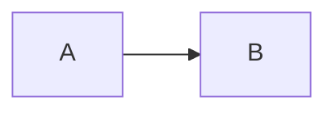
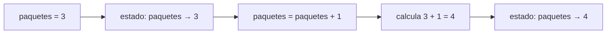

# Plantilla académica única de The Imperial Book

Versión 1 · 2026-11-24. Aplica a **todos los cursos**. Este documento manda sobre cualquier guía anterior
(`EDITORIAL_GUIDE_5_STEPS.md`, `CONTENT_QUALITY_CHECKLIST.md`) cuando se contradigan.

## De dónde sale

La estructura toma el **método** de un libro de texto universitario de referencia —Deitel, *Cómo programar en C++*,
9.ª edición— y lo une con lo que ya funciona en el curso de Fundamentos. Del libro se toma solo la forma de
enseñar; todo el texto y los ejemplos son propios.

| Del libro de texto (Deitel) | De Fundamentos (lo que ya funciona) |
|---|---|
| Objetivos medibles al abrir cada capítulo | Términos definidos antes de usarlos, con tabla «qué es / qué haces» |
| Problema → pseudocódigo → refinamiento → código → salida → análisis | Laboratorios verificables con salida real y entorno declarado |
| Programa completo numerado, con salida y explicación por partes | Diagramas en cada tema (ahora animados) |
| Recuadros fijos: error común, buena práctica, prevenir errores, rendimiento, ingeniería | Caso guía único (RutaFlow) que crece de módulo en módulo |
| Resumen por sección al cerrar el capítulo | Capas: lectura primero, construcción después |
| Autoevaluación **con respuestas** + ejercicios graduados | Temas modernos (Git, CI, seguridad, contenedores) |
| Sección de impacto real («hacer la diferencia») | Verificación con fecha y versiones |
| Orden acumulativo: cada capítulo usa solo lo ya visto | |

## Principio rector: nadie aprende una palabra que nadie le explicó

El lector es alguien que quiere aprender y **no sabe nada**. Por eso:

1. **Ningún término técnico aparece sin explicarse** la primera vez que se usa en el curso. Esto incluye palabras
   que parecen obvias para un programador: *variable*, *archivo*, *terminal*, *función*, *servidor*, *petición*.
2. **Cada término se explica en dos idiomas a la vez**: el técnico (el que usará en su trabajo y en una
   entrevista) y el sencillo (el que le permite entenderlo hoy). Lo sencillo nunca reemplaza a lo técnico: lo
   acompaña. Simplificar no es quitar lo importante.
3. **Cada término trae su código**: un ejemplo mínimo, ejecutable, con su salida real y explicado línea por línea.
   Si el término no es de código (por ejemplo, *latencia*), trae una medición, un comando o una salida observable.
4. Si un término ya se explicó en un tema anterior, se **enlaza** a esa ficha en vez de repetirla.

## Estructura de un curso

```text
Curso
├── Mapa del curso: a quién va dirigido, prerrequisitos, qué sabrá hacer al final, orden de módulos
└── Módulo N (equivale a un capítulo del libro)
    ├── Apertura del módulo
    │   ├── Objetivos («Al terminar este módulo podrás…», 4–8 verbos medibles)
    │   ├── Esquema del módulo (lista de temas)
    │   └── Qué necesitas saber antes (enlaces a módulos previos)
    ├── Tema 1 … Tema K (estructura fija, abajo)
    ├── Laboratorio integrador del módulo (paso a paso, con salida real)
    └── Cierre del módulo
        ├── Resumen por tema (viñetas con los términos en negrita)
        ├── Autoevaluación con respuestas
        ├── Ejercicios graduados (básico, intermedio, reto)
        └── Aplicación real («En el trabajo»: cómo se usa en una empresa)
```

**Regla de orden.** Un tema solo puede usar términos y técnicas ya explicados antes en ese curso o en un
prerrequisito declarado. Si necesita uno nuevo, lo explica ahí mismo con su ficha.

## Estructura fija de un tema

Cada `### Tema N: Título · Nivel · Duración` lleva estos bloques, en este orden. Las marcas en
`monoespaciado` son las que el lector de la app ya reconoce y convierte en cajas.

| # | Bloque | Qué contiene | Marca en Markdown |
|---|---|---|---|
| 1 | **Objetivos** | 2–4 verbos medibles: «podrás declarar…, distinguir…, corregir…» | `#### Objetivos` |
| 2 | **Conceptos clave** | Lista de términos nuevos del tema | Párrafo `**Conceptos clave:** a, b, c` |
| 3 | **El problema** | Una situación concreta de RutaFlow que todavía no sabes resolver | `#### El problema` |
| 4 | **Glosario del tema** | Una ficha por término nuevo (formato abajo) | `#### Glosario del tema` |
| 5 | **Cómo funciona** | Teoría paso a paso, de lo simple a lo completo, con un diagrama | `#### ► CÓMO FUNCIONA` |
| 6 | **Ejemplo resuelto** | Pseudocódigo o plan → código completo → salida real → explicación por partes | `#### Problema resuelto N.M` + `**Razonamiento:**` |
| 7 | **Recuadros** | Error común (con el mensaje real), buena práctica, prevenir errores; rendimiento o ingeniería cuando aplique | `> **Error común.** …` |
| 8 | **Checkpoint** | 1–2 preguntas cortas en mitad de la lectura, respuesta oculta | `#### Checkpoint N.M` + `Respuesta:` |
| 9 | **Laboratorio** | Pasos para construirlo tú, con salida esperada y comandos | `#### Paso 1 · Título` + instrucciones |
| 10 | **Resumen** | 4–8 viñetas, términos en negrita | `#### Resumen` |
| 11 | **Ejercicios verificables** | 3 graduados, con respuesta esperada | `#### Ejercicio verificable N` + `Respuesta esperada:` |
| 12 | **En el trabajo** | Dónde aparece esto en una empresa o en un proyecto real | `#### En el trabajo` |

### Formato de la ficha de término (bloque 4)

Cada término nuevo lleva estos cinco puntos. Ninguno se omite.

```markdown
**variable**
- **Definición técnica:** nombre que el programa asocia a un valor almacenado en memoria; al usar el nombre, el
  intérprete obtiene el valor.
- **En palabras sencillas:** una etiqueta pegada a una caja; la etiqueta es el nombre y lo que hay dentro es el valor.
- **Dónde se rompe la comparación:** en Python la etiqueta no es la caja: dos nombres pueden apuntar al mismo valor.
- **Ejemplo:** `peso_kg = 2.5` → el nombre `peso_kg` queda asociado al valor `2.5`.
- **Error típico:** usar el nombre con otra mayúscula: `print(Peso_kg)` produce `NameError`.
```

### Recuadros (bloque 7)

| Recuadro | Cuándo usarlo |
|---|---|
| **Error común** | Lo que el principiante hace mal, con el mensaje exacto que verá y cómo leerlo |
| **Buena práctica** | Convención profesional (nombres, estilo, estructura) y por qué existe |
| **Prevenir errores** | Hábito que evita el fallo antes de que ocurra (validar, probar, nombrar) |
| **Rendimiento** | Solo si el tema tiene un costo medible |
| **Ingeniería de software** | Decisión de diseño que importa cuando el programa crece |

### Reglas de redacción

- Frases de máximo 25 palabras; párrafos de máximo 5 líneas.
- Voz activa y segunda persona: «vas a declarar», «observa la salida».
- Primero el ejemplo concreto, después la generalización.
- Todo código es **completo y ejecutable** (nada de fragmentos sueltos sin contexto) y va seguido de su salida real.
- Toda salida mostrada se obtuvo ejecutando el código; se declara versión y fecha una vez por módulo.
- Cero texto de plantilla: si una frase sirve igual para cualquier tema, se borra.
- Sin rutas internas (`/tmp/…`), notas de trabajo ni comentarios para el equipo dentro de la lección.

## Esqueleto para copiar

````markdown
### Tema N: Título · Básico · 45 min

<details open>
<summary><strong>Capa 1 — Lectura</strong></summary>

#### Objetivos
Al terminar este tema podrás:
- …

**Conceptos clave:** término 1, término 2, término 3

#### El problema
…

#### Glosario del tema
**término 1**
- **Definición técnica:** …
- **En palabras sencillas:** …
- **Dónde se rompe la comparación:** …
- **Ejemplo:** …
- **Error típico:** …

#### ► CÓMO FUNCIONA
…



#### Problema resuelto N.1
Enunciado…

**Razonamiento:**
1. …

```python
# archivo completo
```

```text
salida real
```

Explicación por partes…

> **Error común.** …

> **Buena práctica.** …

#### Checkpoint N.1
Pregunta…

Respuesta: …

</details>

<details>
<summary><strong>Capa 2 — Construcción</strong></summary>

#### Paso 1 · Título
Instrucción…

#### Paso 2 · Título
Instrucción…

#### Resumen
- …

#### Ejercicio verificable 1
…

Respuesta esperada: …

#### En el trabajo
…

</details>
````

## Tema modelo (Fundamentos M1, Tema 2)

Este es el nivel mínimo esperado. Salidas obtenidas con Python 3.13 el 2026-11-24.

---

### Tema 2: Variables, tipos y cambios de estado · Básico · 45 min

#### Objetivos
Al terminar este tema podrás:
- crear variables y explicar qué guarda cada una;
- reconocer los tipos `str`, `int`, `float` y `bool` y comprobarlos con `type()`;
- cambiar el valor de una variable y predecir lo que imprime el programa;
- leer los errores `NameError` y `TypeError` y corregirlos.

**Conceptos clave:** variable, valor, tipo de dato, asignación, reasignación, `print`, `type`

#### El problema
RutaFlow registra cada envío con su número de guía, su peso, cuántos paquetes lleva y si ya se entregó. El
programa necesita **recordar** esos datos mientras trabaja y **cambiarlos** cuando algo pasa: por ejemplo, cuando
el cliente agrega un paquete. ¿Cómo guarda un programa un dato y cómo lo cambia?

#### Glosario del tema

**valor**
- **Definición técnica:** dato concreto que el programa manipula, como `3`, `2.5` o `"RF-4471"`.
- **En palabras sencillas:** la información en sí: un número, un texto, un sí o un no.
- **Dónde se rompe la comparación:** para el computador `3` y `"3"` son valores distintos: uno es número y otro texto.
- **Ejemplo:** en `paquetes = 3`, el valor es `3`.
- **Error típico:** escribir texto sin comillas (`guia = RF-4471`): Python lo lee como una resta de nombres.

**variable**
- **Definición técnica:** nombre asociado a un valor guardado en la memoria del programa.
- **En palabras sencillas:** una etiqueta pegada a una caja: la etiqueta es el nombre y lo de adentro es el valor.
- **Dónde se rompe la comparación:** en Python el nombre apunta al valor; dos nombres pueden apuntar al mismo.
- **Ejemplo:** `peso_kg = 2.5` crea el nombre `peso_kg` y lo asocia a `2.5`.
- **Error típico:** usar el nombre con otra mayúscula: `Peso_kg` no es `peso_kg`.

**asignación (`=`)**
- **Definición técnica:** instrucción que evalúa la expresión de la derecha y asocia el resultado al nombre de la izquierda.
- **En palabras sencillas:** «guarda esto con este nombre». No es el «igual» de matemáticas.
- **Dónde se rompe la comparación:** `paquetes = paquetes + 1` es imposible en matemáticas y normal en programación.
- **Ejemplo:** `entregado = False`.
- **Error típico:** escribirla al revés: `2.5 = peso_kg` produce `SyntaxError`.

**tipo de dato**
- **Definición técnica:** categoría de un valor que define qué operaciones admite: `str` (texto), `int` (entero),
  `float` (número con decimales), `bool` (`True` o `False`).
- **En palabras sencillas:** la clase de dato; dice qué se puede hacer con él (sumar números, unir textos).
- **Dónde se rompe la comparación:** Python decide el tipo por el valor, no porque tú lo declares.
- **Ejemplo:** `type(2.5)` devuelve `<class 'float'>`.
- **Error típico:** mezclar tipos: `"Paquetes: " + 3` produce `TypeError`.

**`print` y `type`**
- **Definición técnica:** funciones integradas de Python; `print` escribe valores en la salida estándar y `type`
  devuelve el tipo de un valor.
- **En palabras sencillas:** `print` muestra en la terminal; `type` te dice qué clase de dato tienes.
- **Ejemplo:** `print(type(3))` muestra `<class 'int'>`.
- **Error típico:** olvidar los paréntesis: `print "hola"` produce `SyntaxError` en Python 3.

**reasignación y estado**
- **Definición técnica:** reasignar es asociar un nombre existente a un valor nuevo; el **estado** del programa es
  el conjunto de valores de todas sus variables en un instante.
- **En palabras sencillas:** cambiar lo que hay en la caja; el estado es la foto de todas las cajas en un momento.
- **Ejemplo:** después de `paquetes = paquetes + 1`, el estado tiene `paquetes` en `4`.
- **Error típico:** creer que el valor viejo sigue disponible: tras reasignar, el nombre solo da el nuevo.

#### ► CÓMO FUNCIONA
Python ejecuta el archivo de arriba abajo, una línea a la vez. En cada asignación, primero calcula el lado
derecho y después pega el nombre del lado izquierdo al resultado. Cuando un nombre se usa más adelante, Python
busca a qué valor está pegado **en ese momento**.



#### Problema resuelto 2.1
Registra un envío con sus cuatro datos, muéstralos con su tipo y agrega un paquete.

**Razonamiento:**
1. Cada dato necesita un nombre y un tipo: la guía es texto, el peso lleva decimales, los paquetes se cuentan y
   la entrega es sí o no.
2. Para mostrar valores se usa `print`; para comprobar el tipo, `type`.
3. Agregar un paquete es reasignar: calcular `paquetes + 1` y guardar el resultado con el mismo nombre.

```python
# variables.py — registra un envío de RutaFlow
guia = "RF-4471"      # str: texto, siempre entre comillas
peso_kg = 2.5         # float: número con parte decimal
paquetes = 3          # int: número entero
entregado = False     # bool: solo puede ser True o False

print(guia, peso_kg, paquetes, entregado)
print(type(guia), type(peso_kg), type(paquetes), type(entregado))

paquetes = paquetes + 1   # reasignación: el estado cambia
print("paquetes ahora:", paquetes)
```

```text
$ python3 variables.py
RF-4471 2.5 3 False
<class 'str'> <class 'float'> <class 'int'> <class 'bool'>
paquetes ahora: 4
```

**Explicación por partes.**
- Líneas 2–5: cuatro asignaciones. Cada una crea un nombre y le pega un valor de distinto tipo.
- Línea 7: `print` recibe cuatro valores separados por comas y los muestra separados por espacios.
- Línea 8: `type` confirma lo que dedujimos en el razonamiento.
- Línea 10: Python calcula primero `paquetes + 1` (que da `4`) y luego reasigna `paquetes`.

> **Error común.** Escribir el nombre con otra mayúscula. `print(Guia)` termina el programa con
> `NameError: name 'Guia' is not defined. Did you mean: 'guia'?`. Lee el mensaje de derecha a izquierda: Python no
> encontró `Guia` y te sugiere el nombre que sí existe.

> **Error común.** Unir texto y número con `+`. `print("Paquetes: " + 3)` produce
> `TypeError: can only concatenate str (not "int") to str`. Usa una coma: `print("Paquetes:", 3)`.

> **Buena práctica.** Los nombres dicen qué guardan y en qué unidad: `peso_kg` en vez de `p` o `dato1`. Se
> escriben en minúscula con guion bajo (*snake_case*), la convención oficial de Python (PEP 8).

#### Checkpoint 2.1
Si después del programa escribes `paquetes = paquetes * 2`, ¿qué valor queda en `paquetes`?

Respuesta: `8`. Antes de esa línea `paquetes` vale `4` (por la reasignación anterior), y `4 * 2 = 8`.

#### Resumen
- Una **variable** es un nombre asociado a un **valor**.
- La **asignación** `=` calcula la derecha y guarda el resultado con el nombre de la izquierda.
- Cada valor tiene un **tipo de dato** (`str`, `int`, `float`, `bool`) que define qué operaciones admite.
- **Reasignar** cambia el **estado** del programa; el valor anterior deja de estar disponible con ese nombre.
- `NameError` significa «ese nombre no existe»; `TypeError` significa «esa operación no sirve para esos tipos».

#### Ejercicio verificable 1
Calcula el costo de un envío: tarifa de 4200 por kg, peso de 2.5 kg y recargo urgente de 3000. Guarda cada dato en
una variable y muestra el total.

Respuesta esperada: `13500.0`. El resultado es `float` porque multiplicar un `int` por un `float` da `float`; con
`int(total)` se muestra `13500`.

#### En el trabajo
En un backend real, estas variables vienen de una petición y terminan en una base de datos. Los mismos errores
aparecen a otra escala: un `TypeError` por recibir el peso como texto (`"2.5"`) es uno de los fallos más comunes al
leer formularios y archivos CSV.

---

## Cómo se comprueba que un tema cumple la plantilla

Lista de verificación (la automatiza el validador del plan, fase 1):

- [ ] Tiene los 12 bloques en orden.
- [ ] Cada término de «Conceptos clave» tiene ficha completa (5 puntos) o enlace a una ficha anterior.
- [ ] Ningún término técnico se usa antes de explicarse en el curso.
- [ ] Todo bloque de código es ejecutable y va seguido de su salida real.
- [ ] Hay al menos un error común con su mensaje literal.
- [ ] Checkpoint y ejercicios tienen respuesta.
- [ ] No contiene frases de plantilla, rutas internas ni notas de trabajo.
