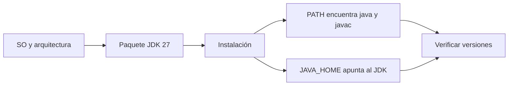
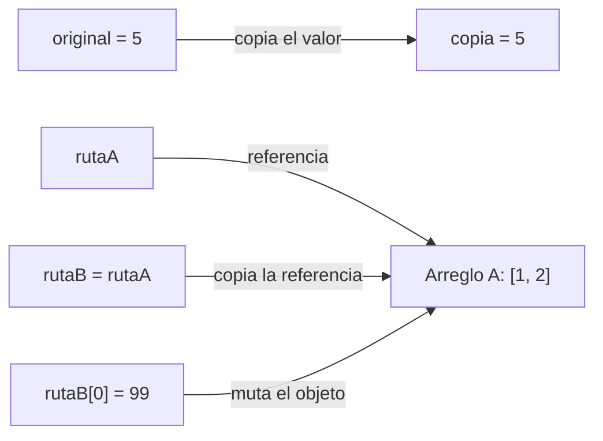
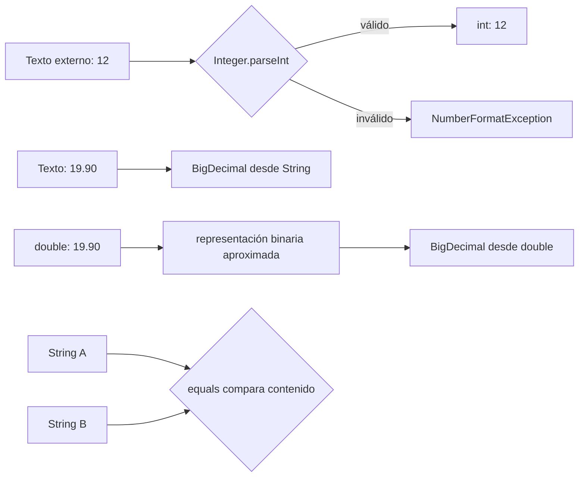
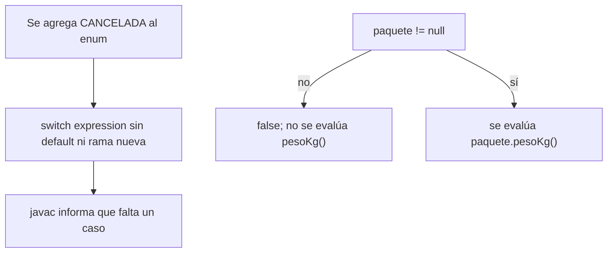
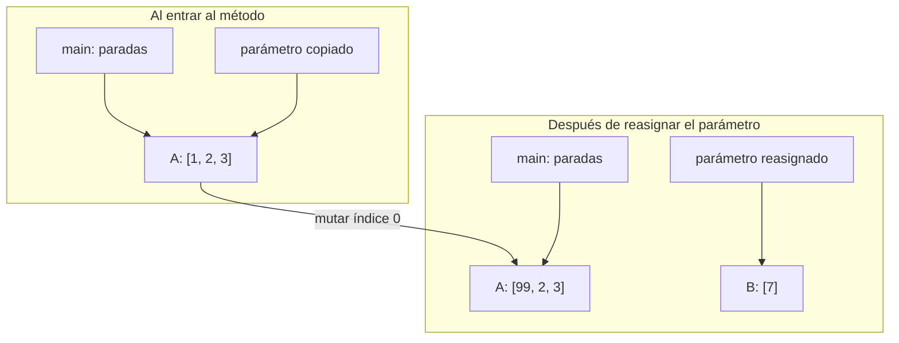
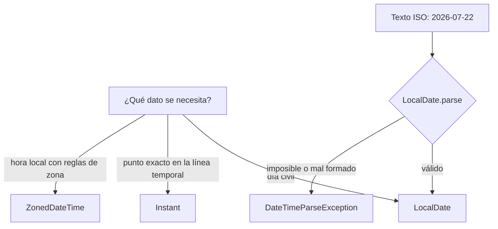

# Módulo 0: Sintaxis, tipos y el modelo de la JVM


**Proyecto del módulo:** crea un proyecto Maven o Gradle desde cero, pega el código del tema y corre las pruebas; las equivalencias entre ambos sistemas están en el Módulo 8, Tema 4.

## Antes de comenzar: instala Java correctamente

**Entorno de Java M0:** usa JDK 27 (Temurin 27.0.1 a la fecha de esta lección; es el release más reciente de Java). Sigue M0 T0 para instalarlo y comprobar `java --version` y `javac --version`. Todo el track Java usa JDK 27; confirma siempre la versión indicada en el Paso 1 de cada tema. Nota: si necesitas una línea de soporte extendido (LTS), la LTS vigente es Java 25; este curso enseña sobre 27 para usar la plataforma más actual.

## Aprende construyendo

### Tema 0: Instalar Eclipse Temurin JDK 27 en macOS, Windows y Ubuntu · Básico · 15 min

#### Aprende

**Paso 1 · Objetivo y preparación**

**Prerrequisito:** ninguno; acceso a una cuenta de usuario y a una terminal. Para instalar paquetes del sistema necesitarás permisos de administrador. **Al finalizar podrás** instalar Eclipse Temurin JDK 27, comprobar que `java` y `javac` pertenecen a la misma versión 27 y explicar qué síntoma aparece cuando el ejecutable no está en `PATH`.

**Paso 2 · Contexto y caso real**

**Caso profesional (escenario didáctico del sector logístico):** un equipo prepara una estación nueva para corregir un servicio que calcula ventanas de entrega. La persona instala un runtime porque `java --version` responde, pero omite el JDK. Al compilar, la terminal muestra `javac: command not found`; el equipo no puede reproducir la compilación local ni entregar el artefacto que espera la integración continua. El problema no es el código ni el repositorio: el entorno carece del compilador o no lo encuentra. La consecuencia concreta es detener la validación hasta instalar el paquete correcto y abrir una terminal que cargue la configuración nueva. El escenario es didáctico; no atribuye el incidente a una empresa real.

**Por qué importa:** distinguir ejecución de compilación evita culpar al repositorio o cambiar código cuando falta una herramienta local. La misma verificación permite reproducir builds en estaciones de desarrollo y en integración continua.

**Paso 3 · Teoría**

**JDK:** instala el kit de desarrollo, que incluye `javac` para compilar y `java` para iniciar la JVM. Un runtime puede ejecutar aplicaciones sin incluir el compilador; que `java --version` funcione no demuestra que puedas compilar.

**Versión y distribución:** la lección fija Eclipse Temurin 27.0.1, el release más reciente de Java disponible al 2 de noviembre de 2026 (Java 27 se publicó el 15 de septiembre de 2026). Selecciona el paquete JDK, no JRE, y una arquitectura compatible con tu sistema. Adoptium publica Temurin para macOS, Windows y Linux; el MSI de Windows de esta guía es x64. Si el selector ofrece un parche posterior de Java 27, anota el número observado en vez de afirmar que instalaste 27.0.1. [Adoptium publica los paquetes Temurin](https://adoptium.net/temurin/releases/?version=27).

**`PATH` y `JAVA_HOME`:** el shell consulta `PATH` para localizar `java` y `javac`. `JAVA_HOME` identifica la carpeta raíz del JDK para herramientas que la necesitan; por sí sola no agrega sus ejecutables al `PATH`. Por eso instalar bien y configurar mal puede producir el mismo “comando no encontrado”.

**Mapa de subtemas críticos**

| Subtema | Función | Evidencia en este tema |
|---|---|---|
| JDK frente a runtime | Núcleo | `javac` compila; `java` ejecuta; probar uno no acredita el otro |
| `PATH` frente a `JAVA_HOME` | Diagnóstico | `command -v` y el fallo deliberado distinguen ruta de instalación |
| Versión, distribución y arquitectura | Decisión | la versión y la plataforma quedan registradas en el archivo de diagnóstico |

**Analogía:** el JDK es una caja de herramientas; `javac` es la herramienta que fabrica el artefacto y `java` la que lo pone en marcha. `PATH` es el tablero que indica dónde buscar cada herramienta. La analogía no describe cómo la JVM carga clases ni sustituye la diferencia entre compilación y ejecución.

**Fuentes oficiales de instalación:** [guía general de Temurin](https://adoptium.net/installation), [paquetes Linux](https://adoptium.net/installation/linux), [instalador Windows](https://adoptium.net/installation/windows) y [cask Homebrew temurin](https://formulae.brew.sh/cask/temurin). En Homebrew, el cask versionado `temurin@NN` solo existe para algunas versiones (por ejemplo `temurin@25`, la LTS); para Java 27 se usa el cask genérico `temurin`, que instala la versión más reciente.



#### Practica

**Paso 4 · Demostración guiada**

En macOS, instala el cask de Java 27; en Windows x64 usa el MSI JDK 27.0.1 y activa `Add to PATH` y `JAVA_HOME`; en Ubuntu/Debian añade el repositorio oficial e instala `temurin-27-jdk`. Los comandos de cada plataforma van separados: ejecuta solo el bloque de tu sistema. El ejemplo independiente crea `~/java-lab/diagnostico-jdk.md` con versiones y rutas resueltas.

```bash
# macOS: instala Temurin 27 desde el cask oficial (genérico = versión más reciente).
brew install --cask temurin
export JAVA_HOME="$(/usr/libexec/java_home -v 27)"
export PATH="$JAVA_HOME/bin:$PATH"
# Verifica que el lanzador y el compilador respondan.
java --version
javac --version
# Conserva las versiones y rutas en un archivo Markdown.
mkdir -p "$HOME/java-lab"
{
  printf '%s\n\n' '# Diagnóstico del JDK'
  java --version
  javac --version
  printf '\n%s\n' '## Rutas'
  command -v java
  command -v javac
} | tee "$HOME/java-lab/diagnostico-jdk.md"
```

```bash
# Ubuntu/Debian: añade la clave y el repositorio oficial.
sudo apt update
sudo apt install -y wget apt-transport-https gpg
wget -qO - https://packages.adoptium.net/artifactory/api/gpg/key/public | gpg --dearmor | sudo tee /etc/apt/trusted.gpg.d/adoptium.gpg > /dev/null
echo "deb https://packages.adoptium.net/artifactory/deb $(awk -F= '/^VERSION_CODENAME/{print$2}' /etc/os-release) main" | sudo tee /etc/apt/sources.list.d/adoptium.list
sudo apt update
sudo apt install -y temurin-27-jdk
# Comprueba el JDK recién instalado.
java --version
javac --version
# Conserva las versiones y rutas en un archivo Markdown.
mkdir -p "$HOME/java-lab"
{
  printf '%s\n\n' '# Diagnóstico del JDK'
  java --version
  javac --version
  printf '\n%s\n' '## Rutas'
  command -v java
  command -v javac
} | tee "$HOME/java-lab/diagnostico-jdk.md"
```

En Windows, después de instalar el MSI, crea el mismo registro en una ventana nueva de PowerShell:

```powershell
# Crea un registro nuevo en la carpeta del laboratorio.
$lab = Join-Path $HOME 'java-lab'
New-Item -ItemType Directory -Force $lab | Out-Null
$file = Join-Path $lab 'diagnostico-jdk.md'
'# Diagnóstico del JDK' | Set-Content -Encoding utf8 $file
# Añade las versiones y las rutas que resolvió PowerShell.
'## java --version' | Add-Content -Encoding utf8 $file
java --version 2>&1 | Add-Content -Encoding utf8 $file
'## javac --version' | Add-Content -Encoding utf8 $file
javac --version 2>&1 | Add-Content -Encoding utf8 $file
'## Rutas' | Add-Content -Encoding utf8 $file
Get-Command java,javac | Select-Object Name,Source | Format-Table -AutoSize | Out-String | Add-Content -Encoding utf8 $file
```

**Salida esperada (verificada con Temurin 27.0.1 en macOS):** `javac --version` muestra `javac 27.0.1.0.2` (el sufijo del parche puede variar). La primera línea de `java --version` comienza con `openjdk 27.0.1`; en el entorno de referencia fue `openjdk 27.0.1.0.2 2026-10-21`. El archivo `~/java-lab/diagnostico-jdk.md` contiene las versiones y las rutas. Si un canal instala un parche más nuevo, registra el número exacto que aparece.

**Explicación del bloque:** las órdenes de instalación agregan el JDK; el bloque de diagnóstico no altera el entorno, solo guarda qué ejecutables encontró el shell en `~/java-lab/diagnostico-jdk.md`.

**Fallo deliberado:** en una terminal POSIX ejecuta `env PATH=/nonexistent /bin/sh -c 'javac --version'`.

**Error esperado:** `/bin/sh: javac: command not found`.

**Diagnóstico:** el comando ejecutó un shell con un `PATH` vacío de propósito. El JDK no se desinstaló; `javac` quedó invisible para esa búsqueda. Restablece la terminal normal y confirma `command -v javac`. No soluciones el síntoma instalando un segundo JDK sin revisar primero la ruta.

**Errores comunes:** confundir `JAVA_HOME` con `PATH`, comprobarlo en una terminal abierta antes de instalar, o creer que `java` por sí solo demuestra que también existe `javac`.

**Paso 5 · Práctica guiada**

1. Ejecuta `java --version` y `javac --version`. **Pista:** compara el número mayor; en el entorno fijado ambos deben indicar 27.
2. En macOS ejecuta `/usr/libexec/java_home -V` y luego `echo "$JAVA_HOME"`. **Pista:** una instalación puede existir aunque `JAVA_HOME` no esté definido en esta terminal.
3. En Ubuntu ejecuta `command -v java`, `command -v javac` y `readlink -f "$(command -v javac)"`. **Pista:** sigue el enlace hasta el JDK Temurin, no hasta otra instalación anterior.
4. En Windows abre una ventana nueva de PowerShell y ejecuta `Get-Command java,javac`. **Pista:** si solo aparece `java`, revisa la selección `FeatureEnvironment` y `FeatureJavaHome` del instalador.

**Paso 6 · Práctica independiente**

En tu sistema instala una sola distribución JDK 27 desde el proveedor elegido. Sin copiar los comandos del paso anterior, registra `java --version`, `javac --version`, la ruta que resuelve el shell y, si existe, el valor de `JAVA_HOME`. Entrega una explicación breve de qué comprobarías antes de concluir que hay un conflicto de versiones. No cambies la instalación de otra persona.

#### Aplica

**Paso 7 · Cierre**

**Checklist de salida.**

- [ ] Instalaste un paquete JDK, no solo un runtime.
- [ ] `java` y `javac` resuelven desde la instalación esperada.
- [ ] Ambos informan Java 27 y registraste el parche observado.
- [ ] Puedes provocar y diagnosticar el fallo de `PATH`.

El siguiente tema compila una clase Java y observa el archivo `.class`; lleva el registro de diagnóstico y la versión que verificaste. Si `java` y `javac` no coinciden, corrige el entorno antes de continuar.

### Tema 1: Del código fuente a la JVM · Básico · 35 min

**Paso 1 · Objetivo y preparación**

**Prerrequisito:** M0 T0 (Instalar Eclipse Temurin JDK 27 en macOS, Windows y Ubuntu) y un editor de texto o IDE. Comprueba `java --version` y `javac --version`; ambos deben indicar Java 27.0.1 o un parche posterior de Java 27.

**Al finalizar podrás:** compilar un programa Java a bytecode, inspeccionar las instrucciones y la versión del `.class` con `javap`, ejecutar ese bytecode con la JVM, y distinguir con evidencia un `ClassNotFoundException` de un `NoClassDefFoundError`.

#### Aprende

**Paso 2 · Contexto y caso profesional**

**Caso profesional (escenario de RutaFlow):** el motor de asignación compila en desarrollo, pero no arranca en el servidor porque el classpath apunta a `src` y el bytecode quedó en `out`. Una variante más sutil arranca y falla a mitad de ejecución porque una clase auxiliar sí estaba al compilar pero desapareció del empaquetado. Este tema permite distinguir un fallo de compilación, uno de carga de la clase principal y uno de carga de una dependencia en tiempo de ejecución.

**Paso 3 · Teoría, modelo mental y analogía**

**¿Por qué es importante?** Compilar a bytecode en vez de código máquina nativo permite ejecutar el mismo programa en distintas plataformas sin recompilarlo, siempre que cada JVM admita la versión del archivo `.class` y las APIs utilizadas.

**Mapa de subtemas críticos**

| Subtema | Papel | Evidencia del tema |
|---|---|---|
| archivo fuente `.java` | Prerrequisito | el nombre del archivo coincide con la clase `public` que contiene |
| compilación con `javac` | Núcleo | genera `out/Saludo.class` y separa fuente de salida |
| bytecode y formato `.class` | Núcleo | `javap -c` expone `getstatic`, `ldc`, `invokevirtual` y `return` |
| carga de clases y classpath | Diagnóstico | `-cp src` falla y `-cp out` carga la clase |
| verificación, interpretación y JIT | Profundización | se distinguen como etapas de carga y ejecución, sin prometer una estrategia fija |
| versión del class file | Compatibilidad | Java 27 produce `major version 71`; `--release 25` produce `69` |
| JDK de compilación frente a runtime | Límite | compilar con uno no garantiza ejecutar en cualquier versión anterior |
| nombre binario, paquete y ruta | Diagnóstico | `com.rutaflow.app.App` se compila en `com/rutaflow/app/App.class` y se invoca con el nombre completo |
| `ClassNotFoundException` frente a `NoClassDefFoundError` | Límite | la clase principal ausente lanza el primero; una dependencia que desaparece en runtime lanza el segundo |
| compilación manual frente a build tool | Decisión | `javac` enseña el mecanismo; Maven/Gradle gestionan grafos reales |

Este mapa define el alcance: el tema no se cierra con «`javac` compila y `java`
ejecuta». Cada fila de abajo tiene su explicación individual, su evidencia y, donde
corresponde, su fallo reproducible.

**Archivo fuente `.java` (prerrequisito).** El código que escribes es texto plano legible y versionable. Hay una regla que causa errores desde el primer día: **el nombre del archivo debe coincidir con el de la clase `public` que contiene**. Si `Saludo.java` declara `public class Saludo`, compila; si declara `public class Otro`, `javac` rechaza el archivo. Esto no es un capricho: la JVM localiza una clase por su nombre, no por el del archivo, así que el compilador fuerza la correspondencia para que ambos coincidan.

**Compilación con `javac` (núcleo).** `javac` traduce el fuente a **bytecode** y escribe un archivo `.class`. Es un paso independiente de la ejecución: puede fallar por errores de sintaxis o de tipos sin que la JVM llegue a intervenir. Con `-d out` separas la salida compilada (`out/`) del código fuente (`src/`); mantener esa separación es lo que hace diagnosticable el caso de RutaFlow.

**Bytecode y formato `.class` (núcleo).** Java no compila a código máquina nativo de un procesador (como C o C++), sino a bytecode: instrucciones de una máquina abstracta, independientes del procesador. Cuando ejecutes `javap -c` verás instrucciones como `getstatic` (leer un campo estático, aquí `System.out`), `ldc` (cargar una constante, el texto a imprimir), `invokevirtual` (invocar un método de instancia, `println`) y `return`. No necesitas memorizarlas; lo importante es comprobar que el `.class` contiene instrucciones de la JVM, no código de tu sistema operativo.

**Verificación, interpretación y JIT (profundización).** Al cargar un `.class`, la JVM primero **verifica** que el bytecode es seguro y bien formado. Después lo **interpreta** instrucción por instrucción y, para el código que se ejecuta con frecuencia, un compilador **JIT** (just-in-time) lo traduce a código máquina nativo en caliente. Son etapas posibles, no una estrategia fija: no asumas que todo se interpreta ni que todo se compila. Para este tema basta saber que entre «cargar» y «ejecutar» hay verificación, y que el rendimiento mejora con el tiempo gracias al JIT.

**Versión del class file (compatibilidad).** Cada `.class` graba una *major version* que identifica para qué Java se generó: Java 27 es `71`, Java 25 (la LTS) es `69` y Java 21 es `65`. `javac --release 25` fija tanto esa versión binaria como las APIs disponibles para ese objetivo. Lo comprobarás con `javap -v`. Un `.class` con una major version mayor que la JVM que intenta cargarlo produce un `UnsupportedClassVersionError`.

**JDK de compilación frente a runtime (límite).** Compilar con un JDK nuevo no garantiza poder ejecutar en una JVM anterior: hacia atrás no hay compatibilidad automática. Por eso, si tu destino de despliegue es una JVM 25, compilas con `--release 25` aunque tengas el JDK 27 instalado. Hacia adelante sí: un `.class` de Java 25 se ejecuta en una JVM 27.

**Analogía (con su límite):** el bytecode es como una partitura que distintos músicos interpretan en sus instrumentos, siempre que entiendan esa edición. Una edición demasiado nueva no se vuelve legible para un intérprete antiguo solo por ser la misma obra. La analogía explica la portabilidad y la compatibilidad de versión; no explica la verificación ni el JIT, que son decisiones internas de la JVM, no del "músico".

**Conceptos clave:** bytecode, portabilidad, major version, verificación/JIT, `javac`/`java`.

**Diagrama interactivo:** [Del código Java a la JVM](/visuals/temas/java/modulo-0-tema-1-bytecode.html).

**Código del ejemplo:**

```java
public class Hola {
    public static void main(String[] args) {
        System.out.println("Hola Java");
    }
}
```
```bash
javac Hola.java   # compila a bytecode: genera Hola.class
java Hola          # la JVM carga, verifica y ejecuta el bytecode
```

Entender este ciclo `javac`/`java` es la base para diagnosticar cualquier error de compilación o de classpath que aparezca al construir el proyecto integrador de este track, mucho después de este tema.

**Compilación manual frente a build tool (decisión).** Invocar `javac`/`java` a mano es lo adecuado **aquí**, para ver el mecanismo sin intermediarios. En un proyecto real con muchas clases y dependencias externas usarás Maven o Gradle (módulos posteriores): gestionan el classpath, el orden de compilación y las versiones, y evitan compilar archivo por archivo. La decisión profesional no es "manual vs. herramienta" en abstracto, sino aprender el mecanismo con `javac` para después entender qué hace la herramienta por ti.

#### Practica

**Paso 4 · Demostración guiada desde cero**

**Desde cero:** parte de una carpeta vacía y prepara la estructura.

```bash
mkdir java-bytecode && cd java-bytecode
mkdir src out
```

**Crea** el archivo `src/Saludo.java` y pega en él el código mostrado a continuación; guárdalo antes de compilarlo:

```java
public final class Saludo {
    public static void main(String[] args) {
        // javac convierte esta instrucción en bytecode dentro de Saludo.class.
        System.out.println("Hola desde la JVM");
    }
}
```

**Ejecuta el ejemplo** (compila, inspecciona la versión y el bytecode, y ejecuta):

```bash
javac -d out src/Saludo.java
javap -v -classpath out Saludo | grep -i "major version"
javap -c -classpath out Saludo
java -cp out Saludo
```

**Resultado esperado** (verificado con Temurin 27.0.1):

```text
  major version: 71
...
         0: getstatic     #7    // Field java/lang/System.out:Ljava/io/PrintStream;
         3: ldc           #13   // String Hola desde la JVM
         5: invokevirtual #15   // Method java/io/PrintStream.println:(Ljava/lang/String;)V
         8: return
...
Hola desde la JVM
```

Con el JDK 27 (sin `--release`), `major version: 71`. Si compilas con `javac --release 25 -d out25 src/Saludo.java` y repites `javap -v`, verás `69`: el mismo JDK 27 produce bytecode compatible con una JVM 25. Comprueba el contraste tú mismo; es la base de la compatibilidad hacia atrás.

**Fallo deliberado 1 — classpath equivocado.** Ejecuta `java -cp src Saludo`:

```text
Error: Could not find or load main class Saludo
Caused by: java.lang.ClassNotFoundException: Saludo
```

Aparece porque el bytecode está en `out`, no en `src`. Corrige apuntando `-cp` a `out`.

**Paso 5 · Práctica guiada**

Ejecuta `javap -c -classpath out Saludo` y localiza la instrucción `invokevirtual` que corresponde a `System.out.println`. Luego provoca, de verdad, la diferencia entre los dos errores de carga que el mapa anuncia. Crea `src/Motor.java` y `src/Ayudante.java`:

```java
public final class Motor {
    static final Ayudante A = new Ayudante();   // dependencia en tiempo de carga
    public static void main(String[] args) {
        System.out.println("usa " + A.saludo());
    }
}
```
```java
public final class Ayudante {
    String saludo() { return "ayudante"; }
}
```

Compila ambas y ejecuta normalmente; después borra **solo** `out/Ayudante.class` y vuelve a ejecutar `Motor`:

```bash
javac --release 25 -d out src/Motor.java src/Ayudante.java
java -cp out Motor            # imprime: usa ayudante
rm out/Ayudante.class
java -cp out Motor
```

**Resultado esperado:**

```text
Exception in thread "main" java.lang.NoClassDefFoundError: Ayudante
	at Motor.<clinit>(Motor.java:2)
Caused by: java.lang.ClassNotFoundException: Ayudante
```

**Explicación de la diferencia (subtema `ClassNotFoundException` vs `NoClassDefFoundError`):** cuando falta la **clase principal** (el caso del `-cp src`), el lanzador no la encuentra y reporta `ClassNotFoundException`. Cuando la clase principal sí carga pero **una dependencia que estaba al compilar desapareció en runtime**, la JVM lanza `NoClassDefFoundError`, con `ClassNotFoundException` como *causa* anidada. No son el mismo fallo: el primero dice "no arranqué"; el segundo dice "arranqué y me rompí al necesitar otra clase". Recompila `Ayudante` para restaurar el programa.

**Si falla.** Si `javac` responde que no encuentra el archivo, ejecútalo desde la carpeta que contiene `src`. Si `java` no encuentra `Motor`, revisa que `-cp` apunte a `out`. Si no obtienes el `NoClassDefFoundError`, confirma que borraste `Ayudante.class` y no `Motor.class`. Si tras modificar un `.java` el comportamiento no cambia, falta recompilar: `javac` no se ejecuta solo.

#### Aplica

**Paso 6 · Práctica independiente**

Trabaja ahora el subtema **nombre binario, paquete y ruta**. Crea `src/App.java` dentro de un paquete:

```java
package com.rutaflow.app;
public final class App {
    public static void main(String[] args) {
        System.out.println("binario=" + App.class.getName());
    }
}
```

Compila con `javac --release 25 -d out2 src/App.java` y comprueba con `find out2 -name '*.class'` que el archivo quedó en `out2/com/rutaflow/app/App.class`: el paquete se traduce a carpetas. Ejecuta primero `java -cp out2 App` (falla con `ClassNotFoundException: App`) y después `java -cp out2 com.rutaflow.app.App` (imprime `binario=com.rutaflow.app.App`). Explica por qué la JVM solo encuentra la clase por su **nombre binario completo**, no por el nombre corto.

**Paso 7 · Cierre**

**Checklist de salida.**

- [ ] `javac -d out src/Saludo.java` genera `out/Saludo.class`.
- [ ] Con JDK 27, `javap -v` muestra `major version: 71` sin `--release`; con `--release 25` produce `69`.
- [ ] `javap -c -classpath out Saludo` muestra `getstatic`, `ldc`, `invokevirtual` y `return`.
- [ ] `java -cp src Saludo` reproduce `ClassNotFoundException` (clase principal ausente).
- [ ] Borrar `Ayudante.class` reproduce `NoClassDefFoundError` con `ClassNotFoundException` como causa.
- [ ] `App.class` queda en `com/rutaflow/app/` y solo se ejecuta con el nombre binario completo.

**Si falla.** Si `App` no compila, revisa que el paquete declarado coincida con la ruta de salida. Si `javap` no encuentra una clase, el `.class` no se generó. Si el mensaje de error no distingue compilación de carga, vuelve a leer qué comando lo produjo y qué clase nombra.

Guarda los fuentes, los `.class`, la salida de `javap -v`, y ambos errores (`ClassNotFoundException` y `NoClassDefFoundError`) junto a su corrección. **Implicación práctica:** diagnosticar carga en producción exige saber, sin adivinar, que la JVM busca bytecode por su nombre binario en un classpath explícito, y que un `NoClassDefFoundError` apunta a una dependencia que estaba al compilar pero no al ejecutar —típicamente un empaquetado incompleto.

**Antes del siguiente tema:** explica qué produce cada comando (`javac`, `javap`, `java`), por qué `-cp src` impide cargar la clase, y en qué se diferencia el fallo de la clase principal del fallo de una dependencia en runtime.

**Errores comunes:** apuntar `-cp` a la carpeta de fuentes en vez de a la de salida; confundir `ClassNotFoundException` (no arrancó) con `NoClassDefFoundError` (arrancó y faltó una dependencia); olvidar recompilar tras modificar el `.java`; y asumir que `javac` ejecuta el programa en vez de solo compilarlo.

**Fuentes oficiales revisadas el 2026-11-02:** [javac Java SE 27](https://docs.oracle.com/en/java/javase/27/docs/specs/man/javac.html), [java Java SE 27](https://docs.oracle.com/en/java/javase/27/docs/specs/man/java.html), [JVM Specification 27 — class file](https://docs.oracle.com/javase/specs/jvms/se27/html/jvms-4.html) y [JVM Specification 27 — loading, linking and initialization](https://docs.oracle.com/javase/specs/jvms/se27/html/jvms-5.html).

### Tema 2: public static void main — qué significa cada palabra · Básico · 30 min

**Paso 1 · Objetivo y preparación**

**Prerrequisito:** M0 T1 (Del código fuente a la JVM). JDK 27 o posterior y un editor de texto o IDE. Comprueba `java --version`.

**Al finalizar podrás:** explicar qué significa cada palabra de `public static void main(String[] args)`, distinguir el `void` del retorno de un código de salida del proceso, usar `String... args`, diferenciar una sobrecarga de `main` del punto de entrada, elegir un entry point entre varios por su nombre binario, y ejecutar un fuente suelto con `java Archivo.java`.

#### Aprende

**Paso 2 · Contexto y caso profesional**

**Caso profesional (escenario de RutaFlow):** el lanzador del motor compila, pero no inicia después de que alguien cambia la firma de `main` para ocultarla. El diagnóstico exige separar los errores que encuentra el compilador de los que aparecen cuando la JVM busca su punto de entrada.

**Paso 3 · Teoría, modelo mental y analogía**

**¿Por qué es importante?** Cada palabra de `public static void main(String[] args)` cumple un propósito necesario y preciso para que la JVM pueda localizar e invocar ese método como punto de entrada sin necesitar una instancia previamente existente de la clase.

**Mapa de subtemas críticos**

| Subtema | Papel | Evidencia exigida |
|---|---|---|
| firma de método | Prerrequisito | separar modificadores, retorno, nombre y parámetros |
| `public` | Núcleo | explicar accesibilidad del launcher, no «visibilidad global» genérica |
| `static` | Núcleo | invocación sin construir la clase y contraste con método de instancia |
| `void` | Núcleo | distinguir retorno Java de código de salida del proceso |
| nombre `main` | Contrato | mostrar que otro nombre compila pero no es punto de entrada |
| `String[] args` y `String... args` | Variante | recibir cero, uno y varios argumentos conservando orden |
| sobrecargas de `main` | Límite | una sobrecarga puede existir sin sustituir la firma de arranque |
| clases anidadas y múltiples entry points | Profundización | elegir explícitamente el nombre binario que se ejecuta |
| lanzamiento moderno de fuente | Variante | diferenciar `java Archivo.java` del ciclo explícito `javac`/`java` |
| errores de firma | Diagnóstico | reproducir compilación correcta con arranque rechazado |

La JVM no ejecuta cualquier método: busca específicamente uno llamado `main`, público, estático, sin retorno, que reciba un arreglo de `String`. Cualquier desviación de esa firma exacta lo vuelve invisible para la JVM, aunque el resto de la clase compile perfectamente.

`public static void main(String[] args)` es la firma exacta que la JVM busca como punto de entrada de cualquier programa Java ejecutable, y cada palabra de esa firma tiene un significado preciso y necesario: `public` hace que el método sea accesible desde cualquier lugar, incluyendo desde fuera de la propia clase, necesario porque la JVM (que no es parte del código de la aplicación) necesita poder invocarlo desde el exterior; `static` indica que el método pertenece a la clase en sí, no a una instancia particular de esa clase, siendo esto crucial porque la JVM invoca `main` sin haber creado previamente ningún objeto de esa clase — si `main` no fuera `static`, la JVM necesitaría una instancia ya existente para invocarlo, pero no existe ninguna todavía en ese punto de la ejecución.

`void` indica que el método no devuelve ningún valor; `main` es el nombre exacto que la JVM busca por convención estricta; `String[] args` es el arreglo de argumentos de línea de comandos (`java Hola argumento1 argumento2` hace que `args` contenga `["argumento1", "argumento2"]`), que parametriza la ejecución sin recompilar.

Las filas restantes del mapa suelen quedar solo mencionadas; aquí cada una tiene su explicación propia.

**`void` frente al código de salida del proceso (núcleo).** Que `main` sea `void` significa que no devuelve un valor al código Java que lo llamó —la JVM no espera un resultado—, pero el **proceso del sistema operativo sí termina con un código de salida**. Por defecto ese código es `0` (éxito). Para devolver otro valor no se usa `return` en `main`: se llama a `System.exit(n)`, que detiene la JVM inmediatamente con ese código. Es la diferencia entre "el método no retorna nada a Java" y "el proceso sí informa un estado al shell". Lo comprobarás leyendo `$?` después de ejecutar.

**`String... args` (variante).** La firma de arranque también acepta `public static void main(String... args)`. `String...` (varargs) es, en el punto de entrada, equivalente a `String[]`: la JVM lo reconoce igual y `args` sigue siendo un arreglo. La diferencia solo importaría si tú llamaras a `main` desde tu propio código; como punto de entrada, ambas formas son válidas.

**Sobrecargas de `main` (límite).** Puedes declarar otros métodos llamados `main` con parámetros distintos, por ejemplo `static void main(int n)`. Compilan y conviven, pero **no son el punto de entrada**: la JVM solo arranca por la firma exacta con `String[]`/`String...`. Una sobrecarga es un método normal más; no sustituye ni "compite" con el arranque.

**Clases anidadas y múltiples entry points (profundización).** Un archivo puede contener varias clases con su propio `main` (incluida una clase anidada `static`). Cada una se compila a su propio `.class` —la anidada queda como `Externa$Interna.class`— y eliges cuál ejecutar escribiendo su **nombre binario**: `java -cp out Externa` o `java -cp out 'Externa$Interna'`. No hay un "main del archivo": hay un entry point por clase, y tú decides cuál lanzar.

**Lanzamiento moderno de fuente única (variante).** Desde Java 11 puedes ejecutar un archivo sin compilarlo antes: `java Archivo.java`. La JVM lo compila en memoria y lo ejecuta sin dejar un `.class` en disco. Es cómodo para un único archivo de prueba; no reemplaza el ciclo `javac`/`java` cuando hay varias clases o dependencias, donde necesitas el bytecode en `out` y un classpath explícito (lo que viste en el Tema 1).

**Analogía (con su límite):** la firma es como un formato de postulación obligatorio: una propuesta correcta en el fondo pero con el formato cambiado simplemente no se procesa. La analogía explica por qué una firma casi igual "no entra"; no explica el código de salida ni la elección entre varios entry points, que son mecanismos concretos del proceso y del lanzador.

**Conceptos clave:** punto de entrada, clase frente a instancia, código de salida, nombre binario, lanzamiento de fuente única.

**Diagrama interactivo:** [La firma que la JVM busca](/visuals/temas/java/modulo-0-tema-2-main.html).

**Transferencia al proyecto integrador «Motor de asignación de entregas»:** Crea un punto de entrada que reciba datos mínimos para asignar entregas. Ejecuta con argumentos válidos e incompletos y comprueba salida y código de terminación sin mezclar entrada con reglas del dominio.

#### Practica

**Paso 4 · Demostración guiada desde cero**

**Desde cero:** parte de una carpeta vacía y prepara la estructura.

```bash
mkdir java-main && cd java-main
mkdir src out
```

**Crea** el archivo `src/PuntoEntrada.java`:

```java
public final class PuntoEntrada {
    public static void main(String[] args) {
        // args recibe cada argumento escrito después del nombre de la clase.
        System.out.printf("argumentos=%d, primero=%s%n", args.length, args[0]);
    }
}
```

**Ejecuta el ejemplo** (compila y pasa un argumento):

```bash
javac -d out src/PuntoEntrada.java
java -cp out PuntoEntrada guia-123
```

**Resultado esperado:** `argumentos=1, primero=guia-123`. **Fallo deliberado:** elimina `static`, recompila y ejecuta; la JVM informa que no encuentra un método `main` válido. `static` permite invocarlo sin crear antes un objeto.

**Paso 5 · Práctica guiada**

Primero el límite entre `void` y el **código de salida**. Crea `src/Salida.java`:

```java
public final class Salida {
    public static void main(String[] args) {
        System.out.println("antes de exit");
        if (args.length == 0) System.exit(3);   // termina el proceso con estado 3
        System.out.println("solo se imprime si hubo argumentos");
    }
}
```

```bash
javac -d out src/Salida.java
java -cp out Salida ; echo "codigo de salida = $?"
```

**Resultado esperado (verificado con Temurin 27.0.1):**

```text
antes de exit
codigo de salida = 3
```

`main` es `void` —no devuelve nada a Java— pero el proceso informó `3` al shell mediante `System.exit`. Ejecuta de nuevo con un argumento (`java -cp out Salida x`) y verás que imprime la segunda línea y el código vuelve a `0`.

Ahora comprueba que una **sobrecarga** no es el entry point. Crea `src/Sobrecarga.java`:

```java
public final class Sobrecarga {
    public static void main(String[] args) {
        System.out.println("entry point real");
        main(42);                 // llamada normal a la sobrecarga
    }
    static void main(int n) {     // compila, pero NO es punto de entrada
        System.out.println("sobrecarga con int=" + n);
    }
}
```

`javac -d out src/Sobrecarga.java` y `java -cp out Sobrecarga` imprimen `entry point real` seguido de `sobrecarga con int=42`: la JVM arrancó solo por la firma con `String[]`.

**Fallo deliberado — firma inexacta:** cambia la firma principal a `public static void main(String args)` (sin corchetes) y ejecuta. Compila, pero la JVM responde que no hay un `main` válido: la firma exige `String[]`/`String...`.

Cierra los dos subtemas restantes con ejecución. **Varargs y lanzamiento de fuente única:** escribe `Varargs.java` con `public static void main(String... args)` que imprima `recibidos=` + `args.length`, y ejecútalo **sin compilar antes** con `java Varargs.java a b c`: imprime `recibidos=3` y no deja ningún `.class` (compiló en memoria). **Múltiples entry points:** escribe `Multi.java` con un `main` en la clase externa y otro en una clase anidada `public static final class Interna`; compílalo y ejecuta `java -cp out Multi` y `java -cp out 'Multi$Interna'` (nota los `.class` `Multi.class` y `Multi$Interna.class`).

**Si falla.** Si no ves el código `3`, confirma que ejecutaste `Salida` sin argumentos. Si la sobrecarga se ejecuta "sola", la llamó tu propio `main`, no la JVM. Si `java Varargs.java` no funciona, el nombre del archivo debe coincidir con la clase pública. Si `Multi$Interna` no arranca, entrecomilla el `$` para el shell. Si tras cambiar la firma la JVM no arranca, compárala carácter por carácter con `public static void main(String[] args)`.

#### Aplica

**Paso 6 · Práctica independiente**

Modifica `PuntoEntrada` para que reciba origen y destino de una guía: valida `args.length >= 2` antes de leer `args[0]`/`args[1]`, muestra un mensaje claro y llama `System.exit(2)` si faltan argumentos, en vez de dejar que reviente con `ArrayIndexOutOfBoundsException`. Ejecútalo con dos argumentos, con uno y con ninguno, y comprueba el código de salida con `echo $?`.

**Paso 7 · Cierre**

**Checklist de salida.**

- [ ] `PuntoEntrada guia-123` imprime `argumentos=1, primero=guia-123`.
- [ ] Quitar `static` produce un fallo de punto de entrada y se explica por qué.
- [ ] `Salida` sin argumentos termina con código `3` vía `System.exit`; con argumentos, con `0`.
- [ ] `Sobrecarga` demuestra que `main(int)` compila pero no es el entry point.
- [ ] `java Varargs.java a b c` imprime `recibidos=3` sin dejar `.class` en disco.
- [ ] `Multi` y `Multi$Interna` se ejecutan por separado según su nombre binario.
- [ ] La versión con dos argumentos valida la longitud y usa un código de salida al faltar datos.

**Si falla.** Si `java Varargs.java` no funciona, confirma que el nombre del archivo coincide con la clase pública. Si `Multi$Interna` no arranca, entrecomilla el nombre para que el shell no interprete `$`. Si la validación de dos argumentos revienta igual, estás leyendo `args[0]` antes de comprobar `args.length`.

Guarda los fuentes, la ejecución con argumento real, el intento sin `static`, y la salida con código `3`. **Implicación práctica:** un error de firma en `main` no es un error de compilación sino un fallo de arranque de la JVM; y el estado real que un orquestador (systemd, Docker, Kubernetes) observa de tu programa no es el `void` de Java, sino el **código de salida** del proceso.

**Antes del siguiente tema:** explica por qué `main` debe ser `static`, en qué se diferencia `void` del código de salida, y cómo eliges entre varios entry points.

**Errores comunes:** usar un modificador de acceso distinto a `public`; omitir `static` esperando que Java cree una instancia; declarar `args` con un tipo distinto a `String[]`/`String...`; confundir una sobrecarga de `main` con el punto de entrada; y creer que `return` dentro de `main` fija el código de salida (lo fija `System.exit`).

**Fuentes oficiales revisadas el 2026-11-02:** [El lanzador `java` (Java SE 27)](https://docs.oracle.com/en/java/javase/27/docs/specs/man/java.html), [`System.exit` (API Java SE 27)](https://docs.oracle.com/en/java/javase/27/docs/api/java.base/java/lang/System.html#exit(int)) y [dev.java: getting started](https://dev.java/learn/getting-started/).

### Tema 3: JDK, JRE y JVM · Básico · 30 min

**Paso 1 · Objetivo y preparación**

**Prerrequisito:** M0 T2 (public static void main — qué significa cada palabra). JDK 27 o posterior y un editor de texto o IDE. Comprueba `java --version` y `javac --version`.

**Al finalizar podrás:** distinguir qué instala el JDK, qué incluye el JRE y qué ejecuta la JVM; decidir proveedor y versión (LTS frente a feature release) para un entorno; reconocer la arquitectura del binario (x64/ARM); y construir un runtime mínimo con `jlink`.

#### Aprende

**Paso 2 · Contexto y caso profesional**

**Caso profesional (escenario de RutaFlow):** el pipeline que compila el motor falla porque la imagen de build solo contiene herramientas de ejecución. Distinguir las herramientas de desarrollo de las necesarias para ejecutar el artefacto permite corregir la imagen sin instalar componentes a ciegas.

**Paso 3 · Teoría, modelo mental y analogía**

**¿Por qué es importante?** Distinguir JDK, JRE y JVM aclara exactamente qué instalar según si el objetivo es desarrollar código Java (JDK) o simplemente ejecutar un programa ya compilado (JRE, aunque en la práctica se suele instalar el JDK completo de todas formas).

**Mapa de subtemas críticos**

| Subtema | Papel | Evidencia exigida |
|---|---|---|
| JVM como máquina abstracta | Núcleo | relacionar carga, verificación y ejecución de bytecode |
| runtime y bibliotecas estándar | Núcleo | separar JVM de APIs como `java.base` |
| JDK y herramientas | Núcleo | localizar `java`, `javac`, `javap`, `jar` y `jlink` |
| JRE histórico frente a runtime actual | Contexto | no prometer una descarga JRE separada que el proveedor no ofrece |
| distribución, proveedor y licencia | Decisión | comprobar vendor, soporte y condiciones del entorno objetivo |
| LTS frente a feature release | Decisión | distinguir cadencia de versión y política de soporte del proveedor |
| `JAVA_HOME` y `PATH` | Diagnóstico | detectar que terminal e IDE pueden usar JDK distintos |
| runtime personalizado con `jlink` | Profundización | explicar módulos incluidos y límite frente a un JDK completo |
| arquitectura del binario | Variante | reconocer incompatibilidad x64/ARM y sistema operativo |
| verificación de instalación | Práctica | conservar versiones y rutas reales de todas las herramientas |

La JVM ejecuta bytecode; el JRE agrega las librerías estándar que ese bytecode necesita en tiempo de ejecución; el JDK agrega además las herramientas para desarrollar, como `javac`. Cada nivel incluye al anterior. La JVM es específicamente la máquina virtual que ejecuta bytecode, el componente mínimo necesario para correr cualquier programa Java ya compilado; el JRE (Java Runtime Environment) incluye la JVM más las librerías estándar necesarias para que los programas Java se ejecuten correctamente (las clases básicas como `String`, `ArrayList`, etc., que un programa típico necesita en tiempo de ejecución, no solo el motor de ejecución del bytecode en sí); el JDK (Java Development Kit) incluye el JRE completo más las herramientas necesarias específicamente para desarrollar programas Java, no solo ejecutarlos (`javac` el compilador, un debugger, `javap` para inspeccionar bytecode, y otras herramientas de desarrollo).

Para escribir y compilar código Java se necesita el JDK completo, porque incluye `javac`; para ejecutar un `.jar` ya compilado bastaría con un runtime, pero en la práctica actual la mayoría de entornos instala el JDK completo incluso para solo ejecutar, porque es razonablemente liviano y evita gestionar dos instalaciones.

Las filas del mapa que no quedan cerradas con lo anterior tienen aquí su explicación individual.

**JRE histórico frente a runtime actual (contexto).** Hasta Java 8, Oracle publicaba un **JRE** descargable por separado (solo ejecución). Desde Java 11 eso desapareció: los proveedores distribuyen el JDK completo, y si necesitas un runtime recortado lo construyes tú con `jlink`. Por eso no debes recomendar "descarga el JRE": ya no existe como producto aparte en las distribuciones modernas.

**Distribución, proveedor y licencia (decisión).** "Java" no es un único binario. Hay varias distribuciones que implementan la misma especificación: Eclipse Temurin (Adoptium), Oracle JDK, Amazon Corretto, Azul Zulu, Microsoft Build of OpenJDK, Red Hat, entre otras. Difieren en **licencia**, soporte comercial y plazos de actualización, no en el lenguaje. La decisión profesional es elegir según las condiciones del entorno objetivo: por ejemplo, Temurin y Corretto son gratuitas para producción; el Oracle JDK tiene su propia licencia que conviene leer antes de desplegar. Lo compruebas con la propiedad `java.vendor`.

**LTS frente a feature release (decisión).** Java publica una versión nueva cada seis meses (*feature release*), pero solo algunas son **LTS** (*long-term support*): 8, 11, 17, 21, 25 y la próxima línea LTS. Las LTS reciben actualizaciones durante años; una feature release deja de recibirlas en pocos meses. Para producción se elige normalmente una LTS (hoy, 25) y se prueba en la actual (27). La decisión no es "la más nueva", sino equilibrar funciones recientes con ventana de soporte del proveedor.

**Runtime personalizado con `jlink` (profundización).** Como Java es modular (JPMS), puedes empaquetar solo los módulos que tu aplicación usa en un runtime a medida con `jlink`. Un runtime con únicamente `java.base` pesa decenas de MB en lugar de los cientos de un JDK completo, útil para imágenes de contenedor pequeñas. Su límite: incluye solo lo que declares; si tu código usa un módulo que no añadiste (por ejemplo `java.sql`), fallará al cargarlo. No reemplaza al JDK para desarrollar: sirve para distribuir.

**Arquitectura del binario (variante).** El JDK es un binario nativo para un sistema operativo y una arquitectura de CPU concretos: x64 (Intel/AMD) o aarch64/ARM (Apple Silicon, muchos servidores cloud). El **bytecode** es portable, pero el JDK que lo ejecuta no: instalar un JDK x64 en una máquina ARM —o una imagen de contenedor con la arquitectura equivocada— produce fallos de ejecución o emulación lenta. Lo compruebas con la propiedad `os.arch`.

**Analogía (con su límite):** la JVM es el motor; el JRE, el vehículo listo para conducir; el JDK, el vehículo más el taller de herramientas. La analogía explica qué incluye cada nivel; no explica proveedor, licencia ni arquitectura: dos vehículos idénticos pueden tener distinto fabricante, garantía y combustible compatible, igual que dos JDK de la misma versión difieren en vendor, licencia y CPU de destino.

**Conceptos clave:** desarrollo frente a ejecución, proveedor y licencia, LTS, `jlink`, arquitectura del binario.

**Diagrama interactivo:** [Capas de la plataforma Java](/visuals/temas/java/modulo-0-tema-3-jdk-jre-jvm.html).

**Transferencia al proyecto integrador «Motor de asignación de entregas»:** Compila el motor y ejecuta su artefacto con el runtime previsto. Registra versiones del compilador y de ejecución y reproduce un fallo de incompatibilidad en un entorno de laboratorio separado.

#### Practica

**Paso 4 · Demostración guiada desde cero**

**Desde cero:** parte de una carpeta vacía y prepara la estructura.

```bash
mkdir java-entorno && cd java-entorno
mkdir src out
java --version
javac --version
```

**Crea** el archivo `src/Entorno.java` y relaciona cada comando con su responsabilidad:

```java
public final class Entorno {
    public static void main(String[] args) {
        // Estas propiedades describen la JVM que ejecuta el bytecode.
        System.out.println(System.getProperty("java.vm.name"));
        System.out.println(System.getProperty("java.version"));
    }
}
```

**Ejecuta el ejemplo** (compila y consulta las propiedades de la JVM):

```bash
javac -d out src/Entorno.java
java -cp out Entorno
```

**Resultado esperado:** `javac` y `java` muestran la misma línea mayor, y el programa informa el nombre de la VM. **Fallo deliberado:** prueba `javacc --version`; “command not found” no es un error de Java sino un nombre de herramienta incorrecto. Si `java` existe pero `javac` no, instalaste un runtime sin compilador o el JDK no está en `PATH`.

**Paso 5 · Práctica guiada**

Lee **proveedor y arquitectura** de tu instalación real:

```bash
java -XshowSettings:properties -version 2>&1 | grep -iE "java.vendor =|java.version =|os.arch =|java.home ="
```

**Resultado esperado (verificado con Temurin 27.0.1; las rutas dependen de la instalación):**

```text
    java.home = .../temurin-27.jdk/Contents/Home
    java.vendor = Eclipse Adoptium
    java.version = 27.0.1.0.2
    os.arch = aarch64
```

`java.vendor` identifica la distribución (aquí Adoptium/Temurin), `java.version` la línea (27), y `os.arch` la arquitectura de CPU (`aarch64` = ARM; en Intel/AMD verías `amd64`/`x86_64`). Es exactamente la información que necesitas para elegir la imagen de contenedor correcta.

Ahora construye un **runtime mínimo con `jlink`** y ejecútalo:

```bash
jlink --add-modules java.base --output runtime-min \
      --strip-debug --no-header-files --no-man-pages
du -sh runtime-min
./runtime-min/bin/java --list-modules
./runtime-min/bin/java -cp out Entorno
```

**Resultado esperado (verificado con Temurin 27.0.1):** el runtime pesa decenas de MB (unos 45M), `--list-modules` muestra solo `java.base@27…`, y `Entorno` imprime igual que con el JDK completo porque solo usa `java.base`.

**Fallo deliberado:** haz que `Entorno` cargue una clase de `java.sql` **en runtime** (no una constante, que el compilador inlinearía). Añade a `main`:

```java
Class<?> c = Class.forName("java.sql.Date");   // fuerza la carga del módulo
System.out.println("cargada=" + c.getName());
```

Recompila con el JDK completo (compila sin problema) y ejecuta con el runtime mínimo:

```text
Exception in thread "main" java.lang.ClassNotFoundException: java.sql.Date
```

Recrea el runtime con `--add-modules java.base,java.sql` y vuelve a funcionar (`cargada=java.sql.Date`). Es el límite del subtema: `javac` ve todo el JDK, pero el runtime recortado solo trae los módulos que declaraste; un acceso que resuelve una **clase** en ejecución expone la falta, mientras que una simple constante numérica inlineada no lo haría.

**Si falla.** Si ambos comandos de versión muestran líneas mayores distintas, hay dos instalaciones y `PATH` no apunta a `JAVA_HOME`. Si `jlink` no existe, estás usando un runtime sin herramientas de desarrollo, no un JDK. Si el runtime mínimo no ejecuta tu clase, revisa qué módulos usa de verdad.

#### Aplica

**Paso 6 · Práctica independiente**

1. Compara tu `java.vendor`/`java.version` con una **LTS**: si tu máquina usa 27 (feature release), explica por qué un servidor de producción podría preferir 21 (LTS) y qué significa para las actualizaciones de seguridad.
2. Crea un segundo runtime con `jlink` que incluya `java.base` y otro módulo que tu programa necesite, mide su tamaño y compáralo con el mínimo. Explica el intercambio entre runtime pequeño y módulos disponibles.

**Paso 7 · Cierre**

**Checklist de salida.**

- [ ] `java --version` y `javac --version` muestran la misma línea mayor.
- [ ] `java.vendor`, `java.version` y `os.arch` se leen de `-XshowSettings:properties`.
- [ ] `javacc --version` produce “command not found” y se distingue de un fallo de Java.
- [ ] `jlink` produce un runtime que ejecuta `Entorno` y lista solo los módulos añadidos.
- [ ] Usar un módulo no incluido en el runtime mínimo falla y se corrige con `--add-modules`.
- [ ] Queda explicada la diferencia LTS frente a feature release para elegir versión.

**Si falla.** Si `java.home` apunta a un runtime sin `javac`/`jlink`, falta el JDK en el `PATH`. Si el mensaje de versión no coincide, no asumas que es un error de código. Si el runtime mínimo no ejecuta tu clase, probablemente usa un módulo fuera de `java.base`.

Guarda la salida de `-XshowSettings`, el tamaño del runtime de `jlink` y su lista de módulos. **Implicación práctica:** elegir vendor, versión LTS y arquitectura correctos, y empaquetar con `jlink` solo lo necesario, es lo que diferencia una imagen de contenedor de 400 MB de una de 60 MB que arranca más rápido y expone menos superficie.

**Antes del siguiente tema:** decide qué necesita una máquina para compilar frente a ejecutar, y por qué el bytecode es portable pero el JDK no.

**Errores comunes:** recomendar "instala el JRE" cuando ya no se distribuye por separado; elegir una feature release para producción sin considerar el soporte; instalar un JDK con arquitectura equivocada (x64 en ARM); y creer que `jlink` reemplaza al JDK para desarrollar.

**Fuentes oficiales revisadas el 2026-11-02:** [dev.java: la JVM](https://dev.java/learn/jvm/), [`jlink` (Java SE 27)](https://docs.oracle.com/en/java/javase/27/docs/specs/man/jlink.html) y [documentación Java SE 27](https://docs.oracle.com/en/java/javase/27/).

### Tema 4: Tipos primitivos vs referencias · Básico · 40 min

**Paso 1 · Objetivo y preparación**

**Prerrequisito:** M0 T3 (JDK, JRE y JVM). JDK 27 o posterior y un editor de texto o IDE. Comprueba `java --version`.

**Al finalizar podrás:** predecir, antes de ejecutar, si una variable copia un valor o comparte una referencia; distinguir identidad (`==`) de igualdad (`equals`); y explicar por qué Java pasa siempre por valor.

#### Aprende

**Paso 2 · Contexto y caso profesional**

**Caso profesional (escenario de RutaFlow):** dos componentes del motor de asignación reciben el mismo arreglo de paradas; al modificar una posición desde uno, el otro observa el cambio. El ejercicio permite distinguir una mutación compartida de una reasignación local.

**Paso 3 · Teoría, modelo mental y analogía**

**¿Por qué es importante?** Los tipos primitivos representan valores como números y booleanos; los tipos referencia representan objetos y arreglos. Saber qué valor se copia y cuándo dos variables pueden alcanzar el mismo objeto permite predecir cambios sin depender de una explicación engañosamente simple sobre dónde vive cada dato en memoria.

**Mapa de subtemas críticos**

| Subtema | Papel | Evidencia exigida |
|---|---|---|
| ocho tipos primitivos | Núcleo | rango, literal y operación representativa sin memorizar mitos |
| referencia, objeto y `null` | Núcleo | diferenciar variable referencia del objeto alcanzado |
| copia de valor primitivo | Mecanismo | cambiar la copia sin modificar el original |
| copia de referencia y aliasing | Mecanismo | dos variables observan la misma mutación |
| identidad frente a igualdad | Diagnóstico | separar `==` de `equals` según el contrato del tipo |
| campos, locales y valores por defecto | Variante | mostrar que una local debe inicializarse y un campo recibe default |
| paso por valor | Núcleo | demostrar que Java nunca pasa una variable «por referencia» |
| arrays como referencias | Integración | mutación compartida y longitud fija |
| memoria y GC | Límite | evitar la regla falsa «primitivo siempre stack, objeto siempre heap» |
| inmutabilidad | Decisión | distinguir referencia final de objeto inmutable |

Un tipo primitivo (`int edad = 30;`) tiene un valor primitivo. Un tipo referencia (`String nombre = "Ana";`) tiene una referencia a un objeto; la referencia no es el objeto ni una dirección que el programa manipule directamente. La especificación del lenguaje define estos valores y su comportamiento, pero no obliga a que toda variable local resida físicamente en una pila ni a que cada objeto permanezca siempre en el heap: la JVM puede optimizar la representación mientras conserva el comportamiento observable del programa.

Los tipos wrapper (`Integer edadObjeto = 30;`, la versión objeto correspondiente al primitivo `int`) sirven cuando una API necesita un objeto, como `List<Integer>`; los genéricos de Java no admiten tipos primitivos directamente (Módulo 2). Los wrappers también pueden representar ausencia con `null`, pero esa conversión automática a primitivo puede lanzar `NullPointerException`. Para valores numéricos simples elige el primitivo por su semántica; no deduzcas una mejora de rendimiento sin medir el caso real.

Las filas del mapa que no quedan cerradas con lo anterior tienen aquí su explicación individual.

**Los ocho tipos primitivos (núcleo).** Java tiene exactamente ocho: `boolean` (`true`/`false`), `char` (un carácter UTF-16), y seis numéricos: `byte` (8 bits, −128..127), `short` (16 bits), `int` (32 bits, −2 147 483 648..2 147 483 647), `long` (64 bits, sufijo `L`), `float` (coma flotante 32 bits, sufijo `f`) y `double` (64 bits). El tamaño está fijado por la especificación, no por el procesador —a diferencia de C—, por eso un `int` mide lo mismo en cualquier plataforma. Lo comprobarás imprimiendo `Byte.MIN_VALUE`, `Integer.MAX_VALUE`, etc.

**Referencia, objeto y `null` (núcleo).** Una variable de tipo referencia no contiene el objeto: contiene una referencia que lo alcanza. `null` significa "no apunta a ningún objeto"; desreferenciar un `null` (llamar un método o campo sobre él) lanza `NullPointerException`. La variable y el objeto son cosas distintas: puedes tener dos variables que alcanzan el mismo objeto, o una variable que deja de apuntarlo sin destruirlo.

**Campos, locales y valores por defecto (variante).** Un **campo** de clase o de instancia recibe un valor por defecto automático si no lo inicializas: `0` para numéricos, `false` para `boolean`, `null` para referencias. Una **variable local**, en cambio, **no** recibe default: usarla sin asignarla antes es un *error de compilación* (`variable local might not have been initialized`), no un fallo en ejecución. Esta diferencia evita leer basura y es una comprobación del compilador, no de la JVM.

**Identidad frente a igualdad (diagnóstico).** `==` compara **identidad**: para primitivos, el valor; para referencias, si son el **mismo objeto**. `equals` compara **igualdad de contenido** según el contrato del tipo. Dos trampas reales: `new String("ruta") == "ruta"` es `false` (objetos distintos) aunque `equals` sea `true`; y con wrappers, `Integer` cachea los valores de −128 a 127, así que `Integer a = 127, b = 127; a == b` da `true`, pero con `1000` da `false`. Regla práctica: compara objetos con `equals`, reserva `==` para primitivos y para comprobar identidad a propósito.

**Paso por valor (núcleo).** Java **siempre pasa argumentos por valor**, nunca "por referencia". Para un objeto, lo que se copia es la **referencia**: por eso un método puede *mutar* el objeto compartido (el cambio se ve fuera), pero si *reasigna* su parámetro a un objeto nuevo, el llamador no se entera, porque solo cambió su copia local de la referencia. Lo demostrarás con un método `mutar(int[])` que sí afecta y un `reasignar(int[])` que no.

**Memoria y GC (límite).** Evita la regla falsa "primitivo siempre en el stack, objeto siempre en el heap". La especificación define el comportamiento observable, no dónde reside físicamente cada dato: la JVM puede, por ejemplo, mantener valores en registros o aplicar optimizaciones de escape. Lo que sí es cierto y útil: los objetos ya inalcanzables los recupera el **garbage collector** automáticamente; tú no liberas memoria a mano. No construyas tu modelo mental sobre "dónde vive" el dato, sino sobre "qué puede alcanzarlo".

**Inmutabilidad (decisión).** `final` sobre una variable impide **reasignarla**, pero no congela el objeto: `final int[] a = {1}; a[0] = 9;` es válido. Un objeto **inmutable** (como `String` o `Integer`) no cambia su estado una vez creado, aunque la variable que lo referencia no sea `final`. Son dos cosas distintas: `final` protege la referencia; la inmutabilidad protege el estado del objeto. Para datos compartidos entre hilos, lo que da seguridad es la inmutabilidad del objeto, no solo el `final` de la variable.

**Analogía (con su límite):** un primitivo es como llevar efectivo en el bolsillo; una referencia es como llevar la llave de una caja fuerte cuyo contenido está en otro lugar. Prestar una copia de la llave no crea una segunda caja fuerte (aliasing), y perder la llave no destruye la caja (eso lo decide el GC). La analogía no explica el caché de `Integer` ni la diferencia `final`/inmutable: esas son reglas del lenguaje, no de la "caja fuerte".

**Conceptos clave:** ocho primitivos, referencia frente a objeto, default de campos, identidad frente a igualdad, paso por valor, GC, `final` frente a inmutabilidad.

**Diagrama de copias:** copiar un primitivo crea otro valor; copiar una referencia permite que dos variables alcancen el mismo arreglo.



**Código del ejemplo:**

```java
int edad = 30;              // valor primitivo
String nombre = "Ana";       // valor referencia a un objeto String
Integer edadObjeto = 30;     // wrapper: versión objeto del primitivo int
```

**Transferencia al proyecto integrador «Motor de asignación de entregas»:** Distingue cantidad de paquetes de referencias a conductores. Prueba dos variables que apuntan al mismo objeto y documenta cuándo una modificación compartida puede alterar una asignación ya calculada.

#### Practica

**Paso 4 · Demostración guiada desde cero**

**Desde cero:** parte de una carpeta vacía y prepara la estructura.

```bash
mkdir java-tipos && cd java-tipos
mkdir src out
```

**Crea** el archivo `src/ValoresYReferencias.java`:

```java
public final class ValoresYReferencias {
    public static void main(String[] args) {
        int original = 5;
        int copia = original;
        copia = 9; // Cambia la copia del primitivo.

        int[] rutaA = {1, 2};
        int[] rutaB = rutaA;
        rutaB[0] = 99; // Ambas variables alcanzan el mismo arreglo.
        System.out.printf("%d %d | %d %d%n", original, copia, rutaA[0], rutaB[0]);
    }
}
```

**Ejecuta el ejemplo** (compila y ejecuta con `javac`):

```bash
javac -d out src/ValoresYReferencias.java && java -cp out ValoresYReferencias
```

**Salida esperada:** `5 9 | 99 99`. **Fallo deliberado:** declara `Integer intentos = null;` y suma `int total = intentos + 1`; aparece `NullPointerException` durante *unboxing*. Valida la ausencia antes de convertir el wrapper a primitivo.

**Paso 5 · Práctica guiada**

Primero, reasignar frente a mutar: en `ValoresYReferencias`, después de `rutaB[0] = 99;` agrega `rutaA = new int[]{5, 6};` y vuelve a imprimir `rutaA[0]` y `rutaB[0]`. `rutaA[0]` pasa a `5` (apunta a un arreglo nuevo), `rutaB[0]` sigue en `99` (sigue en el original): reasignar la variable no toca el objeto anterior.

Ahora cierra los subtemas que faltan por ejecutar. Crea `src/Demo.java`:

```java
public final class Demo {
    static int campoSinInicializar;           // campo: recibe default 0
    public static void main(String[] args) {
        System.out.println("byte=" + Byte.MIN_VALUE + ".." + Byte.MAX_VALUE);
        System.out.println("int=" + Integer.MIN_VALUE + ".." + Integer.MAX_VALUE);
        System.out.println("campoDefault=" + campoSinInicializar);

        Integer a = 127, b = 127;             // dentro del caché -128..127
        Integer c = 1000, d = 1000;           // fuera del caché
        System.out.println("127:  == " + (a == b) + "  equals " + a.equals(b));
        System.out.println("1000: == " + (c == d) + "  equals " + c.equals(d));

        String s1 = "ruta";
        String s2 = new String("ruta");
        System.out.println("String: == " + (s1 == s2) + "  equals " + s1.equals(s2));

        int[] arr = {1};
        mutar(arr);      System.out.println("tras mutar=" + arr[0]);
        reasignar(arr);  System.out.println("tras reasignar=" + arr[0]);
    }
    static void mutar(int[] x) { x[0] = 99; }             // muta el objeto compartido
    static void reasignar(int[] x) { x = new int[]{7}; }  // reasigna la copia local
}
```

```bash
javac -d out src/Demo.java && java -cp out Demo
```

**Salida esperada (verificada con Temurin 27.0.1):**

```text
byte=-128..127
int=-2147483648..2147483647
campoDefault=0
127:  == true  equals true
1000: == false  equals true
String: == false  equals true
tras mutar=99
tras reasignar=99
```

Léela subtema por subtema: el campo sin inicializar vale `0` (default); `== ` da `true` para `127` pero `false` para `1000` por el caché de `Integer`, mientras `equals` siempre es `true`; `new String` crea otro objeto (`==` false, `equals` true); `mutar` cambia el arreglo compartido, `reasignar` no (paso por valor de la referencia).

**Fallo deliberado — local sin inicializar:** crea una clase con `int local; System.out.println(local);` y compila. No es un fallo de ejecución sino de compilación:

```text
error: variable local might not have been initialized
```

Un **campo** habría tomado el default; una **local** no. Inicialízala antes de usarla.

**Si falla.** Si `127 == 127` te da `false`, tu JVM usa otro tamaño de caché (es un detalle de implementación: usa siempre `equals`). Si `tras reasignar` imprime `7`, confundiste mutar con reasignar. Si la local compila, probablemente la inicializaste sin darte cuenta.

#### Aplica

**Paso 6 · Práctica independiente**

Declara `Long totalGuias = null;` dentro de un método que calcule `totalGuias + 1`, sin ejecutarlo todavía. Predice por escrito si lanzará `NullPointerException` y en qué línea exacta; luego ejecútalo para confirmar tu predicción.

**Paso 7 · Cierre**

**Checklist de salida.**

- [ ] `ValoresYReferencias` imprime `5 9 | 99 99` y la copia del primitivo no altera el original.
- [ ] La mutación del arreglo se observa desde ambas variables; reasignar la referencia no.
- [ ] Los rangos de `byte`/`int` y el default `0` de un campo se imprimen desde `Demo`.
- [ ] `Integer 127 == 127` es `true` y `1000 == 1000` es `false`, con `equals` siempre `true`.
- [ ] `new String("ruta") == "ruta"` es `false` y `equals` es `true`.
- [ ] `mutar` cambia el arreglo y `reasignar` no (paso por valor de la referencia).
- [ ] Una variable local sin inicializar produce error de compilación, no de ejecución.
- [ ] El `NullPointerException` de un wrapper `null` se reproduce y se explica el *unboxing*.

**Si falla.** Si `127 == 127` da `false`, es un detalle de implementación del caché: usa `equals`. Si `tras reasignar` imprime `7`, confundiste mutar con reasignar. Si la local compila, la inicializaste sin querer. Si el `NullPointerException` no aparece, estás usando un primitivo y no un wrapper `null`.

Guarda `ValoresYReferencias.java`, `Demo.java`, sus salidas, el error de la local sin inicializar y el `NullPointerException` del wrapper. **Implicación práctica:** un `NullPointerException` en *unboxing*, una comparación de objetos con `==` que "a veces funciona" por el caché de `Integer`, o una mutación compartida de un arreglo que "nadie tocó", son errores de producción que solo se explican con esta distinción, nunca adivinando.

**Antes del siguiente tema:** explica por qué `==` entre objetos puede engañar, en qué se diferencia mutar de reasignar en paso por valor, y por qué `final` no equivale a inmutable.

**Errores comunes:** comparar objetos (o `String`) con `==` en vez de `equals`; creer que Java pasa objetos "por referencia"; asumir que `final` congela el objeto; usar un wrapper `null` como primitivo sin validar; y memorizar el mito "primitivo=stack, objeto=heap".

**Fuentes oficiales revisadas el 2026-11-01:** [JLS 4 — tipos, valores y variables (Java SE 27)](https://docs.oracle.com/javase/specs/jls/se27/html/jls-4.html), [`Integer` (API Java SE 27)](https://docs.oracle.com/en/java/javase/27/docs/api/java.base/java/lang/Integer.html) y [dev.java: language basics](https://dev.java/learn/language-basics/).

### Tema 5: Variables, conversiones y `String` · Intermedio · 45 min

**Paso 1 · Objetivo y preparación**

**Prerrequisito:** M0 T4 (Tipos primitivos vs referencias). JDK 27 o posterior y un editor de texto o IDE. Comprueba `java --version`.

**Al finalizar podrás:** declarar e inferir con `var`; convertir con widening/narrowing y detectar overflow; explicar la promoción numérica y la imprecisión de IEEE 754; elegir `BigDecimal` desde texto para dinero; y comparar texto con `equals`/`Objects.equals`.

#### Aprende

**Paso 2 · Contexto y caso profesional**

**Caso profesional (escenario de RutaFlow):** el servicio calcula tarifas de entrega y recibe cantidades desde formularios. Debe rechazar texto no numérico y conservar precisión decimal para que el importe calculado no dependa de una aproximación binaria.

**Paso 3 · Teoría, modelo mental y analogía**

**¿Por qué es importante?** Porque un error de redondeo en dinero causado por `double`, o una comparación de `String` con `==` que "funciona en pruebas" por el *string pool* y falla con datos reales, son errores silenciosos que solo una conversión y comparación correctas evitan desde el origen.

**Mapa de subtemas críticos**

| Subtema | Papel | Evidencia exigida |
|---|---|---|
| declaración, inicialización y `var` | Fundamento | inferencia local sin confundirla con tipado dinámico |
| alcance y shadowing | Diagnóstico | localizar qué variable usa cada expresión |
| widening y narrowing | Núcleo | conversión segura frente a cast con pérdida |
| overflow y underflow | Límite | reproducir resultado y usar operaciones exactas cuando proceda |
| promoción numérica | Mecanismo | predecir tipo y valor de una expresión mixta |
| IEEE 754 | Límite | mostrar por qué `0.1 + 0.2` no modela dinero exacto |
| `BigDecimal` | Decisión | construir desde texto, definir escala y redondeo |
| `String` inmutable y pool | Núcleo | explicar por qué concatenar produce valores nuevos |
| `==`, `equals` y `Objects.equals` | Diagnóstico | comparar identidad, contenido y nulabilidad |
| `StringBuilder` y text blocks | Variante | elegir construcción incremental o texto multilínea legible |

Una conversión ampliadora (`int` a `long`) nunca pierde información; una conversión reductora necesita un *cast* explícito porque puede descartarla. Para texto externo, `Integer.parseInt` convierte o lanza una excepción clara; nunca asumas que el texto ya es válido.

Las filas del mapa que no quedan cerradas con lo anterior tienen aquí su explicación individual.

**Declaración, inicialización y `var` (fundamento).** Declaras con tipo (`int n = 12;`) o dejas que el compilador lo infiera con `var` (`var n = 12;` → `int`). `var` **no** es tipado dinámico: el tipo se fija en compilación a partir del inicializador y no cambia después. Por eso `var` exige un inicializador (no puede inferir de la nada) y solo vale para variables locales. Úsalo cuando el tipo sea obvio por el lado derecho; evítalo cuando oculte información útil al lector.

**Alcance y shadowing (diagnóstico).** Una variable solo existe dentro del bloque donde se declara (su *alcance*). Cuando un parámetro o una local tiene el mismo nombre que un campo, lo **oculta** (*shadowing*): dentro de ese método, el nombre corto se refiere a la local; para alcanzar el campo usas `this.x` (instancia) o `Clase.x` (estático). Diagnosticar un "valor que no cambia" suele reducirse a identificar qué variable ve realmente la expresión.

**Widening y narrowing (núcleo).** La conversión **ampliadora** (`byte→int→long→double`) es automática y segura. La **reductora** (`int→byte`, `double→int`) requiere un *cast* explícito y puede perder datos: `(byte) 300` no vale `300` sino `44`, porque solo caben 8 bits. El cast es tu declaración de "sé que puedo perder información aquí".

**Overflow y underflow (límite).** Los enteros tienen rango fijo y **envuelven** al desbordarse en silencio: `Integer.MAX_VALUE + 1` da `-2147483648`, no un error. Cuando ese desbordamiento sería un bug grave (contadores de dinero, índices), usa operaciones exactas como `Math.addExact`, que lanza `ArithmeticException: integer overflow` en vez de devolver un valor corrupto.

**Promoción numérica (mecanismo).** En una expresión, los operandos pequeños se **promueven** antes de operar: `byte + byte` se calcula como `int`, y si mezclas `int` con `double`, todo pasa a `double`. Por eso `byte b = 10; byte r = b + b;` no compila sin cast: el resultado es `int`. Predecir el tipo del resultado evita casts innecesarios y sorpresas.

**IEEE 754 (límite).** `float`/`double` siguen el estándar IEEE 754 de coma flotante binaria, que **no representa exactamente** la mayoría de los decimales: `0.1 + 0.2` da `0.30000000000000004`. Para una posición en pantalla da igual; para dinero es un bug. Ahí entra `BigDecimal`.

**`BigDecimal` (decisión).** Modela decimales exactos. Constrúyelo **desde texto** (`new BigDecimal("0.1")`), nunca desde un `double` (`new BigDecimal(0.1)` arrastra la imprecisión binaria). Define escala y redondeo explícitos cuando dividas. Es más lento y verboso: resérvalo para dinero y cálculos donde el redondeo tenga consecuencias.

**`String` inmutable y pool (núcleo).** Un `String` no cambia una vez creado: concatenar o transformar produce **objetos nuevos**. Los literales iguales se comparten en el *string pool*, por eso `"a" == "a"` puede ser `true`; pero `new String("a")` crea otro objeto y rompe esa coincidencia. Nunca bases la lógica en `==` con texto.

**`==`, `equals` y `Objects.equals` (diagnóstico).** `==` compara identidad; `equals` compara contenido pero lanza `NullPointerException` si el receptor es `null`; `Objects.equals(a, b)` compara contenido **tolerando `null`** en ambos lados (`Objects.equals(null, "x")` es `false`, sin excepción). Para comparar datos que pueden faltar, `Objects.equals` es la opción segura.

**`StringBuilder` y text blocks (variante).** Construir un texto concatenando en bucle crea muchos `String` intermedios; `StringBuilder` acumula en un único buffer mutable y es la opción para construcción incremental. Para texto multilínea literal (SQL, JSON, HTML de ejemplo) usa un *text block* `""" ... """`, más legible que escapar saltos de línea.

**Analogía (con su límite):** convertir un `long` a `int` es como vaciar un depósito grande en uno pequeño: lo que no cabe se pierde. La analogía explica el narrowing; no explica el overflow silencioso ni la imprecisión de IEEE 754, que son reglas aritméticas concretas, no "recipientes".

Convertir con `BigDecimal` desde texto (nunca `double`) para valores monetarios es exactamente la regla que aplicará el proyecto integrador de este track en cualquier campo de precio o tarifa, evitando errores de precisión que un `double` introduciría silenciosamente.

**Cuándo no usarlo:** `BigDecimal` es más lento y verboso que `double`; para cálculos donde la precisión decimal exacta no importa (una posición en pantalla, un porcentaje aproximado de progreso), `double` sigue siendo la opción correcta — resérvalo para dinero y cualquier cálculo donde un error de redondeo tenga consecuencias reales.

**Mapa de decisiones:** valida el texto en la frontera, crea importes desde texto decimal y compara cadenas por contenido.



#### Practica

**Paso 4 · Demostración guiada desde cero**

**Desde cero:** parte de una carpeta vacía y prepara la estructura.

```bash
mkdir java-conversiones && cd java-conversiones
mkdir src out
```

**Crea** el archivo `src/Conversiones.java`:

```java
import java.math.BigDecimal;

public final class Conversiones {
    public static void main(String[] args) {
        int cantidad = Integer.parseInt("12"); // Convierte texto validable en número.
        BigDecimal tarifa = new BigDecimal("19.90");
        String estado = new String("ENTREGADO");
        System.out.println(tarifa.multiply(BigDecimal.valueOf(cantidad)));
        System.out.println(estado.equals("ENTREGADO"));
    }
}
```

**Ejecuta el ejemplo** (compila y ejecuta con `javac`):

```bash
javac -d out src/Conversiones.java && java -cp out Conversiones
```

**Resultado esperado:** `238.80` y `true`. **Fallo deliberado:** cambia `"12"` por `"doce"`; `NumberFormatException` identifica una entrada que no puede convertirse. Captúrala en la frontera y pide un dato válido, sin inventar cero como valor silencioso.

**Paso 5 · Práctica guiada**

Cambia `new BigDecimal("19.90")` por `new BigDecimal(19.90)` (literal `double`, sin comillas) y recompila.

**Pista:** compila y ejecuta sin lanzar ninguna excepción, pero el resultado ya no es exactamente `238.80`: aparecen dígitos decimales adicionales de imprecisión binaria heredados del `double` — la razón exacta por la que este tema exige construir `BigDecimal` desde texto, nunca desde un `double`.

Ahora reúne en un solo laboratorio los subtemas que faltan por ejecutar. Crea `src/Mas.java`:

```java
import java.math.BigDecimal;
import java.util.Objects;

public final class Mas {
    public static void main(String[] args) {
        var cantidad = Integer.parseInt("12");       // var infiere int
        int grande = 300;
        long ancho = grande;                          // widening sin cast
        byte angosto = (byte) grande;                 // narrowing: pierde datos
        System.out.println("widening=" + ancho + " narrowing(300->byte)=" + angosto);

        int max = Integer.MAX_VALUE;
        System.out.println("overflow=" + (max + 1));  // envuelve en silencio
        try { Math.addExact(max, 1); }
        catch (ArithmeticException e) { System.out.println("addExact=" + e.getMessage()); }

        byte b1 = 10, b2 = 20;
        var suma = b1 + b2;                            // promoción a int
        System.out.println("promocion=" + suma);

        System.out.println("0.1+0.2=" + (0.1 + 0.2));
        System.out.println("exacto=" + new BigDecimal("0.1").add(new BigDecimal("0.2")));

        String nulo = null;
        System.out.println("Objects.equals=" + Objects.equals(nulo, "x"));

        var sb = new StringBuilder();
        for (int i = 0; i < 3; i++) sb.append(i).append(',');
        System.out.println("sb=" + sb);
    }
}
```

```bash
javac -d out src/Mas.java && java -cp out Mas
```

**Salida esperada (verificada con Temurin 27.0.1):**

```text
widening=300 narrowing(300->byte)=44
overflow=-2147483648
addExact=integer overflow
promocion=30
0.1+0.2=0.30000000000000004
exacto=0.3
Objects.equals=false
sb=0,1,2,
```

Cada línea cierra un subtema: `var` infirió `int`; `(byte) 300` perdió datos y quedó `44`; el overflow envolvió en silencio mientras `addExact` lo detectó; `byte + byte` se promovió a `int`; `0.1 + 0.2` falló en `double` pero `BigDecimal` dio `0.3`; `Objects.equals` toleró el `null` sin lanzar.

**Si falla.** Si el resultado conserva centavos exactos con `new BigDecimal(19.90)`, estás leyendo otro valor. Si `"doce"` no produce `NumberFormatException`, el texto no se convierte. Si `overflow` no da negativo, no estás partiendo de `Integer.MAX_VALUE`. Si `Objects.equals` lanza una excepción, estás usando `equals` sobre el receptor `null` en vez de `Objects.equals`.

#### Aplica

**Paso 6 · Práctica independiente**

1. **Formato y locale.** Agrega una tarifa escrita con coma decimal (`"19,90"`). Predice por escrito si `new BigDecimal("19,90")` lanza excepción o produce un valor incorrecto; ejecútalo y explica por qué el formato del texto importa.
2. **Shadowing.** Escribe una clase con un campo `static int x = 1` y un método `demo(int x)` que imprima la local y el campo (`Clase.x`); llama `demo(99)` y explica qué nombre ve cada expresión.
3. **Text block.** Construye un bloque multilínea con `""" ... """` y compáralo con la misma cadena usando `\n`; decide cuál es más legible para un JSON de ejemplo.

**Paso 7 · Cierre**

**Checklist de salida.**

- [ ] `Conversiones` imprime `238.80` y `true`; `"doce"` produce `NumberFormatException`.
- [ ] `var` infiere el tipo en compilación y exige inicializador.
- [ ] `(byte) 300` da `44` (narrowing con pérdida) y `int→long` no necesita cast.
- [ ] `Integer.MAX_VALUE + 1` envuelve a negativo; `Math.addExact` lanza `integer overflow`.
- [ ] `byte + byte` se promueve a `int`.
- [ ] `0.1 + 0.2` difiere en `double` y es exacto con `BigDecimal` desde texto.
- [ ] `Objects.equals(null, "x")` es `false` sin excepción; `String` se compara con `equals`.
- [ ] `StringBuilder`/text block resuelven construcción incremental y texto multilínea.

**Si falla.** Si `"19,90"` no falla, revisa el locale. Si el importe trae más decimales, el `BigDecimal` nació de un `double`. Si `overflow` no da negativo, no partiste de `Integer.MAX_VALUE`. Si `equals` lanza una excepción, el receptor era `null`: usa `Objects.equals`.

Guarda `Conversiones.java`, `Mas.java`, sus salidas, el `NumberFormatException` y la comparación `0.1+0.2` frente a `BigDecimal`. **Errores comunes:** usar `double` para dinero; construir `BigDecimal` desde `double`; comparar texto con `==`; ignorar el overflow silencioso; y concatenar en bucle en vez de usar `StringBuilder`.

**Antes del siguiente tema:** explica por qué el texto se valida en la frontera, cuándo `BigDecimal` desde `String`, qué hace la promoción numérica y en qué se diferencian `equals` y `Objects.equals`.

**Fuentes oficiales revisadas el 2026-11-01:** [`BigDecimal` (API Java SE 27)](https://docs.oracle.com/en/java/javase/27/docs/api/java.base/java/math/BigDecimal.html), [`Math.addExact` (API Java SE 27)](https://docs.oracle.com/en/java/javase/27/docs/api/java.base/java/lang/Math.html#addExact(int,int)) y [dev.java: language basics](https://dev.java/learn/language-basics/).

### Tema 6: Operadores, precedencia y control de flujo · Intermedio · 45 min

**Paso 1 · Objetivo y preparación**

**Prerrequisito:** M0 T5 (Variables, conversiones y `String`). JDK 27 o posterior y un editor de texto o IDE. Comprueba `java --version`.

**Al finalizar podrás:** predecir el resultado de operadores (división entera, precedencia, incremento); explicar el cortocircuito de `&&`; escribir un `switch` exhaustivo sobre `enum`/`sealed` con pattern matching; y controlar ciclos con etiquetas sin esconder el flujo.

#### Aprende

**Paso 2 · Contexto y caso profesional**

**Caso profesional (escenario de RutaFlow):** el equipo agrega el estado `CANCELADA` al flujo de entrega. Una decisión con `default` podría ocultar el caso nuevo; una rama exhaustiva puede hacer que el compilador señale el cambio pendiente.

**Paso 3 · Teoría, modelo mental y analogía**

**¿Por qué es importante?** Porque un `switch` con `default` oculta en silencio cualquier estado nuevo que el negocio agregue después, mientras un `switch` exhaustivo sin `default` convierte ese mismo olvido en un error de compilación inmediato.

**Mapa de subtemas críticos**

| Subtema | Papel | Evidencia exigida |
|---|---|---|
| operadores aritméticos y división entera | Fundamento | predecir cociente, resto y tipo resultante |
| relacionales, lógicos y cortocircuito | Núcleo | demostrar operando derecho ejecutado o evitado |
| asignación compuesta, incremento y efectos | Diagnóstico | evitar expresiones con orden difícil de razonar |
| precedencia y asociatividad | Núcleo | reescribir con paréntesis que hagan explícita la intención |
| `if` y expresión condicional | Variante | elegir claridad frente a concisión |
| `switch` statement y expression | Núcleo | retorno de valor, `yield` y ausencia de fall-through accidental |
| exhaustividad con `enum`/sealed | Diagnóstico | agregar un caso y obtener error de compilación |
| `for`, enhanced `for`, `while`, `do-while` | Variante | elegir según contador, colección o condición |
| `break`, `continue` y etiquetas | Límite | usarlos sin esconder el flujo principal |
| pattern matching en decisiones | Profundización | refinar tipo sin cast inseguro y conservar exhaustividad |

La precedencia decide qué operación se evalúa primero, pero depender de memorizarla dificulta leer el código: los paréntesis explícitos comunican la intención. `&&`/`||` hacen cortocircuito — si el resultado ya está decidido, el lado derecho no se evalúa. Un `switch` exhaustivo sobre un `enum` sin `default` deja que el compilador detecte un caso nuevo sin manejar.

Elige `if` para rangos o reglas heterogéneas y `switch` para decidir según un conjunto discreto. Un `switch` moderno puede ser una expresión que devuelve un valor y evita variables mutables temporales. En ciclos, define antes la condición de salida y comprueba los límites: `i < elementos.length` visita índices válidos; `i <= elementos.length` intenta acceder una posición inexistente.

Las filas del mapa que no quedan cerradas con lo anterior tienen aquí su explicación individual.

**Operadores aritméticos y división entera (fundamento).** `+ - * / %` operan según el tipo: con enteros, `/` es **división entera** (descarta el decimal) y `%` da el resto, así que `7 / 2` es `3` y `7 % 2` es `1`. Si quieres el cociente decimal, al menos un operando debe ser de punto flotante: `7.0 / 2` es `3.5`. Confundir división entera con decimal es un bug clásico en promedios y porcentajes.

**Relacionales, lógicos y cortocircuito (núcleo).** `== != < > <= >=` producen `boolean`; `&&` y `||` lo combinan con **cortocircuito**: si `&&` ya tiene el lado izquierdo `false`, no evalúa el derecho (y al revés con `||`). Esto no es solo rendimiento: `paquete != null && paquete.pesoKg() > 0` es seguro porque el `pesoKg()` nunca se evalúa si `paquete` es `null`. Con `&` (sin cortocircuito) ambos lados se evalúan y reaparece el `NullPointerException`.

**Asignación compuesta, incremento y efectos (diagnóstico).** `n += 3` equivale a `n = n + 3`. `n++` (post-incremento) usa el valor **actual** y luego incrementa; `++n` (pre-incremento) incrementa y luego usa el nuevo valor: por eso `int post = n++` guarda el valor viejo y `int pre = ++n` el nuevo. Mezclar varios efectos en una expresión (`a[i++] = i++`) la vuelve difícil de razonar; sepáralos.

**Precedencia y asociatividad (núcleo).** `*` y `/` se evalúan antes que `+` y `-`: `2 + 3 * 4` es `14`, no `20`. En vez de memorizar la tabla completa, usa **paréntesis explícitos** que comuniquen la intención: `(2 + 3) * 4`. El código se lee más veces de las que se escribe.

**`switch` statement frente a expression y fall-through (núcleo).** El `switch` *expression* (`case X -> ...`) devuelve un valor, no tiene fall-through y puede exigir exhaustividad. El `switch` *statement* clásico (`case X:`) **sí** cae a la siguiente etiqueta si olvidas el `break` (*fall-through*), lo que a veces se usa a propósito (`case 6: case 7:` comparten rama) pero más a menudo es un bug. Cuando devuelvas un valor, prefiere la forma expression con `->`; si usas un valor acumulado dentro de ramas, `yield` lo devuelve.

**Exhaustividad con `enum`/`sealed` (diagnóstico).** Un `switch` expression sobre un `enum` o un tipo `sealed`, **sin** `default`, obliga al compilador a verificar que todos los casos están cubiertos. Añadir un valor nuevo al `enum` produce entonces un *error de compilación* que te avisa del caso sin manejar. Un `default` "por si acaso" anula esa protección: el caso nuevo cae en silencio.

**Ciclos `for`, enhanced `for`, `while`, `do-while` (variante).** `for` cuando controlas un contador; *enhanced* `for` (`for (var x : coleccion)`) para recorrer sin índice; `while` cuando la condición se evalúa antes de cada vuelta y puede no entrar nunca; `do-while` cuando el cuerpo debe ejecutarse al menos una vez. Elegir el ciclo adecuado comunica la intención.

**`break`, `continue` y etiquetas (límite).** `break` sale del ciclo; `continue` salta a la siguiente iteración. Con ciclos anidados, una **etiqueta** (`afuera: for (...)`) permite `break afuera`/`continue afuera` para controlar el ciclo externo. Son útiles pero esconden el flujo si abusas de ellos: resérvalos para salidas claras, no para saltos enredados.

**Pattern matching en decisiones (profundización).** Un `switch` moderno puede decidir por **tipo** y extraer datos sin cast inseguro: `case Entrega en -> en.kg()`. Sobre un tipo `sealed`, el compilador comprueba exhaustividad igual que con un `enum`. Reemplaza cadenas de `if (x instanceof ...)` con casts manuales por ramas seguras y legibles.

**Analogía (con su límite):** el cortocircuito es un control de acceso por etapas: si la primera puerta rechaza, las siguientes no llegan a abrirse. La analogía explica `&&`/`||`; no explica precedencia ni fall-through, que son reglas sintácticas del lenguaje, no "puertas".

**Conceptos clave:** división entera, cortocircuito, precedencia explícita, switch expression/statement, exhaustividad, etiquetas y pattern matching.

```java
enum Estado { CREADO, EN_RUTA, ENTREGADO, CANCELADO }

static String mensaje(Estado estado) {
    return switch (estado) {
        case CREADO -> "Guía registrada";
        case EN_RUTA -> "Conductor en recorrido";
        case ENTREGADO -> "Entrega confirmada";
        case CANCELADO -> "Envío cancelado";
    };
}

static boolean pesoValido(Paquete paquete) {
    return paquete != null && paquete.pesoKg() > 0 && paquete.pesoKg() <= 50;
}
```

**Implicación práctica:** Una condición correcta no solo produce `true` o `false`; también controla qué operaciones llegan a ejecutarse y qué fallos quedan imposibilitados.

**Transferencia al proyecto integrador «Motor de asignación de entregas»:** Implementa capacidad y prioridad con expresiones sin ambigüedad. Construye casos límite de capacidad exacta y exceso de una unidad y verifica que ninguna entrega queda asignada por precedencia accidental.

**Diagrama de compilación y ejecución:** el compilador puede detectar un nuevo estado sin rama; en ejecución, `&&` evita evaluar la derecha si el paquete es `null`.



#### Practica

**Paso 4 · Demostración guiada desde cero**

**Desde cero:** parte de una carpeta vacía y prepara la estructura.

```bash
mkdir java-control && cd java-control
mkdir src out
```

**Crea** el archivo `src/ControlEntrega.java`:

```java
public final class ControlEntrega {
    enum Estado { CREADA, EN_RUTA, ENTREGADA }

    static String mensaje(Estado estado) {
        return switch (estado) {
            case CREADA -> "Guía creada";
            case EN_RUTA -> "Conductor en recorrido";
            case ENTREGADA -> "Entrega confirmada";
        };
    }

    public static void main(String[] args) { System.out.println(mensaje(Estado.EN_RUTA)); }
}
```

**Ejecuta el ejemplo** (compila y ejecuta con `javac`):

```bash
javac -d out src/ControlEntrega.java && java -cp out ControlEntrega
```

**Resultado esperado:** `Conductor en recorrido`. **Fallo deliberado:** agrega `CANCELADA` al enum y recompila sin agregar una rama; el compilador detecta que la expresión `switch` dejó de ser exhaustiva. Añade el comportamiento del nuevo estado.

**Paso 5 · Práctica guiada**

Reemplaza el primer `&&` de `pesoValido` por `&` y llama `pesoValido(null)`. Lee la línea exacta del *stack trace* y explica por qué se evaluó `paquete.pesoKg()`. Después agrega un nuevo valor al `enum`: el compilador señalará que el `switch` dejó de ser exhaustivo, convirtiendo una evolución del dominio en feedback inmediato.

En vez de agregar la rama para `CANCELADA`, agrega una rama `default -> "Estado desconocido"` al `switch`. El programa vuelve a compilar, pero `CANCELADA` cae silenciosamente en esa rama genérica: la exhaustividad que detectó el olvido queda anulada por el propio `default`.

Ahora reúne en un laboratorio los subtemas que faltan por ejecutar. Crea `src/Flujo.java`:

```java
public final class Flujo {
    sealed interface Evento permits Recogida, Entrega {}
    record Recogida(String zona) implements Evento {}
    record Entrega(int kg) implements Evento {}

    public static void main(String[] args) {
        System.out.println("7/2=" + (7/2) + " 7%2=" + (7%2) + " 7.0/2=" + (7.0/2));
        System.out.println("2+3*4=" + (2+3*4) + " (2+3)*4=" + ((2+3)*4));

        int n = 5; n += 3; int post = n++; int pre = ++n;
        System.out.println("n=" + n + " post=" + post + " pre=" + pre);

        int dia = 6; String tipo;
        switch (dia) {                     // switch statement con fall-through intencional
            case 6: case 7: tipo = "fin de semana"; break;
            default: tipo = "laboral";
        }
        System.out.println("dia=" + tipo);

        StringBuilder sb = new StringBuilder();
        afuera:
        for (int i = 0; i < 3; i++)
            for (int j = 0; j < 3; j++) {
                if (i == 1 && j == 1) continue afuera;
                if (i == 2 && j == 0) break afuera;
                sb.append(i).append(j).append(' ');
            }
        System.out.println("etiquetas=" + sb.toString().trim());

        Evento e = new Entrega(12);
        String msg = switch (e) {          // pattern matching sobre sealed (exhaustivo)
            case Recogida r -> "recoge en " + r.zona();
            case Entrega en -> "entrega " + en.kg() + "kg";
        };
        System.out.println("pattern=" + msg);
    }
}
```

```bash
javac -d out src/Flujo.java && java -cp out Flujo
```

**Salida esperada (verificada con Temurin 27.0.1):**

```text
7/2=3 7%2=1 7.0/2=3.5
2+3*4=14 (2+3)*4=20
n=10 post=8 pre=10
dia=fin de semana
etiquetas=00 01 02 10
pattern=entrega 12kg
```

Léela subtema por subtema: división entera frente a decimal; precedencia (`*` antes que `+`) y su cambio con paréntesis; `n++` devolvió `8` (valor viejo) y `++n` devolvió `10`; el `switch` statement compartió rama por fall-through intencional; las etiquetas controlaron el ciclo externo; y el pattern matching eligió la rama `Entrega` sin cast.

**Si falla.** Si agregar `CANCELADA` no rompe la compilación, el `switch` ya tiene `default`. Si `pesoValido(null)` no falla con `&`, el primer operando no se evalúa. Si `post` no es `8`, confundiste pre con post-incremento. Si el `switch` sobre `Evento` no compila, falta el `sealed` o una rama.

#### Aplica

**Paso 6 · Práctica independiente**

Agrega un nuevo estado `DEVUELTA` al `enum Estado`. Antes de tocar el `switch`, predice por escrito el mensaje de error exacto que dará el compilador; luego agrega la rama faltante y confirma que el mensaje predicho coincide con el real.

**Paso 7 · Cierre**

**Checklist de salida.**

- [ ] `ControlEntrega` imprime `Conductor en recorrido`; `CANCELADA` sin rama rompe la compilación.
- [ ] Agregar `default` silencia el error de exhaustividad y el riesgo queda explicado.
- [ ] `pesoValido(null)` con `&&` no desreferencia `null`; con `&` produce `NullPointerException`.
- [ ] `7/2=3`, `7%2=1`, `7.0/2=3.5` y `2+3*4=14` frente a `(2+3)*4=20`.
- [ ] `n++` devuelve el valor viejo y `++n` el nuevo.
- [ ] Las etiquetas `break/continue afuera` controlan el ciclo externo.
- [ ] El `switch` con pattern matching sobre `sealed` elige la rama por tipo sin cast.

**Si falla.** Si el compilador no detecta un caso nuevo, el `switch` tiene `default`. Si `pesoValido(null)` no falla con `&`, no llega a desreferenciar. Si `post` no es `8`, confundiste pre con post-incremento. Si el pattern matching no compila, falta `sealed` o una rama.

Guarda `ControlEntrega.java`, `Flujo.java`, sus salidas, y el error de exhaustividad provocado por `CANCELADA`. **Errores comunes:** poner un `default` "por si acaso" que oculta casos nuevos; usar `&` donde el lado derecho depende del izquierdo; confiar en precedencia memorizada en vez de paréntesis; olvidar un `break` en un `switch` statement; y confundir división entera con decimal.

**Antes del siguiente tema:** compara `&&` con `&` ante `null`, explica la precedencia de `2+3*4` y por qué un `switch` exhaustivo sobre `sealed` avisa de un caso nuevo.

**Fuentes oficiales revisadas el 2026-11-01:** [JLS 14 — sentencias (Java SE 27)](https://docs.oracle.com/javase/specs/jls/se27/html/jls-14.html), [JLS 15 — expresiones (Java SE 27)](https://docs.oracle.com/javase/specs/jls/se27/html/jls-15.html) y [dev.java: switch expressions](https://dev.java/learn/language-basics/switch-expressions/).

### Tema 7: Arreglos, wrappers y paso de argumentos · Intermedio · 45 min

**Paso 1 · Objetivo y preparación**

**Prerrequisito:** M0 T6 (Operadores, precedencia y control de flujo). JDK 27 o posterior y un editor de texto o IDE. Comprueba `java --version`.

**Al finalizar podrás:** predecir qué modifica un método al recibir un arreglo; recorrer sin salirte de los límites; distinguir arreglos dentados, copia superficial, varargs, caché de wrappers y el boxing de `List<Integer>`.

#### Aprende

**Paso 2 · Contexto y caso profesional**

**Caso profesional (escenario de RutaFlow):** un método del motor intenta reemplazar la lista de paradas reasignando su parámetro, pero el llamador conserva el arreglo original. El caso permite predecir qué cambios observa el código que invoca el método.

**Paso 3 · Teoría, modelo mental y analogía**

**¿Por qué es importante?** Entender qué se copia permite anticipar mutaciones, aliasing y errores de límites antes de ejecutar el programa.

**Mapa de subtemas críticos**

| Subtema | Papel | Evidencia exigida |
|---|---|---|
| declaración, creación e inicialización de array | Fundamento | distinguir referencia, objeto array y valores iniciales |
| índices y longitud fija | Diagnóstico | reproducir y corregir `ArrayIndexOutOfBoundsException` |
| arrays multidimensionales y dentados | Variante | mostrar filas con longitudes diferentes |
| copia superficial | Mecanismo | contrastar asignación, `clone`, `copyOf` y `arraycopy` |
| varargs | Variante | reconocer que el receptor obtiene un array |
| wrappers | Núcleo | relacionar primitivo, objeto, parseo y constantes |
| boxing/unboxing | Diagnóstico | reproducir `NullPointerException` al desempaquetar `null` |
| caché de wrappers | Límite | impedir conclusiones basadas en `Integer == Integer` |
| genéricos y ausencia de primitivos | Integración | justificar `List<Integer>` y su costo potencial |
| paso por valor y mutación | Núcleo | reasignar parámetro no cambia caller; mutar array sí es observable |

Java **siempre pasa argumentos por valor**. Al pasar un `int`, el método recibe una copia del número. Al pasar un objeto, recibe una copia de la referencia: ambas referencias apuntan inicialmente al mismo objeto, por lo que el método puede mutarlo si el tipo es mutable, pero reasignar su parámetro no cambia la variable del llamador. Decir “Java pasa objetos por referencia” oculta esta diferencia y produce predicciones equivocadas.

Un arreglo conserva una secuencia contigua de elementos de un mismo tipo y su longitud no cambia después de crearlo. Los índices comienzan en cero; el último índice válido es `length - 1`. Para una colección que crece o decrece usa `ArrayList` (Módulo 2), no copies arreglos manualmente en cada inserción.

Los wrappers permiten representar primitivos como objetos y admitir `null`, pero el autounboxing puede fallar. `Integer intentos = null; int total = intentos + 1;` lanza `NullPointerException` al intentar extraer el `int`. No uses `null` como un tercer estado implícito: valida o modela la ausencia explícitamente.

Las filas del mapa que no quedan cerradas con lo anterior tienen aquí su explicación individual.

**Arrays multidimensionales y dentados (variante).** Un `int[][]` es en realidad un arreglo de arreglos: cada fila es un arreglo independiente y puede tener **longitud distinta** (*jagged*/dentado). `{ {1,2,3}, {4}, {5,6} }` tiene tres filas de longitudes 3, 1 y 2. No asumas que todas las filas miden igual; recorre cada una con su propio `fila.length`.

**Copia superficial (mecanismo).** Hay que distinguir cuatro cosas: asignar (`b = a`) solo copia la referencia (alias, mismo arreglo); `Arrays.copyOf(a, n)`, `a.clone()` y `System.arraycopy(...)` crean un arreglo **nuevo** con los mismos elementos. El matiz clave: esa copia es **superficial**. Para `int[]` basta porque los elementos son valores; pero para `int[][]` (o arreglos de objetos), `clone()` copia las **referencias** a las filas, así que modificar `clon[0][0]` también cambia `matriz[0][0]`. Para independencia real necesitas copia profunda, fila por fila.

**Varargs (variante).** Un parámetro `int... valores` permite llamar `suma(1,2,3)` sin construir un arreglo a mano, pero dentro del método `valores` **es** un `int[]`: puedes recorrerlo con `for (int v : valores)` y leer `valores.length`. Es azúcar sintáctico para quien llama; el receptor recibe un arreglo.

**Caché de wrappers (límite).** `Integer` reutiliza instancias para valores de −128 a 127, por lo que `Integer a = 100, b = 100; a == b` da `true`, pero con `200` da `false`. No saques conclusiones de `Integer == Integer`: ese resultado depende del caché, no de los valores. Compara wrappers con `equals` o desempaquétalos a primitivo primero.

**Genéricos y ausencia de primitivos (integración).** Las colecciones genéricas solo admiten tipos referencia: es `List<Integer>`, no `List<int>`. Al insertar un `int` se hace *boxing* a `Integer`, y al leerlo con `lista.get(0)` hay *unboxing* automático a `int`. Funciona de forma transparente, pero tiene un costo de memoria y de conversión; para colecciones enormes de números, mídelo antes de asumir que es gratis.

```java
static void reemplazar(int[] copiaReferencia) {
    copiaReferencia[0] = 99;       // muta el mismo arreglo observado por el llamador
    copiaReferencia = new int[]{7}; // solo reasigna la copia local de la referencia
}

int[] paradas = {1, 2, 3};
reemplazar(paradas);
System.out.println(java.util.Arrays.toString(paradas)); // [99, 2, 3]
```

**Predicción antes de ejecutar:** explica por qué el resultado no es `[7]`. Luego cambia el ciclo que recorre `paradas` de `< paradas.length` a `<= paradas.length`; identifica `ArrayIndexOutOfBoundsException`, el índice solicitado y el rango válido informado por el error.

**Analogía:** copiar una referencia es entregar una segunda dirección de la misma bodega, no construir otra bodega — cambiar la mercancía se ve desde ambas direcciones, pero cambiar el papel con la dirección no mueve la bodega original.

**Conceptos clave:** tamaño fijo, autoboxing, aliasing y Java siempre pasa por valor.

**Diagrama de la llamada:** el parámetro recibe una copia del valor de referencia; mutar el arreglo compartido se observa desde el llamador, pero reasignar el parámetro no cambia la variable original.



**Transferencia al proyecto integrador «Motor de asignación de entregas»:** Procesa un arreglo de entregas sin modificar la entrada del llamador. Prueba valores ausentes y wrappers nulos, explicando qué se copia al pasar referencias a un método.

#### Practica

**Paso 4 · Demostración guiada desde cero**

**Desde cero:** parte de una carpeta vacía y prepara la estructura.

```bash
mkdir java-argumentos && cd java-argumentos
mkdir src out
```

**Crea** el archivo `src/Argumentos.java`:

```java
import java.util.Arrays;

public final class Argumentos {
    static void modificar(int[] referenciaCopiada) {
        referenciaCopiada[0] = 99;       // Muta el arreglo compartido.
        referenciaCopiada = new int[]{7}; // Solo reasigna el parámetro local.
    }
    public static void main(String[] args) {
        int[] paradas = {1, 2, 3};
        modificar(paradas);
        System.out.println(Arrays.toString(paradas));
    }
}
```

**Ejecuta el ejemplo** (compila y ejecuta con `javac`):

```bash
javac -d out src/Argumentos.java && java -cp out Argumentos
```

**Salida esperada:** `[99, 2, 3]`, no `[7]`. **Fallo deliberado:** recorre con `i <= paradas.length`; aparece `ArrayIndexOutOfBoundsException` al intentar el índice 3, mientras el último válido es 2.

**Paso 5 · Práctica guiada**

Cambia la firma de `modificar` para que reciba `int primerElemento` (el valor `paradas[0]`, no el arreglo) e intenta que el método lo modifique igual que antes modificaba el arreglo completo.

**Pista:** tras llamar `modificar(paradas[0])`, `paradas[0]` sigue siendo `1` — un `int` primitivo se pasa por valor y el método solo modifica su copia local, a diferencia del arreglo, donde la copia de la referencia sigue apuntando al mismo objeto mutable.

**Si falla.** Si `paradas[0]` cambia al pasar el primitivo, el método está recibiendo el arreglo. Si la salida es `[7]`, se está imprimiendo la variable local del método y no el arreglo del llamador. Si no aparece la excepción de límite, el ciclo no llega al índice `length`.

Ahora reúne los subtemas que faltan por ejecutar. Crea `src/Arr.java`:

```java
import java.util.Arrays;
import java.util.List;

public final class Arr {
    static int suma(int... valores) {          // varargs: el receptor obtiene un int[]
        int t = 0; for (int v : valores) t += v; return t;
    }
    public static void main(String[] args) {
        int[][] dentado = { {1, 2, 3}, {4}, {5, 6} };   // filas de distinta longitud
        System.out.println("filas=" + dentado.length
            + " fila0.len=" + dentado[0].length + " fila1.len=" + dentado[1].length);

        int[] original = {1, 2, 3};
        int[] alias = original;                          // misma referencia
        int[] copia = Arrays.copyOf(original, original.length);  // copia nueva
        original[0] = 99;
        System.out.println("alias[0]=" + alias[0] + " copia[0]=" + copia[0]);

        int[][] matriz = { {1}, {2} };
        int[][] clon = matriz.clone();                   // superficial: comparte las filas
        clon[0][0] = 77;
        System.out.println("matriz[0][0] tras clon=" + matriz[0][0]);

        System.out.println("suma=" + suma(1, 2, 3, 4));

        List<Integer> lista = List.of(1, 2, 3);          // Integer, no int
        int primero = lista.get(0);                       // unboxing automático
        System.out.println("lista=" + lista + " primero=" + primero);
    }
}
```

```bash
javac -d out src/Arr.java && java -cp out Arr
```

**Salida esperada (verificada con Temurin 27.0.1):**

```text
filas=3 fila0.len=3 fila1.len=1
alias[0]=99 copia[0]=1
matriz[0][0] tras clon=77
suma=10
lista=[1, 2, 3] primero=1
```

Léela subtema por subtema: las filas del dentado miden distinto; `alias` ve el cambio (misma referencia) y `copia` no (arreglo nuevo); `clone()` de la matriz es superficial, por eso `clon[0][0]=77` también cambió `matriz[0][0]`; `suma` recibió los varargs como `int[]`; y la `List<Integer>` hizo boxing/unboxing transparente. Para una copia profunda de la matriz tendrías que clonar cada fila por separado.

#### Aplica

**Paso 6 · Práctica independiente**

Crea un segundo arreglo `int[] pesos` con una posición menos que `paradas`, e intenta recorrer ambos arreglos con el mismo índice `i` dentro de un único ciclo. Identifica en qué iteración exacta ocurre `ArrayIndexOutOfBoundsException` sobre `pesos`, y corrige el límite del ciclo para que use el tamaño correcto de cada arreglo.

**Paso 7 · Cierre**

**Checklist de salida.**

- [ ] `Argumentos` imprime `[99, 2, 3]`, no `[7]`; mutar el contenido se ve en el llamador, reasignar no.
- [ ] Recorrer con `i <= paradas.length` produce `ArrayIndexOutOfBoundsException` en el índice 3.
- [ ] Un arreglo dentado tiene filas de distinta longitud.
- [ ] `alias` comparte el arreglo (ve el cambio) y `Arrays.copyOf` crea uno nuevo.
- [ ] `clone()` de una matriz es superficial: cambiar `clon[0][0]` afecta a `matriz[0][0]`.
- [ ] `suma(1,2,3,4)` recibe los varargs como `int[]` y da `10`.
- [ ] `List<Integer>` hace boxing/unboxing al insertar y leer.

**Si falla.** Si el ciclo combinado no falla, los arreglos tienen la misma longitud. Si `copia[0]` cambió con `original[0]`, no creaste una copia. Si `matriz[0][0]` no cambió tras el `clon`, tu JDK clonó profundo (no es el caso) o tocaste otra fila. Si el arreglo parece copiarse al pasarlo, el método crea uno nuevo.

Guarda `Argumentos.java`, `Arr.java`, sus salidas y el `ArrayIndexOutOfBoundsException` provocado por `<=`. **Implicación práctica:** confundir "pasar por referencia" con cómo Java pasa argumentos lleva a predecir mutaciones que no ocurren; y asumir que `clone()`/`copyOf` aíslan una matriz de verdad es una fuente silenciosa de datos compartidos sin querer.

**Antes del siguiente tema:** explica qué copia Java al pasar un `int` frente a una referencia, y por qué `clone()` de `int[][]` no aísla las filas.

**Errores comunes:** decir que Java pasa objetos por referencia; usar `<=` sobre `length`; reasignar un parámetro arreglo esperando cambiar el del llamador; creer que `clone()`/`copyOf` hacen copia profunda; y sacar conclusiones de `Integer == Integer`.

**Fuentes oficiales revisadas el 2026-11-01:** [JLS 15 — invocación de métodos (Java SE 27)](https://docs.oracle.com/javase/specs/jls/se27/html/jls-15.html#jls-15.12), [`Arrays` (API Java SE 27)](https://docs.oracle.com/en/java/javase/27/docs/api/java.base/java/util/Arrays.html) y [dev.java: arrays](https://dev.java/learn/arrays/).

### Tema 8: Entrada, `java.time` y por qué evitar las APIs obsoletas (`Date`/`Calendar`) · Intermedio · 50 min

**Paso 1 · Objetivo y preparación**

**Prerrequisito:** M0 T7 (Arreglos, wrappers y paso de argumentos). JDK 27 o posterior y un editor de texto o IDE. Comprueba `java --version`.

**Al finalizar podrás:** elegir entre `LocalDate`/`Instant`/`ZonedDateTime`/`OffsetDateTime`; distinguir `Duration` de `Period`; formatear con `DateTimeFormatter`; diagnosticar un hueco de DST; y rechazar una fecha imposible al recibirla.

#### Aprende

**Paso 2 · Contexto y caso profesional**

**Caso profesional (escenario de RutaFlow):** el formulario de reprogramación recibe una fecha como texto. Si persiste una fecha imposible, otro proceso puede fallar mucho después al calcular un plazo; validar en la entrada hace visible el problema en el punto correcto.

**Paso 3 · Teoría, modelo mental y analogía**

**¿Por qué es importante?** Una fecha imposible debe rechazarse cuando entra al sistema, no cuando un proceso posterior intenta calcular con ella. Elegir un tipo que exprese si se guarda un día civil, una hora local o un instante también evita perder información de zona horaria o inventarla donde no existe.

**Mapa de subtemas críticos**

| Subtema | Papel | Evidencia exigida |
|---|---|---|
| entrada por argumentos y `Scanner` | Fundamento | diferenciar tokens, líneas, EOF y cierre del recurso |
| parseo y validación | Diagnóstico | separar dato ausente, formato inválido y valor imposible |
| `LocalDate`, `LocalTime`, `LocalDateTime` | Núcleo | elegir tipo cuando no existe zona ni instante global |
| `Instant` | Núcleo | representar un punto temporal comparable globalmente |
| `ZoneId` y `ZonedDateTime` | Núcleo | convertir usando reglas reales de zona |
| `OffsetDateTime` | Variante | conservar offset sin asumir reglas futuras de una región |
| `Duration` y `Period` | Decisión | distinguir tiempo exacto de cantidad calendárica |
| `DateTimeFormatter` y locale | Variante | parsear/formatear con contrato explícito y seguro para hilos |
| DST, huecos y solapamientos | Límite | diagnosticar hora local inexistente o ambigua |
| `Date`/`Calendar` e interoperabilidad | Migración | convertir en fronteras sin propagar APIs mutables al dominio |

Convertir y validar en la frontera significa que el dominio recibe un valor interpretado, no texto sin comprobar: `LocalDate.parse` rechaza una fecha imposible con `DateTimeParseException`. `LocalDate` representa una fecha sin hora ni zona; `Instant` representa un punto en la línea temporal; `ZonedDateTime` conserva fecha, hora y reglas de una zona.

Las filas del mapa que no quedan cerradas con lo anterior tienen aquí su explicación individual.

**Entrada por argumentos y `Scanner` (fundamento).** Los argumentos (`args`) llegan ya separados por el shell; `Scanner` lee de `System.in` de forma interactiva, token a token (`next`, `nextInt`) o línea a línea (`nextLine`), y señala el fin con `hasNext`. Un `Scanner` sobre `System.in` envuelve un recurso del sistema: ciérralo (o usa try-with-resources) cuando ya no lo necesites, y cuida no mezclar `nextInt` con `nextLine` sin consumir el salto de línea pendiente.

**Parseo y validación (diagnóstico).** Separa tres fallos distintos: **dato ausente** (`args.length` insuficiente, antes de leer), **formato inválido** (`NumberFormatException`, `DateTimeParseException`) y **valor imposible** (una fecha que no existe, un número fuera de rango del dominio). Cada uno se maneja en su punto y con su mensaje; mezclarlos oculta la causa real.

**`LocalDate`, `LocalTime`, `LocalDateTime` (núcleo).** Representan datos **sin zona ni instante global**: `LocalDate` un día civil (`2026-03-08`), `LocalTime` una hora de reloj (`09:30`), `LocalDateTime` ambos juntos. Sirven cuando la zona no aplica o se conoce por contexto; no los uses para comparar momentos que ocurrieron en husos distintos.

**`Instant` (núcleo).** Es un punto exacto en la línea temporal, en UTC (`2026-11-01T14:30:00Z`). Es lo que debes guardar para **ordenar o comparar eventos globalmente** (logs, timestamps), porque no depende del reloj local de nadie.

**`ZoneId` y `ZonedDateTime` (núcleo).** `ZoneId.of("America/Bogota")` identifica una zona con sus **reglas reales** (incluido el horario de verano). `inst.atZone(zona)` convierte un `Instant` a la hora de pared de esa zona: el mismo instante UTC se ve como `09:30-05:00` en Bogotá. Usa el identificador de región (`America/Bogota`), no un offset fijo, para que las reglas futuras se apliquen solas.

**`OffsetDateTime` (variante).** Conserva fecha, hora y un **offset fijo** (`-05:00`) pero sin las reglas de una región. Es útil para un dato que ya trae su desfase (por ejemplo, de una API), cuando no quieres asumir las reglas de DST de un lugar concreto. Si necesitas que el DST se calcule, usa `ZonedDateTime`.

**`Duration` y `Period` (decisión).** `Duration` mide **tiempo exacto** (horas, minutos, segundos): `Duration.between(09:00, 11:30)` es `PT2H30M`. `Period` mide **cantidad calendárica** (años, meses, días): `Period.between(1-ene, 1-mar)` es `P2M`. No son intercambiables: "dos meses" no son siempre el mismo número de horas, y sumar un `Period` respeta el calendario (y el DST) mientras un `Duration` suma segundos reales.

**`DateTimeFormatter` y locale (variante).** Parsea y formatea con un **contrato explícito** (`dd/MM/yyyy`) y, cuando el texto depende del idioma (nombres de mes/día), con un `Locale` explícito. A diferencia del viejo `SimpleDateFormat`, `DateTimeFormatter` es **inmutable y seguro para hilos**: puedes compartir una misma instancia entre threads.

**DST, huecos y solapamientos (límite).** En el cambio de horario de verano hay horas locales que **no existen** (hueco de primavera) o que **ocurren dos veces** (solapamiento de otoño). Por ejemplo, el 8 de marzo de 2026 en `America/New_York` la hora `02:30` no existe: construir `ZonedDateTime.of(02:30, NY)` la ajusta automáticamente a `03:30-04:00`. Por eso trabajar con instantes/zonas reales evita cálculos de plazos incorrectos alrededor del DST.

**`Date`/`Calendar` e interoperabilidad (migración).** Las APIs antiguas `java.util.Date` y `Calendar` son mutables, con meses que empiezan en 0 y comportamiento confuso. En código nuevo usa `java.time`; cuando una librería vieja te obligue, convierte en la **frontera** (`Date.from(instant)` / `date.toInstant()`) y no dejes que esos tipos mutables entren a tu dominio.

**Analogía (con su límite):** `LocalDate`, `Instant` y `ZonedDateTime` responden preguntas distintas: “¿qué día es?”, “¿qué instante ocurrió?” y “¿qué hora marcaba el reloj de esta ciudad?”. La analogía ayuda a elegir el tipo; no explica los huecos de DST ni la diferencia `Duration`/`Period`, que son reglas del calendario y del estándar de zonas.

Elegir `java.time` sobre `Date`/`Calendar`, y recibir el reloj como dependencia en vez de llamar `LocalDate.now()` directamente, es exactamente lo que necesitará el proyecto integrador de este track para que su lógica de fechas sea comprobable de forma determinista.

**Límite:** `LocalDate` no guarda hora ni zona horaria. No lo uses para ordenar eventos que ocurren en instantes distintos; elige el tipo temporal según el dato del dominio y no agregues una zona por suposición.

**Diagrama de selección y validación:**



#### Practica

**Paso 4 · Demostración guiada desde cero**

**Desde cero:** parte de una carpeta vacía y prepara la estructura.

```bash
mkdir java-fechas && cd java-fechas
mkdir src out
```

**Crea** el archivo `src/FechaEntrega.java`:

```java
import java.time.LocalDate;
import java.time.format.DateTimeParseException;

public final class FechaEntrega {
    public static void main(String[] args) {
        if (args.length != 1) {
            System.err.println("Uso: java -cp out FechaEntrega AAAA-MM-DD");
            return;
        }

        try {
            LocalDate fecha = LocalDate.parse(args[0]); // ISO: año-mes-día.
            System.out.println("fecha válida=" + fecha);
        } catch (DateTimeParseException error) {
            System.err.printf("Fecha no válida: '%s'. Usa una fecha como 2026-07-22.%n", args[0]);
        }
    }
}
```

**Ejecuta el ejemplo** (compila y pasa una fecha ISO):

```bash
javac -d out src/FechaEntrega.java && java -cp out FechaEntrega 2026-07-22
```

**Resultado esperado:** `fecha válida=2026-07-22`. **Fallo deliberado:** usa `2026-02-31`; `LocalDate.parse` rechaza la fecha imposible y el programa presenta un mensaje de error controlado en `stderr`.

**Paso 5 · Práctica guiada**

Ejecuta el programa sin argumentos (`java -cp out FechaEntrega`) y observa el mensaje de uso. Después ejecútalo con `2026-02-31`.

**Pista:** `args.length` se valida antes de leer `args[0]`; el `catch` solo maneja el error de formato de fecha. No conviertas una ausencia de argumentos en un error de parseo.

**Si falla.** Si `2026-02-31` se acepta, no estás usando `LocalDate.parse` o el texto se transforma antes. Si el programa intenta leer `args[0]` sin argumentos, mueve la validación de longitud antes del `try`. Si una fecha válida se rechaza, revisa el formato ISO `año-mes-día`.

Ahora recorre los tipos de `java.time` que faltan por ejecutar. Crea `src/Tiempo.java`:

```java
import java.time.*;
import java.time.format.DateTimeFormatter;

public final class Tiempo {
    public static void main(String[] args) {
        Instant inst = Instant.parse("2026-11-01T14:30:00Z");       // punto exacto (UTC)
        ZoneId bogota = ZoneId.of("America/Bogota");
        ZonedDateTime zdt = inst.atZone(bogota);                    // mismo instante, hora local
        OffsetDateTime odt = OffsetDateTime.parse("2026-11-01T09:30-05:00");
        System.out.println("instant=" + inst + " enBogota=" + zdt);
        System.out.println("offset=" + odt);

        Duration dur = Duration.between(LocalTime.of(9, 0), LocalTime.of(11, 30));  // tiempo exacto
        Period per = Period.between(LocalDate.of(2026, 1, 1), LocalDate.of(2026, 3, 1)); // calendárico
        System.out.println("duration=" + dur + " period=" + per);

        var fmt = DateTimeFormatter.ofPattern("dd/MM/yyyy");
        System.out.println("formato=" + LocalDate.parse("2026-03-08").format(fmt));

        ZoneId ny = ZoneId.of("America/New_York");                  // DST: 02:30 no existe el 8-mar
        ZonedDateTime hueco = ZonedDateTime.of(LocalDateTime.of(2026, 3, 8, 2, 30), ny);
        System.out.println("hueco_2:30->" + hueco);
    }
}
```

```bash
javac -d out src/Tiempo.java && java -cp out Tiempo
```

**Salida esperada (verificada con Temurin 27.0.1):**

```text
instant=2026-11-01T14:30:00Z enBogota=2026-11-01T09:30-05:00[America/Bogota]
offset=2026-11-01T09:30-05:00
duration=PT2H30M period=P2M
formato=08/03/2026
hueco_2:30->2026-03-08T03:30-04:00[America/New_York]
```

Léela subtema por subtema: el `Instant` en UTC se ve como `09:30-05:00` en Bogotá; `OffsetDateTime` conserva el offset sin región; `Duration` es tiempo exacto (`PT2H30M`) y `Period` es calendárico (`P2M`); el `DateTimeFormatter` aplicó el patrón; y la hora `02:30` inexistente por el DST se ajustó a `03:30-04:00`.

#### Aplica

**Paso 6 · Práctica independiente**

Extiende el programa para recibir también el número de intentos de reentrega en `args[1]`. Antes de leerlo, valida que `args.length == 2`; convierte el segundo argumento con `Integer.parseInt`, rechaza valores negativos y maneja `NumberFormatException` por separado de `DateTimeParseException`.

**Paso 7 · Cierre**

**Checklist de salida.**

- [ ] `FechaEntrega 2026-07-22` imprime `fecha válida=2026-07-22`; `2026-02-31` se rechaza.
- [ ] Ejecutar sin argumentos muestra el uso sin intentar leer `args[0]`.
- [ ] `Instant.atZone(America/Bogota)` muestra la misma hora UTC como `09:30-05:00`.
- [ ] `Duration` da `PT2H30M` (exacto) y `Period` da `P2M` (calendárico).
- [ ] `DateTimeFormatter` formatea `2026-03-08` como `08/03/2026`.
- [ ] La hora `02:30` del 8-mar en New York se ajusta a `03:30-04:00` por el DST.
- [ ] `NumberFormatException` y `DateTimeParseException` se manejan por separado.

**Si falla.** Si `2026-02-31` se acepta, no usas `LocalDate.parse`. Si el programa lee `args[1]` cuando falta, valida la longitud antes. Si el `ZonedDateTime` no ajusta la hora del DST, confirma que usas un `ZoneId` de región (`America/...`), no un offset fijo. Si `Duration` y `Period` imprimen igual, estás midiendo lo mismo con la herramienta equivocada.

Guarda `FechaEntrega.java`, `Tiempo.java`, sus salidas, la fecha imposible rechazada y el ajuste de la hora de DST. **Errores comunes:** aceptar una fecha sin validarla; acceder a `args[0]` sin comprobar que existe; usar un offset fijo donde hacen falta reglas de zona; confundir `Duration` con `Period`; y usar `Date`/`Calendar` en código nuevo.

**Antes del siguiente tema:** decide si el caso es un día civil, una hora con zona o un instante, y explica por qué `LocalDate` no puede ordenar eventos por hora y qué pasa con una hora local en un hueco de DST.

**Fuentes oficiales revisadas el 2026-11-01:** [paquete `java.time` (API Java SE 27)](https://docs.oracle.com/en/java/javase/27/docs/api/java.base/java/time/package-summary.html), [`ZonedDateTime` (API Java SE 27)](https://docs.oracle.com/en/java/javase/27/docs/api/java.base/java/time/ZonedDateTime.html) y [dev.java: date-time](https://dev.java/learn/date-time/).

## Ruta de proyecto progresivo desde carpeta vacía

No crees un proyecto desechable por módulo. Conserva un único repositorio que evoluciona durante todo el track y etiqueta cada hito (`git tag modulo-N`). Empieza con `mkdir academia-java && cd academia-java && git init && gradle init --type java-application`. Ejecuta el comando paso a paso, inspecciona los archivos generados y registra versiones y precondiciones en el README.

| Hito | Evolución acumulativa | Antes de avanzar |
|---|---|---|
| Base | dominio y colecciones. | Arranque reproducible, commit limpio y prueba mínima. |
| Aplicación | I/O, concurrencia y datos. | Casos normales, límite y error automatizados. |
| Integración | Conecta capas y reemplaza dobles por infraestructura controlada. | Diagrama, contratos y prueba de integración. |
| Experto | testing, profiling y seguridad. | Perfil o threat model, telemetría y runbook de recuperación. |

Al iniciar cada laboratorio crea una rama `modulo-N`, implementa el incremento, verifica el criterio de éxito y fusiona solo con pruebas verdes. Si un módulo necesita un experimento aislado, colócalo en `experiments/modulo-N/`; el producto acumulativo permanece ejecutable. Al terminar, otra persona debe poder clonar el repositorio y reproducir el último hito siguiendo únicamente el README.


## Construcción guiada del capítulo

**Objetivo del laboratorio:** compilar y ejecutar un programa Java que procese entrada del usuario con validación de tipos, inspeccionando el bytecode generado.

**Requisitos previos:** ninguno (módulo introductorio del track).

| Paso | Acción | Código | Explicación |
|---|---|---|---|
| 1 | Escribir y compilar `Hola.java` | Ver Tema 1 | Observa el `.class` generado |
| 2 | Declarar los 8 tipos primitivos y un `String` | Ver Tema 4 | Distingue primitivos de referencias |
| 3 | Leer un número con `Scanner` y validar | — | Maneja el caso de entrada incorrecta |
| 4 | Investigar JDK vs JRE vs JVM | Ver Tema 3 | Documenta cuál necesitas para cada caso |
| 5 | Inspeccionar el bytecode con `javap -c` | Ver Tema 1 | Observa las instrucciones generadas |
| 6 | Procesar cantidad y tarifa sin perder precisión | Ver Tema 5 | Compara `double` y `BigDecimal` construido desde texto |
| 7 | Modelar estados del envío con `enum` y `switch` | Ver Tema 6 | Agrega un estado y observa la exhaustividad |
| 8 | Predecir mutaciones y reasignaciones de un arreglo | Ver Tema 7 | Explica valor frente a copia de referencia |
| 9 | Calcular una fecha con `java.time` | Ver Tema 8 | Prueba una entrada válida y una fecha imposible |

**Verificación:** el laboratorio se considera exitoso si el programa compila y ejecuta correctamente, si maneja apropiadamente una entrada inválida del usuario sin terminar abruptamente, y si puedes explicar al menos tres instrucciones del bytecode generado por `javap`.

**Errores comunes y soluciones**

- **Confundir `JRE` con `JDK` al instalar el entorno de desarrollo.** Para desarrollar necesitas el JDK, que incluye `javac`.
- **Olvidar que `main` debe ser exactamente `public static void main(String[] args)`.** Cualquier desviación de esa firma exacta impide que la JVM lo reconozca como punto de entrada.
- **Asumir que un tipo primitivo puede usarse directamente en una colección genérica.** Usa el wrapper correspondiente (`Integer`, no `int`, dentro de `List<Integer>`).
- **Comparar texto con `==`.** Usa `equals` para contenido; `==` solo responde si las referencias son idénticas.
- **Afirmar que Java pasa objetos por referencia.** Java copia la referencia por valor; se puede mutar el objeto apuntado, pero no reasignar la variable del llamador.
- **Usar `double` para una tarifa monetaria.** Usa `BigDecimal` desde una representación decimal textual y define la política de redondeo.

---
