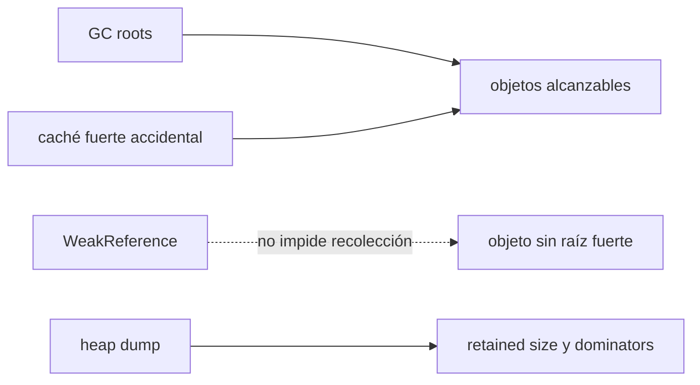
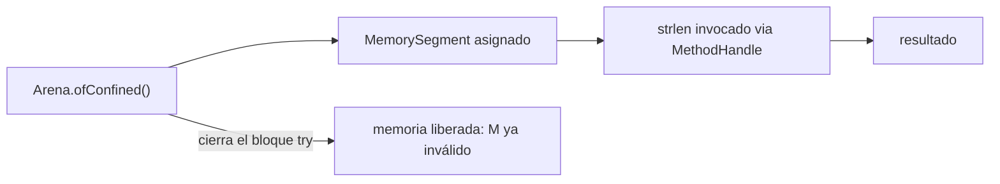

# Módulo 11: JVM interna — GC, profiling y JIT


## Aprende construyendo

### Tema 1: Generaciones de memoria y recolectores · Avanzado · 55 min

**Prerrequisito:** Módulos 0 y 5 de Java (memoria, concurrencia); JDK 27 y un editor. Comprueba `java --version` y `javac --version`.

**Al terminar podrás:** explicar la hipótesis generacional y la heap joven/vieja, comparar las pausas de G1 y ZGC bajo la misma carga, decidir el recolector por throughput o latencia, y distinguir heap de memoria nativa.

#### Aprende

Un servicio de entregas reporta latencia creciente bajo carga, y el equipo «optimiza» cambiando el recolector a ciegas sin medir primero cuántas pausas de GC ocurren realmente ni cuánto duran, arriesgando cambiar algo que no era el cuello de botella real.

**¿Por qué es importante?** La división generacional concentra el esfuerzo de recolección frecuente donde efectivamente se encuentra la mayoría de la basura recolectable; elegir G1 frente a ZGC depende de si la aplicación prioriza throughput general o latencia mínima extrema.

**Mapa de subtemas críticos**

| Subtema | Papel | Evidencia del tema |
|---|---|---|
| hipótesis generacional débil | Prerrequisito | la mayoría de los objetos mueren jóvenes |
| generación joven frente a vieja | Núcleo | joven rápida y frecuente; vieja costosa e infrecuente |
| G1 (throughput/pausas) | Núcleo | balance, default desde JDK 27 en todo entorno |
| ZGC (latencia) | Variante | pausas sub-milisegundo con más overhead |
| medir antes de tunear | Diagnóstico | leer `-Xlog:gc` en vez de cambiar a ciegas |
| heap frente a memoria nativa | Límite | el GC no controla la memoria off-heap |

Cada fila tiene su explicación individual a continuación.

**Hipótesis generacional débil (prerrequisito).** La observación empírica que fundamenta el GC: **la mayoría de los objetos mueren jóvenes** (dejan de referenciarse poco después de crearse). Por eso tiene sentido recolectar con frecuencia la zona donde están los recién creados, en vez de recorrer toda la heap cada vez.

**Generación joven frente a vieja (núcleo).** La heap se divide en **joven** (objetos nuevos, recolectada frecuente y rápido) y **vieja** (objetos que sobrevivieron varias rondas, recolectada menos pero más costosa). Un objeto "promociona" a la vieja tras sobrevivir. Concentrar el esfuerzo en la joven es lo que hace eficiente al GC.

**G1 (núcleo).** Garbage-First equilibra **throughput** y pausas predecibles y cortas; sirve para la mayoría de aplicaciones. Desde JDK 27 (JEP 523) es el **default en todos los entornos** (antes solo en máquinas server-class; un contenedor pequeño podía caer en Serial GC). Si tu app usaba Serial, vuelve a medir tras el cambio.

**ZGC (variante).** Ofrece pausas **sub-milisegundo** incluso con heaps enormes, a cambio de algo más de overhead general. Elígelo solo para aplicaciones **muy sensibles a la latencia** donde una pausa breve de G1 ya sería inaceptable; aceptas a cambio un throughput total potencialmente algo menor.

**Medir antes de tunear (diagnóstico).** Cambiar el recolector "a ciegas" es optimizar sin datos. Primero **mide**: cuántas pausas de GC hay y cuánto duran (`-Xlog:gc`). La decisión G1 vs ZGC solo la responde una medición real de tu carga; el GC rara vez es el cuello de botella que imaginas.

**Heap frente a memoria nativa (límite).** El GC administra la **heap** (objetos Java), no la memoria **nativa** (buffers directos, FFM del Tema 4, librerías JNI). Un consumo de memoria que crece fuera de la heap no lo resuelve tunear el GC: ahí el diagnóstico es otro (fugas off-heap, `MemorySegment` sin cerrar).

La heap de la JVM se divide típicamente en una generación joven (donde se crean los objetos recién instanciados, recolectada frecuentemente y de forma rápida) y una generación vieja (donde terminan los objetos que sobrevivieron varias rondas de recolección de la generación joven, recolectada con menor frecuencia pero de forma más costosa), una división basada en la observación empírica conocida como «hipótesis generacional débil»: la gran mayoría de los objetos creados en cualquier programa mueren jóvenes (dejan de ser referenciados poco después de crearse), por lo que concentrar el esfuerzo de recolección frecuente específicamente en esa generación joven, donde efectivamente se encuentra la mayoría de la basura recolectable, es considerablemente más eficiente que recorrer la heap completa con la misma frecuencia sin distinción.

G1 (Garbage-First) ofrece un buen balance general entre throughput (cantidad total de trabajo útil que la aplicación puede realizar) y pausas predecibles y razonablemente cortas, apropiado para la gran mayoría de aplicaciones sin requisitos extremos de latencia; ZGC ofrece pausas ultra-cortas, del orden de sub-milisegundo, incluso con heaps extremadamente grandes, a cambio de algo más de overhead general de procesamiento, siendo la elección apropiada específicamente para aplicaciones muy sensibles a la latencia donde incluso una pausa breve de G1 sería inaceptable, aceptando a cambio un throughput total potencialmente algo menor.

**Actualización de plataforma:** G1 es el recolector por defecto desde Java 9, pero solo en máquinas «server-class»; en entornos restringidos la JVM podía elegir Serial GC. Desde JDK 27 (JEP 523), G1 es el default en todos los entornos; una aplicación que antes obtenía Serial en un contenedor pequeño pasa a usar G1, y conviene volver a medir si eso cambia algo relevante.

**Analogía:** la generación joven es como una bandeja de entrada que se revisa y se vacía frecuentemente, dado que la mayoría de sus elementos se resuelven o descartan rápidamente; la generación vieja es como un archivo de largo plazo revisado con mucha menor frecuencia, dado que lo que llega ahí ya demostró que probablemente permanecerá relevante por más tiempo. G1 es como un equipo de limpieza que hace rondas regulares y predecibles sin detener completamente las operaciones normales del edificio; ZGC es como un sistema de limpieza casi instantáneo e imperceptible, a costa de requerir algo más de recursos generales para operar de esa forma.

**Conceptos clave:** generación joven vs vieja, G1 frente a ZGC.

**Implicación práctica:** Elegir un recolector sin medir primero es optimizar a ciegas; la decisión entre G1 y ZGC depende de si la aplicación prioriza throughput general o latencia mínima extrema, algo que solo una medición real responde.

**Prueba en terminal:**

```bash
java -XX:+UseZGC -jar mi-app.jar
```
```
Generación joven: objetos recién creados, recolectada frecuente y rápidamente
Generación vieja: objetos que sobrevivieron, recolectada con menor frecuencia
G1: buen balance throughput/pausas | ZGC: pausas sub-milisegundo, algo más de overhead
```

Elegir el recolector correcto es una decisión de infraestructura que documentarías igual para el Proyecto integrador (Módulo 13) antes de desplegarlo bajo carga real.

**Cuándo no usarlo:** para un script de corta vida o una prueba unitaria, tunear el recolector es tiempo perdido; solo importa en procesos de larga duración con carga sostenida.

#### Practica

**Desde cero:**

```bash
mkdir ejemplo-g1-vs-zgc
cd ejemplo-g1-vs-zgc
mkdir -p src/main/java/academia/perf
```

**Crea** `src/main/java/academia/perf/CargaAsignacion.java`. La referencia `volatile` hace que cada arreglo escape realmente; sin ella, el JIT puede eliminar asignaciones que no se observan y la prueba dejaría de medir lo que pretendes:

```java
package academia.perf;

public final class CargaAsignacion {
    private static volatile byte[] ultimo;

    public static void main(String[] args) {
        long iteraciones = 0;
        long inicio = System.nanoTime();
        long siguienteReporte = inicio + 1_000_000_000L;
        while (System.nanoTime() - inicio < 6_000_000_000L) {
            ultimo = new byte[1024];
            iteraciones += ultimo.length;
            long ahora = System.nanoTime();
            if (ahora >= siguienteReporte) {
                System.out.println("bytes asignados: " + iteraciones);
                siguienteReporte = ahora + 1_000_000_000L;
            }
        }
    }
}
```

**Compila una sola vez** y ejecuta exactamente la misma clase con ambos recolectores:

```bash
javac -d out src/main/java/academia/perf/CargaAsignacion.java
java -Xmx64m -Xlog:gc:file=g1.log -XX:+UseG1GC -cp out academia.perf.CargaAsignacion
java -Xmx64m -Xlog:gc:file=zgc.log -Xlog:gc+phases=debug:file=zgc-phases.log -XX:+UseZGC -cp out academia.perf.CargaAsignacion
```

**Resultado esperado:** ambas ejecuciones terminan tras unos seis segundos y reportan bytes asignados. `g1.log` contiene líneas `Pause Young ... 0.xxxms`; ZGC registra sus pausas en `zgc-phases.log` como `Pause Mark Start`, `Pause Mark End` y `Pause Relocate Start`. El `-Xlog:gc` básico de ZGC muestra colecciones, pero no necesariamente esas pausas; por eso se añade el segundo log.

**Fallo deliberado:** repite G1 con `-Xmx16m` manteniendo idéntica la carga. La heap mínima puede variar por plataforma; si la JVM rechaza ese valor, usa el mínimo que acepte y compáralo con `-Xmx128m`.

**Pista:** una heap demasiado pequeña fuerza recolecciones más frecuentes y puede impedir el arranque si no cabe la actividad mínima de la JVM. Compara el número de eventos por segundo, no solo una pausa aislada. **Resultado esperado:** al aumentar `-Xmx` disminuye la presión de asignación y, para esta carga, la frecuencia de recolección; eso no demuestra que una heap infinita sea mejor.

**Si falla.** Si no aparecen pausas de ZGC, revisa que estés leyendo `zgc-phases.log` y no solo `zgc.log`. Si casi no hay GC con G1, comprueba que la asignación escape mediante `ultimo`; un arreglo local jamás leído puede ser eliminado por optimización. No compares duraciones entre máquinas o cargas distintas.

#### Aplica

Repite ambas mediciones con `-Xmx128m`, extrae la pausa máxima y el número de colecciones de cada log, y documenta cuál elegirías para un servicio de baja latencia frente a uno de alto throughput por lotes. Conserva la misma duración, binario y flags de heap en cada comparación.

**Checklist de salida.**

- [ ] G1 y ZGC ejecutan el mismo binario durante la misma duración.
- [ ] Los logs usan nombres distintos y no mezclan corridas.
- [ ] G1 muestra pausas `Pause Young` con duración.
- [ ] ZGC muestra sus fases `Pause ...` en el log de fases.
- [ ] La comparación con otra heap mantiene la carga sin cambios.
- [ ] La recomendación se apoya en pausas y throughput observados.

**Si falla.** Si los resultados cambian mucho entre repeticiones, aumenta la duración y repite antes de concluir; seis segundos sirven para aprender a leer el log, no para certificar producción. Si el recolector no influye en la latencia de tu servicio, investiga otros cuellos de botella antes de seguir ajustando GC.

Guarda ambos logs de GC con sus pausas máximas comparadas; como siguiente paso graba un perfil JFR de la misma carga.

**Errores comunes:** tunear el recolector sin un baseline medido previamente, confundir uso de heap con memoria nativa (fuera del control del GC), y comparar recolectores bajo cargas de trabajo distintas en vez de la misma carga exacta.

**Fuentes oficiales revisadas el 2026-11-01:** [Oracle — Garbage Collection Tuning Guide (Java SE 27)](https://docs.oracle.com/en/java/javase/27/gctuning/) y [JEP 523 — G1 default en todos los entornos](https://openjdk.org/jeps/523).

---

### Tema 2: Java Flight Recorder y JIT compilation · Avanzado · 55 min

**Prerrequisito:** Tema 1 de este módulo; JDK 27 y un editor. Comprueba `java --version` y localiza `jfr` dentro de `bin` del JDK.

**Al terminar podrás:** grabar un perfil JFR de bajo overhead, leer `jdk.ExecutionSample`, explicar interpretación vs JIT y el warm-up, reconocer el inlining, y contrastar con `-Xint`.

#### Aprende

Medir el rendimiento de un método justo al arrancar la aplicación, antes de que el JIT haya compilado el código caliente a código máquina optimizado, mide el intérprete lento de arranque, no el rendimiento real que esa misma aplicación tendrá en producción tras unos segundos de uso continuo.

**¿Por qué es importante?** JFR permite diagnosticar problemas de rendimiento con evidencia real de producción, con overhead mínimo; el JIT explica por qué el rendimiento de una aplicación Java mejora progresivamente tras sus primeros momentos de ejecución.

**Mapa de subtemas críticos**

| Subtema | Papel | Evidencia del tema |
|---|---|---|
| JFR y bajo overhead en producción | Núcleo | grabar un `.jfr` sin degradar la app |
| eventos y `jfr print` | Núcleo | `jdk.ExecutionSample` muestra dónde está la CPU |
| interpretación frente a JIT | Núcleo | la JVM interpreta y luego compila el código caliente |
| warm-up | Diagnóstico | medir antes del warm-up mide el intérprete |
| inlining del JIT | Límite | un método inlineado no aparece como frame propio |
| `-Xint` para contrastar | Variante | desactivar el JIT y ver la diferencia |

Cada fila tiene su explicación individual a continuación.

**JFR y bajo overhead en producción (núcleo).** Java Flight Recorder graba eventos de la JVM (CPU por método, memoria, contención de locks) con overhead **mínimo**, diseñado para usarse en **producción** sin degradar la app. `-XX:StartFlightRecording=filename=perfil.jfr` produce un `.jfr` que analizas después, con datos reales que un entorno de pruebas rara vez reproduce.

**Eventos y `jfr print` (núcleo).** El `.jfr` contiene eventos; `jfr print --events jdk.ExecutionSample` muestra muestras de la pila de ejecución, es decir **dónde** pasó la CPU su tiempo. El método con más muestras es el candidato a optimizar, con evidencia en vez de intuición.

**Interpretación frente a JIT (núcleo).** La JVM primero **interpreta** el bytecode y luego identifica el código **caliente** (muy ejecutado) y lo **compila a código máquina nativo** optimizado (JIT). Por eso una app Java arranca lenta y se acelera: el código frecuente deja de interpretarse.

**Warm-up (diagnóstico).** Medir el rendimiento **al arrancar**, antes del warm-up del JIT, mide el intérprete lento, no el estado estable de producción. Un benchmark serio descarta las primeras iteraciones (o usa JMH, Módulo 4/14). Confundir arranque con estado estable es un error de medición clásico.

**Inlining del JIT (límite).** El JIT puede **inlinear** un método pequeño dentro de quien lo llama; entonces ese método **no aparece** como frame separado en el perfil (sus muestras se atribuyen al llamador). Por eso `main` puede dominar aunque el trabajo esté en un método auxiliar: no asumas que el perfil "miente", es el inlining.

**`-Xint` para contrastar (variante).** `-Xint` fuerza **solo interpretación** (sin JIT): la ejecución es mucho más lenta pero el resultado numérico es el mismo. Sirve para **ver** el efecto del JIT comparando con la ejecución normal; nunca es configuración de producción.

Java Flight Recorder (JFR) graba eventos detallados de la JVM (uso de CPU por método, actividad de memoria, contención de locks) con un overhead deliberadamente mínimo, diseñado específicamente para poder usarse de forma segura en producción sin degradar significativamente el rendimiento de la aplicación mientras se graba: `java -XX:StartFlightRecording=filename=perfil.jfr -jar mi-app.jar` inicia una grabación que produce un archivo `.jfr` analizable posteriormente, permitiendo diagnosticar problemas reales de rendimiento observados directamente en producción bajo carga real, en vez de tener que intentar reproducir artificialmente esas condiciones en un entorno de pruebas separado, que frecuentemente no logra replicar exactamente las condiciones específicas que causan el problema real observado.

La JVM inicialmente interpreta el bytecode (Módulo 0) en vez de compilarlo directamente a código máquina, pero identifica dinámicamente el código «caliente» (métodos ejecutados con muchísima frecuencia durante la ejecución real) y lo compila en caliente a código máquina nativo altamente optimizado específicamente para el patrón de uso observado en esa ejecución concreta, un proceso llamado compilación JIT (Just-In-Time); esta es precisamente la razón por la que una aplicación Java típica suele acelerarse notablemente después de sus primeros segundos de ejecución (el período de «warm-up»): el código que efectivamente se ejecuta con mayor frecuencia progresivamente deja de interpretarse y pasa a ejecutarse como código máquina nativo ya optimizado por el JIT.

**Analogía:** JFR es como una caja negra de un avión, registrando datos detallados de la operación con un impacto mínimo en el propio funcionamiento del avión, permitiendo analizar exactamente qué ocurrió durante un vuelo real específico en vez de solo poder estudiar simulaciones de vuelo separadas; el JIT es como un traductor que inicialmente interpreta un discurso frase por frase en tiempo real, pero que, al notar que ciertas frases se repiten constantemente, memoriza y perfecciona progresivamente una traducción óptima específica para esas frases frecuentes, acelerando notablemente la traducción de esas partes recurrentes con el paso del tiempo.

**Conceptos clave:** perfilado de bajo overhead en producción, compilación en caliente.

**Implicación práctica:** Medir antes del warm-up del JIT puede mezclar arranque e interpretación con el estado estable; JFR permite comprobar dónde se ejecuta realmente el código en lugar de inferirlo.

**Prueba en terminal:**

```bash
java -XX:StartFlightRecording=filename=perfil.jfr -jar mi-app.jar
```
```
JVM interpreta bytecode inicialmente → identifica código "caliente" → 
compila JIT a código máquina optimizado → la app se acelera tras el warm-up
```

Un benchmark del Proyecto integrador (Módulo 13) que no espera el warm-up del JIT mide el intérprete, no el rendimiento real de producción.

**Cuándo no usarlo:** para un script de un solo uso que se ejecuta y termina en milisegundos, el warm-up del JIT nunca llega a ocurrir; no tiene sentido optimizar pensando en código «caliente» que no existirá.

#### Practica

**Desde cero:**

```bash
mkdir ejemplo-jfr-warmup
cd ejemplo-jfr-warmup
mkdir -p src/main/java/academia/perf
```

**Crea** `src/main/java/academia/perf/MetodoCaliente.java`. El resultado acumulado se imprime para evitar que el cálculo completo se elimine como código muerto:

```java
package academia.perf;

public final class MetodoCaliente {
    private static long resultado;

    private static long operacion(long valor) {
        return (valor * 31 + 7) ^ (valor >>> 3);
    }

    public static void main(String[] args) {
        for (int bloque = 1; bloque <= 8; bloque++) {
            long inicio = System.nanoTime();
            for (int i = 0; i < 500_000_000; i++) {
                resultado = operacion(resultado + i);
            }
            long milisegundos = (System.nanoTime() - inicio) / 1_000_000;
            System.out.println("bloque " + bloque + ": " + milisegundos + " ms");
        }
        System.out.println("resultado: " + resultado);
    }
}
```

**Compila y ejecuta con JFR:**

```bash
javac -d out src/main/java/academia/perf/MetodoCaliente.java
java -XX:StartFlightRecording=filename=perfil.jfr -cp out academia.perf.MetodoCaliente
```

**Imprime las muestras de ejecución.** Si `jfr` está en el PATH usa `jfr`; en macOS con Temurin puedes localizarlo así:

```bash
export JAVA_HOME="$(/usr/libexec/java_home -v 27)"
"$JAVA_HOME/bin/jfr" print --events jdk.ExecutionSample perfil.jfr > execution-samples.txt
```

**Resultado esperado:** el archivo contiene eventos `jdk.ExecutionSample` cuyo stack dominante es `academia.perf.MetodoCaliente.main`, en la línea del bucle. El JIT puede inlined `operacion` dentro de `main`, por lo que el método más muestreado no tiene por qué aparecer como un frame separado. Los tiempos dependen de la máquina; busca estabilización tras el arranque, no una aceleración garantizada en cada bloque.

**Fallo deliberado:** ejecuta la misma clase con `-Xint` para impedir la compilación JIT:

```bash
java -Xint -cp out academia.perf.MetodoCaliente
```

**Pista:** esta ejecución es mucho más lenta porque interpreta cada bytecode; el resultado numérico final debe coincidir con la ejecución normal. **Resultado esperado:** los bloques permanecen en el orden de segundos en lugar de beneficiarse del código compilado; no uses `-Xint` como configuración de producción.

**Si falla.** Si `perfil.jfr` no contiene `ExecutionSample`, prolonga la carga: una ejecución de milisegundos ofrece pocas o ninguna muestra. Si `jfr` no se encuentra, usa el ejecutable de `bin` del mismo JDK que compiló la clase. Si los tiempos no mejoran de forma monotónica, no inventes un patrón: el JIT, la CPU y otras cargas introducen variación.

#### Aplica

Resume los cinco métodos con más muestras de `execution-samples.txt`, revisa el contexto de llamada y explica por qué `main` puede dominar aunque el trabajo esté escrito en `operacion`. Repite la grabación con `-Xint` y compara la distribución.

**Checklist de salida.**

- [ ] `perfil.jfr` se genera al terminar la aplicación.
- [ ] `jfr print` produce eventos `jdk.ExecutionSample`.
- [ ] Las muestras señalan el bucle de `MetodoCaliente.main`.
- [ ] El resultado numérico coincide con JIT y con `-Xint`.
- [ ] La ejecución interpretada es sustancialmente más lenta.
- [ ] El análisis considera inlining y contexto, no solo un nombre de método.

**Si falla.** Si la grabación apenas contiene muestras, no declares otro método como cuello de botella: aumenta la carga y vuelve a medir. Si `-Xint` tarda demasiado en tu máquina, reduce todas las iteraciones de forma proporcional y repite ambas variantes con la misma versión.

Guarda el comportamiento con y sin `-Xint`, y el resumen de `jfr print` mostrando el método caliente; como siguiente paso investiga una retención de memoria con heap dump.

**Errores comunes:** medir rendimiento sin dejar que el warm-up del JIT ocurra primero, asumir que JFR tiene overhead alto en producción sin haberlo medido, y confundir el método que aparece con más muestras con la causa raíz sin revisar su contexto de llamada.

**Fuentes oficiales revisadas el 2026-11-01:** [Oracle — jfr (Java SE 27)](https://docs.oracle.com/en/java/javase/27/docs/specs/man/jfr.html) y [JDK Flight Recorder](https://docs.oracle.com/en/java/javase/27/jfapi/).

---

### Tema 3: Referencias especiales y heap dumps · Avanzado · 60 min

**Prerrequisito:** Temas 1–2 de este módulo; JDK 27, un editor y espacio para un volcado de ~70 MB. Comprueba `java --version`.

**Al terminar podrás:** distinguir referencia fuerte de `Weak`/`Soft`/`Phantom`, provocar un `OutOfMemoryError` controlado, generar y entender un heap dump (retained size/dominators), y corregir una caché con `SoftReference`.

#### Aprende

Una caché implementada con una lista que acumula objetos indefinidamente sin nunca liberarlos agota la heap disponible tarde o temprano; sin un heap dump del momento exacto del fallo, diagnosticar qué estaba acumulándose y desde dónde es mucho más difícil que con los logs normales de la aplicación.

**¿Por qué es importante?** Las referencias especiales (`WeakReference`, `SoftReference`) permiten estructuras que cooperan con el recolector de basura en vez de impedir siempre su trabajo; un heap dump proporciona información detallada y específica sobre el estado exacto de la memoria en el momento de un fallo, información que los logs normales no capturan.

**Mapa de subtemas críticos**

| Subtema | Papel | Evidencia del tema |
|---|---|---|
| referencia fuerte frente a especial | Núcleo | una fuerte impide la recolección; una débil no |
| `SoftReference` frente a `WeakReference` | Variante | soft se libera bajo presión; weak más agresiva |
| `PhantomReference` y `ReferenceQueue` | Profundización | limpieza tras volverse fantasma-alcanzable |
| `OutOfMemoryError` por caché sin límite | Diagnóstico | una lista que crece sin liberar agota la heap |
| heap dump (`HeapDumpOnOutOfMemoryError`) | Núcleo | volcado del estado de memoria en el fallo |
| análisis: retained size y dominators | Diagnóstico | qué objetos retienen la memoria |

Cada fila tiene su explicación individual a continuación.

**Referencia fuerte frente a especial (núcleo).** Una referencia **fuerte** (la normal) impide que el GC recoja el objeto mientras exista. Una `WeakReference` **no** lo impide: si la única referencia restante es débil, el objeto puede recolectarse. Permite estructuras (cachés) que cooperan con el GC en vez de retener memoria para siempre.

**`SoftReference` frente a `WeakReference` (variante).** `SoftReference` es más **conservadora**: el GC solo la libera bajo **presión real de memoria**, no en la primera recolección. `WeakReference` se libera más agresivamente. Para una caché que quieres conservar mientras haya memoria pero soltar antes de un OOM, `SoftReference` es la adecuada.

**`PhantomReference` y `ReferenceQueue` (profundización).** `PhantomReference` + `ReferenceQueue` permite ejecutar **limpieza** cuando el objeto ya es fantasma-alcanzable (más fiable que `finalize`, hoy obsoleto). Es un mecanismo avanzado y poco común; basta saber que existe para liberar recursos nativos asociados a un objeto.

**`OutOfMemoryError` por caché sin límite (diagnóstico).** Una estructura que **acumula sin liberar** (una `List` que crece indefinidamente con referencias fuertes) agota la heap y lanza `OutOfMemoryError: Java heap space`. Es la causa más común de fuga en Java: no es que el GC "no funcione", es que algo mantiene vivas las referencias.

**Heap dump (`HeapDumpOnOutOfMemoryError`) (núcleo).** `-XX:+HeapDumpOnOutOfMemoryError -XX:HeapDumpPath=f.hprof` genera un **volcado completo** de la heap en el instante del OOM, con información que los logs no capturan. Es la foto forense del fallo: qué había en memoria y en qué cantidad.

**Análisis: retained size y dominators (diagnóstico).** Un analizador (VisualVM, Eclipse MAT) abre el `.hprof` y muestra el **retained size** (cuánta memoria liberaría eliminar un objeto) y los **dominators** (qué objetos mantienen vivo al resto). Eso señala la causa raíz. **Precaución de seguridad:** un dump de producción puede contener datos sensibles; restringe el acceso al `.hprof`.

`WeakReference` permite mantener una referencia a un objeto sin impedir que el recolector de basura lo elimine si esa es la única referencia restante hacia él (a diferencia de una referencia normal, «fuerte», que sí impide la recolección mientras exista), apropiada para estructuras como cachés donde se desea que ciertos objetos puedan liberarse automáticamente si la memoria se vuelve escasa y ya no hay otras referencias reales activas hacia ellos; `SoftReference` es similar pero más conservadora, permitiendo que el recolector la elimine solo bajo presión real de memoria, no tan agresivamente como una `WeakReference`; `PhantomReference`, junto con una `ReferenceQueue` asociada, permite coordinar limpieza después de que el objeto se vuelve fantasma-alcanzable, un mecanismo más avanzado y de uso considerablemente menos común que los dos anteriores.

Provocar intencionalmente un `OutOfMemoryError` (acumulando objetos indefinidamente en una estructura sin nunca liberar sus referencias) y analizar el heap dump generado en ese momento (un volcado completo del contenido de la heap en el instante del error) permite identificar exactamente qué objetos específicos consumían la memoria disponible en el momento del fallo, información considerablemente más específica y accionable que la que los logs normales de la aplicación proporcionarían, dado que los logs típicamente no capturan el estado completo detallado de la memoria en el instante exacto de un fallo de memoria.

**Analogía:** una `WeakReference` es como una nota adhesiva que recuerda dónde está un objeto, pero que no impide que ese objeto se deseche si nadie más lo necesita realmente; un heap dump es como una fotografía forense detallada tomada exactamente en el momento de un colapso, mostrando con precisión qué había acumulado y en qué cantidades exactas, información que un simple registro de eventos anteriores al colapso no podría ofrecer con el mismo nivel de detalle específico del instante del fallo.

**Conceptos clave:** `WeakReference`/`SoftReference`/`PhantomReference`, análisis de un heap dump.

**Implicación práctica:** Un heap dump muestra exactamente qué objetos consumían la memoria en el instante del fallo, información mucho más específica que los logs normales; una caché con referencias fuertes que nunca se liberan es una causa común y evitable de ese mismo fallo.

**Diagrama:**



Diagnosticar una fuga de memoria con heap dump es la habilidad que usarías si el Proyecto integrador (Módulo 13) empezara a consumir memoria creciente en producción.

**Cuándo no usarlo:** capturar un heap dump completo en un servicio de producción con datos sensibles puede exponer información confidencial en el volcado; restringe el acceso al archivo `.hprof` antes de compartirlo.

#### Practica

**Desde cero:**

```bash
mkdir ejemplo-heap-dump-oom
cd ejemplo-heap-dump-oom
mkdir -p src/main/java/academia/perf
```

**Crea** `src/main/java/academia/perf/FugaCache.java`:

```java
package academia.perf;

import java.util.ArrayList;
import java.util.List;

public final class FugaCache {
    private static final List<byte[]> cache = new ArrayList<>();

    public static void main(String[] args) {
        while (true) {
            cache.add(new byte[1024 * 1024]);
        }
    }
}
```

**Compila y ejecuta con una heap pequeña y un destino explícito para el volcado:**

```bash
javac -d out src/main/java/academia/perf/FugaCache.java
java -Xmx128m -XX:+HeapDumpOnOutOfMemoryError -XX:HeapDumpPath=fuga.hprof -cp out academia.perf.FugaCache
```

**Fallo deliberado:** el programa no termina correctamente; la lista mantiene todas las referencias fuertes hasta agotar los 128 MB.

**Pista:** la consola informa `java.lang.OutOfMemoryError: Java heap space`, `Dumping heap to fuga.hprof ...` y `Heap dump file created`. **Resultado esperado:** `fuga.hprof` existe. Abrirlo en un analizador como VisualVM para confirmar visualmente los `byte[]` dominantes y sus dominators es **revisión manual pendiente** en esta verificación; crear el archivo no equivale a haberlo analizado.

**Crea** `src/main/java/academia/perf/CacheSuave.java`. La limpieza periódica evita acumular también un millón de objetos `SoftReference`; los arreglos referenciados sí pueden liberarse bajo presión:

```java
package academia.perf;

import java.lang.ref.SoftReference;
import java.util.ArrayList;
import java.util.List;

public final class CacheSuave {
    private static final List<SoftReference<byte[]>> cache = new ArrayList<>();

    public static void main(String[] args) {
        for (int i = 0; i < 1_000_000; i++) {
            cache.add(new SoftReference<>(new byte[1024 * 1024]));
            if (cache.size() == 100_000) {
                cache.clear();
            }
        }
        System.out.println("caché suave completada: " + cache.size());
    }
}
```

**Compila y ejecuta la corrección con la misma heap:**

```bash
javac -d out src/main/java/academia/perf/CacheSuave.java
java -Xmx128m -cp out academia.perf.CacheSuave
```

**Resultado esperado:** termina sin `OutOfMemoryError` y muestra `caché suave completada: 0`. Un `SoftReference` puede devolver `null` después; una caché real debe comprobarlo antes de usar el valor.

**Si falla.** Si no aparece `fuga.hprof`, revisa `-XX:+HeapDumpOnOutOfMemoryError`, la ruta y los permisos de escritura. Si la versión suave falla, comprueba que la lista no contenga también referencias fuertes a los mismos arreglos. Si no tienes un analizador HPROF, deja el análisis visual como pendiente; no lo sustituyas por una afirmación basada únicamente en el código.

#### Aplica

Abre el volcado en un analizador HPROF, captura la clase dominante y la ruta que la mantiene viva, y adapta la caché para descartar entradas cuyo `get()` devuelva `null`. Compara ese comportamiento con `WeakReference` y explica cuál encaja mejor con una caché de valores costosos de reconstruir.

**Checklist de salida.**

- [ ] La versión fuerte termina con `OutOfMemoryError: Java heap space`.
- [ ] El fallo genera `fuga.hprof` en la ruta indicada.
- [ ] El análisis visual de dominantes queda hecho o marcado como pendiente.
- [ ] La versión suave termina con la misma `-Xmx128m`.
- [ ] La caché contempla referencias cuyo `get()` devuelve `null`.
- [ ] El archivo de volcado no se comparte sin revisar datos sensibles.

**Si falla.** Si el `OutOfMemoryError` cambia a otro tipo, reduce el tamaño de los arreglos o la heap solo para el laboratorio y registra el cambio. Si una referencia desaparece antes de lo esperado, recuerda que `SoftReference` no es una garantía de retención ni un sustituto de una política de caché con límites.

Guarda el `.hprof` generado, el análisis pendiente o realizado de qué tipo dominaba la memoria, y la versión corregida con `SoftReference` que ya no falla; como siguiente paso invoca memoria nativa con un ciclo de vida explícito.

**Errores comunes:** usar referencias fuertes para una caché que debería poder liberarse bajo presión de memoria, intentar una corrección a ciegas sin analizar primero el heap dump, y capturar un heap dump de producción con datos sensibles sin restringirlo antes de compartirlo.

**Fuentes oficiales revisadas el 2026-11-01:** [Oracle — jhsdb (Java SE 27)](https://docs.oracle.com/en/java/javase/27/docs/specs/man/jhsdb.html) y [`java.lang.ref` (API Java SE 27)](https://docs.oracle.com/en/java/javase/27/docs/api/java.base/java/lang/ref/package-summary.html).

---

### Tema 4: Foreign Function & Memory API (Java 22) · Experto · 55 min

**Prerrequisito:** Temas 1–3 de este módulo; JDK 27 y un sistema con libc. Comprueba `java --version` y `javac --version`.

**Al terminar podrás:** llamar una función nativa de C (`strlen`) con el FFM API (`Linker`/`MethodHandle`/`FunctionDescriptor`), gestionar memoria nativa con `Arena`/`MemorySegment`, y diagnosticar el uso tras cerrar el `Arena`.

#### Aprende

El equipo necesita invocar una librería nativa C ya probada en producción (no quiere reescribirla en Java); hacerlo con JNI tradicional requeriría generar cabeceras, compilar código C intermedio, y mantener ese puente nativo.

**¿Por qué es importante?** La memoria nativa asignada fuera del heap de Java no la libera directamente el recolector mientras el segmento esté en uso; un `Arena` define su ciclo de vida para que no se libere antes ni después de tiempo.

**Mapa de subtemas críticos**

| Subtema | Papel | Evidencia del tema |
|---|---|---|
| FFM frente a JNI | Prerrequisito | sin generar cabeceras ni compilar C intermedio |
| `Linker` y `downcallHandle` | Núcleo | resolver un símbolo nativo y describir su firma |
| `FunctionDescriptor` y layouts | Núcleo | describir tipos (`JAVA_LONG`, `ADDRESS`) |
| `MemorySegment` y `Arena` | Núcleo | asignar memoria nativa con ciclo de vida explícito |
| cierre del `Arena` e invalidez | Diagnóstico | usar un segmento tras cerrar su arena falla |
| `--enable-native-access` | Límite | la JVM avisa del acceso nativo no habilitado |

Cada fila tiene su explicación individual a continuación.

**FFM frente a JNI (prerrequisito).** El Foreign Function & Memory API (estable desde Java 22) reemplaza a JNI para llamar código nativo: **no** requiere generar cabeceras, compilar un puente C ni mantener código intermedio. Es más seguro de tipos y explícito sobre la memoria. Sustituye al JNI clásico del Módulo 13 de Core Java.

**`Linker` y `downcallHandle` (núcleo).** `Linker.nativeLinker()` da acceso al enlazador nativo; `defaultLookup().find("strlen")` resuelve el símbolo por nombre, y `downcallHandle(...)` produce un `MethodHandle` invocable desde Java. Es el puente tipado hacia la función C.

**`FunctionDescriptor` y layouts (núcleo).** `FunctionDescriptor.of(retorno, args...)` describe la **firma** nativa con layouts de valor (`JAVA_LONG`, `JAVA_INT`, `ADDRESS` para punteros). Debe coincidir con la firma C real; una descripción equivocada corrompe la llamada. Es tu declaración del contrato nativo.

**`MemorySegment` y `Arena` (núcleo).** La memoria nativa se asigna en un `MemorySegment` a través de un `Arena` que controla su **ciclo de vida**. `arena.allocateFrom("texto")` crea un segmento con la cadena en UTF-8 (en JDK 27; la antigua `allocateUtf8String` ya no existe). `Arena.ofConfined()` restringe el segmento a un hilo y se cierra con try-with-resources.

**Cierre del `Arena` e invalidez (diagnóstico).** Al cerrar el `Arena` (salir del `try`), la memoria se **libera** y el `MemorySegment` queda **inválido**: usarlo después lanza una excepción. Esto es deliberado y seguro: a diferencia de JNI, no hay punteros colgantes silenciosos. No guardes el segmento fuera del `try`.

**`--enable-native-access` (límite).** La JVM **advierte** (y en el futuro restringirá) el acceso nativo no habilitado; ejecuta con `--enable-native-access=ALL-UNNAMED` (o el módulo concreto) para declararlo explícitamente. Es parte de la integridad por defecto: el acceso nativo es poderoso y debe ser intencional.

El FFM API (finalizado en Java 22) ofrece un modelo más seguro que JNI: un `Linker` resuelve símbolos nativos, un `MethodHandle` los invoca, y un `Arena` controla explícitamente el ciclo de vida de la memoria nativa asignada. En JDK 27, `Arena.allocateFrom(String)` crea el segmento UTF-8; la antigua llamada `allocateUtf8String` ya no está disponible en esa versión.

El FFM API reemplaza JNI con un modelo considerablemente más simple y seguro de tipos: un `Linker` resuelve un símbolo nativo por nombre y describe su firma (`FunctionDescriptor`), produciendo un `MethodHandle` invocable directamente desde Java; un `Arena` controla explícitamente cuándo se libera la memoria nativa asignada (`MemorySegment`), reemplazando el manejo manual de punteros y la generación de código C intermedio que JNI tradicional requería.

**Analogía:** el FFM API es como pedir prestada una herramienta de un taller ajeno con un control de devolución explícito y claro; JNI tradicional es como construir un puente completo de concreto entre dos talleres solo para pasar una herramienta una vez.

**Conceptos clave:** Foreign Function & Memory API, `Linker`, `MethodHandle`, `MemorySegment`, `Arena`, ciclo de vida de memoria nativa.

**Implicación práctica:** El FFM API permite invocar código nativo existente con descriptores de firma y límites de vida comprobados, sin generar un puente JNI; toda llamada debe respetar el `Arena` propietario del segmento.

**Código del ejemplo:**

```java
Linker linker = Linker.nativeLinker();
MethodHandle strlen = linker.downcallHandle(
    linker.defaultLookup().find("strlen").orElseThrow(),
    FunctionDescriptor.of(JAVA_LONG, ADDRESS));

try (Arena arena = Arena.ofConfined()) {
    MemorySegment texto = arena.allocateFrom("entrega-RF-4471");
    long longitud = (long) strlen.invoke(texto);
}
```

**Diagrama:**



Cada integración del Proyecto integrador (Módulo 13) con una librería nativa existente puede beneficiarse del FFM API si sus riesgos y dependencias del sistema operativo están justificados.

**Cuándo no usarlo:** para funcionalidad que ya existe como librería Java pura, agregar una dependencia nativa con FFM API introduce una dependencia del sistema operativo y complejidad de ciclo de vida de memoria sin ningún beneficio real.

#### Practica

**Desde cero:**

```bash
mkdir ejemplo-ffm-strlen
cd ejemplo-ffm-strlen
mkdir -p src/main/java/academia/interop
```

**Crea** `src/main/java/academia/interop/LongitudNativa.java`:

```java
package academia.interop;

import java.lang.foreign.Arena;
import java.lang.foreign.FunctionDescriptor;
import java.lang.foreign.Linker;
import java.lang.foreign.MemorySegment;
import java.lang.invoke.MethodHandle;

import static java.lang.foreign.ValueLayout.ADDRESS;
import static java.lang.foreign.ValueLayout.JAVA_LONG;

public final class LongitudNativa {
    public static void main(String[] args) throws Throwable {
        Linker linker = Linker.nativeLinker();
        MethodHandle strlen = linker.downcallHandle(
            linker.defaultLookup().find("strlen").orElseThrow(),
            FunctionDescriptor.of(JAVA_LONG, ADDRESS));

        try (Arena arena = Arena.ofConfined()) {
            MemorySegment texto = arena.allocateFrom("entrega-RF-4471");
            long longitud = (long) strlen.invoke(texto);
            System.out.println("longitud: " + longitud);
        }
    }
}
```

**Compila y ejecuta habilitando explícitamente el acceso nativo** para código del unnamed module:

```bash
javac -d out src/main/java/academia/interop/LongitudNativa.java
java --enable-native-access=ALL-UNNAMED -cp out academia.interop.LongitudNativa
```

**Resultado esperado:** `longitud: 15`. Sin `--enable-native-access=ALL-UNNAMED`, JDK 27 ejecuta el ejemplo pero emite avisos sobre el método restringido `Linker.downcallHandle`; el flag deja explícita esa capacidad.

**Fallo deliberado:** declara `MemorySegment texto;` fuera del `try`, asigna dentro y mueve la invocación después del cierre:

```java
MemorySegment texto;
try (Arena arena = Arena.ofConfined()) {
    texto = arena.allocateFrom("entrega-RF-4471");
}
System.out.println(strlen.invoke(texto));
```

**Pista:** al salir del bloque, el `Arena` confinado se cierra y el segmento deja de ser válido. **Resultado esperado:** la segunda llamada lanza `IllegalStateException: Already closed`; vuelve a colocar toda invocación dentro del bloque para corregirlo.

**Si falla.** Si `allocateUtf8String` no compila, usa `allocateFrom` en JDK 27. Si `strlen` no aparece en `defaultLookup`, la resolución depende de la plataforma: documenta el sistema y usa una biblioteca disponible allí, sin cambiar la firma nativa a ciegas. Si aparece el aviso de acceso restringido, añade el flag solo al módulo que realmente necesita acceso nativo.

#### Aplica

Añade una segunda llamada a `strlen` dentro del mismo `try` y verifica ambas longitudes. Si necesitas compartir memoria entre hilos, investiga `Arena.ofShared()` y documenta quién cierra ese arena y por qué ninguna llamada puede ocurrir después.

**Checklist de salida.**

- [ ] `Linker.defaultLookup()` resuelve `strlen` sin código C intermedio.
- [ ] `FunctionDescriptor` describe retorno `JAVA_LONG` y argumento `ADDRESS`.
- [ ] `Arena.allocateFrom` crea el texto UTF-8 en JDK 27.
- [ ] La ejecución correcta imprime `longitud: 15`.
- [ ] Usar el segmento tras el cierre produce `Already closed`.
- [ ] El acceso nativo se habilita explícitamente para el caller.

**Si falla.** Si el error ocurre dentro de una llamada nativa, revisa primero que el segmento pertenezca a un arena abierto y accesible desde el hilo actual. No uses un arena global abierto indefinidamente para silenciar `Already closed`: eso convierte un error de ciclo de vida en una posible fuga nativa.

Guarda la llamada nativa exitosa, el `IllegalStateException` por memoria liberada y la corrección; explica por qué la memoria fuera del heap necesita un dueño explícito.

**Errores comunes:** usar memoria de un `Arena` confinado después de que se cerró, no liberar nunca un `Arena` de vida larga, y preferir JNI tradicional cuando FFM ya cubre la necesidad con límites de vida más claros.

**Fuentes oficiales revisadas el 2026-11-01:** [JEP 454 — Foreign Function & Memory API](https://openjdk.org/jeps/454) y [Oracle — Foreign Function & Memory API (Java SE 27)](https://docs.oracle.com/en/java/javase/27/core/foreign-function-and-memory-api.html).

---

## Construcción guiada del capítulo

**Objetivo del laboratorio:** generar un reporte de profiling identificando un cuello de botella real, y analizar un heap dump tras un `OutOfMemoryError` provocado intencionalmente.

**Requisitos previos:** Módulos 0-10 completados.

| Paso | Acción | Código | Explicación |
|---|---|---|---|
| 1 | Ejecutar con G1 y con ZGC, comparar pausas | Ver Tema 1 | `-XX:+UseG1GC` vs `-XX:+UseZGC` |
| 2 | Grabar una sesión de JFR bajo carga | Ver Tema 2 | Analiza el método que más CPU consume |
| 3 | Provocar un `OutOfMemoryError` intencional | Ver Tema 3 | Analiza el heap dump generado |
| 4 | Documentar qué hace el JIT compiler | Ver Tema 2 | Compilación en caliente del código frecuente |
| 5 | Invocar una función nativa con el FFM API | Ver Tema 4 | Sin JNI, con ciclo de vida explícito vía `Arena` |

**Verificación:** el laboratorio se considera exitoso si el reporte de JFR identifica correctamente el método real que más tiempo de CPU consume bajo la carga simulada, si el heap dump analizado identifica correctamente qué objetos causaron el `OutOfMemoryError`, y si la llamada nativa con FFM API falla de forma diagnosticable al usar memoria de un `Arena` ya cerrado. La inspección visual del `.hprof` requiere un analizador y permanece como revisión manual pendiente hasta realizarla.

**Errores comunes y soluciones**

- **Asumir que ZGC siempre es mejor que G1 sin medir.** ZGC prioriza latencia mínima a costa de throughput; mide según las necesidades reales de tu aplicación.
- **Intentar diagnosticar un problema de producción solo con logs normales.** Usa JFR o un heap dump para obtener el detalle específico necesario.
- **Usar referencias fuertes normales para una caché que debería liberarse bajo presión de memoria.** Considera `SoftReference` para ese caso específico y maneja `null` al leerla.
- **Usar memoria nativa de un `Arena` después de que se cerró.** El `Arena` controla el ciclo de vida explícitamente; usa la memoria solo dentro de su ámbito o uno de vida más larga.

---
