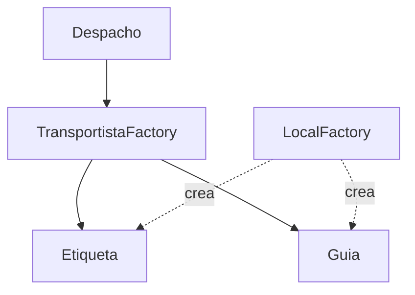
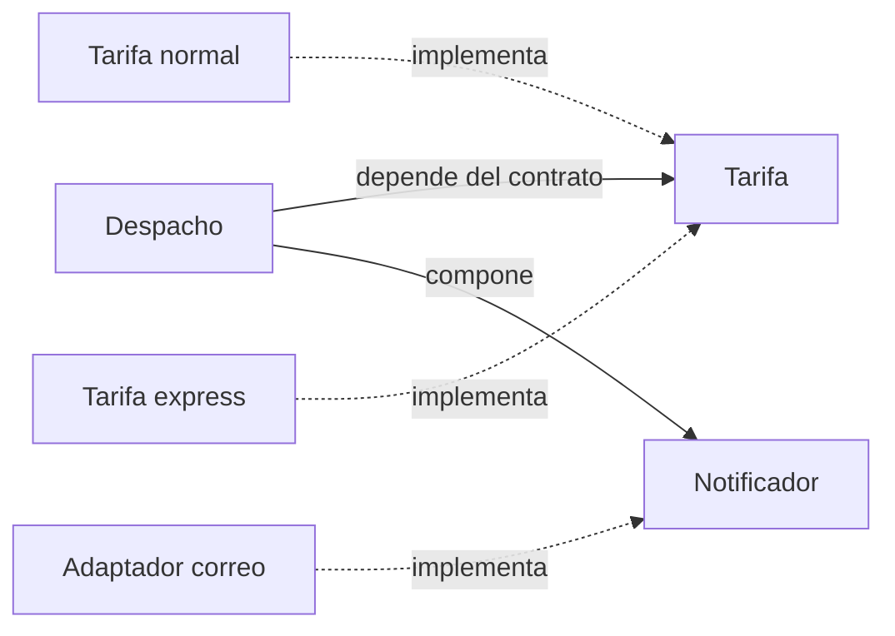
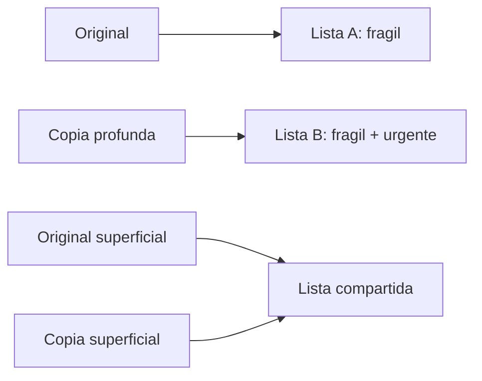

# Módulo 12: Buenas prácticas y patrones de diseño


## Aprende construyendo

### Tema 1: Builder — configuración paso a paso y validación · Intermedio · 45 min

**Prerrequisito:** Módulos 1 y 7 de Java (clases, records); JDK 27 y un editor. Comprueba `java --version`.

**Al terminar podrás:** construir un objeto inmutable con campos obligatorios y opcionales mediante encadenamiento fluido, concentrar la validación en `build()`, y justificar cuándo un constructor o un record son mejores que Builder.

#### Aprende

Un pedido puede requerir cliente y producto, pero incluir opciones variables como cantidad, instrucciones o ventana de entrega. Un constructor posicional largo obliga a pasar valores centinela y hace difícil revisar qué significa cada argumento.

**¿Por qué es importante?** Porque los patrones son vocabulario para resolver problemas, no plantillas obligatorias. Builder ayuda cuando la cantidad de opciones y la validación justifican una construcción guiada.

**Mapa de subtemas críticos**

| Subtema | Papel | Evidencia del tema |
|---|---|---|
| el problema del constructor telescópico | Prerrequisito | muchos parámetros posicionales confunden |
| encadenamiento fluido | Núcleo | métodos con nombre, uno por campo |
| validación en `build()` | Núcleo | ningún objeto parcial sale del builder |
| campos obligatorios frente a opcionales | Variante | opcionales con valor por defecto |
| producto inmutable con constructor privado | Núcleo | solo `build()` crea la instancia `final` |
| Builder frente a record/constructor | Decisión | no usar Builder si hay pocos campos |

Cada fila tiene su explicación individual a continuación.

**El problema del constructor telescópico (prerrequisito).** `new Pedido("Ana","Laptop",2,null,true,false,...)` es ilegible y propenso a error: el orden posicional confunde (¿qué booleano es cuál?) y obliga a pasar `null`/centinelas para los opcionales. Es el dolor que Builder resuelve.

**Encadenamiento fluido (núcleo).** Builder ofrece un método **con nombre** por campo que devuelve `this`, permitiendo encadenar en orden natural y omitir los opcionales: `.cliente("Ana").codigo("RF-1").unidades(2)`. El sitio de llamada se vuelve autoexplicativo sin consultar la firma.

**Validación en `build()` (núcleo).** Las invariantes se concentran en `build()`: comprueba obligatorios y rangos, y lanza antes de crear el objeto. Así **ningún** consumidor recibe un `Pedido` a medio construir; el objeto o es completo y válido, o no existe.

**Campos obligatorios frente a opcionales (variante).** Los obligatorios se validan en `build()`; los opcionales tienen un **valor por defecto** en el Builder (`unidades = 1`). Añadir una opción nueva no obliga a cambiar las llamadas existentes, porque su default la cubre.

**Producto inmutable con constructor privado (núcleo).** El `Pedido` tiene campos `final` y **constructor privado** que recibe el Builder ya validado: solo `build()` puede crear la instancia. No se publica el Builder mutable como si fuera el producto; el producto terminado es inmutable y seguro de compartir.

**Builder frente a record/constructor (decisión).** Para una clase con **pocos** campos obligatorios, un constructor normal o un `record` con constructor compacto (Módulo 7) es más simple. Builder solo compensa cuando hay muchas opciones y validación que justifican la construcción guiada. No lo apliques por rutina.

Un constructor con muchos parámetros, varios de ellos opcionales (`new Pedido("Ana", "Laptop", 2, null, true, false, 15.5, ...)`), es propenso a errores de uso: es fácil confundir el orden de los argumentos posicionales, especialmente cuando varios comparten el mismo tipo (¿cuál booleano corresponde a qué opción específica?), y no queda ninguna indicación clara en el sitio de la llamada de qué representa cada valor individual sin consultar constantemente la firma del constructor. El patrón Builder (`Pedido pedido = Pedido.builder().cliente("Ana").producto("Laptop").cantidad(2).build();`) resuelve este problema encadenando llamadas a métodos con nombres descriptivos, uno por cada campo que se desea establecer, en el orden que resulte más natural para quien construye el objeto, omitiendo directamente cualquier campo opcional que no aplique en ese caso específico, sin necesidad de pasar `null` o valores por defecto explícitos como marcadores de posición para cada campo omitido.

Esta legibilidad mejorada es particularmente valiosa cuando el número de campos es considerable y muchos son genuinamente opcionales, dado que el código resultante en el sitio de la llamada se vuelve autoexplicativo (`.cliente("Ana").producto("Laptop")` deja claro exactamente qué representa cada valor, sin ambigüedad posicional), a diferencia de un constructor tradicional con muchos parámetros posicionales, donde esa claridad depende completamente de que quien lee el código recuerde o consulte constantemente el orden exacto de la firma.

Builder separa la configuración y validación de un producto del objeto ya construido: se expresan pasos nombrados y `build()` entrega un resultado completo o informa por qué no puede crearlo. El Builder fluido anidado de este ejercicio reduce parámetros telescópicos; el Builder GoF también puede usar constructores distintos que ejecutan una secuencia común para crear representaciones diferentes. Una clase directora que guarda secuencias reutilizables es opcional, no un requisito universal del patrón.

**Analogía:** el constructor posicional es un formulario sin etiquetas donde un valor en la casilla incorrecta puede parecer válido; Builder es un formulario guiado con campos nombrados y una revisión final antes de aceptar el pedido.

**Conceptos clave:** encadenamiento fluido, evitar confusión de orden de argumentos, validación en `build()`.

**Implicación práctica:** concentra las invariantes en `build()` para que ningún consumidor reciba un `Pedido` parcialmente válido, y no compartas el Builder mutable entre hilos.

**Código del ejemplo:**

```java
Pedido pedido = Pedido.builder()
    .cliente("Ana")
    .producto("Laptop")
    .cantidad(2)
    .build();
```

Este Builder fluido es apropiado para construir el objeto inmutable de configuración del Proyecto integrador (Módulo 13), con valores obligatorios, opciones y validación concentrada. La práctica implementa `cliente`, `codigo` y `unidades`; exige cliente y código no vacíos, y rechaza unidades menores a uno.

**Cuándo no usarlo:** para una clase pequeña con pocos campos obligatorios, un constructor normal y validación clara suele ser más simple. No agregues una clase directora si solo existe una secuencia de construcción y nadie necesita reutilizarla.

#### Practica

**Desde cero:** crea una carpeta vacía, entra en ella y crea manualmente un archivo nuevo llamado `BuilderPedidoDemo.java`:

```bash
mkdir ejemplo-builder-pedido
cd ejemplo-builder-pedido
```

Escribe este contenido completo en `BuilderPedidoDemo.java`:

```java
public class BuilderPedidoDemo {
    static final class Pedido {
        private final String cliente;
        private final String codigo;
        private final int unidades;

        private Pedido(Builder builder) {
            this.cliente = builder.cliente;
            this.codigo = builder.codigo;
            this.unidades = builder.unidades;
        }

        static Builder builder() {
            return new Builder();
        }

        String resumen() {
            return cliente + ":" + codigo + ":" + unidades;
        }

        static final class Builder {
            private String cliente;
            private String codigo;
            private int unidades = 1;

            Builder cliente(String cliente) {
                this.cliente = cliente;
                return this;
            }

            Builder codigo(String codigo) {
                this.codigo = codigo;
                return this;
            }

            Builder unidades(int unidades) {
                this.unidades = unidades;
                return this;
            }

            Pedido build() {
                if (cliente == null || cliente.isBlank()
                        || codigo == null || codigo.isBlank()) {
                    throw new IllegalStateException("cliente y codigo son obligatorios");
                }
                if (unidades < 1) {
                    throw new IllegalStateException("unidades debe ser positivo");
                }
                return new Pedido(this);
            }
        }
    }

    public static void main(String[] args) {
        Pedido pedido = Pedido.builder()
                .cliente("Ana")
                .codigo("RF-1")
                .unidades(2)
                .build();
        System.out.println("builder=" + pedido.resumen());
    }
}
```

Ejecuta el archivo con el lanzador de código fuente:

```bash
java BuilderPedidoDemo.java
```

**Resultado esperado:**

```text
builder=Ana:RF-1:2
```

Localiza `Pedido`, su clase interna `Builder` y `build()`. El constructor de `Pedido` es privado, conserva campos `final` y recibe el Builder ya validado.

**Fallo deliberado:** en tu archivo, elimina `.codigo("RF-1")` de la llamada de `main` y vuelve a ejecutar el mismo comando.

**Pista:** `build()` lanza `java.lang.IllegalStateException: cliente y codigo son obligatorios`; no aparece un pedido incompleto. **Corrección:** restaura `.codigo("RF-1")` entre `.cliente("Ana")` y `.unidades(2)`; la ejecución vuelve a imprimir `builder=Ana:RF-1:2`.

**Si falla.** Conserva el nombre público `BuilderPedidoDemo` en un archivo llamado exactamente `BuilderPedidoDemo.java` y ejecuta el comando dentro de `ejemplo-builder-pedido`. Si no aparece la excepción, revisa que quitaste el código de la llamada y no solo una variable sin uso. Si `unidades` es cero, la validación correspondiente debe rechazarlo antes de crear el objeto.

#### Aplica

Compara este diseño con un constructor tradicional de seis parámetros posicionales para el mismo `Pedido`; documenta con un ejemplo concreto qué llamada es más fácil de leer y por qué. Añade una opción `instrucciones` sin obligar a los consumidores existentes a cambiar.

**Checklist de salida.**

- [ ] `Pedido` conserva sus campos como `final`.
- [ ] Solo `build()` crea la instancia terminada.
- [ ] La salida correcta incluye `builder=Ana:RF-1:2`.
- [ ] Omitir el código produce `cliente y codigo son obligatorios`.
- [ ] `unidades` tiene valor predeterminado y validación positiva.
- [ ] La comparación explica cuándo un constructor sería más simple.

**Si falla.** Si una llamada puede observar un objeto a medio construir, revisa la visibilidad del constructor y no publiques el Builder como si fuera el producto. Si una nueva opción obliga a modificar todas las llamadas, comprueba que tenga un valor predeterminado dentro del Builder.

Guarda `BuilderPedidoDemo.java` con su Builder, el fallo de validación provocado y la comparación contra el constructor posicional. Como siguiente paso compara patrones que coordinan creación y algoritmos.

**Errores comunes:** compartir un Builder mutable entre hilos, omitir validación en `build()` y usar Builder para objetos con pocos campos obligatorios.

**Fuentes revisadas el 2026-11-01:** [Builder — Refactoring Guru](https://refactoring.guru/design-patterns/builder) y [documentación de Java SE 27](https://docs.oracle.com/en/java/javase/27/).

---

### Tema 2: Factory Method y Strategy · Intermedio · 55 min

**Prerrequisito:** Tema 1 de este módulo e interfaces (Módulo 1); JDK 27 y un editor. Comprueba `java --version`.

**Al terminar podrás:** distinguir Factory simple de Factory Method (GoF), encapsular un algoritmo con Strategy, inyectar la estrategia, y elegir el patrón según varíe la creación o el algoritmo.

#### Aprende

RutaFlow puede enviar avisos por más de un canal y calcular tarifas con políticas distintas. La creación del notificador y el cálculo de la tarifa son variaciones diferentes: centralizar la primera no debe convertir al consumidor en una cadena de condicionales.

**¿Por qué es importante?** Distinguir selección de creación de selección de algoritmo evita condicionales dispersos y abstracciones que no responden a una variación real.

**Mapa de subtemas críticos**

| Subtema | Papel | Evidencia del tema |
|---|---|---|
| Factory simple (`switch` central) | Prerrequisito | mapear una clave a una instancia |
| Factory Method (GoF) | Núcleo | la subclase decide el producto |
| producto común y creador | Núcleo | el flujo usa la abstracción, no el concreto |
| Strategy (algoritmo intercambiable) | Núcleo | el consumidor ignora qué implementación corre |
| inyección de la estrategia | Variante | se configura desde fuera, sin `if`/`switch` |
| qué varía: creación o algoritmo | Diagnóstico | la pregunta que elige el patrón |

Cada fila tiene su explicación individual a continuación.

**Factory simple (prerrequisito).** `crear("email")` → `EmailNotificador`; el consumidor solo ve la interfaz `Notificador`. Centraliza la selección en un `switch`, pero añadir una opción obliga a **editar** ese switch. Es suficiente cuando solo mapeas una clave a una instancia; no es el patrón GoF.

**Factory Method (GoF) (núcleo).** Mueve la creación a un **método que una subclase concreta implementa**: `EmailFactory`/`SmsFactory` deciden el producto, mientras el método heredado ejecuta el flujo común. Extender significa **añadir** una subclase, no editar el flujo. Cuesta más tipos, pero respeta abierto/cerrado.

**Producto común y creador (núcleo).** El flujo del creador trabaja contra la **abstracción** (`Notificador`), no contra un tipo concreto. Esa indirección es la que permite cambiar el producto sin tocar el código que lo usa. El punto de variación queda aislado en la fábrica.

**Strategy (núcleo).** Encapsula un **algoritmo intercambiable** tras una interfaz (`CalculadoraDescuento.calcular(precio)`). El consumidor llama `estrategia.calcular(...)` **sin saber** cuál implementación corre; no tiene `if`/`switch` propio. Cambiar de algoritmo es cambiar la estrategia inyectada.

**Inyección de la estrategia (variante).** La estrategia concreta se **inyecta** desde fuera (constructor, configuración), no se elige dentro del consumidor. Así el mismo código sirve con descuento navideño, de temporada o ninguno, decidido por quien compone el objeto.

**Qué varía: creación o algoritmo (diagnóstico).** La pregunta que elige el patrón: si varía **qué producto se crea** dentro de un flujo → Factory Method; si varía **el algoritmo** que aplica un consumidor → Strategy; si solo mapeas clave→instancia → Factory simple. No introduzcas un patrón si no hay una variación real que lo justifique.

En una Factory simple, `SimpleNotificadorFactory.crear("email")` puede devolver `EmailNotificador` y `crear("sms")` puede devolver `SmsNotificador`; el consumidor solo ve `Notificador`. Añadir una opción suele requerir editar la selección centralizada. Factory Method mueve la creación a un método que una subclase concreta implementa. En la práctica, `EmailFactory` y `SmsFactory` eligen el producto, mientras el método heredado `notificar` ejecuta el mismo flujo con la abstracción `Notificador`. La extensión evita editar ese flujo, aunque añade tipos y no elimina la necesidad de componer el creador adecuado en algún punto.

Strategy encapsula un algoritmo intercambiable detrás de una interfaz común (`interface CalculadoraDescuento { double calcular(double precio); }`, con implementaciones concretas como `DescuentoNavidad`), permitiendo que el código que usa esa estrategia (`double precioFinal = estrategia.calcular(precioOriginal);`) permanezca completamente ajeno a cuál implementación específica de descuento está actualmente activa, delegando esa decisión a quien configura o inyecta la estrategia concreta a usar en cada contexto, sin que el código consumidor necesite ninguna lógica condicional propia (`if`/`switch`) para decidir qué algoritmo aplicar en cada caso.

La pregunta diagnóstica es qué cambia: si varía qué producto se crea dentro de un flujo del creador, considera Factory Method; si varía el algoritmo aplicado por un consumidor, considera Strategy; si solo necesitas mapear una clave a una instancia y el `switch` central es suficiente, una Factory simple puede ser más directa.

**Analogía:** Factory Method cambia la cocina que prepara el producto sin rehacer el servicio que coordina el pedido; Strategy cambia una receta dentro del mismo servicio. Una Factory simple es un mostrador central que deriva cada solicitud según su tipo.

**Conceptos clave:** Factory simple, Factory Method, producto común, creador, punto de variación, Strategy e inyección.

**Implicación práctica:** el consumidor de una Strategy recibe el contrato ya seleccionado; el método heredado de un creador Factory Method conserva el flujo mientras la subclase decide el producto.

**Código de la Factory simple:**

```java
interface Notificador { String enviar(String mensaje); }
class SimpleNotificadorFactory {
    static Notificador crear(String tipo) {
        return switch (tipo) {
            case "email" -> new EmailNotificador();
            case "sms" -> new SmsNotificador();
            default -> throw new IllegalArgumentException("Tipo desconocido");
        };
    }
}

```

En el Proyecto integrador (Módulo 13), el punto de composición elige el canal y la política según configuración; el caso de uso depende de sus contratos, no de clases concretas dispersas.

**Cuándo no usar Factory Method:** si no hay variantes de creación o una Factory simple resuelve claramente la selección, una jerarquía de creadores agrega indirección sin valor. Strategy tampoco aporta si existe una única fórmula estable.

#### Practica

**Desde cero:** crea una carpeta vacía, entra en ella y crea manualmente `FactoryStrategyDemo.java`:

```bash
mkdir ejemplo-factory-strategy
cd ejemplo-factory-strategy
```

Escribe este contenido completo. El archivo reúne una Factory simple, dos creadores Factory Method y tres Strategies para comparar sus decisiones sin dependencias externas:

```java
public class FactoryStrategyDemo {
    interface Notificador {
        String enviar(String mensaje);
    }

    static final class EmailNotificador implements Notificador {
        public String enviar(String mensaje) {
            return "email:" + mensaje;
        }
    }

    static final class SmsNotificador implements Notificador {
        public String enviar(String mensaje) {
            return "sms:" + mensaje;
        }
    }

    static final class SimpleNotificadorFactory {
        static Notificador crear(String tipo) {
            return switch (tipo) {
                case "email" -> new EmailNotificador();
                case "sms" -> new SmsNotificador();
                default -> throw new IllegalArgumentException("Tipo desconocido: " + tipo);
            };
        }
    }

    abstract static class NotificadorFactory {
        abstract Notificador crear();

        final String notificar(String mensaje) {
            return crear().enviar(mensaje);
        }
    }

    static final class EmailFactory extends NotificadorFactory {
        Notificador crear() {
            return new EmailNotificador();
        }
    }

    static final class SmsFactory extends NotificadorFactory {
        Notificador crear() {
            return new SmsNotificador();
        }
    }

    interface Tarifa {
        int calcular(int kilometros);
    }

    static final class Normal implements Tarifa {
        public int calcular(int kilometros) {
            return 500 + 100 * kilometros;
        }
    }

    static final class Express implements Tarifa {
        public int calcular(int kilometros) {
            return 900 + 150 * kilometros;
        }
    }

    static final class Recogida implements Tarifa {
        public int calcular(int kilometros) {
            return 0;
        }
    }

    static final class Cotizador {
        private final Tarifa tarifa;

        Cotizador(Tarifa tarifa) {
            this.tarifa = java.util.Objects.requireNonNull(tarifa, "tarifa");
        }

        int cotizar(int kilometros) {
            if (kilometros < 0) {
                throw new IllegalArgumentException("kilometros negativos");
            }
            return tarifa.calcular(kilometros);
        }
    }

    public static void main(String[] args) {
        if (args.length == 1 && args[0].equals("fallo")) {
            System.out.println(SimpleNotificadorFactory.crear("whatsapp").enviar("RF-1"));
            return;
        }

        NotificadorFactory email = new EmailFactory();
        NotificadorFactory sms = new SmsFactory();
        System.out.println("factory=" + email.notificar("RF-1") + "," + sms.notificar("RF-1"));
        System.out.println("normal=" + new Cotizador(new Normal()).cotizar(10));
        System.out.println("express=" + new Cotizador(new Express()).cotizar(10));
        System.out.println("recogida=" + new Cotizador(new Recogida()).cotizar(10));
    }
}
```

Ejecuta la práctica:

```bash
java FactoryStrategyDemo.java
```

En `NotificadorFactory`, `notificar` conserva el flujo y delega la variación a `crear()`; en `Cotizador`, la tarifa llega por constructor y `cotizar` delega el algoritmo.

**Resultado esperado:**

```text
factory=email:RF-1,sms:RF-1
normal=1500
express=2400
recogida=0
```

**Fallo deliberado:** ejecuta `java FactoryStrategyDemo.java fallo`. La Factory simple recibe un tipo que no registra.

**Pista:** el `default` produce `java.lang.IllegalArgumentException: Tipo desconocido: whatsapp`. **Corrección:** cambia `"whatsapp"` por `"email"` en la rama `fallo` y ejecuta de nuevo ese modo; imprime `email:RF-1`. Después ejecuta sin argumentos para recuperar las cuatro salidas normales. Si agregas un canal real, implementa el producto y registra explícitamente su caso.

**Si falla.** Si crees que cualquier `switch` es Factory Method, localiza el método heredado `notificar` y las subclases: sin ese creador polimórfico estás ante una Factory simple. Si una tarifa nueva obliga a editar `Cotizador`, revisa que reciba `Tarifa` y no una clase concreta.

#### Aplica

Agrega `PushFactory` sin modificar `notificar` ni `Notificador`. Después añade `TarifaEmpresa` con 300 centavos fijos y 80 por kilómetro, inyéctala en el mismo `Cotizador` y comprueba que 10 km devuelve 1100. Anota dónde ocurre cada selección.

**Checklist de salida.**

- [ ] La Factory simple centraliza el `switch` y rechaza tipos desconocidos.
- [ ] `EmailFactory` y `SmsFactory` implementan el mismo creador abstracto.
- [ ] `notificar` no cambia al añadir `PushFactory`.
- [ ] `Cotizador` recibe `Tarifa` y no selecciona implementaciones.
- [ ] Las tres tarifas producen los importes esperados.
- [ ] `TarifaEmpresa` se añade sin editar el consumidor.

**Si falla.** Si el tipo desconocido se convierte en `null`, conserva el `default` con excepción para que la configuración inválida sea visible. Si agregar Strategy multiplica condicionales dentro del consumidor, mueve esa decisión al punto de composición.

Guarda las dos formas de Factory, el fallo por tipo desconocido y las Strategies intercambiadas. Como siguiente paso revisa familias de productos que deben mantenerse compatibles.

**Errores comunes:** llamar Factory Method a cualquier `switch`, usar Factory Method cuando basta una función, y usar Strategy cuando no existe una segunda política real.

**Fuentes:** [Factory Method](https://refactoring.guru/design-patterns/factory-method) y [Strategy](https://refactoring.guru/design-patterns/strategy).

---

### Tema 3: Abstract Factory y familias de productos compatibles · Avanzado · 50 min

**Prerrequisito:** JDK 27 y el Tema 2. Comprueba `java --version`.

**Al terminar podrás:** identificar una familia de productos relacionados, crear una factoría por variante y comprobar que el cliente recibe productos compatibles sin depender de sus clases concretas.

#### Aprende

RutaFlow genera una etiqueta y una guía de transporte. El servicio puede trabajar con envíos locales o internacionales; una etiqueta local junto con una guía internacional es una combinación inválida. El punto de composición elige la familia y el resto del flujo depende de los contratos.

**¿Por qué es importante?** Una configuración entrega objetos individualmente válidos, pero el diseño también debe preservar compatibilidad entre productos relacionados.

**Mapa de subtemas críticos**

| Subtema | Papel | Evidencia del tema |
|---|---|---|
| familia de productos relacionados | Núcleo | etiqueta y guía que deben ser coherentes |
| la interfaz de la fábrica abstracta | Núcleo | un método por producto de la familia |
| fábricas concretas por familia | Núcleo | local e internacional producen su conjunto |
| coherencia garantizada por la fábrica | Diagnóstico | mezclar productos de fábricas distintas es un bug de dominio |
| selección en composición | Decisión | quién inyecta la familia, no el dominio |
| Abstract Factory frente a Factory Method | Límite | familia de productos vs un solo producto |

Cada fila tiene su explicación individual a continuación.

**Familia de productos relacionados (núcleo).** Abstract Factory se usa cuando varios productos deben ser **coherentes entre sí** (una etiqueta y una guía del mismo transportista). No es crear un objeto, sino crear un **conjunto** compatible.

**La interfaz de la fábrica abstracta (núcleo).** `TransportistaFactory` declara **un método por producto** de la familia (`crearEtiqueta()`, `crearGuia()`), devolviendo contratos. El consumidor pide los productos a **la misma** fábrica, garantizando que pertenecen a la misma familia.

**Fábricas concretas por familia (núcleo).** Cada familia tiene su implementación (`LocalFactory`, `InternacionalFactory`) que produce **todo su conjunto** coherente. Añadir una familia nueva es añadir una fábrica concreta, sin tocar al consumidor.

**Coherencia garantizada por la fábrica (diagnóstico).** El error típico: combinar una etiqueta internacional con una guía local. Java no lo impide (ambos cumplen sus interfaces): es un **bug de dominio**, no de tipos. Abstract Factory lo previene obligando a pedir ambos a la misma fábrica; no "adivines" la pareja con condicionales en el producto.

**Selección en composición (decisión).** Qué familia se usa se decide **al componer** (configuración, inyección), no dentro del dominio. El dominio no debe leer variables de entorno para elegir la familia; recibe la fábrica ya seleccionada.

**Abstract Factory frente a Factory Method (límite).** Factory Method crea **un** producto; Abstract Factory crea una **familia** de productos relacionados. Usar Abstract Factory para un solo producto es sobreingeniería (muchas interfaces sin familias que mantener coherentes).

Abstract Factory declara métodos para crear varios tipos de productos relacionados. Cada fábrica concreta representa una variante y produce productos de esa misma familia. El cliente usa interfaces de producto, no el nombre de la fábrica ni clases concretas. Se diferencia de Factory Method, que delega una decisión de creación de un producto en un método redefinido; Abstract Factory coordina una familia de productos. La factoría se selecciona al inicializar la aplicación según configuración, no en cada rama del caso de uso.

| Rol | RutaFlow | Responsabilidad |
|---|---|---|
| Fábrica abstracta | `TransportistaFactory` | Declara `crearEtiqueta()` y `crearGuia()`. |
| Productos abstractos | `Etiqueta`, `Guia` | Contratos que usa el flujo de envío. |
| Fábricas concretas | `LocalFactory`, `InternacionalFactory` | Crean solo productos de su variante. |
| Cliente | Servicio de despacho | Usa contratos sin construir implementaciones concretas. |

**Analogía:** es como elegir un juego completo de documentos para un tipo de envío: cada pieza puede parecer válida por separado, pero el juego solo es correcto si todas pertenecen a la misma variante.

**Conceptos clave:** familia de productos, fábrica abstracta, fábrica concreta, contrato de producto, composición y selección en el arranque.

**Implicación práctica:** inyecta una sola factoría por configuración y pide todos los productos relacionados a esa misma instancia; las interfaces individuales no impiden mezclar familias.

```java
interface TransportistaFactory {
    Etiqueta crearEtiqueta();
    Guia crearGuia();
}

// Cada fábrica concreta mantiene coherente su familia de productos.
final class LocalFactory implements TransportistaFactory {
    public Etiqueta crearEtiqueta() { return codigo -> "LOCAL-" + codigo; }
    public Guia crearGuia() { return () -> "entrega-hoy"; }
}
```

**Diagrama: familia local**



Abstract Factory es útil cuando cambia el conjunto de productos relacionados y el cliente no debe mezclar variantes. Añadir una familia requiere implementar todos los productos; agregar un nuevo tipo de producto afecta la interfaz y todas las fábricas concretas.

**Cuándo no usarlo:** si el único producto variable es un notificador, Factory Method o una Factory simple bastan.

#### Practica

**Desde cero:** crea una carpeta vacía, entra en ella y crea manualmente `AbstractFactoryDemo.java`:

```bash
mkdir ejemplo-abstract-factory
cd ejemplo-abstract-factory
```

Escribe este contenido completo:

```java
public class AbstractFactoryDemo {
    interface Etiqueta {
        String formatear(String codigo);
    }

    interface Guia {
        String servicio();
    }

    interface TransportistaFactory {
        Etiqueta crearEtiqueta();
        Guia crearGuia();
    }

    static final class LocalFactory implements TransportistaFactory {
        public Etiqueta crearEtiqueta() {
            return codigo -> "LOCAL-" + codigo;
        }

        public Guia crearGuia() {
            return () -> "entrega-hoy";
        }
    }

    static final class InternacionalFactory implements TransportistaFactory {
        public Etiqueta crearEtiqueta() {
            return codigo -> "INT-" + codigo;
        }

        public Guia crearGuia() {
            return () -> "aduana-y-seguimiento";
        }
    }

    static String despachar(TransportistaFactory factory, String codigo) {
        Etiqueta etiqueta = factory.crearEtiqueta();
        Guia guia = factory.crearGuia();
        return etiqueta.formatear(codigo) + "," + guia.servicio();
    }

    public static void main(String[] args) {
        TransportistaFactory local = new LocalFactory();
        TransportistaFactory internacional = new InternacionalFactory();

        if (args.length == 1 && args[0].equals("fallo")) {
            Etiqueta etiqueta = internacional.crearEtiqueta();
            Guia guia = local.crearGuia();
            System.out.println("mezcla=" + etiqueta.formatear("RF-1") + "," + guia.servicio());
            return;
        }

        System.out.println("abstract-factory=" + despachar(local, "RF-1")
                + ";" + despachar(internacional, "RF-1"));
    }
}
```

Ejecuta:

```bash
java AbstractFactoryDemo.java
```

Cada método de `TransportistaFactory` devuelve el contrato del producto; `despachar` pide ambos productos a la misma factoría.

**Resultado esperado:**

```text
abstract-factory=LOCAL-RF-1,entrega-hoy;INT-RF-1,aduana-y-seguimiento
```

**Fallo deliberado:** ejecuta `java AbstractFactoryDemo.java fallo`. Esa rama combina una etiqueta internacional con una guía local.

**Pista:** Java no lanza una excepción porque ambos objetos cumplen sus interfaces; la salida inválida es `mezcla=INT-RF-1,entrega-hoy`. **Corrección:** reemplaza todo el cuerpo de la rama `fallo` por estas dos líneas: `System.out.println("mezcla=" + despachar(internacional, "RF-1"));` y `return;`. Así etiqueta y guía provienen de la misma `TransportistaFactory` y obtendrás `mezcla=INT-RF-1,aduana-y-seguimiento`. La falla original es de dominio, no de tipos.

**Si falla.** Si la salida mezcla `INT-` con `entrega-hoy` o `LOCAL-` con aduana, busca dos factorías distintas en la composición. No agregues condicionales al producto para adivinar su pareja: conserva la familia como una unidad desde la creación.

#### Aplica

Agrega `ExpressFactory` con etiqueta y guía propias, sin cambiar el servicio consumidor. Añade una demostración que compruebe que la configuración express crea ambos productos de esa familia y define cómo se rechaza una modalidad desconocida.

**Checklist de salida.**

- [ ] `TransportistaFactory` declara los dos productos relacionados.
- [ ] Las familias local e internacional producen las salidas documentadas.
- [ ] La mezcla deliberada muestra `INT-RF-1,entrega-hoy`.
- [ ] El diagnóstico distingue error de dominio de error de tipos.
- [ ] `ExpressFactory` implementa toda la familia.
- [ ] La selección ocurre en composición, no dentro del dominio.

**Si falla.** Si añadir una familia exige editar el cliente, revisa que este dependa de `TransportistaFactory`, `Etiqueta` y `Guia`. Si añadir un tercer producto obliga a tocar todas las factorías, reconoce ese coste del contrato en vez de ocultarlo con valores `null`.

En el Proyecto integrador (Módulo 13), justifica qué configuración selecciona la familia y quién la inyecta; no hagas que el dominio lea variables de entorno.

**Errores comunes:** usar Abstract Factory para un solo producto, mezclar productos de fábricas distintas o añadir muchas interfaces cuando no hay familias que deban mantenerse coherentes.

**Fuente:** [Abstract Factory](https://refactoring.guru/design-patterns/abstract-factory). Lectura contrastada: Alexander Shvets, *Sumérgete en los patrones de diseño*, edición v2021-1.7, páginas PDF 96–111.

---

### Tema 4: SOLID y cuándo NO aplicar un patrón · Avanzado · 60 min

**Prerrequisito:** JDK 27, interfaces y composición. Comprueba `java --version`.

**Al terminar podrás:** diagnosticar responsabilidades mezcladas y explicar los cinco principios SOLID con decisiones aplicables al servicio de entregas.

#### Aprende

Un servicio de despacho puede validar una entrega, calcular su tarifa, guardar el resultado y enviar una notificación. Si conoce cada política y cada adaptador concreto, cambiar almacenamiento o mensajería obliga a editar código de negocio que no debería depender de esos detalles.

**¿Por qué es importante?** Una solución debe admitir los cambios probables y conservar contratos, no acumular patrones por nombre.

**Mapa de subtemas críticos**

| Subtema | Papel | Evidencia del tema |
|---|---|---|
| SRP (responsabilidad única) | Núcleo | una clase, una razón para cambiar |
| OCP (abierto/cerrado) | Núcleo | extender sin modificar lo existente |
| LSP (sustitución de Liskov) | Diagnóstico | una subclase no debe romper el contrato de la base |
| ISP (segregación de interfaces) | Variante | interfaces pequeñas en vez de una enorme |
| DIP (inversión de dependencias) | Núcleo | depender de abstracciones, no de concretos |
| cuándo NO aplicar un patrón | Decisión | el patrón prematuro es coste sin beneficio |

Cada fila tiene su explicación individual a continuación.

**SRP — responsabilidad única (núcleo).** Una clase debe tener **una sola razón para cambiar**. Si mezcla cálculo de tarifa, persistencia y formato de salida, un cambio en cualquiera la toca y arriesga romper las demás. Separar responsabilidades reduce el acoplamiento accidental.

**OCP — abierto/cerrado (núcleo).** El código debe estar **abierto a extensión, cerrado a modificación**: añadir un comportamiento nuevo (una tarifa, un canal) se hace **agregando** una clase, no editando un `switch` central. Strategy y Factory Method (Tema 2) son formas de lograrlo.

**LSP — sustitución de Liskov (diagnóstico).** Una subclase debe poder usarse **donde se espera la base sin romper su contrato**: no debe lanzar excepciones nuevas inesperadas, endurecer precondiciones ni cambiar el significado. El ejemplo clásico (Rectángulo/Cuadrado) viola LSP porque el cuadrado rompe la expectativa de poder fijar ancho y alto por separado.

**ISP — segregación de interfaces (variante).** Mejor **varias interfaces pequeñas** y cohesivas que una enorme que obliga a implementar métodos que no aplican. Un cliente no debe depender de métodos que no usa; interfaces finas facilitan implementaciones y mocks.

**DIP — inversión de dependencias (núcleo).** Los módulos de alto nivel dependen de **abstracciones**, no de implementaciones concretas; la concreta se inyecta. Es lo que hace testeable el dominio (mockeas la abstracción, Módulo 9) y lo que desacopla la lógica de la infraestructura.

**Cuándo NO aplicar un patrón (decisión).** SOLID y los patrones son herramientas para **cambios probables**, no reglas a cumplir por sí mismas. Un patrón aplicado "por si acaso" añade indirección y clases sin un cambio real que lo justifique: es coste sin beneficio. Primero el problema, luego el patrón.

Un principio solo importa cuando un cambio probable lo pone a prueba.

SOLID son cinco principios para gestionar razones de cambio y contratos; no son una receta para crear una interfaz por cada clase. Identifica qué varía, expresa ese comportamiento como contrato y compón las partes que realmente necesitas. Favorecer composición significa delegar una capacidad a un objeto colaborador cuando la relación es «usa», no crear una subclase solo para reutilizar código.

| Principio | Pregunta para el servicio de entregas | Señal concreta |
|---|---|---|
| SRP — responsabilidad única | ¿Qué razones independientes harían cambiar esta clase? | `Pedido` modela datos; `EmailService` envía correo; `PdfGenerator` genera facturas. |
| OCP — abierto/cerrado | ¿Puedo añadir una política sin reescribir el flujo estable? | `Cotizador` recibe `Tarifa`; se agrega una implementación sin añadir un `if` al cotizador. |
| LSP — sustitución de Liskov | ¿Cada implementación conserva las precondiciones, invariantes y resultados del contrato? | Toda `Tarifa` acepta la misma distancia no negativa y devuelve un importe no negativo. |
| ISP — segregación de interfaces | ¿El consumidor depende de operaciones que no usa? | Separa `ConsultaEntrega` y `ActualizaEntrega` si hay clientes de solo lectura. |
| DIP — inversión de dependencias | ¿La política de negocio conoce detalles de infraestructura? | `Despacho` recibe contratos de almacenamiento y notificación; adaptadores concretos los implementan. |

«Programa a una interfaz» no obliga a introducir abstracciones sin necesidad: el contrato debe expresar una variación real, como las estrategias de tarifa del tema anterior.

El principio de responsabilidad única es fácil de violar gradualmente: una clase `Pedido` que originalmente solo modelaba datos, pero acumuló envío de emails y generación de PDFs, tiene tres razones distintas para cambiar. Cada una debería pertenecer a una clase separada (`Pedido`, `EmailService`, `PdfGenerator`), en vez de acoplar responsabilidades sin relación.

Reconocer cuándo NO aplicar un patrón es tan importante como saber usarlo. Si una Factory solo puede crear un tipo y no hay variación probable, o una Strategy nunca tendrá una segunda implementación, la capa adicional no aporta valor. También es sobre-ingeniería dividir una clase pequeña con una sola razón de cambio en varios tipos «por si acaso».

**Analogía:** SRP separa trabajos con razones de cambio distintas; DIP conecta equipos mediante un contrato acordado, no mediante el conocimiento de sus herramientas internas. La herencia expresa una relación de subtipo; la composición combina capacidades sin prometer que un objeto es otra clase.

**Conceptos clave:** encapsular variación, programar contra contratos, composición, SRP, OCP, LSP, ISP y DIP.

**Implicación práctica:** una interfaz se justifica por un contrato y una variación observables; extraerla sin consumidores ni alternativas solo añade navegación y ceremonia.

**Diagrama: políticas dependientes de contratos**



En el Proyecto integrador (Módulo 13), el caso de uso depende de contratos y combina políticas por composición; las implementaciones concretas quedan en el límite de la aplicación.

**Cuándo no usarlo:** dividir una clase pequeña con una sola razón real de cambio en múltiples clases «por si acaso» es sobre-ingeniería; aplica SRP cuando ya observas responsabilidades genuinamente distintas, no antes.

#### Practica

**Desde cero:** crea una carpeta vacía, entra en ella y crea manualmente `SolidCotizadorDemo.java`:

```bash
mkdir ejemplo-solid-cotizador
cd ejemplo-solid-cotizador
```

Escribe este contenido completo:

```java
public class SolidCotizadorDemo {
    interface Tarifa {
        int calcular(int kilometros);
    }

    static final class Normal implements Tarifa {
        public int calcular(int kilometros) {
            return 500 + 100 * kilometros;
        }
    }

    static final class Express implements Tarifa {
        public int calcular(int kilometros) {
            return 900 + 150 * kilometros;
        }
    }

    static final class Recogida implements Tarifa {
        public int calcular(int kilometros) {
            return 0;
        }
    }

    record Cotizador(Tarifa tarifa) {
        Cotizador {
            java.util.Objects.requireNonNull(tarifa, "tarifa");
        }

        int cotizar(int kilometros) {
            if (kilometros < 0) {
                throw new IllegalArgumentException("kilometros negativos");
            }
            return tarifa.calcular(kilometros);
        }
    }

    public static void main(String[] args) {
        if (args.length == 1 && args[0].equals("fallo")) {
            new Cotizador(new Normal()).cotizar(-1);
            return;
        }

        System.out.println("normal=" + new Cotizador(new Normal()).cotizar(10));
        System.out.println("express=" + new Cotizador(new Express()).cotizar(10));
        System.out.println("recogida=" + new Cotizador(new Recogida()).cotizar(10));
    }
}
```

`Cotizador` recibe `Tarifa` por constructor, valida kilómetros y delega. Ejecuta primero el contrato funcionando y después la distancia inválida:

```bash
java SolidCotizadorDemo.java
java SolidCotizadorDemo.java fallo
```

**Resultado esperado:** la primera ejecución muestra `normal=1500`, `express=2400` y `recogida=0` en líneas separadas. La segunda produce `java.lang.IllegalArgumentException: kilometros negativos` antes de delegar. **Corrección de la entrada:** cambia `cotizar(-1)` por `cotizar(10)` en la rama `fallo`; la excepción desaparece sin eliminar la guarda.

**Fallo deliberado de acoplamiento:** restaura `cotizar(-1)` si lo modificaste, cambia `record Cotizador(Tarifa tarifa)` por `record Cotizador(Normal tarifa)` y compila:

```bash
javac SolidCotizadorDemo.java
```

**Pista:** el compilador informa `Express cannot be converted to Normal` y también `Recogida cannot be converted to Normal`, porque el consumidor ya no admite el contrato común. **Corrección:** restaura `Tarifa` en el componente del record; `javac SolidCotizadorDemo.java` vuelve a compilar y `java SolidCotizadorDemo` permite inyectar las tres implementaciones sin editar `Cotizador`.

**Si falla.** Si la clase concreta parece funcionar con una sola tarifa, añade otra: el error de compilación revela la variación que el contrato sí admite. Si el error es de `null`, conserva la comprobación `Objects.requireNonNull`; DIP no elimina las invariantes.

#### Aplica

Crea manualmente un archivo nuevo `PedidoRefactorDemo.java` en la misma carpeta. Escribe una clase `Pedido` que mezcle datos, `enviarEmailConfirmacion()` y `generarPdfFactura()` con salidas simuladas; anota las tres razones de cambio y extrae `EmailService` y `PdfGenerator`. Divide la persistencia en `ConsultaEntrega` y `ActualizaEntrega` solo si existe un consumidor de solo lectura.

**Checklist de salida.**

- [ ] `Cotizador` depende del contrato `Tarifa`.
- [ ] La distancia negativa se rechaza antes de delegar.
- [ ] El tipo concreto `Normal` impide compilar las otras políticas.
- [ ] La extracción separa datos, correo y PDF por razones de cambio.
- [ ] ISP se aplica solo cuando existe un consumidor con necesidades menores.
- [ ] Documentas al menos una abstracción que NO agregarías.

**Si falla.** Si una implementación rechaza una operación que el contrato promete, revisa LSP antes de añadir excepciones al consumidor. Si el refactor produce muchas clases sin una razón de cambio concreta, detente y conserva la solución más simple.

Guarda la versión mezclada y la refactorizada, identifica dónde aplican OCP, LSP, ISP y DIP y justifica qué abstracción aporta valor.

**Errores comunes:** interpretar OCP como «nunca editar código», fortalecer precondiciones en una subclase, crear interfaces gigantes o separar clases sin razones de cambio distintas.

**Fuente:** [dev.java — Classes and Objects](https://dev.java/learn/classes-objects/). Lectura contrastada: Alexander Shvets, edición v2021-1.7, páginas PDF 35–75.

---

### Tema 5: Prototype — copiar configuración sin compartir estado mutable · Intermedio · 45 min

**Prerrequisito:** JDK 27, listas mutables y constructores. Comprueba `java --version`.

**Al terminar podrás:** implementar una interfaz de copia, distinguir copia superficial de profunda y demostrar con una colección mutable que original y copia son independientes.

#### Aprende

RutaFlow conserva una plantilla de paquete EXPRESS con etiquetas predeterminadas. Cada envío parte de esa plantilla y añade etiquetas propias. Reconstruir todos los campos repite configuración; compartir la misma lista permite que una etiqueta de un envío contamine los siguientes.

**¿Por qué es importante?** Una copia superficial puede parecer correcta hasta que cambiar la copia modifica también el original. Prototype permite crear objetos desde una configuración existente, pero exige decidir qué referencias se comparten y cuáles se copian.

**Mapa de subtemas críticos**

| Subtema | Papel | Evidencia del tema |
|---|---|---|
| clonar una configuración existente | Núcleo | partir de un prototipo en vez de reconstruir |
| copia superficial frente a profunda | Diagnóstico | mutar la copia no debe tocar el original |
| campos mutables y copia defensiva | Núcleo | copiar las colecciones del prototipo |
| `clone()`/`Cloneable` y sus problemas | Límite | preferir un constructor de copia o un método propio |
| Prototype frente a Builder/new | Decisión | cuándo partir de una plantilla aporta valor |

Cada fila tiene su explicación individual a continuación.

**Clonar una configuración existente (núcleo).** Prototype crea un objeto nuevo **copiando** uno existente que ya tiene una configuración base, en vez de reconstruirlo desde cero con todos sus parámetros. Útil cuando preparar la configuración es costoso o hay muchas variantes a partir de una plantilla.

**Copia superficial frente a profunda (diagnóstico).** Una copia **superficial** duplica el objeto pero **comparte** las referencias a sus campos mutables: mutar la copia también cambia el original (el bug clásico). Una copia **profunda** duplica también esos campos. El síntoma —"cambié la copia y se alteró el original"— delata una superficial donde hacía falta profunda.

**Campos mutables y copia defensiva (núcleo).** Al clonar, copia explícitamente las colecciones y objetos mutables del prototipo (`new ArrayList<>(otro.lista)`, `List.copyOf`), igual que la copia defensiva de records (Módulo 7). Los campos inmutables (`String`, primitivos) pueden compartirse sin riesgo.

**`clone()`/`Cloneable` y sus problemas (límite).** El `clone()` heredado de `Object` con `Cloneable` es problemático (protegido, sin constructor, copia superficial por defecto, contrato confuso). La práctica moderna prefiere un **constructor de copia** o un método `copia()` propio que controle explícitamente qué se copia. Conoce `clone()` para leer código ajeno, pero no lo uses de base.

**Prototype frente a Builder/`new` (decisión).** Si construir desde cero con un constructor o Builder (Tema 1) es simple y barato, no necesitas Prototype. Aporta valor cuando partir de una **plantilla ya configurada** ahorra trabajo o cuando no conoces la clase concreta (clonas lo que te dieron). No lo apliques por rutina.

Prototype crea un objeto desde una configuración existente clonándola, no reconstruyéndola.

Prototype delega la copia al objeto mediante un contrato común. El cliente conoce `Prototype<T>`, no necesita inspeccionar campos privados ni decidir la clase concreta. En Java, copiar valores primitivos o referencias inmutables suele ser suficiente; una lista mutable necesita una colección nueva. Una copia profunda no significa duplicar indiscriminadamente recursos externos: conexiones, archivos o clientes de red requieren una política explícita.

En este laboratorio se usa un constructor de copia y `new ArrayList<>(source.labels)`. Se evita `Object.clone()` porque su copia de campos es superficial y su contrato añade complejidad innecesaria para este caso.

**Analogía:** una plantilla impresa de la que cada operador recibe una hoja nueva; escribir «urgente» en una hoja no modifica la plantilla ni otras hojas.

**Conceptos clave:** constructor de copia, referencia compartida, colección independiente, copia superficial y profunda.

**Implicación práctica:** una instancia nueva no garantiza una copia independiente: revisa cada campo mutable y define explícitamente qué se copia y qué se comparte.



En la rama superior hay dos listas: cambiar la copia no alcanza al original. En la inferior, ambas instancias apuntan a la misma lista. Un grafo con ciclos requiere una política de copia y seguimiento de identidades más cuidadosos.

En el Proyecto integrador (Módulo 13), Prototype solo se justifica si existen configuraciones repetidas cuya independencia pueda probarse.

**Cuándo no usarlo:** si bastan un constructor o Builder con pocos valores, o si copiar el grafo exige duplicar recursos externos sin una política clara, no introduzcas Prototype.

#### Practica

**Desde cero:** crea una carpeta vacía, entra en ella y crea manualmente `PrototypeDemo.java`:

```bash
mkdir ejemplo-prototype
cd ejemplo-prototype
```

Escribe este contenido completo:

```java
import java.util.ArrayList;
import java.util.List;

public class PrototypeDemo {
    interface Prototype<T> {
        T copy();
    }

    static class PackageTemplate implements Prototype<PackageTemplate> {
        private final String tipo;
        private final List<String> labels;

        public PackageTemplate(String tipo, List<String> labels) {
            this.tipo = tipo;
            this.labels = new ArrayList<>(labels);
        }

        protected PackageTemplate(PackageTemplate source) {
            this.tipo = source.tipo;
            this.labels = new ArrayList<>(source.labels);
        }

        private PackageTemplate(PackageTemplate source, boolean compartirLabels) {
            this.tipo = source.tipo;
            this.labels = compartirLabels ? source.labels : new ArrayList<>(source.labels);
        }

        public PackageTemplate copy() {
            return new PackageTemplate(this);
        }

        PackageTemplate copiaSuperficialDefectuosa() {
            return new PackageTemplate(this, true);
        }

        void addLabel(String label) {
            labels.add(label);
        }

        int cantidadLabels() {
            return labels.size();
        }

        String resumen() {
            return tipo + labels;
        }
    }

    public static void main(String[] args) {
        PackageTemplate original = new PackageTemplate("EXPRESS", List.of("fragil"));
        PackageTemplate copia;

        if (args.length == 1 && args[0].equals("fallo")) {
            copia = original.copiaSuperficialDefectuosa();
            copia.addLabel("urgente");
            if (original.cantidadLabels() != 1) {
                throw new IllegalStateException("copia superficial compartio etiquetas");
            }
            System.out.println("independiente=true");
            return;
        }

        copia = original.copy();
        copia.addLabel("urgente");
        System.out.println("original=" + original.resumen());
        System.out.println("copia=" + copia.resumen());
        System.out.println("independiente=" + (original.cantidadLabels() == 1));
    }
}
```

Ejecuta:

```bash
java PrototypeDemo.java
```

El constructor público copia la lista recibida; el constructor protegido de copia crea otra lista; `copy()` devuelve una instancia terminada; después solo la copia recibe `urgente`.

**Salida esperada:**

```text
original=EXPRESS[fragil]
copia=EXPRESS[fragil, urgente]
independiente=true
```

**Fallo deliberado:**

```bash
java PrototypeDemo.java fallo
```

**Pista:** `copiaSuperficialDefectuosa()` reutiliza la misma lista y obtiene `java.lang.IllegalStateException: copia superficial compartio etiquetas`. El problema no está en `addLabel`: ambas instancias apuntan a la misma colección. **Corrección:** cambia el cuerpo de `copiaSuperficialDefectuosa()` a `return copy();` y repite el comando con `fallo`; ahora imprime `independiente=true`. En una implementación real eliminarías esa variante defectuosa y conservarías el constructor que crea una lista nueva.

**Si falla.** Si `independiente=false`, busca asignaciones directas de colecciones entre original y copia. Si cambias `fragil` en el original y también cambia la copia, todavía compartes estado mutable. No copies conexiones o archivos como si fueran valores.

#### Aplica

Amplía manualmente `PrototypeDemo.java`: añade `Map<String, String> metadata` a `PackageTemplate`. Primero compártelo para observar la contaminación; después usa un mapa nuevo en todos los constructores. Añade `ColdPackageTemplate` con temperatura máxima y haz que `copy()` conserve el subtipo sin `instanceof` en el cliente.

**Checklist de salida.**

- [ ] La salida normal muestra original y copia con etiquetas distintas.
- [ ] `independiente=true` se comprueba después de modificar la copia.
- [ ] El modo `fallo` demuestra la lista compartida.
- [ ] El constructor de copia crea colecciones nuevas.
- [ ] El subtipo conserva sus campos sin `instanceof` en el cliente.
- [ ] Una tabla documenta la política de copia por campo.

**Si falla.** Si el mapa sigue compartido, revisa el constructor de copia y cualquier setter que acepte la colección original sin copiarla. Si una copia profunda empieza a clonar clientes HTTP, detente y define si esos recursos deben compartirse, cerrarse o recrearse.

Guarda `PrototypeDemo.java`, el fallo por referencia compartida, la corrección y la tabla de política de copia. Compara Prototype con Builder: Prototype parte de un ejemplar configurado; Builder reúne pasos para crear un producto nuevo.

**Errores comunes:** llamar «copia profunda» a una nueva instancia que comparte listas, copiar una conexión externa o depender de la clase concreta en el cliente.

**Fuentes:** [Prototype](https://refactoring.guru/design-patterns/prototype) y [edición de prueba v2021-1.7](https://refactoring.guru/files/design-patterns-es-demo.pdf). La consulta del índice no equivale a leer el capítulo completo.

---

### Tema 6: Patrones estructurales — elegir por intención · Avanzado · 65 min

**Prerrequisito:** JDK 27, interfaces y composición. Comprueba `java --version`.

**Al terminar podrás:** ejecutar seis patrones estructurales, identificar el problema que resuelve cada uno y justificar cuándo una clase envolvente es Adapter, Decorator, Facade o Proxy.

#### Aprende

RutaFlow debe integrar un etiquetador legado, añadir registro a notificaciones, simplificar la creación de un envío, representar paquetes anidados, controlar una cotización y combinar alertas con canales. Una sola clase «Helper» escondería las diferencias y acumularía razones de cambio.

**¿Por qué es importante?** Adapter, Bridge, Decorator, Facade y Proxy pueden verse como objetos que delegan, pero resuelven problemas distintos. Elegir por la forma del diagrama produce clases parecidas con responsabilidades equivocadas; elegir por intención permite diagnosticar el cambio que cada patrón debe aislar.

**Mapa de subtemas críticos**

| Subtema | Papel | Evidencia del tema |
|---|---|---|
| Adapter: traducir una interfaz | Núcleo | encajar una API ajena en el contrato esperado |
| Decorator: añadir responsabilidad | Núcleo | envolver para sumar comportamiento sin herencia |
| Proxy: controlar el acceso | Núcleo | interponer control (lazy, caché, seguridad) |
| Facade: simplificar un subsistema | Variante | una entrada simple a muchas clases |
| Bridge: separar abstracción de implementación | Variante | dos jerarquías que varían por separado |
| elegir por intención, no por forma | Decisión | todos delegan; el problema que aíslan difiere |

Cada fila tiene su explicación individual a continuación.

**Adapter — traducir una interfaz (núcleo).** Encaja una clase existente con una interfaz **incompatible** en el contrato que tu código espera, traduciendo las llamadas. Lo usas para integrar una librería o API ajena sin cambiar tu código ni el de ella.

**Decorator — añadir responsabilidad (núcleo).** **Envuelve** un objeto para sumarle comportamiento (logging, compresión, cifrado) conservando su interfaz, de forma **componible** (varios decoradores apilados). Alternativa a una explosión de subclases; cada decorador aporta una responsabilidad.

**Proxy — controlar el acceso (núcleo).** Interpone un objeto con la **misma interfaz** para controlar el acceso al real: carga perezosa, caché, control de permisos, o una llamada remota. El cliente no nota la diferencia. (Los proxies dinámicos del Módulo 19 son su forma reflexiva, p. ej. `@Transactional`.)

**Facade — simplificar un subsistema (variante).** Ofrece una **entrada simple** a un subsistema complejo de muchas clases, ocultando su coordinación. No añade comportamiento ni traduce: reduce la superficie que el cliente debe conocer.

**Bridge — separar abstracción de implementación (variante).** Separa **dos jerarquías** que varían independientemente (una abstracción y su implementación), conectadas por composición, para que crezcan sin multiplicarse en combinaciones. Útil cuando tienes, por ejemplo, formas × renderizadores.

**Elegir por intención, no por forma (decisión).** Todos estos patrones "delegan en otro objeto" y se **parecen** en el diagrama, pero resuelven problemas distintos: Adapter traduce, Decorator añade, Proxy controla, Facade simplifica, Bridge desacopla. Elígelos por el **cambio que quieres aislar**, no por la forma; copiar la estructura sin la intención produce clases con la responsabilidad equivocada.

Adapter traduce, Decorator añade, Proxy controla, Facade simplifica, Bridge desacopla.

| Patrón | Intención en RutaFlow | Pregunta diagnóstica |
|---|---|---|
| Adapter | Traducir `RF-42` a la interfaz numérica legada | ¿Las interfaces son incompatibles? |
| Bridge | Variar alerta y canal en dimensiones separadas | ¿Dos jerarquías cambiarán independientemente? |
| Composite | Tratar paquete simple y grupo con el mismo contrato | ¿Existe una estructura parte-todo recursiva? |
| Decorator | Añadir registro conservando `Notificacion` | ¿Quiero apilar comportamiento sin cambiar el contrato? |
| Facade | Ofrecer una operación simple sobre varios pasos | ¿El cliente necesita una entrada reducida al subsistema? |
| Proxy | Controlar acceso a una cotización con el mismo contrato | ¿Necesito interceptar acceso al objeto real? |
| Flyweight | Compartir estado intrínseco entre muchísimos objetos | ¿Medí un problema de memoria por estado repetido? |

La forma común es composición y delegación; la intención cambia. Adapter cambia la interfaz, Decorator conserva y amplía comportamiento, Proxy conserva y controla acceso, y Facade presenta una interfaz de más alto nivel para un subsistema. Flyweight no está implementado: sin una medición de memoria y un volumen representativo, añadir caché compartida sería una demostración engañosa.

**Analogía:** varios adaptadores de un taller pueden tener un mango parecido, pero uno traduce un conector, otro añade una función, otro simplifica un panel y otro controla quién puede operar la máquina; la forma externa no define su propósito.

**Conceptos clave:** intención, contrato conservado o traducido, composición, parte-todo, dimensiones independientes.

**Implicación práctica:** clasifica el patrón por el cambio que aísla y por la relación con el contrato, no por la presencia de un campo delegado.

En el Proyecto integrador (Módulo 13), registra qué cambio real justifica cada patrón. No implementes Flyweight hasta definir estado intrínseco, estado contextual y una medición de memoria antes y después.

**Cuándo no usarlo:** no agregues un wrapper si una llamada directa ya expresa el contrato necesario; tampoco conviertas Facade en un objeto omnisciente que conoce todas las reglas del dominio.

#### Practica

**Desde cero:** crea una carpeta vacía, entra en ella y crea manualmente `StructuralPatternsDemo.java`:

```bash
mkdir ejemplo-patrones-estructurales
cd ejemplo-patrones-estructurales
```

Escribe este contenido completo. Cada bloque es deliberadamente pequeño para que puedas relacionar la salida con la intención del patrón:

```java
public class StructuralPatternsDemo {
    static final class LegacyLabel {
        String format(int codigo) {
            return "LEGACY-" + codigo;
        }
    }

    static final class LabelAdapter {
        private final LegacyLabel legacy;

        LabelAdapter(LegacyLabel legacy) {
            this.legacy = legacy;
        }

        String crear(String codigo) {
            if (!codigo.matches("RF-[0-9]+")) {
                throw new IllegalArgumentException("codigo invalido");
            }
            return legacy.format(Integer.parseInt(codigo.substring(3)));
        }
    }

    interface Notificacion {
        String enviar(String mensaje);
    }

    static final class EmailNotificacion implements Notificacion {
        public String enviar(String mensaje) {
            return "email(" + mensaje + ")";
        }
    }

    static final class LogNotificacion implements Notificacion {
        private final Notificacion target;

        LogNotificacion(Notificacion target) {
            this.target = target;
        }

        public String enviar(String mensaje) {
            return "log[" + target.enviar(mensaje) + "]";
        }
    }

    static final class ShipmentFacade {
        String crearEnvio(String codigo) {
            return "validado|reserva:" + codigo + "|aviso:" + codigo;
        }
    }

    interface Component {
        String codigos();
    }

    record Leaf(String codigo) implements Component {
        public String codigos() {
            return codigo;
        }
    }

    static final class Group implements Component {
        private final java.util.List<Component> components;

        Group(Component... components) {
            this.components = java.util.List.of(components);
        }

        public String codigos() {
            StringBuilder resultado = new StringBuilder();
            for (Component component : components) {
                if (!resultado.isEmpty()) {
                    resultado.append('+');
                }
                resultado.append(component.codigos());
            }
            return resultado.toString();
        }
    }

    interface Quote {
        int cents();
    }

    static final class RealQuote implements Quote {
        public int cents() {
            return 1500;
        }
    }

    static final class AuthorizedQuoteProxy implements Quote {
        private final Quote target;
        private final boolean authorized;

        AuthorizedQuoteProxy(Quote target, boolean authorized) {
            this.target = target;
            this.authorized = authorized;
        }

        public int cents() {
            if (!authorized) {
                throw new SecurityException("cotizacion no autorizada");
            }
            return target.cents();
        }
    }

    interface Channel {
        String send(String mensaje);
    }

    static final class SmsChannel implements Channel {
        public String send(String mensaje) {
            return "sms:" + mensaje;
        }
    }

    abstract static class Alert {
        protected final Channel channel;

        Alert(Channel channel) {
            this.channel = channel;
        }

        abstract String send();
    }

    static final class StateAlert extends Alert {
        private final String estado;

        StateAlert(Channel channel, String estado) {
            super(channel);
            this.estado = estado;
        }

        String send() {
            return channel.send("estado=" + estado);
        }
    }

    public static void main(String[] args) {
        System.out.println("adapter=" + new LabelAdapter(new LegacyLabel()).crear("RF-42"));
        Notificacion notificacion = new LogNotificacion(new EmailNotificacion());
        System.out.println("decorator=" + notificacion.enviar("RF-1"));
        System.out.println("facade=" + new ShipmentFacade().crearEnvio("RF-1"));
        Component paquetes = new Group(new Leaf("RF-1"),
                new Group(new Leaf("RF-2"), new Leaf("RF-3")));
        System.out.println("composite=" + paquetes.codigos());
        Quote quote = new AuthorizedQuoteProxy(new RealQuote(), true);
        System.out.println("proxy=" + quote.cents());
        Alert alert = new StateAlert(new SmsChannel(), "EN_CAMINO");
        System.out.println("bridge=" + alert.send());
    }
}
```

Ejecuta:

```bash
java StructuralPatternsDemo.java
```

Señala el contrato que conserva o transforma cada clase. `LabelAdapter` explica la conversión en `crear`; cada wrapper delega mediante su campo privado.

**Salida esperada:**

```text
adapter=LEGACY-42
decorator=log[email(RF-1)]
facade=validado|reserva:RF-1|aviso:RF-1
composite=RF-1+RF-2+RF-3
proxy=1500
bridge=sms:estado=EN_CAMINO
```

**Fallo deliberado de Adapter:** cambia `.crear("RF-42")` por `.crear("LEGACY-42")` y ejecuta de nuevo `java StructuralPatternsDemo.java`.

**Pista:** `LabelAdapter` lanza `java.lang.IllegalArgumentException: codigo invalido`; el adapter recibe el contrato público `RF-<número>` y lo traduce al entero legado. **Corrección:** restaura `RF-42`; vuelven las seis salidas sin relajar la validación.

**Fallo deliberado de Proxy:** restaura el adapter, cambia `new AuthorizedQuoteProxy(new RealQuote(), true)` a `false` y ejecuta otra vez.

**Pista:** las primeras cuatro líneas se imprimen y después obtienes `java.lang.SecurityException: cotizacion no autorizada`. La clase sigue siendo Proxy porque conserva `Quote` y controla el acceso; no es Adapter ni Decorator por tener un campo delegado. **Corrección:** restaura `true`; la salida vuelve a incluir `proxy=1500` y `bridge=sms:estado=EN_CAMINO`.

**Si falla.** Si Adapter no rechaza el formato incorrecto, revisa la expresión `RF-[0-9]+`. Si Proxy deja pasar una cotización no autorizada, comprueba la guarda antes de `target.cents()`. Si un decorador cambia el contrato de `Notificacion`, deja de ser intercambiable con el objeto envuelto.

#### Aplica

Amplía manualmente `StructuralPatternsDemo.java` con `CachedQuoteProxy`: conserva `Quote`, invoca al real una sola vez y cuenta accesos. Ejecuta dos llamadas y demuestra mismo valor, dos accesos al proxy y una al real. Añade `PushChannel` y `DeliveryDelayAlert`; dibuja la matriz de dos alertas por tres canales y explica cómo Bridge evita seis subclases combinadas.

**Checklist de salida.**

- [ ] Las seis salidas normales coinciden con la salida esperada documentada.
- [ ] Adapter traduce `RF-42` y rechaza `LEGACY-42`.
- [ ] Proxy bloquea el acceso no autorizado.
- [ ] Decorator añade logging sin cambiar `Notificacion`.
- [ ] Composite trata hoja y grupo con `Component`.
- [ ] Bridge combina alertas y canales sin clases por cada pareja.

**Si falla.** Si el caché llama dos veces al objeto real, revisa dónde guardas el valor y cómo distingues «todavía no calculado». Si Bridge vuelve a producir clases como `SmsDelayAlert`, separa otra vez las dos dimensiones y compón por constructor.

Guarda las salidas normales, los dos fallos diagnosticados, el proxy con conteos y la matriz de Bridge. Para cada patrón escribe una frase con el cambio que aísla.

**Errores comunes:** llamar Adapter a todo wrapper, convertir Facade en objeto omnisciente, usar Proxy para añadir responsabilidades de presentación y aplicar Flyweight sin evidencia de presión de memoria.

**Fuentes:** [catálogo estructural](https://refactoring.guru/design-patterns/structural-patterns) y [Adapter](https://refactoring.guru/design-patterns/adapter).

---

## Construcción guiada del capítulo

**Objetivo del laboratorio:** construir y refactorizar un módulo propio aplicando al menos dos patrones de diseño justificados por una necesidad real.

**Requisitos previos:** Módulos 0-11 completados.

**Preparación desde cero:** crea una carpeta vacía y entra en ella. Todos los archivos del laboratorio serán nuevos: créalos y escribe su contenido manualmente, sin partir de ningún programa ya resuelto.

```bash
mkdir laboratorio-patrones-rutaflow
cd laboratorio-patrones-rutaflow
```

| Paso | Acción | Archivo que debes crear y escribir | Explicación |
|---|---|---|---|
| 1 | Implementar Builder para un objeto con campos opcionales | `BuilderPedidoDemo.java`, siguiendo el Tema 1 | Evita confusión de orden de argumentos |
| 2 | Implementar una Factory simple según un parámetro | Escribe manualmente la parte Factory de `FactoryStrategyDemo.java`, siguiendo el Tema 2 | Centraliza la selección de un producto |
| 3 | Añadir Strategy para un algoritmo intercambiable | Escribe manualmente la parte Strategy en `FactoryStrategyDemo.java` | Sin modificar el código consumidor |
| 4 | Crear una familia local e internacional con Abstract Factory | `AbstractFactoryDemo.java`, siguiendo el Tema 3 | Mantiene compatibles etiqueta y guía |
| 5 | Refactorizar una clase que viola SRP | `SolidCotizadorDemo.java` y tu `PedidoRefactorDemo.java`, siguiendo el Tema 4 | Separa sus responsabilidades distintas |
| 6 | Identificar un caso de sobre-ingeniería en tu propio código | Añade una nota en `PedidoRefactorDemo.java` | Documenta por qué el patrón no aportaría valor ahí |
| 7 | Copiar una plantilla con una colección mutable | `PrototypeDemo.java`, siguiendo el Tema 5 | Demuestra independencia entre original y copia |
| 8 | Clasificar seis patrones estructurales por intención | `StructuralPatternsDemo.java`, siguiendo el Tema 6 | Evita decidir solo por la forma del wrapper |

**Verificación:** el laboratorio se considera exitoso si cada patrón responde a una variación concreta, el consumidor no conoce clases de productos de cada familia y el ejemplo de sobre-ingeniería está justificado con una razón específica.

**Errores comunes y soluciones**

- **Aplicar un patrón sin una necesidad real detrás.** Verifica primero que existe genuina variabilidad o complejidad que el patrón resuelve.
- **Dejar una clase acumulando responsabilidades no relacionadas con el tiempo.** Revisa periódicamente si una clase tiene más de una razón real para cambiar.
- **Confundir Factory con Strategy.** Factory decide qué crear; Strategy encapsula un algoritmo intercambiable ya creado.

---

## Laboratorio complementario: Strategy, Singleton y Observer en RutaFlow

### Objetivo y preparación

Compara tres decisiones distintas: intercambiar una tarifa, controlar una instancia y avisar a varios interesados. Crea una carpeta vacía y entra en ella. Después crea manualmente `StrategyDemo.java`, `SingletonDemo.java` y `ObserverDemo.java` con los contenidos completos indicados abajo; son programas sin dependencias externas y debes escribirlos tú.

```bash
mkdir laboratorio-strategy-singleton-observer
cd laboratorio-strategy-singleton-observer
```

Usa el JDK del curso y ejecuta todos los comandos dentro de esta carpeta. Este laboratorio modela el dominio del proyecto integrador RutaFlow; no está conectado a su backend.

### Strategy: elegir una política sin cambiar al consumidor

Escribe este contenido completo en `StrategyDemo.java`:

```java
public class StrategyDemo {
    interface Tarifa {
        int calcular(int kilometros);
    }

    static final class Normal implements Tarifa {
        public int calcular(int kilometros) {
            return 500 + 100 * kilometros;
        }
    }

    static final class Express implements Tarifa {
        public int calcular(int kilometros) {
            return 900 + 150 * kilometros;
        }
    }

    static final class Recogida implements Tarifa {
        public int calcular(int kilometros) {
            return 0;
        }
    }

    record Cotizador(Tarifa tarifa) {
        Cotizador {
            java.util.Objects.requireNonNull(tarifa, "tarifa");
        }

        int cotizar(int kilometros) {
            if (kilometros < 0) {
                throw new IllegalArgumentException("kilometros negativos");
            }
            return tarifa.calcular(kilometros);
        }
    }

    public static void main(String[] args) {
        if (args.length == 1 && args[0].equals("fallo")) {
            System.out.println("fallo=" + new Cotizador(new Normal()).cotizar(-1));
            return;
        }
        System.out.println("normal=" + new Cotizador(new Normal()).cotizar(10));
        System.out.println("express=" + new Cotizador(new Express()).cotizar(10));
        System.out.println("recogida=" + new Cotizador(new Recogida()).cotizar(10));
    }
}
```

Ejecuta:

```bash
java StrategyDemo.java
```

**Salida esperada:** `normal=1500`, `express=2400`, `recogida=0`, en líneas separadas. Los importes son centavos enteros para evitar errores de coma flotante. `Cotizador` valida la distancia y delega el cálculo a `Tarifa`; quien lo construye elige `Normal`, `Express` o `Recogida`. Es como contratar un transportista: el contrato de servicio permanece aunque cambie la política de cobro.

Una fábrica con `switch`, como la del Tema 2, es una **simple factory**. No equivale por sí sola al patrón GoF Factory Method, que permite variar la creación mediante subclases. Crear una estrategia y ejecutarla son responsabilidades distintas.

**Fallo deliberado:** ejecuta `java StrategyDemo.java fallo`. La primera línea del error contiene `java.lang.IllegalArgumentException: kilometros negativos`. El consumidor recibe `-1`; la guarda de `cotizar` rechaza una distancia inválida antes de delegar. **Corrección:** cambia la llamada `cotizar(-1)` por `cotizar(10)` y repite el comando; imprime `fallo=1500`. Conservar la validación protege todas las estrategias.

**Práctica independiente:** añade `TarifaEmpresa` con 300 centavos fijos y 80 por kilómetro. Para 10 km debe devolver 1100. Inyéctala sin editar `Cotizador`. Explica dónde decides qué tarifa corresponde a cada cliente.

**Cuándo no usarlo:** si solo existe una fórmula estable, una función basta. Strategy permite sustituir el cálculo; no resuelve por sí mismo selección por permisos, persistencia ni validación de reglas comerciales.

### Singleton: identidad única y dependencia explícita

Escribe este contenido completo en `SingletonDemo.java`:

```java
public class SingletonDemo {
    interface Config {
        String moneda();
    }

    enum Configuracion implements Config {
        INSTANCIA("COP");

        private final String moneda;

        Configuracion(String moneda) {
            this.moneda = moneda;
        }

        public String moneda() {
            return moneda;
        }
    }

    public static void main(String[] args) {
        Config produccion = Configuracion.INSTANCIA;
        Config prueba = () -> "USD";

        System.out.println("misma instancia=" + (produccion == Configuracion.INSTANCIA));
        System.out.println("produccion=" + produccion.moneda());
        System.out.println("prueba=" + prueba.moneda());

        if (args.length == 1 && args[0].equals("fallo")) {
            String actual = Configuracion.INSTANCIA.moneda();
            if (!"USD".equals(actual)) {
                throw new IllegalStateException(
                        "dependencia global: esperado USD, obtenido " + actual);
            }
        }
    }
}
```

Ejecuta:

```bash
java SingletonDemo.java
```

**Salida esperada:** `misma instancia=true`, `produccion=COP`, `prueba=USD`. El `enum Configuracion` tiene un único valor. El consumidor recibe una interfaz `Config`, por lo que una prueba puede suministrar otra moneda sin mutar estado global. La identidad única es local a la clase cargada: no coordina varias JVM ni réplicas del servicio.

| Implementación | Inicialización | Coste o límite |
|---|---|---|
| Eager, campo `static final` | Al inicializar la clase | Puede crear un recurso que no se necesita |
| Lazy sin sincronización | En el primer acceso | Dos hilos pueden construir instancias distintas |
| Método `static synchronized` | En el primer acceso | Usa el monitor en cada acceso |
| Double-checked locking | En el primer acceso | Requiere `volatile`, segunda comprobación dentro del bloqueo y cuidado con el modelo de memoria |
| `enum` con un valor | Al inicializar el enum | Conciso; no permite heredar de otra clase y sigue siendo una dependencia global si se consulta directamente |

Garantizar construcción segura no vuelve seguros los campos mutables. Tampoco convierte una conexión JDBC compartida en un pool. Prefiere inyección de dependencias cuando necesitas reemplazar recursos, aislar pruebas o controlar el cierre de conexiones.

**Fallo deliberado:** ejecuta `java SingletonDemo.java fallo`. Después de las tres salidas normales obtendrás `java.lang.IllegalStateException: dependencia global: esperado USD, obtenido COP`. La variable `actual` consulta directamente `Configuracion.INSTANCIA.moneda`, ignorando la configuración de prueba. **Corrección:** sustituye esa expresión por `prueba.moneda()` y repite el comando; la ejecución termina sin excepción. No cambies la expectativa a COP: ocultaría el acoplamiento.

**Práctica independiente:** inyecta dos configuraciones distintas en dos consumidores simultáneos y comprueba que ninguno cambia la moneda del otro. Explica por qué un singleton mutable global haría esta prueba más frágil.

### Observer: alta, notificación y baja

**¿Cuándo usarlo?**
- Un cambio de estado en un objeto debe disparar actualizaciones en otros sin que el primero conozca a los segundos.
- Varios interesados distintos (cliente, auditoría, métricas) necesitan enterarse del mismo evento sin coordinarse entre sí.
- Necesitas poder agregar un nuevo interesado sin modificar la clase que emite el evento.

**Beneficios:**
- Bajo acoplamiento: `Entrega` nunca importa ni conoce las clases concretas de sus observadores, solo el contrato `Observador`.
- Agregar o quitar un interesado no exige tocar el código que publica el evento.
- Las notificaciones son automáticas y ocurren en el mismo instante en que cambia el estado.

**Estructura formal (GoF) y cómo se mapea en este ejercicio:**

| Rol GoF | En esta demo |
|---|---|
| `Observer` (contrato de actualización) | Interfaz `Observador` con el método `actualizar(String estado)` |
| `Subject` (contrato de alta/baja/notificación) | Los métodos `suscribir`/`cancelar`/`publicar` de `Entrega` |
| `ConcreteSubject` (estado real que cambia) | La propia clase `Entrega` |
| `ConcreteObserver` (reacción concreta a la notificación) | Las lambdas `cliente` y `auditoria` que implementan `Observador` |

El GoF original separa `Subject` de `ConcreteSubject` en dos tipos distintos cuando el dominio tiene **varios tipos de sujetos** intercambiables (por ejemplo, distintas clases de eventos emitiendo notificaciones bajo el mismo contrato). Aquí hay un único tipo de sujeto (`Entrega`), así que fusionar el contrato y la implementación en una sola clase es una simplificación válida, no un error: extraer una interfaz `Subject` separada sin un segundo sujeto real que la implemente sería una abstracción prematura. Del mismo modo, usar lambdas en vez de clases `ConcreteObserverA`/`B`/`C` con nombre propio es idiomático en Java moderno para observadores con una sola responsabilidad: ambas formas implementan el mismo contrato `Observador`.

Escribe este contenido completo en `ObserverDemo.java`:

```java
import java.util.ArrayList;
import java.util.List;

public class ObserverDemo {
    interface Observador {
        void actualizar(String estado);
    }

    static final class Entrega {
        private final List<Observador> observadores = new ArrayList<>();

        void suscribir(Observador observador) {
            observadores.add(observador);
        }

        void cancelar(Observador observador) {
            observadores.remove(observador);
        }

        void publicar(String estado) {
            for (Observador observador : new ArrayList<>(observadores)) {
                observador.actualizar(estado);
            }
        }
    }

    public static void main(String[] args) {
        Observador cliente = estado -> System.out.println("cliente=" + estado);
        Observador auditoria = estado -> System.out.println("auditoria=" + estado);

        if (args.length == 1 && args[0].equals("fallo")) {
            Entrega entregaConFallo = new Entrega();
            entregaConFallo.suscribir(estado -> {
                throw new IllegalStateException("observador no disponible");
            });
            entregaConFallo.suscribir(cliente);
            entregaConFallo.suscribir(auditoria);
            entregaConFallo.publicar("EN_CAMINO");
            return;
        }

        Entrega entrega = new Entrega();
        entrega.suscribir(cliente);
        entrega.suscribir(auditoria);
        entrega.publicar("EN_CAMINO");
        entrega.cancelar(cliente);
        entrega.publicar("ENTREGADA");
    }
}
```

Ejecuta:

```bash
java ObserverDemo.java
```

**Salida esperada:** `cliente=EN_CAMINO`, `auditoria=EN_CAMINO`, `auditoria=ENTREGADA`. `Entrega` conoce únicamente el contrato `Observador`. Después de cancelar la suscripción del cliente, auditoría continúa recibiendo eventos. Es como una lista de avisos de entrega: cada interesado se registra y puede retirarse.

La implementación es síncrona, de un solo hilo y conserva el orden de registro. El patrón no exige ese orden en otras implementaciones. Se recorre una copia de la lista: una baja dentro de un callback se aplica al próximo evento. Registra cada observador una sola vez; esta versión permite duplicados.

**Fallo deliberado:** ejecuta `java ObserverDemo.java fallo`. Un primer observador lanza `java.lang.IllegalStateException: observador no disponible`; cliente y auditoría no reciben el evento porque la excepción interrumpe el bucle. **Corrección:** elimina la suscripción deliberadamente defectuosa y repite el comando con `fallo`; ahora aparecen `cliente=EN_CAMINO` y `auditoria=EN_CAMINO`. Ejecuta después sin argumentos para recuperar también la baja del cliente y la salida `auditoria=ENTREGADA`. Como ejercicio avanzado, decide si debes aislar cada callback con manejo de errores o fallar toda la operación. Si los aíslas, registra qué observador falló; nunca ignores la excepción silenciosamente.

**Práctica independiente:** agrega un observador de métricas, cancélalo después de `EN_CAMINO` y demuestra que no recibe `ENTREGADA`. Luego agrega uno que se desuscriba dentro de su callback y explica el efecto de la instantánea.

**Ejemplos reales de este mismo patrón:** notificaciones de redes sociales (un post nuevo avisa a cada seguidor suscrito), actualizaciones en tiempo real de un dashboard (un valor cambia y cada widget suscrito se redibuja), listeners de eventos en una GUI (un clic notifica a cada handler registrado), sistemas de mensajería pub/sub, y el propio par auditoría/cliente de este ejercicio — un registro de auditoría que nunca debería poder cancelarse igual que el cliente.

**Límites:** una lista en memoria no ofrece durabilidad, reintentos ni entrega entre procesos. Los callbacks lentos bloquean al emisor; olvidar cancelar suscripciones retiene referencias. Para eventos de negocio persistentes estudia outbox y mensajería en los módulos correspondientes.

### Diseño y evidencia

Entrega las tres salidas, el diagnóstico de cada fallo y tus ejercicios. En el proyecto integrador, redacta una decisión sobre dónde seleccionar tarifas, cómo inyectar configuración por cliente y qué hacer si auditoría falla después de registrar una entrega. Distingue una notificación de interfaz prescindible de un registro de negocio que debe sobrevivir a un reinicio.

<details>
<summary>Orientación para contrastar tu diseño</summary>

Selecciona la tarifa en la composición del caso de uso e inyecta su contrato. Mantén la configuración inmutable y explícita; una instancia global no sustituye el aislamiento entre clientes. Usa Observer para avisos locales cuando aceptas sus límites. Si la entrega y su evento deben persistir juntos, considera una transacción con outbox y consumidores idempotentes, documentando el coste operativo adicional.

</details>

Referencia de lectura: Alexander Shvets, *Sumérgete en los patrones de diseño*, edición v2021-1.7, páginas impresas 148–157, 358–373 y 391–405. Los ejemplos anteriores son originales de The Imperial Book. El registro de revisión y las páginas PDF están en `docs/biblioteca/shvets-patrones.md`.
