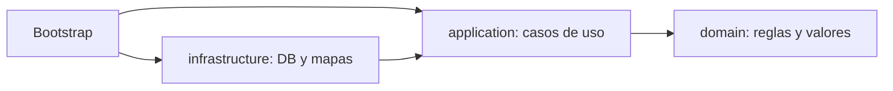

# Módulo 13: Proyecto integrador

## Aprende construyendo

### Tema 1: Arquitectura por capas del proyecto integrador · Avanzado · 50 min

#### Aprende

**Prerrequisito:** Módulos 1, 7, 10 y 12 de Java (clases, records, JPMS, SOLID); JDK 27 y un editor. Comprueba `java --version` y `javac --version`.

**Al terminar podrás:** separar dominio, servicio y aplicación con la dirección de dependencia correcta, compilar el dominio sin infraestructura, aplicar inversión puerto/adaptador, y verificar la frontera en el build.

Una aplicación de entregas que mezcla SQL o clientes HTTP con las reglas de negocio obliga a revisar esas reglas cuando cambia una decisión técnica. El dominio debe describir conceptos del negocio; el servicio coordina casos de uso; la infraestructura implementa persistencia y comunicación.

**¿Por qué es importante?** Porque una frontera comprobable permite cambiar un adaptador sin reescribir el modelo. Los nombres de paquetes ayudan, pero la prueba real es qué necesita cada capa para compilar.

**Mapa de subtemas críticos**

| Subtema | Papel | Evidencia del tema |
|---|---|---|
| capas: dominio, servicio, aplicación | Núcleo | cada una con una responsabilidad distinta |
| dirección de la dependencia | Núcleo | el dominio no depende de servicio ni infraestructura |
| dominio sin infraestructura | Diagnóstico | el dominio compila sin classpath |
| puerto y adaptador (inversión) | Variante | la infraestructura depende del servicio, no al revés |
| ensamblaje en el bootstrap | Núcleo | el punto de entrada compone las capas |
| fitness function de la frontera | Decisión | verificar la frontera, no confiar en la carpeta |

Cada fila tiene su explicación individual a continuación.

**Capas: dominio, servicio, aplicación (núcleo).** El **dominio** describe conceptos y reglas del negocio (valores, invariantes); el **servicio** coordina casos de uso; la **aplicación/infraestructura** implementa persistencia y comunicación (SQL, HTTP). Separar estas responsabilidades evita revisar las reglas cada vez que cambia una decisión técnica.

**Dirección de la dependencia (núcleo).** La regla central: las dependencias apuntan **hacia el dominio**, nunca al revés. El dominio no importa servicio ni infraestructura; el servicio importa el dominio; el bootstrap ensambla ambos. Esa dirección es lo que protege el modelo de los cambios técnicos.

**Dominio sin infraestructura (diagnóstico).** La prueba real no es el nombre del paquete sino qué necesita **compilar**: el dominio debe compilar **sin classpath** (sin servicio ni infraestructura). Si el dominio no compila aislado, una dependencia cruzó la frontera en la dirección equivocada.

**Puerto y adaptador (inversión) (variante).** Para que la infraestructura (un repositorio) sirva al servicio sin que el dominio dependa de ella, se usa inversión: el servicio define un **puerto** (interfaz) y la infraestructura lo **implementa** (adaptador). Así la infraestructura depende del servicio, no al revés (DIP, Módulo 12).

**Ensamblaje en el bootstrap (núcleo).** El punto de entrada (`Main`) es el único que **conoce todas las capas**: crea las implementaciones concretas y las inyecta. Concentrar ahí el ensamblaje mantiene el resto del código dependiendo solo de abstracciones.

**Fitness function de la frontera (decisión).** No confíes en que "las carpetas garantizan aislamiento": verifícalo. Compilar el dominio aislado, o una prueba de arquitectura (ArchUnit), o un `grep -R "infrastructure" domain/src` vacío, convierten la frontera en algo **comprobable** en el build, no en una convención que se erosiona.

**Analogía (con su límite):** diseño de producto, operaciones y logística externa colaboran sin que cambiar de transportista altere el diseño del producto. La analogía explica la separación de responsabilidades; no explica la inversión puerto/adaptador ni que la frontera deba verificarse en el build.



El dominio no importa servicios ni infraestructura. El servicio puede importar el dominio, y el punto de entrada ensambla ambos. No hacen falta tres módulos Maven para demostrar esta dependencia: tres árboles compilados por separado la hacen visible.

**Cuándo no usarlo:** un script descartable sin reglas de negocio no necesita esta ceremonia. Tampoco conviertas cada paquete en un proyecto independiente si no existe una frontera que mantener.

#### Practica

Crea una carpeta `ejemplo-capas-dominio` y estos archivos:

```text
domain/src/main/java/com/example/delivery/domain/Delivery.java
service/src/main/java/com/example/delivery/service/DeliveryService.java
app/src/main/java/com/example/delivery/app/Main.java
```

`Delivery.java` contiene únicamente el modelo:

```java
package com.example.delivery.domain;

public record Delivery(String id, double weight, String destination) {
}
```

`DeliveryService.java` aplica las reglas:

```java
package com.example.delivery.service;

import com.example.delivery.domain.Delivery;

public final class DeliveryService {
    public Delivery register(Delivery delivery) {
        if (delivery.weight() <= 0) {
            throw new IllegalArgumentException("weight must be positive");
        }
        if (delivery.destination().isBlank()) {
            throw new IllegalArgumentException("destination is required");
        }
        return delivery;
    }
}
```

`Main.java` ensambla el caso de uso:

```java
package com.example.delivery.app;

import com.example.delivery.domain.Delivery;
import com.example.delivery.service.DeliveryService;

public final class Main {
    public static void main(String[] args) {
        Delivery delivery = new Delivery("RF-13", 2.5, "Madrid");
        System.out.println(new DeliveryService().register(delivery));
    }
}
```

Compila cada árbol en orden y ejecuta:

```bash
javac -d domain/out $(find domain/src/main/java -name '*.java')
javac -cp domain/out -d service/out $(find service/src/main/java -name '*.java')
javac -cp domain/out:service/out -d app/out $(find app/src/main/java -name '*.java')
java -cp domain/out:service/out:app/out com.example.delivery.app.Main
```

**Resultado esperado:** `Delivery[id=RF-13, weight=2.5, destination=Madrid]`. La primera orden no recibe ningún classpath: demuestra que el dominio compila por sí solo.

**Fallo deliberado:** añade `import com.example.delivery.infrastructure.AuditClient;` a `Delivery.java` y repite solamente la primera compilación.

**Pista:** no crees `AuditClient`: el objetivo es observar la frontera, no satisfacerla.

**Resultado esperado:** `error: package com.example.delivery.infrastructure does not exist`. **Si falla.** Comprueba que estás compilando solo `domain/src/main/java`; incluir otros árboles ocultaría la dirección de la dependencia. Quita el import para restaurar el diseño.

#### Aplica

Añade al servicio la regla que rechaza identificadores en blanco. Crea un adaptador `infrastructure` con un repositorio en memoria que dependa de `DeliveryService`, no al revés, y modifica `Main` para registrar y recuperar la entrega. Ejecuta de nuevo las cuatro órdenes y comprueba con `grep -R "infrastructure" domain/src` que el dominio sigue limpio.

**Checklist de salida**

- [ ] `Delivery` no importa servicio ni infraestructura.
- [ ] El dominio compila sin classpath.
- [ ] El servicio valida peso, destino e identificador.
- [ ] El punto de entrada ensambla las dependencias.
- [ ] El fallo deliberado identifica la dependencia prohibida.
- [ ] El adaptador nuevo no invierte la frontera.

**Proyecto integrador:** conserva esta estructura para procesar el lote del Tema 2 y empaquetarlo en el Tema 3.

**Errores comunes:** confundir carpetas con aislamiento efectivo, colocar validación de negocio en un controlador y crear dependencias cíclicas entre capas.

**Fuentes revisadas el 2026-11-01:** [Maven Guides](https://maven.apache.org/guides/) y [dev.java: Learn](https://dev.java/learn/).

### Tema 2: Integrando concurrencia, modelado y testing · Experto · 60 min

#### Aprende

**Prerrequisito:** Tema 1 de este módulo y Módulos 5, 7 y 9 (virtual threads, sealed, testing); JDK 27 y Maven 3.9+.

**Al terminar podrás:** modelar el resultado con un `sealed` Exito/Error, distinguir fallo esperado de error interno, procesar el lote concurrentemente sin perder resultados, y probar el reparto con una dependencia simulada.

Un lote no debería perder todos sus resultados porque una entrega tenga una dirección incompleta. El fallo esperado pertenece al resultado de esa tarea; un error de infraestructura o una interrupción requieren otro tratamiento.

**¿Por qué es importante?** Porque separar un fallo esperado de un fallo interno evita tanto ocultar errores como abandonar trabajo válido. La interfaz sellada hace visibles los casos que el consumidor debe contemplar.

**Mapa de subtemas críticos**

| Subtema | Papel | Evidencia del tema |
|---|---|---|
| resultado explícito con `sealed` (Exito/Error) | Núcleo | el fallo esperado es parte del resultado, no una excepción |
| fallo esperado frente a error interno | Diagnóstico | la dirección incompleta no es lo mismo que una caída |
| procesamiento concurrente del lote | Núcleo | virtual threads por tarea sin perder resultados |
| reparto de éxitos y errores | Variante | el lote devuelve ambos, no se detiene en el primero |
| prueba con dependencia simulada | Integración | mockear la frontera y verificar el reparto |

Cada fila tiene su explicación individual a continuación.

**Resultado explícito con `sealed` (núcleo).** En vez de lanzar una excepción por cada entrega inválida, el procesamiento devuelve un `sealed interface Resultado permits Exito, Error` (Módulo 7): el fallo esperado es un **valor** que el consumidor debe contemplar en un `switch` exhaustivo, no algo que interrumpe el lote. Hace visibles los casos.

**Fallo esperado frente a error interno (diagnóstico).** Una **dirección incompleta** es un fallo de negocio esperado → va al `Error` del resultado. Un fallo de infraestructura (base caída) o una interrupción es otra cosa → se propaga como excepción. Mezclarlos oculta bugs reales o abandona trabajo válido; distinguirlos es la decisión clave.

**Procesamiento concurrente del lote (núcleo).** Las entregas se procesan en paralelo con virtual threads (Módulo 5), cada tarea devolviendo su `Resultado`. Que una tarea falle no tumba a las demás; cada una encapsula su desenlace.

**Reparto de éxitos y errores (variante).** Al final, el lote entrega **ambos** conjuntos (procesadas y rechazadas con su motivo), no se detiene en el primer fallo. El llamador decide qué hacer con cada grupo (reintentar, reportar). Es lo contrario de "una fila mala pierde todo el lote".

**Prueba con dependencia simulada (integración).** Se verifica el reparto **mockeando la frontera** (el repositorio/servicio externo, Módulo 9): se inyectan entradas que fuerzan éxitos y errores esperados, y se comprueba que el lote los separa correctamente, sin infraestructura real. Integra concurrencia, modelado con sealed y testing en un solo caso.

**Analogía (con su límite):** una línea de inspección etiqueta cada pieza como aprobada o rechazada; una defectuosa no obliga a tirar las demás. La analogía explica el reparto éxito/error; no explica la diferencia entre fallo esperado y error interno, que es una decisión de diseño del dominio.

```java
sealed interface Resultado permits Exito, Error {}
record Exito(String tarea) implements Resultado {}
record Error(String tarea, String motivo) implements Resultado {}
```

`newVirtualThreadPerTaskExecutor()` crea un virtual thread por tarea y su `close()` espera a que terminen. Esto no elimina los límites del recurso externo: una base de datos o API sigue necesitando control de concurrencia. Mockito sustituye el colaborador en la prueba, nunca la clase que queremos verificar.

#### Practica

Crea `ejemplo-procesamiento-concurrente` con un `pom.xml` que declare `maven.compiler.release` en `27`, JUnit Jupiter `6.0.3`, Mockito `5.21.0` y Surefire `3.5.5`. Añade `exec-maven-plugin` `3.6.4` con `academia.procesamiento.ProcesadorLote` como `mainClass`. Usa las dependencias en ámbito `test`.

Crea `src/main/java/academia/procesamiento/ProcesadorLote.java`:

```java
package academia.procesamiento;

import java.util.List;
import java.util.concurrent.ExecutionException;
import java.util.concurrent.Executors;

public final class ProcesadorLote {
    public sealed interface Resultado permits Exito, Error {}
    public record Exito(String tarea) implements Resultado {}
    public record Error(String tarea, String motivo) implements Resultado {}

    @FunctionalInterface
    public interface Operacion {
        void ejecutar(String tarea);
    }

    public List<Resultado> procesar(List<String> tareas, Operacion operacion) {
        try (var executor = Executors.newVirtualThreadPerTaskExecutor()) {
            return tareas.stream()
                    .map(tarea -> executor.submit(() -> ejecutar(tarea, operacion)))
                    .map(future -> {
                        try {
                            return future.get();
                        } catch (InterruptedException e) {
                            Thread.currentThread().interrupt();
                            throw new IllegalStateException("recolección interrumpida", e);
                        } catch (ExecutionException e) {
                            throw new IllegalStateException("fallo interno", e);
                        }
                    })
                    .toList();
        }
    }

    private Resultado ejecutar(String tarea, Operacion operacion) {
        try {
            operacion.ejecutar(tarea);
            return new Exito(tarea);
        } catch (RuntimeException e) {
            return new Error(tarea, e.getMessage());
        }
    }

    public static void main(String[] args) {
        var resultados = new ProcesadorLote().procesar(
                List.of("1", "2", "3", "4", "5"), tarea -> {
                    if (tarea.equals("2") || tarea.equals("5")) {
                        throw new IllegalArgumentException("dirección incompleta");
                    }
                });
        resultados.forEach(System.out::println);
    }
}
```

Ejecuta el programa:

```bash
mvn -q compile exec:java
```

**Resultado esperado:** tres `Exito` y dos `Error`; las tareas `2` y `5` muestran `motivo=dirección incompleta` y las demás conservan su resultado.

Crea `src/test/java/academia/procesamiento/ProcesadorLoteTest.java`:

```java
package academia.procesamiento;

import static org.junit.jupiter.api.Assertions.assertEquals;
import static org.mockito.ArgumentMatchers.anyString;
import static org.mockito.Mockito.doAnswer;
import static org.mockito.Mockito.mock;

import java.util.List;
import org.junit.jupiter.api.Test;

final class ProcesadorLoteTest {
    @Test
    void conservaExitosCuandoDosTareasFallan() {
        var operacion = mock(ProcesadorLote.Operacion.class);
        doAnswer(invocation -> {
            String tarea = invocation.getArgument(0);
            if (tarea.equals("2") || tarea.equals("4")) {
                throw new IllegalArgumentException("fallo esperado");
            }
            return null;
        }).when(operacion).ejecutar(anyString());

        var resultados = new ProcesadorLote().procesar(
                List.of("1", "2", "3", "4", "5"), operacion);

        assertEquals(3, resultados.stream()
                .filter(ProcesadorLote.Exito.class::isInstance).count());
        assertEquals(2, resultados.stream()
                .filter(ProcesadorLote.Error.class::isInstance).count());
    }
}
```

Ejecuta `mvn test`: debe terminar con `BUILD SUCCESS` y una prueba superada. Mockito puede emitir avisos sobre carga dinámica del agente en JDK 27; no son un fallo de esta prueba.

**Fallo deliberado:** elimina el `try/catch` de `ejecutar` y deja que la excepción de la operación salga del callable.

**Resultado esperado:** `future.get()` recibe `ExecutionException`, la recolección lanza `IllegalStateException: fallo interno` y Maven informa de la causa `dirección incompleta`. **Si falla.** Si todavía aparecen dos `Error`, estás ejecutando una clase anterior; limpia y recompila. Restaura el `try/catch` para volver a aislar los fallos esperados.

#### Aplica

Añade un resultado `Omitida` para tareas duplicadas y actualiza la interfaz sellada y las pruebas. Limita a cuatro las operaciones simultáneas contra un recurso simulado con un `Semaphore`, sin cambiar el executor por tarea. Prueba que una interrupción restaura la marca del thread y que los fallos esperados siguen formando parte de la lista.

**Checklist de salida**

- [ ] El executor se cierra con try-with-resources.
- [ ] Éxito y error esperado son casos explícitos.
- [ ] La recolección conserva los resultados válidos.
- [ ] La interrupción restaura el estado del thread.
- [ ] Mockito sustituye el colaborador, no el procesador.
- [ ] El recurso compartido tiene un límite de concurrencia.

**Proyecto integrador:** conecta este procesador con las capas del Tema 1; el dominio no debe conocer el executor.

**Errores comunes:** capturar toda excepción como fallo de negocio, ignorar `InterruptedException` y crear virtual threads sin proteger un recurso agotable.

**Fuentes revisadas el 2026-11-01:** [Virtual Threads](https://dev.java/learn/concurrency/virtual-threads/), [JUnit 5](https://docs.junit.org/current/user-guide/) y [Mockito](https://javadoc.io/doc/org.mockito/mockito-core/latest/org.mockito/org/mockito/Mockito.html).

### Tema 3: Build reproducible y cierre del track · Avanzado · 50 min

#### Aprende

**Prerrequisito:** Temas 1–2 de este módulo y Módulo 8 (build); JDK 27 y Maven 3.9+. Comprueba `mvn --version`.

**Al terminar podrás:** ejecutar la aplicación con una orden documentada, fijar `project.build.outputTimestamp`, comparar dos artefactos byte a byte, y explicar que la reproducibilidad exige fijar también el entorno.

Un proyecto que exige pasos manuales no escritos no es reproducible para otra persona. Además, compilar dos veces el mismo código puede producir archivos distintos si el empaquetado guarda fechas cambiantes.

**¿Por qué es importante?** Porque una orden única reduce errores de preparación y un artefacto idéntico permite relacionar el binario con el código y las dependencias declaradas.

**Mapa de subtemas críticos**

| Subtema | Papel | Evidencia del tema |
|---|---|---|
| orden única y documentada | Núcleo | el proyecto se construye y ejecuta sin pasos ocultos |
| build reproducible | Núcleo | dos builds del mismo código dan el mismo artefacto |
| `project.build.outputTimestamp` | Diagnóstico | normalizar las fechas de las entradas del JAR |
| comparación byte a byte | Variante | verificar la igualdad de dos artefactos |
| fijar entorno y versiones | Límite | mismo JDK y dependencias, no solo el timestamp |
| fuente única de verdad | Decisión | el valor deriva del commit/pipeline, no del reloj |

Cada fila tiene su explicación individual a continuación.

**Orden única y documentada (núcleo).** Un proyecto reproducible se construye y ejecuta con una **orden escrita** (en el README/build), sin pasos manuales que solo conoce quien lo escribió. Si otra persona no puede clonar y ejecutar siguiendo la documentación, el proyecto no es reproducible para el equipo.

**Build reproducible (núcleo).** Compilar **dos veces** el mismo código con el mismo entorno debe producir un artefacto **idéntico**. Esto permite relacionar un binario desplegado con el código y las dependencias exactas que lo generaron (trazabilidad de la cadena de suministro).

**`project.build.outputTimestamp` (diagnóstico).** Por defecto el JAR guarda la **fecha de empaquetado** en cada entrada, así que dos builds difieren aunque el código sea idéntico. Maven usa `project.build.outputTimestamp` para **normalizar** esas fechas a un valor fijo; es el ajuste clave para la reproducibilidad del artefacto.

**Comparación byte a byte (variante).** La verificación es objetiva: construir dos veces y comparar los artefactos con un checksum (`sha256sum`) o byte a byte. Si coinciden, la build es reproducible para ese entorno; si no, algo introduce no-determinismo (timestamps, orden, rutas absolutas).

**Fijar entorno y versiones (límite).** Reproducibilidad **no** significa que dos máquinas con JDK o dependencias distintas den lo mismo. Hay que fijar también el **entorno**: misma versión de JDK, dependencias con versión exacta (Módulo 8), y preferiblemente un build contenedorizado. El timestamp solo resuelve una parte.

**Fuente única de verdad (decisión).** El `outputTimestamp` debe derivar de una **fuente estable** (la fecha del commit, una variable del pipeline), **nunca** del reloj actual ni de un valor inventado a mano. Una sola fuente de verdad evita que el valor se desincronice entre máquinas.

**Analogía (con su límite):** entregar un equipo ensamblado con una receta fija, no una caja cuya composición cambia según la hora de empaquetado. La analogía explica el determinismo del artefacto; no explica que también hay que fijar el entorno (JDK, dependencias), no solo la fecha.

Maven usa `project.build.outputTimestamp` para normalizar las fechas de las entradas del archivo. El valor debe ser fijo o derivar de una revisión estable, nunca del reloj actual. Reproducibilidad no significa que dos máquinas con JDK o dependencias diferentes produzcan necesariamente lo mismo: hay que fijar también el entorno y las versiones.

**Cuándo no usarlo:** no fijes una fecha arbitraria en un sistema que ya obtiene ese valor de forma verificable desde su commit o pipeline; conserva una única fuente de verdad.

#### Practica

Crea `ejemplo-build-reproducible/pom.xml`:

```xml
<project xmlns="http://maven.apache.org/POM/4.0.0">
  <modelVersion>4.0.0</modelVersion>
  <groupId>academia</groupId>
  <artifactId>integrador</artifactId>
  <version>1.0.0</version>
  <properties>
    <maven.compiler.release>27</maven.compiler.release>
    <project.build.sourceEncoding>UTF-8</project.build.sourceEncoding>
    <project.build.outputTimestamp>2026-01-01T00:00:00Z</project.build.outputTimestamp>
  </properties>
  <build>
    <plugins>
      <plugin>
        <groupId>org.codehaus.mojo</groupId>
        <artifactId>exec-maven-plugin</artifactId>
        <version>3.6.4</version>
        <configuration>
          <mainClass>academia.integrador.Main</mainClass>
        </configuration>
      </plugin>
    </plugins>
  </build>
</project>
```

Crea `src/main/java/academia/integrador/Main.java`:

```java
package academia.integrador;

public final class Main {
    public static void main(String[] args) {
        System.out.println("integrador listo");
    }
}
```

Ejecuta la aplicación y construye dos veces, conservando el primer JAR fuera de `target` para que `clean` no lo borre:

```bash
mvn -q compile exec:java
mvn -q clean package
shasum -a 256 target/integrador-1.0.0.jar
cp target/integrador-1.0.0.jar /tmp/integrador-primero.jar
mvn -q clean package
shasum -a 256 target/integrador-1.0.0.jar
cmp /tmp/integrador-primero.jar target/integrador-1.0.0.jar
```

**Resultado esperado:** la aplicación imprime `integrador listo`, ambos SHA-256 coinciden y `cmp` no produce salida. La igualdad se comprueba byte a byte, no solo mirando el tamaño.

**Fallo deliberado:** añade `maven-jar-plugin` `3.5.0` con esta configuración dentro de `build/plugins`:

```xml
<plugin>
  <groupId>org.apache.maven.plugins</groupId>
  <artifactId>maven-jar-plugin</artifactId>
  <version>3.5.0</version>
  <configuration>
    <archive>
      <manifestEntries>
        <Build-Time>${maven.build.timestamp}</Build-Time>
      </manifestEntries>
    </archive>
  </configuration>
</plugin>
```

Repite los dos builds esperando al menos dos segundos entre ellos. **Resultado esperado:** los hashes cambian y `cmp` señala que los archivos difieren. **Si falla.** Si los hashes coinciden, ambos builds ocurrieron dentro de la misma resolución temporal o el plugin no quedó dentro de `build/plugins`. Retira `Build-Time`; conserva `project.build.outputTimestamp`.

#### Aplica

Documenta en el `README.md` del proyecto las versiones de JDK y Maven, `mvn clean verify`, `mvn compile exec:java` y la comparación de hashes. Copia únicamente `pom.xml` y `src` a una carpeta nueva y sigue esas instrucciones sin reutilizar `target`. Añade después las fuentes de los Temas 1 y 2 y consigue que una sola verificación compile y pruebe el integrador completo.

**Checklist de salida**

- [ ] JDK, Maven y plugins tienen versiones documentadas.
- [ ] La aplicación se ejecuta con una sola orden.
- [ ] Dos builds del mismo contenido tienen el mismo SHA-256.
- [ ] `cmp` confirma igualdad byte a byte.
- [ ] La fecha del manifest no depende del reloj actual.
- [ ] Una copia sin `target` compila y ejecuta siguiendo el README.

**Proyecto integrador:** cierra el track con capas, procesamiento concurrente, pruebas y empaquetado reproducible en el mismo proyecto.

**Errores comunes:** confundir una compilación exitosa con reproducibilidad, omitir versiones de plugins y comparar hashes sin limpiar el artefacto anterior.

**Fuentes revisadas el 2026-11-01:** [Reproducible Builds en Maven](https://maven.apache.org/guides/mini/guide-reproducible-builds.html), [Exec Maven Plugin](https://www.mojohaus.org/exec-maven-plugin/) y [dev.java: Learn](https://dev.java/learn/).

## Construcción guiada del capítulo

**Objetivo del laboratorio:** construir la aplicación integradora completa con arquitectura por capas, procesamiento concurrente, tests y build reproducible.

**Requisitos previos:** Módulos 0-12 completados.

| Paso | Acción | Código | Explicación |
|---|---|---|---|
| 1 | Diseñar la arquitectura por capas | Ver Tema 1 | `dominio/`, `servicio/`, `infraestructura/` |
| 2 | Implementar procesamiento con virtual threads | Ver Tema 2 | Modela el resultado como sealed interface |
| 3 | Modelar el dominio con records y sealed interfaces | Módulo 7 | Donde sea apropiado |
| 4 | Escribir tests con JUnit 5 y Mockito | Módulo 9 | Para la lógica de negocio crítica |
| 5 | Configurar el build reproducible | Ver Tema 3 | Ejecutable con un solo comando |

**Verificación:** el laboratorio (y el track completo) se considera exitoso si la aplicación procesa tareas concurrentemente sin condiciones de carrera, si el manejo de éxito/error está modelado explícitamente y verificado exhaustivamente por el compilador, y si cualquier persona puede clonar y ejecutar el proyecto con un único comando documentado.

**Errores comunes y soluciones**

- **Mezclar lógica de dominio con detalles de infraestructura.** Mantén el dominio libre de dependencias hacia infraestructura concreta.
- **Usar excepciones para casos de fallo esperados en procesamiento concurrente masivo.** Modela el resultado como una sealed interface con casos de éxito y error explícitos.
- **Dejar el build sin documentar el comando de ejecución.** Documenta claramente cómo clonar y ejecutar el proyecto con un solo comando.

---
