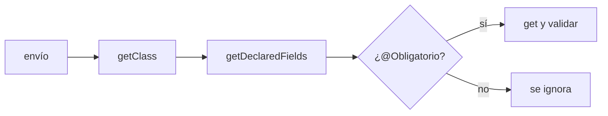
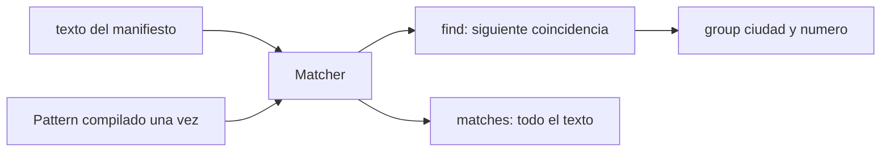
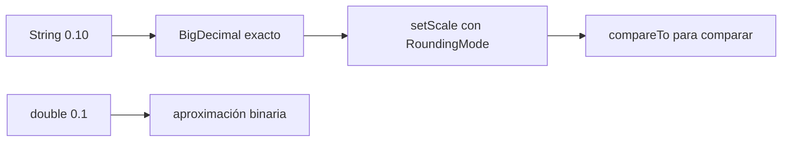
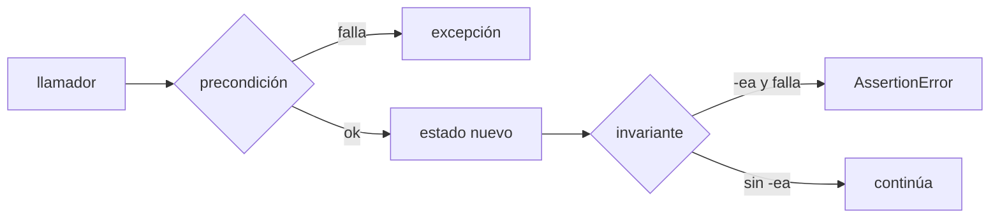
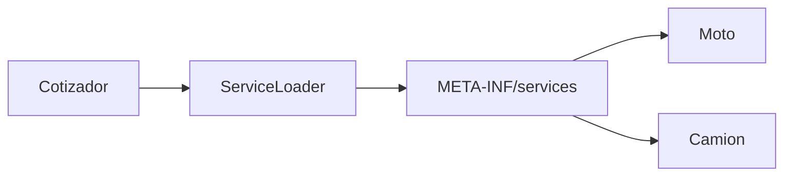
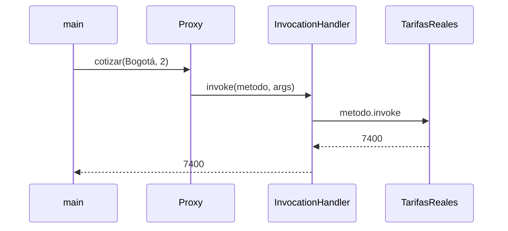
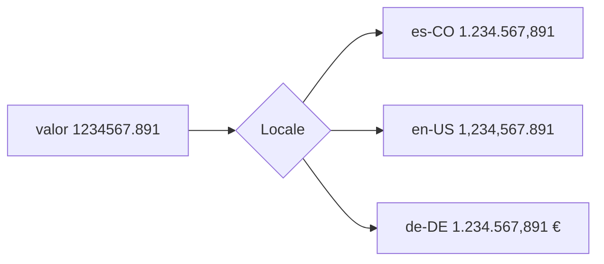

# Módulo 19: Java del día a día — reflexión, regex, dinero, contratos, plugins e i18n

## Aprende construyendo

Cada tema es un proyecto independiente que comienza en una carpeta vacía. Escribe manualmente cada archivo indicado: ningún ejercicio depende de código prefabricado ni de archivos de otro tema.

### Tema 1: Reflexión y anotaciones en tiempo de ejecución · Intermedio · 90 min

#### Aprende

**Prerrequisitos:** orientación a objetos y una comprensión básica de módulos y `opens`.

**Al terminar podrás:** inspeccionarás campos y métodos con reflexión, leerás una anotación propia en tiempo de ejecución y demostrarás el efecto de `RetentionPolicy.RUNTIME` en un validador genérico.

**Por qué importa:** Spring encuentra `@RestController`, Jackson convierte objetos y JUnit descubre métodos `@Test` mediante mecanismos de este tipo. Entenderlos quita la magia a los frameworks y permite diagnosticar anotaciones invisibles o `InaccessibleObjectException`.

**Mapa de subtemas críticos**

| Subtema | Papel | Evidencia |
|---|---|---|
| `Class<?>` y descriptores (`Field`, `Method`) | Núcleo | `getDeclaredFields()` lista los campos |
| `@Retention(RUNTIME)` para ver anotaciones | Núcleo | Sin RUNTIME, `obligatorio=false` |
| `isAnnotationPresent` y `getAnnotation` | Núcleo | Validador lee `@Obligatorio`/`@Rango` |
| `setAccessible(true)` y `opens` (JPMS) | Diagnóstico | `InaccessibleObjectException` sin `opens` |
| Invocar por nombre (`Method.invoke`) | Variante | `toUpperCase` llamado por reflexión |
| Coste y optimización del acceso reflectivo | Límite | Medición con mediana, no una corrida |
| No usar reflexión en lógica de negocio | Error frecuente | Reservada a frameworks/validadores |

Cada fila tiene su explicación individual a continuación.

**`Class<?>` y descriptores (núcleo).** Toda clase cargada tiene un objeto `Class<?>` que describe su estructura: `getDeclaredFields()` devuelve los `Field`, `getDeclaredMethods()` los `Method`, y análogamente constructores. El validador recorre los campos de `Envio` sin conocer la clase en tiempo de compilación, que es justo lo que hacen los frameworks.

**`@Retention(RUNTIME)` para ver anotaciones (núcleo).** Una anotación solo está disponible por reflexión si declara `@Retention(RetentionPolicy.RUNTIME)`. La retención por defecto es `CLASS`: la anotación queda en el `.class` pero no se carga en memoria, así que `isAnnotationPresent` devuelve `false`. Borrar la retención hace que el validador no vea ningún campo obligatorio.

**`isAnnotationPresent` y `getAnnotation` (núcleo).** `campo.isAnnotationPresent(Obligatorio.class)` comprueba si la anotación está; `campo.getAnnotation(Rango.class)` la recupera para leer sus atributos (`min()`, `max()`). Esa es la mecánica con la que un framework decide qué hacer con cada elemento anotado.

**`setAccessible(true)` y `opens` (diagnóstico).** Los campos privados no son accesibles por reflexión hasta llamar `setAccessible(true)`. Bajo JPMS eso falla con `InaccessibleObjectException` salvo que el paquete esté abierto (`opens paquete;` en `module-info.java`). Es la causa típica de errores al reflejar sobre módulos cerrados.

**Invocar por nombre (variante).** `clase.getMethod("toUpperCase")` localiza un método por su nombre y `metodo.invoke(obj, args...)` lo ejecuta. Esto permite llamar código decidido en runtime (serializadores, routers), a costa de perder la verificación del compilador sobre esa llamada.

**Coste y optimización del acceso reflectivo (límite).** La reflexión es más lenta que una llamada directa, pero el JIT optimiza accesos repetidos y la diferencia depende del caso. Por eso la medición se hace con calentamiento, varias repeticiones y reportando mediana y dispersión, sin concluir "la reflexión siempre es lenta" desde una sola corrida.

**No usar reflexión en lógica de negocio (error frecuente).** En código de negocio pierdes verificación del compilador, legibilidad y rendimiento. Se reserva para frameworks, herramientas y validadores genéricos; una regla de negocio normal debe llamar métodos directamente, no descubrirlos por nombre.

Cada clase cargada tiene un objeto `Class<?>` que describe campos (`Field`), métodos (`Method`) y constructores. Una anotación solo existe en tiempo de ejecución si tiene `@Retention(RetentionPolicy.RUNTIME)`. `setAccessible(true)` salta la encapsulación; con JPMS requiere que el paquete esté abierto con `opens`.

**Analogía:** la reflexión es la radiografía de un objeto: ves sus huesos sin abrirlo, pero usar radiografías para todo es más lento y riesgoso que hablar directamente con el paciente.



Desde una carpeta vacía:

```bash
mkdir java-reflexion
cd java-reflexion
```

Crea manualmente `Reflexion.java`:

```java
import java.lang.annotation.*;
import java.lang.reflect.*;
import java.util.*;

public class Reflexion {
    @Retention(RetentionPolicy.RUNTIME)
    @Target(ElementType.FIELD)
    @interface Obligatorio {}

    static class Envio {
        @Obligatorio private String guia;
        @Obligatorio private String destino;
        private String nota;

        Envio(String guia, String destino, String nota) {
            this.guia = guia;
            this.destino = destino;
            this.nota = nota;
        }
    }

    static List<String> validar(Object objeto) throws IllegalAccessException {
        List<String> errores = new ArrayList<>();
        Class<?> clase = objeto.getClass();
        for (Field campo : clase.getDeclaredFields()) {
            if (campo.isAnnotationPresent(Obligatorio.class)) {
                campo.setAccessible(true);
                Object valor = campo.get(objeto);
                if (valor == null || valor.toString().isBlank()) {
                    errores.add(clase.getSimpleName() + "." + campo.getName()
                        + " es obligatorio");
                }
            }
        }
        return errores;
    }

    public static void main(String[] args) throws Exception {
        Class<?> clase = Envio.class;
        System.out.println("Campos de " + clase.getSimpleName() + ":");
        for (Field campo : clase.getDeclaredFields()) {
            System.out.printf("  %-8s %-7s obligatorio=%s%n", campo.getName(),
                campo.getType().getSimpleName(), campo.isAnnotationPresent(Obligatorio.class));
        }
        System.out.println(validar(new Envio("G-1", "Cali", null)));
        System.out.println(validar(new Envio("", null, "frágil")));

        Method metodo = String.class.getMethod("toUpperCase");
        System.out.println(metodo.invoke("entregado"));
    }
}
```

Ejecuta el archivo fuente directamente:

```bash
java Reflexion.java
```

**Resultado esperado:**

```text
Campos de Envio:
  guia     String  obligatorio=true
  destino  String  obligatorio=true
  nota     String  obligatorio=false
[]
[Envio.guia es obligatorio, Envio.destino es obligatorio]
ENTREGADO
```

El validador no menciona `Envio`: lo descubre con `getDeclaredFields()`. La última línea invoca un método localizado por nombre.

**Fallo deliberado y corrección:** borra `@Retention(RetentionPolicy.RUNTIME)`. El programa compila, pero todos los campos muestran `obligatorio=false` y el envío vacío pasa con `[]`. La retención predeterminada es `CLASS`. Restaura la anotación y verifica nuevamente los dos errores de validación.

#### Practica

**Práctica guiada:** crea `RangoDemo.java` con una anotación `@Rango(min, max)` para enteros. Declara `int min(); int max();`, aplícala a `kilos` y valida el intervalo 1–30 mediante `campo.getAnnotation(Rango.class)`.

```bash
java RangoDemo.java
```

**Resultado esperado:** 0 y 31 producen mensajes que incluyen campo e intervalo; 1, 15 y 30 producen una lista vacía.

**Ejercicio independiente:** crea `MedicionReflexion.java`. Mide con `System.nanoTime()` un millón de lecturas del mismo campo por reflexión frente a un getter normal. Calienta ambos recorridos, ejecuta varias repeticiones y escribe en la salida mediana y dispersión; no concludes desde una sola ejecución.

```bash
java MedicionReflexion.java
```

**Resultado esperado:** obtienes mediciones comparables y una explicación que distingue coste de acceso, optimización JIT y utilidad de la reflexión, sin afirmar que toda llamada reflectiva es siempre lenta.

#### Aplica

En el **[Proyecto integrador: validación de solicitudes de asignación](#proyecto-19-utilidades-de-producción-para-el-motor-de-asignación)**, valida con anotaciones los campos obligatorios antes de procesar cada solicitud.

**Checklist de salida**

- [ ] El ejemplo se creó manualmente desde una carpeta vacía.
- [ ] `Class`, `Field` y `Method` aparecen en una ejecución observable.
- [ ] `@Obligatorio` tiene retención `RUNTIME` y objetivo `FIELD`.
- [ ] El validador funciona sin conocer la clase concreta inspeccionada.
- [ ] Puedes explicar la relación entre `setAccessible` y `opens`.
- [ ] Sabes por qué la lógica de negocio normal no debería depender de reflexión.

**Cuándo no usarlo:** en código de negocio normal pierdes verificación del compilador, rendimiento y claridad. Resérvalo para frameworks, herramientas y validadores genéricos.

**Fuentes oficiales revisadas el 2026-11-01:** [Reflection API](https://dev.java/learn/reflection/) y [java.lang.reflect (API Java SE 27)](https://docs.oracle.com/en/java/javase/27/docs/api/java.base/java/lang/reflect/package-summary.html).

### Tema 2: Expresiones regulares con Pattern y Matcher · Intermedio · 90 min

#### Aprende

**Prerrequisito:** manejo básico de `String` y literales de Java.

**Al terminar podrás:** compilarás patrones con clases de caracteres, cuantificadores, límites y grupos con nombre para buscar, validar y enmascarar texto; distinguirás `find()` de `matches()` y diagnosticarás escapes inválidos.

**Por qué importa:** el manifiesto diario de RutaFlow mezcla texto libre con guías como `BO-004512`. Extraerlas, contarlas y enmascararlas es útil, pero un patrón mal diseñado también puede convertirse en una denegación de servicio.

**Mapa de subtemas críticos**

| Subtema | Papel | Evidencia |
|---|---|---|
| `Pattern` compilado una vez, reutilizable | Prerrequisito | Constante estática `GUIA`/`CORREO` |
| Clases, cuantificadores y límites (`\b`, `{6}`) | Núcleo | `ME-12345` (5 dígitos) no coincide |
| Grupos con nombre `(?<ciudad>...)` | Núcleo | `m.group("ciudad")` extrae el campo |
| `find()` vs `matches()` | Núcleo | Buscar dentro vs validar todo |
| Escapes en literal Java (`\\d`) | Diagnóstico | `\d` da `illegal escape character` |
| `replaceAll` con referencias `${nombre}` | Variante | Enmascarado `BO-******` |
| ReDoS por backtracking catastrófico | Límite | `(a+)+$` crece de forma explosiva |

Cada fila tiene su explicación individual a continuación.

**`Pattern` compilado una vez (prerrequisito).** Compilar una regex tiene coste. `Pattern.compile(...)` produce un objeto inmutable y seguro entre hilos que se guarda como constante y se reutiliza; crear un `Matcher` por texto es lo barato. Compilar dentro de un bucle desperdicia trabajo.

**Clases, cuantificadores y límites (núcleo).** `[A-Z]{2}` exige dos mayúsculas, `\d{6}` exactamente seis dígitos y `\b` un límite de palabra. Esta precisión es la que rechaza `bo-1` (minúsculas, pocos dígitos) y `ME-12345` (cinco dígitos): el patrón describe la forma exacta de una guía válida.

**Grupos con nombre (núcleo).** `(?<ciudad>[A-Z]{2})` captura una parte de la coincidencia bajo un nombre legible, recuperable con `m.group("ciudad")`. Frente a índices numéricos, los nombres hacen el código robusto ante reordenar grupos y claro al leer.

**`find()` vs `matches()` (núcleo).** `find()` busca la *siguiente* aparición dentro del texto (sirve para extraer varias guías de un manifiesto); `matches()` exige que *todo* el texto cumpla el patrón (sirve para validar un correo completo). Confundirlos valida de más o extrae de menos.

**Escapes en literal Java (diagnóstico).** En un `String` de Java, `\` inicia un escape del lenguaje, así que una regex `\d` debe escribirse `"\\d"`. Escribir `"\d"` falla en compilación con `illegal escape character` porque Java procesa sus escapes antes de pasar el texto a la regex.

**`replaceAll` con referencias (variante).** `GUIA.matcher(texto).replaceAll("${ciudad}-******")` reemplaza cada coincidencia conservando el grupo `ciudad` y ocultando el número. Es el mecanismo para enmascarar datos sensibles manteniendo contexto legible.

**ReDoS por backtracking catastrófico (límite).** Patrones con cuantificadores anidados como `(a+)+$` pueden provocar un número exponencial de pasos de backtracking ante una entrada que casi coincide, colgando el hilo: una denegación de servicio. La defensa es evitar esa forma, usar patrones lineales y acotar el tamaño de la entrada.

`Pattern` es la expresión compilada: compílala una vez y reutilízala; es inmutable y segura entre hilos. `Matcher` aplica el patrón a un texto. `find()` busca la siguiente coincidencia; `matches()` exige que todo el texto coincida. `(?<nombre>...)` crea un grupo con nombre. En un literal Java, `\d` se escribe `"\\d"`.

**Analogía:** el patrón es un molde de galletas y el texto la masa. `find` busca dónde cabe el molde; `matches` pregunta si toda la masa tiene esa forma.



Empieza en otra carpeta vacía:

```bash
mkdir java-regex
cd java-regex
```

Crea manualmente `Regex.java`:

```java
import java.util.regex.*;
import java.util.*;

public class Regex {
    private static final Pattern GUIA =
        Pattern.compile("\\b(?<ciudad>[A-Z]{2})-(?<numero>\\d{6})\\b");
    private static final Pattern CORREO =
        Pattern.compile("^[\\w.+-]+@[\\w-]+(\\.[\\w-]+)+$");

    public static void main(String[] args) {
        String manifiesto = "Despacho 28/10: BO-004512 a Chapinero, "
            + "CA-998001 a Cali, bo-1 inválida, ME-12345 corta.";
        Matcher m = GUIA.matcher(manifiesto);
        Map<String, Integer> porCiudad = new TreeMap<>();
        while (m.find()) {
            System.out.printf("guía %s -> ciudad=%s número=%s (posición %d)%n",
                m.group(), m.group("ciudad"), m.group("numero"), m.start());
            porCiudad.merge(m.group("ciudad"), 1, Integer::sum);
        }
        System.out.println("Por ciudad: " + porCiudad);

        for (String correo : List.of("ana@rutaflow.co", "beto@@rutaflow",
                "caro.ruiz+pedidos@mail.com")) {
            System.out.printf("%-28s válido=%s%n", correo,
                CORREO.matcher(correo).matches());
        }
        System.out.println(GUIA.matcher(manifiesto).replaceAll("${ciudad}-******"));
    }
}
```

Ejecuta:

```bash
java Regex.java
```

**Resultado esperado:**

```text
guía BO-004512 -> ciudad=BO número=004512 (posición 16)
guía CA-998001 -> ciudad=CA número=998001 (posición 39)
Por ciudad: {BO=1, CA=1}
ana@rutaflow.co              válido=true
beto@@rutaflow               válido=false
caro.ruiz+pedidos@mail.com   válido=true
Despacho 28/10: BO-****** a Chapinero, CA-****** a Cali, bo-1 inválida, ME-12345 corta.
```

`bo-1` está en minúsculas y `ME-12345` tiene cinco dígitos: ninguno coincide.

**Fallo deliberado y corrección:** en `GUIA` cambia `\\d{6}` por `\d{6}` con una sola barra en el literal. `javac` informa `illegal escape character`, porque Java procesa primero sus propios escapes. Restaura `\\d{6}` y vuelve a ejecutar; las dos guías vuelven a aparecer.

#### Practica

**Práctica guiada:** crea `Telefonos.java` con un patrón para teléfonos colombianos de diez dígitos que empiecen por 3, por ejemplo `\\b3\\d{9}\\b`. Extrae teléfonos de un manifiesto que incluya también números de 9 y 11 dígitos.

```bash
java Telefonos.java
```

**Resultado esperado:** solo aparecen los números válidos de diez dígitos; los demás no se extraen como fragmentos.

**Ejercicio independiente:** crea `Redos.java` para comparar `(a+)+$` con un patrón lineal sobre `"a".repeat(n) + "!"`. Empieza con valores pequeños de `n`, aumenta gradualmente, mide tiempos y detén el proceso si crece de forma descontrolada. Explica backtracking catastrófico y añade un límite de longitud de entrada.

```bash
java Redos.java
```

**Resultado esperado:** la comparación muestra el crecimiento desproporcionado del patrón vulnerable y el comportamiento acotado de la alternativa; no uses entradas enormes sin supervisión.

#### Aplica

En el **[Proyecto integrador: extractor seguro de guías](#proyecto-19-utilidades-de-producción-para-el-motor-de-asignación)**, extrae y valida códigos antes de asignarlos, con límite de tamaño para las entradas.

**Checklist de salida**

- [ ] Escribiste el proyecto completo sin archivos prefabricados.
- [ ] Reutilizas un `Pattern` compilado y creas un `Matcher` por texto.
- [ ] Extraes ciudad y número mediante grupos con nombre.
- [ ] Demuestras con ejemplos la diferencia entre `find` y `matches`.
- [ ] Los literales contienen las barras dobles que requieren los escapes regex.
- [ ] Reconoces ReDoS y evitas regex para JSON, XML, URL o fechas estructuradas.

**Cuándo no usarlo:** para formatos estructurados utiliza un parser o la API específica (`URI`, `LocalDate.parse`); una regex enorme es difícil de mantener.

**Fuentes oficiales revisadas el 2026-11-01:** [Regular Expressions](https://dev.java/learn/regex/) y [java.util.regex.Pattern (API Java SE 27)](https://docs.oracle.com/en/java/javase/27/docs/api/java.base/java/util/regex/Pattern.html).

### Tema 3: Dinero exacto con BigDecimal · Básico · 75 min

#### Aprende

**Prerrequisito:** tipos primitivos, operadores y ciclos.

**Al terminar podrás:** crearás importes con `BigDecimal` desde texto, aplicarás escala y redondeo explícitos y compararás cantidades con `compareTo`; observarás tanto la imprecisión de `double` como el fallo de una división sin escala.

**Por qué importa:** RutaFlow cobra tarifas, IVA y cuotas. Una diferencia mínima multiplicada por muchas facturas se convierte en un problema contable y de auditoría.

**Mapa de subtemas críticos**

| Subtema | Papel | Evidencia |
|---|---|---|
| `double` es binario inexacto para dinero | Prerrequisito | `0.10 × 10 != 1.0` con `double` |
| Construir desde `String`, no `double` | Núcleo | `new BigDecimal(0.1)` revela la cola binaria |
| Escala y `RoundingMode` explícitos | Núcleo | `divide(...,2,HALF_EVEN)` evita excepción |
| `HALF_UP` comercial vs `HALF_EVEN` bancario | Variante | Política de redondeo elegida a propósito |
| `equals` (valor+escala) vs `compareTo` (valor) | Diagnóstico | `2.0` equals `2.00` = false; compareTo = 0 |
| Reparto que cuadra al total | Núcleo | Tres cuotas suman `100000.00` |
| Cuándo `double` sí sirve | Límite | Cálculo científico con tolerancia |

Cada fila tiene su explicación individual a continuación.

**`double` es binario inexacto (prerrequisito).** El punto flotante IEEE-754 representa fracciones en base 2; `0,1` no tiene representación exacta, así que sumar `0.10` diez veces da `0.9999999999999999`, distinto de `1.0`. Para dinero ese error se acumula factura a factura.

**Construir desde `String`, no `double` (núcleo).** `new BigDecimal("0.1")` guarda exactamente un décimo; `new BigDecimal(0.1)` captura la aproximación binaria del `double` y arrastra `0.1000000000000000055...`. Siempre se construye desde texto (o desde `BigDecimal.ZERO`) para no heredar el error de origen.

**Escala y `RoundingMode` explícitos (núcleo).** Una división como `100000 / 3` no termina en decimal; `divide(divisor)` sin escala lanza `ArithmeticException: Non-terminating decimal expansion`. Hay que indicar escala y modo: `divide(tres, 2, RoundingMode.HALF_EVEN)` produce `33333.33` con una política declarada.

**`HALF_UP` comercial vs `HALF_EVEN` bancario (variante).** `HALF_UP` redondea el 0,5 hacia arriba (uso comercial habitual); `HALF_EVEN` redondea al par más cercano, reduciendo sesgo acumulado en muchas operaciones (uso bancario). Elegir uno es una decisión contable, no un detalle.

**`equals` vs `compareTo` (diagnóstico).** `BigDecimal.equals` compara valor *y* escala, así que `2.0` no es `equals` a `2.00`. `compareTo` compara solo la cantidad, devolviendo `0` para ambos. Para decidir si dos importes son iguales se usa `compareTo`, no `equals`.

**Reparto que cuadra al total (núcleo).** Repartir `100000` en tres cuotas redondeadas puede perder o ganar centavos. La técnica es redondear las primeras cuotas (`33333.33`) y derivar la última por sustracción (`33333.34`), garantizando que la suma impresa sea exactamente `100000.00`.

**Cuándo `double` sí sirve (límite).** En cálculo científico o gráfico, donde importa el error relativo y el rendimiento, `double` es la elección correcta. `BigDecimal` es para valores exactos de escala fija como dinero; usarlo en un bucle numérico pesado sería lento sin aportar nada.

`double` usa punto flotante binario: 0,1 no tiene representación exacta. `BigDecimal` guarda un entero arbitrario y una escala. Créalo desde `String`, no desde `double`. En divisiones y redondeos indica escala y `RoundingMode`: `HALF_UP` es comercial y `HALF_EVEN` bancario. `equals` compara valor y escala; `compareTo` compara cantidades.

**Analogía:** `double` es una regla de goma, cómoda pero deformable; `BigDecimal` es contar billetes uno por uno.



Desde una carpeta vacía:

```bash
mkdir java-dinero
cd java-dinero
```

Crea manualmente `Dinero.java`:

```java
import java.math.BigDecimal;
import java.math.RoundingMode;

public class Dinero {
    public static void main(String[] args) {
        double totalDouble = 0;
        BigDecimal totalExacto = BigDecimal.ZERO;
        for (int i = 0; i < 10; i++) {
            totalDouble += 0.10;
            totalExacto = totalExacto.add(new BigDecimal("0.10"));
        }
        System.out.println("double:     " + totalDouble
            + "  ¿igual a 1.0? " + (totalDouble == 1.0));
        System.out.println("BigDecimal: " + totalExacto
            + "  ¿igual a 1.00? " + (totalExacto.compareTo(BigDecimal.ONE) == 0));

        BigDecimal tarifa = new BigDecimal("18750");
        BigDecimal iva = new BigDecimal("0.19");
        BigDecimal impuesto = tarifa.multiply(iva).setScale(0, RoundingMode.HALF_UP);
        System.out.println("IVA de " + tarifa + " = " + impuesto
            + "  total = " + tarifa.add(impuesto));

        BigDecimal cuota = new BigDecimal("100000")
            .divide(new BigDecimal("3"), 2, RoundingMode.HALF_EVEN);
        System.out.println("100000 / 3 con 2 decimales = " + cuota);
        System.out.println("new BigDecimal(0.1) = " + new BigDecimal(0.1));
        System.out.println("equals 2.0 vs 2.00: "
            + new BigDecimal("2.0").equals(new BigDecimal("2.00"))
            + "  compareTo: " + new BigDecimal("2.0").compareTo(new BigDecimal("2.00")));
    }
}
```

Ejecuta:

```bash
java Dinero.java
```

**Resultado esperado:**

```text
double:     0.9999999999999999  ¿igual a 1.0? false
BigDecimal: 1.00  ¿igual a 1.00? true
IVA de 18750 = 3563  total = 22313
100000 / 3 con 2 decimales = 33333.33
new BigDecimal(0.1) = 0.1000000000000000055511151231257827021181583404541015625
equals 2.0 vs 2.00: false  compareTo: 0
```

**Fallo deliberado y corrección:** cambia la división de la cuota a `new BigDecimal("100000").divide(new BigDecimal("3"))`. Obtienes `ArithmeticException: Non-terminating decimal expansion; no exact representable decimal result.` Restaura escala 2 y `HALF_EVEN`; el programa vuelve a imprimir `33333.33` con una política explícita.

#### Practica

**Práctica guiada:** crea `Cuotas.java` para repartir `100000` en tres cuotas cuya suma sea exactamente el total. Calcula dos cuotas redondeadas a dos decimales y deriva la última por sustracción.

```bash
java Cuotas.java
```

**Resultado esperado:** las cuotas son `33333.33`, `33333.33` y `33333.34`; su suma impresa es `100000.00`.

**Ejercicio independiente:** crea `DineroCentavos.java` que represente importes como `long` de centavos y repita el cálculo de IVA y cuotas. Documenta reglas de conversión, redondeo y desbordamiento, y compara legibilidad y riesgos con `BigDecimal`. Investiga la API `javax.money` (JSR 354) como alternativa externa, sin añadir dependencias al ejemplo base.

```bash
java DineroCentavos.java
```

**Resultado esperado:** ambos modelos cuadran el total y una nota en la salida explica por qué no deben mezclarse unidades de pesos y centavos implícitamente.

#### Aplica

En el **[Proyecto integrador: tarifas e IVA de asignaciones](#proyecto-19-utilidades-de-producción-para-el-motor-de-asignación)**, calcula cada importe con `BigDecimal` y verifica que el total del día cuadre al peso.

**Checklist de salida**

- [ ] Todo el código fue escrito en un proyecto nuevo y vacío.
- [ ] Los importes se construyen desde `String` o `BigDecimal.ZERO`.
- [ ] Toda división no exacta declara escala y `RoundingMode`.
- [ ] Las cantidades se comparan con `compareTo`, no con `equals`.
- [ ] El reparto de cuotas conserva exactamente el total.
- [ ] Puedes justificar por qué `double` sí es apropiado para cálculos científicos.

**Cuándo no usarlo:** para cálculos científicos o gráficos con tolerancia a error relativo y necesidad de rendimiento, `double` puede ser la opción correcta.

**Fuentes oficiales revisadas el 2026-11-01:** [BigDecimal (API Java SE 27)](https://docs.oracle.com/en/java/javase/27/docs/api/java.base/java/math/BigDecimal.html) y [Numbers and Strings](https://dev.java/learn/numbers-strings/).

### Tema 4: Assertions y diseño por contrato · Intermedio · 75 min

#### Aprende

**Prerrequisito:** excepciones, encapsulación y estado de objetos.

**Al terminar podrás:** separarás precondiciones públicas validadas con excepciones de invariantes internas verificadas con `assert`, ejecutarás con y sin `-ea` y localizarás una invariante rota.

**Por qué importa:** el cargador de camiones mantiene el total de kilos para no recalcularlo. Si una modificación olvida actualizarlo, el camión puede salir sobrecargado; las assertions detectan el bug durante desarrollo y las excepciones protegen la entrada pública en producción.

**Mapa de subtemas críticos**

| Subtema | Papel | Evidencia |
|---|---|---|
| Precondición pública con excepción | Núcleo | `kilos<=0` lanza `IllegalArgumentException` |
| Invariante interna con `assert` | Núcleo | `total == suma(pesos)` comprobado |
| `-ea` activa las assertions (off por defecto) | Prerrequisito | `java` vs `java -ea` difieren |
| Postcondición al final del método | Variante | `assert total > antes` |
| Localizar la invariante rota en su operación | Diagnóstico | `AssertionError: total=22...` |
| `assert` nunca para datos externos | Límite | Entrada de usuario va por excepción |
| `assert` sin efectos secundarios necesarios | Error frecuente | Lógica no depende de estar activadas |

Cada fila tiene su explicación individual a continuación.

**Precondición pública con excepción (núcleo).** Lo que un método exige de quien lo llama (kilos positivos, capacidad no superada) se valida *siempre* con excepciones (`IllegalArgumentException`, `IllegalStateException`), porque esas comprobaciones deben correr también en producción, donde las assertions están apagadas.

**Invariante interna con `assert` (núcleo).** Una invariante es algo que siempre debe cumplirse tras cada operación: aquí, `total` igual a la suma de `pesos`. Se verifica con `assert invarianteValida() : mensaje`, que lanza `AssertionError` solo si falla y solo con `-ea`. Es una red para bugs de implementación, no para entrada externa.

**`-ea` activa las assertions (prerrequisito).** Las assertions están desactivadas por defecto: `java Contratos.java` imprime `Assertions activas: false`. Con `java -ea` se activan. Por eso nunca se usan para validar lo que debe revisarse en producción: en producción típicamente no están.

**Postcondición al final del método (variante).** Una postcondición afirma algo sobre el resultado: guardar `int antes = total` y al final `assert total > antes`. Documenta y verifica el efecto esperado de la operación durante el desarrollo, sin coste en producción.

**Localizar la invariante rota (diagnóstico).** Si `bajarUltimo` olvida `total -= kilos`, sin `-ea` el programa sigue con un total erróneo silencioso. Con `-ea` el `assert` falla *en la operación que rompió la invariante*, mostrando `total=22 no coincide con [12]`: el error se detecta junto a su causa, no tres pasos después.

**`assert` nunca para datos externos (límite).** Validar entrada de usuario o de otra API con `assert` es un fallo de seguridad: en producción las assertions están apagadas y la validación desaparece. Esos datos van siempre por excepciones.

**`assert` sin efectos secundarios necesarios (error frecuente).** Como pueden no ejecutarse, una assertion no debe contener lógica que el programa necesite (`assert lista.add(x)`). Si lo hace, el comportamiento cambia entre ejecutar con y sin `-ea`. Las assertions solo comprueban, no modifican estado necesario.

El diseño por contrato define precondiciones, postcondiciones e invariantes. Las precondiciones públicas se validan siempre con excepciones porque las assertions están desactivadas por defecto. `assert condicion : mensaje` lanza `AssertionError` solo cuando la condición es falsa y la JVM usa `-ea`.

**Analogía:** la excepción es el guardia de la puerta, siempre activo; la assertion es una alarma interna que solo se enciende durante los ensayos.



Empieza en una carpeta vacía:

```bash
mkdir java-contratos
cd java-contratos
```

Crea manualmente `Contratos.java`:

```java
import java.util.*;

public class Contratos {
    static final class Carga {
        private final List<Integer> pesos = new ArrayList<>();
        private int total;
        private final int capacidad;

        Carga(int capacidad) {
            if (capacidad <= 0) {
                throw new IllegalArgumentException("capacidad debe ser positiva: " + capacidad);
            }
            this.capacidad = capacidad;
        }

        void subir(int kilos) {
            if (kilos <= 0) {
                throw new IllegalArgumentException("kilos debe ser positivo: " + kilos);
            }
            if (total + kilos > capacidad) {
                throw new IllegalStateException("excede la capacidad de " + capacidad + " kg");
            }
            pesos.add(kilos);
            total += kilos;
            assert invarianteValida() : "total=" + total + " no coincide con " + pesos;
        }

        void bajarUltimo() {
            int kilos = pesos.remove(pesos.size() - 1);
            total -= kilos;
            assert invarianteValida() : "total=" + total + " no coincide con " + pesos;
        }

        private boolean invarianteValida() {
            return total == pesos.stream().mapToInt(Integer::intValue).sum();
        }

        int total() { return total; }
    }

    public static void main(String[] args) {
        boolean activas = false;
        assert activas = true;
        System.out.println("Assertions activas: " + activas);

        Carga carga = new Carga(30);
        carga.subir(12);
        carga.subir(10);
        carga.bajarUltimo();
        System.out.println("Total: " + carga.total() + " kg");
        try {
            carga.subir(25);
        } catch (IllegalStateException e) {
            System.out.println("Rechazado: " + e.getMessage());
        }
    }
}
```

Ejecuta dos veces:

```bash
java Contratos.java
java -ea Contratos.java
```

**Resultado esperado:**

```text
Assertions activas: false
Total: 12 kg
Rechazado: excede la capacidad de 30 kg
Assertions activas: true
Total: 12 kg
Rechazado: excede la capacidad de 30 kg
```

**Fallo deliberado y corrección:** borra `total -= kilos;` de `bajarUltimo`. Sin `-ea` aparece `Total: 22 kg` sin aviso; con `java -ea Contratos.java` aparece `AssertionError: total=22 no coincide con [12]`. Restaura la sustracción y comprueba nuevamente `Total: 12 kg` en ambos modos.

#### Practica

**Práctica guiada:** agrega a `subir` una postcondición: guarda `int antes = total;` al inicio y añade al final `assert total > antes : "el total no aumentó";`. Prueba una carga válida y un intento rechazado.

```bash
java -ea Contratos.java
```

**Resultado esperado:** la carga válida cumple la postcondición y la carga que excede capacidad sigue lanzando `IllegalStateException` antes de modificar estado.

**Ejercicio independiente:** crea `src/PruebaInvariante.java` con un ejecutable de comprobaciones, sin Maven, Gradle ni JUnit. Compila con `javac` y ejecuta con `java -ea`. Debe comprobar una invariante sana y demostrar que una implementación deliberadamente rota termina con `AssertionError`; después restaura la implementación.

```bash
mkdir src
javac -d out src/PruebaInvariante.java
java -ea -cp out PruebaInvariante
```

**Resultado esperado:** la versión sana imprime `Invariantes OK`; durante el fallo controlado el proceso termina con `AssertionError`, y tras corregir vuelve a imprimir `Invariantes OK`.

#### Aplica

En el **[Proyecto integrador: capacidad de mensajeros](#proyecto-19-utilidades-de-producción-para-el-motor-de-asignación)**, protege con una invariante que ningún mensajero supere su capacidad y valida siempre las entradas públicas con excepciones.

**Checklist de salida**

- [ ] El proyecto comenzó vacío y no usa configuración de build externa.
- [ ] Las entradas públicas inválidas lanzan excepciones con y sin `-ea`.
- [ ] Las invariantes internas se comprueban con `assert`.
- [ ] Ejecutaste y comparaste los modos con assertions activas e inactivas.
- [ ] Una invariante rota se detecta junto a la operación que la causó.
- [ ] Ninguna assertion contiene efectos secundarios necesarios para el programa.

**Cuándo no usarlo:** nunca uses `assert` para datos del usuario o de otra API ni para efectos indispensables; en producción suelen estar desactivadas.

**Fuentes oficiales revisadas el 2026-11-01:** [Programming With Assertions](https://docs.oracle.com/javase/8/docs/technotes/guides/language/assert.html) (guía canónica que sigue vigente) y [Exceptions](https://dev.java/learn/exceptions/).

### Tema 5: ServiceLoader: plugins sin acoplar implementaciones · Avanzado · 2 h

#### Aprende

**Prerrequisitos:** interfaces, paquetes y classpath.

**Al terminar podrás:** definirás un servicio, registrarás dos proveedores en `META-INF/services` y los descubrirás con `ServiceLoader`; añadirás otro proveedor sin modificar el cotizador y diagnosticarás un classpath sin descriptores.

**Por qué importa:** RutaFlow incorpora transportadoras sin querer modificar el cotizador cada mes. Drivers JDBC, proveedores de logging y motores de plantillas usan descubrimiento de servicios para extenderse mediante JAR.

**Mapa de subtemas críticos**

| Subtema | Papel | Evidencia |
|---|---|---|
| Servicio = interfaz; proveedor = implementación | Núcleo | `Transportadora` + `Moto`/`Camion` |
| Descriptor `META-INF/services/<interfaz>` | Núcleo | Archivo con nombres completos |
| Constructor público sin argumentos | Prerrequisito | Proveedor instanciable por el loader |
| `ServiceLoader.load` descubre e instancia perezoso | Núcleo | `Cotizador` no hace `new Moto()` |
| Extender sin tocar el consumidor | Variante | Añadir `Bicicleta` solo al descriptor |
| Descriptor ausente ⇒ 0 proveedores (sin error) | Diagnóstico | `out2` sin `META-INF` descubre 0 |
| `uses`/`provides` en JPMS | Variante | `module-info.java` modular |

Cada fila tiene su explicación individual a continuación.

**Servicio = interfaz; proveedor = implementación (núcleo).** El servicio es un contrato (`Transportadora`); cada proveedor (`Moto`, `Camion`) lo implementa. El consumidor programa contra la interfaz y nunca nombra una implementación concreta, lo que permite sumar transportadoras sin recompilar el cotizador.

**Descriptor `META-INF/services/<interfaz>` (núcleo).** Un archivo de texto cuyo nombre es el nombre completo de la interfaz (`rutaflow.Transportadora`) lista, una por línea, las clases proveedoras. Es el registro que `ServiceLoader` lee para saber qué implementaciones existen en el classpath.

**Constructor público sin argumentos (prerrequisito).** `ServiceLoader` instancia cada proveedor sin parámetros, así que cada implementación necesita un constructor público sin argumentos (o un método `provider()`). Sin él, el descubrimiento falla al construir la instancia.

**`ServiceLoader.load` descubre e instancia perezoso (núcleo).** `ServiceLoader.load(Transportadora.class)` devuelve un iterable que localiza y construye los proveedores de forma perezosa, al recorrerlo. El `Cotizador` obtiene instancias listas sin ejecutar nunca `new Moto()`: el acoplamiento con las clases concretas desaparece.

**Extender sin tocar el consumidor (variante).** Añadir una `Bicicleta` solo requiere escribir la clase y agregar su nombre al descriptor; el `Cotizador` no cambia. Ese es el valor del patrón: el punto de extensión vive en datos (el descriptor o el JAR), no en el código del consumidor.

**Descriptor ausente ⇒ 0 proveedores sin error (diagnóstico).** Si compilas sin copiar `META-INF/services`, `ServiceLoader` no lanza excepción: simplemente descubre cero proveedores. El síntoma es "no pasa nada", y el diagnóstico es revisar que el descriptor esté en el classpath (o `jar tf`).

**`uses`/`provides` en JPMS (variante).** Con módulos, el descubrimiento se declara en `module-info.java`: `uses rutaflow.Transportadora;` en el consumidor y `provides rutaflow.Transportadora with rutaflow.Moto, rutaflow.Camion;` en el proveedor. Sustituye el archivo de texto por declaraciones verificadas por el sistema de módulos.

Un servicio es una interfaz. Un proveedor la implementa y ofrece un constructor público sin argumentos. `META-INF/services/<nombre completo de la interfaz>` lista proveedores, uno por línea. `ServiceLoader.load(Interfaz.class)` los busca en el classpath y los instancia de forma perezosa. Con módulos se declaran `uses` y `provides ... with ...`.

**Analogía:** es un enchufe estándar: el cotizador expone la toma y cada transportadora trae un aparato con la clavija correcta.



Desde una carpeta vacía, crea la estructura:

```bash
mkdir java-plugins
cd java-plugins
mkdir -p src/rutaflow src/META-INF/services
```

Crea manualmente `src/rutaflow/Transportadora.java`:

```java
package rutaflow;

public interface Transportadora {
    String nombre();
    boolean cubre(String ciudad);
    int cotizar(int kilos);
}
```

Crea `src/rutaflow/Moto.java`:

```java
package rutaflow;

public class Moto implements Transportadora {
    public String nombre() { return "Moto urbana"; }
    public boolean cubre(String ciudad) { return ciudad.equals("Bogotá"); }
    public int cotizar(int kilos) { return 6000 + kilos * 800; }
}
```

Crea `src/rutaflow/Camion.java`:

```java
package rutaflow;

public class Camion implements Transportadora {
    public String nombre() { return "Camión nacional"; }
    public boolean cubre(String ciudad) { return true; }
    public int cotizar(int kilos) { return 15000 + kilos * 500; }
}
```

Crea el archivo de texto `src/META-INF/services/rutaflow.Transportadora`:

```text
rutaflow.Moto
rutaflow.Camion
```

Crea `src/rutaflow/Cotizador.java`:

```java
package rutaflow;

import java.util.ServiceLoader;

public class Cotizador {
    public static void main(String[] args) {
        String ciudad = args.length > 0 ? args[0] : "Bogotá";
        int kilos = 10;
        ServiceLoader<Transportadora> cargador = ServiceLoader.load(Transportadora.class);
        int encontradas = 0;
        for (Transportadora t : cargador) {
            encontradas++;
            if (t.cubre(ciudad)) {
                System.out.printf("%-16s %s %d kg = %d COP%n",
                    t.nombre(), ciudad, kilos, t.cotizar(kilos));
            }
        }
        System.out.println("Implementaciones descubiertas: " + encontradas);
    }
}
```

Compila, copia tus propios recursos al classpath y ejecuta:

```bash
javac -d out src/rutaflow/*.java
cp -r src/META-INF out/
java -cp out rutaflow.Cotizador
java -cp out rutaflow.Cotizador Cali
```

**Resultado esperado:**

```text
Moto urbana      Bogotá 10 kg = 14000 COP
Camión nacional  Bogotá 10 kg = 20000 COP
Implementaciones descubiertas: 2
Camión nacional  Cali 10 kg = 20000 COP
Implementaciones descubiertas: 2
```

`Cotizador` nunca ejecuta `new Moto()` ni `new Camion()`.

**Fallo deliberado y corrección:** compila en otro directorio sin copiar servicios:

```bash
javac -d out2 src/rutaflow/*.java
java -cp out2 rutaflow.Cotizador
```

Imprime `Implementaciones descubiertas: 0` sin excepción. El descriptor no está en el classpath. Corrige con `cp -r src/META-INF out2/` y repite: vuelven a descubrirse dos proveedores.

#### Practica

**Práctica guiada:** crea `src/rutaflow/Bicicleta.java`, que cubra solo Bogotá y pedidos de hasta 5 kg. Añade `rutaflow.Bicicleta` al descriptor sin modificar `Cotizador`. Ajusta el cotizador para pasar kilos por argumento si quieres comprobar 5 y 10 kg.

```bash
javac -d out src/rutaflow/*.java
cp -r src/META-INF out/
java -cp out rutaflow.Cotizador
```

**Resultado esperado:** se descubren tres implementaciones; la bicicleta cotiza solo cuando ciudad y peso cumplen su contrato, sin cambios en el descubrimiento principal.

**Ejercicio independiente:** crea una variante modular en una carpeta nueva `java-plugins-modular/`, con `module-info.java`, `uses rutaflow.Transportadora` y `provides rutaflow.Transportadora with rutaflow.Moto, rutaflow.Camion;`. Escribe todos los archivos manualmente, compila al module path y explica qué declara el módulo que antes solo declaraba el archivo de texto.

**Resultado esperado:** el cotizador modular descubre los mismos proveedores sin `META-INF/services`, y puedes señalar las directivas `uses` y `provides` en tu código.

#### Aplica

En el **[Proyecto integrador: estrategias intercambiables de asignación](#proyecto-19-utilidades-de-producción-para-el-motor-de-asignación)**, carga estrategias por cercanía y por carga como proveedores sin editar el motor al añadir otra.

**Checklist de salida**

- [ ] Creaste interfaz, proveedores, descriptor y consumidor manualmente.
- [ ] El descriptor tiene el nombre completo de la interfaz.
- [ ] Cada proveedor tiene constructor público sin argumentos.
- [ ] `Cotizador` no importa ni instancia implementaciones concretas.
- [ ] El fallo de classpath se corrige incluyendo `META-INF/services`.
- [ ] Puedes explicar cuándo Spring hace innecesario usar `ServiceLoader` directamente.

**Cuándo no usarlo:** en una aplicación Spring, la inyección de dependencias ya resuelve el descubrimiento habitual; usa `ServiceLoader` en librerías o aplicaciones sin contenedor.

**Fuentes oficiales revisadas el 2026-11-01:** [ServiceLoader (API Java SE 27)](https://docs.oracle.com/en/java/javase/27/docs/api/java.base/java/util/ServiceLoader.html) y [Modules](https://dev.java/learn/modules/).

### Tema 6: Proxies dinámicos: así funcionan @Transactional y los mocks · Avanzado · 90 min

#### Aprende

**Prerrequisitos:** interfaces y fundamentos de reflexión; no necesitas el código del Tema 1.

**Al terminar podrás:** crearás un proxy con `java.lang.reflect.Proxy` que intercepte una interfaz, registre llamadas, delegue en el objeto real y conserve el tipo de excepción original.

**Por qué importa:** Spring envuelve servicios para transacciones, Mockito crea dobles y los clientes declarativos generan implementaciones. Comprender el proxy explica también por qué una auto-invocación no atraviesa `@Transactional`.

**Mapa de subtemas críticos**

| Subtema | Papel | Evidencia |
|---|---|---|
| `Proxy.newProxyInstance` genera una clase | Núcleo | `isProxyClass` = true |
| `InvocationHandler.invoke` intercepta todo | Núcleo | `[log]` antes y después de delegar |
| Delegar en el objeto real | Núcleo | `metodo.invoke(real, args)` devuelve el valor |
| Desenvolver `InvocationTargetException` | Diagnóstico | `throw e.getCause()` conserva el tipo |
| Proxy JDK solo con interfaces | Límite | Para clases, ByteBuddy/CGLIB |
| Auto-invocación no pasa por el proxy | Límite | Llamada interna ignora `@Transactional` |
| Cuándo un Decorator manual es mejor | Decisión | Una sola clase concreta |

Cada fila tiene su explicación individual a continuación.

**`Proxy.newProxyInstance` genera una clase (núcleo).** En runtime, `Proxy.newProxyInstance(loader, interfaces, handler)` crea una clase que implementa las interfaces dadas. El objeto resultante es del tipo de la interfaz, y `Proxy.isProxyClass` lo confirma: no es una instancia normal, es un envoltorio generado.

**`InvocationHandler.invoke` intercepta todo (núcleo).** Cada llamada a cualquier método de la interfaz llega a `invoke(proxy, metodo, argumentos)`. Ahí el handler puede medir, registrar, cachear o abrir una transacción antes y después de delegar. Es el punto único por donde pasa toda interacción con el objeto.

**Delegar en el objeto real (núcleo).** El handler guarda una referencia al objeto real y ejecuta `metodo.invoke(real, argumentos)` para producir el resultado verdadero. El proxy añade comportamiento alrededor sin reimplementar la lógica: por eso puede envolver cualquier objeto que cumpla la interfaz.

**Desenvolver `InvocationTargetException` (diagnóstico).** Si el método real lanza, la reflexión envuelve esa excepción en `InvocationTargetException`. Si el handler la relanza tal cual, el llamador recibe un `UndeclaredThrowableException` y el contrato cambia. Hay que relanzar `e.getCause()` para que el llamador vea la excepción original (`IllegalArgumentException`).

**Proxy JDK solo con interfaces (límite).** `java.lang.reflect.Proxy` solo puede implementar interfaces, no extender clases concretas. Para interceptar una clase sin interfaz se usan generadores de subclases como ByteBuddy o CGLIB; es la razón por la que Spring a veces exige una interfaz o crea subclases.

**Auto-invocación no pasa por el proxy (límite).** Cuando un método del objeto real llama a otro método propio con `this`, esa llamada interna *no* atraviesa el proxy: va directa. Por eso una auto-invocación no activa `@Transactional` ni el registro: el proxy solo ve las llamadas que entran desde fuera.

**Cuándo un Decorator manual es mejor (decisión).** Si solo necesitas envolver una clase concreta con un comportamiento fijo, un Decorator escrito a mano es más claro y lo verifica el compilador. El proxy dinámico gana cuando el comportamiento es transversal y aplicable a muchas interfaces sin escribir una clase por cada una.

`Proxy.newProxyInstance` genera una clase que implementa interfaces. Cada llamada llega a un `InvocationHandler` con `Method` y argumentos. Si el método real falla, la reflexión envuelve la excepción en `InvocationTargetException`; el manejador debe relanzar su causa. Los proxies JDK funcionan con interfaces; para clases, herramientas como ByteBuddy generan subclases.

**Analogía:** el proxy es la recepcionista de una oficina: todas las llamadas pasan por ella, las anota y las transfiere a la persona correcta.



Desde una carpeta vacía:

```bash
mkdir java-proxies
cd java-proxies
```

Crea manualmente `Proxies.java`:

```java
import java.lang.reflect.*;
import java.util.*;

public class Proxies {
    interface Tarifas {
        int cotizar(String ciudad, int kilos);
        String moneda();
    }

    static class TarifasReales implements Tarifas {
        public int cotizar(String ciudad, int kilos) {
            if (kilos > 30) throw new IllegalArgumentException("máximo 30 kg");
            return (ciudad.equals("Bogotá") ? 5000 : 9000) + kilos * 1200;
        }
        public String moneda() { return "COP"; }
    }

    static <T> T conRegistro(Class<T> interfaz, T real) {
        InvocationHandler manejador = (proxy, metodo, argumentos) -> {
            long inicio = System.nanoTime();
            try {
                Object resultado = metodo.invoke(real, argumentos);
                System.out.printf("  [log] %s%s -> %s%n", metodo.getName(),
                    Arrays.toString(argumentos == null ? new Object[0] : argumentos), resultado);
                return resultado;
            } catch (InvocationTargetException e) {
                System.out.printf("  [log] %s falló: %s%n",
                    metodo.getName(), e.getCause().getMessage());
                throw e.getCause();
            } finally {
                long micros = (System.nanoTime() - inicio) / 1000;
                if (micros > 1_000_000) System.out.println("  [log] lento: " + micros + " µs");
            }
        };
        return interfaz.cast(Proxy.newProxyInstance(interfaz.getClassLoader(),
            new Class<?>[]{interfaz}, manejador));
    }

    public static void main(String[] args) {
        Tarifas tarifas = conRegistro(Tarifas.class, new TarifasReales());
        System.out.println("Clase real del objeto: "
            + (Proxy.isProxyClass(tarifas.getClass()) ? "proxy dinámico" : "normal"));
        System.out.println("Bogotá 2 kg = " + tarifas.cotizar("Bogotá", 2)
            + " " + tarifas.moneda());
        try {
            tarifas.cotizar("Cali", 40);
        } catch (IllegalArgumentException e) {
            System.out.println("El llamador recibe: " + e.getClass().getSimpleName()
                + ": " + e.getMessage());
        }
    }
}
```

Ejecuta:

```bash
java Proxies.java
```

**Resultado esperado:**

```text
Clase real del objeto: proxy dinámico
  [log] cotizar[Bogotá, 2] -> 7400
  [log] moneda[] -> COP
Bogotá 2 kg = 7400 COP
  [log] cotizar falló: máximo 30 kg
El llamador recibe: IllegalArgumentException: máximo 30 kg
```

**Fallo deliberado y corrección:** cambia `throw e.getCause();` por `throw e;`. El llamador ya no atrapa `IllegalArgumentException` y recibe `UndeclaredThrowableException`: el proxy cambió el contrato. Restaura `throw e.getCause();` y verifica otra vez la última línea esperada.

#### Practica

**Práctica guiada:** crea `ProxyCache.java` a partir de tu propia implementación, con `Map<List<Object>, Object>` para cachear únicamente `cotizar`. Usa `Arrays.asList(argumentos)` como clave y deja `moneda` sin caché. Añade un contador al objeto real para observar invocaciones.

```bash
java ProxyCache.java
```

**Resultado esperado:** dos llamadas con ciudad y kilos iguales devuelven el mismo valor y el objeto real cotiza una vez; argumentos distintos producen otra llamada real.

**Ejercicio independiente:** crea `AutoInvocacion.java` con una clase cuyo método público llame a otro método propio. Envuélvela en tu proxy y registra ambas llamadas. Explica la salida y por qué la segunda no atraviesa el proxy.

```bash
java AutoInvocacion.java
```

**Resultado esperado:** solo el método llamado desde fuera aparece en el registro del proxy; la llamada interna ocurre directamente sobre `this`.

#### Aplica

En el **[Proyecto integrador: auditoría del motor de asignación](#proyecto-19-utilidades-de-producción-para-el-motor-de-asignación)**, registra cada decisión mediante un proxy sin modificar las clases de negocio y conserva sus excepciones.

**Checklist de salida**

- [ ] El proxy se implementó desde cero sin frameworks ni archivos externos.
- [ ] La clase generada implementa la interfaz esperada.
- [ ] El manejador registra llamadas y delega en el objeto real.
- [ ] `InvocationTargetException` se desenvuelve antes de relanzar.
- [ ] La caché distingue correctamente los argumentos.
- [ ] Puedes explicar la auto-invocación y cuándo un Decorator manual es más claro.

**Cuándo no usarlo:** si solo necesitas envolver una clase concreta, un Decorator escrito a mano es más claro y lo verifica el compilador.

**Fuentes oficiales revisadas el 2026-11-01:** [java.lang.reflect.Proxy (API Java SE 27)](https://docs.oracle.com/en/java/javase/27/docs/api/java.base/java/lang/reflect/Proxy.html) y [Spring: Understanding AOP Proxies](https://docs.spring.io/spring-framework/reference/core/aop/proxying.html).

### Tema 7: Internacionalización: números, monedas, fechas y orden de texto · Intermedio · 90 min

#### Aprende

**Prerrequisito:** fundamentos de `java.time`, colecciones y comparación de cadenas.

**Al terminar podrás:** formatearás números, monedas y fechas por `Locale`, ordenarás texto español con `Collator`, construirás mensajes con plurales y diagnosticarás un `Locale` mal construido.

**Por qué importa:** `1.234` significa mil doscientos treinta y cuatro en Bogotá y uno coma dos en Nueva York. `compareTo` puede colocar «Álamos» al final. Son errores visibles que afectan cobros, fechas y búsquedas.

**Mapa de subtemas críticos**

| Subtema | Papel | Evidencia |
|---|---|---|
| `Locale` (idioma+región) con `forLanguageTag`/`of` | Prerrequisito | `es-CO`, `en-US`, `de-DE` |
| `NumberFormat` número y moneda por región | Núcleo | `1.234.567,891` vs `1,234,567.891` |
| `DateTimeFormatter.ofLocalizedDate` | Núcleo | Fecha en español, inglés y alemán |
| `Collator` ordena por idioma, no Unicode | Núcleo | «Álamos» primero, no al final |
| `MessageFormat` con `choice` (plurales) | Variante | 0/1/1500 entregas |
| `ResourceBundle` separa textos por idioma | Variante | `mensajes_es`/`mensajes_en` |
| Localizar es presentación, no intercambio | Límite | JSON/CSV conservan ISO 8601 y punto |

Cada fila tiene su explicación individual a continuación.

**`Locale` con `forLanguageTag`/`of` (prerrequisito).** Un `Locale` como `es-CO` combina idioma (`es`) y región (`CO`), y determina todas las convenciones. Se construye con `Locale.forLanguageTag("es-CO")` o `Locale.of("es","CO")`; el viejo `new Locale("es-CO")` está obsoleto e interpreta mal el tag, cayendo a un locale indefinido (`und`).

**`NumberFormat` número y moneda (núcleo).** `NumberFormat.getNumberInstance(locale)` y `getCurrencyInstance(locale)` aplican separadores de miles, decimal y símbolo de moneda según la región: `1.234.567,891` en es-CO, `1,234,567.891` en en-US, `€` al final en de-DE. El mismo valor numérico, distinta presentación.

**`DateTimeFormatter.ofLocalizedDate` (núcleo).** `ofLocalizedDate(FormatStyle.LONG).withLocale(locale)` formatea una fecha con las palabras y el orden de cada idioma (`28 de octubre de 2026`, `October 28, 2026`, `28. Oktober 2026`), sin construir el texto a mano.

**`Collator` ordena por idioma (núcleo).** `String.compareTo` ordena por punto de código Unicode, dejando «Álamos» y «Ñuñoa» fuera de lugar. `Collator.getInstance(locale)` ordena según las reglas del idioma, colocando tildes y ñ donde un hablante los espera. Para listas visibles al usuario se usa `Collator`.

**`MessageFormat` con `choice` (variante).** Un patrón `{0,choice,0#No hay entregas|1#Hay una entrega|1<Hay {0,number,integer} entregas}` elige la forma correcta según el número, resolviendo plurales sin `if` por idioma y formateando el número incrustado también por locale.

**`ResourceBundle` separa textos por idioma (variante).** En una app real los textos no viven en el código: `ResourceBundle.getBundle("mensajes", locale)` carga `mensajes_es.properties` o `mensajes_en.properties` según el locale, de modo que el mismo código produce ambos idiomas sin condicionales de negocio.

**Localizar es presentación, no intercambio (límite).** Los formatos localizados son para mostrar al usuario. Entre sistemas (JSON, CSV, base de datos) se conservan formatos neutrales: ISO 8601 para fechas y punto decimal para números. Mezclar presentación e intercambio corrompe datos al cruzar regiones.

Un `Locale` como `es-CO` identifica idioma y región. `NumberFormat` y `DateTimeFormatter.ofLocalizedDate` aplican convenciones locales. `String.compareTo` ordena por Unicode; `Collator` por reglas del idioma. `MessageFormat` con `choice` resuelve plurales y, en una aplicación real, `ResourceBundle` separa textos por idioma. Los datos de formato proceden de CLDR y pueden variar entre JDK.

**Analogía:** el `Locale` es traductor y notario local: el contenido no cambia, pero cada país lo presenta con sus propias convenciones.



Empieza en una carpeta vacía:

```bash
mkdir java-internacionalizacion
cd java-internacionalizacion
```

Crea manualmente `Formatos.java`:

```java
import java.text.*;
import java.time.*;
import java.time.format.*;
import java.util.*;

public class Formatos {
    public static void main(String[] args) {
        double monto = 1234567.891;
        LocalDate fecha = LocalDate.of(2026, 10, 28);
        for (Locale locale : List.of(Locale.forLanguageTag("es-CO"),
                Locale.forLanguageTag("en-US"), Locale.forLanguageTag("de-DE"))) {
            NumberFormat numero = NumberFormat.getNumberInstance(locale);
            NumberFormat moneda = NumberFormat.getCurrencyInstance(locale);
            DateTimeFormatter larga =
                DateTimeFormatter.ofLocalizedDate(FormatStyle.LONG).withLocale(locale);
            System.out.printf("%-6s número=%-15s moneda=%-18s fecha=%s%n",
                locale.toLanguageTag(), numero.format(monto), moneda.format(monto),
                fecha.format(larga));
        }

        List<String> barrios = new ArrayList<>(
            List.of("Usaquén", "Álamos", "Chapinero", "Ñuñoa", "Bosa", "Niza"));
        List<String> porCodigo = new ArrayList<>(barrios);
        Collections.sort(porCodigo);
        barrios.sort(Collator.getInstance(Locale.forLanguageTag("es-CO")));
        System.out.println("compareTo: " + porCodigo);
        System.out.println("Collator:  " + barrios);

        MessageFormat mensaje = new MessageFormat(
            "{0,choice,0#No hay entregas|1#Hay una entrega|1<Hay {0,number,integer} entregas} para {1}",
            Locale.forLanguageTag("es-CO"));
        for (int n : new int[]{0, 1, 1500}) {
            System.out.println(mensaje.format(new Object[]{n, "Ana"}));
        }
    }
}
```

Ejecuta:

```bash
java Formatos.java
```

**Resultado esperado:**

```text
es-CO  número=1.234.567,891   moneda=$ 1.234.567,89      fecha=28 de octubre de 2026
en-US  número=1,234,567.891   moneda=$1,234,567.89       fecha=October 28, 2026
de-DE  número=1.234.567,891   moneda=1.234.567,89 €      fecha=28. Oktober 2026
compareTo: [Bosa, Chapinero, Niza, Usaquén, Álamos, Ñuñoa]
Collator:  [Álamos, Bosa, Chapinero, Niza, Ñuñoa, Usaquén]
No hay entregas para Ana
Hay una entrega para Ana
Hay 1.500 entregas para Ana
```

Los espacios y algunos símbolos pueden variar según CLDR y el JDK.

**Fallo deliberado y corrección:** sustituye en la lista `Locale.forLanguageTag("es-CO")` por `new Locale("es-CO")`. El constructor está obsoleto y el idioma se interpreta como inexistente: puede aparecer `und` con formatos genéricos. Restaura `forLanguageTag` —o usa `Locale.of("es", "CO")`— y verifica otra vez separadores y fecha en español.

#### Practica

**Práctica guiada:** crea `Horarios.java` que formatee el mismo `Instant` como `ZonedDateTime` en `America/Bogota` y `Europe/Berlin`, cada uno con su `Locale` y zona visibles.

```bash
java Horarios.java
```

**Resultado esperado:** ambas líneas representan el mismo instante, con horas potencialmente distintas y nombres de zona correctos; no sumas manualmente diferencias horarias.

**Ejercicio independiente:** crea `MensajesBundle.java`, `mensajes_es.properties` y `mensajes_en.properties` en una estructura propia. Mueve los mensajes de plural a los archivos, cárgalos con `ResourceBundle.getBundle` y compila con `javac`; coloca los `.properties` en el classpath junto a tus clases.

```bash
mkdir src
javac -d out src/MensajesBundle.java
# Copia tus dos properties a out antes de ejecutar.
java -cp out MensajesBundle es
java -cp out MensajesBundle en
```

**Resultado esperado:** el mismo código produce mensajes en español e inglés sin condicionales por idioma en la lógica de negocio.

#### Aplica

En el **[Proyecto integrador: resumen localizado de asignaciones](#proyecto-19-utilidades-de-producción-para-el-motor-de-asignación)**, presenta el resumen en `es-CO` y `en-US` sin cambiar los valores internos ni los formatos de intercambio.

**Checklist de salida**

- [ ] El proyecto y sus recursos fueron creados manualmente desde cero.
- [ ] Los `Locale` se construyen con `forLanguageTag` o `Locale.of`.
- [ ] Números, moneda y fechas cambian según la región.
- [ ] `Collator` ordena tildes y ñ según el idioma elegido.
- [ ] Los plurales y traducciones no están dispersos en condicionales de negocio.
- [ ] JSON, CSV y persistencia conservan ISO 8601 y punto decimal, no formato localizado.

**Cuándo no usarlo:** no uses formatos localizados para datos entre sistemas; el `Locale` es para presentación al usuario.

**Fuentes oficiales revisadas el 2026-11-01:** [Internationalization Overview (Java SE 27)](https://docs.oracle.com/en/java/javase/27/intl/internationalization-overview.html) y [Locale (API Java SE 27)](https://docs.oracle.com/en/java/javase/27/docs/api/java.base/java/util/Locale.html).

## Construcción guiada del capítulo

### Proyecto 19: utilidades de producción para el motor de asignación

Desde una carpeta vacía crea `utilidades-asignacion/` e inicializa Git si deseas conservar tu propio historial. Escribe manualmente una librería sin frameworks y sin reutilizar archivos de los proyectos anteriores, con:

1. Un validador basado en anotaciones `@Obligatorio` y `@Rango`.
2. Un extractor de guías con regex, protegido contra entradas enormes.
3. Un calculador de tarifas con `BigDecimal` cuyo total del día cuadre al peso.
4. Invariantes con `assert` y comprobaciones ejecutadas con `java -ea`.
5. Estrategias de asignación cargadas con `ServiceLoader`.
6. Un proxy que registre cada llamada al calculador.
7. Un resumen formateado en `es-CO` y `en-US`.

**Verificación:** un campo obligatorio vacío se rechaza; una guía con cinco dígitos no se acepta; la suma de cuotas es igual al total; una invariante rota produce `AssertionError` con `-ea`; agregar una estrategia no modifica el código principal; las excepciones atraviesan el proxy sin cambiar de tipo.

**Errores comunes y soluciones**

- Anotaciones sin `RUNTIME`: la reflexión no las ve.
- `new BigDecimal(0.1)`: crea importes desde `String`.
- Validar entradas con `assert`: usa excepciones.
- Olvidar `META-INF/services` en el JAR: revisa el contenido con `jar tf`.
- Relanzar `InvocationTargetException`: relanza su causa.
- Presentar datos persistidos con formato localizado: separa intercambio y presentación.
