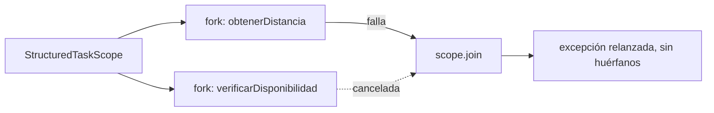
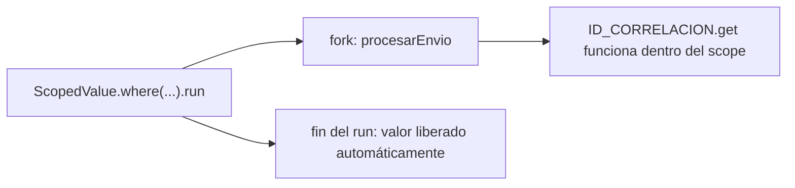

# Módulo 5: Concurrencia — hilos y virtual threads


**Proyecto del módulo:** crea un proyecto Maven o Gradle desde cero, pega el código del tema y corre las pruebas; las equivalencias entre ambos sistemas están en el Módulo 8, Tema 4.

## Aprende construyendo

### Tema 1: ExecutorService y gestión de hilos · Intermedio · 50 min

**Paso 1 · Objetivo y preparación**

**Prerrequisito:** Módulos 0–4 de Java (clases, excepciones, lambdas); JDK 27 o posterior (la API de executors existe desde Java 5, los virtual threads desde 21). Comprueba `java --version` y `javac --version`. No necesitas Maven para este ejemplo independiente desde carpeta vacía.

**Al finalizar podrás:** enviar tareas `Callable` a un executor, recoger resultados con `Future`, diagnosticar un fallo como `ExecutionException`, usar `invokeAll`, cerrar con `shutdown`/`awaitTermination`, y reconocer el executor de virtual threads.

#### Aprende

**Paso 2 · Contexto y caso profesional**

El proyecto integrador calcula tarifas para varias entregas. **¿Por qué es importante?** Un executor permite limitar hilos activos y centralizar su ciclo de vida. No afirmamos que crear exactamente 200 hilos agote cualquier máquina ni que un pool siempre sea más rápido: depende del trabajo y de los recursos disponibles.

**Paso 3 · Teoría, modelo mental y analogía**

`submit` entrega una tarea y devuelve un Future; `get` espera su resultado y propaga fallos. `shutdown` deja de aceptar trabajo nuevo y permite terminar el pendiente. `awaitTermination` comprueba si acabó en un plazo.

**Mapa de subtemas críticos**

| Subtema | Papel | Evidencia del tema |
|---|---|---|
| `Runnable` frente a `Callable` | Prerrequisito | `Callable` devuelve valor y puede lanzar checked |
| `submit` y `Future` | Núcleo | la tarea corre asíncrona y el `Future` guarda el resultado |
| `Future.get` y `ExecutionException` | Diagnóstico | un fallo en la tarea llega envuelto al llamador |
| `invokeAll` | Variante | enviar un lote y recoger en el orden de la lista |
| `shutdown` frente a `shutdownNow` | Núcleo | terminar ordenado o interrumpir lo pendiente |
| `awaitTermination` | Núcleo | esperar el cierre con un plazo |
| tipos de pool y cola no acotada | Decisión | fixed/cached/virtual; limitar hilos ≠ limitar cola |

Cada fila tiene su explicación individual a continuación.

**`Runnable` frente a `Callable` (prerrequisito).** `Runnable.run()` no devuelve nada y no puede lanzar checked; `Callable<V>.call()` **devuelve** un valor y **puede** lanzar una excepción checked. Para tareas que producen un resultado (una tarifa calculada), usa `Callable`.

**`submit` y `Future` (núcleo).** `pool.submit(callable)` encola la tarea, la ejecuta en un hilo del pool de forma asíncrona y devuelve de inmediato un `Future<V>` que representa el resultado futuro. Recoger los `Future` en orden **no** obliga a que las tareas terminen en ese orden.

**`Future.get` y `ExecutionException` (diagnóstico).** `future.get()` **bloquea** hasta que la tarea termina. Si la tarea lanzó una excepción, `get()` no la propaga tal cual: la envuelve en una `ExecutionException`, cuya causa (`getCause()`) es la original. Por eso un fallo nunca debe convertirse en "tarifa cero" silenciosa: llega como fallo real.

**`invokeAll` (variante).** `pool.invokeAll(listaDeCallables)` envía un lote y devuelve la lista de `Future` **en el orden de la lista de entrada** (no el de finalización), tras completarse todas. Es cómodo para "haz estas N cosas y dame todos los resultados".

**`shutdown` frente a `shutdownNow` (núcleo).** `shutdown()` deja de aceptar tareas nuevas pero termina las ya aceptadas; `shutdownNow()` además intenta **interrumpir** las que están corriendo y devuelve las pendientes. Un pool no cerrado puede dejar la JVM viva indefinidamente.

**`awaitTermination` (núcleo).** Tras `shutdown()`, `awaitTermination(plazo, unidad)` espera hasta ese plazo y devuelve `true` si el pool terminó, `false` si se agotó el tiempo (momento de `shutdownNow()`). Es cómo confirmas el cierre sin colgarte para siempre.

**Tipos de pool y cola no acotada (decisión).** `newFixedThreadPool(n)` limita hilos con cola **no acotada** (cuidado: muchas tareas pendientes consumen memoria); `newCachedThreadPool` crea hilos bajo demanda; `newVirtualThreadPerTaskExecutor()` (Java 21+) usa un virtual thread por tarea, ideal para I/O masivo. Limitar hilos **no** limita el trabajo pendiente: para producción define capacidad de cola y política de rechazo.

**Analogía (con su límite):** un equipo fijo recoge encargos de una cola en lugar de contratar a alguien por cada encargo. El límite de la analogía: una cola sin tope también consume memoria, así que acotar el equipo no acota la pila de encargos.

**Conceptos clave:** `ExecutorService`, `Future`, `shutdown` y `awaitTermination` como ciclo de vida explícito del pool.

**Código del ejemplo:**

```java
Future<Integer> pendiente = pool.submit(() -> 1000 + distancia * 500);
int total = pendiente.get();   // espera el resultado y propaga sus fallos
pool.shutdown();               // deja de aceptar trabajo nuevo
```

**Límites y decisión de uso:** este pool usa una cola no acotada; para carga variable en producción define capacidad y política de rechazo, y mide tareas CPU frente a I/O.

#### Practica

**Paso 4 · Demostración guiada desde cero**

Parte de una carpeta vacía y prepara la estructura.

```bash
mkdir ejemplo-executor
cd ejemplo-executor
```

**Crea** `ProcesadorTarifas.java` completo:

```java
import java.util.ArrayList;
import java.util.List;
import java.util.concurrent.ExecutorService;
import java.util.concurrent.Executors;
import java.util.concurrent.Future;
import java.util.concurrent.TimeUnit;

public class ProcesadorTarifas {
    public static void main(String[] args) throws Exception {
        ExecutorService pool = Executors.newFixedThreadPool(4);
        try {
            List<Future<Integer>> pendientes = new ArrayList<>();
            for (int km = 1; km <= 8; km++) {
                final int distancia = km;
                pendientes.add(pool.submit(() -> 1000 + distancia * 500));
            }
            int total = 0;
            for (Future<Integer> pendiente : pendientes) total += pendiente.get();
            System.out.println("Total: " + total);
        } finally {
            pool.shutdown(); // Rechaza nuevos encargos y conserva los ya aceptados.
            if (!pool.awaitTermination(5, TimeUnit.SECONDS)) {
                pool.shutdownNow();
                throw new IllegalStateException("No terminó en el plazo");
            }
        }
        System.out.println("Pool cerrado");
    }
}
```

**Ejecuta el ejemplo:**

```bash
javac ProcesadorTarifas.java
java ProcesadorTarifas
```

**Resultado esperado:** `Total: 26000` y `Pool cerrado`. Explica cada bloque: la copia final de distancia identifica el encargo, los Futures conservan sus resultados y finally cierra el recurso incluso si un cálculo falla. Recoger Futures en orden no fuerza que las tareas se ejecuten en ese mismo orden.

**Paso 5 · Práctica guiada**

Cambia el pool de cuatro hilos a dos, conserva las ocho tareas y vuelve a ejecutar. El total debe seguir siendo 26000; el tamaño del pool cambia la concurrencia, no la lógica del cálculo.

**Fallo deliberado:** elimina `pool.shutdown()`. Al vencer la espera, el cierre forzado sigue evitando dejar la JVM colgada, pero se lanza el error de terminación.

**Pista:** terminar tareas no ordena al executor dejar de esperar trabajo nuevo. Repón shutdown y comprueba el cierre normal.

Ahora cierra los subtemas de `invokeAll`, `ExecutionException` y virtual threads. Crea `Demo.java`:

```java
import java.util.*;
import java.util.concurrent.*;

public class Demo {
    public static void main(String[] args) throws Exception {
        ExecutorService pool = Executors.newFixedThreadPool(2);
        List<Callable<Integer>> tareas = new ArrayList<>();
        for (int km = 1; km <= 8; km++) { final int d = km; tareas.add(() -> 1000 + d * 500); }
        int total = pool.invokeAll(tareas).stream()
            .mapToInt(f -> { try { return f.get(); } catch (Exception e) { throw new RuntimeException(e); } }).sum();
        System.out.println("invokeAll total=" + total);

        Future<Integer> malo = pool.submit(() -> { throw new IllegalStateException("tarifa invalida"); });
        try { malo.get(); }
        catch (ExecutionException e) { System.out.println("ExecutionException causa=" + e.getCause().getClass().getSimpleName()); }

        pool.shutdown();
        System.out.println("awaitTermination=" + pool.awaitTermination(5, TimeUnit.SECONDS));

        try (var vt = Executors.newVirtualThreadPerTaskExecutor()) {   // Java 21+
            System.out.println("vt result=" + vt.submit(() -> "ok").get());
        }
    }
}
```

```bash
javac Demo.java && java Demo
```

**Salida esperada (verificada con Temurin 27.0.1):**

```text
invokeAll total=26000
ExecutionException causa=IllegalStateException
awaitTermination=true
vt result=ok
```

`invokeAll` recogió el lote en orden; el fallo de una tarea llegó como `ExecutionException` cuya causa es la `IllegalStateException` original (no una tarifa cero silenciosa); `awaitTermination` confirmó el cierre; y el executor de virtual threads ejecutó una tarea con la misma API.

**Si falla.** Si el programa imprime el total pero no `Pool cerrado`, la excepción de terminación saltó en el `finally`: revisa la unidad de `awaitTermination`. Si la JVM no termina, falta `shutdown()`/`shutdownNow()`. Si el total no es 26000, la lambda capturó una variable mutable en vez de la copia final. Si `get()` no lanza `ExecutionException`, la tarea no está fallando.

#### Aplica

**Paso 6 · Práctica independiente**

Representa los ocho cálculos como `List<Callable<Integer>>` y usa `invokeAll`. Comprueba que el total sigue siendo 26000. Añade un cálculo que lanza una excepción y localiza cómo llega a quien llama; no conviertas un fallo en una tarifa cero sin una regla de negocio.

**Paso 7 · Cierre**

**Checklist de salida.**

- [ ] `ProcesadorTarifas.java` compila y la salida muestra `Total: 26000` y `Pool cerrado`.
- [ ] `invokeAll` produce el mismo total y recoge en el orden de la lista.
- [ ] Un cálculo que falla llega como `ExecutionException` (causa original), no como tarifa cero.
- [ ] `shutdown` + `awaitTermination` cierran el pool y devuelven `true`.
- [ ] El executor de virtual threads ejecuta una tarea con la misma API.
- [ ] Explicas por qué limitar hilos no limita el trabajo pendiente en una cola no acotada.

**Si falla.** Si `invokeAll` devuelve resultados en un orden distinto, recuerda que respeta el orden de la lista de tareas, no el de finalización. Si la excepción no llega a quien llama, revisa que estés llamando `get()` sobre el Future correspondiente.

El siguiente tema compone dependencias con CompletableFuture; el laboratorio posterior separa timeout y cancelación.

**Errores comunes:** olvidar shutdown, asumir que shutdown espera y medir rendimiento con una sola ejecución diminuta.

**Fuentes oficiales revisadas el 2026-11-01:** [`ExecutorService` (API Java SE 27)](https://docs.oracle.com/en/java/javase/27/docs/api/java.base/java/util/concurrent/ExecutorService.html), [`Executors` (API Java SE 27)](https://docs.oracle.com/en/java/javase/27/docs/api/java.base/java/util/concurrent/Executors.html) y [dev.java: Concurrency](https://dev.java/learn/concurrency/).

---

### Tema 2: CompletableFuture · Intermedio · 45 min

**Paso 1 · Objetivo y preparación**

**Prerrequisito:** Tema 1 de este módulo (executors/`Future`); JDK 27 o posterior. Comprueba `java --version`.

**Al finalizar podrás:** componer pasos asíncronos con `supplyAsync`/`thenApply`/`thenCompose`/`thenCombine`; distinguir `thenApply` de `thenCompose`; centralizar errores con `exceptionally`/`handle`; y elegir el executor adecuado.

#### Aprende

**Paso 2 · Contexto y caso profesional**

Consultar la tarifa de una ruta requiere primero obtener la distancia (una llamada lenta) y luego calcular el precio con ella; anidar callbacks manualmente para esta secuencia se vuelve ilegible apenas se agrega un paso más.

**Paso 3 · Teoría, modelo mental y analogía**

**¿Por qué es importante?** `CompletableFuture` permite componer operaciones asíncronas dependientes entre sí de forma legible y lineal, con manejo de errores centralizado, evitando la anidación progresiva de callbacks manuales.

`CompletableFuture` compone pasos asíncronos dependientes como una cadena lineal (`thenApply`, `thenCompose`), con `exceptionally` centralizando el manejo de errores de toda la cadena.

**Mapa de subtemas críticos**

| Subtema | Papel | Evidencia del tema |
|---|---|---|
| `supplyAsync`/`runAsync` | Núcleo | lanzar trabajo asíncrono sin bloquear |
| `thenApply` frente a `thenCompose` | Diagnóstico | transformar un valor vs encadenar otro `CompletableFuture` |
| `thenCombine` | Variante | combinar dos cadenas independientes |
| `exceptionally` frente a `handle` | Núcleo | recuperarse de un fallo o ver resultado/error |
| `CompletionException` | Límite | el fallo llega envuelto en la cadena |
| elegir el executor | Decisión | el pool común frente a uno propio |

Cada fila tiene su explicación individual a continuación.

**`supplyAsync`/`runAsync` (núcleo).** `supplyAsync(() -> ...)` inicia una tarea asíncrona que **devuelve** un valor (`CompletableFuture<T>`); `runAsync(() -> ...)` para tareas sin resultado (`CompletableFuture<Void>`). Por defecto usan el `ForkJoinPool.commonPool()`; ambas devuelven de inmediato sin bloquear el hilo actual.

**`thenApply` frente a `thenCompose` (diagnóstico).** `thenApply(fn)` transforma el valor con una función **normal** (`T -> R`). `thenCompose(fn)` encadena cuando la función **devuelve otro `CompletableFuture`** (`T -> CompletableFuture<R>`), aplanando el resultado (análogo a `flatMap`). Usar `thenApply` donde debías usar `thenCompose` produce un `CompletableFuture<CompletableFuture<R>>` anidado.

**`thenCombine` (variante).** Combina **dos cadenas independientes** cuando ambas terminan: `a.thenCombine(b, (x, y) -> x + y)`. Útil para llamadas que pueden correr en paralelo y cuyos resultados se fusionan (distancia + tarifa base).

**`exceptionally` frente a `handle` (núcleo).** `exceptionally(e -> valorRecuperacion)` solo se activa si hubo fallo y devuelve un valor de reemplazo. `handle((v, e) -> ...)` se activa **siempre** y recibe tanto el valor (si hubo éxito) como el error (si falló), para decidir en un solo punto. Ambos centralizan el manejo de toda la cadena, no de un paso.

**`CompletionException` (límite).** Igual que `Future.get` envuelve en `ExecutionException`, la cadena de `CompletableFuture` envuelve el fallo en `CompletionException`, cuya causa es la original. Al relanzar desde un `exceptionally`, conserva la causa (`new CompletionException(msg, error)`), no la pierdas.

**Elegir el executor (decisión).** Las variantes `...Async(fn, executor)` permiten pasar un pool propio. Para trabajo de I/O o para no saturar el `commonPool()` (compartido por todo el proceso), pasa un executor dedicado (por ejemplo, uno de virtual threads). No mezcles trabajo bloqueante largo en el pool común.

`CompletableFuture` representa un valor que estará disponible en el futuro como resultado de una operación asíncrona, permitiendo encadenar transformaciones y reacciones sobre ese valor futuro sin bloquear el hilo actual esperando su resultado:

```java
CompletableFuture.supplyAsync(() -> obtenerDatos())
    .thenApply(datos -> transformar(datos))
    .thenAccept(resultado -> System.out.println(resultado))
    .exceptionally(error -> {
        throw new CompletionException("Falló la operación", error);
    });
```

`CompletionException` debe importarse desde `java.util.concurrent`. Esta cadena encadena una obtención de datos asíncrona, una transformación, una acción final y un manejo centralizado que mantiene el fallo visible en vez de convertirlo silenciosamente en un resultado nulo.

Esta composición fluida resuelve el problema de anidar callbacks asíncronos sucesivos de forma manual (el llamado "callback hell", un problema análogo al estudiado para JavaScript en el Módulo 5 del track de JavaScript sobre Promesas), permitiendo expresar una secuencia de pasos asíncronos dependientes entre sí como una cadena lineal legible, en vez de callbacks anidados progresivamente más profundos; `thenCompose` encadena otra operación que a su vez devuelve un `CompletableFuture` (aplanando el resultado, análogo conceptualmente a `flatMap`), mientras `exceptionally` captura cualquier error ocurrido en cualquier punto anterior de toda la cadena, centralizando el manejo de errores en un único lugar en vez de repetirlo en cada paso individual.

**Analogía:** `CompletableFuture` es como encargar una serie de tareas sucesivas a distintos proveedores, donde cada proveedor solo empieza su parte cuando el anterior efectivamente entrega su resultado, sin que quien encargó todo el proceso tenga que esperar bloqueado presencialmente frente a cada proveedor mientras trabaja.

**Conceptos clave:** composición de operaciones asíncronas, manejo de errores en la cadena.

**Cuándo no usarlo:** para una única llamada asíncrona sin pasos dependientes posteriores, encadenar `CompletableFuture` agrega sintaxis sin beneficio; basta con `supplyAsync` y esperar su resultado directamente.

Cada secuencia de llamadas dependientes entre sí del proyecto integrador de este track (obtener datos, transformarlos, reaccionar al resultado) se beneficiará de esta misma composición lineal en vez de callbacks anidados.

**Implicación práctica:** Anidar callbacks manualmente para una secuencia de pasos asíncronos dependientes se vuelve ilegible apenas se agrega un paso más, mientras que encadenar con `thenApply`/`thenCompose` y centralizar errores con `exceptionally` mantiene la cadena lineal y legible.

#### Practica

**Paso 4 · Demostración guiada desde cero**

Parte de una carpeta vacía y prepara la estructura.

```bash
mkdir ejemplo-completable-future
cd ejemplo-completable-future
mkdir -p src/main/java/academia/asincrono
```

**Crea** `CalculoTarifa.java` con `CompletableFuture.supplyAsync(() -> obtenerDistancia(ruta)).thenApply(distancia -> calcularTarifa(distancia)).thenAccept(tarifa -> ...).exceptionally(...)`:

```java
package academia.asincrono;

import java.util.concurrent.CompletableFuture;
import java.util.concurrent.CompletionException;

public final class CalculoTarifa {
    static double obtenerDistancia(String ruta) {
        if (ruta == null || ruta.isBlank()) {
            throw new IllegalArgumentException("ruta vacía");
        }
        return 12.5;
    }

    static double calcularTarifa(double distancia) {
        return distancia * 1.2;
    }

    public static void main(String[] args) {
        CompletableFuture.supplyAsync(() -> obtenerDistancia("ruta-42"))
            .thenApply(CalculoTarifa::calcularTarifa)
            .thenAccept(tarifa -> System.out.println("Tarifa: " + tarifa))
            .exceptionally(error -> {
                System.err.println("Falló: " + error.getMessage());
                return null;
            })
            .join();
    }
}
```

**Ejecuta el ejemplo:**

```bash
javac -d out src/main/java/academia/asincrono/CalculoTarifa.java
java -cp out academia.asincrono.CalculoTarifa
```

**Resultado esperado:** `Tarifa: 15.0`, calculada a partir de una distancia de 12.5 y un factor de 1.2.

**Paso 5 · Práctica guiada**

Cambia la ruta a `""`, ejecuta otra vez y observa que el error se hace visible en `exceptionally` y la cadena termina excepcionalmente al llegar a `join()`. No agregues un valor sustitutivo si no existe una regla de negocio para calcularlo.

**Fallo deliberado:** haz que `obtenerDistancia` lance una excepción deliberadamente para provocar un fallo en medio de la cadena; cambia la ruta `"ruta-42"` por `""`.

**Pista:** confirma que `exceptionally` recibe el fallo de la cadena y lo vuelve a propagar; `join()` lo hace visible al llamador. El error se trata en un único lugar, no en cada etapa.

**Si falla.** Si la cadena termina sin imprimir nada, falta la operación terminal `join()` o `thenAccept`. Si la excepción no llega a `exceptionally`, revisa que el fallo ocurra dentro de un paso de la cadena y no al construirla fuera del `supplyAsync`.

Ahora cierra los subtemas de `thenCompose`, `thenCombine`, `exceptionally` y `handle`. Crea `src/main/java/academia/asincrono/Demo.java`:

```java
package academia.asincrono;
import java.util.concurrent.*;

public class Demo {
    static int distancia(String r) { return r.length() * 10; }
    static CompletableFuture<Integer> distanciaAsync(String r) {
        return CompletableFuture.supplyAsync(() -> distancia(r));
    }
    public static void main(String[] args) throws Exception {
        System.out.println("thenApply=" + CompletableFuture.supplyAsync(() -> distancia("Norte"))
            .thenApply(d -> 1000 + d * 5).get());
        System.out.println("thenCompose=" + CompletableFuture.supplyAsync(() -> "Sur")
            .thenCompose(Demo::distanciaAsync).get());
        var a = CompletableFuture.supplyAsync(() -> 100);
        var b = CompletableFuture.supplyAsync(() -> 50);
        System.out.println("thenCombine=" + a.thenCombine(b, Integer::sum).get());
        System.out.println("exceptionally=" + CompletableFuture.<Integer>supplyAsync(
            () -> { throw new RuntimeException("falló"); }).exceptionally(e -> -1).get());
        System.out.println("handle=" + CompletableFuture.supplyAsync(() -> "ok")
            .handle((v, e) -> e == null ? "valor:" + v : "error:" + e.getMessage()).get());
    }
}
```

```bash
javac -d out src/main/java/academia/asincrono/Demo.java
java -cp out academia.asincrono.Demo
```

**Salida esperada (verificada con Temurin 27.0.1):**

```text
thenApply=1250
thenCompose=30
thenCombine=150
exceptionally=-1
handle=valor:ok
```

`thenApply` transformó el valor; `thenCompose` encadenó otro `CompletableFuture` **aplanándolo** (si hubieras usado `thenApply` ahí, tendrías un future anidado); `thenCombine` fusionó dos cadenas independientes; `exceptionally` recuperó un valor tras el fallo; y `handle` recibió el resultado (o el error) en un solo punto.

#### Aplica

**Paso 6 · Práctica independiente**

Agrega un segundo paso asíncrono con `thenCompose` (que a su vez devuelva otro `CompletableFuture`, por ejemplo verificar disponibilidad del conductor) y pásale un executor propio con `supplyAsync(fn, executor)`; confirma que la cadena completa sigue siendo lineal y no satura el pool común.

**Paso 7 · Cierre**

**Checklist de salida.**

- [ ] `CalculoTarifa.java` compila; la cadena exitosa imprime `Tarifa: 15.0`.
- [ ] Una ruta vacía se captura en `exceptionally` y muestra el fallo.
- [ ] `thenApply` transforma un valor y `thenCompose` aplana otro `CompletableFuture`.
- [ ] `thenCombine` fusiona dos cadenas independientes.
- [ ] `exceptionally` recupera un valor y `handle` ve resultado o error.
- [ ] Explicas cuándo pasar un executor propio en vez del pool común.

**Si falla.** Si al usar `thenApply` obtienes un `CompletableFuture<CompletableFuture<T>>`, el paso devuelve otro future: cambia a `thenCompose`. Si el fallo del segundo paso no llega a `exceptionally`, colócalo dentro de la operación asíncrona, no en la construcción de la cadena.

Guarda la cadena completa, la salida exitosa y el error capturado por `exceptionally`.

**Errores comunes:** anidar callbacks manualmente en vez de encadenar con `thenApply`/`thenCompose`, usar `thenApply` cuando el paso siguiente devuelve otro `CompletableFuture` (produce un `CompletableFuture<CompletableFuture<T>>` anidado en vez de aplanarlo), y omitir `exceptionally` dejando que una excepción en cualquier paso intermedio se propague sin manejar.

**Fuentes oficiales revisadas el 2026-11-01:** [`CompletableFuture` (API Java SE 27)](https://docs.oracle.com/en/java/javase/27/docs/api/java.base/java/util/concurrent/CompletableFuture.html) y [dev.java: Concurrency](https://dev.java/learn/concurrency/).

---

### Tema 3: Virtual threads · Intermedio · 50 min

**Paso 1 · Objetivo y preparación**

**Prerrequisito:** Temas 1–2 de este módulo (executors); JDK 27 o posterior (virtual threads estables desde 21). Comprueba `java --version`.

**Al finalizar podrás:** lanzar decenas de miles de tareas de I/O con virtual threads; explicar carrier/montado-desmontado; distinguir I/O-bound de CPU-bound; reconocer el pinning (JEP 491); y aplicar backpressure.

#### Aprende

**Paso 2 · Contexto y caso profesional**

Simular muchas solicitudes de tracking que esperan respuestas de red muestra cómo la concurrencia bloqueante puede escalar sin asignar un hilo de plataforma a cada espera. El consumo real depende de la JVM, el sistema operativo y la carga; no existe un tamaño universal de stack ni un límite fijo de hilos.

**Paso 3 · Teoría, modelo mental y analogía**

**¿Por qué es importante?** Los virtual threads suelen requerir pocos recursos y permiten muchas tareas concurrentes con código síncrono familiar; son especialmente apropiados para cargas dominadas por I/O bloqueante.

Un virtual thread es gestionado por el runtime de Java y no suele corresponder uno a uno con un hilo del sistema operativo. Cuando se bloquea en operaciones compatibles, el runtime puede liberar el hilo de plataforma que lo transporta para ejecutar otra tarea. Los hilos de plataforma suelen usar más recursos por hilo y pueden ser una capacidad limitada; los tamaños concretos dependen del entorno.

**Mapa de subtemas críticos**

| Subtema | Papel | Evidencia del tema |
|---|---|---|
| platform thread frente a virtual thread | Núcleo | el virtual lo gestiona el runtime, no el SO 1:1 |
| carrier thread y montado/desmontado | Núcleo | al bloquearse en I/O, libera el carrier |
| I/O-bound frente a CPU-bound | Decisión | ayudan en I/O, no aceleran cálculo puro |
| `newVirtualThreadPerTaskExecutor` | Variante | un virtual thread por tarea con la API de executor |
| pinning y JEP 491 | Límite | `synchronized` ya no fija el carrier en JDK 24+ |
| backpressure | Diagnóstico | muchos virtuales no limitan la presión externa |

Cada fila tiene su explicación individual a continuación.

**Platform thread frente a virtual thread (núcleo).** Un **platform thread** mapea 1:1 a un hilo del SO (caro, limitado). Un **virtual thread** lo gestiona el runtime de la JVM: puedes crear cientos de miles. Se usan con la **misma API** (`Thread`, `Runnable`); la diferencia es el coste y cómo se planifican.

**Carrier thread y montado/desmontado (núcleo).** Un virtual thread se ejecuta montado sobre un **carrier** (un platform thread de un pool pequeño). Cuando el virtual se **bloquea en I/O compatible**, el runtime lo **desmonta** y libera el carrier para otro virtual. Por eso miles de esperas conviven con pocos carriers.

**I/O-bound frente a CPU-bound (decisión).** Los virtual threads brillan en cargas dominadas por **espera de I/O** (red, disco): muchas tareas esperando a la vez con poco coste. **No** aceleran **cálculo puro de CPU**: ahí el límite son los núcleos, y un pool de plataforma dimensionado al número de núcleos es lo correcto.

**`newVirtualThreadPerTaskExecutor` (variante).** `Executors.newVirtualThreadPerTaskExecutor()` crea un virtual thread por tarea enviada, con la misma API de `ExecutorService` del Tema 1. Es la forma idiomática de lanzar concurrencia masiva de I/O con código **síncrono y legible**, sin callbacks.

**Pinning y JEP 491 (límite).** Antes, un bloque `synchronized` mantenía el virtual **fijado** (*pinned*) a su carrier, reduciendo la escalabilidad. JEP 491 (JDK 24) eliminó ese pinning por monitores. Todavía puede ocurrir pinning cuando código nativo (JNI/FFM) llama de vuelta a Java y se bloquea; diagnostícalo con el evento JFR `jdk.VirtualThreadPinned`.

**Backpressure (diagnóstico).** Poder lanzar 100 000 virtuales **no** significa que debas disparar 100 000 llamadas a un servicio externo: lo saturarías. Los virtual threads no aplican backpressure por sí solos; limita las solicitudes simultáneas (un `Semaphore`, un tamaño de lote) para proteger los sistemas aguas abajo.

```java
try (var executor = Executors.newVirtualThreadPerTaskExecutor()) {
    for (int i = 0; i < 100_000; i++) {
        executor.submit(() -> hacerLlamadaIO());
    }
}
```

Este bloque crea un virtual thread por tarea. Cuando una tarea espera I/O, el runtime puede liberar su carrier para otras tareas. Un pool de plataforma también puede completar la misma carga, pero con menor concurrencia y, normalmente, más tiempo transcurrido. Los virtual threads no limitan la presión sobre servicios externos: una aplicación real también debe acotar solicitudes simultáneas y aplicar backpressure.

**Analogía:** un thread de plataforma es como reservar una habitación de hotel completa dedicada exclusivamente a una única tarea, con un costo fijo considerable sin importar cuánto tiempo esa tarea pase simplemente esperando sin hacer nada; un virtual thread es como una sala de espera compartida y económica donde miles de personas pueden esperar simultáneamente, y solo se asigna un recurso físico real (el carrier thread) a quien efectivamente está siendo atendido en ese instante específico, liberándolo inmediatamente para atender a otra persona en cuanto la primera simplemente vuelve a esperar.

**Conceptos clave:** hilos gestionados por el runtime de Java, costo por hilo reducido, adecuación a I/O bloqueante.

Para operaciones del proyecto integrador dominadas por I/O bloqueante (por ejemplo, consultar varias fuentes externas), evalúa virtual threads y mide la carga; limita solicitudes simultáneas para no saturar servicios o conexiones.

**Cuándo no usarlo:** los virtual threads no aceleran cálculo puro de CPU; para código CPU-intensivo sin I/O bloqueante, un pool de threads de plataforma bien dimensionado al número de núcleos disponibles sigue siendo la elección correcta.

**Implicación práctica:** Los virtual threads permiten muchas tareas de I/O bloqueante con menos recursos que asignar un hilo de plataforma a cada tarea. No aceleran cálculo puro de CPU; el límite de paralelismo útil sigue dependiendo de los núcleos y del trabajo.

#### Practica

**Paso 4 · Demostración guiada desde cero**

Parte de una carpeta vacía y prepara la estructura.

```bash
mkdir ejemplo-virtual-threads
cd ejemplo-virtual-threads
mkdir -p src/main/java/academia/virtuales
```

**Crea** `TrackingMasivo.java` que lance 50 000 tareas con `Executors.newVirtualThreadPerTaskExecutor()`, cada una simulando una espera de I/O con `Thread.sleep(50)`:

```java
package academia.virtuales;

import java.time.Duration;
import java.util.ArrayList;
import java.util.List;
import java.util.concurrent.Executors;
import java.util.concurrent.Future;

public final class TrackingMasivo {
    public static void main(String[] args) throws Exception {
        int solicitudes = 50_000;
        long inicio = System.nanoTime();

        List<Future<?>> tareas = new ArrayList<>(solicitudes);
        try (var executor = Executors.newVirtualThreadPerTaskExecutor()) {
            for (int i = 0; i < solicitudes; i++) {
                tareas.add(executor.submit(() -> {
                    Thread.sleep(Duration.ofMillis(50));
                    return null;
                }));
            }
            for (Future<?> tarea : tareas) {
                tarea.get();
            }
        }

        long fin = System.nanoTime();
        System.out.printf("%d solicitudes en %.0f ms%n",
            solicitudes, (fin - inicio) / 1_000_000.0);
    }
}
```

**Ejecuta el ejemplo** midiendo el tiempo total:

```bash
javac -d out src/main/java/academia/virtuales/TrackingMasivo.java
java -cp out academia.virtuales.TrackingMasivo
```

**Resultado esperado:** las 50 000 tareas terminan sin ejecutarse en serie durante 50 000 × 50 ms. El tiempo total incluirá la creación y planificación de las tareas y variará según el equipo; no tiene que aproximarse a una sola espera de 50 ms. El `try` con el executor espera a que todas terminen antes de cerrar.

**Paso 5 · Práctica guiada**

Cambia el executor por `Executors.newFixedThreadPool(200)` con las mismas tareas. Como aproximación ideal, 50 000 tareas en tandas de 200 y esperas de 50 ms requieren unas 250 tandas (12,5 s), más planificación; mide en tu equipo y no trates ese valor como garantía.

**Fallo deliberado:** aumenta o reduce el número de tareas y predice el cambio de duración. Si usas `newFixedThreadPool(200)`, la espera ideal de 12,5 s es una estimación; el tiempo real incluye la planificación y la carga del equipo.

**Pista:** observa la diferencia de tiempo, no la memoria exacta por hilo; el argumento de los virtual threads es la capacidad de concurrencia con el mismo hardware.

**Si falla.** Si el tiempo supera mucho la estimación de 12,5 s con el pool fijo, revisa la carga del equipo y confirma que cada tarea espera solo 50 ms. Si la JVM termina antes de que las tareas acaben, falta el `try` que cierra y espera el executor. Si `Thread.sleep(Duration)` no compila, usa `Thread.sleep(50)`.

#### Aplica

**Paso 6 · Práctica independiente**

Reemplaza `Thread.sleep(50)` por un cálculo puro de CPU (por ejemplo, contar primos) y repite la comparación; confirma que ahí los virtual threads no ofrecen ninguna ventaja sobre un pool de plataforma bien dimensionado.

**Paso 7 · Cierre**

**Checklist de salida.**

- [ ] `TrackingMasivo.java` compila y se ejecuta con `javac` y `java -cp out`.
- [ ] Las 50 000 tareas de I/O terminan sin ejecutarse en serie durante 50 000 esperas.
- [ ] Con `newFixedThreadPool(200)` el tiempo total crece de forma evidente.
- [ ] La variante con cálculo de CPU no mejora al usar virtual threads.
- [ ] El executor se cierra con `try` y no deja tareas huérfanas.
- [ ] Explicas por qué la ventaja desaparece en cargas CPU-intensivas.

**Si falla.** Si la variante de CPU tarda lo mismo en ambos casos, es el resultado esperado y confirma el límite: los virtual threads no aceleran cálculo puro. Si el programa se queda sin memoria con las tareas de I/O, revisa que no estés usando threads de plataforma en lugar del executor virtual.

Guarda ambas mediciones (I/O bloqueante y CPU pura) y la conclusión sobre cuándo virtual threads ayudan.

**Antes del siguiente tema:** explica por qué los virtual threads mejoran la capacidad para I/O bloqueante, pero no aceleran por sí mismos el cálculo de CPU.

**Errores comunes:** asumir que los virtual threads aceleran cualquier carga sin medir, usarlos para cálculo CPU-intensivo puro y asumir que toda llamada nativa fija el carrier. JEP 491 eliminó el pinning causado por monitores `synchronized` en JDK 24; el pinning todavía puede ocurrir cuando código nativo (JNI o FFM) llama de vuelta a Java y la callback se bloquea o espera un monitor. Consulta el evento JFR `jdk.VirtualThreadPinned` para diagnosticar esos casos.

**Fuentes oficiales revisadas el 2026-11-01:** [dev.java: Concurrency](https://dev.java/learn/concurrency/), [Virtual Threads (Java SE 27)](https://docs.oracle.com/en/java/javase/27/core/virtual-threads.html) y [JEP 491](https://openjdk.org/jeps/491).

---

### Tema 4: Condiciones de carrera y sincronización · Intermedio · 50 min

**Paso 1 · Objetivo y preparación**

**Prerrequisito:** Temas 1–3 de este módulo; JDK 27 o posterior. Comprueba `java --version`.

**Al finalizar podrás:** reproducir una condición de carrera real; corregirla con `synchronized` y con `AtomicInteger`; explicar por qué `volatile` no la arregla; y reconocer el riesgo de deadlock.

#### Aprende

**Paso 2 · Contexto y caso profesional**

Cien hilos incrementando simultáneamente un contador compartido de "entregas procesadas hoy" sin ninguna coordinación pierden incrementos silenciosamente: el total final es menor al esperado, sin ningún error explícito.

**Paso 3 · Teoría, modelo mental y analogía**

**¿Por qué es importante?** Una condición de carrera produce resultados incorrectos silenciosos dependientes del orden impredecible de ejecución de los hilos; `synchronized` y otras primitivas de coordinación garantizan acceso exclusivo o coordinado a estado compartido mutable, eliminando esa impredecibilidad.

`contador++` son en realidad tres operaciones (leer, sumar, escribir); dos hilos pueden leer el mismo valor antes de que cualquiera escriba el incrementado, perdiendo uno de los dos.

**Mapa de subtemas críticos**

| Subtema | Papel | Evidencia del tema |
|---|---|---|
| condición de carrera | Núcleo | un contador sin coordinar pierde incrementos |
| `++` no es atómico | Diagnóstico | leer-sumar-escribir se intercala entre hilos |
| `synchronized` | Núcleo | acceso exclusivo a la sección crítica |
| `AtomicInteger` y CAS | Variante | incremento atómico sin bloqueo |
| `volatile`: visibilidad ≠ atomicidad | Límite | `volatile` no arregla `++` |
| primitivas de coordinación | Variante | `ReentrantLock`, `Semaphore`, `CountDownLatch` |
| deadlock | Límite | dos locks en orden opuesto se bloquean mutuamente |

Cada fila tiene su explicación individual a continuación.

**Condición de carrera (núcleo).** Ocurre cuando varios hilos leen y modifican el mismo estado mutable sin coordinación, y el resultado depende del orden impredecible de ejecución. No lanza error: simplemente da un **resultado incorrecto silencioso** (100 hilos × 1000 incrementos deberían dar 100 000, pero sin sincronizar salen ~70 000).

**`++` no es atómico (diagnóstico).** `contador++` son **tres** operaciones (leer, sumar, escribir). Dos hilos pueden leer el mismo valor, sumar, y escribir el mismo resultado: un incremento se pierde. Esta no-atomicidad es la causa raíz de la carrera.

**`synchronized` (núcleo).** `synchronized` sobre un método o bloque garantiza que **un solo hilo a la vez** ejecute la sección crítica sobre el mismo monitor, haciendo el incremento indivisible. El resultado vuelve a ser exacto (100 000). El coste: los demás hilos esperan.

**`AtomicInteger` y CAS (variante).** `AtomicInteger.incrementAndGet()` hace el incremento **atómico sin bloqueo**, usando compare-and-swap (CAS) del hardware. Para un contador es más eficiente que `synchronized` y también da el resultado exacto. Hay `AtomicLong`, `AtomicReference`, etc.

**`volatile`: visibilidad ≠ atomicidad (límite).** `volatile` garantiza **visibilidad** (un hilo ve el último valor escrito por otro) pero **no atomicidad**: `volatile int c; c++` sigue teniendo la carrera, porque el `++` compuesto no se vuelve indivisible. Usa `volatile` para flags de una sola escritura/lectura, no para contadores.

**Primitivas de coordinación (variante).** `ReentrantLock` es un lock explícito más flexible que `synchronized` (`tryLock` con timeout, equidad); `Semaphore` limita cuántos hilos acceden a la vez (útil para backpressure); `CountDownLatch` hace que unos hilos esperen a que otros terminen; `CyclicBarrier` sincroniza un grupo en un punto común.

**Deadlock (límite).** Si dos hilos adquieren dos locks en **orden opuesto** (A luego B / B luego A), pueden quedarse esperándose para siempre. Se evita adquiriendo los locks siempre en el **mismo orden** o usando `tryLock` con timeout. Es el riesgo clásico de la sincronización por bloqueo.

**Analogía (con su límite):** una condición de carrera es como dos personas mirando el mismo saldo de una cuenta a la vez y retirando dinero sobre un saldo ya obsoleto: el registro final queda mal sin que ninguna operación "falle"; `synchronized` es la ventanilla única que atiende a una persona por vez para esa cuenta. La analogía explica la exclusión mutua; no explica la diferencia entre visibilidad y atomicidad ni el CAS de `AtomicInteger`, que son mecanismos concretos de la JVM y el hardware.

**Conceptos clave:** carrera, atomicidad de `++`, `synchronized`, `AtomicInteger`/CAS, `volatile`, primitivas de coordinación, deadlock.

**Código del ejemplo:**

```java
synchronized void incrementar() { contador++; } // garantiza acceso exclusivo a la sección crítica
```

Cualquier contador o estado mutable compartido entre hilos del proyecto integrador de este track necesitará esta misma protección (`synchronized`, `AtomicInteger` o una estructura concurrente), nunca acceso concurrente sin coordinar.

**Cuándo no usarlo:** `synchronized` en cada acceso a un contador de alta frecuencia introduce contención entre hilos; para ese caso específico, `AtomicInteger` (basado en operaciones atómicas de hardware) suele rendir mejor que un bloque `synchronized` completo.

**Implicación práctica:** Una condición de carrera puede producir resultados incorrectos silenciosos según el orden de ejecución. Una prueba concurrente puede exponerla, pero una ejecución correcta no demuestra que el código sea seguro; la revisión del código también puede identificar accesos compartidos sin coordinación.

#### Practica

**Paso 4 · Demostración guiada desde cero**

Parte de una carpeta vacía y prepara la estructura.

```bash
mkdir ejemplo-condicion-carrera
cd ejemplo-condicion-carrera
mkdir -p src/main/java/academia/concurrencia
```

**Crea** `ContadorEntregas.java` con un campo `int contador` incrementado por 100 hilos concurrentes sin sincronización, y compara con la misma clase usando `synchronized void incrementar()`:

```java
package academia.concurrencia;

import java.util.ArrayList;
import java.util.List;
import java.util.concurrent.CountDownLatch;
import java.util.concurrent.ExecutorService;
import java.util.concurrent.Executors;
import java.util.concurrent.Future;
import java.util.concurrent.TimeUnit;

public final class ContadorEntregas {
    private int contador;

    synchronized void incrementar() {
        contador++;
    }

    static int ejecutar(boolean sincronizado) throws Exception {
        ContadorEntregas contador = new ContadorEntregas();
        ExecutorService pool = Executors.newFixedThreadPool(100);
        CountDownLatch salida = new CountDownLatch(1);
        List<Future<?>> tareas = new ArrayList<>();
        try {
            for (int hilo = 0; hilo < 100; hilo++) {
                tareas.add(pool.submit(() -> {
                    salida.await();
                    for (int i = 0; i < 1_000; i++) {
                        if (sincronizado) {
                            contador.incrementar();
                        } else {
                            contador.contador++;
                        }
                    }
                    return null;
                }));
            }
            salida.countDown();
            pool.shutdown();
            if (!pool.awaitTermination(10, TimeUnit.SECONDS)) {
                throw new IllegalStateException("El pool no terminó en el plazo");
            }
            for (Future<?> tarea : tareas) {
                tarea.get();
            }
        } finally {
            pool.shutdownNow();
        }
        return contador.valor();
    }

    int valor() {
        return contador;
    }

    public static void main(String[] args) throws Exception {
        System.out.println("Sin sincronizar:  " + ejecutar(false));
        System.out.println("Con synchronized: " + ejecutar(true));
    }
}
```

**Ejecuta el ejemplo** con ambas versiones:

```bash
javac -d out src/main/java/academia/concurrencia/ContadorEntregas.java
java -cp out academia.concurrencia.ContadorEntregas
```

**Resultado esperado:** la versión con `synchronized` imprime exactamente 100 000. La versión sin sincronizar puede quedar por debajo y variar entre ejecuciones; la carrera es real aunque una ejecución particular coincida con el valor esperado.

**Paso 5 · Práctica guiada**

Ejecuta ambas variantes varias veces y registra los resultados. No conviertas una salida correcta de la variante sin sincronizar en prueba de que sea segura: la intercalación cambia y la pérdida de incrementos no está garantizada en cada corrida.

**Fallo deliberado:** quita `synchronized` de `incrementar()` y compara otra vez; diagnostica la pérdida como una operación de lectura-modificación-escritura no atómica, no como un fallo que tenga que aparecer siempre.

**Pista:** con `synchronized`, el resultado es siempre el mismo valor correcto, sin importar cuántas veces lo ejecutes.

Para ver las tres estrategias juntas, crea `src/main/java/academia/concurrencia/Demo.java`:

```java
package academia.concurrencia;
import java.util.concurrent.*;
import java.util.concurrent.atomic.AtomicInteger;

public final class Demo {
    static int sinSync = 0;
    static int conSync = 0;
    static synchronized void incSync() { conSync++; }
    static final AtomicInteger atomico = new AtomicInteger();

    public static void main(String[] args) throws Exception {
        int hilos = 100, inc = 1000;
        correr(hilos, () -> { for (int i = 0; i < inc; i++) sinSync++; });
        correr(hilos, () -> { for (int i = 0; i < inc; i++) incSync(); });
        correr(hilos, () -> { for (int i = 0; i < inc; i++) atomico.incrementAndGet(); });
        int esperado = hilos * inc;
        System.out.println("esperado=" + esperado);
        System.out.println("sinSync=" + sinSync + " (perdio incrementos=" + (sinSync < esperado) + ")");
        System.out.println("conSync=" + conSync);
        System.out.println("atomico=" + atomico.get());
    }
    static void correr(int n, Runnable r) throws Exception {
        try (var ex = Executors.newFixedThreadPool(n)) {
            var latch = new CountDownLatch(n);
            for (int i = 0; i < n; i++) ex.submit(() -> { r.run(); latch.countDown(); });
            latch.await();
        }
    }
}
```

```bash
javac -d out src/main/java/academia/concurrencia/Demo.java
java -cp out academia.concurrencia.Demo
```

**Salida esperada (verificada con Temurin 27.0.1; el valor sin sincronizar varía):**

```text
esperado=100000
sinSync=72882 (perdio incrementos=true)
conSync=100000
atomico=100000
```

Sin sincronizar se **perdieron ~27 000 incrementos** por la carrera (el número exacto cambia entre corridas); `synchronized` y `AtomicInteger` dieron el valor exacto. **Fallo deliberado:** declara `sinSync` como `volatile` y reejecuta: sigue perdiendo incrementos, porque `volatile` da **visibilidad** pero no **atomicidad** del `++`.

**Si falla.** Si la versión sin sincronizar siempre da 100 000, repite: la pérdida depende del intercalado. Si la sincronizada pierde, el `synchronized` no cubre la operación completa. Si el programa se cuelga, el latch no se liberó.

#### Aplica

**Paso 6 · Práctica independiente**

Reemplaza `synchronized` por `AtomicInteger` (usando `incrementAndGet()`) y confirma que el resultado sigue siendo correcto y determinista, sin necesidad de un bloque `synchronized` explícito.

**Paso 7 · Cierre**

**Checklist de salida.**

- [ ] `ContadorEntregas.java` compila y ejecuta con `javac` y `java -cp out`.
- [ ] Comparaste varias ejecuciones y explicas por qué una salida correcta no descarta la carrera.
- [ ] La versión con `synchronized` imprime siempre 100 000.
- [ ] `AtomicInteger` reemplaza `synchronized` con el mismo resultado correcto.
- [ ] Explicas por qué `contador++` no es una operación atómica.
- [ ] Distingues sincronizar la operación completa de sincronizar solo una parte.

**Si falla.** Si `AtomicInteger` no compila, falta `import java.util.concurrent.atomic.AtomicInteger;`. Si el resultado vuelve a ser incorrecto, el incremento sigue ejecutándose sobre el `int` original y no sobre el atómico.

Guarda ambas versiones (sin sincronizar y con `synchronized`/`AtomicInteger`), los resultados inconsistentes y el resultado corregido.

**Antes del siguiente tema:** explica por qué `contador++` necesita coordinación y por qué una ejecución correcta no demuestra ausencia de carrera.

**Errores comunes:** asumir que `contador++` es una operación atómica, sincronizar solo la lectura o solo la escritura en vez de la operación completa de leer-sumar-escribir, y usar `synchronized` en cada acceso a un contador de muy alta frecuencia cuando `AtomicInteger` rendiría mejor con la misma corrección.

**Fuentes oficiales revisadas el 2026-11-01:** [dev.java: Concurrency](https://dev.java/learn/concurrency/), [`AtomicInteger` (API Java SE 27)](https://docs.oracle.com/en/java/javase/27/docs/api/java.base/java/util/concurrent/atomic/AtomicInteger.html) y [`synchronized` — JLS 17 (Java SE 27)](https://docs.oracle.com/javase/specs/jls/se27/html/jls-17.html).

---

### Tema 5: Structured Concurrency (StructuredTaskScope, preview en JDK 27) · Avanzado · 55 min

**Paso 1 · Objetivo y preparación**

**Prerrequisito:** JDK 27 y un editor. Comprueba `java --version`. **`StructuredTaskScope` sigue en preview en JDK 27 (JEP 533, séptima ronda)**, no finalizada: compilar y ejecutar requiere las banderas `--enable-preview --release 27` explícitas, porque `javac` solo acepta previews de la release exacta del JDK que compila.

**Al finalizar podrás:** lanzar dos subtareas relacionadas (distancia y disponibilidad del conductor) con `StructuredTaskScope`, cancelando automáticamente la otra si cualquiera falla.

#### Aprende

**Paso 2 · Contexto y caso profesional**

El servicio de tracking lanza dos llamadas relacionadas con `CompletableFuture` por separado (distancia y disponibilidad del conductor); si la de distancia falla, la de disponibilidad sigue corriendo en segundo plano sin que nadie la cancele, consumiendo recursos para un resultado que ya no se va a usar.

**Paso 3 · Teoría, modelo mental y analogía**

**¿Por qué es importante?** `StructuredTaskScope` garantiza que un grupo de subtareas relacionadas comparta un ciclo de vida común, cancelando el resto automáticamente si cualquiera falla, eliminando las subtareas huérfanas que `CompletableFuture` suelto no previene.

Structured concurrency trata un grupo de subtareas relacionadas como una única unidad: todas nacen dentro del mismo scope y ese scope no termina hasta que todas terminan (o se cancelan).

**Mapa de subtemas críticos**

| Subtema | Papel | Evidencia del tema |
|---|---|---|
| estado preview en JDK 27 | Prerrequisito | requiere `--enable-preview --release 27` |
| `StructuredTaskScope.open` y `fork` | Núcleo | lanzar subtareas relacionadas en un scope |
| `join` y `Subtask.get()` | Núcleo | esperar el cierre conjunto antes de leer |
| `Joiner` (política) | Variante | `allSuccessfulOrThrow` cancela al primer fallo |
| cancelación conjunta frente a `CompletableFuture` suelto | Diagnóstico | sin scope, la hermana queda huérfana |
| scope acota ciclo de vida, no latencia | Límite | no impone timeouts por sí solo |

Cada fila tiene su explicación individual a continuación.

**Estado preview en JDK 27 (prerrequisito).** `StructuredTaskScope` sigue en **preview** (JEP 533, séptima ronda): su API puede cambiar entre versiones. Compilar y ejecutar exige `--release 27 --enable-preview` **exactos** (las banderas deben coincidir con la release del JDK), y la JVM imprime un aviso de preview. No lo uses en producción asumiendo estabilidad.

**`StructuredTaskScope.open` y `fork` (núcleo).** `open(joiner)` abre un scope con una política; cada `scope.fork(callable)` lanza una subtarea (sobre un virtual thread) y devuelve un `Subtask`. Las subtareas son **hermanas** bajo el mismo scope, no futuros sueltos.

**`join` y `Subtask.get()` (núcleo).** `scope.join()` espera a que todas las subtareas terminen o respondan a la cancelación. Solo **después** de `join()` puedes leer `subtask.get()`; leerlo antes es un error porque el resultado aún no existe.

**`Joiner` (política, variante).** El `Joiner` decide el comportamiento del grupo: `allSuccessfulOrThrow()` cancela el resto **al primer fallo** y relanza; `awaitAllSuccessfulOrThrow()` espera a que todas terminen antes de fallar; hay políticas para "el primero que tenga éxito", etc. La política expresa la semántica del grupo.

**Cancelación conjunta frente a `CompletableFuture` suelto (diagnóstico).** La ventaja central: si una subtarea falla, el scope **cancela las hermanas** automáticamente. Con dos `CompletableFuture.supplyAsync` independientes, si el primero falla el segundo **sigue corriendo huérfano**, gastando recursos para un resultado que ya no se usará.

**Scope acota ciclo de vida, no latencia (límite).** El scope garantiza que ninguna subtarea sobreviva al bloque, pero **no** impone un timeout por sí solo: si una subtarea se cuelga sin responder a la cancelación, hay que añadir timeouts/presupuestos de latencia aparte (Tema 7).

**Analogía (con su límite):** un adulto que lleva a varios niños a un museo: si uno se pierde, no sigue dejando a los demás dispersos, reúne o cancela el grupo. La analogía explica el ciclo de vida compartido; no explica las políticas del `Joiner` ni que el scope no pone límite de tiempo.

**Conceptos clave:** preview, `fork`/`join`, `Joiner`, cancelación conjunta, árbol de tareas, ciclo de vida acotado.

Cada operación del **proyecto integrador** de este track que dependa de varias subtareas relacionadas (ej. validar un pedido consultando stock y precio a la vez) debería usar structured concurrency en vez de lanzar `CompletableFuture` sueltos sin ningún scope que los agrupe.

**Cuándo no usarlo:** para una única tarea asíncrona sin ninguna otra subtarea relacionada, `StructuredTaskScope` agrega ceremonia sin beneficio; basta con `Executors.newVirtualThreadPerTaskExecutor()` y esperar ese único resultado. Tampoco reemplaza el diseño de timeouts y presupuestos de latencia: el scope acota el ciclo de vida, no la duración de cada subtarea.

**Límites y decisión de uso:** el scope no impone timeouts ni presupuestos de latencia por sí solo, y no conviene adoptarlo para una única llamada asíncrona sin subtareas hermanas.

#### Practica

**Paso 4 · Demostración guiada desde cero**

**Desde cero:** crea una **carpeta vacía** y dentro el archivo Java completo; no necesitás Gradle ni un proyecto previo.

```bash
mkdir -p ejemplo/src/academia/concurrencia && cd ejemplo
```

**Crea** `src/academia/concurrencia/CalculoTarifaEstructurado.java` con este contenido completo:

```java
package academia.concurrencia;

import java.util.concurrent.StructuredTaskScope;
import java.util.concurrent.CountDownLatch;

sealed interface ParteTarifa permits Distancia, Disponibilidad {}
record Distancia(double kilometros) implements ParteTarifa {}
record Disponibilidad(boolean disponible) implements ParteTarifa {}

public class CalculoTarifaEstructurado {
    private static final CountDownLatch disponibilidadIniciada =
        new CountDownLatch(1);

    static double obtenerDistancia(String ruta) {
        try {
            disponibilidadIniciada.await();
        } catch (InterruptedException e) {
            Thread.currentThread().interrupt();
            throw new IllegalStateException("cancelada antes de iniciar", e);
        }
        throw new IllegalStateException("ruta sin coordenadas");
    }

    static boolean verificarDisponibilidad(String conductorId) {
        disponibilidadIniciada.countDown();
        try {
            Thread.sleep(5_000);
        } catch (InterruptedException e) {
            System.out.println("disponibilidad cancelada");
            return false;
        }
        System.out.println("disponibilidad terminó");
        return true;
    }

    static double calcularTarifa(double distancia, boolean disponible) {
        return distancia * (disponible ? 1.2 : 1.0);
    }

    public static void main(String[] args) throws Exception {
        try (var scope = StructuredTaskScope.open(
                StructuredTaskScope.Joiner.<ParteTarifa>allSuccessfulOrThrow())) {
            var distancia = scope.fork(() ->
                new Distancia(obtenerDistancia("ruta-42")));
            var disponible = scope.fork(() ->
                new Disponibilidad(verificarDisponibilidad("conductor-7")));
            scope.join();
            if (!(distancia.get() instanceof Distancia d)
                    || !(disponible.get() instanceof Disponibilidad a)) {
                throw new IllegalStateException("Resultado de subtarea inesperado");
            }
            System.out.println(calcularTarifa(d.kilometros(), a.disponible()));
        } catch (Exception e) {
            System.out.println("falló: " + e.getMessage());
        }
    }
}
```

**Ejecuta el ejemplo** (compila y corre con la preview de JDK 27):

```bash
javac --release 27 --enable-preview -d out src/academia/concurrencia/CalculoTarifaEstructurado.java
java --enable-preview -cp out academia.concurrencia.CalculoTarifaEstructurado
```

**Resultado esperado:** `disponibilidad cancelada` y `falló: java.lang.IllegalStateException: ruta sin coordenadas`; no aparece `disponibilidad terminó`. El latch garantiza que la segunda subtarea empezó a esperar antes de que falle la primera. El `Joiner` cancela el scope al fallar una tarea y `join()` espera a que las subtareas terminen o respondan a la cancelación. La JVM además imprime una advertencia de preview. Explica cada bloque: `open` configura la política, `fork` lanza subtareas relacionadas, `join` espera el cierre conjunto y `Subtask.get()` se lee después de `join()`. El tipo común `ParteTarifa` permite que ambas tareas devuelvan resultados distintos de forma segura.

**Referencia visual del ciclo de vida:**



**Fallo deliberado:** reemplaza el `StructuredTaskScope` por dos `CompletableFuture.supplyAsync(...)` independientes sin ningún scope que los agrupe, y haz que el primero lance una excepción. Ahora el segundo `CompletableFuture` sigue ejecutándose completo en segundo plano, sin que nadie lo cancele ni lo espere, consumiendo el carrier thread para un resultado que la tarifa final ya no va a usar porque el cálculo ya falló.

**Paso 5 · Práctica guiada**

Cambia `allSuccessfulOrThrow()` por `awaitAllSuccessfulOrThrow()` y ejecuta el mismo fallo. Observa que esta política espera a que termine la otra subtarea en vez de cancelarla al primer fallo; restaura `allSuccessfulOrThrow()` y compara ambos ciclos de vida.

**Pista:** con la preview, el mensaje de la JVM sobre funcionalidades experimentales es esperado; si no aparece la cancelación, revisa que ambas subtareas se lancen con `fork` dentro del mismo scope.

**Si falla.** Si `javac` rechaza la compilación con «preview language features are only supported for release 27», usa exactamente `--release 27 --enable-preview`. Si `disponibilidad terminó` aparece, la otra subtarea no se canceló: confirma que ambas están dentro del scope y que el fallo ocurre tras el `fork`. Si `Subtask.get()` se llama antes de `join()`, el resultado aún no está disponible.

#### Aplica

**Paso 6 · Práctica independiente**

Corrige el paso anterior volviendo a `StructuredTaskScope` con `fork`/`join`, y agrega una tercera subtarea (por ejemplo, registrar el intento en un log de auditoría) confirmando que las tres se cancelan juntas si cualquiera falla.

**Paso 7 · Cierre**

**Checklist de salida.**

- [ ] El ejemplo compila con `javac --release 27 --enable-preview`.
- [ ] La salida muestra `disponibilidad cancelada` y nunca `disponibilidad terminó`.
- [ ] La excepción de la primera subtarea llega al `catch` del `main`.
- [ ] Dos `CompletableFuture` sueltos dejan viva la subtarea hermana.
- [ ] La tercera subtarea también se cancela cuando una falla.
- [ ] Explicas por qué el scope acota el ciclo de vida pero no la duración.

**Si falla.** Si el `catch` imprime un mensaje distinto, revisa que `obtenerDistancia` lance después del `fork`. Si la tercera subtarea no se cancela, confirma que se lanzó con `fork` dentro del mismo `try` del scope. Si la compilación falla por preview, comprueba que `java` y `javac` sean del mismo JDK 27.

Entrega el scope con cancelación conjunta del paso de práctica, la subtarea huérfana del fallo deliberado, y la tercera subtarea agregada; explica por qué estructurar la concurrencia como un árbol (con el mismo ciclo de vida que su scope padre) elimina las fugas de subtareas que `CompletableFuture` suelto no previene.

**Errores comunes:** lanzar subtareas con CompletableFuture sin ningún scope que las agrupe y cancele juntas, no leer `Subtask.get()` solo después de `join()`, y usar structured concurrency para tareas que no están genuinamente relacionadas entre sí.

**Fuente oficial:** [JEP 533: Structured Concurrency](https://openjdk.org/jeps/533) y [Structured Concurrency](https://docs.oracle.com/en/java/javase/27/core/structured-concurrency.html). Este tema usa la séptima ronda de preview de JDK 27; la API aún es experimental y puede cambiar. Las banderas deben coincidir con la release del JDK: `javac --release 25 --enable-preview` con JDK 27 falla, así que el ejemplo se compila con `--release 27 --enable-preview`.

**Antes del siguiente tema:** explica por qué las tareas relacionadas deben compartir ciclo de vida, cómo la política `allSuccessfulOrThrow()` cancela ante un fallo y por qué el scope no define un timeout.

---

### Tema 6: Scoped Values frente a ThreadLocal (Java 25) · Avanzado · 50 min

**Paso 1 · Objetivo y preparación**

**Prerrequisito:** los Temas 3 y 5 de este módulo, y JDK 27. Comprueba `java --version`; `ScopedValue` es estable desde Java 25, pero el scope estructurado de este ejemplo todavía requiere preview en JDK 27.

**Al finalizar podrás:** propagar un ID de correlación a una subtarea estructurada con `ScopedValue` y distinguir su duración acotada de una variable local al hilo.

#### Aprende

**Paso 2 · Contexto y caso profesional**

El servicio propaga el ID de correlación de una petición a las subtareas que consultan servicios externos. La asociación debe existir durante esa operación y dejar de estar disponible al salir de su scope.

**Paso 3 · Teoría, modelo mental y analogía**

**¿Por qué es importante?** Una variable local al hilo vive asociada a ese hilo; un valor de scope vive solo durante una región delimitada. `ScopedValue` hace explícitos el alcance y la inmutabilidad del contexto, pero no garantiza por sí solo un ahorro de heap medible para cualquier carga.

`ScopedValue` vincula un valor a una porción específica y acotada de código, no al hilo completo como `ThreadLocal`. El binding no se reasigna durante ese scope y puede heredarse por subtareas lanzadas dentro de un scope estructurado; al salir del bloque deja de estar ligado en ese contexto.

**Mapa de subtemas críticos**

| Subtema | Papel | Evidencia del tema |
|---|---|---|
| `ScopedValue` frente a `ThreadLocal` | Núcleo | acotado al scope vs ligado al hilo |
| `where(...).run(...)` y lectura con `get()` | Núcleo | el valor existe solo dentro del bloque |
| inmutabilidad del binding | Variante | no se reasigna durante el scope |
| herencia por subtareas estructuradas | Núcleo | el `fork` hijo ve el valor sin pasarlo |
| liberación automática al salir | Diagnóstico | fuera del `run`, `get()` falla |
| estado: `ScopedValue` estable, scope preview | Prerrequisito | `ScopedValue` sin flags; el scope con preview |

Cada fila tiene su explicación individual a continuación.

**`ScopedValue` frente a `ThreadLocal` (núcleo).** `ThreadLocal` asocia un valor a **todo el hilo** y persiste hasta que lo limpies (fuente clásica de fugas, sobre todo con pools reutilizados). `ScopedValue` asocia el valor a una **región de código** delimitada: fuera de ella no existe. Es el reemplazo moderno para contexto de petición (ID de correlación, usuario).

**`where(...).run(...)` y lectura con `get()` (núcleo).** `ScopedValue.where(ID, valor).run(() -> ...)` establece el binding **solo** durante ese bloque; dentro, `ID.get()` devuelve el valor. No hay `set` global: el valor vive atado a la ejecución del `run`/`call`.

**Inmutabilidad del binding (variante).** Durante el scope, el binding **no se reasigna**: no existe un `ID.set(otro)` que lo cambie a mitad. Para un valor distinto, anidas otro `where(...).run(...)`. Esta inmutabilidad hace el contexto predecible y seguro entre hilos.

**Herencia por subtareas estructuradas (núcleo).** Las subtareas lanzadas con `scope.fork(...)` **dentro** del `run` **heredan** el `ScopedValue` sin tener que pasarlo como parámetro: `ID.get()` funciona en el hijo. Es lo que permite propagar el ID de correlación a las llamadas concurrentes de una petición.

**Liberación automática al salir (diagnóstico).** Al terminar el bloque `run`, el binding **desaparece**: llamar `ID.get()` fuera del scope lanza una excepción (no hay valor ligado). No hay que acordarse de "limpiar" como con `ThreadLocal.remove()`.

**Estado (prerrequisito).** `ScopedValue` es **estable** desde Java 25 (se usa sin flags). El `StructuredTaskScope` que lanza las subtareas hijas sigue siendo **preview** en JDK 27, así que ese ejemplo combinado requiere `--enable-preview`.

**Analogía (con su límite):** un gafete de visitante válido solo dentro del edificio, que se devuelve solo al salir, frente a una llave que el visitante se queda y alguien debe reclamar. La analogía explica el alcance acotado; no explica la herencia por subtareas ni la inmutabilidad del binding.

**Conceptos clave:** `ScopedValue`, alcance acotado, inmutabilidad, herencia a subtareas, liberación automática.

**Código del ejemplo:**

```java
static final ScopedValue<String> ID_CORRELACION = ScopedValue.newInstance();

ScopedValue.where(ID_CORRELACION, generarId()).run(() -> {
    try (var scope = StructuredTaskScope.open()) {
        scope.fork(() -> procesarEnvio());   // ID_CORRELACION.get() funciona aquí también
        scope.join();
    }
});
```

**Referencia visual del ciclo de vida:**



#### Practica

**Paso 4 · Demostración guiada desde cero**

Parte de una carpeta vacía y prepara la estructura.

```bash
mkdir ejemplo-scoped-values
cd ejemplo-scoped-values
mkdir -p src/main/java/academia/concurrencia
```

**Crea** `src/main/java/academia/concurrencia/ContextoCorrelacion.java` con una ejecución completa:

```java
package academia.concurrencia;

import java.util.concurrent.StructuredTaskScope;

public final class ContextoCorrelacion {
    static final ScopedValue<String> ID_CORRELACION = ScopedValue.newInstance();

    static String generarId() {
        return "req-" + System.nanoTime();
    }

    static String procesarEnvio() {
        return "procesado por " + ID_CORRELACION.get();
    }

    public static void main(String[] args) {
        ScopedValue.where(ID_CORRELACION, generarId()).run(() -> {
            try (var scope = StructuredTaskScope.open()) {
                var subtarea = scope.fork(ContextoCorrelacion::procesarEnvio);
                scope.join();
                System.out.println(subtarea.get());
            } catch (Exception e) {
                System.out.println("falló: " + e.getMessage());
            }
        });

        System.out.println("Fuera del scope: " + ID_CORRELACION.isBound());
    }
}
```

**Ejecuta el ejemplo** (compila y corre con la preview de JDK 27):

```bash
javac --release 27 --enable-preview -d out src/main/java/academia/concurrencia/ContextoCorrelacion.java
java --enable-preview -cp out academia.concurrencia.ContextoCorrelacion
```

**Resultado esperado:** dentro del bloque `run`, la subtarea imprime `procesado por req-…`; fuera del bloque, `Fuera del scope: false`, porque el valor deja de existir automáticamente al terminar `run`, sin ninguna llamada manual de limpieza.

**Paso 5 · Práctica guiada**

Anida un segundo `ScopedValue.where(ID_CORRELACION, "req-interna").run(...)` dentro del primero. Imprime el valor dentro del scope interno y después de volver al externo: debe ser `req-interna` en el primero y restaurarse al ID exterior en el segundo.

**Pista:** el binding interno solo reemplaza al exterior durante su propio `run`; al terminar, la ejecución vuelve al binding anterior.

**Fallo deliberado:** llama a `ID_CORRELACION.get()` fuera de cualquier binding. Observa la excepción y reemplaza esa lectura por `isBound()` cuando el contexto pueda ser opcional.

**Si falla.** Si `ScopedValue` no compila, confirma que el JDK sea 25 o superior. Si `isBound()` devuelve `true` fuera del scope, revisa si la lectura sigue dentro de otro bloque `where`. Si la compilación falla por preview, comprueba que las banderas correspondan a JDK 27.

#### Aplica

**Paso 6 · Práctica independiente**

Agrega un segundo dato inmutable (por ejemplo, el idioma de la petición) y propágalo a una subtarea del mismo scope. Contrasta el diseño con `ThreadLocal`: explica qué limpieza manual y qué límites de propagación exigiría esa alternativa, sin afirmar una diferencia universal de memoria.

**Paso 7 · Cierre**

**Checklist de salida.**

- [ ] `ContextoCorrelacion.java` compila con `javac --release 27 --enable-preview`.
- [ ] La subtarea lee el ID de correlación dentro del scope.
- [ ] `isBound()` devuelve `false` al salir del bloque `run`.
- [ ] El binding anidado se restaura al volver al scope exterior.
- [ ] Una lectura sin binding falla y `isBound()` permite comprobarlo.
- [ ] Explicas la diferencia de alcance entre `ScopedValue` y `ThreadLocal` sin atribuirles un ahorro fijo de memoria.

**Si falla.** Si la subtarea no puede leer `ScopedValue`, revisa que se lance dentro del `run` y del scope estructurado. Si `isBound()` devuelve un valor inesperado, comprueba el anidamiento de los bloques `where`.

Entrega la propagación de ambos valores con `ScopedValue`, la lectura fallida fuera del scope y la comparación con `ThreadLocal`; explica cuándo es más apropiado un valor inmutable y acotado. Siguiente paso: estudia NIO.2 para completar el manejo de datos del proyecto integrador.

**Errores comunes:** usar `ThreadLocal` heredable como propagación de contexto por defecto con virtual threads, asumir que `ScopedValue` vuelve inmutable el objeto referenciado (solo el binding no se reasigna dentro del scope), y leer un valor fuera del ámbito donde está ligado.

**Fuentes oficiales revisadas el 2026-11-01:** [JEP 506: Scoped Values](https://openjdk.org/jeps/506) y [Scoped Values (Java SE 27)](https://docs.oracle.com/en/java/javase/27/core/scoped-values.html).

---

## Construcción guiada del capítulo

**Objetivo del laboratorio:** construir un servicio concurrente que procese N tareas en paralelo usando virtual threads, corrigiendo una condición de carrera provocada intencionalmente.

**Requisitos previos:** Módulos 0-4 completados.

| Paso | Acción | Código | Explicación |
|---|---|---|---|
| 1 | Lanzar un `Thread` manual y luego con `ExecutorService` | Ver Tema 1 | Compara la reutilización de hilos |
| 2 | Provocar una condición de carrera y corregirla | Ver Tema 4 | Con `synchronized` |
| 3 | Componer llamadas con `CompletableFuture` | Ver Tema 2 | `thenCompose` + `exceptionally` |
| 4 | Crear 50,000 virtual threads | Ver Tema 3 | Compara capacidad de concurrencia para esperas de I/O |
| 5 | Medir latencia de I/O con threads de plataforma vs virtuales | Ver Tema 3 | Con 50,000 tareas de I/O bloqueante |
| 6 | Agrupar subtareas relacionadas con `StructuredTaskScope` | Ver Tema 5 | Cancelación conjunta si una falla |
| 7 | Propagar contexto con `ScopedValue` a virtual threads hijos | Ver Tema 6 | Binding acotado y restaurado al cerrar el scope |

**Verificación:** el laboratorio se considera exitoso si la versión sincronizada del contador siempre da el total correcto (aunque una ejecución no sincronizada coincida por casualidad), si las 50,000 esperas finalizan con virtual threads y con el pool de plataforma registrando los tiempos reales sin prometer una cifra, y si el scope de structured concurrency cancela correctamente una subtarea hermana cuando la otra falla.

**Errores comunes y soluciones**

- **Crear un `Thread` nuevo por cada tarea en cargas con muchas tareas.** Usa un `ExecutorService` para reutilizar hilos.
- **Modificar estado compartido sin sincronización.** Usa `synchronized`, `ReentrantLock`, o estructuras concurrentes como `ConcurrentHashMap`.
- **Usar virtual threads para código CPU-intensivo puro sin I/O.** Los virtual threads no aceleran cálculo puro; su beneficio es específico para I/O bloqueante.
- **Lanzar subtareas relacionadas con `CompletableFuture` suelto en vez de `StructuredTaskScope`.** Sin un scope que las agrupe, una subtarea puede quedar huérfana corriendo en segundo plano si su hermana falla.
- **Usar `InheritableThreadLocal` para todo contexto de subtareas.** Por defecto, los hijos heredan el valor al crearse y su vida queda ligada al hilo; `ScopedValue` es una opción explícita para compartir datos inmutables con alcance acotado.

---


## Laboratorio de transferencia

### Tema 7: Timeouts y cancelación cooperativa sin abandonar recursos · Avanzado · 45 min

**Paso 1 · Objetivo y preparación**

**Prerrequisito:** Temas 1–4 de este módulo (executors/`Future`); JDK 27 o posterior. Comprueba `java --version` y `javac --version`. Ejemplo independiente desde carpeta vacía.

**Al finalizar podrás:** limitar una espera con `get(timeout)`; solicitar cancelación con `cancel(true)`; explicar la interrupción cooperativa y la restauración de la marca; y verificar la terminación del executor.

#### Aprende

**Paso 2 · Contexto y caso profesional**

El proyecto integrador consulta un proveedor que puede tardar demasiado. Dejar de esperar no significa que ese trabajo se haya detenido. **¿Por qué es importante?** Tareas abandonadas siguen consumiendo conexiones, CPU o memoria.

**Paso 3 · Teoría, modelo mental y analogía**

`get` con timeout limita cuánto espera quien llama. `cancel(true)` solicita interrupción; no mata un hilo de forma segura. La tarea debe responder a esa señal. Las esperas interrumpibles, como `sleep`, lanzan `InterruptedException`; si la capturas y finalizas, puedes restaurar la marca de interrupción.

**Mapa de subtemas críticos**

| Subtema | Papel | Evidencia del tema |
|---|---|---|
| `get(timeout)` y `TimeoutException` | Núcleo | limitar cuánto espera el llamador |
| `cancel(true)` como señal | Núcleo | solicita interrupción, no mata el hilo |
| interrupción cooperativa | Diagnóstico | la tarea debe responder a la señal |
| `InterruptedException` y restaurar la marca | Límite | `Thread.currentThread().interrupt()` |
| dejar de esperar ≠ detener el trabajo | Límite | el timeout no deshace el trabajo remoto |
| terminación verificada del executor | Núcleo | `shutdownNow` + `awaitTermination` |

Cada fila tiene su explicación individual a continuación.

**`get(timeout)` y `TimeoutException` (núcleo).** `future.get(50, MILLISECONDS)` espera **a lo sumo** ese plazo; si la tarea no terminó, lanza `TimeoutException`. Acota la espera del **llamador**, no la ejecución de la tarea.

**`cancel(true)` como señal (núcleo).** `future.cancel(true)` **solicita** interrumpir la tarea (el `true` permite interrumpir si ya está corriendo). No la "mata": Java no tiene parada forzosa segura de hilos. Es una señal que la tarea debe atender.

**Interrupción cooperativa (diagnóstico).** La cancelación funciona solo si la tarea **coopera**: comprueba `Thread.interrupted()` en bucles largos o usa operaciones interrumpibles (`sleep`, I/O bloqueante de `java.nio.channels.InterruptibleChannel`). Una tarea que ignora la interrupción seguirá corriendo pese al `cancel`.

**`InterruptedException` y restaurar la marca (límite).** Las esperas interrumpibles lanzan `InterruptedException`, que **borra** la marca de interrupción. Si la capturas y decides terminar, restaura la marca con `Thread.currentThread().interrupt()` para que las capas superiores sepan que hubo interrupción. Nunca la "tragues" en silencio.

**Dejar de esperar ≠ detener el trabajo (límite).** Un `TimeoutException` en tu lado **no** garantiza que el servicio remoto deshizo algo: puede haber procesado la operación igual. Para operaciones no idempotentes, combina timeout con idempotencia/compensación; el timeout solo libera tu espera.

**Terminación verificada del executor (núcleo).** Tras cancelar, cierra el pool con `shutdownNow()` y confirma con `awaitTermination(plazo)` que realmente terminó; si devuelve `false`, hay una tarea que no cooperó y debes diagnosticarla. No asumas que `cancel` cerró todo.

**Analogía (con su límite):** un plazo vence en recepción, pero hay que avisar también a quien ejecuta el encargo; si esa persona ignora el aviso, sigue trabajando. La analogía explica la cooperación; no explica la restauración de la marca de interrupción ni la idempotencia remota.

**Conceptos clave:** timeout de espera, interrupción cooperativa, `InterruptedException`, idempotencia, terminación verificada.

**Límites y decisión de uso:** tiempos exactos dependen del planificador; verifica resultados y terminación, no una duración exacta al milisegundo.

#### Practica

**Paso 4 · Demostración guiada desde cero**

Parte de una carpeta vacía.

```bash
mkdir timeout-java
cd timeout-java
```

**Crea** `Plazo.java` completo:

```java
import java.util.concurrent.*;

public class Plazo {
    public static void main(String[] args) throws Exception {
        ExecutorService pool = Executors.newSingleThreadExecutor();
        CountDownLatch started = new CountDownLatch(1);
        Future<String> result = pool.submit(() -> {
            started.countDown();
            try {
                Thread.sleep(10_000);
                return "Respuesta";
            } catch (InterruptedException error) {
                Thread.currentThread().interrupt();
                return "Cancelada";
            }
        });
        try {
            started.await();
            System.out.println(result.get(50, TimeUnit.MILLISECONDS));
        } catch (TimeoutException error) {
            result.cancel(true); // Solicita la interrupción de la tarea.
            System.out.println("Plazo agotado");
        } finally {
            pool.shutdownNow();
            if (!pool.awaitTermination(2, TimeUnit.SECONDS)) {
                throw new IllegalStateException("La tarea no cooperó");
            }
        }
        System.out.println("Executor terminado");
    }
}
```

**Ejecuta el ejemplo:**

```bash
javac Plazo.java
java Plazo
```

**Resultado esperado:** `Plazo agotado` y `Executor terminado`, sin esperar diez segundos. Explica cada bloque: el latch confirma que empezó la tarea, `get` limita la espera y `finally` comprueba terminación. Un timeout no afirma que un servicio remoto haya deshecho nada.

**Paso 5 · Práctica guiada**

Cambia la espera a 10 ms y el timeout a 2 segundos. La llamada debe devolver `Respuesta`; verifica que ambas variantes cierran el executor y que el límite afecta la espera del llamador, no revierte trabajo remoto ya realizado.

**Fallo deliberado:** elimina el catch del timeout y conserva `finally`. El programa informa `TimeoutException`; comprueba que el executor sigue cerrándose.

**Pista:** el manejo del resultado y la limpieza son responsabilidades distintas. Repón el catch y el mensaje de negocio.

**Si falla.** Si el programa tarda diez segundos, el timeout no se aplicó: revisa la sobrecarga de `get` con tiempo y unidad. Si aparece `La tarea no cooperó`, la tarea ignoró la interrupción. Si el programa no termina, falta `shutdownNow()` o `awaitTermination`.

#### Aplica

**Paso 6 · Práctica independiente**

Escribe qué harías si el proveedor no coopera y qué límite pondrías al número de peticiones simultáneas. Aclara qué recursos locales puedes cerrar y qué efectos remotos no puedes deshacer solo con `cancel(true)`.

**Paso 7 · Cierre**

**Checklist de salida.**

- [ ] `Plazo.java` compila con `javac` y se ejecuta con `java Plazo`.
- [ ] La ejecución imprime `Plazo agotado` y `Executor terminado`.
- [ ] El programa no espera los diez segundos de la tarea.
- [ ] La variante con espera de 10 ms y timeout de 2 s imprime `Respuesta`.
- [ ] El `finally` verifica la terminación del executor.
- [ ] Explicas por qué `cancel(true)` requiere cooperación de la tarea.

**Si falla.** Si la variante rápida imprime `Plazo agotado`, el timeout es menor que la espera: revisa los valores. Si el programa termina sin imprimir `Executor terminado`, el `finally` no llegó a ejecutarse.

El siguiente paso es propagar un presupuesto de tiempo entre llamadas.

**Errores comunes:** asumir que `cancel` garantiza terminación, tragarse interrupciones y cerrar un pool sin comprobar tareas pendientes.

**Fuentes oficiales revisadas el 2026-11-01:** [`ExecutorService` (API Java SE 27)](https://docs.oracle.com/en/java/javase/27/docs/api/java.base/java/util/concurrent/ExecutorService.html) y [`Future` (API Java SE 27)](https://docs.oracle.com/en/java/javase/27/docs/api/java.base/java/util/concurrent/Future.html).
