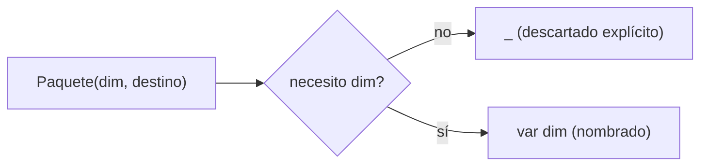

# Módulo 7: Records, sealed classes y pattern matching


**Proyecto del módulo:** crea un proyecto Maven o Gradle desde cero, pega el código del tema y corre las pruebas; las equivalencias entre ambos sistemas están en el Módulo 8, Tema 4.

## Aprende construyendo

### Tema 1: record — modelos inmutables sin boilerplate · Básico · 45 min

**Paso 1 · Objetivo y preparación**

**Prerrequisito:** Módulos 0–2 de Java (clases, `equals`/`hashCode`); JDK 27 o posterior (records estables desde Java 16). Comprueba `java --version`.

**Al finalizar podrás:** modelar con un `record`, validar en el constructor compacto, proteger un componente mutable con copia defensiva, comparar por valor, y "actualizar" creando una instancia nueva.

#### Aprende

**Paso 2 · Contexto y caso profesional**

**Caso profesional:** el servicio de entregas necesita intercambiar guías y destinatarios como valores comparables; cambiar el peso debe producir una guía nueva, no alterar una instancia que otra parte del sistema ya conserva.

**Paso 3 · Teoría, modelo mental y analogía**

Una guía de entrega (número, peso, estado) no debería cambiar sus datos una vez creada; cualquier "actualización" real debería producir una nueva instancia, nunca mutar la existente en un lugar donde otro código todavía la referencia.

**¿Por qué es importante?** `record` elimina el boilerplate que una clase POJO tradicional requeriría para constructor, getters, `equals`, `hashCode` y `toString`, mientras impone inmutabilidad estructural como parte del diseño del lenguaje.

**Mapa de subtemas críticos**

| Subtema | Papel | Evidencia del tema |
|---|---|---|
| declaración y qué genera | Núcleo | `record Punto(int x, int y)` da constructor, accesores, equals/hashCode/toString |
| accesores sin `get` | Variante | `p.x()`, no `getX()` |
| `equals`/`hashCode`/`toString` por valor | Núcleo | dos records con los mismos componentes son iguales |
| componentes `final` e inmutabilidad superficial | Límite | el record no muta, pero un componente mutable sí |
| constructor compacto | Núcleo | validar/normalizar sin repetir la asignación |
| constructor canónico y copia defensiva | Diagnóstico | `List.copyOf` aísla una lista mutable |
| "wither" para actualizar | Variante | crear una instancia nueva en vez de mutar |
| cuándo NO usar record | Decisión | entidad que genuinamente muta (ORM) |

Cada fila tiene su explicación individual a continuación.

**Declaración y qué genera (núcleo).** `record Punto(int x, int y) {}` declara en una línea una clase inmutable completa: el compilador genera el **constructor canónico**, los **accesores**, y sobreescribe `equals`, `hashCode` y `toString` a partir de **todos** los componentes. Reemplaza el POJO con getters/setters manuales (o Lombok).

**Accesores sin `get` (variante).** El método para leer un componente se llama como el componente: `p.x()`, `p.y()` (no `getX()`). Es la convención de records; no hay setters, porque un record no cambia tras construirse.

**`equals`/`hashCode`/`toString` por valor (núcleo).** Dos records son **iguales** si todos sus componentes lo son, aunque sean instancias distintas; su `hashCode` coincide y `toString` muestra los componentes (`Punto[x=3, y=4]`). Esto los hace ideales como claves de mapa y como DTOs comparables por valor.

**Componentes `final` e inmutabilidad superficial (límite).** Los campos de los componentes son `final`: no hay forma de reasignarlos. Pero la inmutabilidad es **superficial**: si un componente referencia un objeto mutable (una `List`), ese objeto todavía puede cambiar desde fuera. Un record con solo `String`/primitivos es inmutable de verdad; con una colección, necesitas protegerla (ver copia defensiva).

**Constructor compacto (núcleo).** `Guia { ... }` (sin lista de parámetros ni asignaciones) es el **constructor compacto**: se ejecuta antes de asignar los campos, ideal para **validar** invariantes (`numero` no vacío, `pesoKg` positivo) y **normalizar**. No repites la asignación `this.x = x`; el compilador la hace al final.

**Constructor canónico y copia defensiva (diagnóstico).** Para cerrar la inmutabilidad superficial, en el constructor compacto reasigna el parámetro mutable a una copia inmutable: `paradas = List.copyOf(paradas)`. Así mutar la lista original desde fuera no afecta al record, y la lista del record rechaza modificaciones (`UnsupportedOperationException`). Es la defensa estándar para componentes de colección.

**"Wither" para actualizar (variante).** Como un record no muta, "actualizar" un valor es **crear una instancia nueva** con un método tipo `conPeso(nuevo)` / `conParada(p)` que reutiliza el resto de componentes. El original queda intacto, lo que es seguro para datos compartidos entre hilos.

**Cuándo NO usar record (decisión).** Un record no sirve para una entidad que **genuinamente muta** su estado en el tiempo (una entidad JPA cuyos campos actualiza el ORM). Para eso usa una clase tradicional con campos mutables. El record es para datos de valor inmutables (DTOs, claves, eventos).

`record Punto(int x, int y) {}` declara una clase inmutable completa en una única línea: el compilador genera automáticamente un constructor que acepta ambos componentes, métodos de acceso con el mismo nombre que cada componente (`p.x()`, `p.y()`, en vez de la convención `getX()`/`getY()` de una clase tradicional), y sobreescribe `equals()`, `hashCode()` y `toString()` basándose en el valor de todos los componentes declarados, reemplazando por completo el boilerplate que una clase POJO (Plain Old Java Object) tradicional requeriría escribir manualmente (o generar con un IDE, o delegar a una librería externa como Lombok) para lograr exactamente el mismo resultado.

Los campos que corresponden a los componentes de un record son `final`: no hay un método generado para reasignar `x` o `y` después de construir `Punto`. Esto da **inmutabilidad superficial**, no profunda: si un componente referencia una lista mutable, esa lista aún podría cambiar. En `Guia`, los componentes son `String`, un `double` y otro record cuyos componentes también son `String`, así que el ejemplo no expone una referencia mutable.

**Analogía:** un record es como un formulario impreso con campos ya fijados en tinta permanente en el momento de imprimirse: puedes leer cualquier campo cuantas veces quieras, pero no puedes tachar y reescribir un valor existente; si necesitas datos distintos, imprimes un formulario completamente nuevo con los valores correctos, en vez de modificar el existente.

`record Guia(String numero, double pesoKg) {}` genera automáticamente constructor, getters (`numero()`, `pesoKg()`), `equals`/`hashCode`/`toString`, sin boilerplate manual. La analogía: un formulario impreso con campos en tinta permanente — para datos distintos, imprimes uno nuevo, no tachas el existente.

**Conceptos clave:** generación automática de constructor, accesores (`numero()`, no `getNumero()`), `equals`/`hashCode`/`toString` e inmutabilidad superficial.

Cada entidad de solo-datos del proyecto integrador de este track (una guía, una tarifa, una dirección) que no necesite identidad mutable debería modelarse como `record`, no como una clase tradicional con getters/setters manuales.

**Cuándo no usarlo:** un `record` no es apropiado para una entidad que genuinamente necesita mutar su estado a lo largo del tiempo (por ejemplo, una entidad gestionada por un ORM que actualiza campos en la base de datos); para esos casos, una clase tradicional con campos mutables sigue siendo la herramienta correcta.

**Implicación práctica:** `record` elimina el boilerplate de constructor/accesores/`equals`/`hashCode`/`toString` y evita reasignar sus componentes. Si los componentes contienen objetos mutables, protégelos por separado; "actualizar" una guía de este ejemplo significa construir otra instancia.

**Código del ejemplo:**

```java
record Punto(int x, int y) {}
// genera automáticamente: constructor, getters (x(), y()), equals, hashCode y toString

Punto p = new Punto(3, 4);
p.x(); // 3
```

#### Practica

**Paso 4 · Demostración guiada desde cero**

**Desde cero:** parte de una carpeta vacía y prepara la estructura.

```bash
mkdir ejemplo-record-guia
cd ejemplo-record-guia
mkdir -p src/main/java/academia/records
```

**Crea** `Guia.java` como `record` con un constructor compacto que valide `numero` no vacío y `pesoKg` positivo. Incluye también el `record Destinatario` que usarás en la práctica independiente y un `Main` que cree dos instancias con los mismos valores y confirme `equals()` por valor:

```java
package academia.records;

import java.util.Objects;

record Destinatario(String nombre, String telefono) {}

record Guia(String numero, double pesoKg, Destinatario destinatario) {
    Guia {
        if (numero == null || numero.isBlank()) {
            throw new IllegalArgumentException("El número de guía es obligatorio");
        }
        if (!Double.isFinite(pesoKg) || pesoKg <= 0) {
            throw new IllegalArgumentException("El peso debe ser positivo: " + pesoKg);
        }
        Objects.requireNonNull(destinatario, "El destinatario es obligatorio");
    }

    Guia conPeso(double nuevoPesoKg) {
        return new Guia(numero(), nuevoPesoKg, destinatario());
    }
}

final class Main {
    public static void main(String[] args) {
        Destinatario ana = new Destinatario("Ana", "555-0101");
        Guia original = new Guia("G-001", 12.5, ana);
        Guia copia = new Guia("G-001", 12.5, new Destinatario("Ana", "555-0101"));

        System.out.println(original);
        System.out.println("Iguales: " + original.equals(copia));
        System.out.println("Peso original: " + original.pesoKg());
        System.out.println("Peso nuevo: " + original.conPeso(10).pesoKg());

        try {
            new Guia("", 12.5, ana);
        } catch (IllegalArgumentException e) {
            System.out.println("Rechazada: " + e.getMessage());
        }
    }
}
```

**Ejecuta el ejemplo:**

```bash
javac -d out src/main/java/academia/records/Guia.java
java -cp out academia.records.Main
```

**Resultado esperado:** imprime la guía, `Iguales: true`, `Peso original: 12.5`, `Peso nuevo: 10.0` y finalmente `Rechazada: El número de guía es obligatorio`. La guía nueva tiene otro peso; la original conserva `12.5`. Las dos guías iniciales son instancias distintas, pero `equals()` devuelve `true` porque coinciden todos sus componentes.

**Paso 5 · Práctica guiada**

Antes de ejecutar, predice qué valores imprimirán `original.pesoKg()` y `original.conPeso(10).pesoKg()`. Ejecuta el programa y compáralos con la salida esperada.

**Fallo deliberado:** intenta asignar directamente `original.pesoKg = 10` dentro del `main` y recompila.

**Pista:** los componentes de un record no tienen setters y el compilador rechaza la asignación con `pesoKg has private access in Guia`, porque el acceso generado solo permite leer. **Resultado esperado:** confirmas que la única forma de "cambiar" un valor es construir una nueva instancia.

Ahora cierra los subtemas de igualdad por valor, copia defensiva y wither. Crea `src/main/java/academia/records/Demo.java`:

```java
package academia.records;
import java.util.*;

public class Demo {
    record Punto(int x, int y) {}
    record Ruta(String nombre, List<String> paradas) {
        Ruta {                                    // compacto: valida y protege
            Objects.requireNonNull(nombre);
            paradas = List.copyOf(paradas);       // copia defensiva → inmutabilidad real
        }
        Ruta conParada(String p) {                // "wither": instancia nueva
            var nuevas = new ArrayList<>(paradas); nuevas.add(p);
            return new Ruta(nombre, nuevas);
        }
    }
    public static void main(String[] args) {
        Punto a = new Punto(3, 4), b = new Punto(3, 4);
        System.out.println("equals=" + a.equals(b) + " hashCode iguales=" + (a.hashCode() == b.hashCode()));
        System.out.println("toString=" + a + " accesor x=" + a.x());

        var paradas = new ArrayList<>(List.of("A", "B"));
        var r = new Ruta("R1", paradas);
        paradas.add("C");                          // mutar la original NO afecta al record
        System.out.println("paradas record=" + r.paradas());
        try { r.paradas().add("X"); }
        catch (UnsupportedOperationException e) { System.out.println("record list inmutable"); }
        System.out.println("conParada=" + r.conParada("Z").paradas());
    }
}
```

```bash
javac -d out src/main/java/academia/records/Demo.java
java -cp out academia.records.Demo
```

**Salida esperada (verificada con Temurin 27.0.1):**

```text
equals=true hashCode iguales=true
toString=Punto[x=3, y=4] accesor x=3
paradas record=[A, B]
record list inmutable
conParada=[A, B, Z]
```

Dos `Punto` con los mismos componentes son iguales y comparten `hashCode`; `toString` muestra los componentes y el accesor se llama `x()`; la **copia defensiva** hizo que añadir `C` a la lista original no afecte al record, y la lista del record es inmutable; el "wither" `conParada` produjo una instancia nueva sin tocar la original.

**Si falla.** Si añadir a la lista original cambia el record, falta `List.copyOf` en el compacto. Si `r.paradas().add` no lanza, no protegiste la colección. Si el compilador no acepta el compacto, no repitas la lista de parámetros ni las asignaciones dentro de él.

#### Aplica

**Paso 6 · Práctica independiente**

Extiende `Guia` con `conNumero(String nuevoNumero)`, que devuelva otra guía y reutilice el destinatario. Comprueba que la guía nueva tiene el número actualizado, la original conserva `G-001` y dos destinatarios con los mismos valores se comparan por valor.

**Paso 7 · Cierre**

**Checklist de salida.**

- [ ] `Guia.java` compila con `javac -d out` sin setters.
- [ ] El constructor compacto rechaza un número vacío con `IllegalArgumentException`.
- [ ] El constructor compacto rechaza un peso cero, negativo, `NaN` o infinito.
- [ ] Dos `Guia` con los mismos valores imprimen `Iguales: true`.
- [ ] `conPeso` devuelve otra guía y deja intacto el peso de la original.
- [ ] Una copia defensiva (`List.copyOf`) aísla un componente de colección mutable.
- [ ] El record `Destinatario` también se compara por valor.
- [ ] Explicas cómo se "actualiza" una guía sin mutar la instancia original.

**Si falla.** Si la prueba de igualdad falla con un `Destinatario`, compara los dos objetos impresos con `toString()` antes de cambiar el modelo. Si el constructor compacto no valida, confirma que la comprobación está dentro del bloque `Guia { ... }` y no en un constructor auxiliar.

Guarda `Guia`, la validación del constructor compacto y la prueba de igualdad por valor; como siguiente paso estudia sealed interfaces.

**Errores comunes:** asumir que un record hace inmutables también los objetos mutables que referencia (usa copia defensiva); usarlo para una entidad que genuinamente muta su estado (por ejemplo, una entidad gestionada por un ORM); intentar agregar un setter a un componente; y validar invariantes fuera del constructor compacto.

**Fuentes oficiales revisadas el 2026-11-01:** [dev.java: Records](https://dev.java/learn/classes-objects/records/), [`Record` (API Java SE 27)](https://docs.oracle.com/en/java/javase/27/docs/api/java.base/java/lang/Record.html) y [JEP 395: Records](https://openjdk.org/jeps/395).

---

### Tema 2: sealed — jerarquías cerradas y exhaustividad · Intermedio · 45 min

**Paso 1 · Objetivo y preparación**

**Prerrequisito:** Tema 1 de este módulo (records); JDK 27 o posterior (`sealed`/`permits` estables desde JDK 17). Comprueba `java --version`.

**Al finalizar podrás:** limitar con `sealed`/`permits` las implementaciones; declarar cada subtipo `final`/`sealed`/`non-sealed`; modelar un ADT con sealed + records; y comprobar que agregar un caso rompe la compilación de los `switch` exhaustivos.

#### Aprende

**Paso 2 · Contexto y caso profesional**

**Caso profesional:** el servicio de entregas procesa estados conocidos; si se incorpora `Cancelada`, toda decisión que clasifique una entrega debe revisarse antes de compilar el cambio.

**Paso 3 · Teoría, modelo mental y analogía**

Una entrega tiene un conjunto fijo de estados posibles (creada, en tránsito, entregada); si el código que procesa esos estados no se entera cuando alguien agrega un estado nuevo (cancelada), el nuevo estado queda silenciosamente sin manejar en producción.

**¿Por qué es importante?** `sealed` permite que el compilador verifique exhaustividad en un switch sin necesidad de una rama `default`, detectando en tiempo de compilación cualquier caso nuevo agregado a la jerarquía que se haya olvidado cubrir en algún switch existente.

**Mapa de subtemas críticos**

| Subtema | Papel | Evidencia del tema |
|---|---|---|
| `sealed` y `permits` | Núcleo | solo los tipos listados pueden implementar |
| `final`/`sealed`/`non-sealed` en subtipos | Núcleo | cada hoja declara si se puede extender |
| exhaustividad en `switch` sin `default` | Diagnóstico | añadir un caso rompe la compilación de los switch |
| sealed + records = ADT | Variante | tipos de dato algebraicos (suma de casos) |
| alcance de `permits` (mismo módulo/paquete) | Límite | los subtipos deben ser accesibles a la base |
| cuándo NO sellar | Decisión | jerarquía abierta a extensión de terceros |

Cada fila tiene su explicación individual a continuación.

**`sealed` y `permits` (núcleo).** `sealed interface Forma permits Circulo, Cuadrado {}` restringe, verificado por el compilador, **exactamente** qué tipos pueden implementar/extender `Forma`. Ningún otro código puede crear una implementación no listada, a diferencia de una interfaz normal que cualquiera implementa.

**`final`/`sealed`/`non-sealed` en subtipos (núcleo).** Cada subtipo permitido **debe** declarar si a su vez se puede extender: `final` (hoja cerrada, lo son los records implícitamente), `sealed` (vuelve a restringir con su propio `permits`) o `non-sealed` (reabre la extensión). Esto mantiene la jerarquía bajo control nivel a nivel.

**Exhaustividad en `switch` sin `default` (diagnóstico).** Como el compilador conoce **todo** el conjunto cerrado, un `switch` sobre la sealed cubre todos los casos sin `default`. Si añades un subtipo a `permits` y olvidas su rama en algún switch, **la compilación falla** señalando dónde, en vez de ser un bug silencioso en producción.

**Sealed + records = ADT (variante).** Combinar una `sealed interface` con `record` que la implementan modela un **tipo de dato algebraico** (una suma de casos: `EstadoEntrega` = `Creada | EnTransito | Entregada`). Es el patrón idiomático moderno para modelar un dominio con un número fijo y conocido de formas, y encaja de lleno con el pattern matching del Tema 3.

**Alcance de `permits` (límite).** Los subtipos de `permits` deben ser **accesibles** desde la clase sellada: en el mismo módulo (si hay módulos) o el mismo paquete si no. No puedes sellar hacia tipos de otro módulo sin exportarlos. Es una restricción de encapsulación, no un capricho.

**Cuándo NO sellar (decisión).** No selles una jerarquía **genuinamente abierta** a extensión externa (un contrato de plugin que terceros implementan): ahí una interfaz normal es lo correcto. `sealed` es para conjuntos cerrados que tú controlas y quieres que el compilador vigile.

`sealed interface Forma permits Circulo, Cuadrado {}` declara explícitamente, mediante la cláusula `permits`, exactamente qué clases o interfaces tienen permitido implementar o extender `Forma`, una restricción verificada por el compilador: ningún otro código, en ningún otro lugar del proyecto, puede crear una implementación adicional no listada en esa cláusula `permits`, a diferencia de una interfaz normal sin `sealed`, que cualquier clase en cualquier lugar puede implementar libremente sin ninguna restricción del compilador.

Cada subtipo permitido debe declararse `final`, `sealed` o `non-sealed`. Los records de este ejemplo son `final` implícitamente, así que las hojas de la jerarquía no se pueden extender; una rama `non-sealed`, en cambio, volvería a permitir subtipos.

Esta restricción deliberada habilita una capacidad adicional en el pattern matching de switch (Tema 3): dado que el compilador conoce exactamente el conjunto completo y cerrado de implementaciones posibles de una sealed interface, puede verificar en tiempo de compilación que un switch sobre esa interfaz cubre absolutamente todos los casos posibles, sin necesidad de una rama `default` como red de seguridad — si en el futuro se agrega una nueva implementación a la lista `permits` pero se olvida agregar su caso correspondiente en algún switch existente en el código, el compilador falla inmediatamente en ese punto, señalando exactamente dónde falta cubrir el nuevo caso, en vez de dejar ese olvido como un bug silencioso que solo se manifestaría en producción cuando efectivamente se procese un objeto de ese nuevo tipo no contemplado.

**Analogía:** `sealed` es como una lista cerrada y oficial de sucursales autorizadas de una franquicia, donde no se permite abrir una sucursal nueva no autorizada explícitamente en esa lista; esto permite que cualquier proceso que dependa de conocer todas las sucursales existentes (como un switch exhaustivo) pueda confiar con certeza en que esa lista está efectivamente completa y no puede haber una sucursal adicional no contemplada apareciendo por sorpresa.

`sealed interface EstadoEntrega permits Creada, EnTransito, Entregada {}` restringe qué tipos pueden implementar la interfaz, verificado por el compilador. La analogía: una lista cerrada y oficial de sucursales autorizadas de una franquicia, donde no se permite abrir una nueva sin actualizar esa lista.

**Conceptos clave:** `permits`, lista explícita de implementaciones válidas, verificación de exhaustividad.

Cada conjunto cerrado de estados del proyecto integrador de este track (estado de una entrega, tipo de notificación, rol de usuario) debería modelarse como `sealed`, para que el compilador obligue a manejar un estado nuevo en cada switch existente.

**Cuándo no usarlo:** `sealed` no tiene sentido para un conjunto de tipos genuinamente abierto a extensión externa (por ejemplo, un plugin que terceros pueden implementar); en ese caso una interfaz normal, sin restricción de `permits`, es la elección correcta.

**Implicación práctica:** `sealed` convierte el olvido de manejar un estado nuevo en un error de compilación inmediato en cada switch existente, en vez de un bug silencioso que solo se descubre en producción cuando ese estado nuevo efectivamente ocurre.

**Código del ejemplo:**

```java
sealed interface Forma permits Circulo, Cuadrado {}
record Circulo(double radio) implements Forma {}
record Cuadrado(double lado) implements Forma {}
```

#### Practica

**Paso 4 · Demostración guiada desde cero**

**Desde cero:** parte de una carpeta vacía y prepara la estructura.

```bash
mkdir ejemplo-sealed-estados
cd ejemplo-sealed-estados
mkdir -p src/main/java/academia/estados
```

**Crea** `EstadoEntrega.java` como `sealed interface` con tres records implementándola (`Creada`, `EnTransito`, `Entregada`), y un método que use un `switch` exhaustivo sobre esos estados sin rama `default`:

```java
package academia.estados;

sealed interface EstadoEntrega permits Creada, EnTransito, Entregada {}

record Creada(String numero) implements EstadoEntrega {}

record EnTransito(String numero, double avanceKm) implements EstadoEntrega {}

record Entregada(String numero, String recibidoPor) implements EstadoEntrega {}

final class Main {
    static String describir(EstadoEntrega estado) {
        return switch (estado) {
            case Creada c -> "Creada " + c.numero();
            case EnTransito e -> "En tránsito " + e.numero() + " (" + e.avanceKm() + " km)";
            case Entregada e -> "Entregada " + e.numero() + " a " + e.recibidoPor();
        };
    }

    public static void main(String[] args) {
        System.out.println(describir(new Creada("E-001")));
        System.out.println(describir(new EnTransito("E-002", 4.5)));
        System.out.println(describir(new Entregada("E-003", "Ana")));
    }
}
```

**Ejecuta el ejemplo:**

```bash
javac -d out src/main/java/academia/estados/EstadoEntrega.java
java -cp out academia.estados.Main
```

**Resultado esperado:** `Creada E-001`, `En tránsito E-002 (4.5 km)` y `Entregada E-003 a Ana`. El `switch` no tiene `default` y compila porque el compilador sabe que `permits` agota exactamente esos tres tipos.

**Paso 5 · Práctica guiada**

Predice qué debe ocurrir si la jerarquía gana otro estado y ejecuta el cambio controlado:

**Fallo deliberado:** agrega un cuarto record `Cancelada implements EstadoEntrega` a la cláusula `permits` sin actualizar el `switch` existente y recompila.

**Pista:** el compilador señala exactamente qué switch no cubre el caso nuevo, con un mensaje del tipo `the switch expression does not cover all possible input values`. **Resultado esperado:** agregar la rama faltante restaura la compilación.

**Si falla.** Si el compilador rechaza un tipo no listado en `permits`, es el comportamiento esperado: solo los tipos nombrados pueden implementar la interfaz sellada. Si el `switch` no compila aunque parezca completo, revisa que los tres records estén declarados en el mismo archivo o paquete y que la interfaz los nombre en `permits`.

#### Aplica

**Paso 6 · Práctica independiente**

En una copia del ejemplo, agrega `Devuelta(String numero, String motivo)` a `permits`. Primero confirma que el `switch` deja de compilar; después incorpora la rama que describe el motivo y verifica la salida. En otro archivo, intenta implementar `EstadoEntrega` sin incluir el tipo en `permits` y confirma que el compilador lo rechaza.

**Paso 7 · Cierre**

**Checklist de salida.**

- [ ] `EstadoEntrega.java` compila con `javac -d out`.
- [ ] El `switch` de `describir` no tiene rama `default`.
- [ ] Las tres salidas describen correctamente cada estado.
- [ ] Agregar `Cancelada` a `permits` rompe la compilación del switch existente.
- [ ] Añadir la rama de `Cancelada` restaura la compilación.
- [ ] Una implementación en otro archivo fuera de `permits` es rechazada.

**Si falla.** Si una implementación externa compila, la interfaz no es `sealed` o el tipo sí figura en `permits`. Si agregar `Cancelada` no rompe nada, el `switch` tiene una rama `default` que está ocultando el caso faltante.

Guarda la jerarquía sellada, el error de compilación al agregar un estado nuevo sin manejarlo, y la corrección; como siguiente paso estudia pattern matching.

**Errores comunes:** declarar una jerarquía abierta (sin `sealed`) cuando el conjunto de casos es en realidad fijo y conocido, agregar una implementación nueva a `permits` sin revisar qué switches existentes dejaron de ser exhaustivos, y usar `sealed` para un conjunto de tipos que legítimamente terceros deberían poder extender.

**Fuente oficial:** [JEP 409: Sealed Classes](https://openjdk.org/jeps/409) y [dev.java: Sealed Classes](https://dev.java/learn/classes-objects/sealed-classes/).

---

### Tema 3: Pattern matching exhaustivo y para instanceof · Intermedio · 45 min

**Paso 1 · Objetivo y preparación**

**Prerrequisito:** Temas 1–2 de este módulo (records, sealed); JDK 27 o posterior (pattern matching en `switch` y record patterns estables desde Java 21). Comprueba `java --version`.

**Al finalizar podrás:** usar `instanceof` con binding, type patterns y record patterns en `switch`, guardas `when`, exhaustividad sin `default` y `case null`, sin casteo manual.

#### Aprende

**Paso 2 · Contexto y caso profesional**

**Caso profesional:** una operación de reprogramación debe aceptar entregas creadas o en tránsito y rechazar las ya entregadas; si aparece otro estado, el compilador debe señalar que falta decidir cómo tratarlo.

**Paso 3 · Teoría, modelo mental y analogía**

Calcular si una entrega puede reprogramarse depende de su estado exacto (no se puede reprogramar una ya `Entregada`); expresar esa lógica con casteos manuales anidados es más verboso y propenso a errores que un switch con pattern matching.

**¿Por qué es importante?** El pattern matching exhaustivo garantiza, verificado por el compilador, que ningún caso posible de una sealed interface quede sin cubrir; el pattern matching para instanceof elimina la redundancia y el riesgo del casteo manual clásico.

Un `switch` con pattern matching extrae directamente el valor ya tipado de cada rama, y el compilador verifica exhaustividad contra la jerarquía `sealed` (Tema 2), sin necesitar `default`. La analogía: verificar la identidad de alguien y recibir simultáneamente su credencial ya lista para usar, sin un paso adicional redundante.

**Mapa de subtemas críticos**

| Subtema | Papel | Evidencia del tema |
|---|---|---|
| `instanceof` con binding | Núcleo | `if (o instanceof String s)` evita el cast |
| type pattern en `switch` | Núcleo | cada rama recibe el valor ya tipado |
| record patterns (deconstrucción) | Variante | `case Rect(double a, double h)` extrae componentes |
| guardas `when` | Variante | refinar una rama con una condición |
| exhaustividad sobre sealed | Diagnóstico | sin `default`, cubrir todos los casos |
| `case null` | Límite | el `switch` es hostil a `null` salvo que lo añadas |

Cada fila tiene su explicación individual a continuación.

**`instanceof` con binding (núcleo).** `if (o instanceof String s)` comprueba el tipo **y** vincula la variable ya casteada `s` en una sola expresión. Sustituye el patrón clásico `if (o instanceof String) { String s = (String) o; ... }`, eliminando el cast redundante y su riesgo de `ClassCastException`.

**Type pattern en `switch` (núcleo).** Un `switch` puede ramificar por **tipo**: `case Circulo c -> ...` recibe `c` ya tipado como `Circulo`. Reemplaza cadenas de `if/else if` con `instanceof` por una estructura legible donde cada rama trabaja con el tipo concreto sin castear.

**Record patterns (deconstrucción) (variante).** Sobre un record puedes **deconstruir** sus componentes en el propio patrón: `case Rect(double a, double h) -> a * h` extrae `a` y `h` directamente, sin llamar `rect.ancho()`/`rect.alto()`. Se anidan para estructuras compuestas (`case Pedido(Cliente(var nombre), var total))`).

**Guardas `when` (variante).** Una rama puede refinarse con una condición: `case Circulo c when c.radio() > 10 -> "grande"`. La guarda se evalúa tras encajar el patrón; permite distinguir casos del mismo tipo (círculo grande vs normal, rectángulo cuadrado vs no). El orden importa: las ramas más específicas van primero.

**Exhaustividad sobre sealed (diagnóstico).** Si el `switch` es sobre un tipo `sealed`, el compilador exige cubrir **todos** los casos y no necesita `default`. Añadir un subtipo a la jerarquía y olvidar su rama rompe la compilación (lo viste en el Tema 2). Evita el `default` "por si acaso": anula esa protección.

**`case null` (límite).** Un `switch` tradicional lanza `NullPointerException` ante `null`. Con pattern matching, el `switch` sigue siendo hostil a `null` **salvo** que añadas explícitamente `case null ->`. La exhaustividad de la jerarquía no hace que `null` sea un caso válido: decídelo tú.

```java
double area(Forma forma) {
    return switch (forma) {
        case Circulo c -> Math.PI * c.radio() * c.radio();
        case Cuadrado q -> q.lado() * q.lado();
    };
}
```

Este switch combina pattern matching (extrayendo directamente `c`/`q` ya tipados correctamente según cada caso, sin casteo manual explícito) con la verificación de exhaustividad habilitada por `sealed` (Tema 2): el compilador verifica que cubra todos los casos de la jerarquía. El `switch` sigue siendo hostil a `null` salvo que se añada explícitamente `case null`; la exhaustividad de la jerarquía no hace que `null` sea un estado válido.

```java
if (obj instanceof Circulo c) {
    System.out.println(c.radio());
}
```

Este pattern matching para `instanceof` reemplaza el patrón clásico anterior (`if (obj instanceof Circulo) { Circulo c = (Circulo) obj; ... }`, que requería un casteo manual explícito y redundante inmediatamente después de la verificación `instanceof`) con una única expresión que verifica el tipo y simultáneamente declara una variable ya correctamente tipada (`c`) disponible directamente dentro del bloque donde la verificación resultó verdadera, eliminando la redundancia y el riesgo de un casteo manual incorrecto que el patrón clásico anterior conllevaba.

**Analogía:** un switch exhaustivo verificado por el compilador es como un formulario de clasificación que garantiza automáticamente que cada categoría posible de un conjunto cerrado y conocido tiene su propio casillero correspondiente, sin necesidad de un casillero genérico de "otros" como respaldo; pattern matching para instanceof es como verificar la identidad de alguien y recibir simultáneamente su credencial ya lista para usar, en vez de verificar la identidad y luego tener que solicitar la credencial por separado en un paso adicional redundante.

**Conceptos clave:** switch sin default verificado, eliminación del casteo manual clásico.

Cada regla de negocio del proyecto integrador de este track que dependa del estado exacto de una entidad sellada se beneficiará de este mismo patrón: switch exhaustivo, sin `default`, verificado por el compilador.

**Cuándo no usarlo:** agregar una rama `default` a un switch exhaustivo sobre una sealed interface, "por si acaso", anula justamente la verificación de exhaustividad que `sealed` habilita — solo omite `default` cuando genuinamente quieres que el compilador te obligue a cubrir cada caso nuevo.

**Implicación práctica:** Un switch exhaustivo sin `default`, verificado contra una jerarquía `sealed`, convierte un estado nuevo sin manejar en un error de compilación inmediato, mientras que un `default` oculta ese mismo olvido dejándolo pasar en silencio.

#### Practica

**Paso 4 · Demostración guiada desde cero**

**Desde cero:** parte de una carpeta vacía y prepara la estructura.

```bash
mkdir ejemplo-pattern-matching
cd ejemplo-pattern-matching
mkdir -p src/main/java/academia/patrones
```

**Crea** `CalculadoraReprogramacion.java` con un método `puedeReprogramarse(EstadoEntrega estado)` que use un `switch` exhaustivo sobre la jerarquía sellada del Tema 2 (`Creada` y `EnTransito` devuelven `true`, `Entregada` devuelve `false`):

```java
package academia.patrones;

sealed interface EstadoEntrega permits Creada, EnTransito, Entregada {}

record Creada(String numero) implements EstadoEntrega {}

record EnTransito(String numero, double avanceKm) implements EstadoEntrega {}

record Entregada(String numero, String recibidoPor) implements EstadoEntrega {}

public final class CalculadoraReprogramacion {
    static boolean puedeReprogramarse(EstadoEntrega estado) {
        return switch (estado) {
            case Creada c -> true;
            case EnTransito e -> true;
            case Entregada e -> false;
        };
    }

    public static void main(String[] args) {
        System.out.println("Creada: " + puedeReprogramarse(new Creada("E-001")));
        System.out.println("En tránsito: " + puedeReprogramarse(new EnTransito("E-002", 3.0)));
        System.out.println("Entregada: " + puedeReprogramarse(new Entregada("E-003", "Ana")));
    }
}
```

**Ejecuta el ejemplo:**

```bash
javac -d out src/main/java/academia/patrones/CalculadoraReprogramacion.java
java -cp out academia.patrones.CalculadoraReprogramacion
```

**Resultado esperado:** `Creada: true`, `En tránsito: true` y `Entregada: false`, sin ningún `default` y sin ningún casteo manual.

**Paso 5 · Práctica guiada**

Antes de ejecutar, predice el resultado de cada estado. Luego agrega el estado faltante de forma controlada:

**Fallo deliberado:** agrega el estado `Cancelada` (del Tema 2) a la jerarquía sin actualizar este switch y recompila.

**Pista:** el compilador señala que `puedeReprogramarse` no cubre `Cancelada`. **Resultado esperado:** agregar esa rama restaura la compilación exhaustiva.

Ahora cierra los subtemas de record patterns, guardas `when` y `case null`. Crea `src/main/java/academia/patrones/Demo.java`:

```java
package academia.patrones;

public class Demo {
    sealed interface Forma permits Circulo, Rect {}
    record Circulo(double radio) implements Forma {}
    record Rect(double ancho, double alto) implements Forma {}

    static String describir(Object o) {
        if (o instanceof String s) return "texto len=" + s.length();   // instanceof con binding
        return "otro";
    }
    static String clasificar(Forma f) {
        return switch (f) {
            case Circulo c when c.radio() > 10 -> "circulo grande";    // guarda when
            case Circulo c -> "circulo r=" + c.radio();
            case Rect(double a, double h) when a == h -> "cuadrado " + a; // record pattern + guarda
            case Rect(double a, double h) -> "rect " + a + "x" + h;       // deconstrucción
        };
    }
    static String conNull(Forma f) {
        return switch (f) {
            case null -> "nulo";                                       // case null explícito
            case Circulo c -> "circulo";
            case Rect r -> "rect";
        };
    }
    public static void main(String[] args) {
        System.out.println(describir("hola"));
        System.out.println(clasificar(new Circulo(20)));
        System.out.println(clasificar(new Circulo(3)));
        System.out.println(clasificar(new Rect(5, 5)));
        System.out.println(clasificar(new Rect(5, 8)));
        System.out.println(conNull(null));
    }
}
```

```bash
javac -d out src/main/java/academia/patrones/Demo.java
java -cp out academia.patrones.Demo
```

**Salida esperada (verificada con Temurin 27.0.1):**

```text
texto len=4
circulo grande
circulo r=3.0
cuadrado 5.0
rect 5.0x8.0
nulo
```

`instanceof String s` vinculó sin cast; la guarda `when` separó el círculo grande del normal; el **record pattern** `Rect(double a, double h)` deconstruyó los componentes y la guarda `a == h` detectó el cuadrado; y `case null` manejó el `null` que de otro modo lanzaría `NullPointerException`.

**Si falla.** Si el switch compila con `Cancelada` sin agregar su rama, existe un `default` que debes eliminar. Si el record pattern no compila, revisa que el tipo deconstruido sea un record y los tipos de los componentes coincidan. Si `conNull(null)` lanza excepción, falta el `case null`.

#### Aplica

**Paso 6 · Práctica independiente**

En `main`, crea un `Object candidato = new EnTransito("E-004", 2.0)` y usa `instanceof EnTransito enTransito` para imprimir su número y avance sin casteo manual. Ejecuta y verifica `Detalle: E-004 a 2.0 km`. Después escribe la variante clásica con `instanceof` y cast, confirma que da la misma salida y explica cuál versión conservarías.

**Paso 7 · Cierre**

**Checklist de salida.**

- [ ] `CalculadoraReprogramacion.java` compila y ejecuta.
- [ ] `Creada` y `EnTransito` devuelven `true`.
- [ ] `Entregada` devuelve `false`.
- [ ] El switch no usa `default` ni casteos manuales.
- [ ] Agregar `Cancelada` sin su rama rompe la compilación.
- [ ] La versión clásica con `instanceof` + cast produce el mismo resultado.

**Si falla.** Si la versión clásica devuelve un resultado distinto, revisa que el `else` final cubra el caso restante en vez de asumir un tipo. Si el compilador advierte sobre una variable de patrón sin usar, es una advertencia del editor y no un error de compilación.

Guarda ambas versiones (pattern matching y casteo clásico) y el error de exhaustividad al agregar `Cancelada`; como siguiente paso estudia módulos y JPMS.

**Errores comunes:** agregar una rama `default` "por si acaso" a un switch exhaustivo sobre una sealed interface (anula la verificación de exhaustividad que `sealed` habilita), usar el casteo manual clásico (`instanceof` + cast) donde pattern matching ya elimina esa redundancia, y olvidar que un switch con pattern matching debe cubrir la jerarquía completa para omitir `default`.

**Fuentes oficiales revisadas el 2026-11-01:** [JEP 441: Pattern Matching for switch](https://openjdk.org/jeps/441), [JEP 440: Record Patterns](https://openjdk.org/jeps/440), [JEP 394: Pattern Matching for instanceof](https://openjdk.org/jeps/394) y [dev.java: Pattern Matching](https://dev.java/learn/pattern-matching/).

---

### Tema 4: Unnamed variables y patterns (_, Java 22) · Avanzado · 50 min

**Paso 1 · Objetivo y preparación**

**Prerrequisito:** Temas 1–3 de este módulo; JDK 27 o posterior (`_` estable desde Java 22). Comprueba `java --version`.

**Al finalizar podrás:** usar `_` para descartar un componente de un record pattern, una excepción en `catch` y una variable de bucle; distinguir el descarte explícito de un nombre sin usar; y comprobar la sangría de un text block.

#### Aprende

**Paso 2 · Contexto y caso profesional**

**Caso profesional:** al generar un resumen de paquete solo se necesita el destino, no las dimensiones; el patrón `_` permite indicar en el código que ese componente se descarta intencionalmente.

**Paso 3 · Teoría, modelo mental y analogía**

**¿Por qué es importante?** `_` distingue un valor descartado de un binding con nombre que podría usarse por accidente. Es una señal del lenguaje; `javac` no suele advertir sobre variables locales sin uso, y el comportamiento de linters depende de su configuración.

Las unnamed variables y patterns (`_`) se finalizaron en Java 22. Permiten descartar explícitamente un binding que la sintaxis exige declarar, como un componente de record pattern o el parámetro de un `catch`. `_` no es una variable: no se puede leer ni reutilizar como identificador.

**Mapa de subtemas críticos**

| Subtema | Papel | Evidencia del tema |
|---|---|---|
| `_` en record pattern | Núcleo | descartar un componente que no se usa |
| `_` en `catch` | Variante | capturar sin nombrar la excepción |
| `_` en bucles y recursos | Variante | descartar el elemento o el recurso |
| `_` no es una variable | Límite | no se lee ni se reutiliza; repetirlo sí se permite |
| descarte explícito frente a nombre sin usar | Decisión | `_` comunica intención; `javac` no advierte de locales sin uso |

Cada fila tiene su explicación individual a continuación.

**`_` en record pattern (núcleo).** Al deconstruir un record, `_` descarta un componente que no necesitas: `case Paquete(Dimensiones _, String destino)` toma solo el destino. Evita nombrar `dim` y no usarlo, que invita a errores y ensucia la lectura.

**`_` en `catch` (variante).** Cuando capturas una excepción cuyo objeto no vas a inspeccionar, `catch (NumberFormatException _)` lo deja claro: te importa el **tipo** del fallo, no sus datos. Antes había que declarar un `e` sin usar.

**`_` en bucles y recursos (variante).** También vale como variable de un for-each (`for (var _ : lista)` cuando solo cuentas iteraciones) o en un try-with-resources donde el recurso se cierra pero no se usa por nombre. En todos los casos la sintaxis exige declarar algo; `_` dice "a propósito, nada".

**`_` no es una variable (límite).** No puedes **leer** `_` ni usarlo como identificador normal; el compilador lo rechaza. Sí puedes usar `_` varias veces en el mismo ámbito (dos componentes descartados), algo imposible con un nombre real. Es un marcador de descarte, no un dato.

**Descarte explícito frente a nombre sin usar (decisión).** `_` **comunica intención**: "este valor se descarta a propósito". Un nombre sin usar (`dim` que nadie lee) no distingue el descarte deliberado del olvido, y `javac` normalmente **no advierte** de variables locales sin uso (depende de linters). Usa `_` cuando la sintaxis te obligue a declarar algo que no vas a usar.

```java
try {
    return OptionalInt.of(Integer.parseInt(texto));
} catch (NumberFormatException _) {
    return OptionalInt.empty(); // la ausencia comunica que el texto no era un entero
}
```

**Analogía:** `_` es como una casilla de formulario marcada explícitamente "N/A"; una variable nombrada sin usar es como una casilla vacía — nadie puede distinguir con certeza si fue dejada vacía a propósito o si simplemente se olvidó completarla.

**Conceptos clave:** unnamed variables, unnamed patterns, _, catch sin binding, descartar un componente de un record pattern, text blocks (`"""`).

Cada deconstrucción del proyecto integrador de este track que no necesite todos los componentes de un record pattern debería usar `_` para los que descarta, en vez de nombrarlos igual sin usarlos.

**Cuándo no usarlo:** si existe cualquier posibilidad de que el binding se use más adelante en el mismo bloque, nómbralo normalmente; `_` no es una variable y el compilador rechaza cualquier intento de leerlo.

**Implicación práctica:** `_` hace imposible referirse accidentalmente al binding descartado y deja clara la intención. No garantiza por sí solo una advertencia concreta de un linter; esas comprobaciones dependen de la herramienta y su configuración.

**Código del ejemplo:**

```java
String resumen(Paquete paquete) {
    return switch (paquete) {
        case Paquete(Dimensiones _, String destino) -> "Destino: " + destino;
    };
}
```



#### Practica

**Paso 4 · Demostración guiada desde cero**

Parte de una carpeta vacía y prepara la estructura.

```bash
mkdir ejemplo-unnamed-patterns
cd ejemplo-unnamed-patterns
mkdir -p src/main/java/academia/patrones
```

**Crea** `src/main/java/academia/patrones/ExtractorDestino.java`. El programa reúne los dos usos de `_` (record pattern y `catch`) y el text block de la consulta:

```java
package academia.patrones;

import java.util.OptionalInt;

record Dimensiones(double ancho, double alto) {}

record Paquete(Dimensiones dim, String destino) {}

public final class ExtractorDestino {
    static String resumen(Paquete paquete) {
        return switch (paquete) {
            case Paquete(Dimensiones _, String destino) -> "Destino: " + destino;
        };
    }

    static OptionalInt entero(String texto) {
        try {
            return OptionalInt.of(Integer.parseInt(texto));
        } catch (NumberFormatException _) {
            return OptionalInt.empty();
        }
    }

    public static void main(String[] args) {
        System.out.println(resumen(new Paquete(new Dimensiones(30, 20), "Centro")));
        System.out.println("Entero válido: " + entero("42").orElseThrow());
        System.out.println("Texto inválido reconocido: " + entero("abc").isEmpty());

        String consulta = """
            SELECT numero, estado
            FROM entregas
            WHERE estado = 'EN_RUTA'
            """;
        System.out.println(consulta);
        System.out.println(consulta.lines().map(linea -> "[" + linea + "]").toList());
    }
}
```

**Ejecuta el ejemplo** directamente con `javac`:

```bash
javac -d out src/main/java/academia/patrones/ExtractorDestino.java
java -cp out academia.patrones.ExtractorDestino
```

Resultado esperado: el compilador acepta `_` como un marcador explícito de "este componente del record pattern es deliberadamente ignorado", sin generar ninguna advertencia de variable no utilizada, y sin que `_` quede disponible como variable dentro del bloque. La salida es `Destino: Centro`, `Entero: 42 / 0` y las tres líneas de la consulta.

Además, Java 15 introdujo los **text blocks** (`"""`) para escribir texto multilínea sin concatenar ni escapar comillas. Declara en el mismo archivo una consulta de ejemplo:
```java
String consulta = """
    SELECT numero, estado
    FROM entregas
    WHERE estado = 'EN_RUTA'
    """;
```
Resultado esperado: `consulta` contiene las tres líneas separadas por salto de línea, sin ningún `\n` ni `+` explícito en el código; Java elimina automáticamente la sangría común a todas las líneas, tomando como referencia la sangría de la comilla de cierre. **Fallo deliberado:** desalinea la comilla de cierre `""";` moviéndola una columna más a la izquierda que el texto interior. El compilador deja de eliminar correctamente la sangría incidental y cada línea del resultado aparece con un espacio extra al inicio que no estaba en la intención original — la sangría del delimitador de cierre, y no la del texto, es la que determina cuánto se recorta.

**Equivalente con Maven o Gradle** (el arquetipo genera un proyecto nuevo; si lo usas, copia el archivo dentro de `app/` antes de ejecutar las pruebas):

```bash
# Maven
mvn -q archetype:generate -DgroupId=academia -DartifactId=app -DarchetypeArtifactId=maven-archetype-quickstart -DinteractiveMode=false
cd app && mvn test
# Gradle (equivalente): gradle init --type java-application --dsl kotlin && ./gradlew test
```

**Fallo deliberado:** nombra la parte descartada con un identificador real sin uso (`Dimensiones dimensionesSinUsar`) en varios métodos distintos del proyecto, "para que quede más descriptivo".

**Pista:** el linter ahora reporta "variable no utilizada" en cada uno de esos métodos junto con las advertencias legítimas de variables genuinamente olvidadas, y el equipo termina ignorando TODAS las advertencias de esa categoría por volumen, incluyendo la que señalaba un error real. **Resultado esperado:** volver a `_` deja el reporte del linter únicamente con las advertencias legítimas.

**Si falla.** Si `_` no compila en un record pattern, el proyecto está apuntando a una versión de Java anterior a la 22: revisa `--release` en `javac` o `maven.compiler.release` en `pom.xml`. Si el compilador rechaza una segunda `_` en el mismo bloque, es correcto: `_` no es una variable reutilizable. Si el text block imprime una línea vacía al inicio, la comilla de apertura `"""` debe ir seguida inmediatamente de un salto de línea.

#### Aplica

Corrige el fallo anterior reemplazando cada binding deliberadamente descartado por `_`, y confirma que el linter ahora reporta únicamente las advertencias de variables genuinamente olvidadas, sin el ruido de las deliberadamente ignoradas.

**Checklist de salida.**

- [ ] `ExtractorDestino.java` compila con `javac -d out`.
- [ ] El record pattern usa `Dimensiones _` sin advertencia de variable no utilizada.
- [ ] El bloque `catch (NumberFormatException _)` compila y devuelve `0`.
- [ ] El text block imprime las tres líneas sin `\n` explícito en el código.
- [ ] Mover la comilla de cierre altera la sangría del resultado.
- [ ] El linter no reporta advertencias sobre los bindings descartados con `_`.

**Si falla.** Si el text block conserva espacios al inicio, la comilla de cierre está más a la izquierda que el texto. Si `_` aparece en una expresión como `System.out.println(_)`, el compilador lo rechaza: es un marcador, no un identificador. Si el linter sigue reportando una variable descartada, quedó un nombre real sin reemplazar.

Entregá el record pattern con `_` de la demostración, el text block de la consulta SQL con su fallo de sangría corregido, el ruido de advertencias por nombrar variables descartadas y la señal limpia del linter tras el fallo deliberado; explicá por qué una sintaxis reservada exclusivamente para "descartado a propósito" reduce el ruido que oculta advertencias legítimas. Siguiente paso: aplica records, sealed interfaces, pattern matching, text blocks y unnamed variables juntos en el dominio del proyecto integrador (Módulo 13).

**Errores comunes:** nombrar bindings descartados con nombres reales que generan ruido de lint, usar `_` para un binding que SÍ se usa más adelante (no compila), asumir que `_` es una variable utilizable (es un marcador, no un identificador), y desalinear la comilla de cierre de un text block esperando que la sangría se ajuste sola.

**Fuentes oficiales revisadas el 2026-11-01:** [JEP 456: Unnamed Variables & Patterns](https://openjdk.org/jeps/456) y [Unnamed Variables and Patterns (Java SE 27)](https://docs.oracle.com/en/java/javase/27/language/unnamed-variables-and-patterns.html).

---


## Construcción guiada del capítulo

**Objetivo del laboratorio:** modelar un dominio inmutable con records y sealed interfaces, con pattern matching exhaustivo.

**Requisitos previos:** Módulos 0-6 completados.

| Paso | Acción | Código | Explicación |
|---|---|---|---|
| 1 | Definir `Punto` como record | Ver Tema 1 | Verifica los métodos generados automáticamente |
| 2 | Definir `Forma` como sealed interface | Ver Tema 2 | Con `Circulo` y `Cuadrado` como records |
| 3 | Escribir un switch exhaustivo sin `default` | Ver Tema 3 | Verifica el error del compilador si falta un caso |
| 4 | Usar pattern matching para instanceof | Ver Tema 3 | Sin casteo manual |
| 5 | Escribir un text block para SQL multilínea | Ver Tema 4 | Con `"""`, cuidando la sangría de la comilla de cierre |
| 6 | Descartar un componente de un record pattern con `_` | Ver Tema 4 | Sin ruido de lint por variables no utilizadas |

**Verificación:** el laboratorio se considera exitoso si agregar una nueva implementación a `permits` sin actualizar el switch existente produce un error de compilación (no un bug silencioso), si el modelo de dominio es completamente inmutable, y si el linter no reporta ninguna advertencia sobre los componentes descartados con `_`.

**Errores comunes y soluciones**

- **Agregar una rama `default` innecesaria a un switch exhaustivo sobre una sealed interface.** Omítela para que el compilador verifique exhaustividad real.
- **Intentar mutar un componente de un record.** Los records son inmutables; construye una nueva instancia con los valores actualizados.
- **Usar el casteo manual clásico donde pattern matching para instanceof sería más claro.** Prefiere `if (obj instanceof Tipo variable)`.
- **Nombrar un binding descartado con un identificador real.** Usa `_` para que el linter no mezcle ese ruido con advertencias legítimas de variables olvidadas.

---
