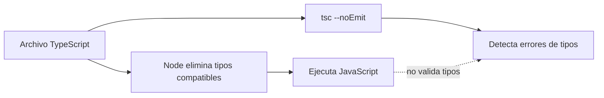
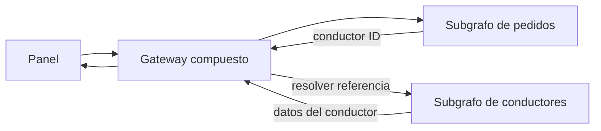
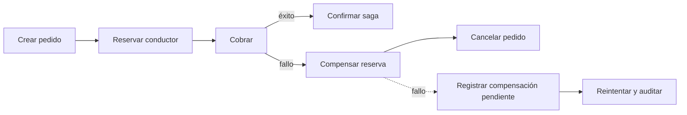
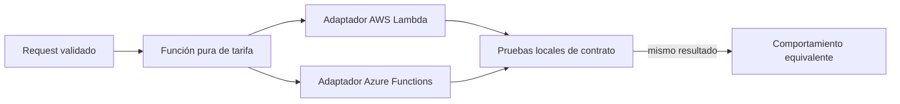
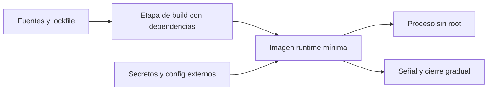
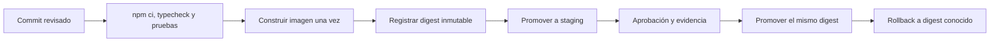

# Módulo 14: Node.js avanzado

## Aprende construyendo

Cada tema es un proyecto independiente que comienza en una carpeta vacía. Escribe manualmente todos los archivos indicados, instala las dependencias dentro de ese proyecto y no copies ni importes archivos de otros temas o ejemplos prefabricados de la academia. Las salidas descritas son resultados que debes comprobar en tu entorno; su inclusión en la lección no acredita que los ejemplos se hayan ejecutado por ti.

### Tema 1: TypeScript en Node.js · Avanzado · 60 min

#### Aprende

**Prerrequisitos:** Node.js 24 LTS, o Node.js 22.18.0 o superior dentro de la línea 22; npm, terminal y TypeScript básico. Comprueba el runtime con `node --version`. Este proyecto no reutiliza ningún archivo.

**Al terminar podrás:** ejecutar un archivo `.ts` directamente con `node`, comprobar que el borrado de tipos no valida el programa y añadir `tsc --noEmit` como una verificación independiente antes de aceptar el código.

**Por qué importa:** quitar la compilación previa acorta el ciclo local de un worker que asigna conductores, pero confundir ejecución con validación permitiría publicar errores de tipos que TypeScript sí puede detectar. Ejecutar y verificar son dos trabajos distintos.

Node realiza **type stripping**: elimina en memoria anotaciones como `: string` y `: Pedido` y ejecuta el JavaScript resultante. No compara los argumentos con las interfaces ni produce un diagnóstico de tipos. `tsc --noEmit`, en cambio, analiza el proyecto y reporta incompatibilidades sin escribir JavaScript. El pipeline necesita ambos pasos porque uno demuestra el comportamiento en runtime y el otro una parte de la corrección estática.

El borrado nativo sirve para sintaxis **borrable**. Una construcción que necesita generar código, como ciertos `enum` o decoradores, exige una transformación real y no debe darse por soportada solo porque el archivo tenga extensión `.ts`.

**Analogía:** quitar las etiquetas de las cajas permite moverlas sin leer cada etiqueta, pero no comprueba que el contenido coincida con lo que decían. El chequeo de TypeScript es la inspección separada de esas etiquetas antes de aceptar el envío.

#### Practica

Desde una carpeta vacía crea `lab-ts-asignacion` y entra en ella:

```bash
mkdir lab-ts-asignacion
cd lab-ts-asignacion
mkdir src
```

Crea manualmente `package.json`:

```json
{
  "name": "lab-ts-asignacion",
  "version": "1.0.0",
  "private": true,
  "type": "module",
  "scripts": {
    "start": "node src/demo.ts",
    "test": "node --test src/asignar.test.ts",
    "typecheck": "tsc --noEmit"
  },
  "devDependencies": {
    "@types/node": "^24.0.0",
    "typescript": "^5.9.3"
  }
}
```

Crea `tsconfig.json`:

```json
{
  "compilerOptions": {
    "target": "ES2022",
    "module": "NodeNext",
    "moduleResolution": "NodeNext",
    "strict": true,
    "noEmit": true,
    "allowImportingTsExtensions": true,
    "erasableSyntaxOnly": true
  },
  "include": ["src/**/*.ts"]
}
```

Crea `src/asignar.ts` con la operación y su contrato:

```ts
export interface Pedido {
  id: string;
  conductorId: string | null;
}

export function asignarConductor(pedido: Pedido, conductorId: string): Pedido {
  return { ...pedido, conductorId };
}
```

Crea `src/demo.ts`:

```ts
import { asignarConductor } from "./asignar.ts";

const resultado = asignarConductor(
  { id: "p-1", conductorId: null },
  "c-9",
);
console.log(resultado);
```

Crea `src/asignar.test.ts`:

```ts
import test from "node:test";
import assert from "node:assert/strict";
import { asignarConductor } from "./asignar.ts";

test("asigna el conductor sin mutar el pedido original", () => {
  const original = { id: "p-1", conductorId: null };
  const resultado = asignarConductor(original, "c-9");

  assert.deepEqual(resultado, { id: "p-1", conductorId: "c-9" });
  assert.equal(original.conductorId, null);
});
```

Instala las dependencias para crear también el lockfile y ejecuta las tres comprobaciones:

```bash
npm install
npm start
npm test
npm run typecheck
```

**Resultado esperado:** `npm start` imprime `{ id: 'p-1', conductorId: 'c-9' }` sin crear `dist/`; la prueba nativa pasa y TypeScript termina sin errores. No se invoca `ts-node` ni una compilación previa.

**Fallo deliberado y corrección:** en `src/demo.ts` sustituye `"c-9"` por `42`. Ejecuta primero `npm start`: Node imprime `conductorId: 42` porque borra la anotación sin verificarla. Ejecuta después `npm run typecheck`: TypeScript reporta que `number` no es asignable a `string`. Restaura `"c-9"` y repite ambos comandos; la corrección debe quedar confirmada por el chequeo, no solo por una salida aparentemente razonable.

**Práctica guiada:** añade temporalmente a `src/demo.ts` `const invalido = { conductorId: null } satisfies import("./asignar.ts").Pedido;`. `npm run typecheck` debe señalar la propiedad `id` ausente, aunque `npm start` siga ejecutando. Retira esa línea y añade en cambio una prueba que use otro pedido válido; conserva el código final sin errores ignorados.

**Ejercicio independiente:** agrega a `src/asignar.ts` una función `reasignarConductor(pedido, conductorId)` que rechace en runtime un `conductorId` vacío y escribe en `src/asignar.test.ts` un caso para el rechazo y otro para una reasignación válida. Ejecuta `npm test && npm run typecheck` y explica por qué la validación de entrada en runtime sigue siendo necesaria aunque el proyecto pase el chequeo estático.

#### Aplica

**Proyecto de aplicación — normalizador de rutas:** desde otra carpeta vacía llamada `app-ts-rutas`, crea manualmente `package.json`, `tsconfig.json`, `src/ruta.ts`, `src/demo.ts` y `src/ruta.test.ts`. Define una unión `EstadoRuta = "pendiente" | "en_curso" | "entregada"`, una función que avance solo al siguiente estado y pruebas para los dos avances y para el rechazo de una ruta ya entregada. Ejecuta el `.ts` con Node, las pruebas y `tsc --noEmit` dentro de ese proyecto; el resultado debe incluir dos transiciones válidas y un error controlado, sin importar archivos de `lab-ts-asignacion`.

**Checklist de salida**

- [ ] Creaste el proyecto, la configuración, el código y las pruebas desde una carpeta vacía.
- [ ] `node` ejecutó los `.ts` sin generar una carpeta `dist/`.
- [ ] Observaste que un argumento `42` se ejecuta, pero `tsc --noEmit` lo rechaza.
- [ ] Restauraste el argumento correcto y repetiste ejecución, pruebas y chequeo.
- [ ] Puedes explicar por qué type stripping no equivale a type checking.
- [ ] El proyecto de aplicación tiene sus propios archivos y no importa este laboratorio.



**Cuándo usar ejecución nativa:** es útil para herramientas y desarrollo con sintaxis que Node admite sin transformación; mantén `tsc --noEmit` como verificación aparte. Si el proyecto necesita decoradores u otra transformación, o soportar runtimes que no ofrecen esa capacidad, conserva un paso de compilación explícito en lugar de tratar el borrado como compilador.

**Proyecto real:** aplica este flujo a un worker propio de asignación de conductores: ejecútalo localmente con Node y bloquea la integración si el chequeo de tipos o las pruebas fallan. Mantén juntos los manifiestos y scripts del proyecto, no dependas de archivos de este tema.

**Cierre y decisión de uso:** conserva la ejecución nativa para desarrollo local y el chequeo explícito en CI. Para sintaxis que requiere transformación real, configura un compilador compatible en vez de suponer que el borrado simple la admite. Errores comunes: afirmar que `node archivo.ts` valida tipos, omitir `tsc --noEmit` o probar únicamente que el proceso arranca.

**Fuentes oficiales:** [Node.js — TypeScript](https://nodejs.org/en/learn/typescript/run-natively) y [TypeScript — tsc CLI](https://www.typescriptlang.org/docs/handbook/compiler-options.html).

### Tema 2: GraphQL avanzado y Federation · Avanzado · 105 min

#### Aprende

**Prerrequisitos:** Node.js LTS, npm, GraphQL básico y Módulo 5 de este track (bases de datos). El laboratorio comienza en una carpeta vacía y usa datos ficticios en memoria.

**Al terminar podrás:** componer dos subgrafos independientes en un gateway, resolver una referencia `Conductor` entre ambos, ejecutar una prueba extremo a extremo con cierre de los tres servidores y explicar los controles que faltan antes de exponer Federation a clientes reales.

**Por qué importa:** Pedidos y Conductores pueden evolucionar sin compartir tablas, pero el panel necesita una sola consulta. La clave federada define el contrato mínimo entre servicios; si falta o su referencia no se puede resolver, el gateway no puede construir una respuesta fiable.

Apollo Federation declara entidades con `@key`. Conductores es propietario de `Conductor.id` y `Conductor.nombre`, y resuelve referencias mediante `__resolveReference`. Pedidos devuelve una referencia `{ __typename, id }` y aporta `pedidosActivos`. El gateway compone los esquemas y planifica qué subgrafo atiende cada campo; no copia las bases de datos entre equipos.

**Analogía:** dos oficinas comparten solo un número de legajo. Cada una completa su parte del expediente, pero el número no sustituye la autorización ni permite leer los archivos internos de la otra oficina.

#### Practica

Crea el proyecto desde cero:

```bash
mkdir lab-federation-entregas
cd lab-federation-entregas
```

Crea manualmente `package.json`:

```json
{
  "name": "lab-federation-entregas",
  "version": "1.0.0",
  "private": true,
  "type": "module",
  "scripts": {
    "start": "node server.mjs",
    "test": "node --test federation.test.mjs"
  },
  "dependencies": {
    "@apollo/gateway": "^2.11.3",
    "@apollo/server": "^4.12.2",
    "@apollo/subgraph": "^2.11.3",
    "graphql": "^16.11.0",
    "graphql-tag": "^2.12.6"
  }
}
```

Crea `server.mjs` completo. Incluye esquemas, resolvers, composición, arranque condicionado y cierre:

```js
import { pathToFileURL } from "node:url";
import { ApolloServer } from "@apollo/server";
import { startStandaloneServer } from "@apollo/server/standalone";
import { ApolloGateway, IntrospectAndCompose } from "@apollo/gateway";
import { buildSubgraphSchema } from "@apollo/subgraph";
import gql from "graphql-tag";

const conductores = [{ id: "c-1", nombre: "Ana" }];
const pedidos = [{ id: "p-1", conductorId: "c-1" }];

export async function startFederation({
  conductorPort = 4001,
  pedidoPort = 4002,
  gatewayPort = 4000,
} = {}) {
  const servidores = [];

  try {
    const conductoresServer = new ApolloServer({
      schema: buildSubgraphSchema({
        typeDefs: gql`#graphql
          type Query { conductor(id: ID!): Conductor }
          type Conductor @key(fields: "id") {
            id: ID!
            nombre: String!
          }
        `,
        resolvers: {
          Query: {
            conductor: (_, { id }) =>
              conductores.find((conductor) => conductor.id === id) ?? null,
          },
          Conductor: {
            __resolveReference: ({ id }) =>
              conductores.find((conductor) => conductor.id === id) ?? null,
          },
        },
      }),
    });
    const { url: conductoresUrl } = await startStandaloneServer(
      conductoresServer,
      { listen: { port: conductorPort, host: "127.0.0.1" } },
    );
    servidores.push(conductoresServer);

    const pedidosServer = new ApolloServer({
      schema: buildSubgraphSchema({
        typeDefs: gql`#graphql
          type Query { pedido(id: ID!): Pedido }
          type Pedido { id: ID!, conductor: Conductor }
          type Conductor @key(fields: "id") {
            id: ID! @external
            pedidosActivos: Int!
          }
        `,
        resolvers: {
          Query: {
            pedido: (_, { id }) =>
              pedidos.find((pedido) => pedido.id === id) ?? null,
          },
          Pedido: {
            conductor: (pedido) => ({
              __typename: "Conductor",
              id: pedido.conductorId,
            }),
          },
          Conductor: {
            pedidosActivos: ({ id }) =>
              pedidos.filter((pedido) => pedido.conductorId === id).length,
          },
        },
      }),
    });
    const { url: pedidosUrl } = await startStandaloneServer(pedidosServer, {
      listen: { port: pedidoPort, host: "127.0.0.1" },
    });
    servidores.push(pedidosServer);

    const gateway = new ApolloGateway({
      supergraphSdl: new IntrospectAndCompose({
        subgraphs: [
          { name: "conductores", url: conductoresUrl },
          { name: "pedidos", url: pedidosUrl },
        ],
      }),
    });
    const gatewayServer = new ApolloServer({ gateway });
    const { url } = await startStandaloneServer(gatewayServer, {
      listen: { port: gatewayPort, host: "127.0.0.1" },
    });
    servidores.push(gatewayServer);

    let cierre;
    return {
      url,
      close: () => {
        cierre ??= Promise.all(
          [...servidores].reverse().map((servidor) => servidor.stop()),
        );
        return cierre;
      },
    };
  } catch (error) {
    await Promise.allSettled(
      [...servidores].reverse().map((servidor) => servidor.stop()),
    );
    throw error;
  }
}

if (
  process.argv[1]
  && import.meta.url === pathToFileURL(process.argv[1]).href
) {
  const federation = await startFederation();
  console.log(`Gateway: ${federation.url}`);

  for (const signal of ["SIGINT", "SIGTERM"]) {
    process.once(signal, async () => {
      await federation.close();
    });
  }
}
```

Crea `federation.test.mjs`:

```js
import test from "node:test";
import assert from "node:assert/strict";
import { startFederation } from "./server.mjs";

async function consultar(url, query) {
  const response = await fetch(url, {
    method: "POST",
    headers: { "content-type": "application/json" },
    body: JSON.stringify({ query }),
  });
  assert.equal(response.status, 200);
  return response.json();
}

test("el gateway combina nombre y pedidos activos y cierra los servidores", async (t) => {
  const federation = await startFederation({
    conductorPort: 0,
    pedidoPort: 0,
    gatewayPort: 0,
  });
  t.after(() => federation.close());

  const resultado = await consultar(
    federation.url,
    '{ pedido(id: "p-1") { conductor { nombre pedidosActivos } } }',
  );
  assert.deepEqual(resultado.data, {
    pedido: { conductor: { nombre: "Ana", pedidosActivos: 1 } },
  });
});

test("un pedido inexistente devuelve null", async (t) => {
  const federation = await startFederation({
    conductorPort: 0,
    pedidoPort: 0,
    gatewayPort: 0,
  });
  t.after(() => federation.close());

  const resultado = await consultar(
    federation.url,
    '{ pedido(id: "no-existe") { id } }',
  );
  assert.deepEqual(resultado.data, { pedido: null });
});
```

Instala, prueba y arranca:

```bash
npm install
npm test
npm start
```

Desde otra terminal consulta únicamente el gateway:

```bash
curl --fail http://127.0.0.1:4000/ \
  -H 'content-type: application/json' \
  --data '{"query":"{ pedido(id: \"p-1\") { conductor { nombre pedidosActivos } } }"}'
```

**Resultado esperado:** las dos pruebas pasan y liberan sus puertos efímeros. `curl` devuelve `{"data":{"pedido":{"conductor":{"nombre":"Ana","pedidosActivos":1}}}}`. Al terminar la ejecución interactiva, `Ctrl+C` detiene gateway y subgrafos; no deben quedar procesos escuchando en 4000, 4001 o 4002.

**Fallo deliberado y corrección:** quita `@key(fields: "id")` de `Conductor` en el subgrafo propietario de Conductores y ejecuta `npm start`. La composición debe rechazarse con un diagnóstico relacionado con la entidad o su clave; el `catch` cierra cualquier subgrafo que ya hubiera arrancado. Restaura la directiva, repite `npm test` y confirma nuevamente la consulta combinada.

**Práctica guiada:** añade `zona: String!` a `Conductor`, incorpora `zona: "norte"` al dato de Ana y solicita ese campo junto a `nombre`. Después cambia temporalmente `__resolveReference` para devolver `null`, observa que el campo federado ya no puede completarse y restaura el resolver. No corrijas una referencia rota leyendo desde Pedidos una supuesta base de Conductores.

**Ejercicio independiente:** agrega dentro de este mismo proyecto un tercer subgrafo Facturación, con su propio `ApolloServer`, esquema y resolver, que extienda `Conductor` mediante `id` y aporte `saldoPendiente: Float!`. Registra el subgrafo en `IntrospectAndCompose`, incluye su cierre en `close` y añade una prueba que consulte `nombre`, `pedidosActivos` y `saldoPendiente` en una sola operación. El valor esperado para Ana debe proceder de un dato ficticio definido en Facturación.

**Límites de seguridad:** este laboratorio solo escucha en loopback, no incluye autenticación y no es publicable tal cual. Antes de exponerlo, autentica y autoriza en gateway y subgrafos según el trust boundary, restringe el acceso directo a subgrafos e introspección, limita tamaño, profundidad, coste y tiempo de las consultas, y define registro y métricas sin datos sensibles. Una clave de entidad es un mecanismo de composición, **no** una credencial ni una regla de autorización. Para un dominio pequeño de un solo equipo, un esquema monolítico puede evitar esta operación adicional.

#### Aplica

**Proyecto de aplicación — catálogo federado de vehículos:** crea otra carpeta vacía, `app-federation-vehiculos`, y escribe allí su `package.json`, `server.mjs` y `federation.test.mjs`. Implementa un subgrafo Vehículos propietario de `Vehiculo @key(fields: "id")` con `matricula`, y otro llamado Mantenimiento que aporte `revisionesPendientes`. Añade una prueba de consulta combinada, otra de ID inexistente y cierre de todos los servidores. Ejecuta únicamente en `127.0.0.1`; el resultado debe mostrar la matrícula y el número de revisiones sin compartir arrays entre los resolvers de ambos dominios.

**Checklist de salida**

- [ ] Creaste manualmente manifiesto, esquemas, resolvers, gateway y pruebas.
- [ ] Conductores declara `@key` y resuelve `__resolveReference`.
- [ ] Pedidos devuelve una referencia por ID, no una copia de `nombre`.
- [ ] La consulta combinada y el pedido inexistente tienen pruebas reales.
- [ ] La composición sin clave falla y vuelve a funcionar al restaurarla.
- [ ] Las pruebas y las señales cierran gateway y subgrafos.
- [ ] Reconoces que autenticación, autorización y límites de consulta siguen pendientes fuera del laboratorio.

**Cierre:** entrega la composición, el fallo de clave corregido y la extensión independiente. No presentes una respuesta `200` como prueba de seguridad ni uses Federation solo para ocultar acoplamiento entre bases de datos.



**Proyecto integrador:** incorpora los subgrafos de pedidos y conductores a un backend propio solo si pertenecen a límites de equipo o despliegue independientes. Mide el coste de resolver referencias y agrega autorización y límites de consulta antes de exponer el gateway a clientes.

**Fuentes oficiales:** [Apollo Federation](https://www.apollographql.com/docs/federation/) y [GraphQL — Federation spec](https://graphql.org/learn/federation/).

### Tema 3: Microservicios, Kafka, RabbitMQ y sagas · Avanzado · 105 min

#### Aprende

**Prerrequisitos:** JavaScript con `async`/`await`, pruebas con Node y Tema 2 de este módulo. Este laboratorio usa llamadas locales para hacer observable la orquestación; no necesita un broker ni archivos anteriores.

**Al terminar podrás:** implementar la saga `crear pedido → reservar conductor → cobrar`, compensar en orden inverso, repetir operaciones con claves de idempotencia y recuperar una compensación que falla sin confundir el patrón con una transacción exactly-once.

**Por qué importa:** tres bases de datos no comparten un `COMMIT`. Si el cobro falla después de reservar un conductor, alguien debe liberar la reserva y cancelar el pedido. Si esa liberación también falla, ocultar el error deja el sistema inconsistente sin una ruta de recuperación.

Cada paso tiene una transacción local y una compensación de negocio. El coordinador registra los pasos completados y, ante un fallo posterior, ejecuta sus compensaciones del último al primero. Una compensación no borra la historia: cancela, libera o reembolsa el efecto visible.

Kafka o RabbitMQ pueden transportar comandos y eventos entre servicios, pero el broker no convierte la secuencia en una transacción global. Reintentos, red de por medio y consumidores reiniciados permiten entregas duplicadas. Por eso cada comando usa una clave estable y el receptor registra su resultado. **No afirmes exactly-once de extremo a extremo:** el laboratorio demuestra idempotencia dentro de un proceso, no atomicidad entre base de datos, broker y proveedor de pagos. En producción hacen falta registros persistentes, restricciones únicas, reconciliación y, según la arquitectura, outbox/inbox.

**Analogía:** cancelar un viaje exige cancelar hotel y vuelo en orden controlado. Un comprobante de cancelación evita pagar dos veces la misma gestión, pero no garantiza que ninguna llamada se pierda; si una cancelación falla, debe quedar una tarea pendiente y una alerta.

#### Practica

Crea el proyecto y su manifiesto:

```bash
mkdir lab-saga-pedidos
cd lab-saga-pedidos
mkdir src
```

Crea `package.json`:

```json
{
  "name": "lab-saga-pedidos",
  "version": "1.0.0",
  "private": true,
  "type": "module",
  "scripts": {
    "demo": "node src/demo.js",
    "test": "node --test src/saga.test.js"
  }
}
```

Crea `src/saga.js` con servicios en memoria, claves estables y diario de compensación:

```js
export function crearLaboratorio({
  fallarCobro = false,
  fallosLiberacion = 0,
} = {}) {
  const estado = {
    pedidos: new Map(),
    reservas: new Map(),
    cargos: new Map(),
    sagas: new Map(),
  };
  const operaciones = new Map();
  let liberacionesFallidas = 0;

  async function idempotente(clave, accion) {
    if (operaciones.has(clave)) return operaciones.get(clave);

    const intento = Promise.resolve().then(accion);
    operaciones.set(clave, intento);
    try {
      return await intento;
    } catch (error) {
      operaciones.delete(clave);
      throw error;
    }
  }

  const servicios = {
    crearPedido: ({ sagaId, pedidoId }) =>
      idempotente(`${sagaId}:crear-pedido`, () => {
        estado.pedidos.set(pedidoId, { id: pedidoId, estado: "creado" });
      }),
    cancelarPedido: ({ sagaId, pedidoId }) =>
      idempotente(`${sagaId}:cancelar-pedido`, () => {
        const pedido = estado.pedidos.get(pedidoId);
        if (pedido) pedido.estado = "cancelado";
      }),
    reservarConductor: ({ sagaId, conductorId }) =>
      idempotente(`${sagaId}:reservar-conductor`, () => {
        estado.reservas.set(sagaId, { conductorId, estado: "reservado" });
      }),
    liberarConductor: ({ sagaId }) =>
      idempotente(`${sagaId}:liberar-conductor`, () => {
        if (liberacionesFallidas < fallosLiberacion) {
          liberacionesFallidas += 1;
          throw new Error("liberación temporalmente no disponible");
        }
        const reserva = estado.reservas.get(sagaId);
        if (reserva) reserva.estado = "liberado";
      }),
    cobrar: ({ sagaId, montoTotal }) =>
      idempotente(`${sagaId}:cobrar`, () => {
        if (fallarCobro) throw new Error("tarjeta rechazada");
        estado.cargos.set(sagaId, { montoTotal, estado: "cobrado" });
      }),
    reembolsar: ({ sagaId }) =>
      idempotente(`${sagaId}:reembolsar`, () => {
        const cargo = estado.cargos.get(sagaId);
        if (cargo) cargo.estado = "reembolsado";
      }),
  };

  const pasos = [
    {
      nombre: "pedido",
      ejecutar: servicios.crearPedido,
      compensar: servicios.cancelarPedido,
    },
    {
      nombre: "conductor",
      ejecutar: servicios.reservarConductor,
      compensar: servicios.liberarConductor,
    },
    {
      nombre: "pago",
      ejecutar: servicios.cobrar,
      compensar: servicios.reembolsar,
    },
  ];

  function vista(sagaId) {
    const diario = estado.sagas.get(sagaId);
    return {
      pedido: estado.pedidos.get(diario.entrada.pedidoId),
      reserva: estado.reservas.get(sagaId),
      cargo: estado.cargos.get(sagaId),
      diario: {
        estado: diario.estado,
        error: diario.error,
        completados: [...diario.completados],
        compensadas: [...diario.compensadas],
        pendientes: [...diario.pendientes],
      },
    };
  }

  async function compensarPendientes(sagaId) {
    const diario = estado.sagas.get(sagaId);
    if (!diario) throw new Error("saga desconocida");

    const pendientes = [];
    for (const nombre of diario.pendientes) {
      const paso = pasos.find((candidato) => candidato.nombre === nombre);
      try {
        await paso.compensar(diario.entrada);
        diario.compensadas.push(nombre);
      } catch (error) {
        pendientes.push(nombre);
        diario.errorCompensacion = error.message;
      }
    }

    diario.pendientes = pendientes;
    diario.estado = pendientes.length
      ? "compensacion_pendiente"
      : "compensada";

    if (pendientes.length) {
      const error = new Error(
        `Compensaciones pendientes: ${pendientes.join(", ")}`,
      );
      error.pendientes = [...pendientes];
      throw error;
    }
    return vista(sagaId);
  }

  async function ejecutar(entrada) {
    const previo = estado.sagas.get(entrada.sagaId);
    if (previo?.estado === "confirmada") return vista(entrada.sagaId);

    const diario = previo ?? {
      entrada: { ...entrada },
      estado: "iniciada",
      completados: [],
      compensadas: [],
      pendientes: [],
    };
    estado.sagas.set(entrada.sagaId, diario);

    try {
      for (const paso of pasos) {
        if (!diario.completados.includes(paso.nombre)) {
          await paso.ejecutar(diario.entrada);
          diario.completados.push(paso.nombre);
        }
      }
      diario.estado = "confirmada";
      return vista(entrada.sagaId);
    } catch (errorOriginal) {
      diario.estado = "compensando";
      diario.error = errorOriginal.message;
      diario.pendientes = [...diario.completados].reverse();

      try {
        await compensarPendientes(entrada.sagaId);
      } catch (errorCompensacion) {
        errorCompensacion.causaOriginal = errorOriginal;
        throw errorCompensacion;
      }
      throw errorOriginal;
    }
  }

  return {
    estado,
    ejecutar,
    vista,
    reintentarCompensaciones: compensarPendientes,
  };
}
```

Crea `src/saga.test.js`:

```js
import test from "node:test";
import assert from "node:assert/strict";
import { crearLaboratorio } from "./saga.js";

const entrada = {
  sagaId: "saga-1",
  pedidoId: "p-1",
  conductorId: "c-1",
  montoTotal: 12000,
};

test("una repetición confirmada no duplica el cargo", async () => {
  const lab = crearLaboratorio();
  await lab.ejecutar(entrada);
  const repetida = await lab.ejecutar(entrada);

  assert.equal(repetida.diario.estado, "confirmada");
  assert.equal(lab.estado.cargos.size, 1);
  assert.equal(repetida.cargo.estado, "cobrado");
});

test("el cobro fallido compensa en orden inverso", async () => {
  const lab = crearLaboratorio({ fallarCobro: true });
  await assert.rejects(lab.ejecutar(entrada), /tarjeta rechazada/);

  const resultado = lab.vista("saga-1");
  assert.deepEqual(resultado.diario.compensadas, ["conductor", "pedido"]);
  assert.equal(resultado.reserva.estado, "liberado");
  assert.equal(resultado.pedido.estado, "cancelado");
});

test("una compensación fallida queda pendiente y puede reintentarse", async () => {
  const lab = crearLaboratorio({ fallarCobro: true, fallosLiberacion: 1 });
  await assert.rejects(lab.ejecutar(entrada), /Compensaciones pendientes: conductor/);

  assert.equal(lab.vista("saga-1").reserva.estado, "reservado");
  assert.equal(lab.vista("saga-1").pedido.estado, "cancelado");
  assert.deepEqual(lab.vista("saga-1").diario.pendientes, ["conductor"]);

  const recuperada = await lab.reintentarCompensaciones("saga-1");
  assert.equal(recuperada.reserva.estado, "liberado");
  assert.equal(recuperada.diario.estado, "compensada");
});
```

Crea `src/demo.js`:

```js
import { crearLaboratorio } from "./saga.js";

const lab = crearLaboratorio({ fallarCobro: true, fallosLiberacion: 1 });
const entrada = {
  sagaId: "demo-1",
  pedidoId: "p-demo",
  conductorId: "c-demo",
  montoTotal: 9000,
};

try {
  await lab.ejecutar(entrada);
} catch (error) {
  console.log("Fallo visible:", error.message);
  console.log("Estado pendiente:", lab.vista("demo-1"));
}

console.log("Tras reintentar:", await lab.reintentarCompensaciones("demo-1"));
```

Ejecuta:

```bash
npm install
npm test
npm run demo
```

**Resultado esperado:** pasan tres pruebas. La demo muestra primero una compensación pendiente, con reserva todavía `reservado` y pedido `cancelado`; tras el reintento, la reserva queda `liberado` y la saga `compensada`. El cargo nunca se crea porque el cobro fue rechazado.

**Fallo deliberado y corrección:** comenta la llamada a `compensarPendientes` dentro del `catch` de `ejecutar` y ejecuta la segunda prueba. El pedido y la reserva conservan sus efectos y la aserción de orden falla. Restaura la llamada y conserva el bucle que continúa con las demás compensaciones aunque una falle; no basta con capturar el error original.

**Práctica guiada:** ejecuta dos veces la primera prueba y señala la clave `${sagaId}:cobrar`. Cambia temporalmente la clave para incluir `Date.now()`, observa que deja de ser estable y revierte el cambio. Después explica qué ocurriría con esa implementación de memoria si el proceso se reinicia: desaparecen tanto los resultados como el diario, por lo que no es una solución persistente.

**Ejercicio independiente:** añade un contador de intentos de liberación y una prueba con dos fallos consecutivos antes del éxito. El programa debe conservar `conductor` en `pendientes` entre reintentos y generar una señal de alerta cuando se supere un máximo de tres intentos. Documenta dónde persistirías diario, claves y próxima fecha de reintento; no elimines una pendiente solo para obtener una salida verde.

#### Aplica

**Proyecto de aplicación — saga de devolución:** desde una carpeta vacía `app-saga-devolucion`, crea manualmente `package.json`, `src/devolucion.js`, `src/devolucion.test.js` y `src/demo.js`. Implementa `registrar devolución → reintegrar stock → reembolsar`, con claves de idempotencia, compensaciones inversas `retirar stock` y `descartar devolución`, diario y reintento de compensación. Prueba éxito, reembolso rechazado y fallo temporal al retirar stock. El resultado final debe dejar explícito cualquier estado pendiente; no declares exactly-once ni uses un broker simulado como garantía transaccional.

**Checklist de salida**

- [ ] Los tres pasos tienen implementaciones locales ejecutables, no funciones sin definir.
- [ ] Un cobro rechazado libera conductor y después cancela pedido.
- [ ] Las claves de idempotencia permanecen estables para una misma saga.
- [ ] Repetir una saga confirmada no duplica el cargo.
- [ ] Una compensación fallida queda registrada y no impide intentar las anteriores.
- [ ] El reintento corrige la compensación pendiente sin borrar su historial.
- [ ] Explicas por qué memoria, broker o reintentos no ofrecen exactly-once global.

**Cierre:** en producción, cada servicio debe hacer durables su operación y su registro de idempotencia; el coordinador necesita recuperación tras reinicios, backoff, alertas y reconciliación. Errores comunes: compensar en orden directo, ignorar un fallo de compensación, generar una clave nueva en cada reintento o confundir ausencia de duplicados en una prueba con una garantía distribuida.



**Cuándo usar saga:** úsala cuando un flujo atraviesa servicios que no comparten una transacción y cada paso tiene una compensación de negocio posible. Si las operaciones caben en una única base transaccional, una transacción local es más simple; una compensación no borra efectos externos irreversibles, por lo que debes diseñar estados pendientes y reconciliación.

**Proyecto integrador:** aplica la saga al flujo real de crear entrega, reservar conductor y autorizar pago. Persiste estado e idempotencia en cada servicio y prueba también una compensación fallida, no solo el camino de éxito.

**Fuentes oficiales:** [Saga pattern — microservices.io](https://microservices.io/patterns/data/saga.html) y [KafkaJS — Getting started](https://kafka.js.org/docs/getting-started).

### Tema 4: Serverless multi-cloud · Avanzado · 75 min

#### Aprende

**Prerrequisitos:** JavaScript ESM, funciones `async` y Módulo 4 del track de Cloud (Serverless con Lambda). No necesitas cuentas cloud: los adaptadores se prueban localmente y este tema no despliega ninguna función.

**Al terminar podrás:** aislar el cálculo de tarifa en una función pura, invocarlo desde adaptadores con las firmas de AWS Lambda y Azure Functions y demostrar con pruebas locales que ambos producen el mismo resultado.

**Por qué importa:** si la fórmula vive dentro del handler de AWS, evaluar otro proveedor obliga a copiar reglas de negocio. La primera divergencia olvidada produce dos precios distintos para el mismo envío.

La lógica pura recibe datos ya extraídos y devuelve un resultado, sin importar SDK ni objetos de plataforma. Cada adaptador traduce el evento del proveedor a esa entrada y traduce la salida al formato correspondiente. Probar los adaptadores directamente verifica esa traducción local, **no** permisos, empaquetado, triggers, límites, latencia ni despliegue en una nube real.

**Analogía:** el aparato conserva su mecanismo y solo cambia el adaptador de enchufe. La analogía termina en la interfaz: cada proveedor también tiene configuración, observabilidad y límites operativos que un adaptador no vuelve portables.

#### Practica

Crea el proyecto desde cero:

```bash
mkdir lab-serverless-tarifas
cd lab-serverless-tarifas
mkdir -p src/logica src/aws src/azure test
```

Crea `package.json`:

```json
{
  "name": "lab-serverless-tarifas",
  "version": "1.0.0",
  "private": true,
  "type": "module",
  "scripts": {
    "test": "node --test test/adaptadores.test.js"
  }
}
```

Crea `src/logica/calcularCosto.js`:

```js
export function calcularCosto({ distanciaKm, pesoKg }) {
  if (
    !Number.isFinite(distanciaKm)
    || !Number.isFinite(pesoKg)
    || distanciaKm < 0
    || pesoKg < 0
  ) {
    throw new TypeError("distanciaKm y pesoKg deben ser números no negativos");
  }
  return distanciaKm * 1500 + pesoKg * 200;
}
```

Crea `src/aws/handler.js`:

```js
import { calcularCosto } from "../logica/calcularCosto.js";

export const handler = async (event) => {
  const body = JSON.parse(event.body);
  return {
    statusCode: 200,
    body: JSON.stringify({ costo: calcularCosto(body) }),
  };
};
```

Crea `src/azure/handler.js`:

```js
import { calcularCosto } from "../logica/calcularCosto.js";

export default async function handler(context, req) {
  context.res = {
    status: 200,
    body: { costo: calcularCosto(req.body) },
  };
}
```

Crea `test/adaptadores.test.js`:

```js
import test from "node:test";
import assert from "node:assert/strict";
import { calcularCosto } from "../src/logica/calcularCosto.js";
import { handler as awsHandler } from "../src/aws/handler.js";
import azureHandler from "../src/azure/handler.js";

const entrada = { distanciaKm: 10, pesoKg: 2 };

test("la lógica calcula 15400", () => {
  assert.equal(calcularCosto(entrada), 15400);
});

test("AWS adapta el evento JSON sin cambiar la fórmula", async () => {
  const respuesta = await awsHandler({ body: JSON.stringify(entrada) });
  assert.equal(respuesta.statusCode, 200);
  assert.deepEqual(JSON.parse(respuesta.body), { costo: 15400 });
});

test("Azure obtiene el mismo costo con su contrato de respuesta", async () => {
  const context = {};
  await azureHandler(context, { body: entrada });
  assert.equal(context.res.status, 200);
  assert.deepEqual(context.res.body, { costo: 15400 });
});
```

Instala y ejecuta las pruebas locales:

```bash
npm install
npm test
```

**Resultado esperado:** pasan tres pruebas y ambos adaptadores devuelven `15400` para 10 km y 2 kg. No se ha creado un recurso en AWS o Azure ni se ha demostrado un despliegue.

**Fallo deliberado y corrección:** copia temporalmente la fórmula dentro de cada handler, pero escribe `pesoKg * 250` solo en AWS. Las pruebas de lógica y Azure seguirán esperando `15400`, mientras AWS devolverá `15500` y fallará su contrato. Elimina ambas copias, restaura las importaciones de `calcularCosto` y repite `npm test`; la corrección consiste en tener una sola fuente de verdad, no en cambiar las aserciones para aceptar dos tarifas.

**Práctica guiada:** invoca la lógica con `{ distanciaKm: -1, pesoKg: 2 }` dentro de una nueva prueba y comprueba `assert.throws`. Añade después pruebas de adaptador para JSON mal formado y para una distancia negativa; decide y documenta un mapeo explícito a respuesta `400` en vez de dejar que cada plataforma produzca un error distinto.

**Ejercicio independiente:** crea manualmente `src/gcp/handler.js` con un adaptador `(req, res)` que use `res.status(200).json({ costo })`, y añade una prueba local con objetos `req` y `res` falsos que registren estado y cuerpo. Comprueba que los tres adaptadores devuelven el mismo costo sin copiar la fórmula. Esta prueba tampoco afirma compatibilidad de empaquetado o despliegue con GCP.

#### Aplica

**Proyecto de aplicación — estimador de almacenamiento:** en otra carpeta vacía `app-serverless-almacen`, crea manualmente el manifiesto, una lógica pura, adaptadores AWS y Azure y un archivo de pruebas. La función debe calcular `GB × meses × precioPorGBMes`, rechazar valores negativos y producir el mismo importe en ambos contratos. Ejecuta pruebas locales de éxito y entrada inválida; entrega las salidas como evidencia de adaptación, no como evidencia de publicación cloud.

**Checklist de salida**

- [ ] La fórmula existe una sola vez y no importa ningún SDK de proveedor.
- [ ] AWS y Azure tienen adaptadores completos y pruebas locales.
- [ ] Ambos calculan `15400` para la entrada del laboratorio.
- [ ] La divergencia deliberada se corrige restaurando la lógica compartida.
- [ ] Las entradas inválidas tienen comportamiento probado.
- [ ] El tercer adaptador se prueba con dobles locales sin duplicar reglas.
- [ ] No afirmas despliegue, trigger o permisos verificados.

**Cierre:** la portabilidad cubre el contrato de entrada y salida de la función, no toda la operación cloud. Antes de desplegar faltan empaquetado, configuración, identidad, secretos, observabilidad, cuotas y pruebas en cada plataforma. Errores comunes: copiar fórmulas, probar solo la lógica pura o presentar una invocación local como publicación.



**Proyecto integrador:** extrae la tarifa de un servicio propio de entregas y mantenla en una función pura compartida por dos adaptadores. Prueba entradas inválidas y la equivalencia del resultado; registra por separado cualquier coste de despliegue y observabilidad de cada proveedor.

**Fuentes oficiales:** [AWS Lambda — Handler en Node.js](https://docs.aws.amazon.com/lambda/latest/dg/nodejs-handler.html) y [Azure Functions — Node.js](https://learn.microsoft.com/azure/azure-functions/functions-reference-node).

### Tema 5: Docker productivo con Node · Avanzado · 90 min

#### Aprende

**Prerrequisitos:** Docker en ejecución, Node.js LTS, npm, `curl` y Módulo 11 de este track (Despliegue y contenedores). El proyecto es nuevo y no reutiliza servidores ni Dockerfiles.

**Al terminar podrás:** construir una imagen multi-stage con `npm ci` y lockfile, ejecutarla como usuario no-root, impedir que archivos locales sensibles entren al contexto y verificar un apagado por `SIGTERM` con espera limitada.

**Por qué importa:** un despliegue envía señales al proceso, no al framework. Si Node corre como root e ignora `SIGTERM`, aumenta el impacto de una compromiso y una petición de entrega puede cortarse durante una parada rutinaria.

La etapa de build instala dependencias de forma reproducible; la final copia solo lo necesario. `.dockerignore` reduce el contexto y evita copiar secretos o `node_modules` locales. Al recibir `SIGTERM`, el servidor deja de aceptar conexiones, espera las activas y fuerza el cierre tras un máximo acotado. `docker stop` también tiene su propio límite antes de enviar `SIGKILL`, por lo que ambos tiempos deben coordinarse.

**Analogía:** al cerrar un restaurante se deja entrar a nadie nuevo y se termina de atender a quienes ya están dentro. La analogía tiene un límite operativo: incluso el cierre amable necesita una hora máxima.

#### Practica

Crea la estructura desde una carpeta vacía:

```bash
mkdir lab-docker-cierre
cd lab-docker-cierre
mkdir src
```

Crea `package.json`:

```json
{
  "name": "lab-docker-cierre",
  "version": "1.0.0",
  "private": true,
  "type": "module",
  "scripts": {
    "start": "node src/servidor.js"
  }
}
```

Crea `src/servidor.js`:

```js
import { createServer } from "node:http";

const esperar = (ms) => new Promise((resolve) => setTimeout(resolve, ms));
let cerrando = false;

const servidor = createServer(async (req, res) => {
  if (cerrando) {
    res.writeHead(503, { "content-type": "application/json" });
    res.end(JSON.stringify({ error: "Servidor cerrando" }));
    return;
  }

  if (req.method === "GET" && req.url === "/salud") {
    res.writeHead(200, { "content-type": "application/json" });
    res.end(JSON.stringify({ estado: "ok" }));
    return;
  }

  if (req.method === "GET" && req.url === "/lenta") {
    await esperar(1500);
    res.writeHead(200, { "content-type": "application/json" });
    res.end(JSON.stringify({ estado: "completada" }));
    return;
  }

  res.writeHead(404, { "content-type": "application/json" });
  res.end(JSON.stringify({ error: "Ruta no encontrada" }));
});

servidor.listen(3000, "0.0.0.0", () => {
  console.log("Servidor listo en puerto 3000");
});

function apagar(signal) {
  if (cerrando) return;
  cerrando = true;
  console.log(`${signal}: no se aceptan conexiones nuevas`);

  const forzado = setTimeout(() => {
    console.error("Timeout de apagado: cerrando conexiones restantes");
    process.exitCode = 1;
    servidor.closeAllConnections();
  }, 8000);
  forzado.unref();

  servidor.close(() => {
    clearTimeout(forzado);
    console.log("Conexiones terminadas; cierre completo");
  });
  servidor.closeIdleConnections();
}

process.once("SIGTERM", () => apagar("SIGTERM"));
process.once("SIGINT", () => apagar("SIGINT"));
```

Crea `Dockerfile`:

```dockerfile
FROM node:24-alpine AS build
WORKDIR /app
COPY package.json package-lock.json ./
RUN npm ci --omit=dev

FROM node:24-alpine
ENV NODE_ENV=production
RUN addgroup -S app && adduser -S app -G app
WORKDIR /app
COPY --from=build /app/node_modules ./node_modules
COPY package.json package-lock.json ./
COPY src ./src
USER app
EXPOSE 3000
CMD ["node", "src/servidor.js"]
```

Crea `.dockerignore`:

```dockerignore
node_modules
npm-debug.log*
.git
.env
.env.*
coverage
dist
```

Genera el lockfile desde el manifiesto y construye. No copies un lockfile de otro proyecto:

```bash
npm install
docker build -t lab-docker-cierre:local .
docker run -d --name lab-docker-cierre -p 3000:3000 lab-docker-cierre:local
docker exec lab-docker-cierre whoami
curl --fail http://127.0.0.1:3000/salud
```

**Resultado esperado:** `whoami` imprime `app`, la salud responde `{"estado":"ok"}` y `npm ci` puede resolver el árbol porque `package-lock.json` existe antes del build.

Ahora comprueba el apagado con una petición activa. En una terminal ejecuta:

```bash
curl --fail http://127.0.0.1:3000/lenta
```

Mientras esa petición espera, en otra terminal ejecuta:

```bash
docker stop --time 15 lab-docker-cierre
docker logs lab-docker-cierre
docker inspect --format '{{.State.ExitCode}}' lab-docker-cierre
```

**Resultado esperado:** `curl` recibe `{"estado":"completada"}`; los logs muestran `SIGTERM` y `Conexiones terminadas; cierre completo`, y el código de salida es `0`. No basta con observar que el contenedor desaparece de `docker ps`.

**Fallo deliberado y corrección:** elimina temporalmente los dos registros `process.once(...)` y repite el build, la petición lenta y `docker stop`. Node termina por la señal sin ejecutar el cierre y el cliente puede recibir una conexión cortada en vez del JSON completo. Restaura los handlers, reconstruye la imagen y repite hasta obtener respuesta completa y salida `0`.

**Práctica guiada:** cambia el timeout interno a `1000` ms y la espera de `/lenta` a `3000` ms. Al detener, debes observar el cierre forzado y un código distinto de `0`; restaura después `8000` y `1500`. Comprueba también la necesidad del lockfile: sin `package-lock.json`, `npm ci` falla en vez de resolver silenciosamente versiones nuevas. Recupéralo con `npm install` desde el manifiesto correcto, no copiándolo de otra carpeta.

**Ejercicio independiente:** añade una segunda petición lenta concurrente y prueba que ambas terminan antes del cierre. Escribe una prueba o un script local que arranque el servidor en un puerto libre, realice la petición, envíe `SIGTERM` y compruebe que no acepta una conexión nueva durante el cierre. Conserva el timeout y documenta qué ocurriría si una conexión nunca terminara.

Limpia el laboratorio cuando termines:

```bash
docker rm lab-docker-cierre
```

#### Aplica

**Proyecto de aplicación — contenedor de notificaciones:** desde una carpeta vacía `app-docker-notificaciones`, crea manualmente su manifiesto, lockfile, servidor HTTP, `Dockerfile` y `.dockerignore`. Expón `/salud` y `/envio-lento`, ejecuta como un usuario no-root propio y cierra conexiones en un máximo de cinco segundos. Construye con `npm ci`, verifica el usuario y detén el contenedor durante un envío lento; la evidencia debe incluir respuesta completa o cierre forzado explícito, logs y código de salida, sin importar el servidor de este tema.

**Checklist de salida**

- [ ] El lockfile se generó en este proyecto y el build usa `npm ci`.
- [ ] La imagen final es multi-stage y copia solo los artefactos necesarios.
- [ ] `docker exec ... whoami` demuestra que el proceso no es root.
- [ ] `.dockerignore` excluye dependencias locales, VCS y archivos de entorno.
- [ ] Una petición activa termina antes del cierre cuando está dentro del límite.
- [ ] El timeout evita una espera indefinida y deja un código de fallo visible.
- [ ] El fallo sin handler se corrige reconstruyendo y repitiendo la prueba.

**Cierre:** el apagado ordenado no garantiza que toda operación termine; por eso tiene timeout y los clientes necesitan reintentos seguros. Errores comunes: usar `npm install` en el build sin lockfile, copiar `.env`, ejecutar como root, llamar a `process.exit(0)` antes de cerrar conexiones o dejar un apagado sin límite.



**Proyecto integrador:** empaqueta la API de entregas en una imagen propia: conserva solo dependencias runtime, ejecuta sin root, inyecta configuración fuera de la imagen y verifica el cierre con `SIGTERM`. Compara el tamaño y el arranque con el artefacto anterior sin presentar esas métricas como seguridad completa.

**Fuentes oficiales:** [Docker — Multi-stage builds](https://docs.docker.com/build/building/multi-stage/) y [Node.js — Process signal events](https://nodejs.org/api/process.html#signal-events).

### Tema 6: CI/CD y promoción de artefactos · Avanzado · 105 min

#### Aprende

**Prerrequisitos:** Docker con Buildx, Node.js LTS, npm y Tema 5 de este módulo. El laboratorio local no usa un registro ni hace `push`; el workflow se escribe como archivo completo, pero aquí no se afirma haberlo ejecutado en GitHub ni haber publicado una imagen.

**Al terminar podrás:** construir un artefacto OCI una sola vez, calcular y verificar el digest de su manifiesto, copiar ese mismo artefacto entre etapas sin reconstruirlo y redactar un workflow que promueva por `imagen@sha256:...` con aprobaciones de entorno.

**Por qué importa:** reconstruir en dev, staging y producción vuelve a resolver el contexto y puede introducir diferencias aunque el commit sea el mismo. La pregunta operativa no es «¿tienen la misma etiqueta?», sino «¿el digest desplegado es el que pasó las pruebas?».

Una etiqueta como `staging` puede cambiar a qué manifiesto apunta; un digest identifica contenido. **Build once, promote by digest** construye y publica una vez en CI, conserva el digest devuelto y hace que cada entorno use esa referencia inmutable. El lockfile hace más reproducible la instalación, pero no sustituye la promoción del mismo artefacto.

En la práctica local se exporta una imagen a un archivo OCI. Un script calcula SHA-256 sobre el manifiesto y lo compara con el digest declarado en `index.json`. Copiar el mismo archivo a staging y producción evita cualquier push y permite demostrar que ambas etapas conservan exactamente el mismo manifiesto.

**Analogía:** se fabrica un lote y se distribuye el mismo precinto numerado a cada almacén. Volver a fabricar para cada tienda no es «promover» el lote original.

#### Practica

Crea un proyecto nuevo, incluido su propio servicio mínimo:

```bash
mkdir lab-promocion-digest
cd lab-promocion-digest
mkdir -p src scripts .github/workflows
```

Crea `package.json`:

```json
{
  "name": "lab-promocion-digest",
  "version": "1.0.0",
  "private": true,
  "type": "module",
  "scripts": {
    "start": "node src/app.js",
    "test": "node --test src/app.test.js"
  }
}
```

Crea `src/app.js`:

```js
console.log(JSON.stringify({ servicio: "pedidos", estado: "listo" }));
```

Crea `src/app.test.js`:

```js
import test from "node:test";
import assert from "node:assert/strict";
import { spawnSync } from "node:child_process";

test("el artefacto ejecuta el servicio esperado", () => {
  const resultado = spawnSync(process.execPath, ["src/app.js"], {
    encoding: "utf8",
  });
  assert.equal(resultado.status, 0);
  assert.deepEqual(JSON.parse(resultado.stdout), {
    servicio: "pedidos",
    estado: "listo",
  });
});
```

Crea `Dockerfile` y genera después el lockfile que `npm ci` exige:

```dockerfile
FROM node:24-alpine AS build
WORKDIR /app
COPY package.json package-lock.json ./
RUN npm ci --omit=dev

FROM node:24-alpine
ENV NODE_ENV=production
WORKDIR /app
COPY --from=build /app/node_modules ./node_modules
COPY package.json package-lock.json ./
COPY src ./src
USER node
CMD ["node", "src/app.js"]
```

Crea `.dockerignore`:

```dockerignore
node_modules
.git
.env
.env.*
dist
staging
production
npm-debug.log*
```

Crea `scripts/verificar-oci.mjs`:

```js
import { readFile } from "node:fs/promises";
import { createHash } from "node:crypto";

const layout = process.argv[2];
if (!layout) throw new Error("Uso: node scripts/verificar-oci.mjs <layout>");

const index = JSON.parse(
  await readFile(`${layout}/index.json`, "utf8"),
);
const entrada = index.manifests.find(
  (manifest) =>
    manifest.mediaType === "application/vnd.oci.image.manifest.v1+json",
);
if (!entrada) throw new Error("No hay manifiesto de imagen OCI");

const [algoritmo, esperado] = entrada.digest.split(":");
if (algoritmo !== "sha256" || !esperado) {
  throw new Error(`Digest no soportado: ${entrada.digest}`);
}

const bytes = await readFile(`${layout}/blobs/sha256/${esperado}`);
const actual = createHash("sha256").update(bytes).digest("hex");
if (actual !== esperado) {
  throw new Error(`Digest inválido: esperado ${esperado}, actual ${actual}`);
}

console.log(entrada.digest);
```

Crea el workflow completo `.github/workflows/promocion.yml`:

```yaml
name: Build una vez y promover por digest

on:
  push:
    branches: [main]
  workflow_dispatch:

permissions:
  contents: read
  packages: write

env:
  REGISTRY: ghcr.io
  IMAGE: ghcr.io/${{ github.repository }}

jobs:
  build:
    runs-on: ubuntu-latest
    outputs:
      digest: ${{ steps.imagen.outputs.digest }}
    steps:
      - uses: actions/checkout@v4
      - uses: actions/setup-node@v4
        with:
          node-version: 24
          cache: npm
      - run: npm ci
      - run: npm test
      - uses: docker/setup-buildx-action@v3
      - uses: docker/login-action@v3
        with:
          registry: ${{ env.REGISTRY }}
          username: ${{ github.actor }}
          password: ${{ secrets.GITHUB_TOKEN }}
      - id: imagen
        uses: docker/build-push-action@v6
        with:
          context: .
          push: true
          tags: ${{ env.IMAGE }}:${{ github.sha }}

  staging:
    needs: build
    runs-on: ubuntu-latest
    environment: staging
    steps:
      - uses: docker/login-action@v3
        with:
          registry: ${{ env.REGISTRY }}
          username: ${{ github.actor }}
          password: ${{ secrets.GITHUB_TOKEN }}
      - name: Validar el artefacto aprobado por digest
        env:
          DIGEST: ${{ needs.build.outputs.digest }}
        run: |
          test -n "$DIGEST"
          REF="${IMAGE}@${DIGEST}"
          docker pull "$REF"
          docker run --rm "$REF"

  production:
    needs: staging
    runs-on: ubuntu-latest
    environment: production
    steps:
      - uses: docker/login-action@v3
        with:
          registry: ${{ env.REGISTRY }}
          username: ${{ github.actor }}
          password: ${{ secrets.GITHUB_TOKEN }}
      - name: Promover exactamente el digest validado en staging
        env:
          DIGEST: ${{ needs.build.outputs.digest }}
        run: |
          test -n "$DIGEST"
          REF="${IMAGE}@${DIGEST}"
          docker pull "$REF"
          docker run --rm "$REF"
```

El workflow tiene build, pruebas, publicación única y dos entornos que consumen el digest producido por `build`; no contiene un segundo `docker build`. Los jobs de entorno muestran una validación ejecutable del artefacto. Una integración real debe sustituir esa validación por el comando de su plataforma usando **la misma** referencia `IMAGE@DIGEST`, credenciales y reglas de aprobación. Crear el archivo no prueba el workflow: su ejecución, la publicación en GHCR y cualquier despliegue quedan fuera de esta práctica local.

Para la prueba local sin pushes, instala el lockfile, ejecuta las pruebas y construye una única exportación OCI:

```bash
npm install
npm test
mkdir -p dist/oci staging/oci production/oci
docker buildx build --output type=oci,dest=dist/pedidos.oci.tar .
tar -xf dist/pedidos.oci.tar -C dist/oci
DIGEST=$(node scripts/verificar-oci.mjs dist/oci)
printf 'Artefacto construido: %s\n' "$DIGEST"
```

Promueve copiando **ese archivo**, no reconstruyendo:

```bash
cp dist/pedidos.oci.tar staging/pedidos.oci.tar
cp dist/pedidos.oci.tar production/pedidos.oci.tar
tar -xf staging/pedidos.oci.tar -C staging/oci
tar -xf production/pedidos.oci.tar -C production/oci
STAGING=$(node scripts/verificar-oci.mjs staging/oci)
PRODUCTION=$(node scripts/verificar-oci.mjs production/oci)
test "$STAGING" = "$DIGEST"
test "$PRODUCTION" = "$DIGEST"
printf 'staging=%s\nproduction=%s\n' "$STAGING" "$PRODUCTION"
```

**Resultado esperado:** las pruebas pasan y se imprime un único `sha256:` de 64 dígitos hexadecimales para build, staging y producción. Los dos `test` terminan sin salida y con código `0`. No se ejecutó `docker push`, no se publicó en GHCR y no se desplegó en una infraestructura.

**Fallo deliberado y corrección:** cambia temporalmente `estado` a `"divergente"` en `src/app.js` y ejecuta un segundo build con destino `staging/pedidos.oci.tar`; extrae ese archivo en un directorio OCI vacío y calcula su digest. Debe diferir del artefacto original de producción. Esto demuestra de forma determinista que un build nuevo es otro artefacto; incluso sin editar código, reconstruir rompe la cadena de evidencia. Restaura `estado: "listo"`, descarta el build divergente y vuelve a copiar `dist/pedidos.oci.tar` a staging. Extrae de nuevo y repite las comparaciones hasta que los tres digest coincidan.

**Práctica guiada:** modifica una copia de un byte del archivo OCI de staging y vuelve a extraerlo; la verificación debe fallar al comparar el hash del manifiesto o al leer un archivo dañado. Restaura staging desde el artefacto original. Después revisa el workflow y localiza la única acción de build y los dos usos de `${{ needs.build.outputs.digest }}`; no aceptes una promoción basada solo en la etiqueta mutable `latest`.

**Ejercicio independiente:** crea `scripts/comparar-digests.mjs` para recibir dos directorios OCI, verificar ambos y salir con código `1` si los digest difieren. Añade una prueba con dos copias iguales y otra con el build divergente. Explica por qué verificar el manifiesto debe acompañarse en un sistema real de verificación de todos sus blobs y de las firmas o políticas que exija la organización.

#### Aplica

**Proyecto de aplicación — promoción de inventario:** en otra carpeta vacía `app-promocion-inventario`, crea manualmente un CLI Node, su prueba, manifiesto, lockfile, `Dockerfile`, `.dockerignore`, verificador OCI y workflow. Construye localmente una sola exportación OCI, promueve el mismo archivo a `calidad` y `produccion` y compara sus digest sin pushes. El workflow debe probar una vez y consumir `needs.build.outputs.digest` en ambos entornos; entrega los tres digest iguales como evidencia local y deja explícitamente pendiente cualquier ejecución remota o despliegue.

**Checklist de salida**

- [ ] El proyecto local tiene código, prueba, lockfile y archivos de build propios.
- [ ] Solo existe una construcción del artefacto antes de promoverlo.
- [ ] El script recalcula SHA-256 y lo compara con el digest OCI declarado.
- [ ] Staging y producción reciben copias del mismo archivo y muestran el mismo digest.
- [ ] La práctica local no ejecuta pushes ni afirma despliegues.
- [ ] El workflow propaga el output `digest` y no reconstruye en los entornos.
- [ ] La divergencia deliberada se corrige restaurando el artefacto original.

**Cierre:** una etiqueta de commit ayuda a localizar el origen, pero el digest es la referencia que deben consumir y verificar los entornos. Errores comunes: reconstruir por etapa, confiar en `latest`, omitir lockfile, perder el digest entre jobs o marcar producción como verificada sin observar la referencia efectivamente desplegada.



**Proyecto integrador:** define un pipeline para la API de entregas que ejecute checks, publique un digest inmutable y promueva ese mismo artefacto entre ambientes con aprobación y rollback documentado. La prueba local del YAML no equivale a una ejecución exitosa de CI ni a un despliegue comprobado.

**Fuentes oficiales:** [GitHub Actions — Environments](https://docs.github.com/actions/deployment/targeting-different-environments/using-environments-for-deployment) y [Docker — Image digests](https://docs.docker.com/engine/reference/commandline/images/#digests).

## Laboratorio práctico

### Proyecto 14: Plataforma operativa de entregas

**Objetivo del laboratorio:** construir desde cero un proyecto independiente que ejecute dominio en TypeScript, componga Pedidos y Conductores, coordine una saga recuperable, pruebe adaptadores serverless localmente y produzca un único artefacto OCI promovible por digest.

**Preparación:** crea una carpeta vacía `lab-plataforma-entregas` y entra en ella. Escribe manualmente todos los archivos de este proyecto y genera su propio lockfile. No copies ni importes código de los seis laboratorios anteriores.

| Archivo o conjunto de archivos | Implementación requerida | Evidencia esperada |
|---|---|---|
| `package.json`, `tsconfig.json`, `package-lock.json` | Scripts `test`, `typecheck`, `demo:federation`, `demo:saga` y dependencias declaradas en este proyecto | `npm ci`, `npm test` y `npm run typecheck` terminan correctamente |
| `src/asignacion/pedido.ts`, `src/asignacion/pedido.test.ts` | Asignación inmutable con tipos borrables y validación de ID vacío en runtime | Una asignación válida, una inválida y un caso estático incorrecto detectado solo por `tsc` |
| `src/federation/servidor.mjs`, `src/federation/federation.test.mjs` | Subgrafos propios de Pedidos y Conductores, `@key`, `__resolveReference`, gateway y cierre completo | Una consulta combina pedido y conductor; ID inexistente devuelve `null`; los puertos quedan libres |
| `src/saga/crearPedido.js`, `src/saga/crearPedido.test.js` | Pasos locales, claves estables, diario persistente al menos durante el proceso, compensación inversa y reintento | Cobro fallido deja pedido cancelado y conductor libre; una liberación fallida queda pendiente hasta el reintento |
| `src/tarifas/calcular.js`, `src/tarifas/aws.js`, `src/tarifas/azure.js`, `src/tarifas/adaptadores.test.js` | Una sola fórmula y dos traducciones de evento/respuesta | Ambos adaptadores producen el mismo importe local; no se declara despliegue cloud |
| `src/http/servidor.js`, `Dockerfile`, `.dockerignore` | Servicio no-root, `npm ci`, cierre por `SIGTERM` y timeout | Una petición lenta termina antes del cierre o el timeout deja evidencia de fallo; `whoami` no devuelve `root` |
| `scripts/verificar-oci.mjs`, `.github/workflows/promocion.yml` | Verificación del manifiesto y workflow de build único con entornos por digest | Una exportación OCI local se copia a staging y producción y los tres digest coinciden, sin pushes locales |

**Recorrido de verificación:** ejecuta primero las pruebas de dominio, Federation, saga y adaptadores; después el chequeo de tipos. Arranca Federation y comprueba su cierre con señal. Construye la imagen, verifica usuario y apagado con una petición activa. Finalmente genera una sola exportación OCI y promueve ese archivo a dos carpetas de entorno. El workflow remoto solo se considera probado si se ejecuta posteriormente con evidencia propia; escribirlo no demuestra publicación ni despliegue.

**Criterios de aceptación**

- [ ] Todos los archivos fuente pertenecen al proyecto nuevo y no hay importaciones desde otros temas.
- [ ] La ejecución nativa de TypeScript y el chequeo estático se reportan como resultados separados.
- [ ] Federation tiene esquemas y resolvers completos, pruebas y cierre; sus límites de seguridad están documentados.
- [ ] La saga muestra orden inverso, idempotencia y recuperación de compensación, sin prometer exactly-once.
- [ ] Los adaptadores serverless tienen resultados locales y ninguna afirmación de despliegue.
- [ ] Docker usa lockfile, `npm ci`, no-root, `.dockerignore`, `SIGTERM` y timeout.
- [ ] La promoción conserva el digest; no se reconstruye ni se usan pushes en la práctica local.

La evidencia de ejecución y la explicación de las decisiones son el cierre del proyecto. Una marca de finalización no sustituye las pruebas, la revisión de seguridad ni la revisión pedagógica humana.

## Trazabilidad de la auditoría original

- **Serverless con Node.js**: adaptador portable y límites de ejecución.
- **Docker con Node.js**: imagen reproducible y usuario no root.
- **CI/CD con Node.js**: pruebas, artefactos y promoción.
- **Microservicios Avanzado**: eventos, brokers y compensaciones.
