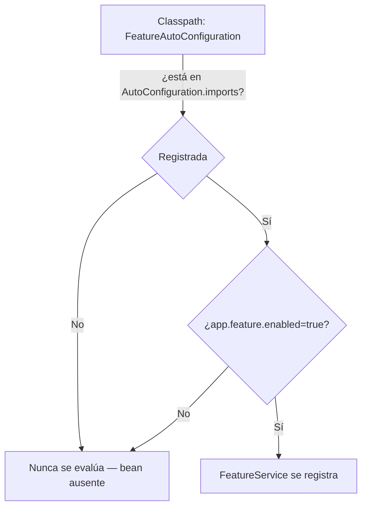

# Módulo 1: Spring Boot CLI y estructura de proyecto

Cada tema declara nivel, duración y una verificación reproducible. La configuración base y el perfil se comprueban con la aplicación Spring Boot real, arrancando con y sin el perfil activo y comparando los valores efectivos.

## Aprende construyendo

### Tema 1: Spring Initializr y starters · Básico · 20 min

**Prerrequisito:** Módulo 0 (contenedor de Spring, `@Service`).

**Al terminar podrás:** elegir starters con criterio y comprobar que evitan el "dependency hell" de resolver manualmente versiones compatibles.

#### Aprende

**¿Por qué es importante?** Un servicio de entregas que necesita exponer HTTP, persistir en PostgreSQL y validar entradas no debería requerir que el equipo investigue manualmente qué versiones de Tomcat, Hibernate y Jackson son compatibles entre sí para la versión de Spring Boot elegida.

**Mapa de subtemas críticos**

| Subtema | Papel | Evidencia |
|---|---|---|
| Spring Initializr como generador | Prerrequisito | `curl -fsSL https://start.spring.io/starter.zip -d type=maven-project -d dependencies=web` produce el `.zip` del proyecto |
| Starter como dependencia curada | Núcleo | `dependencies=web` trae Tomcat, Jackson y Spring MVC autoconfigurados |
| BOM y resolución de versiones | Núcleo | `./mvnw dependency:tree` identifica Tomcat, Jackson y Spring MVC con versiones coherentes |
| Starter `web` vs otros starters | Variante | agregar `validation` habilita `@NotBlank`/`@NotNull`; `data-jpa` trae Hibernate |
| Anotación ausente sin el starter | Diagnóstico | la compilación falla porque `org.springframework.web.bind.annotation.RestController` no está en el classpath |
| Dependencia suelta vs starter | Error frecuente | agregar dependencias sueltas arriesga incompatibilidades que el BOM evitaría |
| Cuándo no usar starters | Límite | en una librería no ejecutable se usan dependencias de Spring Framework, no starters |
| Starters mínimos del proyecto | Decisión | `entregas-api` se justifica con `web`, `data-jpa`, `validation` y `postgresql` |

Cada fila tiene su explicación individual a continuación.

**Spring Initializr como generador (prerrequisito).** Antes de poder elegir starters hay que generar la estructura base del proyecto, y el tema lo hace con `curl` contra `https://start.spring.io/starter.zip -d type=maven-project` pasando `dependencies=web`. El mecanismo entrega un `.zip` con `pom.xml`, `mvnw` y el esqueleto de código ya listos para `./mvnw spring-boot:run`, de modo que la selección de capacidades ocurre en la generación y no después a mano.

**Starter como dependencia curada (núcleo).** Un starter como `spring-boot-starter-webmvc` (llamado `spring-boot-starter-web` antes de Spring Boot 4) no es una sola librería sino un conjunto coherente: al pasar `dependencies=web` el proyecto obtiene Tomcat embebido, Jackson y Spring MVC ya autoconfigurados, lo que permite que `@RestController` y `@GetMapping("/health")` respondan `200 OK` sin configurar el servidor. Ese empaquetado es el valor central frente a reunir piezas sueltas.

**BOM y resolución de versiones (núcleo).** Spring Boot gestiona internamente qué versiones de cada dependencia son compatibles para una versión dada mediante su BOM, eliminando la matriz manual del "dependency hell". El resultado es observable con `./mvnw dependency:tree`, que muestra Tomcat, Jackson y Spring MVC con versiones resueltas coherentemente sin que el equipo las fije una por una.

**Starter `web` vs otros starters (variante).** Cada capacidad tiene su propio starter: agregar `validation` deja disponibles `@NotBlank`/`@NotNull`, y `data-jpa` incorpora Hibernate y la infraestructura de Spring Data. La decisión de qué starter sumar depende de qué capacidad concreta necesita exponer el proyecto, no de agregar todo por si acaso.

**Anotación ausente sin el starter (diagnóstico).** El fallo deliberado del tema genera un proyecto sin el starter `web` e intenta compilar el mismo `SaludController`: la compilación falla porque `org.springframework.web.bind.annotation.RestController` no existe en el classpath. Diagnosticar este caso enseña que sin el starter correspondiente ni las anotaciones básicas están disponibles, mucho antes de cualquier error en tiempo de ejecución.

**Dependencia suelta vs starter (error frecuente).** Uno de los errores comunes del tema es agregar dependencias sueltas en vez del starter correspondiente, lo que reintroduce el riesgo de versiones incompatibles que el BOM habría evitado. El otro extremo —incluir starters que el proyecto no usa— aumenta el tiempo de arranque y la superficie de configuración, por lo que la pista recomienda verificar primero si un starter ya incluye la dependencia buscada.

**Cuándo no usar starters (límite).** El propio tema delimita que para una librería que no es una aplicación ejecutable los starters de Spring Boot no aplican; en ese caso se usan dependencias de Spring Framework según lo que la librería necesite exponer. El límite evita forzar el modelo de starters donde no hay un artefacto ejecutable que autoconfigurar.

**Starters mínimos del proyecto (decisión).** La transferencia al proyecto integrador fija una decisión profesional concreta: generar el microservicio con `web`, `data-jpa`, `validation` y `postgresql` desde el principio y conservar el `pom.xml` como evidencia de las versiones resueltas. Elegir el conjunto mínimo justificado y demostrarlo con `./mvnw dependency:tree` es la forma de cerrar el reto sin arrastrar dependencias innecesarias.

**Conceptos clave:** starter, dependencias preconfiguradas, generación de estructura base.

[start.spring.io](https://start.spring.io) genera la estructura base de un proyecto a partir de starters seleccionados (`web`, `data-jpa`, `security`, `postgresql`). Cada starter es un conjunto curado de dependencias preconfiguradas que trabajan juntas de forma coherente: `spring-boot-starter-webmvc` (llamado `spring-boot-starter-web` antes de Spring Boot 4) trae lo necesario para exponer APIs HTTP; `spring-boot-starter-data-jpa` trae Hibernate y la infraestructura de Spring Data para persistencia. Esta curación es el valor añadido frente a agregar dependencias sueltas: Spring Boot gestiona internamente qué versiones son compatibles para una versión dada mediante su BOM, eliminando la matriz manual de compatibilidad (el "dependency hell").

**Analogía:** un starter es un kit de herramientas preensamblado para un propósito específico, donde todo lo incluido ya está verificado para trabajar junto, en vez de comprar cada herramienta por separado y comprobar manualmente su compatibilidad.

**Diagrama:** [Cómo Initializr genera un proyecto con starters](../../visuals/temas/spring-boot/modulo-1-tema-1-initializr-starters.html)

#### Practica

**Demo paso a paso.** Desde una carpeta vacía, genera el proyecto real con el starter `web`:

```bash
# descarga y arranca con Maven el proyecto generado por Spring Initializr
mkdir ejemplo-spring-m1
cd ejemplo-spring-m1
curl -fsSL https://start.spring.io/starter.zip -d type=maven-project -d dependencies=web -d javaVersion=25 -o app.zip
unzip app.zip
./mvnw spring-boot:run
```

1. Crea `src/main/java/com/example/demo/SaludController.java` exponiendo `GET /health`:

```java
package com.example.demo;

import org.springframework.web.bind.annotation.GetMapping;
import org.springframework.web.bind.annotation.RestController;

@RestController
public class SaludController {
    @GetMapping("/health")
    public String health() {
        return "OK";
    }
}
```

**Explicación línea por línea:** `dependencies=web` en la URL de Initializr selecciona el starter `spring-boot-starter-webmvc` (llamado `spring-boot-starter-web` antes de Spring Boot 4), que trae Tomcat embebido, Jackson y Spring MVC ya autoconfigurados; `@RestController` marca la clase como manejador de peticiones HTTP que serializa directamente los valores de retorno; `@GetMapping("/health")` mapea `GET /health` a este método.

2. Guarda el archivo, reinicia la aplicación y confirma la respuesta:

```bash
curl http://localhost:8080/health
```

**Resultado esperado:** la respuesta HTTP es `200 OK` con cuerpo `OK`, confirmando que el starter `web` autoconfiguró un servidor HTTP funcional sin configuración manual de Tomcat, Jackson ni Spring MVC.

**Fallo deliberado:** genera un segundo proyecto sin el starter `web` (`-d dependencies=`) e intenta agregar el mismo `SaludController`. La compilación falla porque `org.springframework.web.bind.annotation.RestController` no existe en el classpath. Diagnostica confirmando que sin el starter correspondiente ni siquiera las anotaciones básicas de esa capacidad están disponibles, mucho antes de llegar a un error en tiempo de ejecución.

**Ejercicios.**

1. Agrega el starter `validation` a un proyecto existente y confirma que `@NotBlank`/`@NotNull` quedan disponibles.
2. Genera un proyecto con `data-jpa` sin `postgresql` (ni ningún driver) y observa el error real al arrancar.
3. Compara el `pom.xml` generado con y sin `security`, identificando qué dependencias nuevas aparecen.
4. Escribe de memoria los starters mínimos para una API HTTP que persiste en una base relacional.

**Pista:** antes de agregar una dependencia suelta, verifica si existe un starter que ya la incluya con versiones compatibles.

**Completa el código:** rellena el espacio para que el controlador responda a peticiones HTTP:

```java
@____
public class SaludController {
    @GetMapping("/health")
    public String health() { return "OK"; }
}
```

**Reto de memoria:** cierra este documento y escribe un controlador REST mínimo con un endpoint `GET` y los starters necesarios para que compile y arranque.

#### Aplica

**Reto abierto.** Genera un proyecto `entregas-api` con los starters mínimos para exponer HTTP, validar entradas y persistir en PostgreSQL. Justifica cada starter, elimina los que no uses y demuestra con `./mvnw dependency:tree` qué aporta cada uno. Después intenta arrancar sin el driver de base de datos y documenta el error exacto.

**Checklist de salida.**

- [ ] El proyecto arranca y `GET /health` responde `OK`.
- [ ] `pom.xml` contiene solo starters justificados en el README.
- [ ] La comprobación `./mvnw dependency:tree` identifica Tomcat, Jackson y Spring MVC.
- [ ] Reprodujiste y diagnosticaste el fallo por falta de un starter.
- [ ] El proyecto se regenera con el mismo comando desde una carpeta limpia.

**Si falla.** Si `curl` devuelve "connection refused", la aplicación no arrancó: lee la primera línea `Caused by:`. Si falla la compilación por una anotación ausente, compara el `pom.xml` con el proyecto de referencia y agrega el starter, no la dependencia suelta.

**Siguiente paso:** el Tema 2 compara los dos formatos de configuración externa.

**Errores comunes:** agregar dependencias sueltas en vez del starter correspondiente, arriesgando incompatibilidades; incluir starters que el proyecto no necesita, aumentando el arranque y la superficie de configuración.

**Límites y decisión de uso:** para una librería que no es una aplicación ejecutable, los starters de Spring Boot no aplican; usa dependencias de Spring Framework según lo que la librería necesite exponer.

**Fuente oficial:** [Spring Initializr](https://docs.spring.io/initializr/docs/current/reference/html/).

**Transferencia al proyecto integrador:** genera el microservicio productivo con `web`, `data-jpa`, `validation` y `postgresql` desde el principio, y conserva el `pom.xml` como evidencia de versiones resueltas.

### Tema 2: application.yml vs application.properties · Básico · 20 min

**Prerrequisito:** Tema 1 de este módulo.

**Al terminar podrás:** elegir entre YAML y properties y confirmar con la aplicación real que ambos formatos son funcionalmente equivalentes.

#### Aprende

**¿Por qué es importante?** Una configuración con varios niveles de anidación (`spring.datasource.url`, `spring.datasource.username`, `spring.jpa.hibernate.ddl-auto`) se vuelve visualmente repetitiva en `.properties` (el prefijo `spring.` se repite en cada línea), mientras que en `.yml` se agrupa jerárquicamente una sola vez, sin que ninguna de las dos formas cambie qué configuración es posible expresar.

**Mapa de subtemas críticos**

| Subtema | Papel | Evidencia |
|---|---|---|
| Pares clave-valor en `.properties` | Prerrequisito | `spring.datasource.url=jdbc:postgresql://localhost:5432/app` como línea plana |
| Indentación jerárquica en `.yml` | Núcleo | `spring:`/`datasource:`/`url:` con dos espacios expresa la misma clave |
| Equivalencia funcional de ambos formatos | Núcleo | arrancar con cada archivo da el mismo puerto `8080` y la misma URL |
| Detección automática del archivo | Variante | Spring Boot lee `application.yml` en `src/main/resources` sin configuración extra |
| Sensibilidad a la indentación de YAML | Límite | quitar un espacio a `url` provoca error de parseo o clave mal ubicada |
| Error de indentación silencioso | Diagnóstico | contar los espacios exactos revela por qué la propiedad no se aplica |
| Mezclar `.properties` y `.yml` | Error frecuente | tener ambos sin necesidad genera confusión de prioridades |
| Elección de formato por legibilidad | Decisión | para una sola clave sin anidación cualquiera es igual de simple |

Cada fila tiene su explicación individual a continuación.

**Pares clave-valor en `.properties` (prerrequisito).** El punto de partida es entender `application.properties` como pares clave-valor planos con notación de puntos, por ejemplo `spring.datasource.url=jdbc:postgresql://localhost:5432/app`. Esta forma repite el prefijo `spring.` en cada línea, lo que es la base sobre la que el tema contrasta la agrupación jerárquica.

**Indentación jerárquica en `.yml` (núcleo).** `application.yml` expresa exactamente la misma configuración con indentación de dos espacios: `spring:`, luego `datasource:`, luego `url:`. El tema muestra que esa jerarquía representa la misma clave aplanada `spring.datasource.url`, agrupando visualmente las claves relacionadas bajo su nodo padre una sola vez.

**Equivalencia funcional de ambos formatos (núcleo).** El mecanismo central del tema es que ambos formatos son interpretados por el mismo motor: al arrancar con `application.yml` y luego con `application.properties` (manteniendo solo uno presente), la aplicación escucha en el puerto `8080` y usa la misma URL de datasource. Esto confirma que la elección es de legibilidad, sin diferencia funcional.

**Detección automática del archivo (variante).** Spring Boot detecta `application.yml` al arrancar sin configuración adicional siempre que esté en `src/main/resources`, y lo mismo vale para `application.properties`. La variante importa porque si el puerto no cambia, el tema indica verificar que el archivo esté en esa ruta y que no haya otro con mayor prioridad.

**Sensibilidad a la indentación de YAML (límite).** El fallo deliberado consiste en desalinear la indentación de `url` quitándole un espacio respecto a `datasource:`; YAML es sensible a la indentación exacta, así que el parser ubica la línea en otro nivel y produce un error de parseo o una propiedad mal colocada. Ese es el costo que `.properties`, al ser plano, no tiene.

**Error de indentación silencioso (diagnóstico).** El tema advierte que el error de indentación no siempre es obvio: la recomendación es contar los espacios exactos en vez de asumir que "se ve bien". Diagnosticar así explica por qué una clave aparentemente correcta no se aplica, y cómo detectarlo en un pipeline antes de desplegar.

**Mezclar `.properties` y `.yml` (error frecuente).** Entre los errores comunes está mezclar ambos formatos sin necesidad, lo que genera confusión sobre qué archivo tiene prioridad. La demostración del tema mantiene siempre solo uno presente en cada prueba precisamente para que la comparación de puerto y URL sea inequívoca.

**Elección de formato por legibilidad (decisión).** La decisión profesional es de legibilidad: el YAML gana cuanto más profunda es la jerarquía, pero para una sola clave sin anidación la diferencia es irrelevante y cualquiera es igual de simple. Por eso el checklist pide que el README indique qué formato eligió el equipo y por qué.

**Conceptos clave:** configuración tipada, indentación jerárquica, equivalencia funcional.

`application.properties` expresa configuración como pares clave-valor planos con notación de puntos (`spring.datasource.url=jdbc:postgresql://localhost:5432/app`); `application.yml` expresa la misma configuración con indentación jerárquica (`spring: datasource: url: ...`), agrupando visualmente las claves relacionadas bajo su nodo padre. Ambos formatos son válidos y Spring Boot los soporta indistintamente (incluso se pueden mezclar en el mismo proyecto, aunque no es recomendable por claridad); la elección es una cuestión de legibilidad, sin diferencia funcional real.

**Analogía:** `application.properties` es una lista plana de instrucciones con prefijos repetidos; `application.yml` es un índice jerárquico con subcategorías anidadas, generalmente más fácil de navegar cuanto más profunda es la jerarquía.

**Diagrama:**

```text
┌── application.properties (plano) ──────────┐
│  spring.datasource.url=...                    │
│  spring.datasource.username=...                │
└──────────────────────────────────────┘
┌── application.yml (jerárquico) ────────────┐
│  spring:                                      │
│    datasource:                                │
│      url: ...                                 │
│      username: ...                            │
└──────────────────────────────────────┘
```

#### Practica

**Demo paso a paso.** Desde una carpeta vacía (o continuando en `ejemplo-spring-m1`), crea `src/main/resources/application.yml`:

```yaml
spring:
  datasource:
    url: jdbc:postgresql://localhost:5432/app
    username: app_user
server:
  port: 8080
```

1. Guarda el archivo (Spring Boot detecta `application.yml` al arrancar, sin configuración adicional) y confirma que el puerto se aplica:

```bash
# arranca el proyecto Java con Maven usando la configuración de application.yml
cd ejemplo-spring-m1
./mvnw spring-boot:run
```

**Explicación línea por línea:** la indentación de dos espacios bajo `spring:` y luego bajo `datasource:` expresa la misma jerarquía que `spring.datasource.url=...` en formato plano; `server: port: 8080` selecciona el puerto en el que Tomcat escucha.

**Resultado esperado:** la aplicación arranca escuchando en el puerto `8080` (el valor configurado), confirmando que Spring Boot lee y aplica la configuración anidada sin diferencia de comportamiento frente al formato plano.

**Fallo deliberado:** desalinea la indentación de `url` (quítale un espacio respecto a `datasource:`) y vuelve a arrancar. YAML es sensible a la indentación exacta: el parser interpreta la línea como perteneciente a otro nivel y produce un error de parseo o una propiedad en la ubicación equivocada. Diagnostica confirmando que la legibilidad del YAML tiene como costo esa sensibilidad que `.properties` no tiene.

2. Para confirmarlo sin ambigüedad, crea `src/main/resources/application.properties` con la forma plana equivalente:

```properties
spring.datasource.url=jdbc:postgresql://localhost:5432/app
spring.datasource.username=app_user
server.port=8080
```

3. Arranca con este archivo en vez de `application.yml` (mantén solo uno presente) y repite la comprobación:

```bash
# arranca el proyecto Java con Maven usando application.properties en vez de application.yml
cd ejemplo-spring-m1
./mvnw spring-boot:run
```

**Resultado esperado:** la aplicación arranca exactamente igual, escuchando en `8080` y con la misma URL de datasource, confirmando que `spring.datasource.url` (plano) y `spring: datasource: url:` (anidado) son la misma clave interpretada por el mismo mecanismo.

**Ejercicios.**

1. Agrega una tercera clave anidada (`spring.jpa.hibernate.ddl-auto`) en ambos formatos y confirma que producen la misma clave aplanada.
2. Desalinea deliberadamente una indentación en YAML y documenta el error de parseo exacto.
3. Escribe la misma configuración de tres niveles en ambos formatos y cuenta caracteres.
4. Escribe de memoria una configuración anidada de dos niveles en YAML y su equivalente plano.

**Pista:** si te equivocas con la indentación en YAML, el error no siempre es obvio; cuenta los espacios exactos en vez de asumir que "se ve bien".

**Completa el código:** rellena el espacio para expresar `server.port` en YAML:

```yaml
____:
  port: 8080
```

**Reto de memoria:** cierra este documento y escribe la misma configuración de base de datos en ambos formatos, verificando que representan las mismas claves.

#### Aplica

**Reto abierto.** Migra la configuración de un proyecto existente de `.properties` a `.yml` sin cambiar el comportamiento. Demuestra la equivalencia arrancando con cada formato y comparando el puerto efectivo y la URL del datasource. Después introduce un error de indentación y explica cómo lo detectarías en un pipeline.

**Checklist de salida.**

- [ ] Ambos formatos producen el mismo puerto y la misma URL efectiva.
- [ ] Solo uno de los dos archivos está presente en cada prueba.
- [ ] La configuración anidada de tres niveles se lee sin ambigüedad.
- [ ] El error de indentación está reproducido y explicado.
- [ ] El README indica qué formato eligió el equipo y por qué.

**Si falla.** Si el puerto no cambia, verifica que el archivo esté en `src/main/resources` y que no haya otro archivo con mayor prioridad. Si el YAML no parsea, revisa espacios, tabulaciones y que las claves tengan dos puntos seguidos de espacio.

**Siguiente paso:** el Tema 3 usa perfiles para variar esta configuración por entorno.

**Errores comunes:** mezclar `.properties` y `.yml` sin necesidad, generando confusión sobre prioridades; desalinear la indentación y no notarlo hasta que la configuración no se aplica.

**Límites y decisión de uso:** para una sola clave sin anidación, la diferencia entre formatos es irrelevante; cualquiera es igual de simple.

**Fuente oficial:** [Spring Boot — Externalized Configuration](https://docs.spring.io/spring-boot/docs/current/reference/html/features.html#features.external-config).

**Transferencia al proyecto integrador:** la configuración por perfil del microservicio productivo separará entornos con este mismo mecanismo.

### Tema 3: Perfiles y estructura por capas · Intermedio · 30 min

**Prerrequisito:** Tema 2 de este módulo.

**Al terminar podrás:** externalizar configuración por perfil y organizar el código en capas `controller`/`service`/`repository` con responsabilidades delimitadas.

#### Aprende

**¿Por qué es importante?** Desplegar exactamente el mismo artefacto compilado en desarrollo y producción, variando solo la URL de la base de datos y el nivel de logs, evita que el artefacto probado sea sutilmente distinto al desplegado.

**Mapa de subtemas críticos**

| Subtema | Papel | Evidencia |
|---|---|---|
| Configuración base en `application.yml` | Prerrequisito | la base declara `server.port: 8080` y `spring.datasource.url` apuntando a `app` |
| Perfil como sobreescritura parcial | Núcleo | `application-dev.yml` solo declara `spring.datasource.url` apuntando a `app_dev` |
| Activación explícita del perfil | Núcleo | `--spring.profiles.active=dev` y el log `The following 1 profile is active: "dev"` |
| `spring.profiles.group` activa varios perfiles a la vez | Variante | activar `produccion` activa también `metrica` y `seguridad`: el log reporta 3 perfiles activos |
| Configuración fusionada efectiva | Variante | `/actuator/env` reporta `app_dev` para la URL y `8080` heredado para el puerto |
| Perfil nunca activo por defecto | Diagnóstico | arrancar sin la bandera usa la URL base `app`, no `app_dev` |
| Olvidar activar el perfil al desplegar | Error frecuente | el entorno equivocado surge de no pasar `--spring.profiles.active` |
| Separación por capas controller/service/repository | Límite | el controller no contiene reglas de negocio; el service no conoce HTTP |
| Perfiles solo cuando hay varios entornos | Decisión | con un único entorno fijo basta un `application.yml` sin perfiles |

Cada fila tiene su explicación individual a continuación.

**Configuración base en `application.yml` (prerrequisito).** El tema parte de una base en `src/main/resources/application.yml` que declara `server.port: 8080` y `spring.datasource.url` apuntando a `app`. Esa base es el conjunto de valores que un perfil hereda y sobre el que solo se sobreescribe lo necesario, por lo que entenderla es requisito para trazar la configuración final.

**Perfil como sobreescritura parcial (núcleo).** El mecanismo central es que `application-dev.yml` declara únicamente `spring.datasource.url` apuntando a `app_dev`, dejando intacto el resto de la base. Al activar el perfil, la aplicación se conecta a `app_dev` mientras `server.port` permanece en `8080` porque el perfil no lo menciona, demostrando la sobreescritura parcial.

**Activación explícita del perfil (núcleo).** Un perfil se activa al arrancar con `java -jar target/*.jar --spring.profiles.active=dev`, sin recompilar para cada entorno. El log de arranque muestra `The following 1 profile is active: "dev"`, evidencia directa de qué archivo de perfil se cargó además de la base.

**`spring.profiles.group` activa varios perfiles a la vez (variante).** Declarar en `application.yml` `spring.profiles.group.produccion: "metrica,seguridad"` convierte a `produccion` en un perfil "paraguas": activarlo con `--spring.profiles.active=produccion` activa automáticamente también `metrica` y `seguridad`, confirmado en el log de arranque real (`The following 3 profiles are active: "produccion", "metrica", "seguridad"`) y con `Environment.getActiveProfiles()`/`acceptsProfiles(...)`. Esto evita que un despliegue olvide activar uno de varios perfiles relacionados que siempre deberían ir juntos.

**Configuración fusionada efectiva (variante).** Para ver la configuración ya fusionada el tema agrega el starter `actuator`, expone el endpoint `env` con `management.endpoints.web.exposure.include: env` y consulta `/actuator/env`. Esa variante reporta `spring.datasource.url` con el valor del perfil (`.../app_dev`) y `server.port` con el valor base `8080`, exponiendo la fusión sin inferencias.

**Perfil nunca activo por defecto (diagnóstico).** El fallo deliberado consiste en arrancar sin `--spring.profiles.active=dev`: la aplicación usa la `spring.datasource.url` del `application.yml` base apuntando a `app`, no a `app_dev`. Diagnosticar esto deja claro que un perfil nunca se activa automáticamente y que olvidar la bandera es la causa típica de arrancar contra el entorno equivocado.

**Olvidar activar el perfil al desplegar (error frecuente).** Entre los errores comunes está olvidar activar el perfil correcto al desplegar, lo que lleva al comportamiento base en un entorno donde se esperaba otro. La pista del tema recomienda verificar el log `The following N profile(s) are active` antes de desplegar en vez de asumir con qué perfil arrancó la aplicación.

**Separación por capas controller/service/repository (límite).** El tema delimita responsabilidades: `controller/` traduce HTTP hacia y desde DTOs, `service/` tiene la lógica de negocio sin conocer HTTP y `repository/` accede a datos. El límite es que el controller no debe contener reglas de negocio ni el service conocer códigos de estado HTTP; si el controller acumula lógica, la decisión se mueve al service.

**Perfiles solo cuando hay varios entornos (decisión).** La decisión profesional es no multiplicar perfiles sin necesidad: para una aplicación que siempre corre en un único entorno fijo, mantener varios perfiles agrega complejidad sin beneficio y basta un único `application.yml`. Cuando sí hay varios entornos, el reto pide tres perfiles (`dev`, `test`, `prod`) que cambien solo lo suyo sobre el mismo jar.

**Conceptos clave:** perfil (`application-{perfil}.yml`), sobreescritura parcial, `spring.profiles.group`, estructura por capas.

Un perfil (`application-dev.yml`, `application-prod.yml`) sobreescribe únicamente los valores que declara, manteniendo intacto el resto de la configuración base de `application.yml`; `java -jar app.jar --spring.profiles.active=dev` activa el perfil al arrancar, sin recompilar para cada entorno. `spring.profiles.group.<nombre>: "perfilA,perfilB"` define un perfil paraguas que, al activarse, activa también todos los perfiles miembro del grupo. La estructura por capas (`controller/` traduciendo HTTP hacia/desde DTOs, `service/` con la lógica de negocio sin conocimiento de HTTP, `repository/` con el acceso a datos) establece responsabilidades delimitadas: el controller no debería contener lógica de negocio y el service no debería conocer códigos de estado HTTP.

**Analogía:** los perfiles son conjuntos de ajustes preconfigurados para el mismo dispositivo, seleccionables según el contexto sin reconfigurar cada ajuste; la estructura por capas es una cadena de producción donde cada estación tiene una responsabilidad delimitada y no necesita conocer los detalles internos de las demás.

**Diagrama:**

```text
┌ application.yml (base) ───────────────────────────────┐
│  server.port: 8080                                   │
│  spring.datasource.url: .../app                      │
└──────────────────────────┬───────────────────────────┘
                           │ + application-dev.yml
                           ▼
┌ configuración final (perfil dev activo) ──────────────┐
│  server.port: 8080  (heredado)                       │
│  spring.datasource.url: .../app_dev  (sobreescrito)  │
└──────────────────────────────────────────────────────┘
```

#### Practica

**Demo paso a paso.** Desde una carpeta vacía (o continuando en `ejemplo-spring-m1`), parte de la configuración base en `src/main/resources/application.yml`:

```yaml
server:
  port: 8080
spring:
  datasource:
    url: jdbc:postgresql://localhost:5432/app
```

y añade `src/main/resources/application-dev.yml`, que declara solo lo que cambia:

```yaml
spring:
  datasource:
    url: jdbc:postgresql://localhost:5432/app_dev
```

1. Arranca la aplicación activando explícitamente el perfil `dev`:

```bash
# empaqueta y ejecuta el jar Java con el perfil dev activado
cd ejemplo-spring-m1
./mvnw clean package -DskipTests
java -jar target/*.jar --spring.profiles.active=dev
```

**Explicación línea por línea:** `application-dev.yml` solo declara `spring.datasource.url`, sobreescribiendo ÚNICAMENTE esa clave; `server.port` (definido en `application.yml` base) permanece sin cambios porque el perfil no lo menciona; `--spring.profiles.active=dev` indica qué archivo de perfil cargar además de la base.

**Resultado esperado:** los logs de arranque muestran `The following 1 profile is active: "dev"` y la aplicación se conecta a `app_dev` (no a `app`, el valor base), confirmando que el perfil sobreescribió solo la clave que declaró.

**Fallo deliberado:** arranca sin `--spring.profiles.active=dev`. La aplicación usa `spring.datasource.url` del `application.yml` BASE (apuntando a `app`, no a `app_dev`). Diagnostica confirmando que un perfil nunca se activa automáticamente; olvidar la bandera es el error más común al desplegar en el entorno equivocado.

2. Para ver la configuración final ya fusionada, agrega el starter `actuator`, expón el endpoint `env` en `application.yml` (`management.endpoints.web.exposure.include: env`) y consulta el entorno efectivo con la aplicación corriendo:

```bash
# consulta las propiedades efectivas después de fusionar base + perfil dev
curl -s http://localhost:8080/actuator/env/spring.datasource.url | grep -o '"value":"[^"]*"'
curl -s http://localhost:8080/actuator/env/server.port | grep -o '"value":[0-9]*'
```

**Resultado esperado:** `spring.datasource.url` reporta el valor del perfil (`.../app_dev`), mientras `server.port` reporta `8080`, el valor heredado sin cambios. El endpoint `/actuator/env` expone la configuración fusionada sin inferencias.

Agrega al mismo `application.yml` base un grupo de perfiles y confirma con un test real que activar el grupo activa a todos sus miembros:

```yaml
spring:
  profiles:
    group:
      produccion: "metrica,seguridad"
```

```java
// src/test/java/com/academia/PerfilGrupoTest.java
import org.junit.jupiter.api.Test;
import org.springframework.beans.factory.annotation.Autowired;
import org.springframework.boot.test.context.SpringBootTest;
import org.springframework.core.env.Environment;
import org.springframework.core.env.Profiles;
import org.springframework.test.context.ActiveProfiles;

import static org.assertj.core.api.Assertions.assertThat;

@SpringBootTest
@ActiveProfiles("produccion")
class PerfilGrupoTest {
    @Autowired
    private Environment environment;

    @Test
    void activarElGrupoActivaAmbosPerfilesMiembro() {
        assertThat(environment.acceptsProfiles(Profiles.of("metrica"))).isTrue();
        assertThat(environment.acceptsProfiles(Profiles.of("seguridad"))).isTrue();
    }
}
```

**Resultado esperado del grupo:** el log de arranque muestra `The following 3 profiles are active: "produccion", "metrica", "seguridad"` (verificado con Spring Boot 4.1.1 sobre JDK 27.0.1), y el test confirma ambos perfiles miembro activos sin haberlos pasado explícitamente en `--spring.profiles.active`.

**Ejercicios.**

1. Agrega un perfil `test` que sobreescriba únicamente el puerto y confirma con `/actuator/env` qué claves cambian.
2. Declara la misma clave en la base y en el perfil, arranca con el perfil activo y confirma cuál gana.
3. Organiza un endpoint existente en las tres capas (`controller`/`service`/`repository`) y documenta la responsabilidad de cada una.
4. Escribe de memoria un `application-test.yml` que sobreescriba únicamente una clave base.
5. Declara un segundo grupo `staging: "metrica"` (solo un miembro) y confirma con un test que activar `staging` NO activa `seguridad`, solo `metrica`.

**Pista:** antes de desplegar, verifica con el log `The following N profile(s) are active` con qué perfil arrancó la aplicación, en vez de asumirlo.

**Completa el código:** rellena el espacio para activar el perfil `dev`:

```bash
java -jar app.jar --spring.____=dev
```

**Reto de memoria:** cierra este documento y escribe una configuración base y un perfil que sobreescriba una sola clave, y traza la configuración final.

#### Aplica

**Reto abierto.** Diseña tres perfiles (`dev`, `test`, `prod`) para una API de entregas. Cada perfil debe cambiar solo lo que le corresponde y el artefacto compilado debe ser el mismo. Demuestra con `/actuator/env` la configuración efectiva de cada perfil y documenta qué valor gana cuando una clave aparece en dos niveles.

**Checklist de salida.**

- [ ] El mismo jar arranca con los tres perfiles sin recompilar.
- [ ] Cada perfil declara únicamente sus diferencias.
- [ ] `/actuator/env` confirma los valores efectivos de al menos dos claves.
- [ ] El log de arranque identifica el perfil activo en cada corrida.
- [ ] Las capas `controller`, `service` y `repository` existen y el controller no contiene reglas de negocio.
- [ ] Un despliegue sin perfil produce el comportamiento base documentado.

**Si falla.** Si el perfil no se aplica, revisa el nombre del archivo (`application-dev.yml`) y la bandera (`--spring.profiles.active=dev`). Si `/actuator/env` no responde, el endpoint no está expuesto. Si el controller acumula lógica, mueve la decisión al service y deja en el controller solo la traducción HTTP.

**Siguiente paso:** el Tema 4 de este módulo abre el starter por dentro: cómo crear tu propia auto-configuración condicional, el mismo mecanismo que hace posible `spring-boot-starter-web` o cualquier starter de terceros.

**Errores comunes:** olvidar activar el perfil correcto al desplegar; poner lógica de negocio en el controller, mezclando responsabilidades entre capas.

**Límites y decisión de uso:** para una aplicación que siempre corre en un único entorno fijo, mantener múltiples perfiles agrega complejidad sin beneficio; un único `application.yml` basta.

**Fuente oficial:** [Spring Boot — Profiles](https://docs.spring.io/spring-boot/docs/current/reference/html/features.html#features.profiles).

**Transferencia al proyecto integrador:** la estructura por capas de este tema organiza el microservicio productivo.

### Tema 4: Crear tu propia auto-configuración condicional · Avanzado · 40 min

**Prerrequisito:** Tema 1 de este módulo (starter como dependencia curada).

**Al terminar podrás:** escribir una `@AutoConfiguration` propia que registre un bean solo cuando una propiedad lo habilita, y confirmar con `ApplicationContextRunner` que el bean aparece o no aparece según el valor exacto de esa propiedad, sin arrancar nunca una aplicación completa.

#### Aprende

**¿Por qué es importante?** `spring-boot-starter-web` no es magia: es exactamente este mismo mecanismo (una clase `@AutoConfiguration` con condiciones, registrada en un archivo de recursos) aplicado por el equipo de Spring Boot. Un equipo que publica una librería interna compartida entre varios microservicios de la empresa (por ejemplo, un cliente HTTP preconfigurado hacia un servicio de tarifas) puede ofrecer la misma experiencia de "agregar la dependencia y que se autoconfigure" sin que cada equipo consumidor copie manualmente la misma configuración en cada proyecto.

**Mapa de subtemas críticos**

| Subtema | Papel | Evidencia |
|---|---|---|
| `@AutoConfiguration` como marca de clase candidata | Prerrequisito | `FeatureAutoConfiguration` anotada `@AutoConfiguration`, sin lógica de negocio propia |
| Registro en `AutoConfiguration.imports` | Núcleo | `META-INF/spring/org.springframework.boot.autoconfigure.AutoConfiguration.imports` lista la clase por nombre completo |
| `@ConditionalOnProperty` decide si el bean existe | Núcleo | con `app.feature.enabled=true` el contexto SÍ tiene `FeatureService`; sin la propiedad, no |
| Tres valores posibles de la propiedad | Variante | ausente, `false` y `true` producen los tres resultados distintos que el test verifica |
| `ApplicationContextRunner` sin arrancar la app completa | Núcleo | `new ApplicationContextRunner().withConfiguration(...)` construye un contexto mínimo en milisegundos |
| Clase nunca registrada en el archivo de imports | Diagnóstico | aunque la propiedad esté en `true`, el bean nunca aparece: Spring Boot ni siquiera sabe que la clase existe |
| Starters de terceros usan el mismo mecanismo | Decisión | `spring-boot-starter-web` es una `@AutoConfiguration` con condiciones, no un mecanismo especial distinto |

Cada fila tiene su explicación individual a continuación.

**`@AutoConfiguration` como marca de clase candidata (prerrequisito).** `FeatureAutoConfiguration` es una clase de configuración normal (declara beans con `@Bean`), pero anotada `@AutoConfiguration` en vez de `@Configuration` para señalar que es candidata a aplicarse automáticamente, no algo que un desarrollador deba importar manualmente con `@Import`. Por sí sola, la anotación no hace que Spring Boot la encuentre: ese es el rol del archivo de registro.

**Registro en `AutoConfiguration.imports` (núcleo).** El archivo `src/main/resources/META-INF/spring/org.springframework.boot.autoconfigure.AutoConfiguration.imports` lista, una por línea, el nombre completamente calificado de cada clase `@AutoConfiguration` que el classpath debe considerar al arrancar. Este archivo (introducido en Spring Boot 3.0, reemplazando `spring.factories`) es el mecanismo real por el que cualquier starter —incluido uno propio— se vuelve "autoconfigurable" al simple hecho de estar en el classpath, sin que nadie escriba `@Import(FeatureAutoConfiguration.class)` en su aplicación.

**`@ConditionalOnProperty` decide si el bean existe (núcleo).** `@ConditionalOnProperty(prefix = "app.feature", name = "enabled", havingValue = "true")` sobre el método `@Bean` hace que Spring Boot evalúe esa condición al momento de construir el contexto: solo si `app.feature.enabled` vale exactamente `"true"` el bean `FeatureService` se registra. El test `conLaPropiedadEnTrueRegistraElBean` lo confirma con `assertThat(context).hasSingleBean(FeatureService.class)`.

**Tres valores posibles de la propiedad (variante).** El mismo mecanismo produce tres resultados distintos y verificados por tres tests: sin la propiedad (`sinLaPropiedadNoRegistraElBean`), con `false` (`conLaPropiedadEnFalseNoRegistraElBean`) y con `true`. Que "ausente" y "false" produzcan el mismo resultado (bean ausente) no es casualidad: `@ConditionalOnProperty` sin `matchIfMissing = true` exige el valor explícito `"true"`, tratando la ausencia como un "no" por defecto.

**`ApplicationContextRunner` sin arrancar la app completa (núcleo).** `new ApplicationContextRunner().withConfiguration(AutoConfigurations.of(FeatureAutoConfiguration.class))` construye un `ApplicationContext` mínimo específicamente para probar una auto-configuración, sin el costo de arrancar un servidor Tomcat ni cargar toda una aplicación real. Es el mismo mecanismo que el propio equipo de Spring Boot usa para probar sus starters oficiales.

**Clase nunca registrada en el archivo de imports (diagnóstico).** El fallo deliberado de este tema confirma algo contraintuitivo: si la clase `FeatureAutoConfiguration` nunca se lista en el archivo `AutoConfiguration.imports`, el bean `FeatureService` NUNCA aparece en el contexto, incluso con `app.feature.enabled=true` configurado explícitamente. La condición `@ConditionalOnProperty` ni siquiera llega a evaluarse, porque Spring Boot nunca consideró esa clase como candidata en primer lugar: el registro en el archivo es un prerrequisito previo e independiente de la condición misma.

**Starters de terceros usan el mismo mecanismo (decisión).** No hay una API "especial" que usen `spring-boot-starter-web` o `spring-boot-starter-data-jpa` que esté vedada a un desarrollador de aplicación: son clases `@AutoConfiguration` con condiciones (`@ConditionalOnClass`, `@ConditionalOnMissingBean`, `@ConditionalOnProperty`, entre otras), registradas exactamente en el mismo tipo de archivo. Entender este tema es entender cómo funciona cada starter que ya se ha usado en los Temas 1-3.

**Conceptos clave:** `@AutoConfiguration`, `AutoConfiguration.imports`, `@ConditionalOnProperty`, `ApplicationContextRunner`.

Una auto-configuración propia es una clase `@AutoConfiguration` con beans condicionales (`@ConditionalOnProperty`, `@ConditionalOnClass`, `@ConditionalOnMissingBean`), registrada en `META-INF/spring/org.springframework.boot.autoconfigure.AutoConfiguration.imports` para que Spring Boot la considere automáticamente al arrancar, sin que la aplicación consumidora la importe manualmente. `ApplicationContextRunner` permite probar esa auto-configuración en aislamiento, construyendo un contexto mínimo con distintas combinaciones de propiedades y classpath simulado.

**Analogía:** `AutoConfiguration.imports` es como una lista de invitados que la recepción de un edificio consulta automáticamente antes de dejar pasar a alguien; `@ConditionalOnProperty` es el guardia en la puerta de una sala específica dentro del edificio, que solo deja entrar si se cumple una condición adicional — pero si el nombre nunca estuvo en la lista de invitados de recepción, nunca llega siquiera a la puerta de la sala para que el guardia evalúe nada.

**Diagrama:**



#### Practica

**Demo paso a paso.** Desde una carpeta vacía, genera el proyecto con el starter base:

```bash
mkdir auto-config-demo && cd auto-config-demo
curl -fsSL https://start.spring.io/starter.zip -d type=maven-project -d dependencies=web -d javaVersion=27 -o app.zip
unzip -q app.zip
```

Crea `src/main/java/com/academia/autoconfig/FeatureService.java`:

```java
package com.academia.autoconfig;

public class FeatureService {
    public String saludo() {
        return "feature activa";
    }
}
```

Crea `src/main/java/com/academia/autoconfig/FeatureAutoConfiguration.java`:

```java
package com.academia.autoconfig;

import org.springframework.boot.autoconfigure.AutoConfiguration;
import org.springframework.boot.autoconfigure.condition.ConditionalOnProperty;
import org.springframework.context.annotation.Bean;

@AutoConfiguration
public class FeatureAutoConfiguration {

    @Bean
    @ConditionalOnProperty(prefix = "app.feature", name = "enabled", havingValue = "true")
    public FeatureService featureService() {
        return new FeatureService();
    }
}
```

Registra la clase creando `src/main/resources/META-INF/spring/org.springframework.boot.autoconfigure.AutoConfiguration.imports` con una sola línea:

```text
com.academia.autoconfig.FeatureAutoConfiguration
```

Crea el test en `src/test/java/com/academia/autoconfig/FeatureAutoConfigurationTest.java`:

```java
package com.academia.autoconfig;

import org.junit.jupiter.api.Test;
import org.springframework.boot.autoconfigure.AutoConfigurations;
import org.springframework.boot.test.context.runner.ApplicationContextRunner;

import static org.assertj.core.api.Assertions.assertThat;

class FeatureAutoConfigurationTest {

    private final ApplicationContextRunner contextRunner = new ApplicationContextRunner()
            .withConfiguration(AutoConfigurations.of(FeatureAutoConfiguration.class));

    @Test
    void sinLaPropiedadNoRegistraElBean() {
        contextRunner.run(context -> assertThat(context).doesNotHaveBean(FeatureService.class));
    }

    @Test
    void conLaPropiedadEnTrueRegistraElBean() {
        contextRunner.withPropertyValues("app.feature.enabled=true")
                .run(context -> {
                    assertThat(context).hasSingleBean(FeatureService.class);
                    assertThat(context.getBean(FeatureService.class).saludo()).isEqualTo("feature activa");
                });
    }

    @Test
    void conLaPropiedadEnFalseNoRegistraElBean() {
        contextRunner.withPropertyValues("app.feature.enabled=false")
                .run(context -> assertThat(context).doesNotHaveBean(FeatureService.class));
    }
}
```

```bash
./mvnw test
```

**Resultado esperado:** `Tests run: 3, Failures: 0, Errors: 0` (verificado con Spring Boot 4.1.1 / Spring Framework 7.0.9 sobre JDK 27.0.1): los tres tests confirman que el bean aparece únicamente con `app.feature.enabled=true`, y que tanto la ausencia de la propiedad como `false` producen el mismo resultado (ausente).

**Fallo deliberado:** renombra temporalmente el archivo `AutoConfiguration.imports` (o bórralo) y cambia el test para usar un `ApplicationContextRunner` "pelado" (sin `.withConfiguration(AutoConfigurations.of(...))`, simulando que la clase solo se descubre por classpath real) con `app.feature.enabled=true`. El bean sigue ausente. Diagnostica confirmando que `@ConditionalOnProperty` nunca llegó a evaluarse: sin el registro en el archivo de imports, Spring Boot no tiene ninguna noticia de que `FeatureAutoConfiguration` existe, independientemente de qué condiciones declare o de qué valor tenga la propiedad. Restaura el archivo antes de continuar.

**Ejercicios.**

1. Agrega una segunda condición con `@ConditionalOnMissingBean(FeatureService.class)` y confirma que si la aplicación consumidora ya define su propio `FeatureService`, la auto-configuración no lo sobreescribe.
2. Cambia `havingValue = "true"` por `matchIfMissing = true` y confirma con un test que ahora la AUSENCIA de la propiedad activa el bean (el comportamiento inverso al de este tema).
3. Agrega un segundo bean condicionado con `@ConditionalOnClass` a una clase que sabés que no está en el classpath, y confirma que ese bean nunca se registra sin importar el valor de ninguna propiedad.
4. Escribe de memoria (sin mirar) una `@AutoConfiguration` con un bean condicionado por propiedad, su archivo de registro, y un test con `ApplicationContextRunner` que confirme ambos casos (presente/ausente). Compara después contra el patrón del Paso 4.

**Pista:** si un test de auto-configuración pasa o falla de forma que no esperabas, verifica primero que el archivo `AutoConfiguration.imports` tenga el nombre completamente calificado EXACTO de la clase (un error de tipeo ahí falla en silencio, sin ningún error de compilación).

**Completa el código:** rellena la anotación que marca una clase como candidata a auto-configuración:

```java
@____
public class FeatureAutoConfiguration {
    @Bean
    @ConditionalOnProperty(prefix = "app.feature", name = "enabled", havingValue = "true")
    public FeatureService featureService() { return new FeatureService(); }
}
```

**Reto de memoria:** cierra este documento y escribe, solo de memoria, una `@AutoConfiguration` con un bean condicionado por `@ConditionalOnProperty`, su archivo de registro en `META-INF/spring`, y el test con `ApplicationContextRunner` que prueba los tres casos (ausente/false/true).

#### Aplica

**Reto abierto.** Extrae la auto-configuración de un starter interno imaginario para RutaFlow: un `TarifaClient` preconfigurado que solo se active cuando `rutaflow.tarifas.client.enabled=true` esté presente, y que no sobreescriba un `TarifaClient` que la aplicación consumidora ya haya declarado manualmente. Demuestra con `ApplicationContextRunner` los tres escenarios: propiedad ausente, en `false`, y en `true` sin y con un bean propio ya declarado.

**Checklist de salida.**

- [ ] La clase está anotada `@AutoConfiguration` y registrada en `AutoConfiguration.imports`.
- [ ] El bean solo se registra cuando la propiedad vale exactamente `true`.
- [ ] Un test confirma que sin registro en el archivo de imports, la condición nunca se evalúa.
- [ ] `ApplicationContextRunner` prueba los tres escenarios sin arrancar una aplicación completa.
- [ ] Podés explicar en una frase qué mecanismo hace que `spring-boot-starter-web` se autoconfigure.

**Si falla.** Si el bean nunca aparece aunque la propiedad esté en `true`, revisa primero el archivo `AutoConfiguration.imports`: un nombre de clase mal escrito falla en silencio. Si el bean aparece siempre sin importar la propiedad, revisa que `@ConditionalOnProperty` esté sobre el método `@Bean` (no sobre la clase) con el `prefix`/`name`/`havingValue` correctos.

**Siguiente paso:** el Módulo 2 profundiza en la capa web y el manejo de peticiones HTTP.

**Errores comunes:** anotar la clase con `@Configuration` en vez de `@AutoConfiguration` y esperar que se aplique sola sin `@Import`; olvidar el archivo `AutoConfiguration.imports` y asumir que la anotación por sí sola es suficiente; escribir mal el nombre completamente calificado de la clase en el archivo de registro.

**Límites y decisión de uso:** para un bean que la propia aplicación siempre necesita y controla directamente, una auto-configuración agrega indirección sin beneficio; este mecanismo se justifica cuando la configuración se comparte entre múltiples proyectos o equipos como una librería/starter reutilizable.

**Fuente oficial:** [Spring Boot — Creating Your Own Auto-configuration](https://docs.spring.io/spring-boot/reference/features/developing-auto-configuration.html).

**Transferencia al proyecto integrador:** si el microservicio productivo se divide en librerías internas compartidas (por ejemplo, un cliente HTTP común entre varios servicios de RutaFlow), este es el mecanismo para que cada una se autoconfigure al agregarla como dependencia.

## Laboratorio práctico

**Objetivo del laboratorio:** generar un proyecto Spring Boot con perfiles dev/prod y estructura por capas.

**Requisitos previos:** Módulo 0 completado.

| Paso | Acción | Código | Explicación |
|---|---|---|---|
| 1 | Generar el proyecto con Spring Initializr | web, data-jpa, postgresql | Verifica las dependencias generadas |
| 2 | Convertir a `application.yml` | Ver Tema 2 | Compara la legibilidad |
| 3 | Crear `application-dev.yml`/`application-prod.yml` | Ver Tema 3 | Arranca con `--spring.profiles.active=dev` |
| 4 | Organizar en paquetes por capa | Ver Tema 3 | `controller/`, `service/`, `repository/`, `dto/` |
| 5 | Verificar el perfil activo | `/actuator/env` | Si está habilitado |

**Verificación:** el laboratorio se considera exitoso si el proyecto arranca con cada perfil aplicando su configuración específica y si la estructura por capas separa controller/service/repository sin lógica de negocio filtrada en el controller.

**Errores comunes y soluciones**

- **Hardcodear valores de configuración distintos por entorno en el código.** Usa perfiles para externalizar esa configuración.
- **Poner lógica de negocio en el controller.** El controller solo traduce HTTP hacia/desde DTOs y delega la lógica al service.
- **Mezclar `.properties` y `.yml` sin necesidad.** Elige un formato y sé consistente en todo el proyecto.

## Proyecto de cierre del módulo

**Objetivo:** entregar un proyecto ejecutable y reproducible que demuestre configuración externa, perfiles y separación por capas con evidencia observable.

**Entregables.**

1. Proyecto `pipeline-entregas` con `web`, `validation`, `actuator` y `data-jpa`, generado desde Initializr.
2. `application.yml` base y perfiles `dev`, `test` y `prod` con diferencias mínimas documentadas.
3. Paquetes `controller`, `service`, `repository` y `dto`, con un endpoint que atraviese las cuatro capas.
4. Endpoint `GET /configuracion` que devuelva el perfil activo y dos valores efectivos sin exponer secretos.
5. `README.md` con el comando de arranque por perfil y la salida esperada.
6. Registro de los dos fallos provocados (starter ausente y perfil no activado) con su diagnóstico.

**Rúbrica (100 puntos).**

| Criterio | Puntos |
|---|---:|
| Arranque reproducible con el mismo jar y tres perfiles | 20 |
| Configuración base y perfiles con diferencias mínimas y justificadas | 20 |
| Separación real por capas, sin lógica de negocio en el controller | 20 |
| Evidencia de configuración efectiva (`/actuator/env` o endpoint propio) | 15 |
| Fallos reproducidos y diagnosticados por escrito | 15 |
| README con comandos, versiones y criterios de aceptación | 10 |

**Criterio de aceptación:** si un perfil requiere recompilar o el endpoint no permite ver la configuración efectiva, el proyecto no se cierra aunque la rúbrica sume 100.
