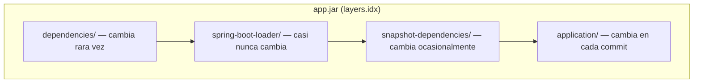
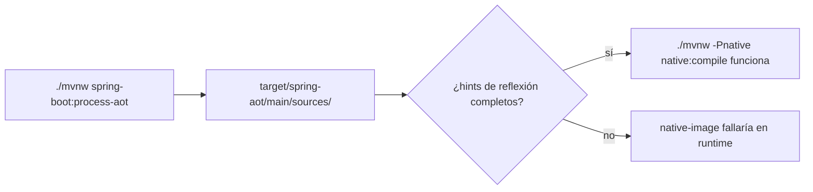
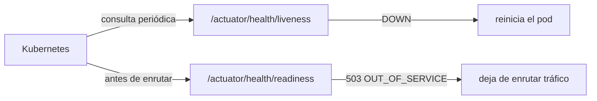

# Módulo 11: Empaquetado y despliegue

Cada tema se verifica con mecanismos reales y ejecutables sin depender de un daemon de Docker disponible en este entorno: el modo `layertools` embebido en el propio JAR de Spring Boot, la meta de Maven `spring-boot:process-aot` (que ejecuta de verdad el motor de AOT de Spring, sin necesitar un compilador nativo de GraalVM instalado), y los endpoints reales de Actuator agrupados por probes de Kubernetes. Continúa sobre `demo-cloud` (Módulo 10) o un proyecto nuevo.

## Aprende construyendo

### Tema 1: Fat JAR vs capas de Docker · Intermedio · 45 min

**Prerrequisito:** Módulo 0 de este track (empaquetado básico con `mvnw package`).

**Al terminar podrás:** inspeccionar, con el propio JAR generado por Spring Boot, las capas reales que separan dependencias de código de aplicación, y explicar por qué esa separación reduce el tamaño de las actualizaciones de imagen.

#### Aprende

**¿Por qué es importante?** Un fat JAR empaqueta la aplicación completa junto con todas sus dependencias en un único archivo; si ese JAR se coloca como una única capa de Docker, cada cambio de código (sin importar cuán pequeño) obliga a Docker a re-subir la imagen completa, incluyendo dependencias que no cambiaron en absoluto.

**Mapa de subtemas críticos**

| Subtema | Papel | Evidencia |
|---|---|---|
| Fat JAR como capa única | Prerrequisito | Cada cambio de código obliga a re-subir la imagen completa con dependencias intactas |
| `layers.idx` y repackaging de Spring Boot | Núcleo | `Unable to find layers.idx in jar` al usar un JAR no repackageado |
| Las cuatro capas declaradas | Núcleo | `layertools list` imprime `dependencies`, `spring-boot-loader`, `snapshot-dependencies`, `application` |
| `extract --destination` | Variante | `test -d target/extracted/dependencies && echo "OK..."` confirma carpetas reales en disco |
| Orden de `COPY` en el Dockerfile | Diagnóstico | `application/` va al final porque los archivos se superponen en el contenedor |
| JAR sin `spring-boot-maven-plugin` | Error frecuente | `java -Djarmode=layertools -jar target/classes.jar list` falla por falta de índice |
| Etiqueta `latest` vs versión inmutable | Decisión | El checklist exige versión inmutable para no dificultar el rollback |
| Prototipo desechable sin pipeline | Límite | La separación por capas no aporta beneficio medible sobre un `docker build` de un solo paso |

Cada fila tiene su explicación individual a continuación.

**Fat JAR como capa única (prerrequisito).** El punto de partida del tema es que un fat JAR reúne aplicación y dependencias en un solo archivo. Si ese archivo entra a Docker como una capa única, cualquier cambio de código invalida toda la capa y obliga a re-subir hasta las dependencias que no cambiaron. Entender ese costo es lo que motiva toda la estrategia de capas que sigue.

**`layers.idx` y repackaging de Spring Boot (núcleo).** El mecanismo central es que el `spring-boot-maven-plugin` repackagea el JAR añadiendo un índice de capas (`layers.idx`) que el modo `layertools` lee. Sin ese repackaging el índice no existe, como demuestra el error `Unable to find layers.idx in jar` sobre un JAR estándar. Es el repackaging, no el empaquetado normal de Maven, el que habilita toda la funcionalidad de capas.

**Las cuatro capas declaradas (núcleo).** El tema separa `dependencies`, `spring-boot-loader`, `snapshot-dependencies` y `application` según su frecuencia de cambio, y `layertools list` las imprime exactamente en ese orden. La capa `application` cambia en cada commit mientras que las dependencias cambian rara vez, y esa diferencia de volatilidad es la que permite reutilizar capas entre deploys. La salida literal del comando es la evidencia observable de que las cuatro capas existen.

**`extract --destination` (variante).** En lugar de solo listar, `extract --destination target/extracted` escribe cada capa como un directorio real de archivos, verificable sin Docker corriendo. El comando `test -d target/extracted/dependencies && echo "OK..."` confirma por filesystem que la extracción ocurrió. Es la variante que convierte el índice abstracto en artefactos concretos que el Dockerfile puede copiar.

**Orden de `COPY` en el Dockerfile (diagnóstico).** El Dockerfile copia las capas de la más estable a la más volátil, y el tema subraya que `application/` va al final porque los archivos se superponen en el contenedor. Alterar ese orden rompería la reutilización que justifica toda la técnica. Diagnosticar un deploy lento empieza por revisar que el orden de `COPY` respete la volatilidad de cada capa.

**JAR sin `spring-boot-maven-plugin` (error frecuente).** El fallo deliberado ejecuta `layertools` contra un JAR generado sin el plugin de Spring Boot y obtiene `Unable to find layers.idx in jar`. El error confirma que el modo depende específicamente del índice que solo el repackaging añade; un JAR "normal" simplemente no lo tiene. Es el error típico de quien empaqueta con el `jar` estándar de Maven y espera capas.

**Etiqueta `latest` vs versión inmutable (decisión).** El checklist y los errores comunes exigen etiquetar la imagen con una versión inmutable en vez de `latest`. Usar `latest` dificulta el rollback porque la etiqueta puede apuntar a artefactos distintos en momentos distintos. La decisión profesional es fijar versiones explícitas para que un despliegue sea reproducible y reversible.

**Prototipo desechable sin pipeline (límite).** El tema delimita que para un prototipo sin un pipeline de deploy repetido, la separación por capas no aporta ningún beneficio medible sobre un `docker build` simple de un solo paso. El valor de las capas aparece solo cuando hay deploys incrementales frecuentes. Reconocer ese límite evita aplicar la complejidad donde no rinde.

**Conceptos clave:** empaquetado por capas, `layertools`, reducir el tamaño de actualizaciones de imagen.

Spring Boot repackagea el JAR con un índice de capas (`layers.idx`) accesible mediante el modo especial `java -Djarmode=layertools -jar app.jar`, que separa dependencies (dependencias de terceros, cambian poco), spring-boot-loader (el propio mecanismo de arranque, casi nunca cambia), snapshot-dependencies (dependencias `-SNAPSHOT`, cambian algo más) y application (el código propio, cambia en cada commit) en directorios distintos. Un Dockerfile que copia cada capa por separado permite que Docker reutilice las capas de dependencias sin cambios entre deploys, subiendo solo la capa `application` (mucho más pequeña) en cada nuevo deploy.

**Analogía:** empaquetar todo en una sola capa de Docker es reempacar y reenviar una caja completa cada vez que cambia un solo objeto pequeño dentro de ella; empaquetar por capas separa el contenido estable del contenido que cambia frecuentemente en cajas distintas, reenviando solo la caja pequeña que efectivamente cambió.

**Diagrama:**



#### Practica

**Demo paso a paso.** Continuando en `demo-cloud` (o, si prefieres un ejemplo independiente, parte de una carpeta vacía y genera el proyecto con Spring Initializr), crea un `application.yml` mínimo y genera el JAR real:

```bash
mkdir -p academia-labs && cd academia-labs
curl -fsSL "https://start.spring.io/starter.zip?type=maven-project&dependencies=web,actuator&javaVersion=25&groupId=io.academia&artifactId=demo-empaquetado&packageName=io.academia.empaquetado" -o demo-empaquetado.zip
unzip demo-empaquetado.zip -d demo-empaquetado
cd demo-empaquetado
```

```yaml
# src/main/resources/application.yml
spring:
  application:
    name: demo-empaquetado
server:
  port: 8080
```

```bash
./mvnw -q package
java -Djarmode=layertools -jar target/*.jar list
```

**Resultado esperado (salida real de `layertools list`, comando oficial de Spring Boot):**

```text
dependencies
spring-boot-loader
snapshot-dependencies
application
```

Extrae las capas a directorios reales y confírmalas por filesystem, sin necesitar Docker corriendo:

```bash
java -Djarmode=layertools -jar target/*.jar extract --destination target/extracted
test -d target/extracted/dependencies && echo "OK: capa dependencies existe"
test -d target/extracted/application && echo "OK: capa application existe"
```

`--destination` es la bandera que fija en qué carpeta extraer las capas del JAR.

Con esas capas ya extraídas y verificadas, el Dockerfile de producción simplemente las copia en el orden correcto:

```dockerfile
FROM eclipse-temurin:21-jre-alpine
WORKDIR /app
COPY target/extracted/dependencies/ ./
COPY target/extracted/spring-boot-loader/ ./
COPY target/extracted/snapshot-dependencies/ ./
COPY target/extracted/application/ ./
ENTRYPOINT ["java", "org.springframework.boot.loader.launch.JarLauncher"]
```

**Explicación línea por línea:** `-Djarmode=layertools` cambia el modo de arranque del propio JAR para ejecutar la herramienta de capas en lugar de la aplicación; `list` imprime los nombres de capa declarados en `layers.idx` y `extract --destination` escribe cada una como un directorio de archivos reales; `test -d` comprueba en el filesystem que la extracción ocurrió, sin intervención de Docker; en el Dockerfile, cada `COPY` crea una capa de imagen independiente y **el orden importa**: los archivos se superponen en el contenedor, por eso `application/` va al final.

**Fallo deliberado:** ejecuta `java -Djarmode=layertools -jar target/classes.jar list` contra un JAR que NO fue repackageado por el plugin de Spring Boot (por ejemplo, uno generado por el `jar` estándar de Maven sin `spring-boot-maven-plugin`). El comando falla con un error real: `Unable to find layers.idx in jar` — diagnostica confirmando que el modo `layertools` depende específicamente del índice de capas que solo el repackaging de Spring Boot añade; un JAR "normal" simplemente no lo tiene. Verifica con el JAR correcto (`target/*.jar` generado por `mvnw package`, que sí incluye el plugin) antes de continuar.

**Ejercicios.**

1. Ejecuta `java -Djarmode=layertools -jar target/*.jar help` y documenta qué otros subcomandos ofrece además de `list` y `extract`.
2. Modifica una línea de `src/main/java` (sin tocar `pom.xml`), reconstruye el JAR con `./mvnw -q package`, y confirma con `diff` recursivo entre extracciones sucesivas que solo la carpeta `application/` cambió de contenido.
3. Agrega una dependencia nueva al `pom.xml`, reconstruye, y confirma que esta vez la carpeta `dependencies/` también cambió.
4. Escribe de memoria (sin mirar) el comando `layertools list` y las cuatro capas que produce. Compara después contra el patrón del demo.

**Pista:** `layertools extract` escribe archivos reales en disco — comparar dos extracciones sucesivas con `diff -rq carpeta1 carpeta2` es una forma directa y verificable de confirmar exactamente qué capas cambiaron entre dos builds, sin necesitar Docker.

**Completa el código:** rellena el espacio con el modo especial que Spring Boot expone dentro de su propio JAR para listar capas:

```bash
java -D____=layertools -jar target/*.jar list
```

**Reto de memoria:** cierra este documento y escribe, solo de memoria, el comando `layertools list`, sus cuatro capas esperadas, y un Dockerfile que las copie en el orden correcto. Compara después contra el patrón del demo.

#### Aplica

**Reto abierto.** Empaqueta `demo-cloud` para actualizaciones incrementales: extrae sus capas, documenta el Dockerfile y demuestra con dos builds consecutivos (uno que cambia solo código y otro que agrega una dependencia) qué capas cambian en cada caso.

**Checklist de salida.**

- [ ] El JAR se genera con `mvnw package` y `layertools list` imprime las cuatro capas.
- [ ] Las capas están extraídas y verificadas en el filesystem.
- [ ] El Dockerfile copia `application/` al final y usa una etiqueta de versión inmutable, no `latest`.
- [ ] Un `diff -rq` entre dos extracciones demuestra qué cambió y qué se reutilizó.
- [ ] Sabes explicar por qué reutilizar capas reduce el tamaño de subida sin cambiar el contenido de la imagen final.

**Si falla.** Si `layertools` responde `Unable to find layers.idx`, el JAR no pasó por el repackaging de Spring Boot: revisa que `spring-boot-maven-plugin` esté declarado y que ejecutaste `package`, no `compile`. Si `target/*.jar` coincide con más de un archivo, nombra el JAR exacto en el comando.

**Siguiente paso:** el siguiente tema reduce el tiempo de arranque compilando a un binario nativo con GraalVM.

**Errores comunes:** empaquetar todo en una única capa de Docker sin usar `layertools`; usar la etiqueta `latest` en vez de una versión inmutable, dificultando el rollback.

**Límites y decisión de uso:** para un prototipo desechable sin pipeline de deploy repetido, la separación por capas no aporta ningún beneficio medible sobre un `docker build` simple de un solo paso.

**Fuente oficial:** [Spring Boot — Container Images](https://docs.spring.io/spring-boot/reference/packaging/container-images/).

**Transferencia al proyecto integrador:** la estrategia de capas de Docker que elijas aquí es la que empaquetará el microservicio productivo (Módulo 12).

### Tema 2: GraalVM native image · Avanzado · 45 min

**Prerrequisito:** Tema 1 de este módulo.

**Al terminar podrás:** ejecutar el procesamiento AOT (ahead-of-time) real de Spring Boot con un comando de Maven rápido y sin GraalVM instalado, inspeccionando el código fuente generado como evidencia concreta de qué hace la compilación nativa antes de invertir en un build completo de `native-image`.

#### Aprende

**¿Por qué es importante?** En un sistema con autoscaling agresivo, un tiempo de arranque de milisegundos (GraalVM native image) permite que nuevas instancias reciban tráfico casi instantáneamente ante un pico, mientras que el arranque de varios segundos de la JVM tradicional degrada la experiencia justo cuando más se necesita capacidad adicional.

**Mapa de subtemas críticos**

| Subtema | Papel | Evidencia |
|---|---|---|
| `native:compile` vs JVM tradicional | Prerrequisito | Binario con arranque en milisegundos a cambio de un build de varios minutos |
| `spring-boot:process-aot` | Núcleo | Genera `target/spring-aot/main/sources/` sin GraalVM instalado |
| `RuntimeHintsRegistrar` y categorías de miembros | Núcleo | `registerType(..., INVOKE_DECLARED_METHODS, DECLARED_FIELDS)` en `InfoHints` |
| `@ImportRuntimeHints` como conexión | Diagnóstico | Sin la anotación el registrador nunca se ejecuta |
| Código fuente AOT inspeccionable | Variante | `find ... -name "*ApplicationContextInitializer.java"` localiza el initializer real |
| Hints ausentes en runtime nativo | Error frecuente | `UnsupportedFeatureException` o `ClassNotFoundException` al reflejar sin hints |
| `process-aot` no valida reflexión | Límite | `process-aot` completa aunque falte `@ImportRuntimeHints` |
| Servicios internos sin autoscaling | Decisión | El costo de build y las restricciones pueden superar el beneficio de arranque |

Cada fila tiene su explicación individual a continuación.

**`native:compile` vs JVM tradicional (prerrequisito).** `./mvnw -Pnative native:compile` produce un binario que el sistema operativo ejecuta directamente, con arranque en milisegundos y menor footprint, a cambio de un build mucho más lento y restricciones de reflexión. Entender ese intercambio es el prerrequisito para decidir cuándo vale la pena el camino nativo. El tema usa esa comparación como punto de partida antes de introducir el atajo de inspección.

**`spring-boot:process-aot` (núcleo).** La meta de Maven ejecuta el mismo motor de análisis AOT de Spring pero se detiene en generar código fuente Java, sin compilar a binario nativo. Eso permite inspeccionar en segundos qué construiría el compilador nativo, y el tema lo verifica con `test -d target/spring-aot/main/sources`. Es el mecanismo central que hace observable el AOT sin GraalVM instalado.

**`RuntimeHintsRegistrar` y categorías de miembros (núcleo).** La clase `InfoHints` declara explícitamente qué miembros deben estar disponibles en el binario mediante `registerType(InfoServicio.class, INVOKE_DECLARED_METHODS, DECLARED_FIELDS)`. Esas categorías indican que los métodos declarados y los campos deben conservarse para reflexión. Sin esa declaración, el compilador nativo no puede descubrir por sí solo esa clase accedida por reflexión.

**`@ImportRuntimeHints` como conexión (diagnóstico).** La anotación sobre `ConfiguracionHints` es lo que efectivamente conecta el registrador con el análisis AOT; el tema advierte que sin ella el registrador nunca se ejecuta. Por eso, al diagnosticar hints que "no surten efecto", el primer punto a revisar es que la anotación esté presente y apunte a la clase correcta. Es el eslabón silencioso entre declarar hints y aplicarlos.

**Código fuente AOT inspeccionable (variante).** En lugar de un artefacto binario opaco, `process-aot` deja código Java legible bajo `target/spring-aot/main/sources/`, y `find ... -name "*ApplicationContextInitializer.java"` localiza el initializer real en disco. Leer ese código es la forma más rápida de entender qué haría el compilador nativo con la configuración actual. La variante de inspección sustituye la espera de un build completo por lectura directa.

**Hints ausentes en runtime nativo (error frecuente).** El fallo deliberado quita `@ImportRuntimeHints` y documenta que un build nativo posterior produciría un binario que, al reflejar sobre `InfoServicio`, lanzaría `UnsupportedFeatureException` o `ClassNotFoundException` según el tipo de acceso. El error confirma que los hints son responsabilidad explícita del desarrollador. Es el fallo clásico de quien asume que la reflexión "simplemente funcionará" en nativo como en la JVM.

**`process-aot` no valida reflexión (límite).** El mismo fallo deliberado muestra que `process-aot` completa exitosamente aunque falte la anotación, porque no valida en tiempo de build que la reflexión funcione en runtime. Ese es su límite: confirma que el análisis se ejecuta y genera código, no que el binario nativo final será correcto. El checklist insiste en saber explicar qué comprueba y qué no comprueba.

**Servicios internos sin autoscaling (decisión).** El tema delimita que para servicios internos sin autoscaling agresivo ni restricciones estrictas de arranque, el costo de build y las restricciones de reflexión de GraalVM pueden superar el beneficio de un arranque más rápido. La decisión profesional pondera ese intercambio en lugar de asumir que nativo siempre conviene. Reconocerlo evita invertir en builds nativos que no pagan su costo.

**Conceptos clave:** compilación ahead-of-time a binario nativo, procesamiento AOT de Spring.

`./mvnw -Pnative native:compile` compila la aplicación a un binario nativo ejecutable directamente por el sistema operativo, con arranque en milisegundos y footprint de memoria menor, a cambio de un build significativamente más lento y restricciones de reflexión. Antes de ese build completo (que puede tardar varios minutos), Spring Boot expone `./mvnw spring-boot:process-aot`, una meta de Maven que ejecuta el mismo motor de análisis AOT de Spring pero se detiene en generar código fuente Java optimizado (sin compilarlo a binario nativo), permitiendo inspeccionar en segundos qué construiría el compilador nativo.

**Analogía:** GraalVM native image es un vehículo que enciende instantáneamente en vez de requerir calentamiento del motor; `process-aot` es revisar el plano detallado de ese vehículo antes de fabricarlo, para detectar problemas de diseño sin esperar la fabricación completa.

**Diagrama:**



#### Practica

**Demo paso a paso.** Continuando en `demo-empaquetado` (o, si prefieres un ejemplo independiente, parte de una carpeta vacía y genera un proyecto nuevo con `mkdir demo-native && cd demo-native && curl -fsSL https://start.spring.io/starter.zip -d type=maven-project -d dependencies=web -d javaVersion=25 -o app.zip && unzip app.zip`), crea `src/main/java/io/academia/empaquetado/InfoServicio.java`, una clase accedida por reflexión (simulando el patrón que requiere hints explícitos):

```bash
mkdir -p src/main/java/io/academia/empaquetado
```

```java
// src/main/java/io/academia/empaquetado/InfoServicio.java
package io.academia.empaquetado;

public class InfoServicio {
    private String version = "1.0.0";

    public String version() {
        return version;
    }
}
```

```java
// src/main/java/io/academia/empaquetado/InfoHints.java
package io.academia.empaquetado;

import org.springframework.aot.hint.MemberCategory;
import org.springframework.aot.hint.RuntimeHints;
import org.springframework.aot.hint.RuntimeHintsRegistrar;

public class InfoHints implements RuntimeHintsRegistrar {
    @Override
    public void registerHints(RuntimeHints hints, ClassLoader classLoader) {
        hints.reflection().registerType(InfoServicio.class,
            MemberCategory.INVOKE_DECLARED_METHODS, MemberCategory.DECLARED_FIELDS);
    }
}
```

Registra esos hints en la configuración para que el motor AOT los aplique:

```java
// src/main/java/io/academia/empaquetado/ConfiguracionHints.java
package io.academia.empaquetado;

import org.springframework.context.annotation.Configuration;
import org.springframework.context.annotation.ImportRuntimeHints;

@Configuration
@ImportRuntimeHints(InfoHints.class)
public class ConfiguracionHints {
}
```

Ejecuta el procesamiento AOT real (rápido, sin GraalVM instalado) y confirma que genera código fuente concreto:

```bash
./mvnw -q spring-boot:process-aot
test -d target/spring-aot/main/sources && echo "OK: Spring generó código AOT real"
find target/spring-aot/main/sources -name "*ApplicationContextInitializer.java"
```

**Explicación línea por línea:** `InfoServicio` representa una clase que solo puede instanciarse o leerse por reflexión, un patrón que el compilador nativo no puede descubrir por sí solo; `RuntimeHintsRegistrar` declara explícitamente qué miembros deben estar disponibles en el binario (`INVOKE_DECLARED_METHODS` y `DECLARED_FIELDS`); `@ImportRuntimeHints` es lo que efectivamente conecta ese registrador con el análisis AOT — sin esa anotación el registrador nunca se ejecuta; `spring-boot:process-aot` corre ese análisis y deja el código generado en `target/spring-aot/main/sources/`, donde `find` demuestra en disco que el initializer existe.

**Resultado esperado:** el directorio `target/spring-aot/main/sources/` existe y contiene un archivo real `...ApplicationContextInitializer.java` generado por el motor AOT de Spring — evidencia concreta y verificable en disco de que el procesamiento AOT realmente se ejecutó, sin necesitar el compilador nativo de GraalVM instalado.

**Fallo deliberado:** quita la anotación `@ImportRuntimeHints(InfoHints.class)` de `ConfiguracionHints` y documenta el resultado: `process-aot` sigue completando exitosamente (porque no valida en tiempo de build que la reflexión funcione en runtime), pero un build completo posterior con `native:compile` produciría un binario que, al invocar reflexión sobre `InfoServicio` en tiempo de ejecución, lanzaría un error real de GraalVM (`com.oracle.svm.core.jdk.UnsupportedFeatureException` o una `ClassNotFoundException` en el binario nativo, según el tipo de acceso) — diagnostica confirmando que los hints de reflexión son responsabilidad explícita del desarrollador: el compilador ahead-of-time no puede inferir dinámicamente qué reflexión necesitará el binario, a diferencia de la JVM tradicional. Restaura `@ImportRuntimeHints(InfoHints.class)` antes de continuar.

**Ejercicios.**

1. Inspecciona con `cat` el contenido real de un archivo generado bajo `target/spring-aot/main/sources/` y documenta, en un comentario, qué patrón de código genera Spring en vez de usar reflexión en runtime.
2. Agrega una segunda clase con un campo privado accedido por Jackson (deserialización JSON) y confirma con `process-aot` que Spring detecta y registra automáticamente hints para tipos usados en `@RestController`.
3. Ejecuta `./mvnw -q spring-boot:process-aot` dos veces seguidas sin cambiar código y confirma con `diff` que el código generado es idéntico (determinismo del procesamiento AOT).
4. Escribe de memoria (sin mirar) una clase `RuntimeHintsRegistrar` con `@ImportRuntimeHints`, y el comando `process-aot` que la ejercita. Compara después contra el patrón del demo.

**Pista:** `target/spring-aot/main/sources/` contiene código Java real y legible, no un artefacto binario opaco — leerlo directamente es la forma más rápida de entender exactamente qué haría el compilador nativo con tu configuración, sin esperar un build completo de `native-image` que puede tardar varios minutos.

**Completa el código:** rellena el espacio con la meta de Maven que ejecuta el procesamiento AOT sin compilar a binario nativo:

```bash
./mvnw spring-boot:____
```

**Reto de memoria:** cierra este documento y escribe, solo de memoria, una clase `RuntimeHintsRegistrar`, la anotación que la registra, y el comando `process-aot` que confirma su efecto en disco. Compara después contra el patrón del demo.

#### Aplica

**Reto abierto.** Prepara `demo-cloud` para una build nativa: identifica una clase que requiera reflexión, declara sus hints con `RuntimeHintsRegistrar`, demuestra con `process-aot` que el análisis se ejecuta y documenta qué se verificó y qué quedó sin ejecutar por no disponer de GraalVM.

**Checklist de salida.**

- [ ] Existe al menos un `RuntimeHintsRegistrar` conectado con `@ImportRuntimeHints`.
- [ ] `process-aot` genera código en `target/spring-aot/main/sources/` y lo demuestras con una ruta concreta.
- [ ] Sabes explicar qué comprueba `process-aot` y qué NO comprueba.
- [ ] El README distingue lo ejecutado (AOT) de lo pendiente (build nativo completo).
- [ ] Ninguna afirmación de tiempo de arranque se presenta como medida sin haber medido.

**Si falla.** Si `process-aot` no genera el directorio, confirma que el proyecto tenga `spring-boot-maven-plugin` y que ejecutes la meta desde la raíz. Si `find` no encuentra el initializer, revisa que la clase principal esté anotada con `@SpringBootApplication` y que el build no esté reutilizando un `target/` de otro proyecto.

**Siguiente paso:** el siguiente tema conecta los health checks de Actuator con las decisiones reales que Kubernetes toma sobre el pod.

**Errores comunes:** asumir que `native-image` no requiere ninguna configuración adicional de reflexión; ejecutar directamente un build nativo completo (varios minutos) en vez de `process-aot` (segundos) durante la iteración de desarrollo.

**Límites y decisión de uso:** para servicios internos sin autoscaling agresivo ni restricciones estrictas de arranque, el costo de build y las restricciones de reflexión de GraalVM pueden superar el beneficio de un arranque más rápido.

**Fuente oficial:** [Spring Boot — GraalVM Native Images](https://docs.spring.io/spring-boot/reference/packaging/native-image/introducing-graalvm-native-images.html).

**Transferencia al proyecto integrador:** GraalVM native image es la opción que reducirá el tiempo de arranque del microservicio productivo (Módulo 12) si el entorno lo justifica.

### Tema 3: Health checks para Kubernetes · Intermedio · 40 min

**Prerrequisito:** Módulo 7 de este track (Actuator y `AvailabilityChangeEvent`).

**Al terminar podrás:** confirmar, con una petición HTTP real, que los endpoints de Actuator agrupados por probes (`/actuator/health/liveness` y `/actuator/health/readiness`) responden con el código de estado correcto según el estado real de disponibilidad de la aplicación.

#### Aprende

**¿Por qué es importante?** Kubernetes decide automáticamente cuándo reiniciar un pod (liveness) y cuándo un pod puede recibir tráfico real (readiness) consultando estos endpoints periódicamente; sin una conexión correcta y probada entre el estado real de la aplicación y estas señales, Kubernetes toma decisiones operativas basadas en información incorrecta.

**Mapa de subtemas críticos**

| Subtema | Papel | Evidencia |
|---|---|---|
| `probes.enabled=true` | Prerrequisito | Sin la propiedad, los endpoints responden `404 NOT_FOUND` |
| Grupos liveness y readiness separados | Núcleo | `/actuator/health/liveness` y `/actuator/health/readiness` como grupos distintos |
| Liveness responde `200 UP` | Núcleo | El test espera `status().isOk()` y `$.status` igual a `UP` |
| Readiness refleja `AvailabilityChangeEvent` | Variante | Publicar `REFUSING_TRAFFIC` produce `503 OUT_OF_SERVICE` |
| `show-details: always` | Diagnóstico | Deja ver el `status` en el cuerpo JSON que el test verifica |
| `404` silencioso fuera de K8s | Error frecuente | Comentar `probes.enabled` devuelve `404` en vez de `200`/`503` |
| `livenessProbe` acoplado a BD externa | Límite | Reinicios en cascada de todos los pods si la base de datos se cae |
| App que no corre en Kubernetes | Decisión | Los grupos no aportan beneficio sobre `/actuator/health` general |

Cada fila tiene su explicación individual a continuación.

**`probes.enabled=true` (prerrequisito).** Fuera de un clúster real de Kubernetes los grupos de probes no se autodetectan, así que el tema los habilita explícitamente con `management.endpoint.health.probes.enabled=true`. Sin esa propiedad, los endpoints responden `404 NOT_FOUND`. Es el prerrequisito de configuración para poder probar los probes en local o en un entorno no-K8s.

**Grupos liveness y readiness separados (núcleo).** Con la propiedad activa, Spring Boot expone `/actuator/health/liveness` y `/actuator/health/readiness` como grupos de health distintos. Liveness responde si el proceso debería seguir corriendo o Kubernetes debería reiniciarlo; readiness responde si está listo para recibir tráfico ahora. Esa separación es la misma distinción de `AvailabilityChangeEvent` del Módulo 7, ahora en el formato exacto que Kubernetes consulta.

**Liveness responde `200 UP` (núcleo).** El primer test confirma con una petición HTTP real que `/actuator/health/liveness` responde `200` con `$.status` igual a `UP` mientras el proceso está sano. Liveness por defecto solo incluye señales de vida del proceso, no de dependencias externas. Ese `200 UP` es la señal que evita que Kubernetes reinicie un pod que realmente está vivo.

**Readiness refleja `AvailabilityChangeEvent` (variante).** El segundo test publica `AvailabilityChangeEvent.publish(publisher, this, ReadinessState.REFUSING_TRAFFIC)` y verifica que readiness pasa a `503 OUT_OF_SERVICE`. Es la misma señal real del Módulo 7, que Spring consume automáticamente y traduce al grupo `readiness`. El test restaura `ACCEPTING_TRAFFIC` al final para no dejar el contexto en un estado que afecte a otras pruebas.

**`show-details: always` (diagnóstico).** La propiedad `show-details: always` deja ver el campo `status` dentro del cuerpo JSON, que es exactamente lo que el test verifica con `jsonPath("$.status")`. Sin ese detalle visible, el aserto sobre el cuerpo no tendría nada que comprobar. Para diagnosticar un probe que responde con el código correcto pero sin cuerpo esperado, este ajuste es el primero a revisar.

**`404` silencioso fuera de K8s (error frecuente).** El fallo deliberado comenta `probes.enabled` y obtiene `404 NOT_FOUND` en ambos endpoints en vez de `200`/`503`. El tema lo describe como un fallo de configuración silencioso y fácil de pasar por alto hasta el primer despliegue real, porque Kubernetes recibiría un `404` al consultar los probes. Es el error típico de probar en local sin la propiedad explícita.

**`livenessProbe` acoplado a BD externa (límite).** El tema advierte que un `livenessProbe` que depende de una base de datos externa es peligroso: si esa base de datos se cae, podría causar reinicios en cascada de todos los pods sin resolver el problema real. Readiness sí puede depender de una dependencia externa, pero liveness debe limitarse a la vida del proceso. Ese límite marca la frontera entre las dos señales.

**App que no corre en Kubernetes (decisión).** El tema delimita que para una aplicación que no se despliega en Kubernetes ni en un orquestador equivalente que consulte probes HTTP, habilitar estos grupos específicos no aporta ningún beneficio sobre el endpoint `/actuator/health` general. La decisión profesional es activar los probes solo cuando hay un consumidor real de esas señales. Reconocerlo evita configuración sin propósito.

**Conceptos clave:** liveness/readiness probes agrupados, conectados a Actuator.

Con `management.endpoint.health.probes.enabled=true`, Spring Boot expone automáticamente `/actuator/health/liveness` y `/actuator/health/readiness` como grupos de health separados. Liveness responde "¿el proceso sigue vivo y debería seguir corriendo, o Kubernetes debería reiniciarlo?"; readiness responde "¿el proceso está listo para recibir tráfico real ahora mismo?" — la misma distinción de `AvailabilityChangeEvent` construida en el Módulo 7, ahora expuesta en el formato exacto que Kubernetes consulta.

**Analogía:** conectar Actuator a los probes de Kubernetes es instalar sensores automáticos que informan al sistema de gestión de una flota cuándo un vehículo necesita mantenimiento (reiniciarse) o simplemente no está listo para un nuevo viaje todavía (no recibir tráfico).

**Diagrama:**



#### Practica

**Demo paso a paso.** Continuando en `demo-empaquetado` (o, si prefieres un ejemplo independiente, parte de una carpeta vacía y genera un proyecto nuevo con `mkdir demo-probes && cd demo-probes && curl -fsSL https://start.spring.io/starter.zip -d type=maven-project -d dependencies=web,actuator -d javaVersion=25 -o app.zip && unzip app.zip`), crea `src/main/resources/application.yml` con los probes habilitados explícitamente (necesario fuera de un clúster real de Kubernetes, donde se autodetectan):

```bash
mkdir -p src/main/resources src/test/java/io/academia/empaquetado
```

```yaml
# src/main/resources/application.yml
management:
  endpoint:
    health:
      probes:
        enabled: true
      show-details: always
  endpoints:
    web:
      exposure:
        include: health
```

Confirma con `MockMvc` real, disparando el mismo `AvailabilityChangeEvent` del Módulo 7, que ambos endpoints reflejan el estado real de la aplicación. **Nota (Spring Boot 4):** `AutoConfigureMockMvc` requiere agregar explícitamente `spring-boot-webmvc-test` (scope `test`) al `pom.xml` — en Boot 3.x venía incluido en `spring-boot-starter-test`:

```xml
<!-- dentro de <dependencies> del pom.xml -->
<dependency>
    <groupId>org.springframework.boot</groupId>
    <artifactId>spring-boot-webmvc-test</artifactId>
    <scope>test</scope>
</dependency>
```

```java
// src/test/java/io/academia/empaquetado/ProbesTest.java
package io.academia.empaquetado;

import org.junit.jupiter.api.Test;
import org.springframework.beans.factory.annotation.Autowired;
import org.springframework.boot.availability.AvailabilityChangeEvent;
import org.springframework.boot.availability.ReadinessState;
import org.springframework.boot.webmvc.test.autoconfigure.AutoConfigureMockMvc;
import org.springframework.boot.test.context.SpringBootTest;
import org.springframework.context.ApplicationEventPublisher;
import org.springframework.test.web.servlet.MockMvc;

import static org.springframework.test.web.servlet.request.MockMvcRequestBuilders.get;
import static org.springframework.test.web.servlet.result.MockMvcResultMatchers.jsonPath;
import static org.springframework.test.web.servlet.result.MockMvcResultMatchers.status;

@SpringBootTest
@AutoConfigureMockMvc
class ProbesTest {

    @Autowired
    private MockMvc mockMvc;

    @Autowired
    private ApplicationEventPublisher publisher;

    @Test
    void livenessRespondeUpMientrasElProcesoSigaVivo() throws Exception {
        mockMvc.perform(get("/actuator/health/liveness"))
            .andExpect(status().isOk())
            .andExpect(jsonPath("$.status").value("UP"));
    }

    @Test
    void readinessResponde503CuandoLaAplicacionDejaDeAceptarTrafico() throws Exception {
        AvailabilityChangeEvent.publish(publisher, this, ReadinessState.REFUSING_TRAFFIC);

        mockMvc.perform(get("/actuator/health/readiness"))
            .andExpect(status().isServiceUnavailable())
            .andExpect(jsonPath("$.status").value("OUT_OF_SERVICE"));

        AvailabilityChangeEvent.publish(publisher, this, ReadinessState.ACCEPTING_TRAFFIC); // restaura para no afectar otros tests
    }
}
```

```bash
./mvnw test -Dtest=ProbesTest
```

**Explicación línea por línea:** `probes.enabled: true` crea los dos grupos de health aunque no se detecte Kubernetes; `show-details: always` deja ver el `status` en el cuerpo JSON que el test verifica; `AvailabilityChangeEvent.publish(...)` emite la misma señal que la aplicación emitiría al arrancar o al perder disponibilidad, y ese evento es lo que el grupo `readiness` traduce a `OUT_OF_SERVICE` con HTTP `503`; el test restaura `ACCEPTING_TRAFFIC` al final para no dejar el contexto en un estado que afecte a otras pruebas.

**Resultado esperado:** `BUILD SUCCESS` con ambos tests en verde: el primero confirma con una petición HTTP real que `/actuator/health/liveness` responde `200 UP` mientras el proceso está sano; el segundo confirma, publicando el mismo `AvailabilityChangeEvent` real usado en el Módulo 7, que `/actuator/health/readiness` refleja genuinamente `503 OUT_OF_SERVICE` cuando la aplicación deja de aceptar tráfico — la misma señal que Kubernetes consultaría para dejar de enrutar peticiones hacia ese pod.

**Fallo deliberado:** comenta la línea `probes: enabled: true` en `application.yml` y ejecuta de nuevo ambos tests. `/actuator/health/liveness` y `/actuator/health/readiness` responden `404 NOT_FOUND` en vez de `200`/`503` — diagnostica confirmando que estos grupos de health NO existen automáticamente fuera de un entorno Kubernetes detectado; sin la propiedad explícita (necesaria para pruebas locales o entornos no-K8s), Kubernetes recibiría un `404` al consultar los probes, un fallo de configuración silencioso y fácil de pasar por alto hasta el primer despliegue real. Restaura la línea antes de continuar.

**Ejercicios.**

1. Agrega un `HealthIndicator` personalizado (como en el Módulo 7) que reporte `DOWN` cuando una dependencia crítica falla, y confirma con un test que ese indicador afecta a `/actuator/health` general pero NO necesariamente al grupo `liveness` (que por defecto solo incluye señales de vida del proceso, no de dependencias externas).
2. Escribe el manifiesto YAML completo (`livenessProbe`, `readinessProbe`, con `initialDelaySeconds` y `periodSeconds`) para el servicio de este Tema.
3. Documenta, en un comentario, por qué un `readinessProbe` que depende de una base de datos externa es apropiado, pero un `livenessProbe` que depende de esa misma base de datos externa es peligroso (podría causar reinicios en cascada de todos los pods si la base de datos se cae, sin resolver el problema real).
4. Escribe de memoria (sin mirar) un test `MockMvc` que confirme `200 UP` en liveness y, tras publicar un `AvailabilityChangeEvent`, `503` en readiness. Compara después contra el patrón del demo.

**Pista:** `AvailabilityChangeEvent.publish(publisher, this, ReadinessState.REFUSING_TRAFFIC)` es el mismo mecanismo real usado en el Módulo 7 para desacoplar readiness de liveness — Spring lo consume automáticamente y lo refleja en el grupo `readiness` cuando `probes.enabled=true`.

**Completa el código:** rellena el espacio con la propiedad que habilita explícitamente los grupos de health por probes:

```yaml
management:
  endpoint:
    health:
      ____:
        enabled: true
```

**Reto de memoria:** cierra este documento y escribe, solo de memoria, la configuración YAML que habilita los probes, y un test `MockMvc` que confirme el `503` real en readiness tras publicar `ReadinessState.REFUSING_TRAFFIC`. Compara después contra el patrón del demo.

#### Aplica

**Reto abierto.** Despliega `demo-cloud` en un clúster local con manifiestos que consulten `/actuator/health/liveness` y `/actuator/health/readiness`, y demuestra con `kubectl` qué ocurre cuando la aplicación deja de aceptar tráfico y cuando vuelve a aceptarlo.

**Checklist de salida.**

- [ ] Los dos grupos de probes responden con la configuración explícita.
- [ ] Un test demuestra `200 UP` en liveness y `503 OUT_OF_SERVICE` en readiness.
- [ ] El manifiesto declara `initialDelaySeconds` y `periodSeconds` con un criterio explícito.
- [ ] `livenessProbe` no depende de bases de datos ni servicios externos.
- [ ] Sabes explicar qué haría Kubernetes si el probe devolviera `404`.

**Si falla.** Si ambos endpoints devuelven `404`, falta `management.endpoint.health.probes.enabled=true` o la exposición de `health`; si solo falla readiness, revisa que el evento publicado sea exactamente `ReadinessState.REFUSING_TRAFFIC` y que el test restaure el estado al terminar. Si el pod se reinicia en bucle en el clúster, el `livenessProbe` está consultando una dependencia externa.

**Siguiente paso:** con esto se cierra el módulo de empaquetado y despliegue; el siguiente módulo aborda observabilidad distribuida con trazas y logs correlacionados.

**Errores comunes:** no habilitar `probes.enabled=true` fuera de un clúster Kubernetes real, recibiendo `404` en pruebas locales; acoplar `livenessProbe` a dependencias externas, causando reinicios en cascada ante un fallo de infraestructura ajeno al proceso mismo.

**Límites y decisión de uso:** para una aplicación que no se despliega en Kubernetes (o un orquestador equivalente que consulte probes HTTP), habilitar estos grupos específicos de health no aporta ningún beneficio operativo adicional sobre el endpoint `/actuator/health` general.

**Fuente oficial:** [Spring Boot — Kubernetes Probes](https://docs.spring.io/spring-boot/reference/actuator/kubernetes-probes.html).

**Transferencia al proyecto integrador:** los health checks de Kubernetes de este tema son los que decidirán si Kubernetes reinicia o enruta tráfico al microservicio productivo (Módulo 12).

## Proyecto de cierre del módulo

**Objetivo:** entregar `demo-cloud` empaquetado y desplegable: imagen por capas con actualizaciones incrementales demostradas, evidencia real de procesamiento AOT con sus hints de reflexión, y probes de Kubernetes conectados al estado genuino de la aplicación.

**Entregables.**

1. JAR generado por `mvnw package` con `layertools list` y las cuatro capas extraídas y verificadas en disco (Tema 1).
2. `Dockerfile` que copia las capas en orden, con etiqueta de versión inmutable y `COPY application/` al final.
3. Registro de dos builds consecutivos con `diff -rq` mostrando qué capa cambió al modificar solo código y qué capa cambió al agregar una dependencia.
4. `RuntimeHintsRegistrar` con `@ImportRuntimeHints` y la salida real de `spring-boot:process-aot` (ruta concreta del initializer generado).
5. `application.yml` con `probes.enabled=true` y los dos tests que demuestran `200 UP` en liveness y `503 OUT_OF_SERVICE` en readiness.
6. Manifiesto de despliegue con `livenessProbe` y `readinessProbe`, y una nota explícita de por qué liveness no consulta dependencias externas.
7. `README.md` que distingue lo ejecutado (capas, AOT, probes) de lo no ejecutado (build nativo completo, despliegue real en clúster), sin presentar como medido lo que no se midió.

**Rúbrica (100 puntos).**

| Criterio | Puntos |
|---|---:|
| Capas extraídas y verificadas por filesystem | 20 |
| Dockerfile con orden correcto y etiqueta inmutable | 15 |
| Evidencia de `diff` entre dos builds por capa | 15 |
| AOT ejecutado con hints de reflexión conectados | 20 |
| Probes con pruebas reales de `200` y `503` | 20 |
| Diferenciación honesta entre lo ejecutado y lo pendiente | 10 |

**Criterio de aceptación:** si el `Dockerfile` copia el JAR completo en una sola capa, si los probes no están habilitados explícitamente fuera de Kubernetes, o si el `livenessProbe` consulta una dependencia externa, el módulo no se considera cerrado aunque la rúbrica sume 100.

## Laboratorio práctico

**Objetivo del laboratorio:** construir una imagen Docker de un servicio Spring Boot optimizada por capas.

**Requisitos previos:** Módulos 0-10 completados.

| Paso | Acción | Código | Explicación |
|---|---|---|---|
| 1 | Generar el fat JAR y ejecutarlo | `./mvnw package` + `java -jar` | Verifica el funcionamiento básico |
| 2 | Construir la imagen por capas | Ver Tema 1 | Compara el tamaño con un JAR simple |
| 3 | Compilar a GraalVM native image | Ver Tema 2 | Mide el tiempo de arranque |
| 4 | Configurar los health checks de Kubernetes | Ver Tema 3 | Conectados a Actuator |

**Verificación:** el laboratorio se considera exitoso si la imagen por capas reduce mensurablemente el tamaño de actualización en un segundo deploy simulado (comparado con reconstruir el JAR completo), y si el binario nativo arranca en milisegundos comparado con la JVM tradicional.

**Errores comunes y soluciones**

- **Empaquetar todo en una única capa de Docker.** Separa dependencias (estables) del código de la aplicación (cambiante).
- **Asumir que GraalVM native image no requiere ninguna configuración adicional.** Verifica que el uso de reflexión esté correctamente configurado para el compilador nativo.
- **No conectar los health checks de Actuator a los probes de Kubernetes.** Sin esa conexión, Kubernetes no puede tomar decisiones informadas sobre el estado real de la aplicación.
