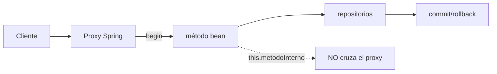
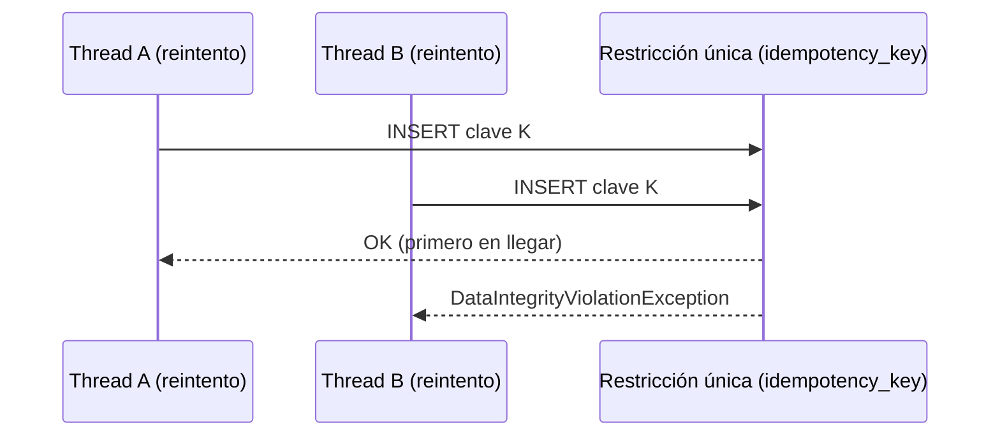
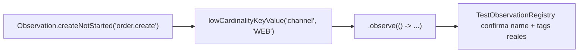

# Módulo 13: Consistencia, contratos y operación distribuida

Anotar un método con `@Transactional`, publicar en Kafka y exponer Actuator no demuestra que un microservicio preserve datos bajo fallos. Spring automatiza infraestructura mediante proxies y convenciones; para usarla con rigor debes conocer la frontera exacta de cada garantía. Este módulo convierte supuestos en pruebas de integración e incidentes controlados.


## Aprende construyendo

Cada tema demuestra su garantía (o su ausencia) con un test real que la ejercita bajo condiciones adversas: self-invocation real detectada con `TransactionSynchronizationManager`, una carrera real de dos threads contra una restricción única de base de datos, un contrato verificado con `MockMvc` contra el JSON real de la API, y `TestObservationRegistry` (la utilidad oficial de test de Micrometer Observation) confirmando tags de baja cardinalidad reales.

### Tema 1: `@Transactional` funciona en una frontera, no como encantamiento · Experto · 1 h 55 min

**Prerrequisito:** Módulo 3 de este track (JPA y transacciones básicas).

**Al terminar podrás:** demostrar, con un test real (no una afirmación teórica), que una llamada `this.metodoInterno()` no atraviesa el proxy de Spring y por lo tanto `@Transactional` no aplica en ese caso, y sabrás corregirlo separando el caso de uso en un bean con límite coherente.

#### Aprende

**¿Por qué es importante?** En una plataforma de entregas, un fallo de base, red o consumidor puede ocurrir después de una escritura; una anotación `@Transactional` presente en el código puede no existir en runtime por self-invocation, una excepción capturada, o un método fuera del proxy — el fallo aparece como datos parcialmente comprometidos, no como un error obvio en el momento de escribir el código.

**Mapa de subtemas críticos**

| Subtema | Papel | Evidencia |
|---|---|---|
| Proxy AOP como frontera transaccional | Prerrequisito | `transaccionActivaLlamandoAlProxy()` devuelve `true` en el test |
| Self-invocation vía `this.` | Núcleo | `laSelfInvocationNoAtraviesaElProxyYLaTransaccionNoSeActiva` espera `false` |
| `TransactionSynchronizationManager.isActualTransactionActive()` como diagnóstico | Diagnóstico | el booleano real que distingue ambos tests, no una afirmación teórica |
| Rollback ante excepción unchecked vs checked | Límite | la excepción checked sin `rollbackFor` deja el commit |
| `rollbackFor = Exception.class` | Variante | el mismo método revierte ante la excepción checked |
| `REQUIRES_NEW` y conexión distinta | Variante | el reto pide un test con dos transacciones anidadas instrumentadas |
| Excepción capturada dentro del boundary | Error frecuente | el fallo deliberado deja el primer `save` comprometido sin rollback |
| Transacción abierta durante llamada HTTP remota | Decisión | mantiene locks/conexión mientras la dependencia incierta responde |

Cada fila tiene su explicación individual a continuación.

**Proxy AOP como frontera transaccional (prerrequisito).** Spring envuelve el bean en un proxy y solo una llamada que entra por él activa `TransactionInterceptor`, que abre la transacción antes de ejecutar el método. El test `transaccionActivaLlamandoAlProxy()` lo demuestra devolviendo `true` cuando el método anotado se invoca a través del proxy. Sin entender esta frontera, cualquier razonamiento sobre dónde aplica `@Transactional` es incorrecto.

**Self-invocation vía `this.` (núcleo).** Una llamada `this.metodoInternoAnotado()` no vuelve a cruzar el proxy, por lo que su anotación `@Transactional` no se activa en ese punto. El test `laSelfInvocationNoAtraviesaElProxyYLaTransaccionNoSeActiva` confirma esto esperando `false`. Es el mecanismo central del tema: la anotación presente en el código no implica transacción en runtime.

**`TransactionSynchronizationManager.isActualTransactionActive()` como diagnóstico (diagnóstico).** Esta API real de Spring responde si hay una transacción activa en el thread actual sin inspeccionar logs ni adivinar por el comportamiento. Es el instrumento que convierte el tema en una demostración con un valor booleano real en vez de una afirmación. La pista del tema recomienda usarla también fuera de los tests, como herramienta de diagnóstico.

**Rollback ante excepción unchecked vs checked (límite).** Spring revierte por defecto ante excepciones unchecked, no necesariamente ante checked. El reto 2 reproduce con un test que una excepción checked sin `rollbackFor` deja el commit igualmente, un comportamiento contraintuitivo para quien viene de otros lenguajes. Este es el límite exacto de la garantía por defecto.

**`rollbackFor = Exception.class` (variante).** Añadir `rollbackFor = Exception.class` al mismo método hace que la excepción checked sí provoque rollback, como confirma el reto 3. Es la variante explícita que amplía el conjunto de excepciones que revierten, necesaria cuando la lógica de negocio señala fallos con excepciones comprobadas.

**`REQUIRES_NEW` y conexión distinta (variante).** `REQUIRES_NEW` suspende la transacción exterior y usa recursos distintos, de modo que un commit interior permanece aunque la operación exterior falle. El reto 1 pide un test con dos transacciones anidadas instrumentadas que confirme que la interior usa una conexión distinta a la exterior. Elegir esta propagación es una decisión sobre qué debe sobrevivir a un fallo externo.

**Excepción capturada dentro del boundary (error frecuente).** Capturar una excepción dentro del boundary transaccional y devolver éxito impide el rollback salvo que se marque el estado explícitamente. El fallo deliberado del tema muestra que, con dos guardados y una excepción entre ambos en un método sin transacción real activa, el primer `save` permanece comprometido en la base. Es la forma más silenciosa de perder atomicidad.

**Transacción abierta durante llamada HTTP remota (decisión).** No se debe mantener una transacción abierta mientras se espera una llamada HTTP remota: sostiene locks y la conexión mientras una dependencia incierta responde, y además no puede revertir el sistema externo. La decisión correcta es persistir la intención y coordinar de forma asíncrona, no envolver la llamada remota en el boundary.

**Conceptos clave:** proxy AOP, `TransactionInterceptor`, self-invocation, `REQUIRED`, `REQUIRES_NEW`, rollback rule.

En el modo habitual, Spring envuelve el bean en un proxy. Una llamada que entra por el proxy activa `TransactionInterceptor`, obtiene una transacción y ejecuta el método. Una llamada `this.metodoInterno()` no cruza el proxy; su anotación puede no aplicar. `REQUIRED` participa en la transacción existente o crea una; `REQUIRES_NEW` suspende la exterior y usa recursos distintos, y un commit interno permanece aunque la operación exterior falle. Spring revierte por defecto ante excepciones unchecked, no necesariamente checked; capturar una excepción dentro del boundary y devolver éxito impide el rollback salvo que marques el estado explícitamente. No mantengas una transacción abierta durante una llamada HTTP remota: sostiene locks/conexión mientras una dependencia incierta responde, y no puede revertir el sistema externo.

**Analogía:** el proxy es el torniquete que registra entrada y salida de una zona protegida. Caminar entre habitaciones dentro de la zona no vuelve a pasar por el torniquete, aunque la puerta interna tenga un cartel `@Transactional`.

**Diagrama:**



#### Practica

Parte de una carpeta vacía y crea `src/main/java/io/academia/consistencia/`:

```bash
mkdir demo-consistencia
cd demo-consistencia
curl -fsSL https://start.spring.io/starter.zip -d type=maven-project -d dependencies=web,data-jpa,h2,actuator -d javaVersion=25 -o app.zip
unzip app.zip
mkdir -p src/main/java/io/academia/consistencia
mkdir -p src/test/java/io/academia/consistencia
```

```java
// src/main/java/io/academia/consistencia/FronteraTransaccionalService.java
package io.academia.consistencia;

import org.springframework.stereotype.Service;
import org.springframework.transaction.annotation.Transactional;
import org.springframework.transaction.support.TransactionSynchronizationManager;

@Service
public class FronteraTransaccionalService {

    // llamado DIRECTAMENTE a través del proxy: la transacción SÍ está activa
    @Transactional
    public boolean transaccionActivaLlamandoAlProxy() {
        return TransactionSynchronizationManager.isActualTransactionActive();
    }

    // método público SIN @Transactional que invoca internamente un método anotado vía this.
    public boolean transaccionActivaViaSelfInvocation() {
        return metodoInternoAnotado(); // this.metodoInternoAnotado() -> NO atraviesa el proxy
    }

    @Transactional
    boolean metodoInternoAnotado() {
        return TransactionSynchronizationManager.isActualTransactionActive();
    }
}
```

Confirma con un test real, sin ningún mock de la infraestructura de transacciones, que la self-invocation efectivamente NO activa la transacción:

```java
// src/test/java/io/academia/consistencia/SelfInvocationTest.java
package io.academia.consistencia;

import org.junit.jupiter.api.Test;
import org.springframework.beans.factory.annotation.Autowired;
import org.springframework.boot.test.context.SpringBootTest;

import static org.assertj.core.api.Assertions.assertThat;

@SpringBootTest
class SelfInvocationTest {

    @Autowired
    private FronteraTransaccionalService servicio;

    @Test
    void llamarDirectamenteAlProxyActivaLaTransaccionReal() {
        assertThat(servicio.transaccionActivaLlamandoAlProxy()).isTrue();
    }

    @Test
    void laSelfInvocationNoAtraviesaElProxyYLaTransaccionNoSeActiva() {
        assertThat(servicio.transaccionActivaViaSelfInvocation()).isFalse();
    }
}
```

```bash
./mvnw test -Dtest=SelfInvocationTest
```

**Resultado esperado:** `BUILD SUCCESS` con ambos tests en verde: `TransactionSynchronizationManager.isActualTransactionActive()` (la API real de Spring para consultar si hay una transacción activa en el thread actual, no una suposición) confirma `true` cuando el método anotado se invoca a través del proxy, y `false` cuando se invoca internamente vía `this.` — el mismo mecanismo exacto documentado en la teoría, ahora demostrado con un valor booleano real, no solo descrito.

**Fallo deliberado:** cambia `transaccionActivaViaSelfInvocation()` para llamar `metodoInternoAnotado()` como si fuera seguro para una operación de negocio real (por ejemplo, envolviendo un `repository.save(...)` dentro del método interno, asumiendo que `@Transactional` protege ese guardado). Con dos guardados dentro de `metodoInternoAnotado()` y una excepción entre ambos, ningún rollback ocurre — el primer `save` permanece comprometido en la base — porque, como el test ya demostró, no hay ninguna transacción real activa que revertir. Restaura la versión original antes de continuar.

1. Agrega un tercer método `@Transactional(propagation = Propagation.REQUIRES_NEW)` y un test que confirme, con dos transacciones anidadas instrumentadas, que la interior usa una conexión distinta a la exterior.
2. Simula una excepción checked dentro de un método `@Transactional` sin `rollbackFor` explícito, y confirma con un test que el commit ocurre igualmente (el comportamiento por defecto de Spring, contraintuitivo para quien viene de otros lenguajes).
3. Agrega `@Transactional(rollbackFor = Exception.class)` a ese mismo método y confirma con un test que ahora sí revierte ante la misma excepción checked.
4. Escribe de memoria (sin mirar) un servicio con self-invocation y un test `TransactionSynchronizationManager` que confirme la ausencia de transacción real. Compara después contra el patrón de la demostración guiada.

**Pista:** `TransactionSynchronizationManager.isActualTransactionActive()` es la forma más directa y real de responder "¿hay una transacción de verdad en este punto del código?" sin inspeccionar logs ni adivinar por el comportamiento observado — úsala como herramienta de diagnóstico, no solo en tests.

#### Aplica

**Completa el código:** rellena el espacio con la clase real de Spring que confirma si hay una transacción activa en el thread actual:

```java
boolean activa = ____.isActualTransactionActive();
```

**Reto de memoria sin mirar:** cierra este documento y escribe, solo de memoria, un servicio con un método público que llama internamente a un método `@Transactional` vía `this.`, y un test que confirme que la transacción NO está activa en ese caso. Compara después contra el patrón de la demostración guiada.

**Checklist de salida.**

- [ ] Un test confirma con `TransactionSynchronizationManager.isActualTransactionActive()` que la self-invocation no abre transacción.
- [ ] El caso de uso corregido vive en otro bean y el test confirma la transacción activa.
- [ ] Una excepción checked sin `rollbackFor` deja el commit, reproducido con un test.
- [ ] Con `rollbackFor = Exception.class` la misma excepción revierte.
- [ ] Puedes explicar por qué el proxy no intercepta `this.metodoInterno()`.

**Si falla.** Si el test detecta transacción en la self-invocation, comprueba que el servicio se inyecta como proxy y no se instancia con `new`. Si la excepción checked no revierte, añade `rollbackFor`: Spring solo revierte por defecto ante excepciones no comprobadas.

Ya demuestras con un valor booleano real, no una afirmación teórica, que `@Transactional` depende de atravesar el proxy de Spring. El siguiente tema aborda qué hacer cuando un cliente repite una operación tras un timeout ambiguo. Fuentes oficiales: [Spring — Transaction Management](https://docs.spring.io/spring-framework/reference/data-access/transaction.html).

**Errores comunes:** anotar un método private o auto-invocado esperando que el proxy lo intercepte; capturar una excepción dentro del boundary transaccional y devolver éxito, impidiendo el rollback sin marcarlo explícitamente; mantener una transacción abierta durante una llamada HTTP remota.

**Cuándo no usarlo:** para una operación de lectura pura sin ningún efecto de escritura, envolverla en `@Transactional` de escritura no aporta ninguna garantía adicional y solo reserva una conexión innecesariamente.

Entender los límites de `@Transactional` es esencial antes de escalar el proyecto integrador de este track (microservicio productivo, Módulo 12) a múltiples servicios con transacciones distribuidas.

### Tema 2: Recuperación implica duplicación segura · Experto · 2 h 35 min

**Prerrequisito:** Tema 1 de este módulo; Módulo 3 de este track (JPA).

**Al terminar podrás:** demostrar, con dos threads reales compitiendo por la misma clave de idempotencia contra una restricción única de base de datos, que solo uno de los dos gana la carrera — la garantía real que evita procesar dos veces la misma operación tras un reintento.

#### Aprende

**¿Por qué es importante?** Un timeout después del commit deja el resultado ambiguo desde la perspectiva del cliente: el cliente repite la petición, y el servidor debe reconocer que es la misma intención, no una segunda operación distinta. Reintentar mejora la disponibilidad, pero sin una identidad de operación explícita, multiplica los efectos.

**Mapa de subtemas críticos**

| Subtema | Papel | Evidencia |
|---|---|---|
| Clave de idempotencia en la misma transacción | Prerrequisito | la clave se guarda con `saveAndFlush` dentro de `@Transactional`, en `registrarYProcesarPedido` |
| Restricción única como árbitro de la carrera | Núcleo | `@UniqueConstraint`/`@Column(unique = true)` sobre `clave` |
| Carrera real de dos threads | Diagnóstico | `pool.invokeAll(...)` y el XOR `threadA ^ threadB` dan `true` |
| `DataIntegrityViolationException` como señal de duplicado | Núcleo | el `catch` en `crearConClave`, FUERA de la transacción, que devuelve `false` |
| El `catch` no puede vivir dentro del método `@Transactional` | Error frecuente | un flush fallido marca la transacción rollback-only aunque se capture la excepción; `UnexpectedRollbackException` en el commit |
| `find` previo sin unicidad | Error frecuente | el fallo deliberado falla intermitentemente con 20 threads |
| Transactional outbox vs `kafkaTemplate.send(...)` | Variante | el texto distingue outbox de una escritura no atómica a Kafka |
| At-least-once y dedupe por `eventId` | Límite | el relay publica después y el consumidor deduplica |
| Resultado guardado para reintentos | Decisión | el reto 3 devuelve el resultado almacenado, no `false` |

Cada fila tiene su explicación individual a continuación.

**Clave de idempotencia en la misma transacción (prerrequisito).** La clave asociada a principal, operación y hash del request debe guardarse en la MISMA transacción del efecto de negocio, para que identidad y efecto sean atómicos. En el ejemplo, `registrarYProcesarPedido` es `@Transactional` y persiste el `RegistroIdempotencia` con `saveAndFlush`; ahí mismo iría el efecto de negocio real (guardar el pedido). Separar la clave del efecto rompería la garantía antes de empezar.

**Restricción única como árbitro de la carrera (núcleo).** La `@UniqueConstraint` sobre `clave` (y `@Column(unique = true)`) es lo que decide atómicamente qué intento concurrente gana. Es el mecanismo central del tema: la base de datos, no el código de aplicación, resuelve la carrera cuando dos reintentos llegan a la vez. Sin ella, no hay punto de decisión atómico.

**Carrera real de dos threads (diagnóstico).** El test usa un `ExecutorService` real y `pool.invokeAll(...)` para lanzar dos intentos genuinamente en paralelo con la misma clave. El operador XOR `threadA ^ threadB` confirma que exactamente uno obtuvo `true` y el otro `false`, nunca ambos ni ninguno. Es la evidencia observable de que la garantía se sostiene bajo concurrencia real.

**`DataIntegrityViolationException` como señal de duplicado (núcleo).** Cuando la restricción única rechaza el segundo insert, Spring Data lanza `DataIntegrityViolationException`. `crearConClave` llama a `registrarYProcesarPedido` y captura esa excepción como "este intento es un reintento duplicado", devolviendo `false`. El mecanismo convierte una violación de integridad en una decisión de negocio clara: esta llamada no debe procesar un pedido nuevo.

**El `catch` no puede vivir dentro del método `@Transactional` (error frecuente).** Esta es la trampa real, no teórica: si el `try/catch` de `DataIntegrityViolationException` está dentro del MISMO método anotado `@Transactional` que hace el `saveAndFlush`, Hibernate marca esa transacción como rollback-only en el momento del flush fallido —incluso si la excepción se captura y el método retorna `false` con total normalidad—. Cuando el proxy de Spring intenta confirmar (`commit`) esa transacción al final del método, descubre que está marcada para revertir y lanza `UnexpectedRollbackException`, un error distinto y más confuso que el `DataIntegrityViolationException` original. La solución (la que usa este tema) es separar las dos responsabilidades en dos métodos: `registrarYProcesarPedido` hace el trabajo atómico real dentro de su propia transacción y deja que la excepción se propague sin capturarla; `crearConClave`, SIN `@Transactional`, llama a ese método y captura la excepción desde fuera de cualquier transacción Spring, así que no hay ninguna transacción que termine marcada rollback-only por este `catch`.

**`find` previo sin unicidad (error frecuente).** Verificar con un `find` si la clave existe antes de insertar no basta, porque dos threads pueden pasar ese `find` antes de que cualquiera inserte. El fallo deliberado reemplaza la restricción única por un `find` previo y, con 20 threads, el test falla intermitentemente procesando el pedido dos veces. Es el error clásico que el tema insiste en descartar.

**Transactional outbox vs `kafkaTemplate.send(...)` (variante).** Guardar la entidad y llamar `kafkaTemplate.send(...)` en pasos separados no es una transacción atómica entre PostgreSQL y Kafka. El patrón transactional outbox guarda el evento junto al agregado en la misma transacción y un relay separado lo publica después. Es la variante correcta cuando el efecto incluye publicar un evento.

**At-least-once y dedupe por `eventId` (límite).** El outbox con relay garantiza entrega at-least-once, no exactly-once: el mensajero puede duplicar la entrega. El límite real es que el consumidor debe deduplicar por `eventId`, como ilustra la analogía del número de expediente. Ignorar esto traslada la duplicación al consumidor.

**Resultado guardado para reintentos (decisión).** El reto 3 añade un campo `resultado` a `RegistroIdempotencia` para almacenar el resultado de la primera ejecución exitosa, de modo que un reintento posterior devuelva ese valor en vez de simplemente `false`. Es una decisión de diseño que distingue "ya procesado, aquí está tu resultado" de un rechazo opaco, mejorando la experiencia del cliente que reintenta.

**Conceptos clave:** idempotency key, restricción única, transactional outbox, at-least-once.

Guarda la clave de idempotencia asociada a principal, operación y hash del request en la MISMA transacción del efecto de negocio. Una restricción única de base de datos decide la carrera entre dos intentos concurrentes; un `find` previo (verificar si la clave ya existe antes de insertar) no basta, porque dos threads pueden pasar ese `find` simultáneamente antes de que cualquiera de los dos inserte. Guardar la entidad y llamar `kafkaTemplate.send(...)` en pasos separados NO es una transacción atómica entre PostgreSQL y Kafka; el patrón transactional outbox guarda el evento junto al agregado en la misma transacción, y un relay separado lo publica después, garantizando at-least-once (el consumidor debe deduplicar por `eventId`).

**Analogía:** el outbox es el libro de correspondencia escrito en la misma operación que el pedido. El mensajero puede copiar una entrega, pero el destinatario reconoce el número de expediente y descarta la copia.

**Diagrama:**



#### Practica

Continuando en `demo-consistencia` (o, si prefieres un ejemplo independiente, parte de una carpeta vacía con `mkdir demo-idempotencia && cd demo-idempotencia && curl -fsSL https://start.spring.io/starter.zip -d type=maven-project -d dependencies=web,data-jpa,h2 -d javaVersion=25 -o app.zip && unzip app.zip`), crea `src/main/java/io/academia/consistencia/idempotencia/`:

```bash
mkdir -p src/main/java/io/academia/consistencia/idempotencia
```

```java
// src/main/java/io/academia/consistencia/idempotencia/RegistroIdempotencia.java
package io.academia.consistencia.idempotencia;

import jakarta.persistence.Entity;
import jakarta.persistence.GeneratedValue;
import jakarta.persistence.Id;
import jakarta.persistence.Table;
import jakarta.persistence.UniqueConstraint;
import jakarta.persistence.Column;

@Entity
@Table(name = "registro_idempotencia", uniqueConstraints = @UniqueConstraint(columnNames = "clave"))
public class RegistroIdempotencia {
    @Id
    @GeneratedValue
    private Long id;

    @Column(unique = true, nullable = false)
    private String clave;

    protected RegistroIdempotencia() {}

    public RegistroIdempotencia(String clave) {
        this.clave = clave;
    }
}
```

```java
// src/main/java/io/academia/consistencia/idempotencia/RegistroIdempotenciaRepository.java
package io.academia.consistencia.idempotencia;

import org.springframework.data.jpa.repository.JpaRepository;

public interface RegistroIdempotenciaRepository extends JpaRepository<RegistroIdempotencia, Long> {}
```

```java
// src/main/java/io/academia/consistencia/idempotencia/PedidoService.java
package io.academia.consistencia.idempotencia;

import org.springframework.dao.DataIntegrityViolationException;
import org.springframework.stereotype.Service;
import org.springframework.transaction.annotation.Transactional;

@Service
public class PedidoService {
    private final RegistroIdempotenciaRepository registros;

    public PedidoService(RegistroIdempotenciaRepository registros) {
        this.registros = registros;
    }

    // SIN @Transactional aquí: este método catch-ea la excepción desde FUERA de
    // cualquier transacción Spring, así que no hay ninguna transacción que pueda
    // quedar marcada rollback-only por el fallo.
    public boolean crearConClave(String claveIdempotencia) {
        try {
            registrarYProcesarPedido(claveIdempotencia);
            return true; // esta llamada ganó la carrera y procesó el pedido real
        } catch (DataIntegrityViolationException e) {
            return false; // la clave ya existía: esta llamada es un reintento duplicado, no un pedido nuevo
        }
    }

    // @Transactional SÍ va aquí: la clave y el efecto de negocio real (guardar el
    // pedido) se confirman o revierten juntos, de forma atómica, en esta transacción.
    @Transactional
    public void registrarYProcesarPedido(String claveIdempotencia) {
        registros.saveAndFlush(new RegistroIdempotencia(claveIdempotencia));
        // aquí iría el efecto de negocio real, p.ej. pedidos.save(new Pedido(claveIdempotencia));
    }
}
```

Confirma con dos threads reales, compitiendo genuinamente por la misma clave, que solo uno gana:

```java
// src/test/java/io/academia/consistencia/idempotencia/RaceIdempotenciaTest.java
package io.academia.consistencia.idempotencia;

import org.junit.jupiter.api.Test;
import org.springframework.beans.factory.annotation.Autowired;
import org.springframework.boot.test.context.SpringBootTest;

import java.util.List;
import java.util.concurrent.Callable;
import java.util.concurrent.ExecutorService;
import java.util.concurrent.Executors;
import java.util.concurrent.Future;

import static org.assertj.core.api.Assertions.assertThat;

@SpringBootTest
class RaceIdempotenciaTest {

    @Autowired
    private PedidoService pedidoService;

    @Test
    void deDosThreadsConLaMismaClaveSoloUnoGanaLaCarreraReal() throws Exception {
        String claveCompartida = "idem-key-001";
        ExecutorService pool = Executors.newFixedThreadPool(2);

        Callable<Boolean> intento = () -> pedidoService.crearConClave(claveCompartida);
        List<Future<Boolean>> resultados = pool.invokeAll(List.of(intento, intento));

        boolean threadA = resultados.get(0).get();
        boolean threadB = resultados.get(1).get();

        assertThat(threadA ^ threadB).isTrue(); // exactamente UNO de los dos ganó, nunca ambos ni ninguno
        pool.shutdown();
    }
}
```

```bash
./mvnw test -Dtest=RaceIdempotenciaTest
```

**Resultado esperado:** `BUILD SUCCESS` con el test en verde: con dos threads reales ejecutándose genuinamente en paralelo (`ExecutorService` con un pool real, no una simulación secuencial), la restricción única de la base de datos decide la carrera real; el operador XOR (`^`) confirma que exactamente uno de los dos threads recibió `true` (procesó el pedido) y el otro `false` (`DataIntegrityViolationException` real capturada, reconocido como duplicado), nunca ambos ni ninguno.

**Fallo deliberado:** reemplaza `registros.saveAndFlush(...)` dentro de un `try/catch` por un `find` previo (`if (registros.findByClaveIsPresent(claveCompartida)) return false; else registros.save(...)`) sin restricción única real respaldándolo, y ejecuta de nuevo el test con más iteraciones (por ejemplo 20 threads en vez de 2). El test FALLA intermitentemente: ambos threads pueden pasar el `find` antes de que cualquiera de los dos inserte, procesando el "pedido" dos veces — diagnostica confirmando por qué la teoría insiste en que un `find` previo no basta: sin la restricción única forzando la decisión atómicamente en la base de datos, la ventana de carrera entre el `find` y el `save` permite que ambos threads "ganen". Restaura la versión con restricción única antes de continuar.

1. Aumenta la competencia a 20 threads con la misma clave y confirma que la suma de resultados `true` es exactamente 1, sin importar cuántos threads compitan.
2. Ejecuta 20 threads con 20 claves DISTINTAS y confirma que los 20 resultan en `true` (ninguna carrera real cuando las claves no coinciden).
3. Agrega un campo `resultado` a `RegistroIdempotencia` para almacenar el resultado de la primera ejecución exitosa, y confirma con un test que un reintento posterior (tras que la clave ya exista) devuelve ese resultado guardado en vez de simplemente `false`.
4. Escribe de memoria (sin mirar) un `PedidoService` con una restricción única de idempotencia, y un test con `ExecutorService` de dos threads que confirme la carrera real. Compara después contra el patrón de la demostración guiada.

**Pista:** `pool.invokeAll(...)` bloquea hasta que AMBAS tareas terminan, y cada `Future.get()` propaga cualquier excepción real que ocurrió dentro del thread — una forma directa de coordinar y verificar el resultado de una carrera real entre threads sin necesitar sincronización manual adicional en el test.

#### Aplica

**Completa el código:** rellena el espacio con la excepción real que Spring Data lanza cuando una restricción única de base de datos rechaza un insert duplicado:

```java
try {
    registros.saveAndFlush(new RegistroIdempotencia(clave));
    return true;
} catch (____ e) {
    return false;
}
```

**Nota:** en código real, este `try/catch` va en un método SIN `@Transactional` que llama a otro `@Transactional` donde ocurre el `saveAndFlush` (ver "El `catch` no puede vivir dentro del método `@Transactional`" más arriba).

**Reto de memoria sin mirar:** cierra este documento y escribe, solo de memoria, un servicio con idempotencia respaldada por restricción única, y un test con dos threads reales que confirme que exactamente uno gana la carrera. Compara después contra el patrón de la demostración guiada.

**Checklist de salida.**

- [ ] Dos threads con la misma clave producen exactamente un resultado exitoso.
- [ ] Veinte threads con veinte claves distintas producen veinte éxitos.
- [ ] La garantía la impone una restricción única de base de datos, no un `find` previo.
- [ ] Un reintento con la clave ya registrada devuelve el resultado guardado.
- [ ] El duplicado se captura como la excepción real que lanza Spring Data.
- [ ] El `catch` vive en un método SIN `@Transactional` que llama a otro método `@Transactional` donde ocurre el `saveAndFlush`.

**Si falla.** Si ambos threads ganan, falta la restricción única o la transacción no se confirma antes del segundo insert. Si el reintento devuelve `false` sin el resultado, guarda el resultado en el registro de idempotencia dentro de la misma transacción que la clave. Si aparece `UnexpectedRollbackException` en vez de `false`, el `catch` quedó dentro del método `@Transactional`: sepáralo en dos métodos.

Ya demuestras con una carrera real entre threads que una restricción única de base de datos, no un `find` previo, es lo que garantiza idempotencia bajo concurrencia genuina. El siguiente tema protege el contrato HTTP que consumidores externos dependen de que no cambie sin previo aviso. Fuentes oficiales: [Spring Data — Optimistic and Pessimistic Locking](https://docs.spring.io/spring-data/jpa/reference/jpa/locking.html).

**Errores comunes:** usar un `find` antes de insertar como única defensa contra duplicados, sin una restricción única real respaldándolo; confiar en que las transacciones de Kafka vuelven atómica una escritura arbitraria en PostgreSQL.

**Cuándo no usarlo:** para una operación de lectura pura sin ningún efecto de escritura, o para una operación donde procesarla dos veces es genuinamente inocuo (por ejemplo, releer el mismo valor), la infraestructura de idempotencia no aporta ninguna garantía adicional necesaria.

La duplicación segura (idempotencia) de este tema es la que protegerá al proyecto integrador de este track (microservicio productivo, Módulo 12) de reintentos duplicados.

### Tema 3: Contratos ejecutables protegen despliegues independientes · Experto · 1 h 45 min

**Prerrequisito:** Módulo 2 de este track (controllers y DTOs).

**Al terminar podrás:** verificar, con `MockMvc` contra el JSON real producido por un endpoint, que la API cumple el contrato exacto que un consumidor externo espera, y demostrar en código qué tipo de cambio (status, campo, enum) rompe ese contrato de forma silenciosa.

#### Aprende

**¿Por qué es importante?** Tests internos verdes no ejecutan código de consumidores desplegados por otros equipos, ni de dispositivos móviles que no se actualizan al mismo tiempo que el backend. Un cambio que parece inocuo desde dentro del servicio (renombrar un campo, agregar un valor a un enum) puede romper silenciosamente a un consumidor que no puede desplegarse en sincronía.

**Mapa de subtemas críticos**

| Subtema | Papel | Evidencia |
|---|---|---|
| Contrato ejecutable con `MockMvc` contra el JSON real | Prerrequisito | `@WebMvcTest(PedidoController.class)` perfora el controller real |
| Status HTTP exacto como parte del contrato | Núcleo | `status().isCreated()` exige 201, no 200 |
| `jsonPath` sobre el valor textual del JSON | Núcleo | `jsonPath("$.status").value("ACCEPTED")` verifica el texto que viaja |
| Renombrar un valor de enum | Error frecuente | el fallo deliberado `ACCEPTED`→`CONFIRMED` lanza `AssertionError` |
| Cambio aditivo compatible | Variante | `estimatedDelivery` opcional no rompe el contrato existente |
| Nuevo valor de enum y `switch` exhaustivo | Límite | agregar `PENDING` rompe a un consumidor con `switch` exhaustivo |
| Problem Details (RFC 7807) para errores | Variante | `application/problem+json` con `type`, `title`, `status`, `detail` |
| Contrato formal solo cuando aporta | Decisión | endpoint interno desplegado en conjunto puede no justificarlo |

Cada fila tiene su explicación individual a continuación.

**Contrato ejecutable con `MockMvc` contra el JSON real (prerrequisito).** El test se anota con `@WebMvcTest(PedidoController.class)` y ejecuta una petición real contra el controller, verificando el JSON que produce y no una descripción de OpenAPI sin comprobar. Es el prerrequisito del tema: un contrato que no se ejecuta contra el tráfico real no garantiza nada, solo documenta una intención.

**Status HTTP exacto como parte del contrato (núcleo).** `status().isCreated()` exige específicamente 201, porque el consumidor depende exactamente de ese código y no de un 200. El status forma parte del contrato tanto como el cuerpo; un cambio silencioso de 201 a 200 rompería a quien ramifica su lógica por el código de respuesta.

**`jsonPath` sobre el valor textual del JSON (núcleo).** `jsonPath("$.status").value("ACCEPTED")` verifica el valor textual exacto que viaja por la red, no el nombre de la constante Java del enum. Como advierte la pista, si `@JsonProperty` o una serialización personalizada transforma ese valor, el contrato debe mirar el texto real; este es el mecanismo que distingue el objeto interno del JSON publicado.

**Renombrar un valor de enum (error frecuente).** El fallo deliberado renombra `ACCEPTED` a `CONFIRMED`, un cambio que "suena" equivalente desde dentro del servicio, y el test lanza un `AssertionError` real porque `$.status` esperaba `"ACCEPTED"`. Diagnostica que un consumidor externo con un `switch` exhaustivo sobre `"ACCEPTED"` se rompería en producción, algo que ningún test interno detectaría sin este contrato.

**Cambio aditivo compatible (variante).** El reto 1 agrega un campo opcional `estimatedDelivery` al `PedidoResponse` y confirma que el contrato existente sobre `id` y `status` sigue pasando sin modificación. Es la variante segura: un cambio aditivo real y verificado, no solo asumido seguro, que permite evolucionar la API sin romper consumidores.

**Nuevo valor de enum y `switch` exhaustivo (límite).** Agregar un tercer valor como `PENDING` al enum `Estado` es el límite de la compatibilidad: un consumidor con un `switch` exhaustivo en Java, TypeScript o Kotlin que no se haya actualizado primero no sabría manejar el valor nuevo. El reto 2 pide documentar exactamente qué consumidor se rompería, marcando la frontera entre aditivo seguro e incompatible.

**Problem Details (RFC 7807) para errores (variante).** Los errores se expresan con `application/problem+json` (RFC 7807), con `type`, `title`, `status`, `detail` e `instance`/correlation ID, sin exponer el stack trace interno. El reto 3 pide un test de contrato para el caso `400 Bad Request` con Problem Details, tratando la forma del error como parte verificable del contrato, no solo el caso feliz.

**Contrato formal solo cuando aporta (decisión).** Para un endpoint interno consumido únicamente por el mismo equipo que lo mantiene y desplegado siempre en conjunto, la sobrecarga de un contrato formal versionado puede no justificarse frente a coordinar el cambio directamente. La decisión del tema es dimensionar el rigor del contrato al riesgo real de despliegues independientes.

**Conceptos clave:** contract test, backward compatibility, additive change, Problem Details.

OpenAPI documenta request, response, seguridad y errores, usando DTOs públicos (no entidades JPA directamente expuestas). `application/problem+json` (RFC 7807, ya usado en el Módulo 5) da errores consistentes con `type`, `title`, `status`, `detail` e `instance`/correlation ID, sin exponer el stack trace interno. Los cambios aditivos (campo opcional nuevo, endpoint nuevo) suelen ser más seguros, pero agregar un valor a un enum es un cambio frecuentemente incompatible para consumidores con un `switch` exhaustivo sobre ese enum, que no sabría manejar el valor nuevo.

**Analogía:** el contrato no es una foto del proveedor, sino el calibre que ambos equipos pasan antes de ensamblar. Si mide detalles innecesarios, impide cualquier mejora; si no mide nada, deja piezas incompatibles.

**Diagrama:**

```
┌── Cambio aditivo ────────────┐   ┌── Cambio potencialmente roto ─────┐
│ campo opcional nuevo          │   │ nuevo valor de enum                │
│ endpoint nuevo                │   │ renombrar/reordenar un campo        │
│ generalmente SEGURO           │   │ cambiar unidad/zona horaria/semántica│
└──────────────────────┘   └───────────────────────────┘
```

#### Practica

Continuando en `demo-consistencia` (o, si prefieres un ejemplo independiente, parte de una carpeta vacía con `mkdir demo-contratos && cd demo-contratos && curl -fsSL https://start.spring.io/starter.zip -d type=maven-project -d dependencies=web -d javaVersion=25 -o app.zip && unzip app.zip`), crea `src/main/java/io/academia/consistencia/api/PedidoController.java`:

```bash
mkdir -p src/main/java/io/academia/consistencia/api
```

```java
// src/main/java/io/academia/consistencia/api/PedidoController.java
package io.academia.consistencia.api;

import org.springframework.http.ResponseEntity;
import org.springframework.web.bind.annotation.*;

@RestController
@RequestMapping("/api/orders")
public class PedidoController {

    public enum Estado { ACCEPTED, REJECTED }

    public record PedidoResponse(String id, Estado status) {}

    @PostMapping
    public ResponseEntity<PedidoResponse> crear(@RequestBody(required = false) String body) {
        return ResponseEntity.status(201).body(new PedidoResponse("PED-001", Estado.ACCEPTED));
    }
}
```

Formaliza el contrato que un consumidor externo espera como un test `MockMvc` real contra el JSON producido. **Nota (Spring Boot 4):** `WebMvcTest` requiere agregar explícitamente `spring-boot-webmvc-test` (scope `test`) al `pom.xml` — en Boot 3.x venía incluido en `spring-boot-starter-test`:

```xml
<!-- dentro de <dependencies> del pom.xml -->
<dependency>
    <groupId>org.springframework.boot</groupId>
    <artifactId>spring-boot-webmvc-test</artifactId>
    <scope>test</scope>
</dependency>
```

```java
// src/test/java/io/academia/consistencia/api/ContratoPedidoTest.java
package io.academia.consistencia.api;

import org.junit.jupiter.api.Test;
import org.springframework.beans.factory.annotation.Autowired;
import org.springframework.boot.webmvc.test.autoconfigure.WebMvcTest;
import org.springframework.test.web.servlet.MockMvc;

import static org.springframework.test.web.servlet.request.MockMvcRequestBuilders.post;
import static org.springframework.test.web.servlet.result.MockMvcResultMatchers.*;

@WebMvcTest(PedidoController.class)
class ContratoPedidoTest {

    @Autowired
    private MockMvc mockMvc;

    @Test
    void elContratoExigeStatus201ConIdYStatusAccepted() throws Exception {
        mockMvc.perform(post("/api/orders").contentType("application/json").content("{}"))
            .andExpect(status().isCreated()) // el consumidor depende EXACTAMENTE de 201, no de 200
            .andExpect(jsonPath("$.id").isNotEmpty())
            .andExpect(jsonPath("$.status").value("ACCEPTED")); // el consumidor tiene un switch exhaustivo sobre este valor
    }
}
```

```bash
./mvnw test -Dtest=ContratoPedidoTest
```

**Resultado esperado:** `BUILD SUCCESS` con el test en verde: contra el JSON REAL producido por el controller (no una descripción de OpenAPI sin verificar), el contrato exige específicamente `201`, un campo `id` no vacío y `status` con el valor exacto `"ACCEPTED"` — un cambio de status a `200`, un campo renombrado, o un valor de enum distinto haría fallar este test antes de llegar a producción.

**Fallo deliberado:** cambia el enum `Estado` para renombrar `ACCEPTED` a `CONFIRMED` (un cambio que "suena" equivalente desde dentro del servicio) y ejecuta de nuevo el test. FALLA con `AssertionError` real: `$.status` esperaba `"ACCEPTED"` pero recibió `"CONFIRMED"` — diagnostica confirmando que un consumidor externo con un `switch` exhaustivo sobre el valor textual `"ACCEPTED"` se rompería silenciosamente en producción con este cambio, algo que ningún test interno del servicio (que solo verifica su propia lógica) detectaría sin este contrato explícito. Restaura `ACCEPTED` antes de continuar.

1. Agrega un campo opcional nuevo (`estimatedDelivery`) al `PedidoResponse` y confirma con un test que el contrato existente (`id`, `status`) sigue pasando sin modificación — un cambio aditivo real y verificado, no solo asumido seguro.
2. Agrega un tercer valor al enum `Estado` (`PENDING`) y documenta, en un comentario del test, qué tipo de consumidor específico (uno con `switch` exhaustivo en Java, TypeScript o Kotlin) se rompería al recibir ese valor nuevo sin haберse actualizado primero.
3. Escribe un test de contrato para el caso de error (`400 Bad Request` con `Problem Details`) cuando el body de la petición es inválido.
4. Escribe de memoria (sin mirar) un test `MockMvc` que verifique el `status` HTTP exacto y el valor exacto de un campo enum en la respuesta JSON. Compara después contra el patrón de la demostración guiada.

**Pista:** `jsonPath("$.status").value("ACCEPTED")` verifica el VALOR TEXTUAL exacto del JSON producido, no el nombre de la constante Java del enum — si `@JsonProperty` o una estrategia de serialización personalizada transforma ese valor, el contrato debe verificar el texto que realmente viaja por la red, no el nombre interno de la constante.

#### Aplica

**Completa el código:** rellena el espacio con el matcher de MockMvc que verifica el valor exacto de un campo JSON en la respuesta:

```java
mockMvc.perform(post("/api/orders")...)
    .andExpect(____("$.status").value("ACCEPTED"));
```

**Reto de memoria sin mirar:** cierra este documento y escribe, solo de memoria, un `PedidoController` con un enum de estado, y un test `MockMvc` que verifique el contrato exacto de status HTTP y valor de enum. Compara después contra el patrón de la demostración guiada.

**Checklist de salida.**

- [ ] `MockMvc` verifica el status HTTP exacto y el valor textual del enum en el JSON.
- [ ] Un campo opcional nuevo no rompe el contrato existente, comprobado con el mismo test.
- [ ] Un valor nuevo de enum queda documentado con el consumidor que se rompería.
- [ ] El caso `400` con Problem Details tiene su propio test.
- [ ] Puedes decir qué cambios son aditivos y cuáles rompen a un consumidor desplegado.

**Si falla.** Si `jsonPath` no encuentra el campo, revisa la ruta `$...` y la serialización (`@JsonProperty`). Si el contrato pasa pero el cliente real falla, el test está mirando el objeto Java y no el JSON que viaja por la red.

Ya verificas contratos HTTP contra el JSON real producido por la API, demostrando en código qué cambios rompen silenciosamente a consumidores externos. El siguiente y último tema conecta trazas, métricas y logs para responder preguntas operativas reales durante un incidente. Fuentes oficiales: [Spring Cloud Contract](https://docs.spring.io/spring-cloud-contract/reference/) y [RFC 7807 — Problem Details](https://www.rfc-editor.org/rfc/rfc7807).

**Errores comunes:** copiar la respuesta completa como contrato en vez de conservar solo las expectativas mínimas significativas, volviendo imposible evolucionar la API; generar una página Swagger sin verificarla contra tráfico real, asumiendo que documentar es lo mismo que garantizar.

**Cuándo no usarlo:** para un endpoint interno consumido únicamente por el mismo equipo que lo mantiene, desplegado siempre en conjunto, la sobrecarga de un contrato formal versionado puede no justificarse frente a coordinar el cambio directamente entre las mismas personas.

Los contratos ejecutables de este tema son los que permitirán desplegar el proyecto integrador de este track (microservicio productivo, Módulo 12) de forma independiente de sus consumidores.

### Tema 4: Observabilidad sirve a un objetivo y a una decisión · Experto · 1 h 45 min

**Prerrequisito:** Módulo 7 de este track (Actuator y Micrometer).

**Al terminar podrás:** confirmar, con `TestObservationRegistry` (la utilidad oficial de test de Micrometer Observation), que una operación de negocio registra una observación real con tags de baja cardinalidad, y explicar por qué un tag de alta cardinalidad como un `orderId` no debe usarse como label métrico.

#### Aprende

**¿Por qué es importante?** Logs aislados no reconstruyen una operación que atraviesa HTTP, base de datos y Kafka; y retries sin un presupuesto de tiempo definido convierten una lentitud puntual en una saturación total del sistema. La observabilidad debe responder preguntas operativas concretas, no simplemente "llenar la cabina de luces".

**Mapa de subtemas críticos**

| Subtema | Papel | Evidencia |
|---|---|---|
| `Observation` sobre operación de negocio | Prerrequisito | `Observation.createNotStarted("order.create", registry)` |
| Tag de baja cardinalidad | Núcleo | `lowCardinalityKeyValue("channel", canal)` con pocos valores |
| `TestObservationRegistry` como verificación | Diagnóstico | `hasObservationWithNameEqualTo("order.create")` en verde |
| `orderId` como label métrico | Error frecuente | el fallo deliberado crea una serie temporal por `orderId` |
| Instrumentación automática vs de negocio | Límite | HTTP y repositorios ya están instrumentados; no duplicar |
| Tag `result` para éxito/fallo | Variante | el reto 1 registra `success`/`failure` en ambos casos |
| SLI/SLO y error budget | Decisión | "proporción de pedidos aceptados en menos de 500ms" |
| `correlationId` de negocio vs trace/span ID | Variante | el reto 2 distingue correlation ID de un span de OpenTelemetry |

Cada fila tiene su explicación individual a continuación.

**`Observation` sobre operación de negocio (prerrequisito).** El servicio instrumenta la operación con `Observation.createNotStarted("order.create", registry)` y la ejecuta con `.observe(...)`. Es el prerrequisito del tema: una observación nombrada que modela una operación de negocio concreta, colocada donde responde una pregunta específica y no de forma indiscriminada.

**Tag de baja cardinalidad (núcleo).** `lowCardinalityKeyValue("channel", canal)` añade un tag cuyo dominio tiene pocos valores posibles (WEB, MOBILE, API). Es el mecanismo central: los tags de baja cardinalidad —resultado o tipo de operación— son los adecuados para labels métricos porque cada valor distinto multiplica las series temporales almacenadas.

**`TestObservationRegistry` como verificación (diagnóstico).** El test usa la utilidad oficial `TestObservationRegistry` y `TestObservationRegistryAssert` para confirmar que la operación `order.create` se registró con `channel=WEB`. Es el instrumento de diagnóstico que convierte la teoría en una aserción real sobre el par nombre-valor que un dashboard de producción consultaría, sin inspeccionar manualmente el registro.

**`orderId` como label métrico (error frecuente).** El fallo deliberado reemplaza `channel` por un `orderId` único como tag; el test de `TestObservationRegistry` seguiría pasando, pero en un sistema real como Prometheus cada `orderId` crearía una serie temporal nueva y, con miles de pedidos por día, degradaría o rechazaría la cardinalidad. Es el error que el tema marca como límite técnico real, no estilístico.

**Instrumentación automática vs de negocio (límite).** Spring Boot ya instrumenta automáticamente HTTP y repositorios con Micrometer Observation, así que la observación de negocio debe agregarse solo donde responde una pregunta que la automática no cubre, evitando duplicarla. El límite es no instrumentar por instrumentar: cada observación debe justificar su existencia con una pregunta operativa.

**Tag `result` para éxito/fallo (variante).** El reto 1 añade un segundo tag de baja cardinalidad `result` con valores `success`/`failure` y confirma con un test que tanto el caso de éxito como una excepción simulada registran el valor correcto. Es la variante que permite distinguir desenlaces sin inflar la cardinalidad, base para medir tasa de error.

**SLI/SLO y error budget (decisión).** Un SLI se define desde la perspectiva del usuario (proporción de pedidos aceptados en menos de 500ms), el SLO lo evalúa sobre una ventana de tiempo y el error budget guía cuánto riesgo tomar. La decisión operativa es elegir qué medir y con qué objetivo; el reto 3 pide definir un SLI propio y el tag `result` que permitiría calcularlo a partir de las observaciones.

**`correlationId` de negocio vs trace/span ID (variante).** El reto 2 pide documentar la diferencia entre un `correlationId` de negocio, que puede acompañar una traza, y un trace/span ID real generado por OpenTelemetry: el primero no reemplaza al segundo. Es la variante que evita confundir un identificador de dominio con la correlación técnica que une trazas a través de servicios.

**Conceptos clave:** Observation, baja cardinalidad, SLI/SLO, error budget.

Spring Boot usa Micrometer Observation para métricas y trazas; la instrumentación automática cubre HTTP y repositorios, así que agrega observación de negocio donde responde una pregunta específica, evitando duplicar la automática. Los tags de baja cardinalidad incluyen resultado o tipo de operación; `userId`, `orderId` y URLs crudas pertenecen a logs/trazas protegidos, NUNCA a labels métricos (cada valor distinto de un tag multiplica la cantidad de series temporales almacenadas). Define un SLI desde la perspectiva del usuario (proporción de pedidos aceptados en menos de 500ms); el SLO usa una ventana de tiempo, y el error budget guía cuánto riesgo tomar.

**Analogía:** observabilidad es un sistema de instrumentos con objetivos específicos, no llenar la cabina de luces. Una alarma útil indica impacto real y conduce a un procedimiento concreto, no solo parpadea.

**Diagrama:**



#### Practica

Continuando en `demo-consistencia` (o, si prefieres un ejemplo independiente, parte de una carpeta vacía y genera un proyecto nuevo con `mkdir demo-observabilidad && cd demo-observabilidad && curl -fsSL https://start.spring.io/starter.zip -d type=maven-project -d dependencies=web,actuator -d javaVersion=25 -o app.zip && unzip app.zip`), agrega `io.micrometer:micrometer-observation-test` al `pom.xml` (la dependencia oficial de test de Micrometer) y crea `src/main/java/io/academia/consistencia/observabilidad/`:

```bash
mkdir -p src/main/java/io/academia/consistencia/observabilidad
```

```java
// src/main/java/io/academia/consistencia/observabilidad/PedidoObservadoService.java
package io.academia.consistencia.observabilidad;

import io.micrometer.observation.Observation;
import io.micrometer.observation.ObservationRegistry;
import org.springframework.stereotype.Service;

@Service
public class PedidoObservadoService {
    private final ObservationRegistry registry;

    public PedidoObservadoService(ObservationRegistry registry) {
        this.registry = registry;
    }

    public String crear(String canal) {
        return Observation.createNotStarted("order.create", registry)
            .lowCardinalityKeyValue("channel", canal) // baja cardinalidad: pocos valores posibles (WEB, MOBILE, API)
            .observe(() -> "PED-" + System.nanoTime()); // NUNCA agregues aquí el orderId como tag
    }
}
```

Confirma con `TestObservationRegistry` (real, oficial, no una simulación) que la observación se registra con el nombre y el tag exactos:

```java
// src/test/java/io/academia/consistencia/observabilidad/ObservabilidadTest.java
package io.academia.consistencia.observabilidad;

import io.micrometer.observation.tck.TestObservationRegistry;
import io.micrometer.observation.tck.TestObservationRegistryAssert;
import org.junit.jupiter.api.BeforeEach;
import org.junit.jupiter.api.Test;

class ObservabilidadTest {

    private TestObservationRegistry registry;
    private PedidoObservadoService servicio;

    @BeforeEach
    void iniciar() {
        registry = TestObservationRegistry.create();
        servicio = new PedidoObservadoService(registry);
    }

    @Test
    void crearUnPedidoRegistraUnaObservacionRealConTagDeBajaCardinalidad() {
        servicio.crear("WEB");

        TestObservationRegistryAssert.assertThat(registry)
            .hasObservationWithNameEqualTo("order.create")
            .that()
            .hasLowCardinalityKeyValue("channel", "WEB");
    }
}
```

```bash
./mvnw test -Dtest=ObservabilidadTest
```

**Resultado esperado:** `BUILD SUCCESS` con el test en verde: `TestObservationRegistry` (la utilidad oficial de Micrometer para testear observaciones, registrada como dependencia real, no simulada) confirma que la operación `order.create` efectivamente se registró con el tag `channel=WEB`, exactamente el par nombre-valor real que un dashboard de producción consultaría.

**Fallo deliberado:** cambia `lowCardinalityKeyValue("channel", canal)` por `lowCardinalityKeyValue("orderId", "PED-" + System.nanoTime())` (agregando un identificador único como tag) y documenta el resultado: el test de contrato de cardinalidad seguiría "pasando" técnicamente (el valor se registra), pero en un sistema de métricas real (Prometheus, por ejemplo) cada `orderId` distinto crearía una serie temporal nueva, y con miles de pedidos por día el sistema de métricas se degradaría o directamente rechazaría la cardinalidad — diagnostica confirmando por qué la disciplina de baja cardinalidad no es estilística: es un límite técnico real del sistema de métricas subyacente, aunque el propio test de `TestObservationRegistry` no lo capture directamente (esa protección adicional requiere un límite de cardinalidad configurado en el `MeterRegistry` de producción). Restaura `channel` antes de continuar.

1. Agrega un segundo tag de baja cardinalidad (`result`, con valores `success`/`failure`) a `PedidoObservadoService.crear(...)`, y confirma con un test que ambos casos (éxito y una excepción simulada) registran el tag correcto.
2. Documenta, en un comentario, la diferencia entre un `correlationId` de negocio (que puede acompañar una traza) y un trace/span ID real generado por OpenTelemetry — el primero no reemplaza al segundo.
3. Escribe una definición de SLI en una frase para tu propio dominio (por ejemplo, "proporción de confirmaciones de entrega procesadas en menos de 500ms") y documenta qué tag de baja cardinalidad (`result`) permitiría calcular ese SLI a partir de las observaciones instrumentadas.
4. Escribe de memoria (sin mirar) un servicio instrumentado con `Observation` y un test `TestObservationRegistry` que confirme el nombre y un tag de baja cardinalidad. Compara después contra el patrón de la demostración guiada.

**Pista:** `TestObservationRegistryAssert.assertThat(registry).hasObservationWithNameEqualTo(...)` es la API oficial y fluida de aserciones de Micrometer para observaciones — encadenar `.that().hasLowCardinalityKeyValue(...)` es la forma idiomática de verificar tags específicos sin inspeccionar manualmente la estructura interna del registro.

#### Aplica

**Completa el código:** rellena el espacio con el método que agrega un tag de baja cardinalidad a una observación:

```java
Observation.createNotStarted("order.create", registry)
    .____("channel", canal)
    .observe(() -> ...);
```

**Reto de memoria sin mirar:** cierra este documento y escribe, solo de memoria, un servicio instrumentado con `Observation` y un tag de baja cardinalidad, y un test `TestObservationRegistry` que lo confirme. Compara después contra el patrón de la demostración guiada.

**Checklist de salida.**

- [ ] `TestObservationRegistry` encuentra la observación por su nombre.
- [ ] La observación lleva tags de baja cardinalidad (`channel`, `result`).
- [ ] Ningún identificador único (`orderId`, `shipmentId`) se usa como tag.
- [ ] El SLI definido se puede calcular con los tags registrados.
- [ ] Éxito y fallo registran el valor correcto del tag `result`.

**Si falla.** Si la observación no aparece, comprueba que el servicio y el test comparten el mismo `ObservationRegistry`. Si falta el tag, añádelo con `lowCardinalityKeyValue` antes de `observe(...)`.

Ya confirmas con la utilidad oficial de test de Micrometer que una operación de negocio registra observaciones reales con tags de baja cardinalidad, y explicas por qué un identificador único como tag degradaría un sistema de métricas real. El siguiente tema completa el mapa de consistencia distribuida con el patrón inbox, 2PC y el teorema CAP. Fuentes oficiales: [Micrometer — Observation](https://docs.micrometer.io/micrometer/reference/observation.html) y [Spring Boot Actuator](https://docs.spring.io/spring-boot/reference/actuator/).

**Errores comunes:** usar un identificador único (`userId`, `orderId`, URL cruda) como tag de una métrica, degradando el sistema de métricas por alta cardinalidad; hacer que el liveness probe dependa de una base de datos externa, provocando reinicios masivos durante una caída ajena al proceso mismo.

**Cuándo no usarlo:** para una operación interna de altísima frecuencia y bajo valor diagnóstico individual (por ejemplo, cada iteración de un bucle interno), instrumentar cada una con una `Observation` dedicada puede generar más sobrecarga que valor operativo real.

**Transferencia al proyecto integrador «microservicio productivo»:** Instrumenta la confirmación de entrega con una `Observation` etiquetada por `channel` y `result`, y define el SLI "proporción de confirmaciones procesadas en menos de 500ms" a partir de esas observaciones, nunca con el `shipmentId` como tag.

### Tema 5: Inbox, 2PC y el teorema CAP: límites de la consistencia distribuida · Experto · 1 h 30 min

**Prerrequisito:** Tema 2 de este módulo (outbox e idempotencia).

**Al terminar podrás:** implementar el patrón inbox para deduplicar eventos reentregados en el lado consumidor, explicar por qué el two-phase commit (2PC) rara vez se usa en microservicios modernos, y aplicar el teorema CAP para justificar por qué este módulo elige disponibilidad sobre consistencia fuerte durante una partición de red.

#### Aprende

Un consumidor de Kafka recibe el mismo evento `PagoConfirmado` dos veces porque el broker garantiza entrega at-least-once, no exactly-once. Si el consumidor simplemente vuelve a aplicar el efecto (acreditar el pago), el cliente queda acreditado dos veces.

**¿Por qué es importante?** El outbox del Tema 2 resuelve el lado PRODUCTOR (publicar un evento de forma atómica con el cambio de negocio); el inbox resuelve el lado CONSUMIDOR (procesar un evento recibido exactamente una vez, aunque el broker lo reentregue). Son la mitad complementaria de la misma garantía de extremo a extremo, y confundirlos deja un lado sin proteger.

**Mapa de subtemas críticos**

| Subtema | Papel | Evidencia |
|---|---|---|
| Inbox: tabla de eventos ya procesados | Núcleo | `EventoProcesado` con `@Column(unique = true)` sobre `eventId` |
| Registro del evento y efecto en la misma transacción | Núcleo | `registrarYAplicarEfecto` es `@Transactional`; el `catch` vive fuera, en `procesarEvento` |
| Redelivery secuencial y concurrente deduplicadas | Diagnóstico | un test llama dos veces con el mismo `eventId`; otro usa `pool.invokeAll` con dos threads reales |
| Outbox (productor) vs inbox (consumidor) | Variante | ambos usan una restricción única, pero protegen lados opuestos del mismo flujo |
| 2PC: coordinador y dos fases, pero bloqueante | Límite | si el coordinador cae entre las dos fases, los participantes quedan bloqueados indefinidamente |
| Por qué Spring no ofrece 2PC "de fábrica" | Decisión | requiere un `JtaTransactionManager` + un coordinador XA externo (Atomikos/Narayana), no solo `@Transactional` |
| Teorema CAP aplicado a las decisiones ya tomadas | Decisión | outbox+inbox elige disponibilidad (AP); 2PC intenta consistencia a costa de bloquear (CP) |

Cada fila tiene su explicación individual a continuación.

**Inbox: tabla de eventos ya procesados (núcleo).** El patrón inbox registra, en una tabla propia, el identificador de cada evento entrante ya procesado, usando una restricción única como árbitro —el mismo mecanismo del Tema 2, aplicado al lado consumidor en vez del productor—. `EventoProcesado` tiene `@Column(unique = true, nullable = false)` sobre `eventId`; si el broker reentrega el mismo `eventId`, el segundo intento de registrarlo falla con `DataIntegrityViolationException` antes de que el efecto se ejecute una segunda vez.

**Registro del evento y efecto en la misma transacción (núcleo).** Igual que en el Tema 2, el registro del `eventId` y el efecto de negocio deben confirmarse o revertirse juntos, y el mismo riesgo de `UnexpectedRollbackException` aplica aquí si el `catch` vive dentro del método `@Transactional`. `ConsumidorEventosService.procesarEvento` (sin `@Transactional`) llama a `registrarYAplicarEfecto` (con `@Transactional`), que hace `repository.saveAndFlush(...)` seguido de `efecto.run()` SIN capturar nada; la excepción se propaga y revierte la transacción de forma normal, y `procesarEvento` la captura desde fuera.

**Redelivery secuencial y concurrente deduplicadas (diagnóstico).** Un broker puede reentregar el mismo evento por reintentos del productor, rebalanceo de particiones, o un consumidor que se cae antes de confirmar el offset. El laboratorio prueba ambos casos: una llamada secuencial con el mismo `eventId` dos veces (la segunda devuelve `false` y el contador de efectos no sube), y dos threads concurrentes con el mismo `eventId` vía `pool.invokeAll(...)` (el XOR confirma que exactamente uno aplicó el efecto). Ambos escenarios son reentregas reales del mundo at-least-once, no simulaciones artificiales.

**Outbox (productor) vs inbox (consumidor) (variante).** El outbox garantiza que un evento se publica si y solo si el cambio de negocio que lo originó se confirmó; el inbox garantiza que un evento recibido se procesa si y solo si no se había procesado antes. Ambos usan el mismo mecanismo (restricción única + transacción), pero en lados opuestos del flujo: sin outbox, el productor podría perder o duplicar la publicación; sin inbox, el consumidor podría duplicar el efecto aunque la publicación haya sido perfecta. Un sistema con at-least-once de punta a punta necesita los dos, no solo uno.

**2PC: coordinador y dos fases, pero bloqueante (límite).** El two-phase commit coordina una transacción entre dos o más recursos (por ejemplo, dos bases de datos distintas) en dos fases: *prepare* (cada participante confirma que PUEDE comprometerse, pero no lo hace todavía) y *commit* (el coordinador, si todos dijeron que sí, ordena confirmar a todos). El límite real es que si el coordinador falla justo después de que los participantes respondieron "sí" en la fase prepare pero antes de enviar la orden de commit, cada participante queda con sus recursos bloqueados (locks retenidos) indefinidamente, esperando una instrucción que puede no llegar nunca. Esta es la razón principal por la que 2PC no se demuestra con código ejecutado en este tema: su propio modo de fallo requiere un coordinador real cayéndose en un punto exacto, y su valor pedagógico está en entender ese bloqueo, no en levantar infraestructura XA de laboratorio.

**Por qué Spring no ofrece 2PC "de fábrica" (decisión).** `@Transactional` de Spring coordina una transacción LOCAL contra un único `DataSource` (o `EntityManager`); coordinar dos recursos transaccionales distintos (dos bases de datos, o una base de datos y una cola JMS) con garantías ACID reales requiere JTA (`JtaTransactionManager`) respaldado por un coordinador de transacciones externo que implemente XA, como Atomikos o Narayana — una pieza de infraestructura adicional, no una anotación. La decisión de este módulo (y de la mayoría de arquitecturas de microservicios modernas) es evitar 2PC precisamente por su bloqueo ante la caída del coordinador, y usar en su lugar consistencia eventual con outbox + inbox: cada paso se confirma localmente y de inmediato: ningún recurso queda bloqueado esperando a otro.

**Teorema CAP aplicado a las decisiones ya tomadas (decisión).** El teorema CAP afirma que, durante una partición de red real entre nodos, un sistema distribuido debe elegir entre Consistencia (todos los nodos ven el mismo dato inmediatamente) y Disponibilidad (el sistema sigue respondiendo), pero no ambas a la vez. El outbox y el inbox de este módulo eligen Disponibilidad: el productor confirma su escritura local de inmediato (sin esperar a que el evento llegue al consumidor) y el consumidor sigue procesando otros eventos aunque uno esté en tránsito, aceptando una ventana de inconsistencia temporal (el consumidor "aún no sabe" del evento) a cambio de que ningún lado se bloquee. 2PC, en cambio, intenta Consistencia inmediata entre los participantes, pagando el precio de que, ante la caída del coordinador durante la partición, el sistema deja de estar Disponible (los recursos quedan bloqueados). Ninguna opción es "la correcta" en abstracto: es una decisión de arquitectura que depende de qué le cuesta más al negocio, una inconsistencia temporal breve o una indisponibilidad total durante una falla de coordinación.

Inbox deduplica eventos reentregados en el lado consumidor con el mismo mecanismo que outbox usa en el lado productor: una restricción única que decide la carrera, y una transacción que une el registro del evento con el efecto de negocio. 2PC coordina múltiples recursos con garantías fuertes pero bloquea indefinidamente si el coordinador cae entre sus dos fases, razón por la que Spring no lo ofrece sin infraestructura JTA/XA externa. El teorema CAP explica por qué este módulo prefiere consistentemente disponibilidad (outbox/inbox, eventual) sobre consistencia fuerte bloqueante (2PC) para los flujos de este track.

**Analogía:** el inbox es el libro de recepción de un almacén: antes de acomodar una caja, el encargado revisa el número de guía contra el libro; si ya está anotado, la caja se devuelve sin desempacar, sin importar cuántas veces la reenvíe el transportista. 2PC es como pedirle a dos almacenes distintos que confirmen "puedo recibir la caja" antes de que cualquiera la acomode de verdad, y solo entonces dar la orden final de acomodarla en ambos; si quien da esa orden final desaparece justo después de las confirmaciones, ambos almacenes quedan con la puerta medio abierta, esperando una orden que nunca llega.

#### Practica

Continúa en una carpeta nueva o en `demo-consistencia`.

```bash
mkdir -p src/main/java/io/academia/consistencia/inbox
```

Crea la entidad y el repositorio del inbox:

```java
// src/main/java/io/academia/consistencia/inbox/EventoProcesado.java
package io.academia.consistencia.inbox;

import jakarta.persistence.*;

@Entity
@Table(name = "evento_procesado", uniqueConstraints = @UniqueConstraint(columnNames = "eventId"))
public class EventoProcesado {
    @Id
    @GeneratedValue
    private Long id;

    @Column(nullable = false, unique = true)
    private String eventId;

    protected EventoProcesado() {}

    public EventoProcesado(String eventId) {
        this.eventId = eventId;
    }
}
```

```java
// src/main/java/io/academia/consistencia/inbox/EventoProcesadoRepository.java
package io.academia.consistencia.inbox;

import org.springframework.data.jpa.repository.JpaRepository;

public interface EventoProcesadoRepository extends JpaRepository<EventoProcesado, Long> {}
```

Crea el servicio, aplicando el mismo patrón de dos métodos del Tema 2 (catch fuera de `@Transactional`):

```java
// src/main/java/io/academia/consistencia/inbox/ConsumidorEventosService.java
package io.academia.consistencia.inbox;

import org.springframework.dao.DataIntegrityViolationException;
import org.springframework.stereotype.Service;
import org.springframework.transaction.annotation.Transactional;

@Service
public class ConsumidorEventosService {
    private final EventoProcesadoRepository repository;

    public ConsumidorEventosService(EventoProcesadoRepository repository) {
        this.repository = repository;
    }

    public boolean procesarEvento(String eventId, Runnable efecto) {
        try {
            registrarYAplicarEfecto(eventId, efecto);
            return true;
        } catch (DataIntegrityViolationException ex) {
            return false; // eventId ya procesado: redelivery duplicada, se ignora
        }
    }

    @Transactional
    public void registrarYAplicarEfecto(String eventId, Runnable efecto) {
        repository.saveAndFlush(new EventoProcesado(eventId));
        efecto.run();
    }
}
```

**Ejecuta el ejemplo** (genera el proyecto con Spring Initializr, pega el código y corre las pruebas):

```bash
curl -fsSL https://start.spring.io/starter.zip -d type=maven-project -d dependencies=data-jpa,h2 -d javaVersion=25 -o app.zip && unzip -o app.zip
./mvnw test
```
Equivalencias Maven/Gradle en el Módulo 1.

Confirma redelivery secuencial y concurrente:

```java
// src/test/java/io/academia/consistencia/inbox/ConsumidorEventosServiceTest.java
package io.academia.consistencia.inbox;

import org.junit.jupiter.api.Test;
import org.springframework.beans.factory.annotation.Autowired;
import org.springframework.boot.test.context.SpringBootTest;

import java.util.List;
import java.util.concurrent.*;
import java.util.concurrent.atomic.AtomicInteger;

import static org.assertj.core.api.Assertions.assertThat;

@SpringBootTest
class ConsumidorEventosServiceTest {

    @Autowired
    private ConsumidorEventosService consumidor;

    @Test
    void redeliverySecuencialAplicaElEfectoUnaSolaVez() {
        AtomicInteger efectos = new AtomicInteger(0);
        String eventId = "pago-confirmado-500";

        boolean primera = consumidor.procesarEvento(eventId, efectos::incrementAndGet);
        boolean redelivery = consumidor.procesarEvento(eventId, efectos::incrementAndGet);

        assertThat(primera).isTrue();
        assertThat(redelivery).isFalse();
        assertThat(efectos.get()).isEqualTo(1);
    }

    @Test
    void redeliveryConcurrenteAplicaElEfectoUnaSolaVez() throws Exception {
        AtomicInteger efectos = new AtomicInteger(0);
        String eventId = "pago-confirmado-900";
        ExecutorService pool = Executors.newFixedThreadPool(2);

        Callable<Boolean> intento = () -> consumidor.procesarEvento(eventId, efectos::incrementAndGet);
        List<Future<Boolean>> resultados = pool.invokeAll(List.of(intento, intento));

        boolean threadA = resultados.get(0).get();
        boolean threadB = resultados.get(1).get();

        assertThat(threadA ^ threadB).isTrue();
        assertThat(efectos.get()).isEqualTo(1);
        pool.shutdown();
    }
}
```

```bash
./mvnw test -Dtest=ConsumidorEventosServiceTest
```

**Resultado esperado:** `BUILD SUCCESS` con ambos tests en verde: la redelivery secuencial del mismo `eventId` aplica el efecto una sola vez (la segunda llamada devuelve `false`); la redelivery concurrente con dos threads reales produce exactamente un `true` (XOR) y el efecto se aplica exactamente una vez. **Fallo deliberado:** mueve el `try/catch` de `procesarEvento` dentro de `registrarYAplicarEfecto` (el mismo método `@Transactional` que hace el `saveAndFlush` y llama `efecto.run()`); el test de redelivery lanza `UnexpectedRollbackException` en vez de recibir `false` con normalidad, reproduciendo exactamente la regresión del Tema 2 — confirma que separar el `catch` en un método sin `@Transactional` no es un detalle de estilo, sino lo que evita ese error.

**Pista:** si quieres ver 2PC fallar sin levantar un coordinador XA real, dibuja el diagrama de secuencia con tres actores (Coordinador, Participante A, Participante B) y marca con una X el punto exacto entre `prepare` y `commit` donde, si el Coordinador cae, A y B quedan bloqueados para siempre esperando una orden que nunca llega. Ese diagrama por sí solo demuestra el límite sin necesitar código.

#### Aplica

Dibuja el diagrama de secuencia completo de 2PC (prepare + commit, con el punto de fallo del coordinador marcado) y, al lado, el diagrama de outbox+inbox para el mismo escenario de negocio (por ejemplo, "reservar inventario en dos almacenes distintos"). Para cada uno, escribe en una frase qué elige el teorema CAP: consistencia o disponibilidad, y qué le cuesta al negocio esa elección.

**Checklist de salida.**

- [ ] El inbox usa una restricción única sobre `eventId`, igual que el outbox del Tema 2 usa una sobre la clave de idempotencia.
- [ ] El `catch` de `procesarEvento` vive fuera de cualquier método `@Transactional`.
- [ ] Una redelivery secuencial y una concurrente del mismo `eventId` aplican el efecto exactamente una vez.
- [ ] Puedes explicar en una frase por qué 2PC bloquea ante la caída del coordinador.
- [ ] Puedes nombrar, para outbox+inbox y para 2PC, cuál de los dos lados del teorema CAP (C o A) cada uno prioriza.

**Si falla.** Si la redelivery secuencial o concurrente aplica el efecto más de una vez, revisa que `EventoProcesado.eventId` tenga realmente `unique = true` y que la tabla se haya creado con esa restricción (revisa el log de Hibernate al arrancar). Si aparece `UnexpectedRollbackException`, el `catch` quedó dentro del método `@Transactional`: sepáralo, igual que en el Tema 2.

Entrega el inbox con sus dos tests de redelivery, y los dos diagramas de secuencia (2PC y outbox+inbox) con la decisión CAP de cada uno explicada en una frase, como incremento del proyecto integrador de RutaFlow: el consumidor de confirmaciones de entrega no debe acreditar dos veces la misma confirmación aunque el broker la reentregue. **Cuándo no usarlo:** no implementes inbox para un consumidor que ya es naturalmente idempotente por el propio efecto (por ejemplo, "fijar un valor" en vez de "incrementar un contador"); la tabla de deduplicación añade una escritura y una restricción única sin aportar ninguna garantía adicional en ese caso.

Como **siguiente** paso, lleva lo aprendido al proyecto integrador del track.

**Errores comunes:** implementar outbox en el productor y asumir que eso ya protege al consumidor de reentregas, sin un inbox del lado consumidor; y proponer 2PC como solución a "necesito consistencia entre dos servicios" sin considerar su modo de fallo bloqueante ni la infraestructura JTA/XA que realmente requiere.

**Fuente oficial:** [documentación de Spring Framework — Transaction Management](https://docs.spring.io/spring-framework/reference/data-access/transaction.html).

## Revisión oficial de plataforma — julio de 2026

### Spring Boot 4.1 y actualización con compatibilidad comprobada

**Spring Boot 4.1** añade soporte de **Spring gRPC**, mejoras de OpenTelemetry, configuración renovada de Jackson y mitigación SSRF en clientes HTTP mediante `InetAddressFilter`. Adoptar una versión mayor exige revisar release notes, Java mínimo, cambios de namespaces, starters, observabilidad y dependencias administradas. La protección SSRF complementa validación y egress; no convierte URLs suministradas por usuarios en confiables.

**Aplicación al proyecto:** migra una rama, añade una prueba que bloquee loopback/metadatos cloud mediante InetAddressFilter, instrumenta una llamada gRPC y compara trazas HTTP/gRPC antes de promover el cambio.


## Laboratorio práctico

### Proyecto: microservicio comprobado bajo fallos

Evoluciona el proyecto 12 mediante una vertical de “crear pedido y proyectar resumen”.

1. Dibuja límites transaccionales y recursos. Escribe invariantes antes de anotar métodos.
2. Crea tests para unchecked, checked, excepción capturada, self-invocation, `REQUIRES_NEW` y conflicto `@Version`.
3. Observa conexiones/locks y prueba deadlock o conflicto de orden controlado; define retry solo para la víctima segura.
4. Implementa `Idempotency-Key` bajo restricción única y transacción. Ejecuta 20 requests paralelos iguales.
5. Guarda pedido y outbox juntos. Mata relay después de publicar/antes de marcar y prueba duplicación segura.
6. Implementa consumer con dedupe transaccional, DLT, replay y reconciliación.
7. Describe OpenAPI/Problem Details y añade contratos de consumidor. Rompe status, campo y enum para demostrar gates.
8. Instrumenta traza HTTP→DB→Kafka→consumer, logs correlacionados y métricas sin alta cardinalidad.
9. Define SLI/SLO. Inyecta latencia, timeout, 503 y lag; ajusta deadlines, breaker, bulkhead y readiness.
10. Ejecuta game day, recupera con runbook y entrega postmortem con timeline y acciones.

**Verificación:** consultas prueban un pedido por clave y un efecto por evento; contratos fallan ante incompatibilidad; una traza conecta todo el flujo; alerta refleja burn rate; reinicios no pierden outbox. CI usa PostgreSQL/Kafka reales efímeros y reproduce escenarios críticos.

**Errores comunes y soluciones**

- `@Transactional` en método private/self-called: mueve boundary a llamada que atraviesa proxy o usa template explícito.
- Capturar excepción y devolver null: propaga semántica y prueba rollback.
- Transacción alrededor de HTTP: persiste intención y coordina asíncronamente.
- `find` antes de idempotencia: usa unicidad y transacción contra carrera.
- Confiar en Kafka EOS para PostgreSQL: declara frontera y usa outbox/dedupe.
- Contrato que copia respuesta entera: conserva expectativas mínimas significativas.
- Tag con ID: usa baja cardinalidad en métricas y contexto protegido en trace/log.
- Liveness consulta todas las dependencias: separa vida de preparación para tráfico.

<!-- OFFICIAL-TOPIC-ATLAS:START -->
## Atlas completo de temas oficiales

Derivado de la [documentación oficial](https://docs.spring.io/spring-boot/reference/), sus referencias, migraciones y guías de operación. Inventariar no equivale a dominar: cada selección se demuestra con código, prueba, medición y explicación. **Cobertura: 54 temas.**

| Área | Temas que deben poder explicarse y aplicarse | Resultado verificable |
|---|---|---|
| Núcleo | `auto-configuration` · `starters` · `configuration properties` · `profiles` · `DI` · `lifecycle` · `logging` · `failure analyzers` | entregas |
| Web | `MVC` · `WebFlux` · `validación` · `Problem Details` · `filtros` · `CORS` · `REST clients` · `GraphQL` · `WebSocket` · `gRPC` | entregas |
| Datos | `JDBC` · `JPA` · `R2DBC` · `transacciones` · `migrations` · `MongoDB` · `Redis` · `cache` · `locking` · `Testcontainers` | entregas |
| Seguridad | `Spring Security` · `OAuth2 y OIDC` · `resource server` · `method security` · `CSRF` · `headers` · `secretos` · `SAML` | entregas |
| Integración | `Kafka` · `AMQP` · `JMS` · `scheduling` · `batch` · `mail` · `outbox` · `idempotencia` · `circuit breakers` · `contratos` | entregas |
| Operación | `Actuator` · `Micrometer` · `OpenTelemetry` · `health groups` · `graceful shutdown` · `native images` · `Buildpacks` · `Kubernetes` | entregas |

### Método de estudio y proyecto de ampliación

Para cada tema responde qué problema resuelve, cuál es su modelo mental, cómo falla, cómo se verifica y cuándo no conviene. Elige uno por área e intégralos en un proyecto propio de ampliación. Entrega diagrama, ADR, pruebas de éxito y fallo, una medición, una amenaza y el enlace oficial con versión y fecha. Una API preview se aísla en laboratorio y nunca se presenta como base estable.
<!-- OFFICIAL-TOPIC-ATLAS:END -->

