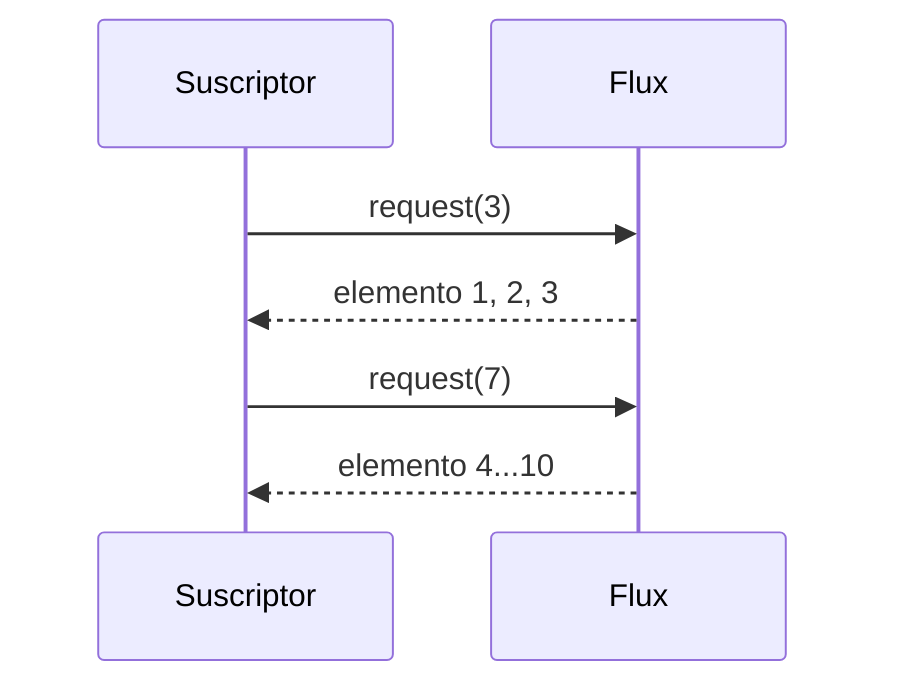
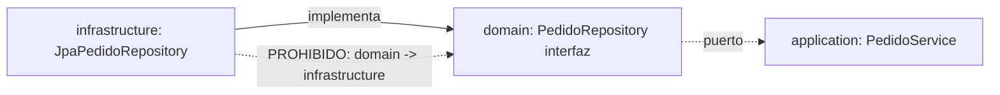
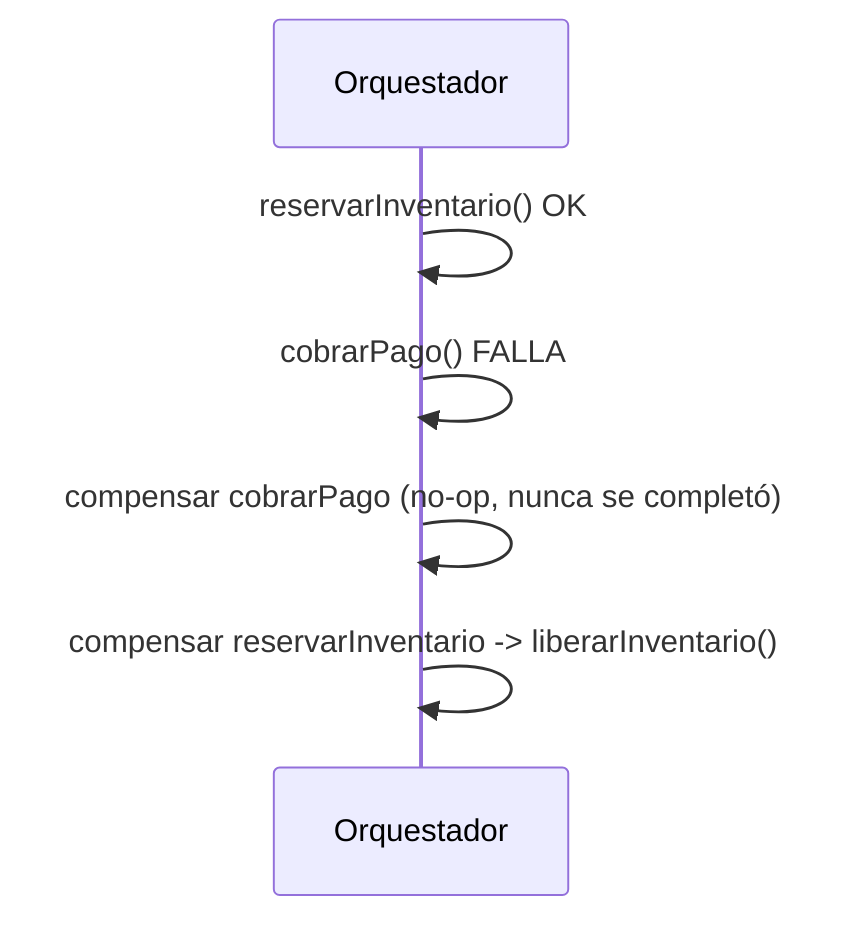
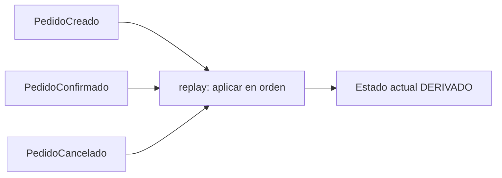
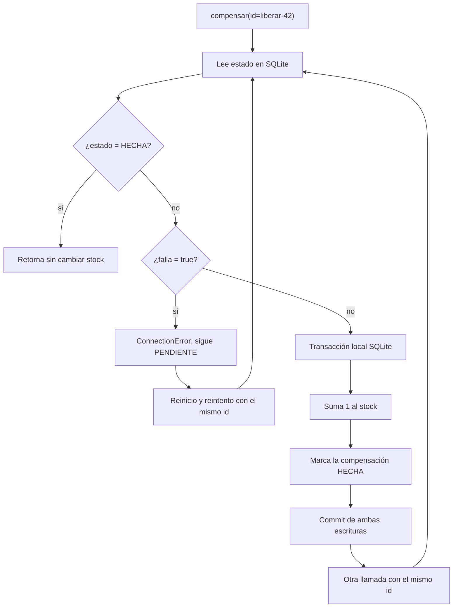
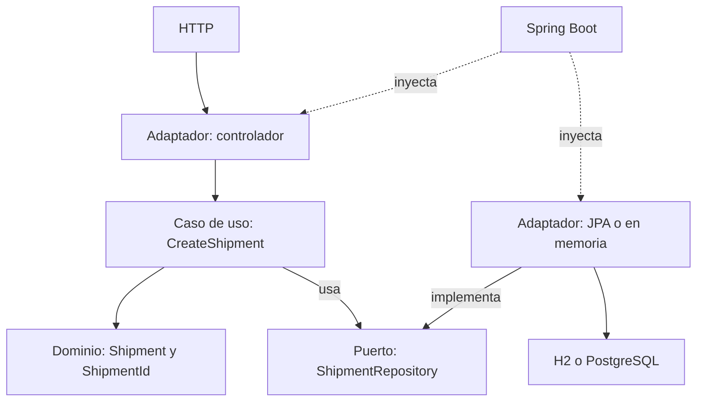

# Módulo 15: Spring Master: hexagonal, reactivo y microservicios


## Aprende construyendo

Este módulo cierra el nivel "master" del track con ocho técnicas avanzadas, cada una verificada con una herramienta real y oficial del ecosistema, sin sustituir infraestructura por descripción: `reactor-test` para backpressure real, el patrón oficial de Testcontainers para contenedores reutilizados, ArchUnit para congelar reglas arquitectónicas, Resilience4j Bulkhead/RateLimiter, un orquestador de saga con compensación real, un event store con replay real, la recuperación de una compensación que falla sin duplicar su efecto, y la separación entre dominio, caso de uso, puerto y adaptador sin acoplar el dominio a Spring.

### Tema 1: Backpressure real en WebFlux con reactor-test · Experto · 1 h 30 min

**Prerrequisito:** Módulo 9 de este track (Mono, Flux, StepVerifier).

**Al terminar podrás:** demostrar, con `StepVerifier` y una demanda inicial controlada, que un `Flux` respeta el backpressure real de Reactive Streams: solo emite exactamente lo que el suscriptor solicitó, ni un elemento más.

#### Aprende

**¿Por qué es importante?** Netty (el servidor sobre el que corre WebFlux) usa un pequeño número de threads de event loop; sin backpressure real, un productor rápido podría saturar la memoria de un consumidor lento acumulando elementos sin control. Reactive Streams resuelve esto con demanda explícita: el consumidor pide cuántos elementos quiere, no al revés.

**Mapa de subtemas críticos**

| Subtema | Papel | Evidencia |
|---|---|---|
| `request(n)` como demanda explícita | Prerrequisito | `.thenRequest(3)` seguido de `.thenRequest(7)` produce exactamente dos solicitudes |
| `StepVerifier.create(flux, 0)` con demanda inicial | Núcleo | arrancar con `0` hace que nada fluya hasta el primer `thenRequest` |
| `doOnRequest` como sonda de demanda real | Diagnóstico | `demandasSolicitadas` contiene `containsExactly(3L, 7L)` |
| Demanda ilimitada por defecto (`Long.MAX_VALUE`) | Error frecuente | `StepVerifier.create(flux)` sin demanda registra una sola entrada `Long.MAX_VALUE` |
| `limitRate(4)` como variante del patrón de solicitudes | Variante | la actividad 2 documenta cómo cambia el patrón de `doOnRequest` |
| Reloj virtual con `delayElements` | Decisión | la actividad 3 verifica el retraso por elemento sin esperar tiempo real |
| Streams pequeños y acotados | Límite | «Cuándo no usarlo» descarta el control explícito cuando la memoria nunca es riesgo |

Cada fila tiene su explicación individual a continuación.

**`request(n)` como demanda explícita (Prerrequisito).** Un `Subscriber` de Reactive Streams no recibe nada hasta que llama `request(n)`, de modo que la demanda es la condición previa de todo flujo. En el ejemplo, `.thenRequest(3)` y luego `.thenRequest(7)` son las dos señales que empujan los elementos; sin ellas el `Flux` quedaría quieto. Comprender este contrato es el prerrequisito para que el resto del backpressure tenga sentido.

**`StepVerifier.create(flux, 0)` con demanda inicial (Núcleo).** La sobrecarga que acepta una demanda inicial `0` es el mecanismo central del tema: fija que el `Flux` no emita hasta pedirlo explícitamente. Por eso `expectNext(1, 2, 3)` solo pasa tras `thenRequest(3)`, demostrando control real y no el camino feliz. Es la pieza que convierte una afirmación teórica en una verificación observable.

**`doOnRequest` como sonda de demanda real (Diagnóstico).** `doOnRequest(demandasSolicitadas::add)` registra cada solicitud de demanda que realmente ocurre, sirviendo como instrumento de diagnóstico. La aserción `containsExactly(3L, 7L)` prueba, con datos reales y no inferidos, que hubo exactamente dos solicitudes. Si algo rompe el backpressure, esta lista lo revela de inmediato.

**Demanda ilimitada por defecto (`Long.MAX_VALUE`) (Error frecuente).** El fallo deliberado cambia a `StepVerifier.create(flux)` sin demanda inicial y la lista pasa a contener una única entrada `Long.MAX_VALUE`. Ese es el error típico: la mayoría de consumidores piden demanda ilimitada de inmediato, anulando cualquier control. Reconocerlo evita creer que «el backpressure simplemente funciona».

**`limitRate(4)` como variante del patrón de solicitudes (Variante).** La segunda actividad agrega `.limitRate(4)` y pide documentar con un test cómo cambia el patrón de solicitudes registradas por `doOnRequest`. Es una variante del mismo mecanismo: en vez de controlar la demanda desde el suscriptor, el operador reparte las solicitudes en lotes. Observar su efecto sobre la lista de demandas conecta la variante con la sonda ya conocida.

**Reloj virtual con `delayElements` (Decisión).** La tercera actividad simula un consumidor lento con `.delayElements(Duration.ofMillis(50))` y verifica el tiempo con el reloj virtual de `StepVerifier`. La decisión relevante es usar tiempo virtual en lugar de esperar 50 ms reales por elemento, lo que mantiene el test rápido y determinista. Elegir el reloj virtual es lo que hace viable verificar temporización sin ralentizar la suite.

**Streams pequeños y acotados (Límite).** La sección «Cuándo no usarlo» marca el límite: para streams pequeños y acotados, donde la memoria del consumidor nunca es un riesgo, controlar la demanda explícitamente solo agrega complejidad. El backpressure real es una herramienta para flujos donde el desajuste productor/consumidor importa. Saber dónde no aplicarlo evita formalismo sin beneficio medible.

**Conceptos clave:** demanda explícita (`request(n)`), `doOnRequest`, demanda ilimitada por defecto.

Un `Subscriber` de Reactive Streams debe llamar `request(n)` para indicar cuántos elementos está dispuesto a recibir; sin esa llamada explícita, no fluye ningún dato. La mayoría de consumidores (incluyendo el `subscribe()` simple) solicitan demanda ilimitada (`Long.MAX_VALUE`) por defecto, lo cual anula el propósito del backpressure si el consumidor real no puede procesar a esa velocidad.

**Analogía:** backpressure es un trabajador de línea de ensamblaje que solo pide "dame 3 piezas más" cuando termina de procesar las anteriores, en vez de que la línea le arroje piezas sin parar independientemente de su capacidad de procesarlas.

**Diagrama:**



#### Practica

Parte de una carpeta vacía y crea `src/test/java/io/academia/master/backpressure/BackpressureRealTest.java`:

```bash
mkdir demo-backpressure
cd demo-backpressure
curl -fsSL https://start.spring.io/starter.zip -d type=maven-project -d dependencies=webflux -d javaVersion=25 -o app.zip
unzip app.zip
mkdir -p src/test/java/io/academia/master/backpressure
```

```java
// src/test/java/io/academia/master/backpressure/BackpressureRealTest.java
package io.academia.master.backpressure;

import org.junit.jupiter.api.Test;
import reactor.core.publisher.Flux;
import reactor.test.StepVerifier;

import java.util.concurrent.CopyOnWriteArrayList;

import static org.assertj.core.api.Assertions.assertThat;

class BackpressureRealTest {

    @Test
    void elFluxSoloEmiteExactamenteLoQueElSuscriptorSolicito() {
        CopyOnWriteArrayList<Long> demandasSolicitadas = new CopyOnWriteArrayList<>();

        Flux<Integer> flux = Flux.range(1, 10)
            .doOnRequest(demandasSolicitadas::add); // registra CADA solicitud real de demanda

        StepVerifier.create(flux, 0) // arranca con demanda 0: nada fluye hasta pedirlo explícitamente
            .thenRequest(3)
            .expectNext(1, 2, 3)
            .thenRequest(7)
            .expectNext(4, 5, 6, 7, 8, 9, 10)
            .verifyComplete();

        assertThat(demandasSolicitadas).containsExactly(3L, 7L); // exactamente dos solicitudes reales: 3 y luego 7
    }
}
```

```bash
./mvnw test -Dtest=BackpressureRealTest
```

**Resultado esperado:** `BUILD SUCCESS` con el test en verde: `doOnRequest` registra REALMENTE las dos solicitudes de demanda (`3` y `7`, no una lista simulada), y `StepVerifier` con demanda inicial `0` confirma que ningún elemento fluye hasta que se solicita explícitamente — el backpressure real de Reactive Streams, no una descripción teórica.

**Fallo deliberado:** cambia `StepVerifier.create(flux, 0)` por `StepVerifier.create(flux)` (sin demanda inicial explícita, el valor por defecto) y ejecuta de nuevo. La aserción `containsExactly(3L, 7L)` FALLA, porque ahora `demandasSolicitadas` contiene una única entrada `Long.MAX_VALUE` — diagnostica confirmando que el `StepVerifier` por defecto (como la mayoría de consumidores reales) solicita demanda ilimitada de inmediato, anulando cualquier control de backpressure. Restaura la demanda inicial `0` antes de continuar.

1. Cambia la demanda inicial a `1` y solicita de a un elemento por vez (`thenRequest(1)` repetido 10 veces), confirmando que `demandasSolicitadas` contiene diez entradas de `1L`.
2. Agrega un `.limitRate(4)` al Flux y documenta, con un test, cómo cambia el patrón de solicitudes de demanda registradas por `doOnRequest`.
3. Simula un consumidor lento con `.delayElements(Duration.ofMillis(50))` y confirma con `StepVerifier` (usando su reloj virtual) que el tiempo total respeta ese retraso por elemento.
4. Escribe de memoria (sin mirar) un `Flux` con `doOnRequest`, y un `StepVerifier` con demanda inicial `0` que confirme el backpressure real. Compara después contra el patrón de la demostración guiada.

**Pista:** `StepVerifier.create(publisher, initialRequest)` es la sobrecarga oficial de `reactor-test` que permite arrancar con una demanda inicial distinta de la ilimitada por defecto — imprescindible para probar backpressure real en vez de el camino feliz sin restricciones.

#### Aplica

**Completa el código:** rellena el espacio con el método de `StepVerifier` que solicita una cantidad específica de elementos:

```java
StepVerifier.create(flux, 0)
    .____(3)
    .expectNext(1, 2, 3)
```

**Reto de memoria sin mirar:** cierra este documento y escribe, solo de memoria, un `Flux` con `doOnRequest` y un test que confirme, con demanda inicial `0`, que el backpressure real limita lo emitido. Compara después contra el patrón de la demostración guiada.

**Checklist de salida.**

- [ ] `StepVerifier` arranca con demanda `0` y el `Flux` no emite nada hasta `thenRequest`.
- [ ] `doOnRequest` registra exactamente las solicitudes reales (`3` y `7`).
- [ ] Una demanda inicial por defecto produce una única solicitud `Long.MAX_VALUE`, y el test lo demuestra.
- [ ] El consumidor lento con `delayElements` se verifica con el reloj virtual de `StepVerifier`.
- [ ] `limitRate(4)` cambia el patrón de solicitudes y queda documentado con un test.

**Si falla.** Si el `Flux` emite antes de `thenRequest`, la demanda inicial no es `0`. Si `demandasSolicitadas` contiene `Long.MAX_VALUE`, el `StepVerifier` se creó sin demanda explícita. Si `delayElements` tarda el tiempo real del test, el reloj virtual no está en uso.

Ya demuestras con `reactor-test` que el backpressure de Reactive Streams es un mecanismo real de demanda explícita, no una descripción abstracta. El siguiente tema acelera la suite de tests reutilizando contenedores de Testcontainers entre clases. Fuentes oficiales: [Project Reactor — Testing](https://projectreactor.io/docs/core/release/reference/testing.html).

**Errores comunes:** asumir que backpressure "simplemente funciona" sin verificar la demanda real solicitada; dejar que un consumidor por defecto solicite demanda ilimitada cuando el caso de uso requiere control explícito.

**Cuándo no usarlo:** para streams pequeños y acotados donde la memoria del consumidor nunca es un riesgo real, controlar la demanda explícitamente agrega complejidad sin ningún beneficio medible.

Verificar backpressure con `reactor-test` es la prueba que confirmaría que el proyecto integrador de este track (microservicio productivo, Módulo 12), si usa WebFlux, no colapsa bajo carga.

### Tema 2: Contenedores Testcontainers reutilizados entre clases · Experto · 1 h 40 min

**Prerrequisito:** Módulo 6 de este track (Testcontainers básico).

**Al terminar podrás:** aplicar el patrón oficial de "singleton container" de Testcontainers para que dos clases de test distintas reutilicen el MISMO contenedor real, confirmado comparando el `containerId` real entre ambas.

#### Aprende

**¿Por qué es importante?** Sin reutilización, cada clase de test con `@Testcontainers` arranca y detiene su propio contenedor, y una suite con decenas de clases puede pasar minutos solo levantando y bajando bases de datos idénticas repetidamente, ralentizando el ciclo de feedback de CI.

**Mapa de subtemas críticos**

| Subtema | Papel | Evidencia |
|---|---|---|
| Clase base `ContenedorCompartido` | Prerrequisito | `PrimeraClaseTest` y `SegundaClaseTest` extienden la misma base abstracta |
| Arranque estático único `static { POSTGRES.start(); }` | Núcleo | quitar el bloque `static` provoca errores de conexión reales |
| `getContainerId()` como evidencia de identidad | Diagnóstico | `isEqualTo(PrimeraClaseTest.containerIdVistoAqui)` compara IDs reales |
| Ausencia deliberada de `@Testcontainers`/`@Container` | Error frecuente | combinarlos causa conflicto de ciclo de vida (Errores comunes) |
| Tercera clase que comparte el contenedor | Variante | la actividad 1 confirma el mismo `containerId` en una tercera clase |
| Medición de tiempo compartido vs por clase | Decisión | la actividad 3 compara con `System.currentTimeMillis()` |
| Suite de una o dos clases | Límite | «Cuándo no usarlo» descarta el patrón para suites pequeñas |

Cada fila tiene su explicación individual a continuación.

**Clase base `ContenedorCompartido` (Prerrequisito).** El patrón exige una superclase abstracta que declare el contenedor estático, de la que heredan todas las clases de test. En el ejemplo `PrimeraClaseTest` y `SegundaClaseTest` extienden `ContenedorCompartido`, lo que les da acceso al mismo campo `POSTGRES`. Sin esa herencia compartida no habría una única instancia que reutilizar.

**Arranque estático único `static { POSTGRES.start(); }` (Núcleo).** El bloque estático arranca el contenedor una sola vez por proceso de test, y Testcontainers lo mantiene vivo hasta que la JVM termina. Es el mecanismo central: el fallo deliberado quita ese bloque y los tests fallan con errores de conexión reales, porque nadie inició el contenedor. La singularidad del arranque es lo que distingue este patrón de la gestión automática por clase.

**`getContainerId()` como evidencia de identidad (Diagnóstico).** El tema no confía en que la velocidad «sugiera» reutilización: usa `getContainerId()`, el ID real que Docker asigna. La aserción `isEqualTo(PrimeraClaseTest.containerIdVistoAqui)` prueba con evidencia concreta que ambas clases ven la misma instancia física. Es la sonda que convierte una inferencia en una confirmación.

**Ausencia deliberada de `@Testcontainers`/`@Container` (Error frecuente).** El patrón singleton funciona solo si las clases no usan esas anotaciones, que gestionarían el ciclo de vida por clase. El error frecuente, señalado en «Errores comunes», es combinarlas con el arranque estático y provocar conflictos de ciclo de vida. Mantener el control manual y exclusivo evita que dos mecanismos peleen por el mismo contenedor.

**Tercera clase que comparte el contenedor (Variante).** La primera actividad añade una tercera clase que también extiende `ContenedorCompartido` y confirma que ve el mismo `containerId`. Es una variante que demuestra que el patrón escala a N clases, no solo a dos. Repetir la comprobación de identidad en otra clase refuerza que el contenedor es verdaderamente compartido.

**Medición de tiempo compartido vs por clase (Decisión).** La tercera actividad mide con `System.currentTimeMillis()` el tiempo del contenedor compartido frente a una versión con `@Container` por clase. Esa medición informa la decisión de adoptar el patrón: el ahorro real debe justificar la complejidad del ciclo de vida manual. Documentar la diferencia observada convierte la intuición en un criterio medible.

**Suite de una o dos clases (Límite).** «Cuándo no usarlo» fija el límite: para una suite de una o dos clases, gestionar el ciclo de vida a mano no compensa un ahorro mínimo. El patrón rinde cuando hay muchas clases que arrancarían bases idénticas. Conocer ese umbral evita introducir complejidad donde el beneficio es despreciable.

**Conceptos clave:** singleton container, `getContainerId()`, contenedor compartido entre clases.

El patrón oficial de "singleton container" de Testcontainers arranca un único contenedor estático (sin `@Container`/`@Testcontainers` gestionándolo automáticamente por clase) y lo comparte entre todas las clases de test que lo necesiten dentro de la misma ejecución de la suite, en vez de un contenedor nuevo por clase.

**Analogía:** es como compartir una sala de reuniones ya preparada entre varias reuniones consecutivas del mismo día, en vez de montar y desmontar la sala completa para cada reunión individual.

**Diagrama:**

```
┌── Sin reutilización ─────────────┐  N clases = N contenedores arrancados
└──────────────────────────┘
┌── Con singleton container ───────┐  N clases = 1 contenedor compartido
└──────────────────────────┘
```

#### Practica

Parte de una carpeta vacía y crea `src/test/java/io/academia/master/singleton/ContenedorCompartido.java`:

```bash
mkdir demo-testcontainers-singleton
cd demo-testcontainers-singleton
curl -fsSL https://start.spring.io/starter.zip -d type=maven-project -d dependencies=data-jpa -d javaVersion=25 -o app.zip
unzip app.zip
mkdir -p src/test/java/io/academia/master/singleton
```

```java
// src/test/java/io/academia/master/singleton/ContenedorCompartido.java
package io.academia.master.singleton;

import org.testcontainers.containers.PostgreSQLContainer;

public abstract class ContenedorCompartido {
    // sin @Container: arranca UNA sola vez, compartido por TODAS las subclases del proceso de test
    static final PostgreSQLContainer<?> POSTGRES = new PostgreSQLContainer<>("postgres:16-alpine");

    static {
        POSTGRES.start(); // arranque explícito único; Testcontainers reutiliza esta instancia hasta que la JVM termine
    }
}
```

```java
// src/test/java/io/academia/master/singleton/PrimeraClaseTest.java
package io.academia.master.singleton;

import org.junit.jupiter.api.Test;

public class PrimeraClaseTest extends ContenedorCompartido {
    static String containerIdVistoAqui;

    @Test
    void registraElContainerIdRealVistoDesdeEstaClase() {
        containerIdVistoAqui = POSTGRES.getContainerId();
    }
}
```

```java
// src/test/java/io/academia/master/singleton/SegundaClaseTest.java
package io.academia.master.singleton;

import org.junit.jupiter.api.Test;

import static org.assertj.core.api.Assertions.assertThat;

public class SegundaClaseTest extends ContenedorCompartido {

    @Test
    void elContainerIdEsElMismoQueElDeLaPrimeraClase() {
        String idAqui = POSTGRES.getContainerId();
        assertThat(idAqui).isEqualTo(PrimeraClaseTest.containerIdVistoAqui); // MISMO contenedor real, no uno nuevo
    }
}
```

```bash
./mvnw test -Dtest=PrimeraClaseTest,SegundaClaseTest
```

**Resultado esperado:** `BUILD SUCCESS` con ambos tests en verde, ejecutados en el orden correcto: `SegundaClaseTest` confirma que `POSTGRES.getContainerId()` devuelve el MISMO ID de contenedor Docker real que `PrimeraClaseTest` observó — evidencia concreta (un ID de contenedor real, no una suposición) de que ambas clases comparten la misma instancia en ejecución, en vez de arrancar contenedores separados.

**Fallo deliberado:** quita el bloque `static { POSTGRES.start(); }` (dejando que cada clase dependa de un arranque implícito que no ocurre de forma compartida) y ejecuta de nuevo. Los tests fallan con errores de conexión reales (el contenedor nunca arrancó) — diagnostica confirmando que el patrón singleton container depende explícitamente de un arranque estático único y deliberado, no de la gestión automática por clase que `@Testcontainers`/`@Container` normalmente proveen. Restaura el bloque `static` antes de continuar.

1. Agrega una tercera clase de test que extienda `ContenedorCompartido` y confirma que también comparte el mismo `containerId`.
2. Documenta, en un comentario, por qué este patrón requiere que las clases NO usen `@Testcontainers`/`@Container` (que gestionarían el ciclo de vida automáticamente por clase, entrando en conflicto con el arranque manual compartido).
3. Mide con `System.currentTimeMillis()` el tiempo total de ejecutar las dos clases con el contenedor compartido, comparado con una versión donde cada clase usa su propio `@Container` independiente, y documenta la diferencia real observada.
4. Escribe de memoria (sin mirar) una clase base `ContenedorCompartido` con arranque estático único, y dos clases de test que confirmen el mismo `containerId`. Compara después contra el patrón de la demostración guiada.

**Pista:** `getContainerId()` devuelve el ID real y único que Docker asignó al contenedor en ejecución — es la forma más directa de confirmar con evidencia, no solo con inferencia por velocidad, si dos referencias apuntan al mismo contenedor físico o a instancias distintas.

#### Aplica

**Completa el código:** rellena el espacio con el método real de Testcontainers que devuelve el identificador único del contenedor en ejecución:

```java
String id = POSTGRES.____();
```

**Reto de memoria sin mirar:** cierra este documento y escribe, solo de memoria, una clase base con un contenedor compartido arrancado estáticamente, y dos clases de test que confirmen el mismo `containerId`. Compara después contra el patrón de la demostración guiada.

**Checklist de salida.**

- [ ] Dos clases de test obtienen el mismo `getContainerId()`.
- [ ] El contenedor se arranca una sola vez en un bloque `static`.
- [ ] Ninguna subclase usa `@Testcontainers`/`@Container`.
- [ ] Quitar el arranque estático produce errores de conexión, no un falso verde.
- [ ] Una tercera clase comparte el mismo contenedor.

**Si falla.** Si cada clase ve un ID distinto, el contenedor se crea por clase. Si falla la conexión, falta el arranque estático. Si el test dura lo mismo con y sin el patrón, la medición no está comparando lo que crees.

Ya aplicas el patrón oficial de contenedor compartido de Testcontainers, confirmado con evidencia real del `containerId`, para acelerar una suite de tests con múltiples clases. El siguiente tema congela reglas arquitectónicas de un diseño hexagonal con una herramienta que las verifica automáticamente. Fuentes oficiales: [Testcontainers — Manual Container Lifecycle Control](https://java.testcontainers.org/test_framework_integration/manual_lifecycle_control/).

**Errores comunes:** combinar el patrón singleton container con `@Testcontainers`/`@Container` en la misma clase, causando conflictos de ciclo de vida; olvidar el arranque estático explícito, dejando el contenedor sin iniciar.

**Cuándo no usarlo:** para una suite pequeña de una o dos clases de test, la complejidad adicional de gestionar el ciclo de vida manualmente no compensa el ahorro de tiempo, que sería mínimo.

Reutilizar contenedores Testcontainers entre clases es la optimización que mantendría rápida la suite de pruebas del proyecto integrador de este track (microservicio productivo, Módulo 12).

### Tema 3: Arquitectura hexagonal verificada con ArchUnit · Experto · 1 h 50 min

**Prerrequisito:** Módulo 10 Tema 7 de este track (DDD y contextos delimitados).

**Al terminar podrás:** escribir una regla de ArchUnit (la librería oficial de test de arquitectura para Java) que falla automáticamente si el paquete de dominio depende de infraestructura, congelando la regla hexagonal como código verificable, no como una convención de equipo no forzada.

#### Aprende

**¿Por qué es importante?** Una arquitectura hexagonal (puertos y adaptadores) mantiene el dominio independiente de detalles de infraestructura (framework, base de datos concreta) SOLO si esa regla se respeta consistentemente; sin verificación automatizada, un import accidental de una clase JPA dentro del paquete de dominio pasa desapercibido en una revisión de código apurada.

**Mapa de subtemas críticos**

| Subtema | Papel | Evidencia |
|---|---|---|
| Puerto `PedidoRepository` en `domain` | Prerrequisito | la interfaz define `buscar(String id)` sin saber cómo se implementa |
| Adaptador `JpaPedidoRepository` en `infrastructure` | Prerrequisito | `@Repository` que `implements PedidoRepository` |
| `noClasses().that().resideInAPackage("..domain..")` | Núcleo | la regla falla si `domain` depende de `..infrastructure..` |
| Análisis de bytecode con `ClassFileImporter` | Variante | `importPackages("io.academia.master.hexagonal")` lee el bytecode compilado |
| Violación detectada en el build | Diagnóstico | agregar un campo `JpaPedidoRepository` en `Pedido` lanza `Architecture Violation` |
| Dirección permitida infraestructura → dominio | Decisión | la actividad 1 expresa la dependencia válida con `classes().that()...` |
| Prototipo pequeño de corta vida | Límite | «Cuándo no usarlo» considera la regla desproporcionada |

Cada fila tiene su explicación individual a continuación.

**Puerto `PedidoRepository` en `domain` (Prerrequisito).** El dominio declara un contrato, la interfaz `PedidoRepository` con `buscar(String id)`, sin conocer su implementación. Esa separación puerto/dominio es el prerrequisito conceptual: sin un puerto no hay frontera que ArchUnit pueda vigilar. La interfaz expresa qué necesita el dominio, no cómo se cumple.

**Adaptador `JpaPedidoRepository` en `infrastructure` (Prerrequisito).** El adaptador `JpaPedidoRepository`, anotado con `@Repository`, implementa el puerto usando un detalle concreto de infraestructura. Vive en `infrastructure` precisamente para que la dependencia apunte hacia el dominio y no al revés. Tener un adaptador real es el segundo prerrequisito que da sentido a la regla.

**`noClasses().that().resideInAPackage("..domain..")` (Núcleo).** La regla `noClasses().that().resideInAPackage("..domain..").should().dependOnClassesThat().resideInAPackage("..infrastructure..")` es el mecanismo central del tema. Congela como código ejecutable la invariante hexagonal: el dominio nunca depende de la infraestructura. `regla.check(clases)` lanza un `AssertionError` real cuando se viola, en cada build.

**Análisis de bytecode con `ClassFileImporter` (Variante).** `new ClassFileImporter().importPackages("io.academia.master.hexagonal")` analiza el bytecode compilado, no el texto fuente. Esta variante de análisis detecta dependencias que un `grep` sobre el código fuente podría pasar por alto, incluso a través de generación de código. Operar sobre el bytecode es lo que da robustez a la verificación.

**Violación detectada en el build (Diagnóstico).** El fallo deliberado agrega un campo `private JpaPedidoRepository repo;` en `Pedido` y el test falla con un mensaje específico de ArchUnit: `Architecture Violation ... because Pedido.class depends on JpaPedidoRepository`. Ese mensaje es el diagnóstico exacto, en el momento en que la violación ocurre. Atraparla en el build evita descubrirla meses después, o nunca.

**Dirección permitida infraestructura → dominio (Decisión).** La primera actividad pide expresar que `infrastructure` SÍ puede depender de `domain`, la dirección válida del flujo de dependencias. La decisión de diseño es asimétrica: una dirección se prohíbe y la contraria se permite deliberadamente. Codificar ambas reglas documenta la decisión arquitectónica completa, no solo la prohibición.

**Prototipo pequeño de corta vida (Límite).** «Cuándo no usarlo» marca el límite: para un prototipo pequeño sin intención de mantenimiento, invertir en reglas ArchUnit puede ser una formalidad desproporcionada. El valor de congelar la arquitectura crece con la vida y el tamaño del proyecto. Reconocer ese umbral evita ceremonia sin retorno.

**Conceptos clave:** puerto (interfaz), adaptador (implementación), regla arquitectónica como test.

El dominio define un **puerto** (`PedidoRepository`, una interfaz) sin saber cómo se implementa; un **adaptador** en el paquete de infraestructura (`JpaPedidoRepository`) implementa ese puerto usando Spring Data JPA. ArchUnit permite expresar la regla "el dominio nunca depende de la infraestructura" como código Java ejecutable en cada build, en vez de una regla solo documentada que nadie verifica automáticamente.

**Analogía:** ArchUnit es un inspector de aduanas automatizado que revisa cada commit para confirmar que ningún paquete cruzó una frontera arquitectónica prohibida, en vez de confiar en que cada desarrollador recuerde la regla por su cuenta.

**Diagrama:**



#### Practica

Parte de una carpeta vacía, agrega `com.tngtech.archunit:archunit-junit5` al `pom.xml` (la librería oficial de ArchUnit), y crea `src/main/java/io/academia/master/hexagonal/domain/Pedido.java`:

```bash
mkdir demo-hexagonal
cd demo-hexagonal
curl -fsSL https://start.spring.io/starter.zip -d type=maven-project -d dependencies=data-jpa,h2 -d javaVersion=25 -o app.zip
unzip app.zip
mkdir -p src/main/java/io/academia/master/hexagonal/{domain,infrastructure}
mkdir -p src/test/java/io/academia/master/hexagonal
```

```java
// src/main/java/io/academia/master/hexagonal/domain/Pedido.java
package io.academia.master.hexagonal.domain;

public class Pedido {
    private final String id;
    public Pedido(String id) { this.id = id; }
    public String getId() { return id; }
}
```

```java
// src/main/java/io/academia/master/hexagonal/domain/PedidoRepository.java
package io.academia.master.hexagonal.domain;

// PUERTO: el dominio define el contrato, sin saber cómo se implementa
public interface PedidoRepository {
    Pedido buscar(String id);
}
```

```java
// src/main/java/io/academia/master/hexagonal/infrastructure/JpaPedidoRepository.java
package io.academia.master.hexagonal.infrastructure;

import io.academia.master.hexagonal.domain.Pedido;
import io.academia.master.hexagonal.domain.PedidoRepository;
import org.springframework.stereotype.Repository;

// ADAPTADOR: implementa el puerto usando un detalle de infraestructura concreto
@Repository
public class JpaPedidoRepository implements PedidoRepository {
    @Override
    public Pedido buscar(String id) { return new Pedido(id); }
}
```

Congela la regla hexagonal con ArchUnit:

```java
// src/test/java/io/academia/master/hexagonal/ReglaHexagonalTest.java
package io.academia.master.hexagonal;

import com.tngtech.archunit.core.importer.ClassFileImporter;
import com.tngtech.archunit.lang.ArchRule;
import org.junit.jupiter.api.Test;

import static com.tngtech.archunit.lang.syntax.ArchRuleDefinition.noClasses;

class ReglaHexagonalTest {

    @Test
    void elDominioNuncaDependeDeLaInfraestructura() {
        var clases = new ClassFileImporter().importPackages("io.academia.master.hexagonal");

        ArchRule regla = noClasses().that().resideInAPackage("..domain..")
            .should().dependOnClassesThat().resideInAPackage("..infrastructure..");

        regla.check(clases); // lanza AssertionError real si la regla se viola
    }
}
```

```bash
./mvnw test -Dtest=ReglaHexagonalTest
```

**Resultado esperado:** `BUILD SUCCESS` con el test en verde: ArchUnit analiza el bytecode REAL compilado (no el código fuente textualmente) y confirma que ninguna clase de `domain` importa o depende de ninguna clase de `infrastructure` — la regla hexagonal congelada como verificación automática, no como una promesa de estilo.

**Fallo deliberado:** modifica `Pedido.java` (en `domain`) para que importe y use `JpaPedidoRepository` directamente (por ejemplo, agregando un campo `private JpaPedidoRepository repo;`) y ejecuta de nuevo el test. FALLA con un mensaje real y específico de ArchUnit: `Architecture Violation ... Pedido does not satisfy: ... because Pedido.class depends on JpaPedidoRepository` — diagnostica confirmando que ArchUnit atrapa la violación en el momento exacto en que ocurre, en el build, en vez de descubrirse meses después en una revisión de código o, peor, nunca. Revierte el cambio antes de continuar.

1. Agrega una segunda regla que confirme que las clases en `infrastructure` SÍ pueden depender de `domain` (la dirección permitida), usando `classes().that().resideInAPackage("..infrastructure..").should().dependOnClassesThat().resideInAPackage("..domain..").orShould()...` según corresponda.
2. Agrega una regla de nomenclatura (`classes().that().resideInAPackage("..infrastructure..").should().haveSimpleNameEndingWith("Repository").orShould()...`) y confirma que se cumple sobre el código existente.
3. Documenta, en un comentario, la diferencia entre una violación arquitectónica detectada por ArchUnit (en el build) y la misma violación detectada solo en una revisión de código manual (mucho más tarde, si es que se detecta).
4. Escribe de memoria (sin mirar) una regla ArchUnit que prohíba una dependencia entre dos paquetes, y confirma con un test que se cumple sobre tu propio código. Compara después contra el patrón de la demostración guiada.

**Pista:** `new ClassFileImporter().importPackages(...)` analiza el BYTECODE COMPILADO, no el texto fuente — esto significa que ArchUnit detecta dependencias reales incluso a través de generación de código o reflexión indirecta que un simple `grep` sobre el código fuente podría pasar por alto.

#### Aplica

**Completa el código:** rellena el espacio con el método de ArchUnit que expresa "ninguna clase debería depender de":

```java
ArchRule regla = noClasses().that().resideInAPackage("..domain..")
    .should().____().resideInAPackage("..infrastructure..");
```

**Reto de memoria sin mirar:** cierra este documento y escribe, solo de memoria, una regla ArchUnit que prohíba que el dominio dependa de la infraestructura, y un test que la ejecute. Compara después contra el patrón de la demostración guiada.

**Checklist de salida.**

- [ ] ArchUnit analiza el bytecode compilado de todo el paquete.
- [ ] `noClasses().that().resideInAPackage("..domain..")` no depende de `..infrastructure..`.
- [ ] Un import de infraestructura dentro del dominio hace fallar el build con el mensaje de ArchUnit.
- [ ] La dirección permitida (infraestructura → dominio) también está expresada.
- [ ] La regla corre en cada build, no solo en una revisión manual.

**Si falla.** Si la regla pasa pese al import, el paquete importado no coincide con el patrón. Si falla por clases de terceros, restringe el import con `importPackages`. Si el mensaje no nombra la clase, revisa el `ClassFileImporter`.

Ya congelas una regla arquitectónica hexagonal como un test ejecutable con ArchUnit, atrapando violaciones en el build en vez de en una revisión manual. El siguiente tema protege llamadas entre servicios con Bulkhead y RateLimiter de Resilience4j, complementando el CircuitBreaker ya visto. Fuentes oficiales: [ArchUnit User Guide](https://www.archunit.org/userguide/html/000_Index.html).

**Errores comunes:** documentar una regla arquitectónica solo en un README sin verificación automatizada; definir reglas demasiado laxas que no detectan violaciones reales.

**Cuándo no usarlo:** para un prototipo pequeño de corta vida sin intención de mantenimiento a largo plazo, invertir en reglas ArchUnit puede ser una formalidad desproporcionada frente al beneficio.

Verificar la arquitectura hexagonal con ArchUnit es lo que protegería los límites de capas del proyecto integrador de este track (microservicio productivo, Módulo 12).

### Tema 4: Bulkhead y RateLimiter de Resilience4j · Experto · 1 h 55 min

**Prerrequisito:** Módulo 10 Tema 3 de este track (CircuitBreaker de Resilience4j).

**Al terminar podrás:** confirmar, con llamadas concurrentes reales, que un `Bulkhead` limita el número de llamadas simultáneas hacia una dependencia, y que un `RateLimiter` limita la tasa de llamadas por período de tiempo, complementando el `CircuitBreaker` ya visto en el Módulo 10.

#### Aprende

**¿Por qué es importante?** Un `CircuitBreaker` reacciona a fallos ya ocurridos; un `Bulkhead` PREVIENE que una única dependencia lenta consuma todos los threads/recursos disponibles, aislando su impacto; un `RateLimiter` protege a la dependencia misma de recibir más tráfico del que puede soportar, independientemente de si está fallando o no.

**Mapa de subtemas críticos**

| Subtema | Papel | Evidencia |
|---|---|---|
| `BulkheadConfig.maxConcurrentCalls(2)` | Núcleo | la tercera llamada concurrente lanza `BulkheadFullException` |
| `CountDownLatch` para coordinar concurrencia real | Prerrequisito | `enCurso.await()` confirma que dos threads ocupan el bulkhead |
| `RateLimiterConfig` con `limitForPeriod(2)` | Núcleo | `primera` y `segunda` son `true`, `tercera` es `false` |
| `timeoutDuration(Duration.ZERO)` vs espera | Variante | la actividad 2 configura un timeout distinto de cero que sí espera un permiso |
| Dimensionar el límite demasiado alto | Error frecuente | subir a `maxConcurrentCalls(10)` deja `rechazadas.get()` en `0` |
| Encadenar Bulkhead con CircuitBreaker | Decisión | la actividad 3 documenta el orden de aplicación de decoradores |
| Dependencia de altísima capacidad | Límite | «Cuándo no usarlo» considera innecesaria la protección |

Cada fila tiene su explicación individual a continuación.

**`BulkheadConfig.maxConcurrentCalls(2)` (Núcleo).** El `Bulkhead` configurado con `maxConcurrentCalls(2)` limita a dos las llamadas simultáneas hacia la dependencia; la tercera se rechaza de inmediato con `BulkheadFullException` en vez de encolarse. En el test, dos `llamadaLenta` ocupan la capacidad y la tercera incrementa `rechazadas`. Es el mecanismo central de aislamiento de recursos.

**`CountDownLatch` para coordinar concurrencia real (Prerrequisito).** `enCurso` y `liberar` coordinan threads reales para que la prueba sea determinista. `enCurso.await()` garantiza que las dos primeras llamadas ya están dentro del bulkhead antes de intentar la tercera, evitando un test intermitente por timing. Sin esa coordinación previa no se podría afirmar con certeza que el bulkhead está lleno.

**`RateLimiterConfig` con `limitForPeriod(2)` (Núcleo).** El `RateLimiter` con `limitForPeriod(2)` y `limitRefreshPeriod(Duration.ofSeconds(10))` concede dos permisos por ventana. Las aserciones muestran `primera` y `segunda` en `true` y `tercera` en `false`, porque ya se consumieron los dos permisos. Es el segundo mecanismo central: limitar por tasa, independientemente de la concurrencia.

**`timeoutDuration(Duration.ZERO)` vs espera (Variante).** El ejemplo usa `timeoutDuration(Duration.ZERO)` para rechazar de inmediato sin esperar un permiso. La segunda actividad explora la variante opuesta: un `timeoutDuration` distinto de cero deja que una llamada espere y obtenga un permiso si se libera durante la espera. Esa elección cambia el comportamiento entre «rechazo instantáneo» y «espera acotada».

**Dimensionar el límite demasiado alto (Error frecuente).** El fallo deliberado sube a `maxConcurrentCalls(10)` y el test falla porque `rechazadas.get()` queda en `0`: la tercera llamada ya no se rechaza. Es el error típico de dimensionar el bulkhead demasiado holgado, eliminando la protección que debía ofrecer. El test demuestra que el parámetro, no la intención, manda.

**Encadenar Bulkhead con CircuitBreaker (Decisión).** La tercera actividad combina `Bulkhead.decorateSupplier` con `CircuitBreaker.decorateSupplier` del Módulo 10 en una sola cadena y pide documentar el orden recomendado. La decisión de diseño es cómo componer primitivas de resiliencia, ya que el orden de los decoradores afecta el comportamiento. Articular ese orden integra el tema con el CircuitBreaker previo.

**Dependencia de altísima capacidad (Límite).** «Cuándo no usarlo» fija el límite: para una dependencia interna de altísima capacidad y sin riesgo real de saturación, Bulkhead y RateLimiter pueden ser una capa innecesaria. La protección vale cuando existe riesgo creíble de saturación. Saber distinguir ese caso evita añadir mecanismos sin beneficio real.

**Conceptos clave:** Bulkhead (aislamiento de recursos), RateLimiter (límite de tasa).

Un `Bulkhead` limita cuántas llamadas concurrentes pueden ejecutarse simultáneamente hacia una dependencia específica; al superar ese límite, las llamadas adicionales fallan inmediatamente con `BulkheadFullException` en vez de encolarse indefinidamente. Un `RateLimiter` limita cuántas llamadas pueden ejecutarse dentro de una ventana de tiempo, independientemente de la concurrencia.

**Analogía:** un Bulkhead es un compartimento estanco de un barco: si un compartimento se inunda, los demás permanecen aislados y el barco no se hunde completo; un RateLimiter es un peaje que solo permite pasar un número fijo de vehículos por minuto, sin importar cuántos lleguen a la vez.

**Diagrama:**

```
┌── Bulkhead ──────────────────────┐  máx N llamadas CONCURRENTES
└──────────────────────────┘
┌── RateLimiter ───────────────────┐  máx N llamadas por VENTANA DE TIEMPO
└──────────────────────────┘
```

#### Practica

Parte de una carpeta vacía, agrega `io.github.resilience4j:resilience4j-bulkhead` y `io.github.resilience4j:resilience4j-ratelimiter` al `pom.xml`, y crea `src/test/java/io/academia/master/resilience/BulkheadRateLimiterTest.java`:

```bash
mkdir demo-resilience-avanzado
cd demo-resilience-avanzado
curl -fsSL https://start.spring.io/starter.zip -d type=maven-project -d dependencies=web -d javaVersion=25 -o app.zip
unzip app.zip
mkdir -p src/test/java/io/academia/master/resilience
```

```java
// src/test/java/io/academia/master/resilience/BulkheadRateLimiterTest.java
package io.academia.master.resilience;

import io.github.resilience4j.bulkhead.Bulkhead;
import io.github.resilience4j.bulkhead.BulkheadConfig;
import io.github.resilience4j.bulkhead.BulkheadFullException;
import io.github.resilience4j.ratelimiter.RateLimiter;
import io.github.resilience4j.ratelimiter.RateLimiterConfig;
import org.junit.jupiter.api.Test;

import java.time.Duration;
import java.util.concurrent.CountDownLatch;
import java.util.concurrent.ExecutorService;
import java.util.concurrent.Executors;
import java.util.concurrent.atomic.AtomicInteger;

import static org.assertj.core.api.Assertions.assertThat;

class BulkheadRateLimiterTest {

    @Test
    void elBulkheadRechazaLlamadasQueSuperanElMaximoConcurrenteReal() throws Exception {
        BulkheadConfig config = BulkheadConfig.custom().maxConcurrentCalls(2).build();
        Bulkhead bulkhead = Bulkhead.of("servicioTarifas", config);

        CountDownLatch enCurso = new CountDownLatch(2);
        CountDownLatch liberar = new CountDownLatch(1);
        AtomicInteger rechazadas = new AtomicInteger(0);
        ExecutorService pool = Executors.newFixedThreadPool(3);

        Runnable llamadaLenta = () -> Bulkhead.decorateRunnable(bulkhead, () -> {
            enCurso.countDown();
            try { liberar.await(); } catch (InterruptedException ignored) {}
        }).run();

        pool.submit(llamadaLenta);
        pool.submit(llamadaLenta);
        enCurso.await(); // confirma que las DOS primeras ya están dentro del bulkhead, ocupando el máximo

        try {
            Bulkhead.decorateRunnable(bulkhead, () -> {}).run(); // la TERCERA debe rechazarse de inmediato
        } catch (BulkheadFullException e) {
            rechazadas.incrementAndGet();
        }

        assertThat(rechazadas.get()).isEqualTo(1);
        liberar.countDown();
        pool.shutdown();
    }

    @Test
    void elRateLimiterRechazaLlamadasQueSuperanElLimiteDeLaVentana() {
        RateLimiterConfig config = RateLimiterConfig.custom()
            .limitForPeriod(2)
            .limitRefreshPeriod(Duration.ofSeconds(10))
            .timeoutDuration(Duration.ZERO) // no espera: rechaza inmediatamente si no hay permiso
            .build();
        RateLimiter limiter = RateLimiter.of("servicioTarifas", config);

        boolean primera = limiter.acquirePermission();
        boolean segunda = limiter.acquirePermission();
        boolean tercera = limiter.acquirePermission(); // supera el límite de 2 por ventana

        assertThat(primera).isTrue();
        assertThat(segunda).isTrue();
        assertThat(tercera).isFalse(); // rechazada: ya se consumieron los 2 permisos de esta ventana
    }
}
```

```bash
./mvnw test -Dtest=BulkheadRateLimiterTest
```

**Resultado esperado:** `BUILD SUCCESS` con ambos tests en verde: el `Bulkhead` real, con dos threads reales ocupando su capacidad máxima (confirmado con `CountDownLatch`, no una suposición de timing), rechaza la tercera llamada concurrente con `BulkheadFullException` real; el `RateLimiter` real acepta exactamente 2 permisos dentro de la ventana configurada y rechaza el tercero.

**Fallo deliberado:** cambia `maxConcurrentCalls(2)` a `maxConcurrentCalls(10)` y ejecuta de nuevo `elBulkheadRechazaLlamadasQueSuperanElMaximoConcurrenteReal`. El test FALLA porque la tercera llamada ya NO se rechaza (`rechazadas.get()` queda en `0`) — diagnostica confirmando que el límite de concurrencia del Bulkhead es exactamente el parámetro configurado, y que dimensionarlo incorrectamente (demasiado alto) elimina la protección real que debía ofrecer. Restaura `maxConcurrentCalls(2)` antes de continuar.

1. Reduce `limitForPeriod` a 1 y confirma con un test que solo la primera llamada de cada ventana de tiempo se acepta.
2. Configura un `timeoutDuration` distinto de cero en el `RateLimiter` y confirma con un test que una llamada esperando ese timeout SÍ puede obtener un permiso si se libera uno durante la espera.
3. Combina `Bulkhead.decorateSupplier` con `CircuitBreaker.decorateSupplier` (Módulo 10) en una única cadena de decoradores, y documenta el orden de aplicación recomendado.
4. Escribe de memoria (sin mirar) un `BulkheadConfig` con un límite de concurrencia, y un test con `CountDownLatch` que confirme el rechazo real de una llamada que excede ese límite. Compara después contra el patrón de la demostración guiada.

**Pista:** `CountDownLatch` es la herramienta correcta para coordinar temporalmente threads reales en un test de concurrencia — sin ella, un test de Bulkhead podría fallar intermitentemente por condiciones de carrera en el timing, en vez de confirmar de forma determinista que las llamadas concurrentes efectivamente ocupan el bulkhead antes de intentar la que debe rechazarse.

#### Aplica

**Completa el código:** rellena el espacio con la excepción real que Resilience4j lanza cuando un Bulkhead está lleno:

```java
try {
    Bulkhead.decorateRunnable(bulkhead, () -> {}).run();
} catch (____ e) {
    rechazadas.incrementAndGet();
}
```

**Reto de memoria sin mirar:** cierra este documento y escribe, solo de memoria, un `Bulkhead` con límite de concurrencia y un `RateLimiter` con límite por ventana, cada uno con un test que confirme el rechazo real. Compara después contra el patrón de la demostración guiada.

**Checklist de salida.**

- [ ] `maxConcurrentCalls(2)` rechaza la tercera llamada concurrente con `BulkheadFullException`.
- [ ] `CountDownLatch` confirma que las dos primeras llamadas ocupan el bulkhead antes de la tercera.
- [ ] `limitForPeriod(2)` acepta dos permisos y rechaza el tercero en la ventana.
- [ ] Un `timeoutDuration` distinto de cero permite esperar un permiso.
- [ ] Subir el límite del bulkhead hace fallar el test, confirmando que el parámetro manda.

**Si falla.** Si la tercera llamada no se rechaza, el límite es demasiado alto o las llamadas no son concurrentes. Si el `RateLimiter` acepta más permisos, revisa `limitRefreshPeriod`. Si el test es intermitente, falta coordinación con latches.

Ya proteges llamadas concurrentes con Bulkhead (aislamiento de recursos) y RateLimiter (límite de tasa), complementando el CircuitBreaker del Módulo 10 con un conjunto completo de primitivas de resiliencia. El siguiente tema orquesta una saga real con pasos compensables. Fuentes oficiales: [Resilience4j — Bulkhead](https://resilience4j.readme.io/docs/bulkhead) y [Resilience4j — RateLimiter](https://resilience4j.readme.io/docs/ratelimiter).

**Errores comunes:** dimensionar un Bulkhead demasiado holgado, eliminando la protección real que debía ofrecer; combinar retries con RateLimiter sin considerar que los reintentos también consumen permisos de la ventana.

**Cuándo no usarlo:** para una dependencia interna de altísima capacidad y sin riesgo real de saturación, agregar Bulkhead y RateLimiter puede ser una capa de protección innecesaria frente al riesgo real.

Bulkhead y RateLimiter son los mecanismos que protegerían al proyecto integrador de este track (microservicio productivo, Módulo 12) de saturación por un solo cliente o dependencia.

### Tema 5: Saga con compensación real · Experto · 2 h 10 min

**Prerrequisito:** Módulo 13 de este track (transacciones distribuidas e idempotencia).

**Al terminar podrás:** ejecutar un orquestador de saga real que, ante el fallo de un paso intermedio, ejecuta las compensaciones de los pasos ya completados en orden inverso, confirmado con una lista real de acciones ejecutadas. Aquí el orquestador es código propio, sin motor de workflow; el Módulo 10, Tema 8 muestra la misma idea delegada a Temporal.

#### Aprende

**¿Por qué es importante?** Crear un pedido puede requerir reservar inventario, cobrar el pago y confirmar el envío como tres pasos independientes en distintos servicios; si el cobro de pago falla después de reservar inventario, ese inventario reservado debe liberarse explícitamente — ninguna transacción distribuida automática hace esto por ti.

**Mapa de subtemas críticos**

| Subtema | Papel | Evidencia |
|---|---|---|
| Interfaz `PasoSaga` con `ejecutar`/`compensar` | Prerrequisito | cada paso define `ejecutar()`, `compensar()` y `nombre()` |
| Orquestación secuencial con registro de completados | Núcleo | `completados.add(paso)` solo tras `paso.ejecutar()` exitoso |
| Compensación en orden inverso con `Collections.reverse` | Núcleo | el log muestra `COMPENSADO: reservarInventario` tras `FALLO: cobrarPago` |
| Detención ante el fallo | Diagnóstico | `confirmarEnvio` NUNCA aparece como `EJECUTADO` en el log |
| Copia antes de invertir `new ArrayList<>(completados)` | Error frecuente | la Pista advierte que `reverse` modifica la lista en el lugar |
| Compensación que también falla | Decisión | la actividad 3 documenta la necesidad de reintentos o alertas |
| Operación en una sola transacción local | Límite | «Cuándo no usarlo» prefiere una transacción ACID (Módulo 3) |

Cada fila tiene su explicación individual a continuación.

**Interfaz `PasoSaga` con `ejecutar`/`compensar` (Prerrequisito).** Cada paso de la saga implementa `PasoSaga`, que obliga a declarar `ejecutar()`, su compensación `compensar()` y un `nombre()` para el log. Esa tripleta es el prerrequisito estructural: sin una compensación explícita por paso no hay nada que deshacer ante un fallo posterior. La interfaz formaliza que compensar es una acción de negocio, no un rollback automático.

**Orquestación secuencial con registro de completados (Núcleo).** El `OrquestadorSaga` recorre los pasos en orden y solo añade a `completados` tras un `ejecutar()` exitoso, registrando `EJECUTADO` en el log. Este seguimiento es el mecanismo central que determina, ante un fallo, exactamente qué pasos deben revertirse. Solo lo confirmado como completado entra en la lista a compensar.

**Compensación en orden inverso con `Collections.reverse` (Núcleo).** Ante una excepción, el orquestador copia `completados`, aplica `Collections.reverse` y compensa en orden inverso al de ejecución. El log del test confirma `COMPENSADO: reservarInventario` después de `FALLO: cobrarPago`. Revertir en orden inverso respeta posibles dependencias entre recursos reservados, como explica el fallo deliberado.

**Detención ante el fallo (Diagnóstico).** Cuando `cobrarPago` falla, el orquestador retorna y `confirmarEnvio` nunca llega a ejecutarse: el log no contiene `EJECUTADO: confirmarEnvio`. Esa ausencia es el diagnóstico de que la saga se detuvo en el punto exacto del fallo. El log concreto, no la prosa, demuestra el flujo real de corte y compensación.

**Copia antes de invertir `new ArrayList<>(completados)` (Error frecuente).** La Pista advierte que `Collections.reverse(lista)` invierte en el lugar, modificando la lista original. El código copia con `new ArrayList<>(completados)` antes de invertir precisamente para no corromper `completados`. Olvidar esa copia es el error frecuente que alteraría el orden original necesario para otros usos en el método.

**Compensación que también falla (Decisión).** La tercera actividad agrega el manejo de una excepción durante una compensación y pide documentar por qué las sagas reales necesitan reintentos o alertas manuales. Es la decisión operativa clave: una compensación que falla no puede simplemente ignorarse. Decidir entre reintentar o escalar a intervención humana define la robustez real de la saga.

**Operación en una sola transacción local (Límite).** «Cuándo no usarlo» marca el límite: si la operación cabe en una única transacción de base de datos local (Módulo 3), una saga distribuida agrega complejidad innecesaria frente a una transacción ACID. La saga rinde cuando el trabajo se reparte entre varios servicios sin transacción común. Reconocer ese caso evita sobrediseñar algo que una transacción simple resolvería.

**Conceptos clave:** paso con compensación, orquestación secuencial, reversión en orden inverso.

Una saga es una secuencia de pasos locales, cada uno con una acción de compensación explícita que deshace su efecto si un paso POSTERIOR falla. Un orquestador ejecuta los pasos en orden; ante un fallo, ejecuta las compensaciones de los pasos YA completados, en orden INVERSO al que se ejecutaron.

**Analogía:** una saga es como desarmar una torre de bloques en el orden inverso exacto al que se construyó, para no dejar bloques sueltos ni desestabilizar la estructura restante.

**Diagrama:**



#### Practica

Parte de una carpeta vacía y crea `src/main/java/io/academia/master/saga/PasoSaga.java`:

```bash
mkdir demo-saga
cd demo-saga
curl -fsSL https://start.spring.io/starter.zip -d type=maven-project -d dependencies=web -d javaVersion=25 -o app.zip
unzip app.zip
mkdir -p src/main/java/io/academia/master/saga
mkdir -p src/test/java/io/academia/master/saga
```

```java
// src/main/java/io/academia/master/saga/PasoSaga.java
package io.academia.master.saga;

public interface PasoSaga {
    void ejecutar() throws Exception;
    void compensar();
    String nombre();
}
```

```java
// src/main/java/io/academia/master/saga/OrquestadorSaga.java
package io.academia.master.saga;

import java.util.ArrayList;
import java.util.Collections;
import java.util.List;

public class OrquestadorSaga {

    public List<String> ejecutar(List<PasoSaga> pasos) {
        List<String> log = new ArrayList<>();
        List<PasoSaga> completados = new ArrayList<>();

        for (PasoSaga paso : pasos) {
            try {
                paso.ejecutar();
                completados.add(paso);
                log.add("EJECUTADO: " + paso.nombre());
            } catch (Exception e) {
                log.add("FALLO: " + paso.nombre());
                List<PasoSaga> aCompensar = new ArrayList<>(completados);
                Collections.reverse(aCompensar); // orden INVERSO al de ejecución
                for (PasoSaga p : aCompensar) {
                    p.compensar();
                    log.add("COMPENSADO: " + p.nombre());
                }
                return log;
            }
        }
        return log;
    }
}
```

Confirma con un test real que el orden de compensación es exactamente el inverso:

```java
// src/test/java/io/academia/master/saga/SagaCompensacionTest.java
package io.academia.master.saga;

import org.junit.jupiter.api.Test;

import java.util.List;

import static org.assertj.core.api.Assertions.assertThat;

class SagaCompensacionTest {

    @Test
    void unFalloEnElSegundoPasoCompensaSoloElPrimeroEnOrdenInverso() {
        PasoSaga reservarInventario = pasoQueSiempreTieneExito("reservarInventario");
        PasoSaga cobrarPago = pasoQueSiempreFalla("cobrarPago");
        PasoSaga confirmarEnvio = pasoQueSiempreTieneExito("confirmarEnvio"); // NUNCA debe ejecutarse

        List<String> log = new OrquestadorSaga().ejecutar(List.of(reservarInventario, cobrarPago, confirmarEnvio));

        assertThat(log).containsExactly(
            "EJECUTADO: reservarInventario",
            "FALLO: cobrarPago",
            "COMPENSADO: reservarInventario" // solo el paso YA completado se compensa, en orden inverso (trivial aquí: 1 elemento)
        );
    }

    private PasoSaga pasoQueSiempreTieneExito(String nombre) {
        return new PasoSaga() {
            public void ejecutar() {}
            public void compensar() {}
            public String nombre() { return nombre; }
        };
    }

    private PasoSaga pasoQueSiempreFalla(String nombre) {
        return new PasoSaga() {
            public void ejecutar() throws Exception { throw new Exception("fallo simulado de " + nombre); }
            public void compensar() {}
            public String nombre() { return nombre; }
        };
    }
}
```

```bash
./mvnw test -Dtest=SagaCompensacionTest
```

**Resultado esperado:** `BUILD SUCCESS` con el test en verde: el log REAL de ejecución confirma que `reservarInventario` se ejecutó, `cobrarPago` falló, `confirmarEnvio` NUNCA se ejecutó (el orquestador se detuvo ante el fallo), y `reservarInventario` fue compensado — el flujo completo de una saga real con compensación, no una descripción del patrón.

**Fallo deliberado:** agrega un CUARTO paso `pasoQueSiempreTieneExito("etiquetarPaquete")` ANTES de `cobrarPago` en la lista, y actualiza la aserción esperando (incorrectamente) que la compensación aparezca en el MISMO orden de ejecución (`etiquetarPaquete` antes que `reservarInventario`) en vez del orden inverso real. El test FALLA porque `Collections.reverse(aCompensar)` efectivamente invierte el orden — diagnostica confirmando por qué la compensación debe ser estrictamente inversa: si `etiquetarPaquete` reservó un recurso físico DESPUÉS de que `reservarInventario` reservara uno lógico, deshacer en el orden incorrecto podría intentar liberar un recurso que depende de otro que ya fue liberado. Corrige la aserción al orden inverso real antes de continuar.

1. Agrega un cuarto paso exitoso y confirma que, si el fallo ocurre en el TERCER paso, se compensan los dos primeros en orden inverso (segundo, luego primero).
2. Confirma con un test que si TODOS los pasos tienen éxito, ninguna compensación se ejecuta y el log solo contiene entradas `EJECUTADO`.
3. Agrega manejo de una excepción DURANTE una compensación (una compensación que también falla) y documenta, en un comentario, por qué las sagas reales necesitan reintentos o alertas manuales para este caso límite.
4. Escribe de memoria (sin mirar) un `OrquestadorSaga` que compense en orden inverso ante un fallo, y un test que confirme el log completo. Compara después contra el patrón de la demostración guiada.

**Pista:** `Collections.reverse(lista)` invierte una lista EN EL LUGAR (modifica la lista original) — usa una copia (`new ArrayList<>(completados)`) antes de invertir si necesitas preservar el orden original de `completados` para otro propósito en el mismo método.

#### Aplica

**Completa el código:** rellena el espacio con el método que invierte el orden de la lista de pasos completados antes de compensar:

```java
List<PasoSaga> aCompensar = new ArrayList<>(completados);
Collections.____(aCompensar);
```

**Reto de memoria sin mirar:** cierra este documento y escribe, solo de memoria, un orquestador de saga con compensación en orden inverso, y un test que confirme el log de ejecución completo ante un fallo intermedio. Compara después contra el patrón de la demostración guiada.

**Checklist de salida.**

- [ ] El orquestador ejecuta los pasos en orden y se detiene en el fallo.
- [ ] Solo se compensan los pasos completados.
- [ ] La compensación ocurre en orden inverso.
- [ ] El log real contiene `EJECUTADO`, `FALLO` y `COMPENSADO` en la secuencia esperada.
- [ ] Un fallo en el tercer paso compensa el segundo y luego el primero.

**Si falla.** Si se compensa un paso no ejecutado, se añadió a `completados` antes de confirmar el éxito. Si el orden no es inverso, falta `Collections.reverse`. Si la aserción falla por el log, imprime el log completo antes de ajustar.

Ya orquestas una saga real con compensación en orden inverso, confirmada con un log de ejecución concreto, no solo descrita en prosa. El siguiente y último tema de este módulo reconstruye el estado de un agregado reproduciendo su historial completo de eventos. Fuentes oficiales: [microservices.io — Saga Pattern](https://microservices.io/patterns/data/saga.html).

**Errores comunes:** compensar en el mismo orden de ejecución en vez del orden inverso; no manejar el caso donde una compensación misma falla.

**Cuándo no usarlo:** para una operación que puede modelarse dentro de una única transacción de base de datos local (Módulo 3), una saga distribuida agrega complejidad innecesaria frente a una simple transacción ACID.

Una Saga con compensación real es el patrón que necesitaría el proyecto integrador de este track (microservicio productivo, Módulo 12) si coordina transacciones a través de varios servicios.

### Tema 6: Event Sourcing con replay real · Experto · 2 h

**Prerrequisito:** Módulo 13 de este track (transactional outbox).

**Al terminar podrás:** reconstruir el estado completo de un agregado reproduciendo (replay) una lista real de eventos de dominio, confirmando que el estado reconstruido coincide exactamente con el esperado tras aplicar cada evento en orden.

#### Aprende

**¿Por qué es importante?** En vez de almacenar solo el estado actual de un pedido (que pierde el historial de cómo llegó a ese estado), Event Sourcing almacena la secuencia completa de eventos que ocurrieron; el estado actual se DERIVA reproduciendo esos eventos, nunca se almacena directamente como la fuente de verdad.

**Mapa de subtemas críticos**

| Subtema | Papel | Evidencia |
|---|---|---|
| `sealed interface EventoPedido` con records | Prerrequisito | tres `record` implementan la interfaz sellada |
| `reconstruirDesde(List<EventoPedido>)` como replay | Núcleo | aplica cada evento en orden sobre `INEXISTENTE` |
| `switch` exhaustivo sin `default` | Diagnóstico | agregar `PedidoReabierto` fuerza un error de compilación (actividad 1) |
| El orden de los eventos es significativo | Error frecuente | invertir `PedidoCancelado` y `PedidoConfirmado` da `CONFIRMADO`, no `CANCELADO` |
| Historial parcial | Variante | dos eventos dejan el estado en `CONFIRMADO` donde termina el historial |
| Diferencia frente al outbox del Módulo 13 | Decisión | la actividad 3 documenta estado DERIVADO vs evento que NOTIFICA |
| Historial de cambios irrelevante | Límite | «Cuándo no usarlo» prefiere un `UPDATE` convencional |

Cada fila tiene su explicación individual a continuación.

**`sealed interface EventoPedido` con records (Prerrequisito).** Los eventos se modelan como `record` inmutables dentro de una `sealed interface`: `PedidoCreado`, `PedidoConfirmado` y `PedidoCancelado`. La inmutabilidad y el sellado son el prerrequisito: cada evento es un hecho ya ocurrido y el conjunto de tipos es cerrado. Esa base permite tanto el replay como la verificación exhaustiva del `switch`.

**`reconstruirDesde(List<EventoPedido>)` como replay (Núcleo).** El mecanismo central es `reconstruirDesde`, que parte de un estado inicial `INEXISTENTE` y aplica cada evento en orden mediante `aplicar`. El estado actual se deriva del historial completo, no se almacena directamente. El primer test confirma que tres eventos reconstruyen un estado final `CANCELADO` con su motivo.

**`switch` exhaustivo sin `default` (Diagnóstico).** El `switch` sobre la interfaz sellada no tiene rama `default`, de modo que el compilador exige manejar todos los casos. La primera actividad agrega `PedidoReabierto` y provoca un error de compilación hasta actualizar `aplicar`. Ese fallo en tiempo de compilación es el diagnóstico que evita un caso olvidado silenciosamente en producción.

**El orden de los eventos es significativo (Error frecuente).** El fallo deliberado invierte `PedidoCancelado` y `PedidoConfirmado`, y el estado final pasa a `CONFIRMADO` en vez de `CANCELADO`, porque el último evento aplicado determina el resultado. Es el error conceptual típico: tratar los eventos como un conjunto en vez de una secuencia. El mismo conjunto en otro orden reconstruye un estado distinto, igual que en el negocio real.

**Historial parcial (Variante).** El segundo test reproduce solo dos eventos y confirma que el estado queda en `CONFIRMADO`, exactamente donde termina el historial. Esta variante muestra que el replay no inventa estados futuros: refleja fielmente hasta dónde llegaron los hechos. Un historial incompleto produce un estado parcial coherente, no un error.

**Diferencia frente al outbox del Módulo 13 (Decisión).** La tercera actividad pide documentar la diferencia entre Event Sourcing y el transactional outbox del Módulo 13. La decisión de diseño es si los eventos SON la fuente de verdad (estado derivado por replay) o solo NOTIFICAN un cambio ya persistido convencionalmente. Distinguir ambos enfoques evita confundir «usar eventos» con derivar el estado de ellos.

**Historial de cambios irrelevante (Límite).** «Cuándo no usarlo» fija el límite: si el historial de cambios es irrelevante para el negocio y solo importa el estado actual, Event Sourcing agrega una complejidad de reconstrucción que un simple `UPDATE` no tendría. El patrón rinde cuando el cómo se llegó al estado tiene valor. Reconocer ese caso evita pagar el costo del replay sin necesidad.

**Conceptos clave:** evento de dominio inmutable, replay, estado derivado.

Cada evento (`PedidoCreado`, `PedidoConfirmado`, `PedidoCancelado`) es un hecho inmutable ya ocurrido; el estado actual del agregado se reconstruye aplicando cada evento, en orden, sobre un estado inicial vacío. Esto es distinto del outbox (Módulo 13), que usa eventos para NOTIFICAR a otros servicios sobre un cambio ya persistido de forma convencional — Event Sourcing usa los eventos MISMOS como la fuente de verdad del estado.

**Analogía:** el estado actual de una cuenta bancaria NO se almacena directamente; se deriva reproduciendo cada depósito y retiro desde el inicio de la cuenta — el saldo es una consecuencia calculada del historial completo, no un número guardado independientemente.

**Diagrama:**



#### Practica

Parte de una carpeta vacía y crea `src/main/java/io/academia/master/eventsourcing/EventoPedido.java`:

```bash
mkdir demo-event-sourcing
cd demo-event-sourcing
curl -fsSL https://start.spring.io/starter.zip -d type=maven-project -d dependencies=web -d javaVersion=25 -o app.zip
unzip app.zip
mkdir -p src/main/java/io/academia/master/eventsourcing
mkdir -p src/test/java/io/academia/master/eventsourcing
```

```java
// src/main/java/io/academia/master/eventsourcing/EventoPedido.java
package io.academia.master.eventsourcing;

public sealed interface EventoPedido {
    record PedidoCreado(String id) implements EventoPedido {}
    record PedidoConfirmado() implements EventoPedido {}
    record PedidoCancelado(String motivo) implements EventoPedido {}
}
```

```java
// src/main/java/io/academia/master/eventsourcing/EstadoPedido.java
package io.academia.master.eventsourcing;

import java.util.List;

public record EstadoPedido(String id, String estado, String motivoCancelacion) {

    public static EstadoPedido reconstruirDesde(List<EventoPedido> eventos) {
        EstadoPedido estado = new EstadoPedido(null, "INEXISTENTE", null);
        for (EventoPedido evento : eventos) {
            estado = aplicar(estado, evento);
        }
        return estado;
    }

    private static EstadoPedido aplicar(EstadoPedido actual, EventoPedido evento) {
        return switch (evento) {
            case EventoPedido.PedidoCreado e -> new EstadoPedido(e.id(), "CREADO", null);
            case EventoPedido.PedidoConfirmado e -> new EstadoPedido(actual.id(), "CONFIRMADO", null);
            case EventoPedido.PedidoCancelado e -> new EstadoPedido(actual.id(), "CANCELADO", e.motivo());
        };
    }
}
```

Confirma con un test real que el replay reconstruye exactamente el estado esperado:

```java
// src/test/java/io/academia/master/eventsourcing/ReplayTest.java
package io.academia.master.eventsourcing;

import org.junit.jupiter.api.Test;

import java.util.List;

import static org.assertj.core.api.Assertions.assertThat;

class ReplayTest {

    @Test
    void reproducirTresEventosEnOrdenReconstruyeElEstadoFinalCorrecto() {
        List<EventoPedido> eventos = List.of(
            new EventoPedido.PedidoCreado("PED-001"),
            new EventoPedido.PedidoConfirmado(),
            new EventoPedido.PedidoCancelado("cliente se arrepintió")
        );

        EstadoPedido estadoFinal = EstadoPedido.reconstruirDesde(eventos);

        assertThat(estadoFinal.id()).isEqualTo("PED-001");
        assertThat(estadoFinal.estado()).isEqualTo("CANCELADO");
        assertThat(estadoFinal.motivoCancelacion()).isEqualTo("cliente se arrepintió");
    }

    @Test
    void reproducirSoloDosEventosDejaElEstadoEnConfirmadoSinCancelar() {
        List<EventoPedido> eventos = List.of(
            new EventoPedido.PedidoCreado("PED-002"),
            new EventoPedido.PedidoConfirmado()
        );

        EstadoPedido estadoFinal = EstadoPedido.reconstruirDesde(eventos);

        assertThat(estadoFinal.estado()).isEqualTo("CONFIRMADO"); // el estado se detiene exactamente donde termina el historial
    }
}
```

```bash
./mvnw test -Dtest=ReplayTest
```

**Resultado esperado:** `BUILD SUCCESS` con ambos tests en verde: el primero confirma que reproducir TRES eventos reales en orden reconstruye un estado final `CANCELADO` con el motivo correcto; el segundo confirma que reproducir solo DOS eventos (un historial parcial real) deja el estado en `CONFIRMADO`, exactamente donde el historial termina — el estado es una consecuencia calculada del historial, no un valor almacenado independientemente.

**Fallo deliberado:** en la lista de eventos del primer test, invierte el orden colocando `PedidoCancelado` ANTES que `PedidoConfirmado` y ejecuta de nuevo. El test FALLA (o produce un estado final distinto al esperado: `CONFIRMADO` en vez de `CANCELADO`, porque el evento aplicado en último lugar es el que determina el estado final) — diagnostica confirmando que el orden de los eventos en el replay es tan significativo como su contenido: el mismo conjunto de eventos en un orden distinto reconstruye un estado distinto, exactamente como en la realidad del negocio (confirmar antes de cancelar no es lo mismo que cancelar antes de confirmar). Restaura el orden correcto antes de continuar.

1. Agrega un cuarto tipo de evento (`PedidoReabierto`) y confirma con un test que el `switch` exhaustivo (gracias a `sealed interface`) obliga al compilador a manejar el caso nuevo, evitando un caso olvidado silenciosamente.
2. Escribe un test que confirme que reconstruir con una lista de eventos VACÍA devuelve el estado inicial `INEXISTENTE`, sin lanzar ninguna excepción.
3. Documenta, en un comentario, la diferencia entre Event Sourcing (los eventos SON el estado, reconstruido por replay) y el transactional outbox del Módulo 13 (los eventos NOTIFICAN un cambio que ya se persistió convencionalmente en otra forma).
4. Escribe de memoria (sin mirar) un `sealed interface` de eventos y una función de replay que reconstruya el estado aplicando cada evento en orden. Compara después contra el patrón de la demostración guiada.

**Pista:** un `sealed interface` con un `switch` sin rama `default` obliga al compilador de Java a verificar que TODOS los casos posibles están manejados — agregar un nuevo tipo de evento sin actualizar la función `aplicar(...)` produce un error de COMPILACIÓN, no un bug silencioso descubierto en producción.

#### Aplica

**Completa el código:** rellena el espacio con el método estático que reconstruye el estado reproduciendo una lista de eventos:

```java
EstadoPedido estadoFinal = EstadoPedido.____(eventos);
```

**Reto de memoria sin mirar:** cierra este documento y escribe, solo de memoria, un `sealed interface` de eventos de dominio y una función de replay que los reduzca a un estado final. Compara después contra el patrón de la demostración guiada.

**Checklist de salida.**

- [ ] Tres eventos en orden reconstruyen `CANCELADO` con el motivo correcto.
- [ ] Un historial parcial deja el estado donde termina el historial.
- [ ] Una lista vacía produce `INEXISTENTE` sin excepción.
- [ ] Invertir dos eventos produce un estado distinto, demostrando que el orden importa.
- [ ] Añadir un evento al `sealed interface` obliga a actualizar el `switch` exhaustivo.

**Si falla.** Si el estado final es anterior al esperado, revisa el orden de la lista. Si el `switch` compila con un caso sin manejar, la interfaz no es `sealed`. Si `id` queda nulo, el evento de creación no se aplicó primero.

Ya reconstruyes el estado de un agregado reproduciendo su historial completo de eventos, confirmando que el orden y el contenido de esos eventos determinan exactamente el resultado. Este era el último tema del módulo y del track; el siguiente paso natural es aplicar estas seis técnicas combinadas sobre un proyecto propio de tamaño real. Fuentes oficiales: [Martin Fowler — Event Sourcing](https://martinfowler.com/eaaDev/EventSourcing.html).

**Errores comunes:** confundir Event Sourcing con simplemente "usar eventos" (como el outbox), cuando la diferencia real es si el estado se DERIVA del historial o se almacena convencionalmente; olvidar que el orden de aplicación de eventos es semánticamente significativo.

**Cuándo no usarlo:** para un agregado con un historial de cambios irrelevante para el negocio (donde solo el estado actual importa, nunca cómo se llegó a él), Event Sourcing agrega una complejidad de reconstrucción que un simple `UPDATE` convencional no tendría.

**Transferencia al proyecto integrador «microservicio productivo»:** Modela el ciclo de vida de un envío (`EnvioCreado`, `EnvioRecogido`, `EnvioEntregado`, `EnvioDevuelto`) como eventos de dominio, y reconstruye el estado de auditoría de un envío disputado reproduciendo su historial completo, en vez de confiar solo en el último estado guardado.

## Trazabilidad de la auditoría original

- **Spring WebFlux**: cubierto mediante fundamento, laboratorio y evidencia del capítulo.
- **Testing Avanzado**: cubierto mediante fundamento, laboratorio y evidencia del capítulo.
- **Arquitectura Hexagonal**: cubierto mediante fundamento, laboratorio y evidencia del capítulo.
- **Microservicios Avanzado**: cubierto mediante fundamento, laboratorio y evidencia del capítulo.
- **Spring Cloud Avanzado**: cubierto mediante fundamento, laboratorio y evidencia del capítulo.


## Aplicación del material de referencia

### Tema 7: Compensación que falla: conservar trabajo pendiente y reintentar sin duplicar · Experto · 1 h 15 min

**Prerrequisito:** saga del tema anterior, transacciones locales, idempotencia y SQLite/Python 3.

**Al terminar podrás:** recuperar una compensación después de un fallo y un reinicio sin aplicar dos veces su efecto. Es un ejemplo independiente desde carpeta vacía: aísla el participante antes de conectarlo a Kafka u otro coordinador.

#### Aprende

Reservaste inventario y el pago fue rechazado. La liberación de inventario también puede fallar. **¿Por qué es importante?** Devolver «saga terminada» tras capturar la primera excepción oculta trabajo todavía pendiente. El proyecto integrador necesita un estado observable y una acción de recuperación.

**Mapa de subtemas críticos**

| Subtema | Papel | Evidencia |
|---|---|---|
| Estado observable `PENDIENTE`/`HECHA` en SQLite | Prerrequisito | la tabla `compensaciones` guarda el estado de `liberar-42` |
| Identidad estable de la operación (`liberar-42`) | Núcleo | el mismo id reconoce la operación tras reiniciar |
| Salida temprana cuando el estado es `HECHA` | Núcleo | `if estado == 'HECHA': return` evita repetir el efecto |
| Atomicidad del efecto y su marca con `with db:` | Diagnóstico | stock `+1` y marca `HECHA` se confirman juntos en una transacción |
| Fallo que conserva `PENDIENTE` | Error frecuente | quitar la salida temprana sube el stock dos veces y rompe la expectativa 10 |
| Contador de intentos y revisión manual | Decisión | «Aplica» pide un límite de intentos y estado de revisión |
| Sin atomicidad entre Kafka y la base | Límite | el ejemplo serial no demuestra transacción entre broker y SQLite |

Cada fila tiene su explicación individual a continuación.

**Estado observable `PENDIENTE`/`HECHA` en SQLite (Prerrequisito).** El ejercicio persiste el estado de la compensación en la tabla `compensaciones`, que arranca en `PENDIENTE` para `liberar-42`. Ese estado observable es el prerrequisito: sin él, capturar la excepción y devolver «saga terminada» ocultaría trabajo pendiente. Guardar el estado permite que un reinicio sepa qué falta hacer.

**Identidad estable de la operación (`liberar-42`) (Núcleo).** El identificador fijo `liberar-42` es la clave para que un reintento reconozca la misma operación en vez de generar una nueva. La Pista advierte: no generes un ID nuevo por cada intento. Esta identidad estable es el mecanismo central que hace posible la deduplicación tras un reinicio.

**Salida temprana cuando el estado es `HECHA` (Núcleo).** Al iniciar, `compensar` lee el estado y, si ya es `HECHA`, retorna sin tocar el stock. Esa salida temprana es lo que vuelve idempotente la operación: dos llamadas posteriores no duplican el efecto. El programa principal invoca `compensar(db)` dos veces y el stock final queda en 10, no en 11.

**Atomicidad del efecto y su marca con `with db:` (Diagnóstico).** Dentro de `with db:`, el `UPDATE` del stock y el `UPDATE` que marca `HECHA` se confirman juntos en una transacción local de SQLite. Esa atomicidad es la evidencia de que el efecto y su registro no pueden quedar desincronizados en esta base del participante. Si la marca se guardara fuera de la transacción, quedaría `HECHA` sin efecto aplicado.

**Fallo que conserva `PENDIENTE` (Error frecuente).** El fallo deliberado elimina la salida temprana cuando el estado es `HECHA`: el stock sube otra vez y la expectativa de 10 se rompe. Es el error frecuente de reintentar sin reconocer que la operación ya se hizo. La prueba, que usa una base temporal y verifica la cantidad final, lo detecta de forma determinista.

**Contador de intentos y revisión manual (Decisión).** La sección «Aplica» pide añadir contador de intentos, próximo instante permitido y un estado de revisión manual tras un límite. Es la decisión operativa: un reintento ciego y sin cota puede repetirse indefinidamente. Definir un límite y una ruta de escalamiento manual es lo que hace observable y acotada la recuperación.

**Sin atomicidad entre Kafka y la base (Límite).** El propio tema fija el límite: múltiples bases y un broker no comparten la transacción SQLite de este ejercicio, así que no se demuestra atomicidad entre Kafka y una base de datos. Esta muestra serial tampoco prueba concurrencia entre consumidores. Conocer esa frontera evita extrapolar la garantía local a un coordinador distribuido.

Compensar es ejecutar una nueva acción de negocio; no retrocede el tiempo. Se necesita una identidad de operación estable para que un reintento no libere dos veces. En este participante local, el efecto y su marca se guardan en una transacción de SQLite. Un coordinador distribuido además debe persistir qué pidió, qué recibió y qué sigue pendiente.

**Analogía:** devolver un paquete requiere registrar que la devolución ocurrió, no solo enviar una orden y olvidarla. El límite es que múltiples bases y un broker no comparten la transacción SQLite de este ejercicio. No se demuestra atomicidad entre Kafka y una base de datos.

**Flujo serial del laboratorio:** el efecto sobre stock y la marca `HECHA` se confirman juntos en SQLite. El diagrama no representa dos consumidores concurrentes ni una transacción con Kafka.



#### Practica

Parte de una carpeta vacía y crea manualmente los dos archivos del ejercicio en la raíz de `ejemplo-compensacion`:

```bash
mkdir ejemplo-compensacion
cd ejemplo-compensacion
```

Crea `compensacion.py` con este contenido completo:
```python
import sqlite3


def iniciar(db):
    db.executescript('''CREATE TABLE IF NOT EXISTS stock(id TEXT PRIMARY KEY, cantidad INTEGER);
    CREATE TABLE IF NOT EXISTS compensaciones(id TEXT PRIMARY KEY, estado TEXT);
    INSERT OR IGNORE INTO stock VALUES ('reserva-42', 9);
    INSERT OR IGNORE INTO compensaciones VALUES ('liberar-42', 'PENDIENTE');''')


def compensar(db, falla=False):
    estado = db.execute("SELECT estado FROM compensaciones WHERE id='liberar-42'").fetchone()[0]
    if estado == 'HECHA':
        return
    if falla:
        raise ConnectionError('Inventario temporalmente no disponible')
    # El efecto y su marcador son atómicos EN ESTA base local del participante.
    with db:
        db.execute("UPDATE stock SET cantidad=cantidad+1 WHERE id='reserva-42'")
        db.execute("UPDATE compensaciones SET estado='HECHA' WHERE id='liberar-42'")


if __name__ == '__main__':
    with sqlite3.connect('saga.db') as db:
        iniciar(db)
        try:
            compensar(db, falla=True)
        except ConnectionError:
            print('Compensación pendiente; requiere reintento')
        compensar(db)
        compensar(db)
        print('Stock final:', db.execute('SELECT cantidad FROM stock').fetchone()[0])
```

Crea `test_compensacion.py` con este contenido completo:
```python
import sqlite3
import tempfile
from pathlib import Path
import unittest
from compensacion import iniciar, compensar

class CompensacionTest(unittest.TestCase):
    def test_reinicio_y_reintento_no_duplican_efecto(self):
        with tempfile.TemporaryDirectory() as tmp:
            path=Path(tmp)/'saga.db'
            with sqlite3.connect(path) as db:
                iniciar(db)
                with self.assertRaises(ConnectionError): compensar(db, falla=True)
                self.assertEqual('PENDIENTE', db.execute('SELECT estado FROM compensaciones').fetchone()[0])
            with sqlite3.connect(path) as db:
                compensar(db)
                compensar(db)
                self.assertEqual(10, db.execute('SELECT cantidad FROM stock').fetchone()[0])
                self.assertEqual('HECHA', db.execute('SELECT estado FROM compensaciones').fetchone()[0])
if __name__=='__main__':unittest.main()
```

Ejecuta la prueba y después el programa desde `ejemplo-compensacion`:

```bash
python3 -m unittest test_compensacion.py
python3 compensacion.py
```

**Resultado esperado:** una prueba correcta; al ejecutar el programa por primera vez aparece compensación pendiente y stock final 10. Explica cada bloque: el identificador `liberar-42` conserva la operación, el fallo mantiene PENDIENTE, el reinicio abre el mismo archivo y el segundo intento comprueba HECHA antes de repetir el efecto. La prueba utiliza una base temporal y verifica la cantidad final, no solo una lista de mensajes.

**Fallo deliberado:** elimina la salida temprana cuando el estado es HECHA. Repite la prueba: el stock sube otra vez y falla la expectativa 10. **Pista:** reintentar requiere reconocer el mismo comando; no generes un ID nuevo por cada intento.

#### Aplica
Añade contador de intentos, próximo instante permitido y estado de revisión manual tras un límite. Después diseña outbox/inbox para notificar la compensación confirmada sin perder el evento ni duplicar su efecto. No uses un sleep ilimitado dentro de una transacción.

**Checklist de salida.**

- [ ] Un fallo deja la compensación en `PENDIENTE`, no marcada como hecha.
- [ ] Tras reiniciar, el mismo identificador `liberar-42` reconoce la operación.
- [ ] Reintentar dos veces aplica el efecto una sola vez: stock final 10.
- [ ] La prueba usa una base temporal y verifica la cantidad, no solo los mensajes.
- [ ] Existe un límite de intentos y un estado de revisión manual.

**Si falla.** Si el stock sube dos veces, falta la salida temprana cuando el estado es `HECHA`. Si el estado queda `HECHA` sin efecto, la marca se guarda fuera de la transacción del efecto. Si cada reintento usa un ID nuevo, el comando no es reconocible y la deduplicación no puede funcionar.

El siguiente paso es probar dos participantes y reentrega real de mensajes. **Errores comunes:** confundir compensación con rollback global, marcar HECHA antes del efecto y reintentar sin observabilidad ni límite. **Límites y decisión de uso:** esta muestra serial no prueba concurrencia entre múltiples consumidores; una variante concurrente necesita bloqueo o transición condicional y pruebas de carreras.

**Fuente oficial:** [patrón Saga](https://microservices.io/patterns/data/saga.html).

### Tema 8: Clean Architecture y DDD táctico: caso de uso antes que framework · Experto · 1 h 50 min

**Prerrequisito:** Módulo 3 (persistencia), Módulo 10
Tema 7 (contextos delimitados e invariantes) y Java 21 o superior.

**Al terminar podrás:** separar una regla de negocio en entidad, caso de uso, puerto y
adaptador, y explicar dónde entra Spring Boot, JPA y H2 sin convertirlos
en el centro del dominio. El ejemplo independiente se compila con `javac`; no
necesita levantar Spring para demostrar la dirección de dependencias.

#### Aprende

La captura de referencia anuncia cinco incrementos: entidades DDD táctico,
casos de uso/interactors y boundaries, adaptadores de interfaz, frameworks y
drivers, y un código completo que llega hasta la API. La secuencia es útil si se
conserva el límite: una entidad protege una regla; el caso de uso coordina; un
puerto expresa lo que necesita; un adaptador conecta la tecnología; Spring Boot
es un driver de entrada o infraestructura, no el dueño de la regla.

**¿Por qué es importante?** Un controlador que crea directamente un repositorio
JPA mezcla HTTP, transacción y negocio. Puede funcionar en una demo y volverse
difícil de probar o migrar cuando cambia la base de datos. Clean Architecture
no significa multiplicar carpetas: significa que el dominio no importa
frameworks y que la dirección de dependencias apunta hacia la regla.

**Mapa de subtemas críticos**

| Subtema | Papel | Evidencia |
|---|---|---|
| Dominio con invariantes (`ShipmentId`, `Shipment`) | Prerrequisito | los `record` lanzan `IllegalArgumentException` si el valor está en blanco |
| Puerto `ShipmentRepository` | Núcleo | `CreateShipment` recibe la interfaz, no una implementación |
| Caso de uso `CreateShipment` | Núcleo | `execute("ENV-42")` crea un `Shipment` en estado `CREATED` |
| Adaptador `InMemoryShipmentRepository` | Variante | implementa el puerto sin base de datos y el `test.sh` compila con `javac` |
| Dependencia que cruza el límite | Error frecuente | importar una anotación de Spring en `Shipment` cruza la frontera |
| Dirección de dependencias hacia la regla | Decisión | pasar de H2 a PostgreSQL cambia el adaptador, no el dominio (actividad 4) |
| Clean Architecture no garantiza buen modelado | Límite | una entidad anémica sigue siendo diseño débil pese a los paquetes |

Cada fila tiene su explicación individual a continuación.

**Dominio con invariantes (`ShipmentId`, `Shipment`) (Prerrequisito).** Los `record` `ShipmentId` y `Shipment` validan sus invariantes en el constructor compacto y lanzan `IllegalArgumentException` si el valor está nulo o en blanco. Ese núcleo de reglas, libre de Spring y JPA, es el prerrequisito: el dominio protege sus restricciones por sí mismo. Sin invariantes propias, una capa externa tendría que vigilar lo que el dominio debería garantizar.

**Puerto `ShipmentRepository` (Núcleo).** `ShipmentRepository` es el boundary: una interfaz con `save` y `find` que expresa lo que el caso de uso necesita sin fijar la tecnología. El caso de uso depende de esta interfaz, nunca de una implementación concreta. Ese puerto es el mecanismo central que mantiene la dirección de dependencias apuntando hacia la regla.

**Caso de uso `CreateShipment` (Núcleo).** `CreateShipment` coordina la regla: recibe un id, construye un `Shipment` en estado `CREATED` y lo guarda a través del puerto. `useCase.execute("ENV-42")` produce la salida `shipment=ENV-42 status=CREATED`. El interactor orquesta sin conocer HTTP ni la base de datos, que son detalles de los anillos externos.

**Adaptador `InMemoryShipmentRepository` (Variante).** `InMemoryShipmentRepository` implementa el puerto usando una `List`, sin base de datos, y permite que `test.sh` compile y ejecute con `javac`/`java` sin levantar Spring. Es una variante de adaptador equivalente, desde la perspectiva del dominio, a un futuro adaptador JPA. Poder intercambiar la implementación sin tocar el caso de uso demuestra que la frontera está bien puesta.

**Dependencia que cruza el límite (Error frecuente).** El fallo deliberado importa una anotación de Spring en `Shipment` o hace que el caso de uso reciba `EntityManager`. Ese es el error frecuente: una dependencia de infraestructura cruza hacia el dominio y lo acopla al framework. La Pista lo resume: si para probar la regla necesitas levantar H2, la frontera está demasiado adentro.

**Dirección de dependencias hacia la regla (Decisión).** La cuarta actividad pide enumerar qué cambia al pasar de H2 a PostgreSQL y qué debe permanecer intacto. La decisión arquitectónica es mantener el dominio y el caso de uso estables mientras solo el adaptador cambia. Documentar esa frontera en `docs/arquitectura.md`, indicando qué paquetes pueden importar Spring, convierte la decisión en una regla explícita.

**Clean Architecture no garantiza buen modelado (Límite).** El propio tema fija el límite: una arquitectura limpia no garantiza buen modelado, porque una entidad anémica o un caso de uso que solo reenvía llamadas sigue siendo diseño débil aunque tenga muchos paquetes. Separar capas es necesario pero no suficiente. Reconocerlo evita confundir estructura de carpetas con calidad de diseño.

Usa cuatro anillos prácticos:

1. **Dominio:** entidad, value object y agregado con invariantes.
2. **Aplicación:** caso de uso/interactor que recibe una orden y usa puertos.
3. **Adaptadores:** controlador, presenter y repositorio que traducen formatos.
4. **Frameworks y drivers:** Spring Boot, JPA, H2, HTTP, mensajería y sistema
   operativo.

**Analogía:** el dominio es la receta y sus restricciones; el caso de uso es
la persona que coordina la preparación; los puertos son enchufes con una forma
estable; los adaptadores son los cables concretos; Spring es la cocina. Cambiar
la cocina no debe cambiar la receta. El límite es que una arquitectura limpia no
garantiza buen modelado: una entidad anémica o un caso de uso que solo reenvía
llamadas sigue siendo diseño débil aunque tenga muchos paquetes.

**Diagrama:**



#### Practica

Desde una carpeta vacía crea `Main.java` y `test.sh` con el contenido completo de abajo:

```bash
mkdir ejemplo-clean-architecture
cd ejemplo-clean-architecture
```

`Main.java` contiene las capas mínimas sin importar Spring:

```java
import java.util.ArrayList;
import java.util.List;

record ShipmentId(String value) {
    ShipmentId {
        if (value == null || value.isBlank()) throw new IllegalArgumentException("id requerido");
    }
}

record Shipment(ShipmentId id, String status) {
    Shipment {
        if (status == null || status.isBlank()) throw new IllegalArgumentException("estado requerido");
    }
}

interface ShipmentRepository {
    void save(Shipment shipment);
    Shipment find(ShipmentId id);
}

final class InMemoryShipmentRepository implements ShipmentRepository {
    private final List<Shipment> values = new ArrayList<>();

    @Override public void save(Shipment shipment) { values.removeIf(value -> value.id().equals(shipment.id())); values.add(shipment); }
    @Override public Shipment find(ShipmentId id) { return values.stream().filter(value -> value.id().equals(id)).findFirst().orElse(null); }
}

final class CreateShipment {
    private final ShipmentRepository repository;

    CreateShipment(ShipmentRepository repository) { this.repository = repository; }

    Shipment execute(String id) {
        Shipment shipment = new Shipment(new ShipmentId(id), "CREATED");
        repository.save(shipment);
        return shipment;
    }
}

public class Main {
    public static void main(String[] args) {
        ShipmentRepository repository = new InMemoryShipmentRepository();
        CreateShipment useCase = new CreateShipment(repository);
        Shipment shipment = useCase.execute("ENV-42");
        if (!"CREATED".equals(repository.find(shipment.id()).status())) throw new AssertionError("estado incorrecto");
        System.out.println("shipment=" + shipment.id().value() + " status=" + shipment.status());
    }
}
```

Crea `test.sh` con estas cuatro líneas y ejecútalo:

```bash
cat > test.sh <<'SCRIPT'
#!/usr/bin/env bash
set -euo pipefail
rm -rf build && mkdir -p build && javac -d build Main.java && java -cp build Main
SCRIPT
bash test.sh
```

**Resultado esperado:** `shipment=ENV-42 status=CREATED`. `ShipmentId` y
`Shipment` representan el dominio; `CreateShipment` es el interactor;
`ShipmentRepository` es el boundary; `InMemoryShipmentRepository` es un
adaptador de prueba. En una aplicación Spring, un `@RestController` convertiría
HTTP en la entrada del caso de uso y un adaptador JPA implementaría el puerto,
pero ninguna de esas clases aparece en el dominio.

**Fallo deliberado:** importa una anotación de Spring en `Shipment` o cambia el
caso de uso para recibir `EntityManager`. Compila de nuevo y explica qué
dependencia cruzó el límite. Después cambia el repositorio en memoria por un
adaptador falso que registre llamadas sin modificar `CreateShipment`.

**Pista:** el caso de uso debe depender de `ShipmentRepository`, no de la clase
que lo implementa. Si para probar la regla necesitas levantar H2, la frontera
está demasiado adentro.

#### Aplica

1. Añade una transición `CANCELLED` que solo pueda ocurrir desde `CREATED`.
2. Escribe un test puro que falle al cancelar dos veces.
3. Diseña un `CreateShipmentController` que traduzca una petición HTTP a la
   orden del caso de uso, sin devolver la entidad de persistencia directamente.
4. Enumera qué parte cambiaría al pasar de H2 a PostgreSQL y qué parte debería
   permanecer intacta. En el proyecto integrador, documenta esa frontera en
   `docs/arquitectura.md` e indica qué paquetes pueden importar Spring.

**Checklist de salida.**

- [ ] `ShipmentId` y `Shipment` validan sus invariantes sin importar Spring ni JPA.
- [ ] `CreateShipment` depende de `ShipmentRepository`, no de una implementación.
- [ ] Un adaptador falso registra llamadas sin modificar el caso de uso.
- [ ] `CANCELLED` solo ocurre desde `CREATED` y cancelar dos veces falla en un test puro.
- [ ] `docs/arquitectura.md` documenta qué paquetes pueden importar Spring.

**Si falla.** Si `Shipment` necesita Spring para compilar, una anotación cruzó la frontera. Si el test del caso de uso necesita H2, la frontera está demasiado adentro. Si cancelar dos veces no falla, la transición no valida el estado de origen.

Registra la dirección de dependencias, el test de la transición inválida y una
tabla que
separe dominio, aplicación, adaptadores y drivers. El siguiente paso es revisar
la regla con ArchUnit en el Tema 3 y conectar el caso de uso a una API REST sin
exponer entidades JPA.

**Errores comunes:** llamar Clean Architecture a una estructura de carpetas sin
reglas verificables, poner lógica en controllers, compartir entidades JPA entre
contextos, crear interfaces para cada clase sin una razón y usar `@Data` en
entidades con relaciones. **Límites y decisión de uso:** este laboratorio
demuestra dirección de dependencias y no reemplaza pruebas de integración,
transacciones reales, migraciones Flyway ni seguridad de la API.

**Fuente oficial:** [Spring Boot reference](https://docs.spring.io/spring-boot/reference/) y [DDD Aggregate de Martin Fowler](https://martinfowler.com/bliki/DDD_Aggregate.html).

### Tema 9: CQRS y saga por coreografía · Experto · 1 h 20 min

**Prerrequisito:** Tema 5 de este módulo (saga con compensación real) y Módulo 10, Tema 8 (saga orquestada con Temporal).

**Al terminar podrás:** separar un modelo de escritura de uno de lectura conectados por un evento de dominio, e implementar una saga coreografiada donde ningún componente conoce la secuencia completa — a diferencia de los dos orquestadores (Temporal y manual) ya vistos.

#### Aprende

Un endpoint de resumen solo necesita leer; el endpoint que crea un envío solo necesita escribir. Forzar ambos a pasar por la misma entidad JPA acopla una pantalla de solo lectura a las reglas de validación de la escritura.

**¿Por qué es importante?** CQRS separa el modelo que escribe del modelo que se lee, permitiendo que cada uno se optimice para su propio trabajo; una saga coreografiada elimina el punto único de coordinación de una saga orquestada, a costa de que ningún componente tenga la vista completa del proceso.

**Mapa de subtemas críticos**

| Subtema | Papel | Evidencia |
|---|---|---|
| Modelo de escritura (`EnvioEscritura`) | Núcleo | Entidad normalizada; `EnvioComandoService` la muta y publica `EnvioEstadoCambiado` |
| Modelo de lectura (`EnvioResumenLectura`) | Núcleo | Entidad denormalizada, distinta clase y tabla, actualizada solo por el listener de proyección |
| Proyección después del commit | Núcleo | `@TransactionalEventListener(AFTER_COMMIT)` evita publicar una lectura de una escritura que luego haga rollback |
| Saga coreografiada sin coordinador | Núcleo | `InventarioService` y `PagoService` solo reaccionan a eventos; ningún bean conoce reservar→cobrar→compensar completo |
| Compensación disparada por evento | Variante | `PagoRechazado` dispara `InventarioService.alRechazarPago`, no una llamada directa |
| Orquestada (Temporal/manual) vs coreografiada | Decisión | Mismo resultado de negocio, ningún componente central en la versión coreografiada |
| Evento local frente a mensajería durable | Límite | `ApplicationEventPublisher` es síncrono, en proceso y no reemplaza Kafka, un broker ni un outbox |
| Atomicidad y doble escritura | Diagnóstico | Guardar dominio y publicar a un broker por separado puede perder o duplicar mensajes; outbox cierra esa frontera |
| Idempotencia, orden y versión | Profundización | Una proyección profesional tolera reentregas, rechaza eventos antiguos y evoluciona contratos explícitamente |
| Observabilidad y ciclos | Diagnóstico | Correlation ID, estado de saga y grafo de eventos permiten localizar pasos atascados y bucles |

Cada fila tiene su explicación individual a continuación.

**Modelo de escritura (`EnvioEscritura`) (núcleo).** El modelo de escritura (Command side de CQRS) es la fuente de verdad normalizada: `EnvioComandoService.crearEnvio`/`avanzarEstado` mutan `EnvioEscritura` dentro de una transacción y publican `EnvioEstadoCambiado` al terminar. Este modelo no está optimizado para mostrarse en una pantalla; está optimizado para validar reglas de negocio al escribir.

**Modelo de lectura (`EnvioResumenLectura`) (núcleo).** El modelo de lectura (Query side) es una clase y tabla completamente distintas, con una forma denormalizada ("resumen" como texto ya armado) pensada solo para leerse rápido. El test `losModelosDeEscrituraYLecturaSonEntidadesYTablasDistintas` confirma explícitamente que no es la misma entidad vista de dos formas: son dos clases que ni siquiera son instancias una de la otra.

**Proyección después del commit (núcleo).** `EnvioProyeccionListener.actualizarResumen` escucha `EnvioEstadoCambiado` con `@TransactionalEventListener(phase = AFTER_COMMIT)` y reconstruye el modelo de lectura desde los datos del evento, sin volver a consultar el modelo de escritura. La fase importa: un `@EventListener` común se ejecuta durante `publishEvent`; si después falla la transacción, un consumidor externo podría haber observado un estado que nunca fue confirmado. Como la transacción original ya terminó, la escritura de la proyección abre una transacción nueva con `REQUIRES_NEW`. Si el evento se publica sin una transacción activa, el listener transaccional no se ejecuta salvo que se configure `fallbackExecution = true`; aquí no se habilita para detectar ese error.

**Saga coreografiada sin coordinador (núcleo).** En las sagas vistas antes (Temporal en el Módulo 10, el orquestador manual en el Tema 5), un componente conoce y dirige la secuencia completa. Aquí, `InventarioService.alCrearPedido` solo sabe "cuando llega `PedidoCreado`, reservo y publico `InventarioReservado`"; `PagoService.alReservarInventario` solo sabe "cuando llega `InventarioReservado`, cobro y publico `PagoAprobado` o `PagoRechazado`". Ningún bean contiene la secuencia `reservar → cobrar → (compensar si falla)`: esa secuencia emerge de cómo cada servicio reacciona de forma independiente a eventos. `PedidoService.crearPedido` solo anuncia que el pedido existe; no es un orquestador.

**Compensación disparada por evento (variante).** Cuando `PagoService` publica `PagoRechazado`, es `InventarioService.alRechazarPago` quien decide liberar el inventario — una reacción, no una instrucción de un coordinador. El test `pagoRechazadoDisparaCompensacionDeInventarioSinCoordinadorCentral` confirma la secuencia completa `inventario:reservar → pago:rechazar → inventario:liberar` emergiendo solo de reacciones encadenadas.

**Orquestada (Temporal/manual) vs coreografiada (decisión).** Las tres formas de saga (Temporal, orquestador manual, coreografiada) logran el mismo resultado de negocio: compensar si un paso falla. La orquestada centraliza la lógica de secuencia en un lugar fácil de leer y depurar, a cambio de un punto único de coordinación; la coreografiada elimina ese punto único (cada servicio se despliega y evoluciona con más independencia), a cambio de que entender el flujo completo requiere leer varios servicios a la vez y no hay un solo lugar que muestre "en qué paso va" un pedido concreto.

**Evento local frente a mensajería durable (límite).** `ApplicationEventPublisher` llama listeners dentro de la misma JVM; por defecto, en el thread que publica. `AFTER_COMMIT` cambia la fase, no convierte el evento en asíncrono, persistente ni distribuido. En esta demostración, cuando el método público regresa, la proyección ya se ejecutó. Con Kafka u otro broker la lectura sí puede quedar temporalmente atrasada y el cliente debe tolerar esa consistencia eventual. Si el proceso cae entre el commit y el listener local, Spring no reentrega el evento después de reiniciar.

**Atomicidad y doble escritura (diagnóstico).** Guardar `EnvioEscritura` y luego publicar directamente a un broker son dos operaciones distintas: puede confirmarse una y fallar la otra. El patrón outbox —ya practicado en este módulo— persiste el cambio y el mensaje pendiente en la misma transacción; un publicador posterior lo entrega al broker. El consumidor debe seguir siendo idempotente porque una entrega puede repetirse. No llames a esta demostración una integración distribuida confiable: demuestra separación de modelos y fase transaccional dentro de una JVM.

**Idempotencia, orden y versión (profundización).** Un evento profesional incluye `eventId`, `aggregateId`, `aggregateVersion`, fecha y versión del esquema. La proyección conserva los `eventId` procesados o aplica una operación idempotente; además, solo acepta una versión de agregado posterior a la última aplicada. Sin esas defensas, una reentrega puede repetir efectos y un evento tardío puede devolver la lectura a un estado anterior. Cambiar o eliminar campos del evento exige compatibilidad, adaptador o migración; renombrar un record Java no es una estrategia de evolución distribuida.

**Observabilidad y ciclos (diagnóstico).** Al repartir el flujo, registra el mismo `correlationId` en cada evento y materializa el estado de la saga (`INICIADA`, `INVENTARIO_RESERVADO`, `COMPENSADA`, etc.) para detectar procesos atascados. Revisa también el grafo de publicaciones: si A publica X, B responde con Y y A vuelve a publicar X, los listeners síncronos pueden entrar en recursión hasta agotar la pila. La ausencia de coordinador no elimina la coordinación; la distribuye y obliga a observarla.

CQRS separa el modelo de escritura (valida e impone invariantes) del modelo de lectura (optimizado para mostrarse). CQRS no obliga a usar eventos, bases separadas ni Event Sourcing: este ejemplo elige un evento para mantener la proyección sin acoplarla al servicio de comandos. Una saga coreografiada logra el mismo resultado que una orquestada (compensar pasos ya completados si uno falla) sin que ningún componente conozca la secuencia completa: cada servicio reacciona únicamente a los eventos que le interesan.

**Analogía:** CQRS es como una cocina con dos áreas separadas: la de preparación (donde se cortan y validan los ingredientes, siguiendo reglas estrictas) y la de montaje del plato para servir (que solo necesita el resultado ya listo, no repetir la validación). Una saga coreografiada es una fila de bomberos pasándose baldes: cada uno solo sabe "recibo un balde, lo paso al siguiente"; nadie en la fila ve el incendio completo ni dirige a los demás.

#### Practica

Genera un proyecto Spring Boot desde Initializr.

```bash
curl -fsSL https://start.spring.io/starter.zip -d type=maven-project -d dependencies=data-jpa,h2 -d javaVersion=25 -o app.zip && unzip -o app.zip
```

Crea el modelo de escritura y su servicio de comandos:

```java
@Entity
public class EnvioEscritura {
    @Id private String envioId;
    private String estado;
    // constructor, getters, setEstado
}

@Service
public class EnvioComandoService {
    private final EnvioEscrituraRepository repository;
    private final ApplicationEventPublisher eventos;
    // constructor

    @Transactional
    public void crearEnvio(String envioId, String ciudadDestino) {
        repository.save(new EnvioEscritura(envioId, "CREADO"));
        eventos.publishEvent(new EnvioEstadoCambiado(envioId, "CREADO", ciudadDestino));
    }
}
```

Crea el modelo de lectura (clase y tabla distintas) y el listener que lo proyecta:

```java
@Entity
public class EnvioResumenLectura {
    @Id private String envioId;
    private String resumen;
    // constructor, getters
}

@Component
public class EnvioProyeccionListener {
    private final EnvioResumenLecturaRepository lectura;
    // constructor

    @TransactionalEventListener(phase = TransactionPhase.AFTER_COMMIT)
    @Transactional(propagation = Propagation.REQUIRES_NEW)
    public void actualizarResumen(EnvioEstadoCambiado evento) {
        String resumen = "Envío " + evento.envioId() + " -> " + evento.estado() + " (" + evento.ciudadDestino() + ")";
        lectura.save(new EnvioResumenLectura(evento.envioId(), resumen));
    }
}
```

Crea la saga coreografiada con dos servicios que solo se escuchan entre sí:

```java
@Component
public class InventarioService {
    // constructor con ApplicationEventPublisher y RegistroAcciones (log para el test)

    @EventListener
    public void alCrearPedido(Eventos.PedidoCreado evento) {
        registro.registrar("inventario:reservar:" + evento.pedidoId());
        eventos.publishEvent(new Eventos.InventarioReservado(evento.pedidoId()));
    }

    @EventListener
    public void alRechazarPago(Eventos.PagoRechazado evento) {
        registro.registrar("inventario:liberar:" + evento.pedidoId());
        eventos.publishEvent(new Eventos.InventarioLiberado(evento.pedidoId()));
    }
}

@Component
public class PagoService {
    // constructor con ApplicationEventPublisher y RegistroAcciones

    @EventListener
    public void alReservarInventario(Eventos.InventarioReservado evento) {
        if (evento.pedidoId().contains("FALLA")) {
            registro.registrar("pago:rechazar:" + evento.pedidoId());
            eventos.publishEvent(new Eventos.PagoRechazado(evento.pedidoId()));
        } else {
            registro.registrar("pago:aprobar:" + evento.pedidoId());
            eventos.publishEvent(new Eventos.PagoAprobado(evento.pedidoId()));
        }
    }
}
```

**Ejecuta el ejemplo** (genera el proyecto con Spring Initializr, pega el código y corre las pruebas):

```bash
curl -fsSL https://start.spring.io/starter.zip -d type=maven-project -d dependencies=data-jpa,h2 -d javaVersion=25 -o app.zip && unzip -o app.zip
./mvnw test
```
Equivalencias Maven/Gradle en el Módulo 1.

Escribe el test de CQRS que confirma proyección real, y el de saga que confirma la secuencia emergente sin coordinador:

```java
@Test
void elComandoActualizaElModeloDeEscrituraYElEventoProyectaElModeloDeLectura() {
    comandos.crearEnvio("ENV-CQRS-1", "Medellín");
    assertThat(consultas.resumenDe("ENV-CQRS-1")).isEqualTo("Envío ENV-CQRS-1 -> CREADO (Medellín)");
}

@Test
void pagoRechazadoDisparaCompensacionDeInventarioSinCoordinadorCentral() {
    pedidos.crearPedido("PED-FALLA-1");
    assertThat(registro.acciones()).containsExactly(
        "inventario:reservar:PED-FALLA-1",
        "pago:rechazar:PED-FALLA-1",
        "inventario:liberar:PED-FALLA-1");
}
```

#### Transfiere cada mecanismo

No des por comprendido un subtema solo porque el test principal quedó verde. Realiza estas variaciones una por una:

1. **Escritura/lectura:** agrega `peso` a la escritura pero solo `categoriaPeso` a la lectura; demuestra que cada modelo puede evolucionar con una forma distinta.
2. **Fase de commit:** publica el evento fuera de `@Transactional` y observa que el listener no corre; luego explica por qué activar `fallbackExecution` ocultaría ese error de diseño en este caso.
3. **Coreografía/compensación:** agrega `NotificacionService` sin editar inventario ni pagos; fuerza su fallo y decide explícitamente si se reintenta o se compensa.
4. **Durabilidad/outbox:** mata el proceso conceptualmente justo después del commit y antes de proyectar; dibuja qué dato permite al outbox recuperar el trabajo que el evento local perdería.
5. **Idempotencia/orden:** entrega dos veces el mismo `eventId` y después entrega las versiones 3 y 2; la lectura debe aplicar una sola vez la 3 y rechazar la 2 como obsoleta.
6. **Observabilidad/ciclos:** propaga un `correlationId`, registra cada transición y crea temporalmente un listener que vuelva a publicar el evento inicial; detecta el ciclo en el grafo antes de ejecutarlo.

**Resultados observables:** cada variación debe dejar una aserción o registro verificable: forma distinta de los modelos, listener ausente sin transacción, nuevo paso agregado sin coordinador, outbox pendiente recuperable, versión final igual a 3 y grafo con ciclo marcado. Si solo puedes describir el resultado pero no observarlo, la práctica aún no acredita el subtema.

**Resultado esperado:** `BUILD SUCCESS` con ambos flujos en verde: al regresar `crearEnvio`, el commit ya ocurrió y el listener abrió una transacción nueva para proyectar la lectura; el pedido con "FALLA" en su id dispara exactamente reservar → rechazar → liberar, sin que ningún método conozca esa secuencia completa. **Fallo deliberado 1:** cambia `AFTER_COMMIT` por `BEFORE_COMMIT`, lanza una excepción después de publicar y comprueba que ambas tablas hacen rollback; luego explica por qué enviar a un broker no transaccional dentro de esa fase no tendría el mismo resultado. **Fallo deliberado 2:** elimina el listener `alRechazarPago`; el test debe fallar porque falta `inventario:liberar`, no esperar a una auditoría manual de stock.

**Pista:** si quieres confirmar que de verdad no hay coordinador, cuenta cuántas clases distintas conocen el nombre completo de la secuencia `reservar → cobrar → compensar`. En la versión coreografiada, la respuesta debería ser cero.

#### Aplica

Agrega un tercer paso (`NotificacionService` que escucha `PagoAprobado` y marca el pedido como notificado) sin tocar `InventarioService` ni `PagoService`. Confirma que agregar un paso nuevo a una saga coreografiada no requiere modificar los servicios existentes, a diferencia de un orquestador donde agregar un paso sí implica editar la secuencia central.

**Checklist de salida.**

- [ ] `EnvioEscritura` y `EnvioResumenLectura` son clases y tablas distintas.
- [ ] El modelo de lectura se actualiza solo a través de `@TransactionalEventListener(AFTER_COMMIT)`, nunca por una llamada directa desde el comando.
- [ ] `InventarioService` y `PagoService` no comparten ninguna clase que conozca la secuencia completa.
- [ ] Un pago rechazado dispara la compensación de inventario únicamente por el evento `PagoRechazado`.
- [ ] Puedes nombrar una ventaja y una desventaja de coreografía frente a orquestación.
- [ ] Puedes explicar por qué el evento local no es durable y cuándo necesitas outbox, idempotencia y control de versión.
- [ ] Cada evento de saga conserva un `correlationId` y puedes detectar un ciclo en el grafo de publicaciones.

**Si falla.** Si la consulta no refleja el último estado, confirma que el listener realmente escucha el tipo de evento publicado (coincidencia exacta de clase). Si la compensación no ocurre, confirma que `PagoRechazado` se publica y que `InventarioService` tiene un `@EventListener` para ese tipo exacto.

Entrega el modelo de escritura/lectura separado, la saga coreografiada con su test de compensación, y una frase comparando coreografía con los dos orquestadores ya vistos (Temporal y manual), como incremento del proyecto integrador de RutaFlow. **Cuándo no usarlo:** no introduzcas CQRS para una entidad simple de CRUD sin lógica de negocio significativa en la escritura; la separación de modelos añade código sin beneficio cuando leer y escribir usan la misma forma de los datos de todas formas.

Como **siguiente** paso, lleva lo aprendido al proyecto integrador del track.

**Errores comunes:** hacer que el listener de proyección vuelva a consultar el modelo de escritura en vez de usar los datos del evento, reintroduciendo el acoplamiento que CQRS buscaba eliminar; y asumir que una saga coreografiada "no tiene lógica de coordinación" cuando en realidad esa lógica existe, solo que está repartida entre varios servicios en vez de centralizada.

**Fuentes primarias y de arquitectura:** [Spring Framework — eventos ligados a transacciones](https://docs.spring.io/spring-framework/reference/data-access/transaction/event.html), [Spring Framework — propagación transaccional](https://docs.spring.io/spring-framework/reference/data-access/transaction/declarative/tx-propagation.html), [Azure Architecture Center — CQRS](https://learn.microsoft.com/en-us/azure/architecture/patterns/cqrs) y [Azure Architecture Center — Saga](https://learn.microsoft.com/en-us/azure/architecture/reference-architectures/saga/saga).
