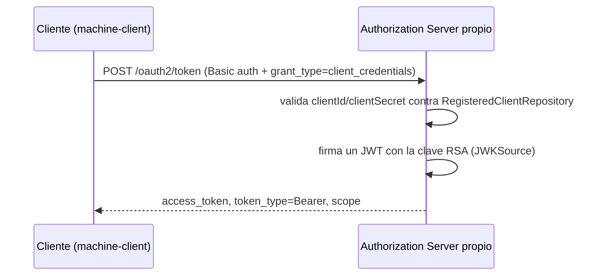

# Módulo 18: Autenticación y backend seguro con Spring Security

## Aprende construyendo

El resultado será una API Spring Boot que autentica requests con un proveedor OAuth 2.0/OIDC, autoriza por scope/rol y valida entradas. No se implementa una firma JWT artesanal: el laboratorio usa Spring Security Resource Server para validar tokens emitidos por un issuer de confianza.

### Dos ejemplos: primero visible, luego real

- **Ejemplo sencillo:** `/health` es público; `/api/envios` requiere identidad y `/api/admin/tarifas` exige autoridad admin. Prueba los resultados 200, 401 y 403 con MockMvc.
- **Caso RutaFlow:** dos usuarios del mismo rol consultan `/api/envios/{id}`. Solo el propietario o un permiso explícito del tenant puede ver ese envío; agrega pruebas para dueño, otro usuario, token expirado y solicitud sin credencial.

El rol permite entrar a una clase de operación; la comprobación de propiedad autoriza el objeto concreto. El caso aplicado no se considera listo solo porque el token tenga firma válida.

### Tema 1: SecurityFilterChain y autorización · Avanzado · 1 h 30 min

**Prerrequisito:** Módulo 17 de este track, JDK 27+ y Maven.

**Al terminar podrás:** proteger endpoints, distinguir 401 de 403 y probar reglas con MockMvc. Continúa el `SecurityFilterChain` del Módulo 4, Tema 1 con autorización por rol, `@PreAuthorize` y OAuth2 resource server.

#### Aprende

Un operador autenticado puede consultar envíos, pero solo un rol de administración puede cambiar reglas de tarifas. Autenticación y autorización son decisiones diferentes.

**¿Por qué es importante?** Una política explícita de denegación por defecto evita que un endpoint nuevo quede público por accidente.

**Mapa de subtemas críticos**

| Subtema | Papel | Evidencia |
|---|---|---|
| Autenticación vs. autorización | Prerrequisito | 401 cuando falta/invalida la credencial; 403 cuando se autenticó pero no tiene permiso |
| Declaración de `SecurityFilterChain` | Núcleo | El `@Bean` que encadena `authorizeHttpRequests(...)` y `.oauth2ResourceServer(...)` |
| Orden y precedencia de `requestMatchers` | Núcleo | `/health` permitAll antes que `/api/admin/**` hasRole y `/api/**` authenticated |
| Denegación por defecto `anyRequest().denyAll()` | Límite | El fallo deliberado cambia a `.anyRequest().permitAll()` y los tests de seguridad fallan |
| Method security con `@PreAuthorize` | Variante | `@EnableMethodSecurity` + `@PreAuthorize("hasRole('ADMIN')")` en método de servicio |
| Prefijo `ROLE_` y mapeo claim→authority | Error frecuente | Un usuario autenticado entra a la ruta admin si el prefijo no coincide |
| Validación del token por el resource server | Decisión | Verifica emisor, firma, expiración y audiencia; no aceptar solo por decodificar el payload |
| Autorización a nivel de objeto (propiedad) | Diagnóstico | `GET /api/envios/{id}` distingue propietario, otro usuario y operador de tenant |

Cada fila tiene su explicación individual a continuación.

**Autenticación vs. autorización (prerrequisito).** Autenticar responde quién eres y autorizar responde a qué puedes acceder; son decisiones separadas. Por eso el tema distingue 401, que indica que falta o no es válida la autenticación, de 403, que significa que te autenticaste pero no tienes permiso. Confundirlas lleva a diagnósticos equivocados, como tratar un problema de permisos como si fuera de credenciales.

**Declaración de `SecurityFilterChain` (núcleo).** El `@Bean SecurityFilterChain api(HttpSecurity http)` declara cómo se procesa cada request: encadena `authorizeHttpRequests(...)` con las reglas y `oauth2ResourceServer(oauth -> oauth.jwt(...))` para validar el bearer token. Un token válido identifica claims y las reglas convierten esos claims en autoridades. Sin este bean no hay política explícita y la cadena por defecto no refleja las reglas del dominio.

**Orden y precedencia de `requestMatchers` (núcleo).** Las reglas se evalúan en el orden declarado: `/health` como `permitAll`, `/api/admin/**` con `hasRole("ADMIN")`, `/api/**` como `authenticated` y el resto `denyAll`. Colocar una regla más general antes que una específica dejaría la específica inalcanzable. El orden mostrado va de la ruta pública a la más restringida y termina cerrando todo lo no declarado.

**Denegación por defecto `anyRequest().denyAll()` (límite).** El `denyAll()` final garantiza que cualquier endpoint no contemplado quede cerrado en lugar de abierto. El fallo deliberado lo demuestra: al cambiarlo a `.anyRequest().permitAll()` los tests de seguridad fallan, y restaurar la denegación los vuelve a pasar. Este límite convierte un olvido de configuración en un error visible en vez de una fuga silenciosa.

**Method security con `@PreAuthorize` (variante).** Además de proteger rutas en la cadena, `@EnableMethodSecurity` habilita anotar métodos de servicio con `@PreAuthorize("hasRole('ADMIN')")`. Es una variante de aplicar la política a nivel de método en lugar de solo por URL. El tema advierte no duplicar en controller y servicio reglas incompatibles, porque dos políticas que se contradicen producen comportamiento ambiguo.

**Prefijo `ROLE_` y mapeo claim→authority (error frecuente).** `hasRole("ADMIN")` espera la autoridad `ROLE_ADMIN`; por eso el test fija `new SimpleGrantedAuthority("ROLE_ADMIN")`. Si un usuario autenticado entra a la ruta admin, el prefijo `ROLE_` o el mapeo del claim del issuer a la autoridad no coinciden. Igualmente, si `@PreAuthorize` se ignora, suele faltar `@EnableMethodSecurity` o el método se invoca desde el mismo bean sin pasar por el proxy.

**Validación del token por el resource server (decisión).** Un JWT firmado no es necesariamente secreto y decodificar su payload no lo valida. El resource server verifica emisor, firma, expiración y audiencia según la configuración del `issuer-uri`, que aquí se inyecta por `OIDC_ISSUER_URI`. La decisión es nunca aceptar un token solo por poder leer su contenido y no guardar tokens reales en el repositorio.

**Autorización a nivel de objeto (propiedad) (diagnóstico).** Un rol general permite entrar a una clase de operación, pero no autoriza automáticamente cualquier objeto. Por eso `GET /api/envios/{id}` debe comprobar además que el recurso pertenece al usuario o tenant, con tests que distingan propietario, otro usuario y operador. El diagnóstico está en el checklist: si dos usuarios del mismo rol ven envíos ajenos, falta la comprobación de propiedad pese a tener token válido.

`SecurityFilterChain` declara cómo procesar requests. Un bearer token válido identifica claims; las reglas convierten claims en autoridades. 401 indica que falta o no es válida la autenticación; 403 significa que se autenticó, pero no tiene permiso.

Un JWT firmado no es necesariamente secreto. El resource server verifica emisor, firma, expiración y audiencia según la configuración; nunca aceptes un token solo por decodificar su payload.

**Analogía:** la `SecurityFilterChain` es el control de acceso de un edificio: una fila de puestos por los que pasa toda visita antes de entrar. La autenticación es el guardia que verifica quién eres; la autorización es la tarjeta que decide a qué pisos te deja subir el ascensor.

#### Practica

Genera una app con `web`, `security`, `oauth2-resource-server` y `validation`.

**Desde cero:** parte de una carpeta vacía, ejecuta el comando que aparece debajo y escribe `src/main/java/academia/seguridad/SeguridadConfig.java` con el contenido de este tema.

```bash
curl -fsSL https://start.spring.io/starter.zip -d type=maven-project -o ejemplo.zip && unzip -o ejemplo.zip -d ejemplo
```

**Crea** el archivo `src/main/java/academia/seguridad/SeguridadConfig.java` y pega en él el código mostrado a continuación; guárdalo antes de ejecutarlo.

En `src/main/java/academia/seguridad/SeguridadConfig.java`:

```java
@Configuration
@EnableMethodSecurity
public class SeguridadConfig {
    @Bean
    SecurityFilterChain api(HttpSecurity http) throws Exception {
        return http
            .authorizeHttpRequests(auth -> auth
                .requestMatchers("/health").permitAll()
                .requestMatchers("/api/admin/**").hasRole("ADMIN")
                .requestMatchers("/api/**").authenticated()
                .anyRequest().denyAll())
            .oauth2ResourceServer(oauth -> oauth.jwt(Customizer.withDefaults()))
            .build();
    }
}
```

**Ejecuta el ejemplo** (genera el proyecto con Spring Initializr, pega el código y corre las pruebas):

```bash
curl -fsSL https://start.spring.io/starter.zip -d type=maven-project -d dependencies=web -d javaVersion=25 -o app.zip && unzip -o app.zip
./mvnw test
```
Equivalencias Maven/Gradle en el Módulo 1.

En `src/main/resources/application.yml`, configura `spring.security.oauth2.resourceserver.jwt.issuer-uri: ${OIDC_ISSUER_URI}`. Agrega `/api/envios` y `/api/admin/tarifas`; no guardes tokens reales en el repositorio. En un test con MockMvc puedes fijar authorities sin depender del issuer:

```java
import static org.springframework.security.test.web.servlet.request.SecurityMockMvcRequestPostProcessors.jwt;
import static org.springframework.test.web.servlet.request.MockMvcRequestBuilders.get;
import static org.springframework.test.web.servlet.result.MockMvcResultMatchers.status;
import org.springframework.security.core.authority.SimpleGrantedAuthority;

mockMvc.perform(get("/api/admin/tarifas")
        .with(jwt().authorities(new SimpleGrantedAuthority("ROLE_ADMIN"))))
    .andExpect(status().isOk());
```

Prueba además `.with(jwt())` sin autoridad admin (403) y una petición sin `jwt()` (401). Ejecuta `./mvnw test`.

**Resultado esperado:** público 200; request sin credencial 401; usuario autenticado en ruta admin 403; autoridad necesaria 200. **Fallo deliberado:** cambia la regla general a `.anyRequest().permitAll()` y confirma que los tests de seguridad fallan; restaura denegación por defecto.

Añade `@PreAuthorize` a una operación de negocio. Escribe pruebas para cada rol y revisa el mapeo claim→authority del issuer real. No dupliques en controller y servicio reglas incompatibles.

**Pista:** anota con `@PreAuthorize("hasRole('ADMIN')")` un método de servicio y llámalo en un test con `jwt().authorities(new SimpleGrantedAuthority("ROLE_USER"))`; si el método se ejecuta igual, revisa que `@EnableMethodSecurity` esté presente en la configuración y que el prefijo de la autoridad coincida con el que realmente mapeas desde el claim del issuer.

#### Aplica

Protege `GET /api/envios/{id}` comprobando también que el recurso pertenece al usuario o tenant. Un rol general no autoriza automáticamente cualquier objeto. Diseña tests para owner, otro usuario y operador.

**Checklist de salida.**

- [ ] `/health` responde 200 sin credencial y `/api/**` responde 401 sin token.
- [ ] Un JWT válido sin `ROLE_ADMIN` recibe 403 en `/api/admin/tarifas`.
- [ ] `@EnableMethodSecurity` y `@PreAuthorize` protegen la operación de negocio y los tests por rol pasan.
- [ ] `GET /api/envios/{id}` distingue propietario, otro usuario y operador de tenant.
- [ ] La regla general es `denyAll()` y ningún endpoint nuevo queda público por accidente.
- [ ] El issuer se configura por `OIDC_ISSUER_URI` y no hay tokens reales en el repositorio.

**Si falla.** Si una petición sin credencial devuelve 403 en lugar de 401, el request no se autenticó: revisa que la prueba no adjunte `jwt()`. Si un usuario autenticado entra en la ruta admin, comprueba el prefijo `ROLE_` de la autoridad y el mapeo claim→authority. Si `@PreAuthorize` se ignora, falta `@EnableMethodSecurity` o el método se invoca desde el mismo bean sin pasar por el proxy.

Entrega configuración, matriz de permisos y tests para 401/403/permitido como incremento del proyecto integrador de RutaFlow. **Cuándo no usarlo:** no deshabilites CSRF en una app que autentica con cookies solo porque es HTTP; en APIs stateless con bearer explícito la decisión es distinta. CORS no es autenticación.

Como **siguiente** paso, lleva lo aprendido al próximo tema y conéctalo con el proyecto integrador del track.

**Errores comunes:** cambiar la regla general a `.anyRequest().permitAll()` "para probar más rápido" y olvidar restaurar la denegación por defecto, y duplicar la misma regla de autorización en `@PreAuthorize` del controller y en `SecurityFilterChain`, terminando con dos políticas que se contradicen.

**Fuente oficial:** [documentación de Spring Boot](https://docs.spring.io/spring-boot/index.html).

### Tema 2: DTO validation, CORS, JWT/OIDC y clientes HTTP · Avanzado · 1 h 20 min

**Prerrequisito:** Tema 1 de este módulo y el entorno del stack instalado (JDK 27+ y Maven).

**Al terminar podrás:** rechazar datos inválidos antes de ejecutar lógica de negocio y configurar de forma deliberada los límites de una API.

#### Aprende

Una solicitud de envío contiene peso negativo y una dirección excesivamente larga. Si se persiste sin validar, el problema se propaga al cálculo y al proceso de entrega.

**¿Por qué es importante?** Validar y limitar la entrada en el borde de la API reduce errores de dominio y superficie de ataque antes de tocar persistencia o servicios externos.

**Mapa de subtemas críticos**

| Subtema | Papel | Evidencia |
|---|---|---|
| Restricciones Bean Validation en el DTO | Prerrequisito | `@NotBlank @Size(max = 80)` en `referencia` y `@Positive` en `pesoKg` |
| Activación con `@Valid` en el controlador | Núcleo | `@Valid @RequestBody CrearEnvioRequest`: válida 201, peso negativo 400 |
| DTO como contrato HTTP estable | Variante | El `record CrearEnvioRequest` separa el contrato de las entidades internas |
| CORS y su límite de alcance | Límite | CORS controla orígenes del navegador; no bloquea clientes no-browser |
| CORS `*` con credenciales | Error frecuente | El navegador rechaza `*` combinado con credenciales |
| Cliente HTTP y protección SSRF | Núcleo | El test hacia `169.254.169.254` debe bloquearse antes de abrir la conexión |
| Reintentos por clase de error | Decisión | 4xx fallo funcional, 5xx transitorio, reintento solo en operación idempotente |
| Cuerpo de error estable (Problem Details) | Diagnóstico | Si el cuerpo cambia entre pruebas, centralizar el formato de error |

Cada fila tiene su explicación individual a continuación.

**Restricciones Bean Validation en el DTO (prerrequisito).** `CrearEnvioRequest` declara las reglas con anotaciones: `@NotBlank @Size(max = 80)` sobre `referencia` y `@Positive` sobre `pesoKg`. Estas restricciones describen qué entrada es aceptable antes de que la lógica de negocio la toque. Son el prerrequisito de cualquier validación: sin ellas declaradas, `@Valid` no tiene qué evaluar.

**Activación con `@Valid` en el controlador (núcleo).** Declarar las restricciones no basta; el controlador recibe `@Valid @RequestBody CrearEnvioRequest request` para que se evalúen en el borde. Una referencia válida responde 201 y un peso negativo responde 400 con cuerpo de error estable. El fallo deliberado lo confirma: al quitar `@Valid`, una entrada inválida alcanza al controlador o servicio, y restaurarlo recupera el 400.

**DTO como contrato HTTP estable (variante).** El `record CrearEnvioRequest` actúa como contrato HTTP, separado de las entidades de persistencia. Esta variante protege el API de cambios internos de las entidades, de modo que modificar un modelo de dominio no rompa a los clientes. Mantener el DTO independiente evita acoplar el formato expuesto a la representación almacenada.

**CORS y su límite de alcance (límite).** CORS controla qué orígenes web pueden leer respuestas desde un navegador, pero no bloquea clientes no-browser. Entender este límite evita tratar CORS como un control de autorización: un cliente que no es navegador ignora la política. CORS no es autenticación; delimita lectura cruzada de orígenes en el contexto del navegador.

**CORS `*` con credenciales (error frecuente).** Un error típico es configurar CORS con origen `*` junto con credenciales habilitadas, combinación que el navegador rechaza y que además expondría la API a cualquier origen. El tema pide usar el origen exacto de desarrollo en lugar del comodín. Si el navegador rechaza CORS, se revisa que el origen sea exacto y que no se combine `*` con credenciales.

**Cliente HTTP y protección SSRF (núcleo).** El `HttpClient` saliente necesita timeout, allowlist de hosts y protección SSRF, sin seguir redirecciones arbitrarias a destinos internos. La prueba apunta el cliente a `http://169.254.169.254/`: si la petición sale sin que la allowlist la rechace, el control de SSRF no está aplicado en el código. El destino debe bloquearse antes de abrir la conexión, no solo estar documentado como riesgo.

**Reintentos por clase de error (decisión).** La decisión de reintentar depende de la clase de respuesta: los 4xx se tratan como fallo funcional y no se reintentan, los 5xx como potencialmente transitorios y solo se reintenta la operación idempotente. El tema advierte no agregar retry a escrituras sin idempotency key, porque repetir una operación no idempotente puede duplicar efectos. Así el reintento se limita a casos donde repetir es seguro.

**Cuerpo de error estable (Problem Details) (diagnóstico).** Las respuestas de error deben usar un cuerpo estable con Problem Details, centralizado en lugar de un texto distinto por endpoint. El diagnóstico aparece cuando el cuerpo de error cambia entre pruebas: la señal es centralizar el formato de error. Un cuerpo consistente permite que los tests comprueben errores sin fijar textos ad hoc por ruta.

Bean Validation declara restricciones de entrada (`@NotBlank`, `@Positive`, `@Size`) y `@Valid` activa su evaluación. DTOs protegen el contrato HTTP de cambios internos de las entidades. CORS controla qué orígenes web pueden leer respuestas desde un navegador; no bloquea clientes no-browser. CSRF importa cuando el navegador adjunta credenciales automáticamente, especialmente cookies.

OAuth 2.0 y OIDC deben delegar emisión/rotación de credenciales a un proveedor confiable. `HttpClient` saliente necesita timeout, allowlist y protección SSRF; no sigas redirecciones arbitrarias a destinos internos.

**Analogía:** validar el DTO es revisar el formulario de aduana antes de dejar pasar la mercancía; CORS es la lista de países desde los que se aceptan envíos; el JWT/OIDC es el pasaporte sellado que acredita al viajero; y el cliente HTTP es el mensajero que lleva y trae esos paquetes entre oficinas.

#### Practica

**Desde cero:** parte de una carpeta vacía, ejecuta el comando que aparece debajo y escribe `src/main/java/academia/envios/CrearEnvioRequest.java` con el contenido de este tema.

```bash
curl -fsSL https://start.spring.io/starter.zip -d type=maven-project -o ejemplo.zip && unzip -o ejemplo.zip -d ejemplo
```

En `src/main/java/academia/envios/CrearEnvioRequest.java`:

```java
public record CrearEnvioRequest(
    @NotBlank @Size(max = 80) String referencia,
    @Positive BigDecimal pesoKg
) {}
```

**Ejecuta el ejemplo** (genera el proyecto con Spring Initializr, pega el código y corre las pruebas):

```bash
curl -fsSL https://start.spring.io/starter.zip -d type=maven-project -d dependencies=web -d javaVersion=25 -o app.zip && unzip -o app.zip
./mvnw test
```
Equivalencias Maven/Gradle en el Módulo 1.

El controlador recibe `@Valid @RequestBody CrearEnvioRequest request`. Ejecuta `./mvnw test` con `MockMvc`: una referencia válida crea 201; peso negativo devuelve 400 con cuerpo de error estable. Configura CORS con origen exacto de desarrollo, no `*` combinado con credenciales.

**Resultado esperado:** los datos inválidos se rechazan antes de invocar el servicio. **Fallo deliberado:** quita `@Valid`; verifica que una entrada inválida alcanza al controlador/servicio. Restaura la validación y comprueba 400.

Implementa cliente HTTP de servicio a servicio con timeout y host allowlisted. Trata 4xx como fallo funcional, 5xx como potencialmente transitorio y reintenta solo operación idempotente. Añade una prueba de intento de acceder a `169.254.169.254`; debe ser bloqueado por política de red y aplicación.

**Pista:** apunta el cliente HTTP directamente a `http://169.254.169.254/` en el test y ejecútalo; si la petición sale sin que tu allowlist de hosts la rechace, el control de SSRF no está aplicado en el código del cliente — debe bloquear el destino antes de abrir la conexión, no solo estar documentado como riesgo.

#### Aplica

Entrega una API con Problem Details para errores, validación de campos, límites de payload configurados y CORS específico. Escribe tabla con riesgo, control y prueba para token expirado, payload inválido, usuario ajeno, SSRF y repetición de request.

**Checklist de salida.**

- [ ] `CrearEnvioRequest` usa `@NotBlank`, `@Size` y `@Positive`, y el controlador recibe `@Valid`.
- [ ] Una referencia válida responde 201 y un peso negativo responde 400 con cuerpo de error estable.
- [ ] CORS usa el origen exacto de desarrollo y no combina `*` con credenciales.
- [ ] El cliente HTTP aplica timeout, allowlist y bloquea `169.254.169.254` antes de abrir la conexión.
- [ ] Los 4xx se tratan como fallo funcional, los 5xx como transitorios y solo se reintenta lo idempotente.
- [ ] La entrega incluye la tabla riesgo-control-prueba para token expirado, payload inválido, usuario ajeno, SSRF y repetición.

**Si falla.** Si una entrada inválida alcanza el servicio, falta `@Valid` en el parámetro del controlador. Si el cuerpo de error cambia entre pruebas, centraliza el formato de error en vez de fijar un texto distinto por endpoint. Si el test hacia `169.254.169.254` completa la conexión, la allowlist no se aplica en el cliente: bloquéala antes de abrir la conexión. Si el navegador rechaza CORS, revisa que el origen sea exacto y que no combines `*` con credenciales.

En el proyecto integrador de RutaFlow, estos controles protegen creación de envíos y llamadas a proveedores de geocodificación. **Cuándo no usarlo:** no agregues retry a escrituras sin idempotency key; no uses validación de URL basada solo en regex.

Como **siguiente** paso, lleva lo aprendido al próximo tema y conéctalo con el proyecto integrador del track.

**Errores comunes:** quitar `@Valid` del parámetro del controlador "para simplificar" y dejar que una entrada inválida llegue al servicio, y configurar CORS con origen `*` junto con credenciales habilitadas, algo que el navegador rechaza y que además expondría la API a cualquier origen.

**Fuente oficial:** [documentación de Spring Boot](https://docs.spring.io/spring-boot/index.html).

### Tema 3: Levantar tu propio OAuth2 Authorization Server · Experto · 50 min

**Prerrequisito:** Módulo 10 Tema 4 de este track (OAuth2 resource server/client con Keycloak).

**Al terminar podrás:** levantar un `OAuth2AuthorizationServerConfigurer` propio con un cliente `client_credentials` registrado en memoria, y confirmar con una petición real al endpoint `/oauth2/token` que el servidor emite un JWT real, firmado con una clave RSA generada al arrancar.

#### Aprende

**¿Por qué es importante?** El Módulo 10 Tema 4 consumió identidad de un proveedor EXTERNO (Keycloak); este tema resuelve el caso inverso: un sistema propio (RutaFlow, por ejemplo) que necesita emitir sus propios tokens para que servicios internos (un worker de facturación, un job batch) se autentiquen entre sí sin un usuario humano de por medio, sin depender de un proveedor de identidad externo.

**Mapa de subtemas críticos**

| Subtema | Papel | Evidencia |
|---|---|---|
| `OAuth2AuthorizationServerConfigurer` real | Núcleo | se instancia directamente (`new OAuth2AuthorizationServerConfigurer()`), no vía un método factory estático |
| `RegisteredClientRepository` en memoria | Prerrequisito | un `RegisteredClient` con `AuthorizationGrantType.CLIENT_CREDENTIALS` registrado sin base de datos |
| `JWKSource` con clave RSA generada al arrancar | Núcleo | el servidor firma tokens con una clave que cambia en cada reinicio, invalidando tokens previos |
| `/oauth2/token` responde un JWT real | Núcleo | la petición con `client_secret_basic` real devuelve `access_token`, `token_type: Bearer` y el `scope` pedido |
| Credenciales inválidas rechazan la petición | Diagnóstico | un secreto incorrecto responde `401`, no un token vacío ni un error genérico |
| `client_credentials` sin flujo de login | Decisión | sin usuario humano involucrado, no hace falta `UserDetailsService`, formulario de login ni OIDC |

Cada fila tiene su explicación individual a continuación.

**`OAuth2AuthorizationServerConfigurer` real (núcleo).** A diferencia de patrones de ejemplos antiguos que sugieren un método factory estático, la versión real de este configurer (confirmado inspeccionando directamente la clase compilada) se instancia con su constructor normal: `new OAuth2AuthorizationServerConfigurer()`, y se aplica a `HttpSecurity` vía `.with(configurer, customizer)`, el mismo patrón DSL que cualquier otro configurer de Spring Security.

**`RegisteredClientRepository` en memoria (prerrequisito).** `RegisteredClient.withId(...).clientId("machine-client").clientSecret("{noop}secret").clientAuthenticationMethod(ClientAuthenticationMethod.CLIENT_SECRET_BASIC).authorizationGrantType(AuthorizationGrantType.CLIENT_CREDENTIALS).scope("tarifas.read").build()` declara un cliente completo sin ninguna base de datos; `InMemoryRegisteredClientRepository` lo expone al servidor de autorización. Es el prerrequisito de identidad: sin un cliente registrado, ninguna petición de token puede autenticarse.

**`JWKSource` con clave RSA generada al arrancar (núcleo).** El servidor necesita un par de claves RSA para firmar los JWT que emite; este demo las genera EN MEMORIA al arrancar (`KeyPairGenerator.getInstance("RSA")`), lo que significa que un reinicio del servidor genera una clave distinta e invalida silenciosamente cualquier token emitido con la clave anterior — aceptable para un demo, pero una decisión real de producción necesita persistir o rotar claves deliberadamente.

**`/oauth2/token` responde un JWT real (núcleo).** El test hace una petición POST real a `/oauth2/token` con autenticación HTTP Basic (`client-id:client-secret`) y `grant_type=client_credentials`, y confirma en la respuesta real: `access_token` presente, `token_type` igual a `"Bearer"`, y `scope` igual al pedido (`"tarifas.read"`). No es una respuesta simulada: es el servidor de autorización real emitiendo un token real.

**Credenciales inválidas rechazan la petición (diagnóstico).** El segundo test confirma, con un secreto de cliente incorrecto, que el servidor responde `401 Unauthorized`, no un error distinto ni (peor) un token válido. Es la verificación mínima de que la autenticación del cliente contra el Authorization Server realmente se aplica, no solo se declara.

**`client_credentials` sin flujo de login (decisión).** Porque este escenario es máquina-a-máquina (sin usuario humano), la configuración omite deliberadamente `UserDetailsService`, formulario de login, y el configurer `.oidc(...)`: ninguno de esos mecanismos tiene sentido cuando no hay una persona autenticándose. Agregar esas piezas sin necesitarlas sería complejidad sin propósito.

**Conceptos clave:** `OAuth2AuthorizationServerConfigurer`, `RegisteredClientRepository`, `client_credentials`, `JWKSource`.

Un `OAuth2AuthorizationServerConfigurer` propio (instanciado con su constructor, no un factory estático) convierte una aplicación Spring en un emisor de tokens OAuth2 real. Un `RegisteredClientRepository` (en memoria para este demo) declara qué clientes pueden pedir tokens y con qué grant type; `client_credentials` es el grant apropiado para comunicación máquina-a-máquina sin usuario humano. El servidor firma los tokens con una clave RSA expuesta vía `JWKSource`. El endpoint `/oauth2/token` responde con un JWT real ante credenciales válidas, y `401` ante credenciales inválidas.

**Analogía:** levantar tu propio Authorization Server es como una empresa que decide emitir sus propias credenciales de acceso interno en vez de depender de un servicio externo de verificación de identidad; el cliente `client_credentials` es como un empleado de mantenimiento que se identifica con una credencial de servicio (no una persona con usuario y contraseña) para acceder a un área restringida sin que haya ningún proceso de "inicio de sesión" humano de por medio.

**Diagrama:**



#### Practica

**Demo paso a paso.** Desde una carpeta vacía, genera el proyecto:

```bash
mkdir authserver-demo && cd authserver-demo
curl -fsSL https://start.spring.io/starter.zip -d type=maven-project -d dependencies=oauth2-authorization-server -d javaVersion=27 -o app.zip
unzip -q app.zip
```

Crea `src/main/java/com/academia/authserver/AuthorizationServerConfig.java`:

```java
package com.academia.authserver;

import java.security.KeyPair;
import java.security.KeyPairGenerator;
import java.security.interfaces.RSAPrivateKey;
import java.security.interfaces.RSAPublicKey;
import java.util.UUID;

import com.nimbusds.jose.jwk.JWKSet;
import com.nimbusds.jose.jwk.RSAKey;
import com.nimbusds.jose.jwk.source.ImmutableJWKSet;
import com.nimbusds.jose.jwk.source.JWKSource;
import com.nimbusds.jose.proc.SecurityContext;

import org.springframework.context.annotation.Bean;
import org.springframework.context.annotation.Configuration;
import org.springframework.core.annotation.Order;
import org.springframework.security.config.annotation.web.builders.HttpSecurity;
import org.springframework.security.config.annotation.web.configuration.EnableWebSecurity;
import org.springframework.security.config.annotation.web.configurers.oauth2.server.authorization.OAuth2AuthorizationServerConfigurer;
import org.springframework.security.oauth2.core.AuthorizationGrantType;
import org.springframework.security.oauth2.core.ClientAuthenticationMethod;
import org.springframework.security.oauth2.server.authorization.client.InMemoryRegisteredClientRepository;
import org.springframework.security.oauth2.server.authorization.client.RegisteredClient;
import org.springframework.security.oauth2.server.authorization.client.RegisteredClientRepository;
import org.springframework.security.oauth2.server.authorization.settings.AuthorizationServerSettings;
import org.springframework.security.web.SecurityFilterChain;

@Configuration
@EnableWebSecurity
public class AuthorizationServerConfig {

    @Bean
    @Order(1)
    public SecurityFilterChain authorizationServerSecurityFilterChain(HttpSecurity http) throws Exception {
        OAuth2AuthorizationServerConfigurer authorizationServerConfigurer =
                new OAuth2AuthorizationServerConfigurer();

        http
            .securityMatcher(authorizationServerConfigurer.getEndpointsMatcher())
            .with(authorizationServerConfigurer, (authorizationServer) -> { })
            .authorizeHttpRequests((authorize) -> authorize.anyRequest().authenticated());

        return http.build();
    }

    @Bean
    @Order(2)
    public SecurityFilterChain defaultSecurityFilterChain(HttpSecurity http) throws Exception {
        http.authorizeHttpRequests((authorize) -> authorize.anyRequest().denyAll());
        return http.build();
    }

    @Bean
    public RegisteredClientRepository registeredClientRepository() {
        RegisteredClient machineClient = RegisteredClient.withId(UUID.randomUUID().toString())
                .clientId("machine-client")
                .clientSecret("{noop}secret") // solo para este demo; en producción usa un PasswordEncoder real
                .clientAuthenticationMethod(ClientAuthenticationMethod.CLIENT_SECRET_BASIC)
                .authorizationGrantType(AuthorizationGrantType.CLIENT_CREDENTIALS)
                .scope("tarifas.read")
                .build();

        return new InMemoryRegisteredClientRepository(machineClient);
    }

    @Bean
    public JWKSource<SecurityContext> jwkSource() {
        KeyPair keyPair = generateRsaKey();
        RSAPublicKey publicKey = (RSAPublicKey) keyPair.getPublic();
        RSAPrivateKey privateKey = (RSAPrivateKey) keyPair.getPrivate();
        RSAKey rsaKey = new RSAKey.Builder(publicKey)
                .privateKey(privateKey)
                .keyID(UUID.randomUUID().toString())
                .build();
        return new ImmutableJWKSet<>(new JWKSet(rsaKey));
    }

    private static KeyPair generateRsaKey() {
        try {
            KeyPairGenerator generator = KeyPairGenerator.getInstance("RSA");
            generator.initialize(2048);
            return generator.generateKeyPair();
        } catch (Exception ex) {
            throw new IllegalStateException(ex);
        }
    }

    @Bean
    public AuthorizationServerSettings authorizationServerSettings() {
        return AuthorizationServerSettings.builder().build();
    }
}
```

Agrega las dependencias reales de testing (`spring-boot-webmvc-test` del Módulo 2 Tema 7, más `spring-security-test` para `httpBasic(...)`) y crea el test en `src/test/java/com/academia/authserver/TokenEndpointTest.java`:

```java
package com.academia.authserver;

import org.junit.jupiter.api.Test;
import org.springframework.beans.factory.annotation.Autowired;
import org.springframework.boot.test.context.SpringBootTest;
import org.springframework.boot.webmvc.test.autoconfigure.AutoConfigureMockMvc;
import org.springframework.test.web.servlet.MockMvc;

import static org.springframework.security.test.web.servlet.request.SecurityMockMvcRequestPostProcessors.httpBasic;
import static org.springframework.test.web.servlet.request.MockMvcRequestBuilders.post;
import static org.springframework.test.web.servlet.result.MockMvcResultMatchers.jsonPath;
import static org.springframework.test.web.servlet.result.MockMvcResultMatchers.status;

@SpringBootTest
@AutoConfigureMockMvc
class TokenEndpointTest {

    @Autowired
    private MockMvc mockMvc;

    @Test
    void elClienteRealObtieneUnAccessTokenConClientCredentials() throws Exception {
        mockMvc.perform(post("/oauth2/token")
                        .param("grant_type", "client_credentials")
                        .param("scope", "tarifas.read")
                        .with(httpBasic("machine-client", "secret")))
                .andExpect(status().isOk())
                .andExpect(jsonPath("$.access_token").exists())
                .andExpect(jsonPath("$.token_type").value("Bearer"))
                .andExpect(jsonPath("$.scope").value("tarifas.read"));
    }

    @Test
    void credencialesInvalidasRechazanLaPeticion() throws Exception {
        mockMvc.perform(post("/oauth2/token")
                        .param("grant_type", "client_credentials")
                        .with(httpBasic("machine-client", "credencial-equivocada")))
                .andExpect(status().isUnauthorized());
    }
}
```

```bash
./mvnw test
```

**Resultado esperado:** `Tests run: 2, Failures: 0, Errors: 0` (verificado con Spring Boot 4.1.1 / Spring Security 7.1.1 / Spring Framework 7.0.9 sobre JDK 27.0.1): la petición con credenciales válidas recibe un `access_token` real, `token_type: Bearer` y el `scope` pedido; la petición con secreto incorrecto recibe `401 Unauthorized`.

**Fallo deliberado:** usa el método factory estático `OAuth2AuthorizationServerConfigurer.authorizationServer()` (como sugieren varios tutoriales y ejemplos de versiones anteriores) en vez de `new OAuth2AuthorizationServerConfigurer()`. La compilación FALLA: `cannot find symbol: method authorizationServer()`. Diagnostica confirmando, inspeccionando la clase real compilada (no solo confiando en un tutorial), que esta versión del configurer se instancia con su constructor normal, sin ningún método factory estático — un ejemplo concreto de por qué verificar contra el código real importa más que replicar un patrón de un tutorial sin confirmarlo. Restaura `new OAuth2AuthorizationServerConfigurer()` antes de continuar.

**Ejercicios.**

1. Decodifica (sin verificar la firma, solo la carga útil Base64) el `access_token` recibido y documenta qué claims contiene (`scope`, `iss`, `exp`, entre otros).
2. Registra un segundo `RegisteredClient` con un scope distinto, y confirma con un test que un cliente no puede obtener un token con un scope que no tiene asignado.
3. Reinicia la aplicación (en un entorno real, no en el test) y documenta por qué un token emitido antes del reinicio deja de ser válido — relacionado con cómo se genera la clave RSA en este demo.
4. Escribe de memoria (sin mirar) un `RegisteredClient` con grant `client_credentials`, y un test que confirme que el endpoint de token real responde con un JWT. Compara después contra el patrón del Paso 4.

**Pista:** si un tutorial o ejemplo usa un método estático que no existe en tu versión, no asumas que el tutorial está mal escrito ni que tu versión está rota: inspecciona la clase real (`javap` sobre el `.class`, o la documentación de la versión exacta que tenés) antes de decidir cuál tiene razón.

**Completa el código:** rellena el grant type apropiado para comunicación máquina-a-máquina sin usuario humano:

```java
RegisteredClient.withId(UUID.randomUUID().toString())
    .clientId("machine-client")
    .authorizationGrantType(AuthorizationGrantType.____)
    .build();
```

**Reto de memoria:** cierra este documento y escribe, solo de memoria, un `RegisteredClientRepository` en memoria con un cliente `client_credentials`, y un test que confirme que `/oauth2/token` emite un JWT real. Compara después contra el patrón del Paso 4.

#### Aplica

**Reto abierto.** Para RutaFlow, diseña el esquema de autenticación máquina-a-máquina entre el servicio de facturación y el servicio de entregas: un Authorization Server propio con al menos dos clientes registrados (`facturacion-worker`, `reportes-batch`), cada uno con su propio scope, y demuestra con tests reales que cada cliente solo puede obtener tokens con su scope asignado.

**Checklist de salida.**

- [ ] `/oauth2/token` responde un JWT real con credenciales válidas, confirmado con un test.
- [ ] Credenciales inválidas responden `401`, no un error genérico ni un token vacío.
- [ ] Al menos dos clientes con scopes distintos están registrados y diferenciados por test.
- [ ] Podés explicar por qué este escenario no necesita `UserDetailsService` ni flujo de login.
- [ ] Entendés la implicación de generar la clave RSA en memoria al arrancar (tokens inválidos tras un reinicio).

**Si falla.** Si la compilación falla con `cannot find symbol: authorizationServer()`, usa `new OAuth2AuthorizationServerConfigurer()` en su lugar (ver el fallo deliberado de este tema). Si el endpoint de token responde `401` con credenciales que parecen correctas, confirma el formato exacto de `clientSecret` (`{noop}secret` para texto plano en un demo, nunca en producción).

**Siguiente paso:** esto cierra el módulo de seguridad avanzada; el proyecto integrador del track aplica estos controles en conjunto.

**Errores comunes:** asumir que un método factory estático de un tutorial siempre existe en la versión real instalada, sin verificarlo contra la clase compilada; usar `client_credentials` para un escenario que en realidad involucra un usuario humano (donde `authorization_code` sería el grant correcto).

**Límites y decisión de uso:** para un sistema con un único cliente conocido y de confianza total (sin necesidad real de rotación de credenciales ni múltiples scopes), un token estático compartido puede ser más simple que levantar un Authorization Server completo; este mecanismo se justifica cuando hay múltiples clientes con necesidades de acceso diferenciadas.

**Fuente oficial:** [Spring Authorization Server — Getting Started](https://docs.spring.io/spring-authorization-server/reference/getting-started.html).

**Transferencia al proyecto integrador:** este Authorization Server propio es el que emitirá credenciales para la comunicación interna entre servicios del microservicio productivo (Módulo 12).
