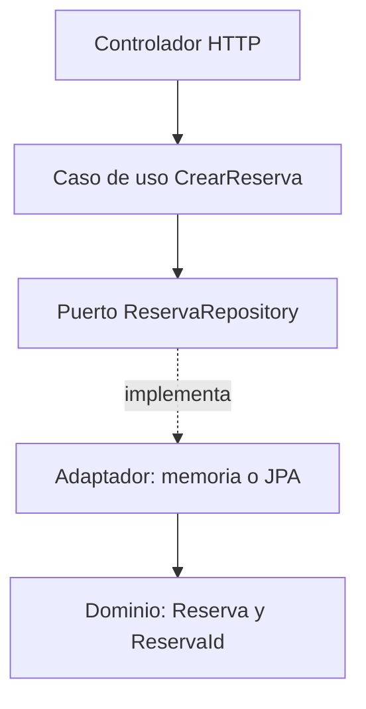
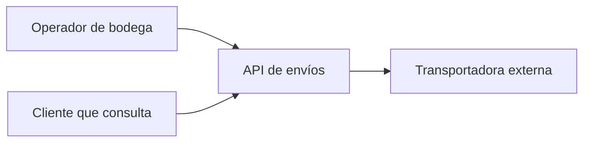
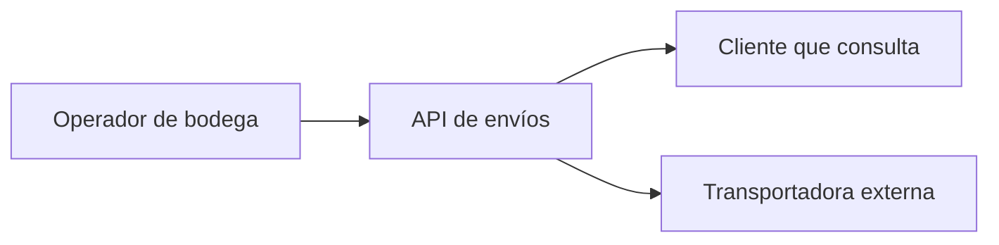
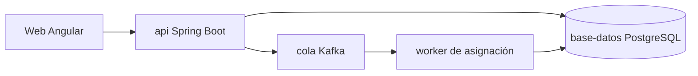
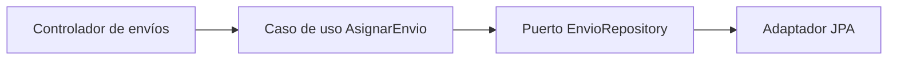
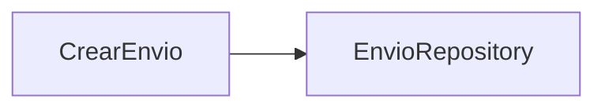
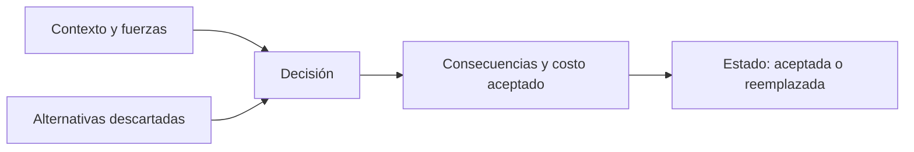

# Módulo 22: Arquitectura: puertos, C4 y decisiones

## Aprende construyendo

Cada tema parte de una carpeta vacía, produce un artefacto concreto y lo verifica con un comando real.

### Tema 1: Hexagonal: puertos que hablan el idioma del dominio · Experto · 1 h 10 min

**Prerrequisito:** Java 21 o superior, `javac`/`java` en el `PATH`, y el Módulo 15 (Clean Architecture y DDD táctico). Comprueba `javac -version`.

**Al terminar podrás:** separar una regla de negocio de su infraestructura con un puerto que devuelve tipos del dominio, y compilar el caso de uso sin Spring ni JPA en el classpath.

#### Aprende

**¿Por qué es importante?** Un puerto que devuelve `Page<ReservaEntity>` obliga al dominio a depender de Spring Data: el test del caso de uso levanta el contexto de Spring, tarda segundos y falla cuando cambia la versión de JPA. El síntoma aparece cuando alguien intenta probar una regla de negocio y descubre que necesita una base de datos. En el proyecto integrador, las reglas de asignación de envíos deben probarse sin infraestructura. Un puerto que habla el idioma del negocio es lo que hace posible esa prueba.

**Mapa de subtemas críticos**

| Subtema | Papel | Evidencia |
|---|---|---|
| Separación dominio / aplicación / adaptadores | Prerrequisito | `record Reserva`, `interface ReservaRepository` y `class EnMemoria` viven en zonas distintas de `Hexagonal.java` |
| Puerto con tipos del dominio | Núcleo | `ReservaRepository` declara `Optional<Reserva> buscar(ReservaId id)`, no entidades |
| Adaptador en memoria | Variante | `EnMemoria implements ReservaRepository` con un `List<Reserva>` compila sin dependencias externas |
| Dirección de dependencias | Núcleo | `java -cp out Hexagonal` imprime `reserva=RES-1 vehiculo=camion-1` sin Spring en el classpath |
| Puerto que filtra por infraestructura | Error frecuente | el puerto con `Page<ReservaEntity>` provoca `package org.springframework.data.domain does not exist` |
| Paginación en el adaptador, no en el puerto | Decisión | añadir `Pageable` al puerto rompe `javac`; `List<Reserva> buscarPorVehiculo` sigue compilando |
| Cuándo NO usar hexagonal | Límite | en un CRUD sin reglas la separación «añade ceremonia sin beneficio» |

Cada fila tiene su explicación individual a continuación.

**Separación dominio / aplicación / adaptadores (prerrequisito).** El ejemplo coloca en un mismo archivo los `record ReservaId`/`Reserva` (dominio), la clase `CrearReserva` (aplicación) y `EnMemoria` (adaptador), pero cada uno cumple un rol distinto. Entender esas tres zonas es condición previa: sin ella, el puerto se confunde con el repositorio concreto y la regla de negocio queda atada a la tecnología.

**Puerto con tipos del dominio (núcleo).** La interfaz `ReservaRepository` declara `guardar(Reserva)` y `Optional<Reserva> buscar(ReservaId)`: habla solo el idioma del negocio. Ese es el mecanismo central de la arquitectura, porque permite que `CrearReserva` coordine la regla sin conocer dónde se persiste. La variante aparece al cambiar la implementación sin tocar el puerto.

**Adaptador en memoria (variante).** `EnMemoria` implementa el puerto con una `List<Reserva>` y un `stream().filter(...).findFirst()`, demostrando que el caso de uso no distingue si detrás hay una lista o una base de datos. Es la variante más barata del adaptador y la que hace posible probar sin infraestructura; una versión JPA sería otra variante del mismo contrato.

**Dirección de dependencias (núcleo).** El programa compila y corre con `javac -d out src/Hexagonal.java` y `java -cp out Hexagonal`, imprimiendo `reserva=RES-1 vehiculo=camion-1` sin mencionar Spring. La dependencia apunta del adaptador hacia el dominio, nunca al revés: por eso el test del caso de uso no necesita levantar contexto.

**Puerto que filtra por infraestructura (error frecuente).** El fallo deliberado cambia el puerto a `Page<ReservaEntity>` y `javac` responde `package org.springframework.data.domain does not exist`. El diagnóstico clave es que no falta una dependencia en el `build.gradle`: el problema es de dirección, el dominio empezó a depender del framework. Corregir el puerto para devolver `Reserva` restablece la compilación.

**Paginación en el adaptador, no en el puerto (decisión).** Añadir `List<Reserva> buscarPorVehiculo(String vehiculo)` compila, pero exigir `Pageable` en el puerto vuelve a romper la compilación. La decisión profesional es ubicar la paginación en el adaptador y que el puerto devuelva una lista del dominio, conservando la independencia frente a Spring Data.

**Cuándo NO usar hexagonal (límite).** El tema advierte que hexagonal «no significa una carpeta por capa ni un puerto por tabla»: en un CRUD sin reglas la separación añade ceremonia sin beneficio. El límite marca la decisión de aplicarla solo donde existen reglas que deben probarse sin infraestructura, como la asignación de envíos del proyecto integrador.

La arquitectura hexagonal separa tres zonas: el **dominio** (tipos y reglas), la **aplicación** (casos de uso que coordinan) y los **adaptadores** (HTTP, JPA, colas). El puerto es una interfaz declarada por la aplicación y hablada en tipos del dominio; el adaptador la implementa traduciendo desde su tecnología.

**Analogía:** un enchufe no sabe qué aparato se conecta. El puerto fija la forma (dos patas, 220 V) y el adaptador es el cable del aparato concreto. Si el enchufe exigiera un tipo de cable propietario, cambiar de aparato obligaría a cambiar la pared.

**Diagrama:**



#### Practica

**Desde cero:** parte de una carpeta vacía y prepara el proyecto:

```bash
mkdir arquitectura-hexagonal && cd arquitectura-hexagonal
mkdir src
```

**Crea** el archivo `src/Hexagonal.java` y pega en él el código mostrado a continuación; guárdalo antes de compilarlo:

```java
import java.util.ArrayList;
import java.util.List;
import java.util.Optional;

public final class Hexagonal {
    record ReservaId(String valor) {
        ReservaId {
            if (valor == null || valor.isBlank()) throw new IllegalArgumentException("id requerido");
        }
    }

    record Reserva(ReservaId id, String vehiculo, int dias) {
        Reserva {
            if (dias <= 0) throw new IllegalArgumentException("dias debe ser positivo");
        }
    }

    // Puerto: declara lo que la aplicación necesita, con tipos del dominio.
    interface ReservaRepository {
        void guardar(Reserva reserva);
        Optional<Reserva> buscar(ReservaId id);
    }

    static final class CrearReserva {
        private final ReservaRepository repositorio;
        CrearReserva(ReservaRepository repositorio) { this.repositorio = repositorio; }

        Reserva ejecutar(ReservaId id, String vehiculo, int dias) {
            Reserva reserva = new Reserva(id, vehiculo, dias);
            repositorio.guardar(reserva);
            return reserva;
        }
    }

    static final class EnMemoria implements ReservaRepository {
        private final List<Reserva> datos = new ArrayList<>();

        public void guardar(Reserva reserva) { datos.add(reserva); }

        public Optional<Reserva> buscar(ReservaId id) {
            return datos.stream().filter(reserva -> reserva.id().equals(id)).findFirst();
        }
    }

    public static void main(String[] args) {
        ReservaRepository repositorio = new EnMemoria();
        Reserva creada = new CrearReserva(repositorio).ejecutar(new ReservaId("RES-1"), "camion-1", 3);
        Reserva recuperada = repositorio.buscar(creada.id()).orElseThrow();
        System.out.println("reserva=" + recuperada.id().valor() + " vehiculo=" + recuperada.vehiculo());
    }
}
```

**Ejecuta el ejemplo** (compila y corre sin ninguna dependencia externa):

```bash
javac -d out src/Hexagonal.java
java -cp out Hexagonal
```

**Resultado esperado:** `reserva=RES-1 vehiculo=camion-1`. El programa no menciona Spring, JPA ni una base de datos: el adaptador es una lista en memoria y el caso de uso no lo sabe.

**Fallo deliberado:** cambia el puerto para que devuelva una entidad de Spring Data:

```java
interface ReservaRepository {
    org.springframework.data.domain.Page<ReservaEntity> buscar(
        org.springframework.data.domain.Pageable pageable);
}
```

Al compilar, `javac` responde:

```text
Hexagonal.java:19: error: package org.springframework.data.domain does not exist
```

El diagnóstico es que el dominio ahora depende de un framework. No falta una dependencia en el `build.gradle`: el problema es de dirección. Corrige el puerto para devolver `Reserva` y comprueba que `javac` vuelve a compilar sin Spring.

**Conceptos clave:** puerto, adaptador, dirección de dependencias, tipos del dominio.

Añade al puerto `List<Reserva> buscarPorVehiculo(String vehiculo)` y verifica que sigue compilando sin Spring. Si necesitas `Pageable` para paginar, la paginación pertenece al adaptador, no al puerto.

**Pista:** si el puerto nuevo exige `Pageable`, la compilación vuelve a fallar; la paginación se implementa en el adaptador y el puerto devuelve una lista del dominio. **Resultado esperado:** el proyecto compila y el caso de uso se prueba con `EnMemoria`, sin levantar contexto.

**Si falla.** Si `javac` no encuentra el archivo, ejecútalo desde la carpeta que contiene `src`. Si `java` dice que no encuentra `Hexagonal`, falta `-cp out`. Si vuelve el error de `org.springframework.data.domain`, el puerto sigue hablando en tipos de infraestructura.

#### Aplica

Crea `src/CancelarReserva.java`: un caso de uso que busque la reserva, valide que no esté ya cancelada y guarde el cambio. Ejecútalo con `java -cp out` desde una clase `Main` propia.

**Resultado esperado:** cancelar dos veces la misma reserva produce un mensaje de dominio, no un `NullPointerException`.

**Checklist de salida.**

- [ ] `javac -d out src/Hexagonal.java` compila sin Spring ni JPA en el classpath.
- [ ] `java -cp out Hexagonal` imprime `reserva=RES-1 vehiculo=camion-1`.
- [ ] El puerto `ReservaRepository` devuelve `Reserva` y `Optional<Reserva>`, no entidades ni `Pageable`.
- [ ] El fallo deliberado reproduce el error de `org.springframework.data.domain` y se corrige.
- [ ] `CancelarReserva` valida el estado y cancelar dos veces deja un mensaje de dominio.
- [ ] La decisión sobre paginación en el adaptador queda explicada.

**Si falla.** Si cancelar dos veces lanza `NullPointerException`, la búsqueda no está devolviendo un caso de dominio y el flujo no valida el estado. Si la segunda cancelación se guarda en silencio, falta la comprobación de la reserva ya cancelada. Si `Main` no compila junto a `CancelarReserva`, vuelve a ejecutar `javac -d out` sobre ambos archivos.

Documentar el sistema completo con C4 es el siguiente paso. **Errores comunes:** devolver entidades JPA desde el puerto; inyectar `Pageable` en el dominio; poner la lógica de negocio en el adaptador; crear un puerto por cada método del repositorio.

**Límites y decisión de uso:** hexagonal no significa una carpeta por capa ni un puerto por tabla. Si el sistema es un CRUD sin reglas, la separación añade ceremonia sin beneficio. En el proyecto integrador se justifica donde hay reglas que deben probarse sin infraestructura.

**Fuente oficial:** [Hexagonal Architecture (Alistair Cockburn)](https://alistair.cockburn.us/hexagonal-architecture/) y [Spring Data JPA](https://docs.spring.io/spring-data/jpa/reference/).

### Tema 2: C4: contexto, contenedores, componentes y código · Experto · 1 h 20 min

**Prerrequisito:** Tema 1 de este módulo; Node.js 20 o superior (`node --version`).

**Al terminar podrás:** dibujar los cuatro niveles C4 de una API de envíos, enlazar cada relación con el código que la implementa y validar el documento con un script que falla si un contenedor del sistema no aparece.

#### Aprende

**¿Por qué es importante?** Un diagrama que nadie puede contrastar se convierte en decoración. En el proyecto integrador, el diagrama de contenedores se usa para decidir dónde vive la cola y quién escribe en la base; si el diagrama muestra un worker que el código no tiene, la decisión se toma sobre una ficción.

**Mapa de subtemas críticos**

| Subtema | Papel | Evidencia |
|---|---|---|
| Los cuatro niveles C4 | Prerrequisito | el validador exige `## Contexto`, `## Contenedores`, `## Componentes` y `## Código` |
| Contenedores desplegables | Núcleo | la lista `['api', 'worker', 'base-datos', 'cola']` se busca en el texto del documento |
| Relaciones verificables | Núcleo | el conteo de `/-->/g` debe ser al menos 12; `C4 OK: 4 niveles y 12 relaciones` |
| Validación por script | Variante | `node validar-c4.mjs` falla con `process.exit(1)` si falta un nivel o contenedor |
| Diagrama y código separados | Error frecuente | borrar `Cola --> Worker` da `Se esperaban al menos 12 relaciones y hay 11` |
| Contar flechas de otro nivel | Diagnóstico | «cada nivel debe mantener sus propias relaciones» si el conteo sube sin mostrarse |
| C4 no sustituye a un ADR | Límite | «C4 responde “qué hay” y el ADR responde “por qué”» |

Cada fila tiene su explicación individual a continuación.

**Los cuatro niveles C4 (prerrequisito).** El documento `docs/c4/envios.md` debe contener exactamente `## Contexto`, `## Contenedores`, `## Componentes` y `## Código`, y el validador comprueba esos encabezados antes que nada. Cada nivel responde una pregunta distinta sin repetir la anterior; omitir uno provoca `Faltan niveles` y bloquea el resto de la verificación.

**Contenedores desplegables (núcleo).** El validador define `const contenedores = ['api', 'worker', 'base-datos', 'cola']` y falla si alguno no aparece en el texto. Estos son las aplicaciones, colas y bases que se despliegan por separado, el mecanismo central del nivel de contenedores. La ausencia produce `Faltan contenedores en el C4: worker`, señal de que el diagrama dejó de reflejar el sistema real.

**Relaciones verificables (núcleo).** Cada flecha `-->` debe corresponder a una llamada o dependencia real, y el script cuenta `(texto.match(/-->/g) ?? []).length` exigiendo al menos 12. El resultado `C4 OK: 4 niveles y 12 relaciones` reporta el número real; el umbral convierte el diagrama en algo contrastable en lugar de decoración.

**Validación por script (variante).** `node validar-c4.mjs` es la variante automatizada de la revisión: lee el markdown, no Mermaid, y corta con `process.exit(1)` ante cualquier carencia. Permite que el documento tenga una prueba reproducible, por eso el tema crea primero el validador y luego el documento.

**Diagrama y código separados (error frecuente).** El fallo deliberado borra `Cola --> Worker["worker de asignación"]` y el validador responde `Se esperaban al menos 12 relaciones y hay 11`; si además se borra el nodo, aparece `Faltan contenedores en el C4: worker`. El error típico es dibujar un contenedor que no existe o perder una relación: el validador detecta la ausencia, no la corrige.

**Contar flechas de otro nivel (diagnóstico).** Al añadir el nivel de código de `CancelarEnvio` el contador debe subir a `C4 OK: 4 niveles y 13 relaciones`. Si sube sin que el diagrama muestre la flecha, el diagnóstico es que se está contando una relación de otro nivel; cada nivel debe mantener sus propias relaciones para que el conteo sea fiel.

**C4 no sustituye a un ADR (límite).** C4 documenta estructura, no decisiones ni comportamiento en tiempo de ejecución. El tema fija la decisión: para una elección que cambia el costo futuro, el artefacto correcto es un ADR, porque «C4 responde “qué hay” y el ADR responde “por qué”». Usar C4 como sustituto de un ADR es uno de los errores comunes listados.

C4 resuelve el problema de escala: no se dibuja todo en un solo nivel. Cada nivel responde una pregunta distinta y no repite la anterior. Los cuatro niveles son: **contexto** (el sistema y sus usuarios), **contenedores** (aplicaciones, colas y bases que se despliegan por separado), **componentes** (piezas dentro de un contenedor) y **código** (clases y relaciones). Cada flecha debe corresponder a una llamada o dependencia real.

**Analogía:** es un mapa de escalas. El contexto es el mapa del país, los contenedores son las ciudades, los componentes son los barrios y el código son las calles. Un mapa de país con calles es ilegible; un mapa de calles que pretende explicar el país, también.

**Diagrama:**



#### Practica

**Desde cero:** parte de una carpeta vacía y prepara la estructura:

```bash
mkdir c4-envios && cd c4-envios
mkdir -p docs/c4
```

**Crea** `validar-c4.mjs` y `docs/c4/envios.md`. El validador primero, para que el documento tenga una prueba:

```javascript
// Comprueba que el C4 tenga los cuatro niveles y los contenedores reales.
import { readFile } from 'node:fs/promises';

const texto = await readFile('docs/c4/envios.md', 'utf8');
const contenedores = ['api', 'worker', 'base-datos', 'cola'];
const faltantes = contenedores.filter((nombre) => !texto.toLowerCase().includes(nombre));
if (faltantes.length) {
  console.error(`Faltan contenedores en el C4: ${faltantes.join(', ')}`);
  process.exit(1);
}

const niveles = ['Contexto', 'Contenedores', 'Componentes', 'Código'];
const sinNivel = niveles.filter((nivel) => !texto.includes(`## ${nivel}`));
if (sinNivel.length) {
  console.error(`Faltan niveles: ${sinNivel.join(', ')}`);
  process.exit(1);
}

const relaciones = (texto.match(/-->/g) ?? []).length;
if (relaciones < 12) {
  console.error(`Se esperaban al menos 12 relaciones y hay ${relaciones}`);
  process.exit(1);
}

console.log(`C4 OK: ${niveles.length} niveles y ${relaciones} relaciones`);
```

Crea `docs/c4/envios.md` con el título `# API de envíos — C4` y cuatro secciones (`## Contexto`, `## Contenedores`, `## Componentes`, `## Código`). Cada sección lleva su diagrama; estos son los cuatro, en orden:









**Ejecuta el ejemplo** (verifica el documento):

```bash
node validar-c4.mjs
```

**Resultado esperado:** `C4 OK: 4 niveles y 12 relaciones`. El número es el de flechas del documento; el validador informa el real y falla si baja de doce.

**Fallo deliberado:** elimina la línea `Cola --> Worker["worker de asignación"]` y ejecuta otra vez. El validador responde `Se esperaban al menos 12 relaciones y hay 11`. Si además borras el nodo del worker, responde `Faltan contenedores en el C4: worker`. El diagnóstico es que el diagrama y el sistema se separaron: el validador detecta la ausencia, no la corrige. Vuelve a añadir el worker y su relación.

**Conceptos clave:** nivel C4, contenedor, relación verificable, documento versionado.

Añade el nivel de código de `CancelarEnvio` con su dependencia de `EnvioRepository` y vuelve a ejecutar. El contador de relaciones debe subir sin tocar el validador.

**Pista:** si el contador no sube, el diagrama añadido no contiene una flecha `-->`; el validador cuenta relaciones, no secciones. **Resultado esperado:** `C4 OK: 4 niveles y 13 relaciones`.

**Si falla.** Si el validador responde `Faltan niveles`, revisa que cada sección use exactamente `## Contexto`, `## Contenedores`, `## Componentes` y `## Código`. Si responde `Faltan contenedores`, el nombre debe aparecer en el texto, incluso dentro de un diagrama. Si responde `Se esperaban al menos 12 relaciones`, cuenta las flechas reales antes de tocar el umbral: el documento perdió una relación.

#### Aplica

Añade un contenedor real que hoy no está en el diagrama (por ejemplo, un `worker` de recordatorios) y actualiza también la lista `contenedores` del validador. Ejecuta `node validar-c4.mjs`.

**Resultado esperado:** el validador pasa y el documento menciona el nuevo contenedor en el nivel correcto.

**Checklist de salida.**

- [ ] `docs/c4/envios.md` contiene los cuatro niveles con sus encabezados exactos.
- [ ] El documento incluye los contenedores `api`, `worker`, `base-datos` y `cola`.
- [ ] `node validar-c4.mjs` imprime `C4 OK: 4 niveles y 12 relaciones`.
- [ ] La eliminación de una flecha produce el mensaje con el conteo real y se restaura.
- [ ] El nivel de código de `CancelarEnvio` sube el contador a 13 relaciones.
- [ ] El nuevo contenedor aparece en el nivel correcto y en la lista del validador.

**Si falla.** Si tras añadir el contenedor el validador sigue fallando, actualiza también la lista `contenedores`; el validador no lee Mermaid, lee el texto. Si el conteo de relaciones sube sin que el diagrama las muestre, estás contando una flecha de otro nivel: cada nivel debe mantener sus propias relaciones.

Registrar por qué se eligió esta arquitectura es el siguiente paso. **Errores comunes:** mezclar niveles en un solo dibujo; dibujar un contenedor que no existe; usar C4 como sustituto de un ADR; no versionar el diagrama junto al código.

**Límites y decisión de uso:** C4 documenta estructura, no decisiones ni comportamiento en tiempo de ejecución. Para una decisión que cambia el costo futuro, el artefacto correcto es un ADR. En el proyecto integrador, C4 responde «qué hay» y el ADR responde «por qué».

**Fuente oficial:** [C4 model](https://c4model.com/) y [Diagramas como código con Mermaid](https://mermaid.js.org/syntax/flowchart.html).

### Tema 3: ADR: decisiones con contexto, alternativas y consecuencias · Experto · 1 h 10 min

**Prerrequisito:** Temas 1 y 2; Node.js 20 o superior.

**Al terminar podrás:** escribir tres Architecture Decision Records con contexto, alternativas, consecuencias y estado, y validarlos con un script que falla si falta una sección o si no se consideró ninguna alternativa.

#### Aprende

**¿Por qué es importante?** Dentro de un año, alguien preguntará por qué la asignación va por Kafka y no por una llamada directa. Sin un ADR, la respuesta se pierde y la decisión se revierte por moda. En el proyecto integrador, la elección de cola, base de datos y estrategia de reintentos debe poder revisarse sin depender de la memoria del equipo.

**Mapa de subtemas críticos**

| Subtema | Papel | Evidencia |
|---|---|---|
| Las cinco secciones del ADR | Prerrequisito | el validador exige `## Contexto`, `## Decisión`, `## Alternativas`, `## Consecuencias`, `## Estado` |
| Alternativas descartadas | Núcleo | se cuentan los patrones `^- \*\*` y se exigen al menos 2 por ADR |
| Nomenclatura `NNNN-*.md` | Prerrequisito | el filtro `/^\d{4}-.+\.md$/` ignora archivos que no empiecen por cuatro dígitos |
| Estado de la decisión | Variante | cambiar `0002` a `Reemplazada por 0004` conserva el historial y el validador pasa |
| ADR sin alternativas | Error frecuente | borrar `## Alternativas` da `0003-reintentos-con-outbox.md: faltan ## Alternativas` |
| Marcador equivocado de alternativa | Diagnóstico | una lista numerada no coincide con `- **` y produce `se esperaban al menos 2 alternativas` |
| Cuándo escribir un ADR | Decisión | se justifica «cuando el costo de revertir es alto», no para decisiones baratas |

Cada fila tiene su explicación individual a continuación.

**Las cinco secciones del ADR (prerrequisito).** Cada ADR debe contener `## Contexto`, `## Decisión`, `## Alternativas`, `## Consecuencias` y `## Estado`; el validador las lista en `const secciones` y corta con `faltan ...` si alguna no aparece. Son la estructura mínima que distingue una decisión registrada de una nota suelta, por eso el validador se escribe antes que los documentos.

**Alternativas descartadas (núcleo).** El script cuenta `(texto.match(/^- \*\*/gm) ?? []).length` y exige al menos dos por ADR, como las entradas `- **MongoDB:**` y `- **SQLite:**` del ADR `0001`. Registrar lo que se descartó y por qué es el mecanismo que convierte el documento en una elección revisable y no en una orden.

**Nomenclatura `NNNN-*.md` (prerrequisito).** El validador filtra `docs/adr` con `/^\d{4}-.+\.md$/` y exige tres archivos; nombres como `0001-postgresql-en-lugar-de-mongodb.md` cumplen el patrón. Un archivo que no empiece por cuatro dígitos no se cuenta y dispara `Se esperaban 3 ADR y hay N`, lo que obliga a numerar las decisiones de forma ordenada.

**Estado de la decisión (variante).** El campo `## Estado` admite valores como `Aceptada el 2026-10-30` o `Reemplazada por 0004`. Cambiar `0002` a reemplazada y crear `0004` mantiene el historial explícito y el validador sigue pasando: una decisión reemplazada sigue siendo historia útil, no se borra.

**ADR sin alternativas (error frecuente).** El fallo deliberado borra la sección `## Alternativas` del ADR `0003` y el validador responde `0003-reintentos-con-outbox.md: faltan ## Alternativas`. El diagnóstico es que un ADR sin alternativas no permite revisar la decisión: parece una orden. La corrección es reponer la sección con dos opciones reales.

**Marcador equivocado de alternativa (diagnóstico).** El validador cuenta las alternativas por el patrón `- **` al inicio de línea, así que una lista numerada o con otro marcador no se contabiliza y aparece `se esperaban al menos 2 alternativas`. El diagnóstico fino es que las opciones están escritas como texto continuo en vez de lista con el marcador esperado.

**Cuándo escribir un ADR (decisión).** Un ADR documenta una decisión, no garantiza que sea buena. La decisión profesional que fija el tema: si revertir es barato basta una línea en el commit, y el ADR se justifica cuando el costo de revertir es alto, para las decisiones que alguien querrá cuestionar dentro de un año.

Un ADR no es un documento de diseño: es la memoria de una decisión concreta, con las alternativas que se descartaron y el costo que se aceptó. Tiene cinco partes: **contexto** (la fuerza que obliga a decidir), **decisión** (qué se eligió), **alternativas** (qué se descartó y por qué), **consecuencias** (qué se gana y qué se paga) y **estado** (propuesta, aceptada, reemplazada). El estado importa: una decisión reemplazada sigue siendo historia útil.

**Analogía:** es el acta de una reunión técnica. No describe la oficina ni el organigrama; registra qué se decidió, quién lo propuso, qué otras opciones había y qué se aceptó perder. Sin acta, la reunión se repite cada seis meses.

**Diagrama:**



#### Practica

**Desde cero:** parte de una carpeta vacía y prepara la estructura:

```bash
mkdir adr-envios && cd adr-envios
mkdir -p docs/adr
```

**Crea** `validar-adr.mjs` y tres ADR. Empieza por el validador:

```javascript
// Verifica que cada ADR tenga las secciones y al menos dos alternativas.
import { readdir, readFile } from 'node:fs/promises';

const archivos = (await readdir('docs/adr'))
  .filter((nombre) => /^\d{4}-.+\.md$/.test(nombre))
  .sort();
if (archivos.length < 3) {
  console.error(`Se esperaban 3 ADR y hay ${archivos.length}`);
  process.exit(1);
}

const secciones = ['## Contexto', '## Decisión', '## Alternativas', '## Consecuencias', '## Estado'];
for (const archivo of archivos) {
  const texto = await readFile(`docs/adr/${archivo}`, 'utf8');
  const faltan = secciones.filter((seccion) => !texto.includes(seccion));
  if (faltan.length) {
    console.error(`${archivo}: faltan ${faltan.join(', ')}`);
    process.exit(1);
  }
  const alternativas = (texto.match(/^- \*\*/gm) ?? []).length;
  if (alternativas < 2) {
    console.error(`${archivo}: se esperaban al menos 2 alternativas y hay ${alternativas}`);
    process.exit(1);
  }
}

console.log(`ADR OK: ${archivos.length} decisiones con contexto, alternativas y consecuencias`);
```

Crea `docs/adr/0001-postgresql-en-lugar-de-mongodb.md`:

```markdown
# 0001 — PostgreSQL para el estado de envíos

## Contexto

El estado de un envío cambia con reglas de negocio (transiciones válidas) y se consulta por
identificador y por fecha. El equipo ya opera PostgreSQL en local y necesita transacciones.

## Decisión

Usar PostgreSQL como base de datos del estado de envíos.

## Alternativas

- **MongoDB:** documentos flexibles, pero sin transacciones multi-documento simples en nuestro caso de uso.
- **SQLite:** suficiente para una demo, no para varias instancias concurrentes.

## Consecuencias

Se gana consistencia transaccional y consultas por fecha con índices. Se paga operación de
migraciones y un esquema que exige revisar cada cambio.

## Estado

Aceptada el 2026-10-30.
```

Crea `docs/adr/0002-kafka-para-asignacion.md` y `docs/adr/0003-reintentos-con-outbox.md` con la misma estructura y al menos dos alternativas cada uno.

**Ejecuta el ejemplo** (verifica los ADR):

```bash
node validar-adr.mjs
```

**Resultado esperado:** `ADR OK: 3 decisiones con contexto, alternativas y consecuencias`.

**Fallo deliberado:** borra la sección `## Alternativas` del ADR `0003`. El validador responde `0003-reintentos-con-outbox.md: faltan ## Alternativas`. El diagnóstico es que un ADR sin alternativas no permite revisar la decisión: parece una orden, no una elección. Vuelve a añadir la sección con dos opciones reales.

**Conceptos clave:** contexto, decisión, alternativas, consecuencias, estado del ADR.

Cambia el estado de `0002` a `Reemplazada por 0004` y crea `0004` con la nueva decisión. El validador debe seguir pasando y el historial queda explícito.

**Pista:** el validador cuenta las alternativas por el patrón `- **` al inicio de línea; una lista numerada o con otro marcador no se contabiliza. **Resultado esperado:** `ADR OK: 4 decisiones...` sin borrar la decisión anterior.

**Si falla.** Si responde `Se esperaban 3 ADR y hay N`, los nombres deben empezar por cuatro dígitos y terminar en `.md` dentro de `docs/adr`. Si responde `faltan ## Alternativas`, revisa el encabezado exacto y las dos alternativas con `- **`. Si responde `se esperaban al menos 2 alternativas`, las opciones están escritas como texto continuo y no como lista.

#### Aplica

Escribe un ADR para una decisión del proyecto integrador que todavía no esté documentada (por ejemplo, autenticación con JWT o estrategia de caché) y enlázalo desde el README del proyecto.

**Resultado esperado:** el validador pasa y el README apunta al ADR con su número.

**Checklist de salida.**

- [ ] `validar-adr.mjs` exige tres archivos con nombres `NNNN-*.md`.
- [ ] Los ADR `0001`, `0002` y `0003` existen y pasan `node validar-adr.mjs`.
- [ ] Cada ADR contiene contexto, decisión, alternativas, consecuencias y estado.
- [ ] Cada ADR registra al menos dos alternativas reales con `- **`.
- [ ] El fallo deliberado del ADR `0003` reproduce el mensaje de sección faltante y se corrige.
- [ ] El ADR `0004` reemplaza a `0002` sin borrar la decisión anterior.
- [ ] El README del proyecto integrador enlaza el nuevo ADR por su número.

**Si falla.** Si el ADR nuevo no aparece, comprueba que sigue el patrón `NNNN-titulo.md` y que está en `docs/adr`. Si el estado reemplazado rompe el validador, el problema está en una sección o alternativa ausente, no en el texto del estado. Si el README enlaza un número que no existe, el enlace apunta a una decisión inexistente.

Aplicar el mismo criterio a cada nueva decisión del proyecto es el siguiente paso. **Errores comunes:** escribir un ADR después de implementar sin registrar las alternativas; copiar el mismo texto en los tres; dejar el estado «propuesta» para siempre; usar el ADR para describir la arquitectura completa.

**Límites y decisión de uso:** un ADR documenta una decisión, no garantiza que sea buena. Si la decisión es reversible y barata, el registro puede ser una línea en el commit; el ADR se justifica cuando el costo de revertir es alto. En el proyecto integrador se escribe para las decisiones que alguien querrá cuestionar dentro de un año.

**Fuente oficial:** [Architecture Decision Records (AWS Prescriptive Guidance)](https://docs.aws.amazon.com/prescriptive-guidance/latest/architectural-decision-records/adr-process.html) y [ADR en Martin Fowler](https://martinfowler.com/bliki/ArchitectureDecisionRecord.html).
