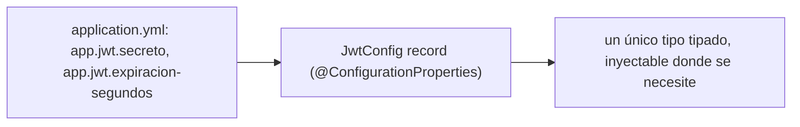
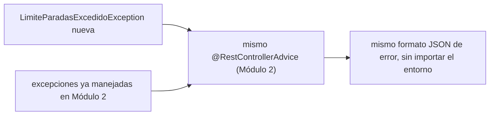

# Módulo 5: Configuración, perfiles y manejo de errores

Cada tema declara su nivel, su duración y una verificación reproducible. La configuración se comprueba con `ApplicationContextRunner` y el formato de error con `MockMvc` reales, para que "la aplicación falla al arranque" o "el formato de error es consistente" sean afirmaciones ejecutadas, no solo descritas.

## Aprende construyendo

### Tema 1: @ConfigurationProperties tipado · Intermedio · 35 min

**Prerrequisito:** Spring Initializr y starters (Módulo 1); `application.yml` vs `application.properties` (Módulo 1).

**Al terminar podrás:** agrupar configuración relacionada en un tipo fuertemente tipado con `@ConfigurationProperties`, y confirmar con un test real que los valores de `application.yml` se enlazan correctamente.

#### Aprende

**¿Por qué es importante?** Una API de entregas cambia URLs, límites y credenciales entre local, pruebas y producción; leer cada valor individual con `@Value("${...}")` disperso en distintas clases dificulta tener una visión centralizada de toda la configuración relacionada con un aspecto específico, como JWT.

**Mapa de subtemas críticos**

| Subtema | Papel | Evidencia |
|---|---|---|
| Prefijo `@ConfigurationProperties("app.jwt")` | Prerrequisito | El `record JwtConfig` agrupa todo bajo el prefijo `app.jwt` del `application.yml` |
| Enlace a un `record` tipado | Núcleo | `assertThat(config.secreto()).isEqualTo("clave-real")` y `config.expiracionSegundos()` en `JwtConfigTest` |
| `@EnableConfigurationProperties(JwtConfig.class)` | Prerrequisito | `ConfigActivador` registra la clase y `withUserConfiguration(ConfigActivador.class)` la carga |
| Convención kebab-case | Diagnóstico | `expiracion-segundos` en `application.yml` mapea a `expiracionSegundos` del record |
| `@NestedConfigurationProperty` para anidar | Variante | El ejercicio 2 agrupa un sub-objeto de reintentos dentro de `JwtConfig` |
| Conversión de tipos al enlazar | Error frecuente | `app.jwt.expiracion-segundos=texto-no-numerico` hace que el enlace falle con `hasFailed()` |
| `@ConfigurationProperties` vs `@Value` suelto | Decisión | Para un feature flag booleano aislado, un `@Value` simple es más directo |
| `ApplicationContextRunner` como verificación | Límite | Levanta solo los beans de `withUserConfiguration(...)`, no toda la aplicación |

Cada fila tiene su explicación individual a continuación.

**Prefijo `@ConfigurationProperties("app.jwt")` (prerrequisito).** El prefijo declarado en la anotación es la raíz común que Spring usa para localizar en `application.yml` todas las propiedades que pertenecen a este grupo. En el ejemplo, `secreto` y `expiracion-segundos` viven ambos bajo `app.jwt`, de modo que el record reúne un aspecto completo de la configuración. Si el prefijo no coincide con la estructura del YAML, los componentes del record llegan sin valor.

**Enlace a un `record` tipado (núcleo).** El mecanismo central es traducir texto del `application.yml` a los componentes tipados del `record JwtConfig`, verificado por `JwtConfigTest` cuando `config.secreto()` devuelve `"clave-real"` y `config.expiracionSegundos()` devuelve `900L`. Esto reemplaza múltiples `@Value` dispersos por un único objeto fuertemente tipado e inyectable. El beneficio directo es verificación de tipos en tiempo de compilación sobre todo el grupo, no sobre strings sueltos.

**`@EnableConfigurationProperties(JwtConfig.class)` (prerrequisito).** Sin este registro, Spring no crea el bean y el enlace nunca ocurre, aunque el record esté bien anotado. En el ejemplo lo aporta `ConfigActivador`, y el test lo activa con `withUserConfiguration(ConfigActivador.class)`. Omitirlo produce el síntoma de que el bean no existe en el contexto, descrito en la sección "Si falla".

**Convención kebab-case (diagnóstico).** La clave `expiracion-segundos` del `application.yml` se enlaza al componente `expiracionSegundos` del record mediante la relajación de nombres de Spring Boot. Cuando los valores llegan `null`, la causa típica es una discrepancia entre el nombre en el YAML y el prefijo declarado. Reconocer esta convención permite diagnosticar el problema sin tocar el código del record.

**`@NestedConfigurationProperty` para anidar (variante).** El ejercicio 2 muestra una variante del enlace plano: agrupar un sub-objeto (por ejemplo, una configuración de reintentos) dentro de `JwtConfig` manteniendo el mismo mecanismo de enlace tipado. Es la forma de componer configuración jerárquica sin romper la validación del grupo. El ejercicio pide confirmar con el test que el sub-objeto también se enlaza correctamente.

**Conversión de tipos al enlazar (error frecuente).** El fallo deliberado sustituye `expiracion-segundos=900` por `texto-no-numerico`: Spring no puede convertir ese texto al `long` declarado y el enlace falla, comprobable con `assertThat(context).hasFailed()`. El punto clave es que el error aparece al enlazar la configuración, antes de que ningún código de negocio use el valor. Es el error más instructivo del tema porque demuestra la verificación temprana.

**`@ConfigurationProperties` vs `@Value` suelto (decisión).** La sección de límites es explícita: para un único valor aislado sin relación con un grupo mayor, como un feature flag booleano suelto, crear un `record` completo es desproporcionado y un `@Value` simple resulta más directo. La decisión profesional depende de si el valor pertenece a un grupo coherente. Agrupar aporta valor cuando varias propiedades comparten un aspecto.

**`ApplicationContextRunner` como verificación (límite).** La utilidad levanta un contexto mínimo y aislado con solo los beans declarados en `withUserConfiguration(...)`, no la aplicación completa. Por eso es más rápida que `@SpringBootTest` para probar configuración, como señala la pista del tema. Su límite es precisamente ese aislamiento: prueba el enlace del grupo, no la integración con el resto de la aplicación.

**Conceptos clave:** agrupación de configuración relacionada, frente a `@Value` disperso.

`@ConfigurationProperties("app.jwt") @Validated public record JwtConfig(@NotBlank String secreto, @Min(60) long expiracionSegundos) {}` mapea un grupo completo de configuración relacionada (todo bajo el prefijo `app.jwt`) hacia un único tipo fuertemente tipado, en vez de leer cada valor disperso con `@Value` repetido en cada clase que lo necesita. Esta agrupación ofrece verificación de tipos en tiempo de compilación (un valor numérico mal configurado como texto se detecta al mapear) y validación centralizada de todo el grupo en un único lugar.

**Analogía:** `@ConfigurationProperties` es un formulario estructurado con una sección dedicada para cada tema relacionado; `@Value` disperso es anotar valores sueltos en notas adhesivas distribuidas por distintas partes de una oficina, sin ninguna vista centralizada.

**Diagrama:**



#### Practica

**Demo paso a paso.** Desde una carpeta vacía (o continuando en `academia-spring`, o créala con `mkdir -p academia-spring` si es tu primera vez), genera el proyecto con Spring Initializr real (`web`, `validation`) y crea `src/main/java/com/academia/config/JwtConfig.java`:

```bash
mkdir -p academia-spring/src/main/java/com/academia/config
cd academia-spring
curl -fsSL https://start.spring.io/starter.zip -d type=maven-project -d dependencies=web,validation -d javaVersion=25 -d artifactId=academia-config -o app.zip
unzip -o app.zip
```

```java
// src/main/java/com/academia/config/JwtConfig.java
package com.academia.config;

import jakarta.validation.constraints.Min;
import jakarta.validation.constraints.NotBlank;
import org.springframework.boot.context.properties.ConfigurationProperties;
import org.springframework.boot.context.properties.EnableConfigurationProperties;
import org.springframework.context.annotation.Configuration;
import org.springframework.validation.annotation.Validated;

@ConfigurationProperties("app.jwt")
@Validated
public record JwtConfig(
    @NotBlank String secreto,
    @Min(60) long expiracionSegundos
) {}
```

```java
// src/main/java/com/academia/config/ConfigActivador.java
package com.academia.config;

import org.springframework.boot.context.properties.EnableConfigurationProperties;
import org.springframework.context.annotation.Configuration;

@Configuration
@EnableConfigurationProperties(JwtConfig.class)
public class ConfigActivador {}
```

```yaml
# src/main/resources/application.yml
app:
  jwt:
    secreto: clave-de-prueba-academia-floci
    expiracion-segundos: 900
```

**Explicación línea por línea:** el `record JwtConfig` agrupa ambos valores bajo el prefijo `app.jwt`; `@NotBlank` y `@Min(60)` declaran las restricciones de validación directamente sobre los componentes del record; `@EnableConfigurationProperties(JwtConfig.class)` registra la clase para que Spring la enlace y valide durante el arranque.

Confirma con `ApplicationContextRunner` (la utilidad real de Spring Boot Test para levantar un contexto mínimo y aislado, sin todo el arranque completo de la aplicación) que los valores de `application.yml` se enlazan correctamente al tipo tipado:

```java
// src/test/java/com/academia/config/JwtConfigTest.java
package com.academia.config;

import org.junit.jupiter.api.Test;
import org.springframework.boot.test.context.runner.ApplicationContextRunner;

import static org.assertj.core.api.Assertions.assertThat;

class JwtConfigTest {

    private final ApplicationContextRunner contextRunner = new ApplicationContextRunner()
        .withUserConfiguration(ConfigActivador.class);

    @Test
    void enlazaLosValoresDeConfiguracionAlTipoTipado() {
        contextRunner
            .withPropertyValues("app.jwt.secreto=clave-real", "app.jwt.expiracion-segundos=900")
            .run(context -> {
                JwtConfig config = context.getBean(JwtConfig.class);
                assertThat(config.secreto()).isEqualTo("clave-real");
                assertThat(config.expiracionSegundos()).isEqualTo(900L);
            });
    }
}
```

```bash
mvn test -Dtest=JwtConfigTest       # Maven
./gradlew test --tests JwtConfigTest # Gradle (equivalente)
```

**Resultado esperado:** `BUILD SUCCESS` con el test en verde, confirmando que `ApplicationContextRunner` levantó un contexto real con esas propiedades y `JwtConfig` las enlazó correctamente a un tipo fuertemente tipado, sin ningún `@Value` disperso.

**Fallo deliberado:** cambia `app.jwt.expiracion-segundos=900` por `app.jwt.expiracion-segundos=texto-no-numerico` en el test y ejecuta de nuevo. El `context.getBean(JwtConfig.class)` lanza una excepción real (`context.run(...)` captura el fallo internamente; verifica con `contextRunner.withPropertyValues(...).run(context -> assertThat(context).hasFailed())`) porque Spring no puede convertir ese texto al tipo `long` declarado — diagnostica confirmando que la verificación de tipos ocurre al enlazar la configuración, antes de que ningún código de negocio intente usar ese valor. Revierte el valor antes de continuar.

**Ejercicios.**

1. Agrega un tercer campo al `record` (`boolean modoDebug`) y confirma con el test que también se enlaza correctamente desde `application.yml`.
2. Usa `@NestedConfigurationProperty` para agrupar un sub-objeto anidado dentro de `JwtConfig` (por ejemplo, una configuración de reintentos) y confirma que también se enlaza correctamente.
3. Compara escribir el mismo enlace con `@Value("${app.jwt.secreto}")` y `@Value("${app.jwt.expiracion-segundos}")` disueltos en dos clases distintas, y documenta en una frase qué visión centralizada se pierde frente a `JwtConfig`.
4. Escribe de memoria (sin mirar) un `record` con `@ConfigurationProperties` y dos campos validados, y un test `ApplicationContextRunner` que confirme el enlace correcto.

**Pista:** `ApplicationContextRunner` es más rápido que `@SpringBootTest` para probar configuración aislada porque no levanta toda la aplicación, solo el subconjunto de beans que declares con `withUserConfiguration(...)`.

**Completa el código:** rellena el espacio para declarar el prefijo de configuración correcto:

```java
@____("app.jwt")
@Validated
public record JwtConfig(@NotBlank String secreto, @Min(60) long expiracionSegundos) {}
```

**Reto de memoria:** cierra este documento y escribe, solo de memoria, un `record` con `@ConfigurationProperties` y validación, y un test `ApplicationContextRunner` que confirme el enlace correcto de sus valores. Compara después contra el patrón del Paso 4.

#### Aplica

**Reto abierto.** Reúne toda la configuración dispersa de tu proyecto en tres grupos tipados y validados: seguridad, almacenamiento y límites de negocio. Elimina los `@Value` sueltos, documenta el prefijo de cada grupo y demuestra con `ApplicationContextRunner` que un valor inválido se rechaza al enlazar.

**Checklist de salida.**

- [ ] Cada grupo de configuración relacionada vive en un `record` validado.
- [ ] Los valores se enlazan desde `application.yml` con un test que los comprueba.
- [ ] No queda ningún `@Value` para propiedades de un grupo ya tipado.
- [ ] Un valor de tipo incorrecto hace fallar el enlace antes de usarse.
- [ ] El README documenta prefijos, valores obligatorios y valores por defecto.

**Si falla.** Si el bean no existe en el contexto, confirma `@EnableConfigurationProperties` o el escaneo correspondiente; si los valores llegan `null`, revisa que los nombres en `application.yml` usen kebab-case y coincidan con el prefijo declarado.

**Siguiente paso:** el Tema 2 confirma qué ocurre cuando un valor obligatorio falta por completo.

**Errores comunes:** usar `@Value` disperso en vez de `@ConfigurationProperties` agrupado, perdiendo visión centralizada; olvidar `@EnableConfigurationProperties` o el escaneo de componentes, dejando la clase sin registrar aunque esté bien declarada.

**Límites y decisión de uso:** para un único valor de configuración aislado sin relación con ningún grupo mayor (por ejemplo, un feature flag booleano suelto), un `@Value` simple es más directo que crear un `record` completo solo para ese valor.

**Fuente oficial:** [Spring Boot — Type-safe Configuration Properties](https://docs.spring.io/spring-boot/reference/features/external-config.html#features.external-config.typesafe-configuration-properties).

**Transferencia al proyecto integrador:** `@ConfigurationProperties` tipado es como organizará su configuración el proyecto integrador de este track (microservicio productivo, Módulo 12), sin strings mágicos dispersos.

### Tema 2: Fallar rápido al arranque · Intermedio · 30 min

**Prerrequisito:** Tema 1 de este módulo (`@ConfigurationProperties`).

**Al terminar podrás:** confirmar, con un test real, que la aplicación se niega a arrancar cuando falta un valor de configuración obligatorio, en vez de arrancar con un valor inválido que fallaría más tarde.

#### Aprende

**¿Por qué es importante?** Si `app.jwt.secreto` falta y la aplicación arranca de todas formas, el problema se manifestará mucho más tarde —posiblemente ya en producción bajo tráfico real— cuando algún código intente usar ese valor `null`, en un momento y contexto completamente distinto de donde realmente se originó el problema.

**Mapa de subtemas críticos**

| Subtema | Papel | Evidencia |
|---|---|---|
| `@Validated` sobre `@ConfigurationProperties` | Prerrequisito | Tema 1 añadió `@Validated` a `JwtConfig`; aquí es la causa del fallo de arranque |
| Fallo rápido al arranque | Núcleo | Sin `app.jwt.secreto`, `assertThat(context).hasFailed()` es verdadero |
| `BindValidationException` como causa raíz | Diagnóstico | `hasRootCauseInstanceOf(BindValidationException.class)` en `FalloArranqueTest` |
| Arranque exitoso con todos los valores | Núcleo | Con secreto y `expiracion-segundos` presentes, `hasNotFailed()` pasa |
| Violación de `@Min(60)` | Variante | El ejercicio 1 confirma que `expiracion-segundos` menor a 60 también detiene el arranque |
| Mensaje que nombra la propiedad | Diagnóstico | `context.getStartupFailure().getMessage()` menciona la propiedad problemática |
| Quitar `@Validated` deja `null` silencioso | Error frecuente | Sin `@Validated` el contexto arranca con `secreto = null` y el test deja de fallar |
| Opcional con default seguro vs obligatorio | Decisión | Un tamaño de página con default no debe forzarse como obligatorio |

Cada fila tiene su explicación individual a continuación.

**`@Validated` sobre `@ConfigurationProperties` (prerrequisito).** Este tema depende directamente de la clase `JwtConfig` del Tema 1, que ya lleva `@Validated`. Esa anotación es la que activa la validación de `@NotBlank` y `@Min` durante el enlace, y por tanto es el requisito previo sin el cual el comportamiento de fallo rápido no existe. El tema reutiliza `ConfigActivador` para cargarla en el contexto de prueba.

**Fallo rápido al arranque (núcleo).** El mecanismo central: cuando falta un valor marcado como obligatorio, el contexto NO arranca y el fallo se produce en el momento más temprano y supervisado posible. El test `sinElValorObligatorioElContextoNoArranca` omite a propósito `app.jwt.secreto` y comprueba `hasFailed()`. Esto convierte un problema latente en un error inmediato durante el despliegue en lugar de en producción bajo tráfico.

**`BindValidationException` como causa raíz (diagnóstico).** El test no solo verifica que el arranque falló, sino que la causa raíz real es `BindValidationException`, con `hasRootCauseInstanceOf(BindValidationException.class)`. Esta es la excepción concreta que Spring lanza cuando `@Validated` rechaza un valor al enlazar. Identificarla permite distinguir un fallo de validación de configuración de otros fallos de arranque no relacionados.

**Arranque exitoso con todos los valores (núcleo).** El segundo test, `conTodosLosValoresObligatoriosElContextoArrancaCorrectamente`, aporta la cara positiva: con `secreto` y `expiracion-segundos` presentes, el mismo contexto arranca y `hasNotFailed()` pasa. Este contraste medido sobre el resultado real del arranque demuestra que la diferencia la marca la presencia o ausencia del valor, no una suposición.

**Violación de `@Min(60)` (variante).** El ejercicio 1 extiende el caso del valor faltante a un valor presente pero inválido: `expiracion-segundos` menor a 60 viola `@Min(60)` y detiene el arranque con el mismo tipo de causa raíz. Es una variante importante porque muestra que el fallo rápido cubre tanto ausencia como rangos inválidos, no solo campos vacíos.

**Mensaje que nombra la propiedad (diagnóstico).** El ejercicio 2 pide leer `context.getStartupFailure().getMessage()` y confirmar que menciona explícitamente la propiedad problemática. Este detalle es el que hace accionable el fallo para quien despliega, porque señala exactamente qué valor corregir. La pista recuerda que `getStartupFailure()` devuelve la cadena completa de causas.

**Quitar `@Validated` deja `null` silencioso (error frecuente).** El fallo deliberado retira `@Validated` de `JwtConfig`: entonces el contexto arranca "exitosamente" con `secreto = null` y `hasFailed()` pasa a ser falso, por lo que el test deja de pasar. Esto demuestra que `@Validated` es la línea responsable de convertir un valor faltante en un fallo inmediato. Omitirla es el error central que el tema previene.

**Opcional con default seguro vs obligatorio (decisión).** La sección de límites aclara que no todo valor debe ser obligatorio: un valor genuinamente opcional con un default seguro, como un tamaño de página de paginación, no debería forzarse con `@NotBlank`/`@Min` sin default. La decisión profesional reserva la obligatoriedad para valores donde no existe un valor por defecto seguro, como secretos o credenciales.

**Conceptos clave:** validación temprana, evitar fallas silenciosas tardías en producción.

Con `@Validated` aplicado a una clase de `@ConfigurationProperties`, si falta un valor marcado `@NotBlank` o `@Min`, la aplicación NO arranca en absoluto: falla inmediatamente durante el arranque con un mensaje claro señalando exactamente qué valor falta o es inválido. Este principio de "fallar rápido" (fail-fast) prioriza detectar el problema en el momento más temprano y controlado posible (el arranque, típicamente supervisado activamente durante un despliegue) en vez de dejar que se manifieste de forma impredecible durante la operación normal.

**Analogía:** fallar rápido al arranque es como que un avión rechace despegar si detecta en la revisión previa en tierra que le falta un componente esencial, en vez de descubrir esa falta a mitad de vuelo, un momento considerablemente más peligroso para resolverlo.

**Diagrama:**

```text
┌── sin @Validated ──────────────────────────────────────┐
│  falta app.jwt.secreto → app arranca "bien" →               │
│  falla más tarde en producción (NullPointerException)       │
└──────────────────────────────────────────────────┘
┌── con @Validated ──────────────────────────────────────┐
│  falta app.jwt.secreto → app NO arranca →                    │
│  error claro inmediato, en el momento del despliegue        │
└──────────────────────────────────────────────────┘
```

#### Practica

**Demo paso a paso.** Reutiliza `academia-spring` (o créalo desde una carpeta vacía con `mkdir -p academia-spring` si es tu primera vez) y crea `src/test/java/com/academia/config/FalloArranqueTest.java`, confirmando con `ApplicationContextRunner` que la ausencia del valor obligatorio impide el arranque:

```bash
mkdir -p academia-spring/src/test/java/com/academia/config
cd academia-spring
```

```java
// src/test/java/com/academia/config/FalloArranqueTest.java
package com.academia.config;

import org.junit.jupiter.api.Test;
import org.springframework.boot.context.properties.bind.validation.BindValidationException;
import org.springframework.boot.test.context.runner.ApplicationContextRunner;

import static org.assertj.core.api.Assertions.assertThat;

class FalloArranqueTest {

    private final ApplicationContextRunner contextRunner = new ApplicationContextRunner()
        .withUserConfiguration(ConfigActivador.class);

    @Test
    void sinElValorObligatorioElContextoNoArranca() {
        contextRunner
            .withPropertyValues("app.jwt.expiracion-segundos=900") // falta app.jwt.secreto a propósito
            .run(context -> {
                assertThat(context).hasFailed();
                assertThat(context.getStartupFailure())
                    .hasRootCauseInstanceOf(BindValidationException.class);
            });
    }

    @Test
    void conTodosLosValoresObligatoriosElContextoArrancaCorrectamente() {
        contextRunner
            .withPropertyValues("app.jwt.secreto=clave-real", "app.jwt.expiracion-segundos=900")
            .run(context -> assertThat(context).hasNotFailed());
    }
}
```

```bash
mvn test -Dtest=FalloArranqueTest   # Maven
./gradlew test --tests FalloArranqueTest # Gradle (equivalente)
```

**Explicación línea por línea:** `withPropertyValues` define el conjunto exacto de propiedades que verá el contexto; el primer test omite deliberadamente `app.jwt.secreto`; `hasFailed()` comprueba que el contexto no arrancó y `hasRootCauseInstanceOf(BindValidationException.class)` comprueba la causa raíz real del fallo; el segundo test demuestra que con todas las propiedades presentes el mismo contexto arranca.

**Resultado esperado:** ambos tests pasan: sin `app.jwt.secreto`, el contexto falla al arrancar con una causa raíz `BindValidationException` (la excepción real que Spring lanza cuando `@Validated` rechaza un valor); con todos los valores obligatorios presentes, el contexto arranca sin fallos — la diferencia medida directamente sobre el resultado real del arranque, no sobre una suposición.

**Fallo deliberado:** quita temporalmente `@Validated` de `JwtConfig` (dejando solo `@ConfigurationProperties`) y ejecuta de nuevo `sinElValorObligatorioElContextoNoArranca`. El test FALLA porque ahora `assertThat(context).hasFailed()` es falso: el contexto arranca "exitosamente" con `secreto = null`, exactamente el escenario peligroso que este Tema previene — diagnostica confirmando que `@Validated` es la línea específica de código responsable de convertir un valor faltante en un fallo de arranque inmediato, en vez de un `null` silencioso que fallaría más tarde en un lugar distinto. Revierte `@Validated` antes de continuar.

**Ejercicios.**

1. Agrega un tercer test que confirme que un valor de `expiracion-segundos` menor a `60` (violando `@Min(60)`) también hace fallar el arranque, con el mismo tipo de causa raíz.
2. Lee el mensaje completo de `context.getStartupFailure().getMessage()` en un test y confirma que menciona explícitamente el nombre de la propiedad problemática.
3. Agrega una segunda clase `@ConfigurationProperties` con su propia validación, y confirma que un valor inválido en CUALQUIERA de las dos hace fallar el arranque completo del contexto, no solo el de la clase afectada.
4. Escribe de memoria (sin mirar) un test `ApplicationContextRunner` que confirme `hasFailed()` con una causa raíz `BindValidationException` ante un valor de configuración faltante. Compara después contra el patrón del Paso 4.

**Pista:** `context.getStartupFailure()` devuelve la excepción completa con toda la cadena de causas; `hasRootCauseInstanceOf(...)` navega hasta la causa más profunda, que es normalmente la más específica y útil para diagnosticar.

**Completa el código:** rellena el espacio para confirmar que el contexto falló al arrancar:

```java
contextRunner.withPropertyValues("app.jwt.expiracion-segundos=900")
    .run(context -> assertThat(context).____());
```

**Reto de memoria:** cierra este documento y escribe, solo de memoria, dos tests `ApplicationContextRunner`: uno que confirme el fallo de arranque ante un valor faltante, y otro que confirme el arranque exitoso con todos los valores presentes. Compara después contra el patrón del Paso 4.

#### Aplica

**Reto abierto.** Marca como obligatorias todas las propiedades sin valor por defecto seguro (secretos, credenciales, URLs de servicios) y deja con valor por defecto explícito las que sí lo tengan. Demuestra con tests que cada propiedad obligatoria falta una a la vez y el arranque se detiene, y documenta el mensaje que recibe quien despliega.

**Checklist de salida.**

- [ ] Cada propiedad sin valor por defecto seguro es obligatoria y validada.
- [ ] Un test por propiedad demuestra que su ausencia impide el arranque.
- [ ] El mensaje de fallo nombra la propiedad problemática.
- [ ] Las propiedades con valor por defecto seguro no bloquean el arranque.
- [ ] El README explica qué hacer ante el error de validación.

**Si falla.** Si el contexto arranca con una propiedad faltante, confirma que `@Validated` sigue en la clase y que la restricción está en el componente correcto del record; si el mensaje no nombra la propiedad, revisa que estés leyendo la causa raíz y no solo la excepción externa.

**Siguiente paso:** el Tema 3 aborda cómo comunicar de forma consistente los errores que sí ocurren durante la operación normal.

**Errores comunes:** omitir `@Validated` en la clase de configuración, dejando que un valor faltante pase desapercibido hasta usarse en producción; definir valores por defecto inseguros para propiedades que deberían ser explícitamente obligatorias, como secretos o credenciales.

**Límites y decisión de uso:** para un valor de configuración genuinamente opcional con un valor por defecto seguro y razonable (por ejemplo, un tamaño de página de paginación), forzar validación obligatoria sin un valor por defecto sería innecesariamente rígido; reserva `@NotBlank`/`@Min` sin default para valores donde no existe un valor por defecto seguro.

**Fuente oficial:** [Spring Boot — Testing auto-configuration](https://docs.spring.io/spring-boot/reference/testing/spring-boot-applications.html#testing.spring-boot-applications.testing-auto-configuration).

**Transferencia al proyecto integrador:** fallar rápido al arranque es la estrategia que adoptará el proyecto integrador de este track (microservicio productivo, Módulo 12) para no desplegar con configuración inválida.

### Tema 3: Manejo global de excepciones consistente entre entornos · Avanzado · 40 min

**Prerrequisito:** `@ControllerAdvice` y `ResponseEntity` (Módulo 2); Temas 1-2 de este módulo.

**Al terminar podrás:** extender el manejo global de excepciones (Módulo 2) para una nueva excepción de negocio, confirmando con `MockMvc` real que el formato de error permanece consistente.

#### Aprende

**¿Por qué es importante?** Cada nueva regla de negocio que puede fallar (por ejemplo, exceder el límite de paradas por ruta) necesita comunicar el error al cliente de la API en el MISMO formato que cualquier otro error ya manejado, sin que el consumidor de la API tenga que aprender un formato distinto por cada tipo de excepción nueva.

**Mapa de subtemas críticos**

| Subtema | Papel | Evidencia |
|---|---|---|
| Excepción de negocio del dominio | Prerrequisito | `LimiteParadasExcedidoException extends RuntimeException` con mensaje del límite |
| `@ExceptionHandler` en un `@RestControllerAdvice` | Núcleo | `manejarLimiteExcedido` mapea la excepción en `ManejadorGlobalErrores` |
| `ProblemDetail` y RFC 7807 | Núcleo | La respuesta usa `application/problem+json` con `title` y `status` 422 |
| Verificación con `MockMvc` real | Diagnóstico | `status().isUnprocessableEntity()` y `jsonPath("$.title")` en el test |
| Campos adicionales con `setProperty` | Variante | El ejercicio 2 añade `problema.setProperty("limite", ...)` y lo lee con `jsonPath("$.limite")` |
| Condición de límite `>` vs `=` | Límite | El ejercicio 3 prueba `numeroDeParadas=20` contra la condición `> LIMITE_PARADAS` |
| Respuesta de error manual en el endpoint | Error frecuente | El fallo deliberado devuelve `200 OK` con texto plano y rompe el test |
| Handler global vs manejo local | Decisión | Un error exclusivo de un único endpoint puede manejarse en el método |

Cada fila tiene su explicación individual a continuación.

**Excepción de negocio del dominio (prerrequisito).** `LimiteParadasExcedidoException` extiende `RuntimeException` y construye su mensaje a partir del límite recibido. Es el punto de partida: el controller la lanza cuando la regla de negocio se viola, sin construir la respuesta de error allí mismo. Modelar el fallo como una excepción de dominio es lo que permite centralizar su traducción después.

**`@ExceptionHandler` en un `@RestControllerAdvice` (núcleo).** El mecanismo central es mapear la excepción a una respuesta HTTP en el MISMO `@RestControllerAdvice` que ya manejaría otras excepciones del Módulo 2, mediante `manejarLimiteExcedido`. Así la traducción vive en un único lugar y el endpoint queda limpio. El tema insiste en extender el advice existente, no crear uno nuevo por excepción.

**`ProblemDetail` y RFC 7807 (núcleo).** El handler devuelve `ProblemDetail.forStatusAndDetail(HttpStatus.UNPROCESSABLE_ENTITY, ...)`, el formato estándar RFC 7807 que Spring serializa como `application/problem+json`. Fija el `title` "Límite de paradas excedido" y el `status` 422. Usar este tipo estándar garantiza que todos los errores compartan la misma forma de cuerpo, sin importar el entorno ni el endpoint de origen.

**Verificación con `MockMvc` real (diagnóstico).** El test `excederElLimiteDeParadasDevuelveProblemDetailConsistente` envía `numeroDeParadas=25` y comprueba `status().isUnprocessableEntity()`, el `contentTypeCompatibleWith("application/problem+json")`, el `title` y el `status` 422 con `jsonPath`. La pista explica que `contentTypeCompatibleWith` es más robusto que comparar el string exacto porque tolera un charset añadido. Esta verificación mide la respuesta real, no una suposición.

**Campos adicionales con `setProperty` (variante).** El ejercicio 2 muestra una variante: enriquecer el `ProblemDetail` con `problema.setProperty("limite", LIMITE_PARADAS)` y confirmar con `jsonPath("$.limite")` que aparece en la respuesta. Es la forma de añadir contexto específico del error sin abandonar el formato estándar. Mantiene la uniformidad del cuerpo mientras agrega datos útiles para el cliente.

**Condición de límite `>` vs `=` (límite).** El ejercicio 3 fuerza el caso de frontera exacto: `numeroDeParadas=20`, igual al límite, contra la condición `numeroDeParadas > LIMITE_PARADAS`. Como la comparación es estrictamente mayor, 20 se acepta y 21 se rechaza. El ejercicio pide decidir si ese es el comportamiento correcto según el enunciado "el límite es 20", que es exactamente el tipo de error por uno (off-by-one) que suele pasarse por alto.

**Respuesta de error manual en el endpoint (error frecuente).** El fallo deliberado sustituye el `throw` por un `return "ERROR: límite excedido"` con `200 OK` por defecto. El test falla porque `status().isUnprocessableEntity()` no coincide con el `200` real. Esto demuestra de forma observable por qué construir respuestas de error a mano en cada endpoint produce inconsistencias: un cliente que espera `422` con `ProblemDetail` recibiría un `200` con texto plano no estructurado.

**Handler global vs manejo local (decisión).** La sección de límites matiza la regla: para un error verdaderamente específico de un único endpoint sin posibilidad de reutilización, manejarlo directamente en el método puede ser aceptable. La decisión profesional reserva el `@RestControllerAdvice` centralizado para excepciones de negocio con sentido a nivel de aplicación, que es la mayoría. El criterio es la reutilización del tipo de error.

**Conceptos clave:** el mismo `@RestControllerAdvice` extendido, formato uniforme sin importar el entorno.

El manejo global de excepciones, ya cubierto en el Módulo 2 con `@RestControllerAdvice`, se extiende naturalmente para mapear cualquier excepción de negocio adicional hacia una respuesta HTTP consistente, en el mismo lugar centralizado, garantizando que el formato de error permanezca exactamente el mismo sin importar el entorno (desarrollo, pruebas, producción) ni qué endpoint originó el error. Combinar esto con la configuración tipada y validada de los Temas 1-2 produce una aplicación robusta en su conjunto: los problemas de configuración se detectan al arranque, y los errores de negocio que sí ocurren durante la operación se comunican de forma predecible.

**Analogía:** extender el manejo global de excepciones es ampliar el mismo protocolo unificado de atención de incidencias de una empresa para cubrir cada nuevo tipo de incidencia, en vez de crear un protocolo distinto para cada problema nuevo que aparece.

**Diagrama:**



#### Practica

**Demo paso a paso.** Reutiliza `academia-spring` (o créalo desde una carpeta vacía con `mkdir -p academia-spring` si es tu primera vez) y crea la excepción de negocio y su mapeo en `src/main/java/com/academia/errores/`:

```bash
mkdir -p academia-spring/src/main/java/com/academia/errores
cd academia-spring
```

```java
// src/main/java/com/academia/errores/LimiteParadasExcedidoException.java
package com.academia.errores;

public class LimiteParadasExcedidoException extends RuntimeException {
    public LimiteParadasExcedidoException(int limite) {
        super("El límite de " + limite + " paradas por ruta fue excedido");
    }
}
```

```java
// src/main/java/com/academia/errores/ManejadorGlobalErrores.java
package com.academia.errores;

import org.springframework.http.HttpStatus;
import org.springframework.http.ProblemDetail;
import org.springframework.web.bind.annotation.ExceptionHandler;
import org.springframework.web.bind.annotation.RestControllerAdvice;

@RestControllerAdvice
public class ManejadorGlobalErrores {

    @ExceptionHandler(LimiteParadasExcedidoException.class)
    public ProblemDetail manejarLimiteExcedido(LimiteParadasExcedidoException ex) {
        ProblemDetail problema = ProblemDetail.forStatusAndDetail(HttpStatus.UNPROCESSABLE_ENTITY, ex.getMessage());
        problema.setTitle("Límite de paradas excedido");
        return problema;
    }
}
```

```java
// src/main/java/com/academia/errores/RutasController.java
package com.academia.errores;

import org.springframework.web.bind.annotation.PostMapping;
import org.springframework.web.bind.annotation.RequestParam;
import org.springframework.web.bind.annotation.RestController;

@RestController
public class RutasController {
    private static final int LIMITE_PARADAS = 20;

    @PostMapping("/api/rutas")
    public String crearRuta(@RequestParam int numeroDeParadas) {
        if (numeroDeParadas > LIMITE_PARADAS) throw new LimiteParadasExcedidoException(LIMITE_PARADAS);
        return "ruta creada con " + numeroDeParadas + " paradas";
    }
}
```

**Explicación línea por línea:** `LimiteParadasExcedidoException` es una excepción de negocio específica del dominio; `@ExceptionHandler(LimiteParadasExcedidoException.class)` en el MISMO `@RestControllerAdvice` que ya manejaría otras excepciones (Módulo 2) la mapea a `422 Unprocessable Entity` usando `ProblemDetail` (el formato estándar RFC 7807, el mismo formato que cualquier otro error de esta API); el controller lanza la excepción cuando la regla de negocio se viola, sin necesidad de construir la respuesta de error manualmente en cada endpoint.

Confirma con `MockMvc` real que la excepción se traduce al formato `ProblemDetail` esperado, con el mismo `Content-Type` estándar que cualquier otro error de la API. **Nota (Spring Boot 4):** `AutoConfigureMockMvc` requiere agregar explícitamente `spring-boot-webmvc-test` (scope `test`) al `pom.xml` — en Boot 3.x venía incluido en `spring-boot-starter-test`:

```xml
<!-- dentro de <dependencies> del pom.xml -->
<dependency>
    <groupId>org.springframework.boot</groupId>
    <artifactId>spring-boot-webmvc-test</artifactId>
    <scope>test</scope>
</dependency>
```

```java
// src/test/java/com/academia/errores/ManejadorGlobalErroresTest.java
package com.academia.errores;

import org.junit.jupiter.api.Test;
import org.springframework.beans.factory.annotation.Autowired;
import org.springframework.boot.webmvc.test.autoconfigure.AutoConfigureMockMvc;
import org.springframework.boot.test.context.SpringBootTest;
import org.springframework.test.web.servlet.MockMvc;

import static org.springframework.test.web.servlet.request.MockMvcRequestBuilders.post;
import static org.springframework.test.web.servlet.result.MockMvcResultMatchers.*;

@SpringBootTest
@AutoConfigureMockMvc
class ManejadorGlobalErroresTest {

    @Autowired
    private MockMvc mockMvc;

    @Test
    void excederElLimiteDeParadasDevuelveProblemDetailConsistente() throws Exception {
        mockMvc.perform(post("/api/rutas").param("numeroDeParadas", "25"))
            .andExpect(status().isUnprocessableEntity())
            .andExpect(content().contentTypeCompatibleWith("application/problem+json"))
            .andExpect(jsonPath("$.title").value("Límite de paradas excedido"))
            .andExpect(jsonPath("$.status").value(422));
    }

    @Test
    void dentroDelLimiteCreaLaRutaCorrectamente() throws Exception {
        mockMvc.perform(post("/api/rutas").param("numeroDeParadas", "10"))
            .andExpect(status().isOk());
    }
}
```

```bash
mvn test -Dtest=ManejadorGlobalErroresTest # Maven
./gradlew test --tests ManejadorGlobalErroresTest # Gradle (equivalente)
```

**Resultado esperado:** ambos tests pasan: exceder el límite devuelve `422` con el formato `application/problem+json` estándar (el mismo formato RFC 7807 usado por cualquier otro error ya manejado en el Módulo 2), y una petición dentro del límite responde `200` normalmente.

**Fallo deliberado:** en `RutasController`, reemplaza `throw new LimiteParadasExcedidoException(LIMITE_PARADAS)` por una respuesta manual de error construida directamente en el método (`return "ERROR: límite excedido"`, con `200 OK` por defecto en vez de un código de error). Ejecuta de nuevo `excederElLimiteDeParadasDevuelveProblemDetailConsistente` — el test FALLA porque `status().isUnprocessableEntity()` no coincide con el `200` real devuelto — diagnostica confirmando por qué construir respuestas de error manualmente dentro de cada endpoint, en vez de lanzar una excepción de negocio hacia el manejador centralizado, produce inconsistencias reales y detectables: un cliente que espera `422` con `ProblemDetail` recibiría un `200` con un texto plano no estructurado. Revierte el cambio antes de continuar.

**Ejercicios.**

1. Agrega una segunda excepción de negocio distinta al mismo `@RestControllerAdvice` y confirma con un test que ambas producen el mismo formato `application/problem+json`, solo con `title`/`detail` distintos.
2. Agrega un campo adicional al `ProblemDetail` (`problema.setProperty("limite", LIMITE_PARADAS)`) y confirma con `jsonPath("$.limite")` que aparece en la respuesta.
3. Provoca el error con un valor límite exacto (`numeroDeParadas=20`, igual al límite, no mayor) y confirma si la condición actual (`>`) lo acepta o lo rechaza; decide si ese es el comportamiento correcto según el enunciado "el límite es 20".
4. Escribe de memoria (sin mirar) una excepción de negocio, su mapeo en `@RestControllerAdvice` a `ProblemDetail`, y un test `MockMvc` que confirme el código de estado y el `title`. Compara después contra el patrón del Paso 4.

**Pista:** `content().contentTypeCompatibleWith("application/problem+json")` es más robusto que comparar el string exacto del `Content-Type`, porque tolera parámetros adicionales como el charset que Spring puede agregar automáticamente.

**Completa el código:** rellena el espacio para mapear la excepción a una respuesta HTTP:

```java
@____(LimiteParadasExcedidoException.class)
public ProblemDetail manejarLimiteExcedido(LimiteParadasExcedidoException ex) {
    return ProblemDetail.forStatusAndDetail(HttpStatus.UNPROCESSABLE_ENTITY, ex.getMessage());
}
```

**Reto de memoria:** cierra este documento y escribe, solo de memoria, una excepción de negocio mapeada a `ProblemDetail` en un `@RestControllerAdvice`, y un test `MockMvc` que confirme el código de estado y el formato de la respuesta. Compara después contra el patrón del Paso 4.

#### Aplica

**Reto abierto.** Define el catálogo completo de errores de negocio del proyecto, con código HTTP, `title` estable y campos adicionales por tipo. Implementa cada excepción y su handler, y demuestra con tests que el `Content-Type` y la forma del cuerpo son idénticos en desarrollo, pruebas y producción.

**Checklist de salida.**

- [ ] Cada excepción de negocio tiene un handler en el mismo `@RestControllerAdvice`.
- [ ] Todos los errores devuelven `application/problem+json` con la misma forma.
- [ ] Los códigos HTTP distinguen validación, conflicto, recurso ausente y límite excedido.
- [ ] Ningún endpoint construye respuestas de error a mano.
- [ ] El catálogo de errores está documentado y probado.

**Si falla.** Si el handler no se aplica, confirma que la clase está escaneada por el contexto y que la excepción no se captura antes en un `try/catch` local; si cambia el `Content-Type`, revisa que devuelvas `ProblemDetail` y no un `Map` genérico.

**Siguiente paso:** el módulo 6 aborda cómo probar la aplicación completa de forma automatizada.

**Errores comunes:** construir respuestas de error manualmente dentro de un endpoint específico en vez de lanzar una excepción hacia el manejador centralizado; crear un `@ControllerAdvice` nuevo y separado para cada excepción, en vez de extender el mismo existente.

**Límites y decisión de uso:** para un error verdaderamente específico de un único endpoint sin ninguna posibilidad de reutilización en otro lugar de la aplicación, manejarlo directamente en el método del controller sin pasar por el mecanismo global puede ser aceptable; reserva el `@RestControllerAdvice` centralizado para excepciones de negocio con sentido a nivel de aplicación.

**Fuente oficial:** [Spring — Error Handling for REST with ProblemDetail](https://docs.spring.io/spring-framework/reference/web/webmvc/mvc-ann-rest-exceptions.html).

**Transferencia al proyecto integrador:** el manejo global de excepciones de este tema es el que mantendrá consistente el proyecto integrador de este track (microservicio productivo, Módulo 12) entre entornos.

## Laboratorio práctico

**Objetivo del laboratorio:** configurar propiedades tipadas y validadas al arranque, sin valores hardcodeados.

**Requisitos previos:** Módulos 0-4 completados.

| Paso | Acción | Código | Explicación |
|---|---|---|---|
| 1 | Crear una clase `@ConfigurationProperties` | Ver Tema 1 | Con valores tipados desde `application.yml` |
| 2 | Agregar `@Validated` | Ver Tema 2 | Falla al arranque si falta un valor obligatorio |
| 3 | Provocar la falla intencionalmente | Ver Tema 2 | Confirmado con `ApplicationContextRunner` real |
| 4 | Centralizar una excepción de negocio adicional | Ver Tema 3 | Mismo formato `ProblemDetail` consistente |

**Verificación:** el laboratorio se considera exitoso si borrar un valor de configuración obligatorio impide que la aplicación arranque, con `BindValidationException` como causa raíz real, y si todos los errores de negocio devuelven el mismo formato `application/problem+json` consistente.

**Errores comunes y soluciones**

- **Usar `@Value` disperso en vez de `@ConfigurationProperties` agrupado.** Agrupa configuración relacionada en un único tipo tipado.
- **Omitir `@Validated` en la clase de configuración.** Sin ella, un valor faltante puede pasar desapercibido hasta usarse en producción.
- **Crear un nuevo `@ControllerAdvice` separado para cada nueva excepción.** Extiende el mismo `@ControllerAdvice` centralizado existente.

## Proyecto de cierre del módulo

**Objetivo:** entregar un servicio que arranque con configuración tipada y validada, se detenga ante un valor obligatorio ausente y devuelva un único formato de error para todo su dominio.

**Entregables.**

1. Tres grupos de configuración tipados con `@ConfigurationProperties` (seguridad, persistencia y límites) y sus valores en `application.yml`.
2. `@Validated` en cada grupo, con al menos una propiedad obligatoria y una con valor por defecto seguro documentado.
3. Tests `ApplicationContextRunner` que comprueben el enlace correcto, el fallo por valor faltante y el fallo por valor fuera de rango.
4. Un catálogo de al menos cuatro excepciones de negocio con handlers en un único `@RestControllerAdvice`.
5. Tests `MockMvc` que verifiquen código, `Content-Type` y forma del cuerpo de cada error.
6. `README.md` con tabla de propiedades (nombre, tipo, obligatoriedad, valor por defecto) y el procedimiento ante un fallo de arranque.

**Rúbrica (100 puntos).**

| Criterio | Puntos |
|---|---:|
| Configuración agrupada, tipada y enlazada desde `application.yml` | 20 |
| Validación al arranque probada con causa raíz real | 20 |
| Propiedades opcionales con valor por defecto seguro documentado | 10 |
| Catálogo de errores con formato uniforme `application/problem+json` | 20 |
| Cobertura de casos normales, límite y error en tests | 15 |
| README reproducible y diagnóstico de fallos provocados | 15 |

**Criterio de aceptación:** si la aplicación arranca con un secreto obligatorio ausente, o si dos errores de negocio devuelven formas distintas de cuerpo, el módulo no se considera cerrado aunque la rúbrica sume 100.
