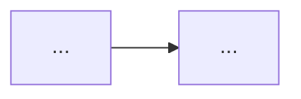

## CAPÍTULO <MXX-LYY>: <Título>

### 1. Ubicación
- **Curso:** ...
- **Módulo:** ...
- **Lección:** ...
- **Tiempo estimado:** ...
- **Versiones:** ...

### 2. Prerrequisitos
- ...

### 3. Objetivo de aprendizaje
Al terminar podrás **...** ...

### 4. Problema real / por qué importa
...

### 5. Analogía y modelo mental
...  
**Dónde se rompe la analogía:** ...

### 6. Diagrama técnico

**Texto alternativo:** ...

### 7. Conceptos fundamentales
#### Qué es
...
#### Cómo funciona por dentro
...
#### Cuándo usar / cuándo NO usar
...
#### Trade-offs
...

### 8. Construcción desde cero
#### Paso 1: ...
```bash
...
```
```text
Salida real:
...
```

### 9. Código de referencia completo
Ruta real en `labs/...` y listado relevante completo.

### 10. Explicación línea por línea / por bloque
| Código/bloque | Intención | Efecto | Si se omite/cambia |
|---|---|---|---|

### 11. Laboratorio reproducible
```bash
...
```

### 12. Verificación automática
`verify.sh` valida...  
Pass/fail: ...

### 13. Modificación guiada
- Cambio:
- Hipótesis:
- Comando:
- Resultado real observado:

### 14. Error común y diagnóstico
- Síntoma:
- Mensaje real:
- Causa:
- Diagnóstico:
- Fix:

### 15. Cierre
#### Anti-patrón
...
#### Pregunta de entrevista
- Pregunta: ...
- Respuesta modelo: ...
#### Resumen
- ...
#### Puente
...
