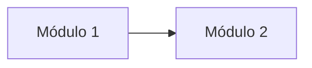

# [Nombre del curso]

## Para quién es
- ...

## Prerrequisitos
- ...

## Qué sabrás hacer al terminar
1. ...

## Mapa del libro

## Proyecto guía
- ...

## Versiones y entorno
- ...

## Cómo usar este libro
- Lee el capítulo, construye el lab desde cero, ejecuta verify, haz la modificación guiada.

## Convenciones
- Comandos copiables.
- Salida real marcada.
- Errores reproducibles.

## Capstone / proyecto final
- ...

## Apéndices
- Glosario, cheatsheet, troubleshooting, referencias.
