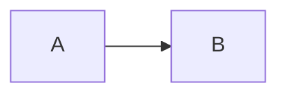

## FICHA DE TEMA: [nombre exacto]

### 1. UBICACIÓN
Curso X, Módulo Y, Lección Z.

### 2. PRERREQUISITOS
- 

### 3. OBJETIVO DE APRENDIZAJE
[Verbo Bloom] + [resultado medible].

### 4. ANALOGÍA VISUAL
Descripción detallada + texto alternativo.

### 5. DIAGRAMA TÉCNICO

Texto alternativo.

### 6. EXPLICACIÓN CONCEPTUAL
- Qué es:
- Para qué sirve:
- Cuándo NO usarlo:

### 7. CONSTRUCCIÓN PASO A PASO DESDE CERO
1. Ruta/archivo:
   - Contenido:
   - Por qué:
   - Comando:
   - Output esperado:

### 8. CÓDIGO DE REFERENCIA COMPLETO
```text
...
```

### 9. EXPLICACIÓN LÍNEA POR LÍNEA
- 

### 10. LABORATORIO PASO A PASO
```bash
...
```
Output esperado:
```text
...
```

### 11. VERIFICACIÓN AUTOMÁTICA
`verify.sh` / test: criterio pass/fail.

### 12. MODIFICACIÓN GUIADA
- Cambio:
- Hipótesis:
- Resultado observado:

### 13. ERROR COMÚN
- Síntoma:
- Causa:
- Diagnóstico visual:
- Corrección:

### 14. PREGUNTA DE ENTREVISTA
- Pregunta:
- Respuesta modelo:

### 15. ANTI-PATRÓN RELACIONADO
- Anti-patrón:
- Cómo se ve:
- Alternativa:
