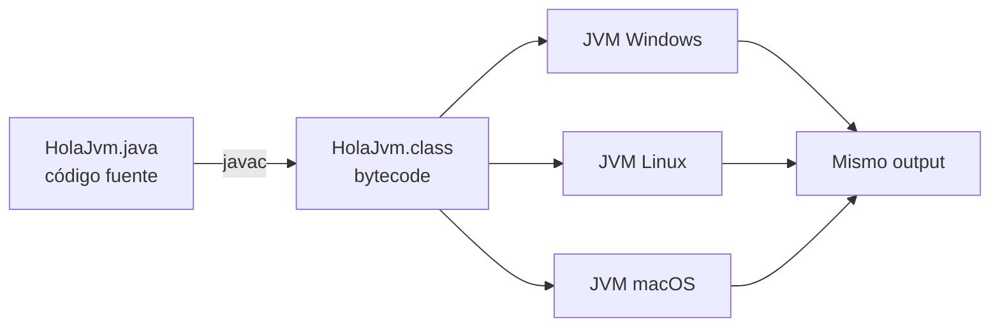

## CAPÍTULO M01-L01: Qué es Java, JVM, bytecode y WORA

### 1. Ubicación
- **Curso:** C1 — Java desde Cero a Experto
- **Módulo:** M01 — Fundamentos de Java
- **Lección:** L01 — Qué es Java, JVM, bytecode, WORA
- **Tiempo estimado:** 45 min
- **Versiones:** Java 21 (JDK 21)

### 2. Prerrequisitos
- Saber usar terminal y un editor de texto.
- Saber qué es un programa, una variable y una función/método en términos generales.
- JDK 21 instalado (se valida en la lección 3; aquí se asume disponible).

### 3. Objetivo de aprendizaje
Al terminar podrás **explicar** la cadena Java→bytecode→JVM→ejecución, **compilar** y **ejecutar** un programa mínimo y **verificar** con `javap` que el `.class` contiene bytecode.

### 4. Problema real / por qué importa
Cuando escribes Java, no entregas directamente instrucciones del CPU de Windows o Linux. Entregas bytecode que una JVM ejecuta. Si no entiendes esta cadena, te confunden errores como “compila pero no corre”, diferencias de versión de JVM, o el mito de que Java es “multiplataforma mágico”.

### 5. Analogía y modelo mental
**Escena:** Una receta escrita en español (`.java`) se traduce a una receta en idioma universal de cocina (bytecode `.class`). Diferentes cocinas (Windows, Linux, macOS) tienen chefs distintos (JVMs) que entienden ese idioma universal y preparan el mismo plato.  
**Texto alternativo:** Diagrama con “Código fuente .java”, “Bytecode .class” y “JVM en distintos SO” produciendo el mismo resultado.  
**Dónde se rompe:** JNI, rutas, encoding, dependencias nativas y versiones de JVM pueden romper la portabilidad.

### 6. Diagrama técnico

**Texto alternativo:** El compilador javac transforma .java en .class. El mismo bytecode puede ser ejecutado por JVMs en distintos sistemas operativos, produciendo el mismo resultado.

### 7. Conceptos fundamentales
- **Qué es:** Java es un lenguaje compilado a bytecode. La JVM ejecuta ese bytecode. WORA significa “Write Once, Run Anywhere”: el mismo bytecode corre donde exista una JVM compatible.
- **Para qué sirve:** Permite portar aplicaciones entre sistemas operativos sin recompilar el código fuente para cada uno, siempre que el runtime sea compatible.
- **Cómo funciona:** `javac` verifica tipos y genera bytecode; `java` arranca la JVM, carga clases, verifica bytecode y ejecuta/JIT compila.
- **Cuándo NO usarlo:** No asumir WORA absoluto para código nativo (JNI), dependencias del SO, rutas, codificaciones o comportamiento específico de plataforma. Tampoco elegir Java solo por WORA si el problema requiere otro runtime/ecosistema.

### 8. Construcción paso a paso desde cero

1. **Crear estructura**
   ```bash
   mkdir -p modules/m01/labs/l01-que-es-java-jvm-bytecode-wora/src
   cd modules/m01/labs/l01-que-es-java-jvm-bytecode-wora
   ```
   Por qué: separa fuente, salida y verificación.

2. **Escribir el código fuente** (`src/HolaJvm.java`)
   ```java
   public class HolaJvm {
       public static void main(String[] args) {
           String mensaje = "Hola JVM";
           System.out.println(mensaje);
       }
   }
   ```
   Por qué: `main` es el punto de entrada; `mensaje` hace visible una variable; `println` produce salida observable.

3. **Compilar a bytecode**
   ```bash
   mkdir -p out
   javac -d out src/HolaJvm.java
   ```
   Output esperado: `out/HolaJvm.class` existe.

4. **Inspeccionar bytecode**
   ```bash
   javap -c -classpath out HolaJvm
   ```
   Output esperado: instrucciones como `getstatic`, `ldc`, `invokevirtual`.

5. **Ejecutar en la JVM**
   ```bash
   java -cp out HolaJvm
   ```
   Output esperado: `Hola JVM`.

### 9. Código de referencia completo
```java
public class HolaJvm {
    public static void main(String[] args) {
        String mensaje = "Hola JVM";
        System.out.println(mensaje);
    }
}
```

### 10. Explicación línea por línea / por bloque
- `public class HolaJvm`: clase pública; el archivo debe llamarse `HolaJvm.java`.
- `public static void main(String[] args)`: punto de entrada que la JVM busca.
- `String mensaje = "Hola JVM";`: variable local de tipo `String`.
- `System.out.println(mensaje);`: envía texto a la salida estándar.
- `javap -c`: desensambla bytecode; demuestra el artefacto intermedio.

### 11. Laboratorio reproducible
```bash
cd docs/cursos/java-desde-cero/labs/m01-l01-que-es-java-jvm-bytecode-wora
./verify.sh
```
Salida real esperada:
```text
RESULTADO: OK
```

### 12. Verificación automática
`verify.sh` compila, ejecuta, compara salida `Hola JVM` y confirma que `javap` muestra `System.out.println`.

### 13. Modificación guiada
- **Cambio:** modifica `Hola JVM` por `Hola Java 21`.
- **Hipótesis:** la salida cambiará y el test de igualdad exacta fallará si no actualizas la expectativa.
- **Comando:** `./verify.sh`.
- **Resultado esperado:** falla por salida inesperada. Revierte.

### 14. Error común y diagnóstico
- **Síntoma:** `error: class HolaJvm is public, should be declared in a file named HolaJvm.java`.
- **Causa:** nombre de archivo no coincide con clase pública.
- **Diagnóstico visual:** comparar nombre del archivo en el árbol con la declaración `public class HolaJvm`.
- **Corrección:** renombrar archivo o clase para que coincidan.

### 15. Cierre
#### Anti-patrón
Creer que “Java es lento porque es interpretado” sin entender JIT/bytecode/JVM. Mide antes de opinar.

#### Pregunta de entrevista
- **Pregunta:** ¿Qué significa WORA y cuál es su límite real?
- **Respuesta modelo:** WORA significa que el mismo bytecode puede correr en cualquier JVM compatible. El límite aparece con código nativo, dependencias de SO, rutas, encoding y diferencias de versión/runtime.

#### Resumen
- `.java` → `javac` → `.class` bytecode.
- JVM ejecuta bytecode.
- WORA es real, pero no absoluto.

#### Puente
M01-L02 separa JDK, JRE y JVM: qué instala cada cosa y para qué sirve.
