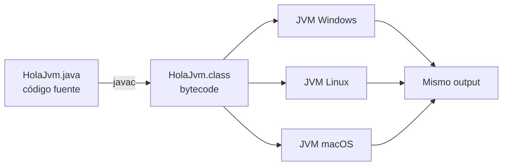

## FICHA DE TEMA: Qué es Java, JVM, bytecode, WORA

### 1. UBICACIÓN
Curso 1: Java desde Cero a Experto, Módulo 1, Lección 1.

### 2. PRERREQUISITOS
- Saber usar terminal y un editor de texto.
- Saber qué es un programa, una variable y una función/método en términos generales.
- Tener JDK instalado (se valida en la lección 3; aquí se asume disponible).

### 3. OBJETIVO DE APRENDIZAJE
**Explicar** la cadena Java→bytecode→JVM→ejecución, **compilando** y **ejecutando** un programa mínimo y **verificando** con `javap` que el `.class` contiene bytecode.

### 4. ANALOGÍA VISUAL
**Escena:** Una receta escrita en español (código `.java`) se traduce a una receta en un idioma universal de cocina (bytecode `.class`). Diferentes cocinas del mundo (Windows, Linux, macOS) tienen chefs distintos (JVMs) que entienden ese idioma universal y preparan el mismo plato.  
**Texto alternativo:** Diagrama con tres cajas: “Código fuente .java”, “Bytecode .class (idioma intermedio)”, “JVM en Windows/Linux/macOS” produce “Mismo resultado”.

### 5. DIAGRAMA TÉCNICO

**Texto alternativo:** El compilador javac transforma .java en .class. El mismo bytecode puede ser ejecutado por JVMs en distintos sistemas operativos, produciendo el mismo resultado.

### 6. EXPLICACIÓN CONCEPTUAL
- **Qué es:** Java es un lenguaje compilado a bytecode. La JVM (Java Virtual Machine) ejecuta ese bytecode. WORA significa “Write Once, Run Anywhere”: el mismo bytecode corre donde exista una JVM compatible.
- **Para qué sirve:** Permite portar aplicaciones entre sistemas operativos sin recompilar el código fuente para cada uno, siempre que el runtime sea compatible.
- **Cuándo NO usarlo:** No asumir WORA absoluto para código nativo (JNI), dependencias del SO, rutas, codificaciones o comportamiento específico de plataforma. Tampoco elegir Java solo por WORA si el problema requiere otro runtime/ecosistema.

### 7. CONSTRUCCIÓN PASO A PASO DESDE CERO

1. **Crear estructura**
   - Ruta: `modules/m01/labs/l01-que-es-java-jvm-bytecode-wora/`
   - Comando:
     ```bash
     mkdir -p modules/m01/labs/l01-que-es-java-jvm-bytecode-wora/src
     cd modules/m01/labs/l01-que-es-java-jvm-bytecode-wora
     ```
   - Por qué: separa fuente, salida y verificación.
   - Output esperado: carpeta creada.

2. **Escribir el código fuente**
   - Ruta: `src/HolaJvm.java`
   - Contenido:
     ```java
     public class HolaJvm {
         public static void main(String[] args) {
             String mensaje = "Hola JVM";
             System.out.println(mensaje);
         }
     }
     ```
   - Por qué: `main` es el punto de entrada; `mensaje` hace visible una variable; `println` produce salida observable.
   - Output esperado: archivo guardado.

3. **Compilar a bytecode**
   - Comando:
     ```bash
     mkdir -p out
     javac -d out src/HolaJvm.java
     ```
   - Por qué: `javac` traduce Java a bytecode `.class`.
   - Output esperado: `out/HolaJvm.class` existe.

4. **Inspeccionar bytecode**
   - Comando:
     ```bash
     javap -c -classpath out HolaJvm
     ```
   - Por qué: evidencia que el `.class` no es el `.java`; es bytecode para la JVM.
   - Output esperado: instrucciones como `getstatic`, `ldc`, `invokevirtual`.

5. **Ejecutar en la JVM**
   - Comando:
     ```bash
     java -cp out HolaJvm
     ```
   - Por qué: `java` inicia la JVM y ejecuta el bytecode.
   - Output esperado: `Hola JVM`.

### 8. CÓDIGO DE REFERENCIA COMPLETO
```java
public class HolaJvm {
    public static void main(String[] args) {
        String mensaje = "Hola JVM";
        System.out.println(mensaje);
    }
}
```

`verify.sh`
```bash
#!/usr/bin/env bash
set -euo pipefail
cd "$(dirname "$0")"
mkdir -p out
javac -d out src/HolaJvm.java
OUT="$(java -cp out HolaJvm)"
[[ "$OUT" == "Hola JVM" ]] || { echo "FALLA: salida inesperada: $OUT"; exit 1; }
javap -c -classpath out HolaJvm | grep -q "System.out.println" || { echo "FALLA: bytecode no contiene println"; exit 1; }
test -f out/HolaJvm.class || { echo "FALLA: no se generó .class"; exit 1; }
echo "RESULTADO: OK"
```

### 9. EXPLICACIÓN LÍNEA POR LÍNEA
- `public class HolaJvm`: clase pública; el archivo debe llamarse `HolaJvm.java`.
- `public static void main(String[] args)`: punto de entrada que la JVM busca.
- `String mensaje = "Hola JVM";`: variable local de tipo `String`.
- `System.out.println(mensaje);`: envía texto a la salida estándar.
- `javap -c`: desensambla bytecode; demuestra el artefacto intermedio.

### 10. LABORATORIO PASO A PASO
```bash
mkdir -p out
javac -d out src/HolaJvm.java
javap -c -classpath out HolaJvm
java -cp out HolaJvm
./verify.sh
```
Output esperado:
```text
Hola JVM
RESULTADO: OK
```

### 11. VERIFICACIÓN AUTOMÁTICA
`./verify.sh` compila, ejecuta, compara salida exacta y verifica que el bytecode contenga la llamada esperada. Exit 0 = OK.

### 12. MODIFICACIÓN GUIADA
- Cambio: reemplaza `"Hola JVM"` por `"Hola bytecode"`.
- Hipótesis: la salida cambia y `verify.sh` falla porque espera el texto original.
- Resultado observado: confirma que la verificación es un contrato observable.

### 13. ERROR COMÚN
- **Síntoma:** `error: class HolaJvm is public, should be declared in a file named HolaJvm.java`.
- **Causa:** nombre de archivo no coincide con clase pública.
- **Diagnóstico visual:** comparar nombre del archivo en el árbol con `public class ...`.
- **Corrección:** renombrar archivo o clase para que coincidan.

### 14. PREGUNTA DE ENTREVISTA
- **Pregunta:** ¿Qué significa WORA y cuál es su límite real?
- **Respuesta modelo:** WORA significa que el bytecode Java puede ejecutarse en cualquier plataforma con una JVM compatible. El límite real aparece con código nativo, dependencias de SO, archivos/rutas, UI específica, o diferencias de versión/configuración del runtime.

### 15. ANTI-PATRÓN RELACIONADO
- **Anti-patrón:** asumir que “corre en mi JVM” implica que correrá igual en producción.
- **Cómo se ve:** funciona localmente pero falla por versión de JDK/JVM, encoding o dependencia de sistema.
- **Alternativa:** fijar versión de JDK, probar en CI/contenedor y declarar requisitos de runtime.
