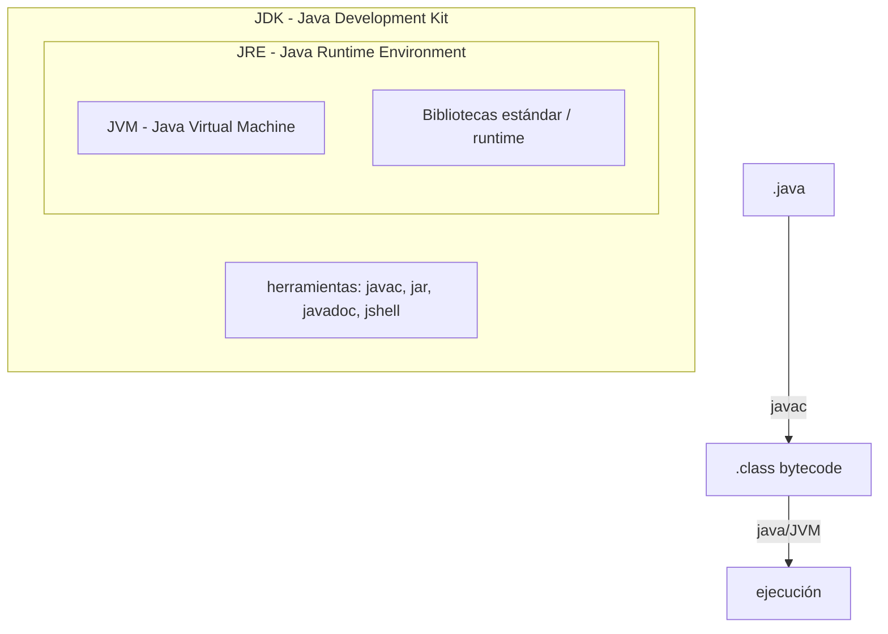

### FICHA DE TEMA: JDK vs JRE vs JVM

#### 1. UBICACIÓN
Curso 1: Java desde Cero a Experto, Módulo 1, Lección 2.

#### 2. PRERREQUISITOS
- Saber qué es un programa y ejecutar comandos en terminal.
- Haber leído la Lección 1 (Java/JVM/bytecode/WORA).

#### 3. OBJETIVO DE APRENDIZAJE
**Diferenciar** JDK, JRE y JVM mediante un diagrama y un script de verificación, identificando correctamente cuál componente se necesita para compilar y cuál para ejecutar.

#### 4. ANALOGÍA VISUAL
**Escena:** Una cocina profesional. La **JVM** es el cocinero que ejecuta la receta paso a paso. El **JRE** es la cocina equipada (cocinero + utensilios + ingredientes básicos) lista para preparar platos. El **JDK** es la cocina equipada más el taller de desarrollo de recetas (cuchillos de chef, balanza, cuaderno, probadores), necesario para crear nuevas recetas.  
**Texto alternativo:** Ilustración con tres cajas anidadas: JVM dentro de JRE, JRE dentro de JDK. JDK incluye herramientas como javac, jar, javadoc; JRE incluye bibliotecas y JVM; JVM ejecuta bytecode.

#### 5. DIAGRAMA TÉCNICO

**Texto alternativo:** El código fuente .java se compila con javac, herramienta del JDK, generando bytecode .class. La JVM, dentro del JRE, ejecuta el bytecode. El JDK contiene JRE y herramientas de desarrollo.

#### 6. EXPLICACIÓN CONCEPTUAL
- **Qué es:** JVM ejecuta bytecode; JRE provee JVM + bibliotecas para ejecutar; JDK provee JRE + herramientas para desarrollar/compilar.
- **Para qué sirve:** Elegir correctamente qué instalar: desarrollador necesita JDK; usuario final solo necesita runtime (hoy usualmente empaquetado con la app).
- **Cuándo NO usarlo:** No instalar solo JRE/JVM si vas a compilar código; no asumir que `java -version` implica que `javac` está disponible.

#### 7. CONSTRUCCIÓN PASO A PASO DESDE CERO

1. **Crear carpeta del lab**
   - Ruta: `modules/m01-fundamentos/labs/l02-jdk-jre-jvm/`
   - Comando:
     ```bash
     mkdir -p modules/m01-fundamentos/labs/l02-jdk-jre-jvm && cd modules/m01-fundamentos/labs/l02-jdk-jre-jvm
     ```
   - Por qué: aísla el experimento y permite verificación automática.
   - Output esperado: carpeta creada, sin error.

2. **Crear archivo de diagnóstico**
   - Ruta: `diagnostico.sh`
   - Contenido:
     ```bash
     #!/usr/bin/env bash
     set -euo pipefail
     echo "== java =="
     java -version 2>&1 | head -n 1
     echo "== javac =="
     javac -version 2>&1 | head -n 1
     echo "== JAVA_HOME =="
     echo "${JAVA_HOME:-NO_DEFINIDO}"
     ```
   - Por qué: evidencia qué componentes están presentes.
   - Comando: `chmod +x diagnostico.sh && ./diagnostico.sh`
   - Output esperado: versión de java y javac; JAVA_HOME definido o NO_DEFINIDO.

3. **Crear programa mínimo para probar compilación/ejecución**
   - Ruta: `src/HolaComponentes.java`
   - Contenido:
     ```java
     public class HolaComponentes {
         public static void main(String[] args) {
             System.out.println("JDK compila, JVM ejecuta");
         }
     }
     ```
   - Por qué: demuestra que `javac` (JDK) genera bytecode y `java` (JVM) lo ejecuta.

4. **Compilar y ejecutar**
   - Comandos:
     ```bash
     mkdir -p out
     javac -d out src/HolaComponentes.java
     java -cp out HolaComponentes
     ```
   - Por qué: separa fase de compilación y ejecución.
   - Output esperado: `JDK compila, JVM ejecuta`.

#### 8. CÓDIGO DE REFERENCIA COMPLETO

`src/HolaComponentes.java`
```java
public class HolaComponentes {
    public static void main(String[] args) {
        System.out.println("JDK compila, JVM ejecuta");
    }
}
```

`verify.sh`
```bash
#!/usr/bin/env bash
set -euo pipefail
ROOT="$(cd "$(dirname "$0")" && pwd)"
cd "$ROOT"
mkdir -p out
javac -d out src/HolaComponentes.java
OUT="$(java -cp out HolaComponentes)"
EXPECTED="JDK compila, JVM ejecuta"
if [[ "$OUT" != "$EXPECTED" ]]; then
  echo "FALLA: salida inesperada: $OUT" >&2
  exit 1
fi
command -v javac >/dev/null || { echo "FALLA: javac no está en PATH"; exit 1; }
command -v java >/dev/null || { echo "FALLA: java no está en PATH"; exit 1; }
echo "RESULTADO: OK"
```

#### 9. EXPLICACIÓN LÍNEA POR LÍNEA
- `set -euo pipefail`: falla rápido ante errores; evita falsos positivos.
- `javac -d out src/HolaComponentes.java`: usa compilador del JDK; genera `.class` en `out/`.
- `java -cp out HolaComponentes`: JVM carga bytecode desde classpath.
- Comparación `OUT != EXPECTED`: verificación observable, no “parece que funciona”.

#### 10. LABORATORIO PASO A PASO
```bash
cd modules/m01-fundamentos/labs/l02-jdk-jre-jvm
./verify.sh
```
Output esperado:
```text
RESULTADO: OK
```

#### 11. VERIFICACIÓN AUTOMÁTICA
- Script: `./verify.sh`
- Criterio: compila con `javac`, ejecuta con `java`, salida exacta, exit 0.

#### 12. MODIFICACIÓN GUIADA
- Cambio: renombra `javac` temporalmente en PATH (o usa un contenedor solo con JRE) y ejecuta `verify.sh`.
- Hipótesis: la ejecución de `.class` existente puede funcionar, pero compilar `.java` falla.
- Resultado observado: fallo en compilación; confirma rol del JDK.

#### 13. ERROR COMÚN
- **Síntoma:** `javac: command not found`.
- **Causa:** hay JRE/runtime pero no JDK, o PATH incorrecto.
- **Diagnóstico visual:** diagrama de cajas: falta la capa externa JDK. Terminal muestra `java -version` ok, `javac -version` falla.
- **Corrección:** instalar JDK 21, configurar PATH/JAVA_HOME, reiniciar terminal.

#### 14. PREGUNTA DE ENTREVISTA
- **Pregunta:** ¿Puedo ejecutar un `.jar` sin JDK? ¿Y compilar código Java sin JDK?
- **Respuesta modelo:** Sí, ejecutar un `.jar` requiere un runtime/JVM compatible; no necesitas JDK. Compilar código fuente `.java` sí requiere JDK porque `javac` es parte del JDK.

#### 15. ANTI-PATRÓN RELACIONADO
- **Anti-patrón:** “Instalé Java” sin especificar componente.
- **Cómo se ve:** CI falla al compilar pero la máquina local “tiene Java”.
- **Alternativa:** documentar versión de JDK, validar `java -version` y `javac -version` en setup y verify.sh.
