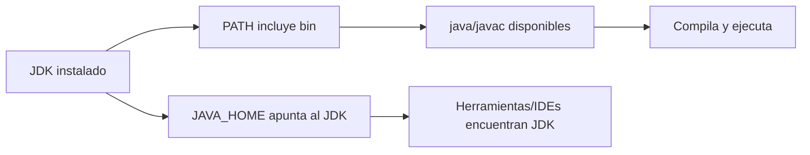

## FICHA DE TEMA: Instalación de JDK 21 (LTS) y configuración de JAVA_HOME

### 1. UBICACIÓN
Curso 1: Java desde Cero a Experto, Módulo 1, Lección 3.

### 2. PRERREQUISITOS
- Saber abrir terminal y editar variables de entorno básicas.
- Conocer diferencia conceptual JDK/JRE/JVM (M1L2).

### 3. OBJETIVO DE APRENDIZAJE
**Configurar** y **verificar** un entorno JDK funcional comprobando `java`, `javac` y `java.home` mediante un programa y script automatizado.

### 4. ANALOGÍA VISUAL
**Escena:** Antes de cocinar necesitas que la cocina tenga gas, cuchillos y horno conectados. JDK es el equipamiento; JAVA_HOME/PATH es la señalización que dice dónde está.  
**Texto alternativo:** Caja de herramientas JDK conectada por flechas PATH/JAVA_HOME a la terminal, que ejecuta java y javac.

### 5. DIAGRAMA TÉCNICO

**Texto alternativo:** El JDK instalado se expone por PATH y JAVA_HOME; la terminal puede compilar y ejecutar.

### 6. EXPLICACIÓN CONCEPTUAL
- **Qué es:** JDK 21 LTS es la distribución de desarrollo Java de soporte largo. JAVA_HOME apunta al directorio del JDK; PATH permite invocar binarios.
- **Para qué sirve:** Garantiza compilación/ejecución reproducible y que herramientas (Maven/Gradle/IDE) encuentren el JDK correcto.
- **Cuándo NO usarlo:** No fijar JAVA_HOME globalmente si trabajas con múltiples JDKs sin un gestor (sdkman/jenv); no usar un JRE cuando necesitas compilar.

### 7. CONSTRUCCIÓN PASO A PASO DESDE CERO
1. **Crear lab**
   - Ruta: `modules/m01/labs/l03-instalacion-jdk-21-y-java-home/`
   - Comando: `mkdir -p src out`
   - Por qué: aislar verificación. Output: carpeta creada.
2. **Crear `src/CheckJava.java`**
   - Código: lee `System.getProperty("java.version")` y `java.home`.
   - Por qué: prueba real del runtime activo. Output: archivo creado.
3. **Compilar y ejecutar**
   - Comando: `javac -d out src/CheckJava.java && java -cp out CheckJava`
   - Por qué: confirma JDK + JVM. Output: `JAVA_VERSION=<versión instalada>` y `JAVA_HOME=OK`.
4. **Crear `verify.sh`**
   - Verifica comandos y salida. Output: `RESULTADO: OK`.

### 8. CÓDIGO DE REFERENCIA COMPLETO
```java
public class CheckJava {
  public static void main(String[] args) {
    String version = System.getProperty("java.version");
    String home = System.getProperty("java.home");
    System.out.println("JAVA_VERSION=" + version);
    System.out.println("JAVA_HOME=" + (home!=null && !home.isBlank()?"OK":"MISSING"));
  }
}
```

### 9. EXPLICACIÓN LÍNEA POR LÍNEA
- `System.getProperty("java.version")`: versión del runtime que ejecuta el programa.
- `System.getProperty("java.home")`: ruta del runtime/JDK usado.
- Verificación `!home.isBlank()`: evita aceptar configuración vacía.

### 10. LABORATORIO PASO A PASO
```bash
javac -d out src/CheckJava.java
java -cp out CheckJava
./verify.sh
```
Output esperado:
```text
JAVA_VERSION=<versión>
JAVA_HOME=OK
RESULTADO: OK
```

### 11. VERIFICACIÓN AUTOMÁTICA
`verify.sh` valida `java/javac` en PATH, compila, ejecuta y confirma salida. Exit 0 = OK.

### 12. MODIFICACIÓN GUIADA
- Cambio: imprime también `System.getProperty("java.vendor")`.
- Hipótesis: verás el proveedor del JDK.
- Resultado observado: útil para diagnosticar diferencias entre entornos.

### 13. ERROR COMÚN
- **Síntoma:** `javac: command not found`.
- **Causa:** JRE instalado o PATH sin `bin` del JDK.
- **Diagnóstico visual:** `which java` apunta a runtime, `which javac` falla.
- **Corrección:** instalar JDK 21, exportar JAVA_HOME y PATH, reiniciar terminal.

### 14. PREGUNTA DE ENTREVISTA
- **Pregunta:** ¿Por qué `java -version` puede funcionar pero `javac` no?
- **Respuesta modelo:** Porque puede estar instalado solo el runtime/JRE o el PATH apunta a un runtime sin herramientas de desarrollo; `javac` pertenece al JDK.

### 15. ANTI-PATRÓN RELACIONADO
- **Anti-patrón:** instalar varias versiones de Java sin control y sin verificar cuál usa el proyecto.
- **Cómo se ve:** compila local, falla en CI o al revés.
- **Alternativa:** fijar versión, documentarla, verificar con script y usar gestor de versiones.
