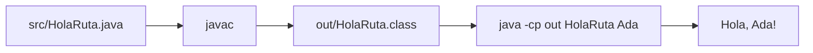

## FICHA DE TEMA: Construcción guiada: primer programa Java desde cero (sin IDE)

### 1. UBICACIÓN
Curso 1: Java desde Cero a Experto, Módulo 1, Lección 4.

### 2. PRERREQUISITOS
- JDK instalado y `java/javac` funcionando.
- Saber crear archivos y ejecutar comandos en terminal.

### 3. OBJETIVO DE APRENDIZAJE
**Construir** un programa Java desde cero sin IDE, **compilarlo** y **ejecutarlo** con y sin argumentos, verificando la salida esperada.

### 4. ANALOGÍA VISUAL
**Escena:** Escribir una nota a mano, traducirla con un traductor oficial (javac) y leerla en voz alta con un lector (JVM).  
**Texto alternativo:** Archivo .java pasa a javac, genera .class y java lo ejecuta mostrando texto en terminal.

### 5. DIAGRAMA TÉCNICO

**Texto alternativo:** El código fuente se compila y la JVM ejecuta el bytecode con un argumento.

### 6. EXPLICACIÓN CONCEPTUAL
- **Qué es:** Un programa Java mínimo con clase pública y método `main`.
- **Para qué sirve:** Entender el ciclo fuente→bytecode→ejecución sin depender de un IDE.
- **Cuándo NO usarlo:** No evitar el IDE siempre; úsalo cuando aporta productividad, pero aprende el ciclo base para diagnosticar problemas.

### 7. CONSTRUCCIÓN PASO A PASO DESDE CERO
1. Crear `src/HolaRuta.java` con clase y `main`.
2. Leer `args`: si hay argumento usarlo, si no usar `mundo`.
3. Imprimir con `System.out.println`.
4. Compilar: `javac -d out src/HolaRuta.java`.
5. Ejecutar: `java -cp out HolaRuta` y `java -cp out HolaRuta Ada`.
6. Crear `verify.sh` comparando ambas salidas.

### 8. CÓDIGO DE REFERENCIA COMPLETO
```java
public class HolaRuta {
  public static void main(String[] args) {
    String nombre = args.length > 0 ? args[0] : "mundo";
    System.out.println("Hola, " + nombre + "!");
  }
}
```

### 9. EXPLICACIÓN LÍNEA POR LÍNEA
- `args.length > 0 ? args[0] : "mundo"`: usa argumento o valor por defecto.
- `System.out.println("Hola Java")`: salida observable para humanos y scripts.

### 10. LABORATORIO PASO A PASO
```bash
mkdir -p out
javac -d out src/HolaRuta.java
java -cp out HolaRuta
java -cp out HolaRuta Ada
./verify.sh
```
Output esperado:
```text
Hola, mundo!
Hola, Ada!
RESULTADO: OK
```

### 11. VERIFICACIÓN AUTOMÁTICA
`verify.sh` ejecuta ambos casos y compara salidas exactas.

### 12. MODIFICACIÓN GUIADA
- Cambio: soporta nombre y apellido: `args[0] + " " + args[1]`.
- Hipótesis: necesitarás validar longitud de args.
- Resultado observado: sin validación puede lanzar `ArrayIndexOutOfBoundsException`.

### 13. ERROR COMÚN
- **Síntoma:** `Could not find or load main class HolaRuta`.
- **Causa:** classpath incorrecto o no compilaste en `out`.
- **Diagnóstico visual:** `ls out` debe mostrar `HolaRuta.class`.
- **Corrección:** `java -cp out HolaRuta`.

### 14. PREGUNTA DE ENTREVISTA
- **Pregunta:** ¿Qué hace el método `main` en Java?
- **Respuesta modelo:** Es el punto de entrada estándar que la JVM invoca para iniciar una aplicación Java; recibe argumentos de línea de comandos como `String[]`.

### 15. ANTI-PATRÓN RELACIONADO
- **Anti-patrón:** depender del IDE para todo y no saber ejecutar/compilar manualmente.
- **Cómo se ve:** ante un fallo de build/CI, no se sabe diagnosticar.
- **Alternativa:** conocer el ciclo CLI básico aunque uses IDE.
