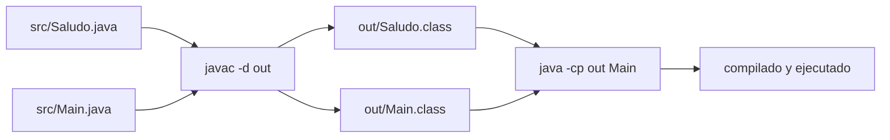

## FICHA DE TEMA: Compilación con javac y ejecución con java

### 1. UBICACIÓN
Curso 1: Java desde Cero a Experto, Módulo 1, Lección 5.

### 2. PRERREQUISITOS
- Saber crear clases y método main.
- JDK en PATH.

### 3. OBJETIVO DE APRENDIZAJE
**Compilar** múltiples archivos Java con `javac` y **ejecutar** el programa con `java -cp`, verificando la generación de `.class`.

### 4. ANALOGÍA VISUAL
**Escena:** Dos piezas de un rompecabezas se fabrican por separado (compilan) y luego se ensamblan en la mesa (classpath) para usarlas.  
**Texto alternativo:** Saludo.java y Main.java se compilan a .class y se ejecutan juntos con classpath.

### 5. DIAGRAMA TÉCNICO

**Texto alternativo:** javac genera dos clases; java carga ambas desde out.

### 6. EXPLICACIÓN CONCEPTUAL
- **Qué es:** `javac` compila fuentes; `java` ejecuta bytecode cargando clases desde classpath.
- **Para qué sirve:** Entender dependencias entre clases y errores de compilación/ejecución.
- **Cuándo NO usarlo:** No compilar manualmente en proyectos grandes; usar Maven/Gradle, pero entender la base.

### 7. CONSTRUCCIÓN PASO A PASO DESDE CERO
1. Crear `src/Saludo.java` con método `mensaje()`.
2. Crear `src/Main.java` que llama `Saludo.mensaje()`.
3. Compilar: `javac -d out src/Saludo.java src/Main.java`.
4. Verificar `.class` generados.
5. Ejecutar: `java -cp out Main`.
6. Automatizar con `verify.sh`.

### 8. CÓDIGO DE REFERENCIA COMPLETO
```java
public class Saludo { public static String mensaje(){ return "compilado y ejecutado"; } }
```
```java
public class Main { public static void main(String[] args){ System.out.println(Saludo.mensaje()); } }
```

### 9. EXPLICACIÓN LÍNEA POR LÍNEA
- `javac -d out src/HolaCompilacion.java`: coloca bytecode en `out`.
- `java -cp out Main`: define classpath y clase principal.

### 10. LABORATORIO PASO A PASO
```bash
mkdir -p out
javac -d out src/Saludo.java src/Main.java
java -cp out Main
./verify.sh
```
Output esperado:
```text
compilado y ejecutado
RESULTADO: OK
```

### 11. VERIFICACIÓN AUTOMÁTICA
`verify.sh` confirma `.class` y salida exacta.

### 12. MODIFICACIÓN GUIADA
- Cambio: renombra `mensaje()` a `texto()` solo en `Saludo`.
- Hipótesis: la compilación falla por símbolo no encontrado.
- Resultado observado: enseña dependencia de compilación.

### 13. ERROR COMÚN
- **Síntoma:** `NoClassDefFoundError`.
- **Causa:** clase compilada pero classpath incorrecto en ejecución.
- **Diagnóstico visual:** revisar ubicación de `.class` y `-cp`.
- **Corrección:** usar `java -cp out Main`.

### 14. PREGUNTA DE ENTREVISTA
- **Pregunta:** ¿Diferencia entre `javac` y `java`?
- **Respuesta modelo:** `javac` compila código fuente a bytecode; `java` inicia la JVM para ejecutar bytecode.

### 15. ANTI-PATRÓN RELACIONADO
- **Anti-patrón:** compilar “a ojo” y no limpiar `out`.
- **Cómo se ve:** clases viejas enmascaran errores.
- **Alternativa:** `rm -rf out && mkdir -p out` antes de compilar.
