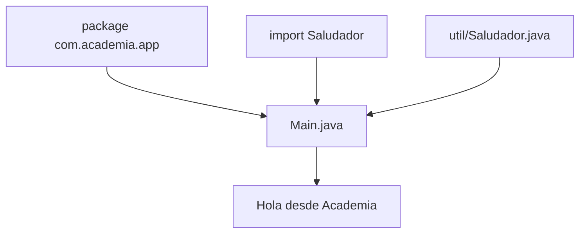

## FICHA DE TEMA: Estructura de un archivo .java: package, imports, clase, main

### 1. UBICACIÓN
Curso 1: Java desde Cero a Experto, Módulo 1, Lección 6.

### 2. PRERREQUISITOS
- Compilar y ejecutar Java básico.
- Conocer clases y métodos.

### 3. OBJETIVO DE APRENDIZAJE
**Construir** un programa Java con paquete, import, clase auxiliar y `main`, compilándolo por estructura de directorios y verificando su ejecución.

### 4. ANALOGÍA VISUAL
**Escena:** Un edificio con dirección (package), puerta de acceso (import), habitaciones (clases) y recepción (main).  
**Texto alternativo:** El package ubica la clase, el import la hace visible, main inicia la ejecución.

### 5. DIAGRAMA TÉCNICO

**Texto alternativo:** Main en un paquete importa Saludador de otro paquete y produce salida.

### 6. EXPLICACIÓN CONCEPTUAL
- **Qué es:** La estructura mínima de un archivo Java incluye declaración de paquete opcional, imports, declaración de tipo y métodos.
- **Para qué sirve:** Organiza código, evita colisiones de nombres y permite compilación escalable.
- **Cuándo NO usarlo:** No usar paquetes excesivamente profundos sin necesidad; no poner todo en el paquete por defecto en proyectos reales.

### 7. CONSTRUCCIÓN PASO A PASO DESDE CERO
1. Crear directorios `src/com/academia/app/util`.
2. Crear `Saludador.java` con `package com.academia.app.util;`.
3. Crear `Main.java` con `package com.academia.app;` e `import com.academia.app.util.Saludador;`.
4. Compilar indicando fuentes: `javac -d out src/com/academia/app/util/Saludador.java src/com/academia/app/Main.java`.
5. Ejecutar con nombre fully qualified: `java -cp out com.academia.app.Main`.

### 8. CÓDIGO DE REFERENCIA COMPLETO
```java
package com.academia.app;
import com.academia.app.util.Saludador;
public class Main {
  public static void main(String[] args) {
    Saludador s = new Saludador("Academia");
    System.out.println(s.saludar());
  }
}
```
```java
package com.academia.app.util;
public class Saludador {
  private final String nombre;
  public Saludador(String nombre) { this.nombre = nombre; }
  public String saludar() { return "Hola desde " + nombre; }
}
```

### 9. EXPLICACIÓN LÍNEA POR LÍNEA
- `package com.academia.m01;`: namespace de la clase.
- `import java.util.List;`: atajo para nombre completo.
- `private final String nombre`: estado inmutable tras construcción.
- `main`: punto de entrada.

### 10. LABORATORIO PASO A PASO
```bash
javac -d out src/com/academia/app/util/Saludador.java src/com/academia/app/Main.java
java -cp out com.academia.app.Main
./verify.sh
```
Output esperado:
```text
Hola desde Academia
RESULTADO: OK
```

### 11. VERIFICACIÓN AUTOMÁTICA
`verify.sh` compila estructura por paquetes y valida salida exacta.

### 12. MODIFICACIÓN GUIADA
- Cambio: mueve `Saludador` a otro paquete sin actualizar import.
- Hipótesis: fallará compilación.
- Resultado observado: error `cannot find symbol`/paquete.

### 13. ERROR COMÚN
- **Síntoma:** `Could not find or load main class Main`.
- **Causa:** se ejecutó sin nombre de paquete completo.
- **Diagnóstico visual:** la clase está en `out/com/academia/app/Main.class`.
- **Corrección:** `java -cp out com.academia.app.Main`.

### 14. PREGUNTA DE ENTREVISTA
- **Pregunta:** ¿Para qué sirve `package` en Java?
- **Respuesta modelo:** Organiza clases en namespaces, evita colisiones de nombres y refleja estructura del proyecto; también influye en acceso package-private.

### 15. ANTI-PATRÓN RELACIONADO
- **Anti-patrón:** usar el paquete por defecto para todo.
- **Cómo se ve:** conflictos, mala organización, problemas al escalar.
- **Alternativa:** usar paquetes por dominio/capa desde el inicio.
