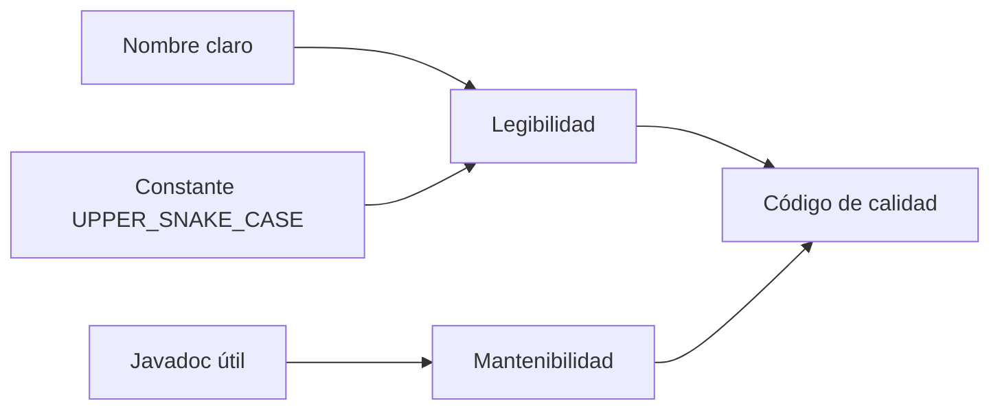

## FICHA DE TEMA: Comentarios, convenciones de nombres, estilo de código

### 1. UBICACIÓN
Curso 1: Java desde Cero a Experto, Módulo 1, Lección 7.

### 2. PRERREQUISITOS
- Saber escribir clases, métodos y variables en Java.

### 3. OBJETIVO DE APRENDIZAJE
**Aplicar** convenciones de nombres y estilo Java en una clase pequeña, usando comentarios solo donde aportan intención, y verificar comportamiento con un script.

### 4. ANALOGÍA VISUAL
**Escena:** Un taller con herramientas etiquetadas y manual breve. Las etiquetas claras (nombres) evitan errores; el manual (comentarios) solo explica lo no obvio.  
**Texto alternativo:** Código con nombres claros, constante en mayúsculas y comentario Javadoc.

### 5. DIAGRAMA TÉCNICO

**Texto alternativo:** Convenciones y comentarios útiles mejoran legibilidad y mantenibilidad.

### 6. EXPLICACIÓN CONCEPTUAL
- **Qué es:** Convenciones: clases PascalCase, métodos/variables camelCase, constantes UPPER_SNAKE_CASE, paquetes minúsculas. Comentarios explican intención, no lo obvio.
- **Para qué sirve:** Facilita lectura, revisión y mantenimiento.
- **Cuándo NO usarlo:** No comentar cada línea obvia; no usar nombres crípticos; no mantener comentarios desactualizados.

### 7. CONSTRUCCIÓN PASO A PASO DESDE CERO
1. Crear `CalculadoraImpuestos.java`.
2. Definir constante `TASA_IVA`.
3. Implementar `calcularTotal` con validación.
4. Agregar Javadoc breve y comentario solo en validación.
5. Compilar y ejecutar; verificar con script.

### 8. CÓDIGO DE REFERENCIA COMPLETO
```java
/**
 * Calculadora simple de impuestos.
 * Convenciones: clase PascalCase, métodos camelCase, constantes UPPER_SNAKE_CASE.
 */
public class CalculadoraImpuestos {
  public static final double TASA_IVA = 0.19;
  public double calcularTotal(double subtotal) {
    if (subtotal < 0) {
      throw new IllegalArgumentException("subtotal negativo");
    }
    return subtotal * (1 + TASA_IVA);
  }
  public static void main(String[] args) {
    CalculadoraImpuestos calc = new CalculadoraImpuestos();
    System.out.println(calc.calcularTotal(100));
  }
}
```

### 9. EXPLICACIÓN LÍNEA POR LÍNEA
- `TASA_IVA`: constante con convención UPPER_SNAKE_CASE.
- `calcularTotal`: camelCase, verbo claro.
- Javadoc: describe propósito sin repetir lo obvio.
- Validación: protege invariante de dominio.

### 10. LABORATORIO PASO A PASO
```bash
mkdir -p out
javac -d out src/CalculadoraImpuestos.java
java -cp out CalculadoraImpuestos
./verify.sh
```
Output esperado:
```text
119.0
RESULTADO: OK
```

### 11. VERIFICACIÓN AUTOMÁTICA
`verify.sh` valida salida, presencia de constante y Javadoc.

### 12. MODIFICACIÓN GUIADA
- Cambio: renombra `TASA_IVA` a `tasa`.
- Hipótesis: funciona pero viola convención; actualiza verificador si quieres imponer estilo.
- Resultado observado: diferencia entre corrección funcional y calidad de estilo.

### 13. ERROR COMÚN
- **Síntoma:** código funciona pero es difícil de leer.
- **Causa:** nombres pobres, comentarios obsoletos o exceso de comentarios.
- **Diagnóstico visual:** leer método sin contexto; si no se entiende, nombres/comentarios fallan.
- **Corrección:** renombrar por intención, borrar comentarios obvios, documentar decisiones.

### 14. PREGUNTA DE ENTREVISTA
- **Pregunta:** ¿Cuándo prefieres un buen nombre antes que un comentario?
- **Respuesta modelo:** Casi siempre. Un nombre claro hace el código autoexplicativo; el comentario se reserva para intención, trade-offs, invariantes o decisiones no obvias.

### 15. ANTI-PATRÓN RELACIONADO
- **Anti-patrón:** comentarios que repiten el código (`i++; // incrementa i`).
- **Cómo se ve:** ruido, desactualización y baja señal.
- **Alternativa:** nombres expresivos y comentarios de intención.
