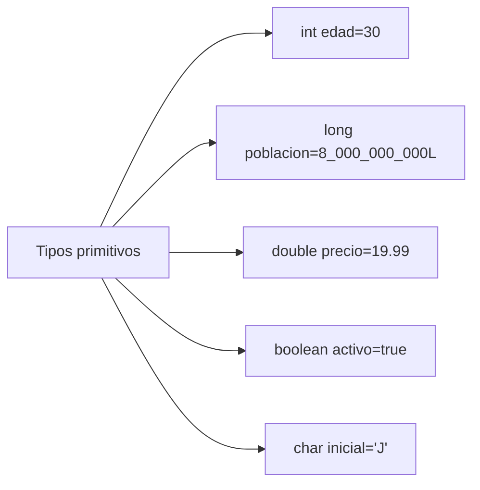

## FICHA DE TEMA: Tipos primitivos: int, long, double, boolean, char

### 1. UBICACIÓN
Curso 1: Java desde Cero a Experto, Módulo 2, Lección 1.

### 2. PRERREQUISITOS
- Módulo 1 completado.
- Saber compilar y ejecutar Java.

### 3. OBJETIVO DE APRENDIZAJE
**Declarar** y **usar** los tipos primitivos básicos de Java, imprimiendo sus valores y verificando el comportamiento con un script.

### 4. ANALOGÍA VISUAL
**Escena:** Cajas etiquetadas de distintos tamaños: una pequeña para enteros, una grande para números largos, una con decimales, un interruptor on/off y una ficha con una letra.  
**Texto alternativo:** Cinco contenedores representan int, long, double, boolean y char, cada uno con un valor de ejemplo.

### 5. DIAGRAMA TÉCNICO

**Texto alternativo:** Los cinco tipos primitivos almacenan valores simples sin objetos.

### 6. EXPLICACIÓN CONCEPTUAL
- **Qué es:** Tipos primitivos son valores básicos incorporados en Java: enteros, decimales, booleanos y caracteres.
- **Para qué sirve:** Representar datos simples con eficiencia y semántica clara.
- **Cuándo NO usarlo:** No usar primitivos cuando necesitas nullabilidad, colecciones genéricas o comportamiento de objeto; usar wrappers o tipos adecuados.

### 7. CONSTRUCCIÓN PASO A PASO DESDE CERO
1. Crear `src/TiposDemo.java`.
2. Declarar una variable por tipo primitivo.
3. Usar sufijo `L` para long y literal char con comillas simples.
4. Imprimir cada valor con etiqueta.
5. Compilar y ejecutar.
6. Crear `verify.sh` que valide salidas clave.

### 8. CÓDIGO DE REFERENCIA COMPLETO
```java
public class TiposDemo {
  public static void main(String[] args) {
    int edad = 30;
    long poblacion = 8_000_000_000L;
    double precio = 19.99;
    boolean activo = true;
    char inicial = 'J';
    System.out.println("edad=" + edad);
    System.out.println("poblacion=" + poblacion);
    System.out.println("precio=" + precio);
    System.out.println("activo=" + activo);
    System.out.println("inicial=" + inicial);
  }
}
```

### 9. EXPLICACIÓN LÍNEA POR LÍNEA
- `long poblacion = 8_000_000_000L;`: `L` indica literal long; sin él, el literal entero puede desbordar int.
- `char inicial = 'J';`: char usa comillas simples y representa un carácter UTF-16.
- `boolean activo = true;`: solo `true` o `false`.

### 10. LABORATORIO PASO A PASO
```bash
mkdir -p out
javac -d out src/TiposDemo.java
java -cp out TiposDemo
./verify.sh
```
Output esperado:
```text
edad=30
poblacion=8000000000
precio=19.99
activo=true
inicial=J
RESULTADO: OK
```

### 11. VERIFICACIÓN AUTOMÁTICA
`verify.sh` compila, ejecuta y valida valores representativos.

### 12. MODIFICACIÓN GUIADA
- Cambio: quita la `L` de `8_000_000_000L`.
- Hipótesis: falla la compilación por literal fuera de rango int.
- Resultado observado: el compilador reporta “integer number too large”.

### 13. ERROR COMÚN
- **Síntoma:** `integer number too large`.
- **Causa:** literal entero grande sin sufijo `L`.
- **Diagnóstico visual:** revisar literal numérico y tipo destino.
- **Corrección:** agregar `L`.

### 14. PREGUNTA DE ENTREVISTA
- **Pregunta:** ¿Cuándo usarías `int` vs `long`?
- **Respuesta modelo:** `int` para contadores y valores dentro de su rango; `long` cuando hay riesgo de desbordar int, como timestamps, IDs grandes o poblaciones. Elegir por rango y claridad.

### 15. ANTI-PATRÓN RELACIONADO
- **Anti-patrón:** usar `double` para dinero sin considerar precisión decimal.
- **Cómo se ve:** errores de redondeo en cálculos financieros.
- **Alternativa:** `BigDecimal` o enteros en centavos según caso.
