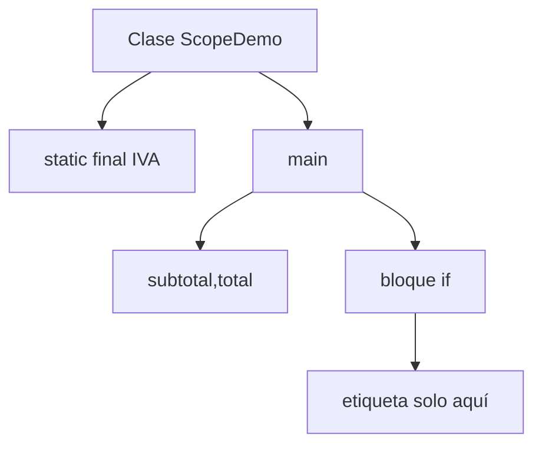

## FICHA DE TEMA: Variables, constantes (final), scope

### 1. UBICACIÓN
Curso 1: Java desde Cero a Experto, Módulo 2, Lección 2.

### 2. PRERREQUISITOS
- Tipos primitivos.
- Compilar/ejecutar Java.

### 3. OBJETIVO DE APRENDIZAJE
**Usar** variables locales, constantes `final` y comprender el scope de bloque, verificando el comportamiento por compilación y ejecución.

### 4. ANALOGÍA VISUAL
**Escena:** Una pizarra general del aula (constante/variable de clase) y notas adhesivas dentro de una caja (variables de bloque) que no existen fuera de la caja.  
**Texto alternativo:** IVA visible en toda la clase; etiqueta existe solo dentro del bloque if.

### 5. DIAGRAMA TÉCNICO

**Texto alternativo:** Las variables tienen distintos alcances según dónde se declaran.

### 6. EXPLICACIÓN CONCEPTUAL
- **Qué es:** Variable almacena un valor mutable; `final` impide reasignación; scope define dónde el nombre es visible.
- **Para qué sirve:** Evita errores, hace explícitas constantes y limita vida de variables.
- **Cuándo NO usarlo:** No hacer todo global/static; no usar `final` creyendo que hace inmutable un objeto mutable interno.

### 7. CONSTRUCCIÓN PASO A PASO DESDE CERO
1. Crear `ScopeDemo.java`.
2. Declarar `static final double IVA = 0.19;`.
3. En `main`, calcular `total`.
4. Dentro de `if`, declarar `etiqueta` e imprimirla.
5. Imprimir `total` fuera del if.
6. Verificar con `verify.sh`.

### 8. CÓDIGO DE REFERENCIA COMPLETO
```java
public class ScopeDemo {
  static final double IVA = 0.19;
  public static void main(String[] args) {
    double subtotal = 100;
    double total = subtotal * (1 + IVA);
    if (total > 100) {
      String etiqueta = "caro";
      System.out.println(etiqueta);
    }
    System.out.println(total);
  }
}
```

### 9. EXPLICACIÓN LÍNEA POR LÍNEA
- `static final double IVA`: constante de clase.
- `String etiqueta` dentro del `if`: scope de bloque; no accesible fuera.
- `total` se calcula antes y se usa después.

### 10. LABORATORIO PASO A PASO
```bash
mkdir -p out
javac -d out src/ScopeDemo.java
java -cp out ScopeDemo
./verify.sh
```
Output esperado:
```text
caro
119.0
RESULTADO: OK
```

### 11. VERIFICACIÓN AUTOMÁTICA
`verify.sh` valida salida. La modificación guiada valida scope por error de compilación.

### 12. MODIFICACIÓN GUIADA
- Cambio: intenta imprimir `etiqueta` fuera del `if`.
- Hipótesis: error de compilación “cannot find symbol”.
- Resultado observado: confirma límite de scope.

### 13. ERROR COMÚN
- **Síntoma:** `cannot find symbol` para una variable.
- **Causa:** se usa fuera de su scope.
- **Diagnóstico visual:** identificar llaves `{}` donde fue declarada.
- **Corrección:** declarar en scope adecuado o pasar valor.

### 14. PREGUNTA DE ENTREVISTA
- **Pregunta:** ¿`final` hace inmutable un objeto?
- **Respuesta modelo:** No necesariamente. `final` impide reasignar la referencia; si el objeto es mutable, su estado interno puede cambiar.

### 15. ANTI-PATRÓN RELACIONADO
- **Anti-patrón:** declarar todas las variables al inicio del método.
- **Cómo se ve:** scope innecesariamente amplio, difícil de leer.
- **Alternativa:** declarar cerca del primer uso.
