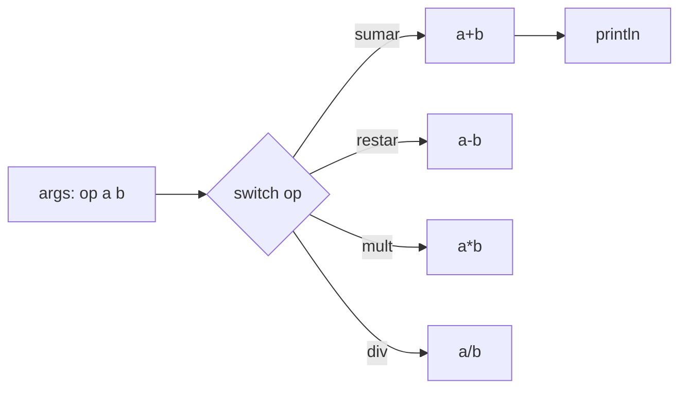

## FICHA DE TEMA: Construcción guiada: calculadora de consola desde cero

### 1. UBICACIÓN
Curso 1: Java desde Cero a Experto, Módulo 2, Lección 5.

### 2. PRERREQUISITOS
- Tipos primitivos, operadores, métodos básicos.

### 3. OBJETIVO DE APRENDIZAJE
**Construir** una calculadora CLI en Java desde cero, implementando operaciones y validaciones básicas, verificadas por script.

### 4. ANALOGÍA VISUAL
**Escena:** Una caja registradora con botones: sumar, restar, multiplicar, dividir. Cada botón ejecuta una operación clara.  
**Texto alternativo:** Entrada op,a,b pasa por un selector y produce resultado numérico.

### 5. DIAGRAMA TÉCNICO

**Texto alternativo:** La operación seleccionada determina el cálculo.

### 6. EXPLICACIÓN CONCEPTUAL
- **Qué es:** Una CLI simple que parsea argumentos y ejecuta operaciones.
- **Para qué sirve:** Practicar tipos, operadores, control de flujo, métodos y manejo de errores.
- **Cuándo NO usarlo:** No usar este enfoque sin validación/sanitización en entradas no confiables; para expresiones complejas usar parser dedicado.

### 7. CONSTRUCCIÓN PASO A PASO DESDE CERO
1. Crear `Calculadora.java`.
2. Implementar métodos `sumar/restar/multiplicar/dividir`.
3. En `main`, validar args y parsear enteros.
4. Usar `switch` por operación.
5. Manejar división por cero con `IllegalArgumentException`.
6. Verificar con `verify.sh`.

### 8. CÓDIGO DE REFERENCIA COMPLETO
```java
public class Calculadora {
  public static int sumar(int a,int b){ return a+b; }
  public static int restar(int a,int b){ return a-b; }
  public static int multiplicar(int a,int b){ return a*b; }
  public static int dividir(int a,int b){
    if(b==0) throw new IllegalArgumentException("division por cero");
    return a/b;
  }
  public static void main(String[] args){
    if(args.length<3){ System.out.println("USO: op a b"); return; }
    String op=args[0]; int a=Integer.parseInt(args[1]); int b=Integer.parseInt(args[2]);
    int r=switch(op){
      case "sumar" -> sumar(a,b);
      case "restar" -> restar(a,b);
      case "mult" -> multiplicar(a,b);
      case "div" -> dividir(a,b);
      default -> throw new IllegalArgumentException("op invalida");
    };
    System.out.println(r);
  }
}
```

### 9. EXPLICACIÓN LÍNEA POR LÍNEA
- `Integer.parseInt`: convierte texto CLI a entero.
- `switch` expression: selecciona operación y retorna valor.
- Validación `b==0`: evita división inválida.

### 10. LABORATORIO PASO A PASO
```bash
mkdir -p out
javac -d out src/Calculadora.java
java -cp out Calculadora sumar 2 3
./verify.sh
```
Output esperado:
```text
5
RESULTADO: OK
```

### 11. VERIFICACIÓN AUTOMÁTICA
`verify.sh` prueba las cuatro operaciones.

### 12. MODIFICACIÓN GUIADA
- Cambio: agrega operación `mod`.
- Hipótesis: deberás actualizar switch y verify.
- Resultado observado: diseño extensible por casos.

### 13. ERROR COMÚN
- **Síntoma:** `NumberFormatException`.
- **Causa:** argumentos no numéricos.
- **Diagnóstico visual:** imprimir args recibidos.
- **Corrección:** validar/atrapar parseo.

### 14. PREGUNTA DE ENTREVISTA
- **Pregunta:** ¿Por qué separar operaciones en métodos?
- **Respuesta modelo:** Mejora legibilidad, prueba y reutilización; `main` orquesta y los métodos encapsulan lógica.

### 15. ANTI-PATRÓN RELACIONADO
- **Anti-patrón:** todo el cálculo dentro de `main`.
- **Cómo se ve:** código difícil de probar.
- **Alternativa:** métodos pequeños con responsabilidad clara.
