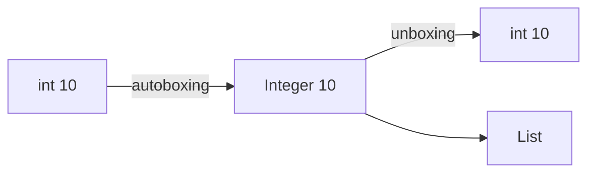

## FICHA DE TEMA: Wrappers: Integer, Double, Boolean, y autoboxing

### 1. UBICACIÓN
Curso 1: Java desde Cero a Experto, Módulo 2, Lección 6.

### 2. PRERREQUISITOS
- Primitivos y colecciones básicas.

### 3. OBJETIVO DE APRENDIZAJE
**Usar** wrappers y autoboxing/unboxing, identificando cuándo son necesarios y riesgos comunes (null).

### 4. ANALOGÍA VISUAL
**Escena:** Un número primitivo es una moneda suelta; un wrapper es la moneda dentro de una caja etiquetada que puede guardarse en estantes (colecciones).  
**Texto alternativo:** Autoboxing mete el primitivo en caja; unboxing lo saca.

### 5. DIAGRAMA TÉCNICO

**Texto alternativo:** Wrappers permiten usar primitivos en colecciones genéricas.

### 6. EXPLICACIÓN CONCEPTUAL
- **Qué es:** Wrappers son clases objeto para primitivos. Autoboxing/unboxing convierte automáticamente.
- **Para qué sirve:** Colecciones genéricas, APIs que requieren objetos, utilidades (`parseInt`).
- **Cuándo NO usarlo:** No usar wrappers innecesariamente en bucles intensivos; cuidado con `null` al hacer unboxing.

### 7. CONSTRUCCIÓN PASO A PASO DESDE CERO
1. Crear `WrappersDemo.java`.
2. Autoboxing `Integer a = 10`.
3. Unboxing `int b = a`.
4. Usar `List<Integer>` y `Integer.parseInt`.
5. Verificar salida.

### 8. CÓDIGO DE REFERENCIA COMPLETO
```java
import java.util.*;
public class WrappersDemo {
  public static void main(String[] args){
    Integer a = 10; // autoboxing
    int b = a; // unboxing
    List<Integer> nums = new ArrayList<>();
    nums.add(1); nums.add(2);
    System.out.println(b);
    System.out.println(Integer.parseInt("42"));
    System.out.println(nums.size());
  }
}
```

### 9. EXPLICACIÓN LÍNEA POR LÍNEA
- `Integer a = 10`: autoboxing.
- `int b = a`: unboxing.
- `List<Integer>`: genéricos requieren tipos objeto.

### 10. LABORATORIO PASO A PASO
```bash
mkdir -p out
javac -d out src/WrappersDemo.java
java -cp out WrappersDemo
./verify.sh
```
Output esperado:
```text
10
42
2
RESULTADO: OK
```

### 11. VERIFICACIÓN AUTOMÁTICA
`verify.sh` confirma valores y tamaño de lista.

### 12. MODIFICACIÓN GUIADA
- Cambio: `Integer n = null; int x = n;`
- Hipótesis: `NullPointerException` en unboxing.
- Resultado observado: riesgo real de wrappers.

### 13. ERROR COMÚN
- **Síntoma:** `NullPointerException` al unboxear.
- **Causa:** wrapper nulo convertido a primitivo.
- **Diagnóstico visual:** rastrear origen del `Integer` nulo.
- **Corrección:** validar null o usar `OptionalInt`/diseño alternativo.

### 14. PREGUNTA DE ENTREVISTA
- **Pregunta:** ¿Por qué existe autoboxing y cuál es su costo?
- **Respuesta modelo:** Facilita interoperar primitivos con APIs de objetos/genéricos. Cuesta asignaciones/objetos y puede causar NPE en unboxing o overhead en loops.

### 15. ANTI-PATRÓN RELACIONADO
- **Anti-patrón:** usar `Integer` en todas partes “por si acaso”.
- **Cómo se ve:** nulls inesperados y overhead.
- **Alternativa:** primitivos por defecto; wrappers cuando se necesiten.
