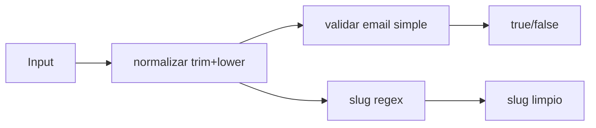

## FICHA DE TEMA: Construcción guiada: manipulación de strings desde cero

### 1. UBICACIÓN
Curso 1: Java desde Cero a Experto, Módulo 2, Lección 8.

### 2. PRERREQUISITOS
- String/StringBuilder.
- Métodos y condicionales básicos.

### 3. OBJETIVO DE APRENDIZAJE
**Construir** utilidades de manipulación de strings desde cero (normalizar, validar, slugificar) con verificación automática.

### 4. ANALOGÍA VISUAL
**Escena:** Una mesa de edición: recortar espacios, pasar a minúsculas, revisar forma y convertir a etiqueta limpia.  
**Texto alternativo:** Entrada de texto pasa por normalización, validación y transformación.

### 5. DIAGRAMA TÉCNICO

**Texto alternativo:** El texto se transforma en salidas observables.

### 6. EXPLICACIÓN CONCEPTUAL
- **Qué es:** Manipulación de strings es transformar/validar texto con reglas explícitas.
- **Para qué sirve:** Limpieza de entrada, validaciones básicas, generación de identificadores legibles.
- **Cuándo NO usarlo:** No validar emails complejos con regex simplista en producción crítica; usar librerías/estándares adecuados.

### 7. CONSTRUCCIÓN PASO A PASO DESDE CERO
1. Crear `StringLab.java`.
2. Implementar `normalizar` con `trim` y `toLowerCase`.
3. Implementar `esEmailSimple` con checks de `@` y `.`.
4. Implementar `slug` con regex.
5. Probar en `main` y verificar con script.

### 8. CÓDIGO DE REFERENCIA COMPLETO
```java
public class StringLab {
  static String normalizar(String s){
    return s.trim().toLowerCase();
  }
  static boolean esEmailSimple(String s){
    String n = normalizar(s);
    int at = n.indexOf('@');
    int dot = n.lastIndexOf('.');
    return at > 0 && dot > at + 1 && dot < n.length() - 1;
  }
  static String slug(String s){
    return normalizar(s).replaceAll("[^a-z0-9]+","-").replaceAll("^-|-$","");
  }
  public static void main(String[] args){
    System.out.println(normalizar("  Hola Mundo  "));
    System.out.println(esEmailSimple(" USER@Example.com "));
    System.out.println(esEmailSimple("malo@com"));
    System.out.println(slug(" Hola, Java 21! "));
  }
}
```

### 9. EXPLICACIÓN LÍNEA POR LÍNEA
- `trim().toLowerCase()`: normaliza espacios y mayúsculas.
- `indexOf('@')`/`lastIndexOf('.')`: validación simple de estructura.
- `replaceAll("[^a-z0-9]+","-")`: reemplaza no alfanumérico por guion.
- limpieza final de guiones bordes: evita `-hola-`.

### 10. LABORATORIO PASO A PASO
```bash
mkdir -p out
javac -d out src/StringLab.java
java -cp out StringLab
./verify.sh
```
Output esperado:
```text
hola mundo
true
false
hola-java-21
RESULTADO: OK
```

### 11. VERIFICACIÓN AUTOMÁTICA
`verify.sh` valida normalización, validación simple y slug.

### 12. MODIFICACIÓN GUIADA
- Cambio: agrega soporte para guiones bajos en slug.
- Hipótesis: deberás ajustar regex y casos.
- Resultado observado: reglas de normalización son decisiones de producto.

### 13. ERROR COMÚN
- **Síntoma:** slug con guiones dobles o bordes.
- **Causa:** regex sin normalización posterior.
- **Diagnóstico visual:** imprimir entrada intermedia.
- **Corrección:** colapsar separadores y recortar bordes.

### 14. PREGUNTA DE ENTREVISTA
- **Pregunta:** ¿Por qué no usar una regex gigante para validar todo email?
- **Respuesta modelo:** Porque el estándar de email es complejo; una regex simple puede rechazar válidos o aceptar inválidos. Para producción, combinar validación razonable con verificación por envío o librerías probadas.

### 15. ANTI-PATRÓN RELACIONADO
- **Anti-patrón:** confiar en validación de string como seguridad completa.
- **Cómo se ve:** datos inválidos o ataques pasan por validaciones superficiales.
- **Alternativa:** validar formato, semántica y contexto; sanitizar según destino.
