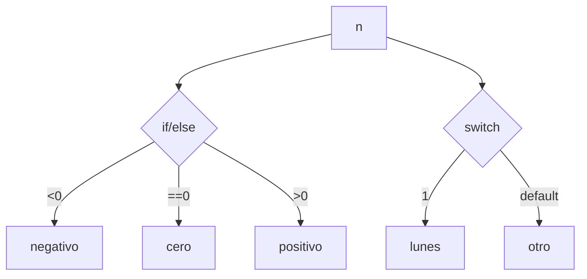

## FICHA DE TEMA: if/else, switch, switch expressions

### 1. UBICACIÓN
Curso 1: Java desde Cero a Experto, Módulo 3, Lección 1.

### 2. PRERREQUISITOS
- Variables, operadores y tipos básicos.

### 3. OBJETIVO DE APRENDIZAJE
**Implementar** decisiones con `if/else` y `switch` expressions, verificando salidas para múltiples casos.

### 4. ANALOGÍA VISUAL
**Escena:** Semáforo y selector de carriles: `if/else` evalúa condiciones en orden; `switch` selecciona un caso por valor.  
**Texto alternativo:** El flujo entra, evalúa condición/caso y sale por una rama observable.

### 5. DIAGRAMA TÉCNICO

**Texto alternativo:** if/else clasifica por rangos; switch por casos discretos.

### 6. EXPLICACIÓN CONCEPTUAL
- **Qué es:** Estructuras de control condicional.
- **Para qué sirve:** Ejecutar diferentes caminos según estado/entrada.
- **Cuándo NO usarlo:** No usar switch gigante cuando un polimorfismo/mapa de estrategias es más claro; no anidar ifs profundos sin refactor.

### 7. CONSTRUCCIÓN PASO A PASO DESDE CERO
1. Crea `ControlFlow.java`.
2. Implementa `clasificar` con `if/else`.
3. Implementa `dia` con switch expression.
4. En `main`, imprime casos representativos.
5. Verifica con script.

### 8. CÓDIGO DE REFERENCIA COMPLETO
```java
public class ControlFlow {
  static String clasificar(int n){
    if(n<0) return "negativo";
    else if(n==0) return "cero";
    return "positivo";
  }
  static String dia(int n){
    return switch(n){
      case 1 -> "lunes";
      case 2 -> "martes";
      default -> "otro";
    };
  }
  public static void main(String[] args){
    System.out.println(clasificar(-1));
    System.out.println(clasificar(0));
    System.out.println(clasificar(5));
    System.out.println(dia(1));
    System.out.println(dia(9));
  }
}
```

### 9. EXPLICACIÓN LÍNEA POR LÍNEA
- `if/else if/else`: orden importa; primera condición verdadera gana.
- `switch` expression con `->`: retorna valor, sin fall-through accidental.
- `default`: cubre casos no contemplados.

### 10. LABORATORIO PASO A PASO
```bash
mkdir -p out && javac -d out src/ControlFlow.java
java -cp out ControlFlow
./verify.sh
```
Output esperado:
```text
negativo
cero
positivo
lunes
otro
RESULTADO: OK
```

### 11. VERIFICACIÓN AUTOMÁTICA
`verify.sh` valida las cinco salidas.

### 12. MODIFICACIÓN GUIADA
- Cambio: agrega `case 2 -> "martes"` y pruébalo.
- Hipótesis: salida para 2 cambia a martes.
- Resultado observado: switch expression facilita mapeos discretos.

### 13. ERROR COMÚN
- **Síntoma:** caso inesperado en switch antiguo.
- **Causa:** fall-through por falta de `break`.
- **Diagnóstico visual:** trazar ejecución caso por caso.
- **Corrección:** usar switch expression `->` o `break`.

### 14. PREGUNTA DE ENTREVISTA
- **Pregunta:** ¿Cuándo prefieres switch expression sobre if/else?
- **Respuesta modelo:** Cuando mapeas un valor discreto a resultados claros; mejora legibilidad y evita fall-through. Para rangos o lógica compleja, if/else o estrategias.

### 15. ANTI-PATRÓN RELACIONADO
- **Anti-patrón:** ifs anidados profundos.
- **Cómo se ve:** difícil de leer y probar.
- **Alternativa:** guard clauses, switch, o extraer métodos.
