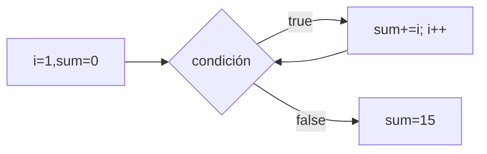

## FICHA DE TEMA: for, while, do-while, for-each

### 1. UBICACIÓN
Curso 1: Java desde Cero a Experto, Módulo 3, Lección 2.

### 2. PRERREQUISITOS
- Condicionales y operadores.

### 3. OBJETIVO DE APRENDIZAJE
**Implementar** bucles `for`, `while` y `do-while` para resolver el mismo problema y verificar equivalencia de resultados.

### 4. ANALOGÍA VISUAL
**Escena:** Tres rutas para dar 5 vueltas a una pista: contador fijo (for), mientras haya vueltas (while), y hacer una y luego repetir (do-while).  
**Texto alternativo:** Diferentes estructuras de bucle pueden producir el mismo resultado.

### 5. DIAGRAMA TÉCNICO

**Texto alternativo:** Un bucle repite mientras la condición sea verdadera.

### 6. EXPLICACIÓN CONCEPTUAL
- **Qué es:** Estructuras de repetición.
- **Para qué sirve:** Ejecutar lógica repetitiva controlada.
- **Cuándo NO usarlo:** No usar bucle cuando una operación de stream/colección es más clara; evitar bucles infinitos sin condición de salida.

### 7. CONSTRUCCIÓN PASO A PASO DESDE CERO
1. Crear `BuclesDemo.java`.
2. Sumar 1..5 con `for`.
3. Repetir con `while`.
4. Repetir con `do-while`.
5. Imprimir los tres resultados y verificar.

### 8. CÓDIGO DE REFERENCIA COMPLETO
```java
public class BuclesDemo {
  public static void main(String[] args){
    int sumFor=0; for(int i=1;i<=5;i++) sumFor+=i;
    int sumWhile=0; int j=1; while(j<=5){ sumWhile+=j; j++; }
    int sumDo=0; int k=1; do{ sumDo+=k; k++; }while(k<=5);
    System.out.println(sumFor);
    System.out.println(sumWhile);
    System.out.println(sumDo);
  }
}
```

### 9. EXPLICACIÓN LÍNEA POR LÍNEA
- `for(init;cond;inc)`: compacto para contadores.
- `while(cond)`: evalúa antes de entrar.
- `do{...}while(cond)`: ejecuta al menos una vez.

### 10. LABORATORIO PASO A PASO
```bash
mkdir -p out && javac -d out src/BuclesDemo.java
java -cp out BuclesDemo
./verify.sh
```
Output esperado:
```text
15
15
15
RESULTADO: OK
```

### 11. VERIFICACIÓN AUTOMÁTICA
`verify.sh` compara las tres líneas con `15`.

### 12. MODIFICACIÓN GUIADA
- Cambio: cambia límite a 10.
- Hipótesis: los tres resultados serán 55.
- Resultado observado: misma lógica, distinto parámetro.

### 13. ERROR COMÚN
- **Síntoma:** bucle infinito.
- **Causa:** condición nunca se vuelve falsa o contador no avanza.
- **Diagnóstico visual:** imprimir contador en cada iteración.
- **Corrección:** asegurar progreso hacia la condición de salida.

### 14. PREGUNTA DE ENTREVISTA
- **Pregunta:** ¿Diferencia entre `while` y `do-while`?
- **Respuesta modelo:** `while` puede no ejecutar ninguna vez; `do-while` ejecuta el cuerpo al menos una vez antes de evaluar la condición.

### 15. ANTI-PATRÓN RELACIONADO
- **Anti-patrón:** modificar la variable de control de forma confusa dentro del for.
- **Cómo se ve:** difícil razonar, bugs sutiles.
- **Alternativa:** mantener control claro o usar while.
