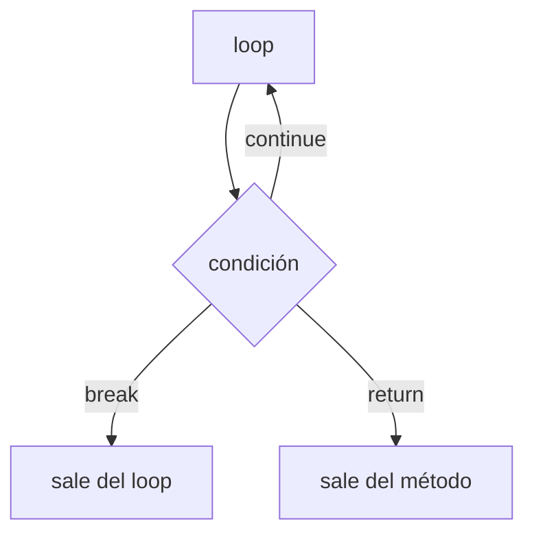

## FICHA DE TEMA: break, continue, return

### 1. UBICACIÓN
Curso 1: Java desde Cero a Experto, Módulo 3, Lección 3.

### 2. PRERREQUISITOS
- Bucles y condicionales.

### 3. OBJETIVO DE APRENDIZAJE
**Usar** `break`, `continue` y comprender `return` para controlar flujo, verificando efectos observables.

### 4. ANALOGÍA VISUAL
**Escena:** En una cinta de inspección, `continue` salta una pieza defectuosa, `break` detiene la cinta, `return` termina el turno completo.  
**Texto alternativo:** Tres instrucciones alteran el flujo con alcances distintos.

### 5. DIAGRAMA TÉCNICO

**Texto alternativo:** continue salta iteración, break sale del bucle, return sale del método.

### 6. EXPLICACIÓN CONCEPTUAL
- **Qué es:** Instrucciones de salto controlado.
- **Para qué sirve:** Simplificar lógica de bucles y salidas tempranas.
- **Cuándo NO usarlo:** No abusar para crear flujo spaghetti; evitar múltiples returns confusos en métodos complejos sin claridad.

### 7. CONSTRUCCIÓN PASO A PASO DESDE CERO
1. Crear `BreakContinue.java`.
2. Usar `break` para encontrar primer par.
3. Usar `continue` para sumar impares.
4. Imprimir resultados y verificar.

### 8. CÓDIGO DE REFERENCIA COMPLETO
```java
public class BreakContinue {
  public static void main(String[] args){
    int firstEven=-1;
    int sumOdd=0;
    for(int i=1;i<=6;i++){
      if(i%2==0){ firstEven=i; break; }
    }
    for(int i=1;i<=6;i++){
      if(i%2==0) continue;
      sumOdd+=i;
    }
    System.out.println(firstEven);
    System.out.println(sumOdd);
  }
}
```

### 9. EXPLICACIÓN LÍNEA POR LÍNEA
- `break`: sale del primer for al encontrar el primer par.
- `continue`: salta pares, solo suma impares.
- `sumOdd` termina en 1+3+5=9.

### 10. LABORATORIO PASO A PASO
```bash
mkdir -p out && javac -d out src/BreakContinue.java
java -cp out BreakContinue
./verify.sh
```
Output esperado:
```text
2
9
RESULTADO: OK
```

### 11. VERIFICACIÓN AUTOMÁTICA
`verify.sh` valida ambas líneas.

### 12. MODIFICACIÓN GUIADA
- Cambio: elimina `break`.
- Hipótesis: `firstEven` terminará en 6.
- Resultado observado: break corta temprano.

### 13. ERROR COMÚN
- **Síntoma:** bucle no procesa todos los elementos esperados.
- **Causa:** `break` o `continue` mal ubicado.
- **Diagnóstico visual:** trazar iteraciones.
- **Corrección:** revisar condición y posición del salto.

### 14. PREGUNTA DE ENTREVISTA
- **Pregunta:** ¿Diferencia entre `break` y `return` dentro de un bucle?
- **Respuesta modelo:** `break` sale del bucle/switch actual; `return` sale del método completo, sin importar bucles anidados.

### 15. ANTI-PATRÓN RELACIONADO
- **Anti-patrón:** usar saltos para ocultar lógica compleja.
- **Cómo se ve:** difícil mantenimiento.
- **Alternativa:** extraer funciones y condiciones claras.
