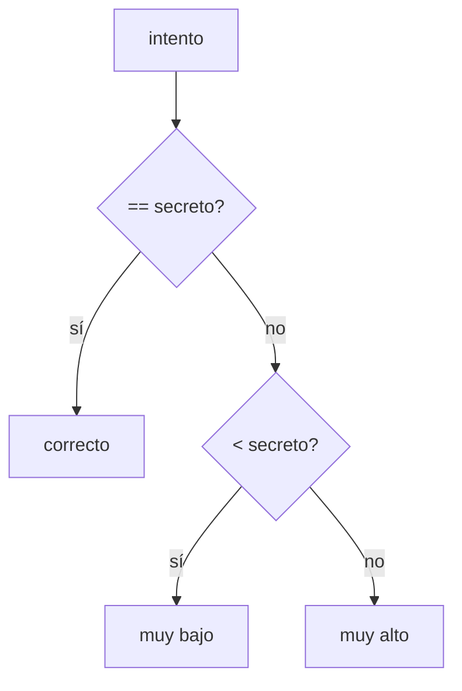

## FICHA DE TEMA: Construcción guiada: juego de adivinanza desde cero

### 1. UBICACIÓN
Curso 1: Java desde Cero a Experto, Módulo 3, Lección 4.

### 2. PRERREQUISITOS
- Condicionales, bucles, métodos.

### 3. OBJETIVO DE APRENDIZAJE
**Construir** un juego de adivinanza simple desde cero con lógica de comparación y verificación automática.

### 4. ANALOGÍA VISUAL
**Escena:** Un termómetro de cercanía: “muy bajo”, “muy alto”, “correcto”.  
**Texto alternativo:** Cada intento se compara con el secreto y produce feedback.

### 5. DIAGRAMA TÉCNICO

**Texto alternativo:** Decisiones en cascada clasifican el intento.

### 6. EXPLICACIÓN CONCEPTUAL
- **Qué es:** Un programa que compara intentos contra un valor secreto.
- **Para qué sirve:** Practicar control de flujo, métodos y pruebas.
- **Cuándo NO usarlo:** No exponer el secreto en logs/cliente real; este lab es didáctico.

### 7. CONSTRUCCIÓN PASO A PASO DESDE CERO
1. Crear `Adivinanza.java`.
2. Implementar `evaluar(secreto,intento)`.
3. En `main`, simular intentos y imprimir respuestas.
4. Verificar con script.

### 8. CÓDIGO DE REFERENCIA COMPLETO
```java
public class Adivinanza {
  static String evaluar(int secreto, int intento){
    if(intento == secreto) return "correcto";
    if(intento < secreto) return "muy bajo";
    return "muy alto";
  }
  public static void main(String[] args){
    int secreto = 7;
    int[] intentos = {3,9,7};
    for(int i: intentos){
      System.out.println(evaluar(secreto,i));
    }
  }
}
```

### 9. EXPLICACIÓN LÍNEA POR LÍNEA
- `evaluar`: encapsula regla de negocio.
- Bucle `for-each`: prueba varios casos.
- Salidas deterministas: fáciles de verificar.

### 10. LABORATORIO PASO A PASO
```bash
mkdir -p out && javac -d out src/Adivinanza.java
java -cp out Adivinanza
./verify.sh
```
Output esperado:
```text
muy bajo
muy alto
correcto
RESULTADO: OK
```

### 11. VERIFICACIÓN AUTOMÁTICA
`verify.sh` valida secuencia exacta de respuestas.

### 12. MODIFICACIÓN GUIADA
- Cambio: lee intentos de `args`.
- Hipótesis: el juego se vuelve interactivo por CLI.
- Resultado observado: debes validar entrada.

### 13. ERROR COMÚN
- **Síntoma:** siempre responde “muy alto”.
- **Causa:** comparación invertida.
- **Diagnóstico visual:** probar casos límite.
- **Corrección:** revisar condiciones `<`/`>`.

### 14. PREGUNTA DE ENTREVISTA
- **Pregunta:** ¿Por qué extraer `evaluar` como método?
- **Respuesta modelo:** Separa lógica de IO, facilita pruebas unitarias y reutilización.

### 15. ANTI-PATRÓN RELACIONADO
- **Anti-patrón:** mezclar entrada, lógica y salida en un bloque.
- **Cómo se ve:** difícil de testear.
- **Alternativa:** métodos puros para lógica.
