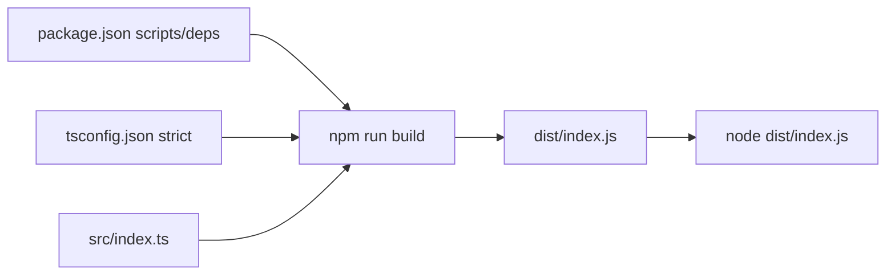

### FICHA DE TEMA: Primer proyecto Node desde cero (package.json, tsconfig, estructura)

#### 1. UBICACIÓN
Curso 3: Node.js Microservicios desde Cero, Módulo 1, Lección 8.

#### 2. PRERREQUISITOS
- Node 20 LTS instalado, npm disponible.
- Saber usar terminal y editor.
- Haber visto ES6+ y TypeScript básico (M1 L1-L2).

#### 3. OBJETIVO DE APRENDIZAJE
**Crear** desde cero un proyecto Node.js con TypeScript estricto, scripts de build/test/run y estructura mínima profesional, **verificando** su ejecución con un script automatizado.

#### 4. ANALOGÍA VISUAL
**Escena:** Armar un taller antes de fabricar. `package.json` es la ficha del taller (nombre, herramientas, comandos). `tsconfig.json` son las reglas de calidad. `src/` es la mesa de trabajo; `dist/` es el producto terminado.  
**Texto alternativo:** Diagrama de cajas: package.json configura scripts/deps; tsconfig define reglas del compilador; src/index.ts se compila a dist/index.js; npm scripts ejecutan build/start/test.

#### 5. DIAGRAMA TÉCNICO

**Texto alternativo:** npm run build usa tsconfig y compila src TypeScript a dist JavaScript; node ejecuta el artefacto compilado.

#### 6. EXPLICACIÓN CONCEPTUAL
- **Qué es:** Esqueleto mínimo de proyecto Node+TS con configuración reproducible.
- **Para qué sirve:** Base consistente para todos los labs; evita “funciona en mi máquina”.
- **Cuándo NO usarlo:** No usar esta base mínima para producción sin agregar lint, tests, CI, manejo de secretos y observabilidad; no usar TS si el equipo/contexto no lo necesita (trade-off).

#### 7. CONSTRUCCIÓN PASO A PASO DESDE CERO

1. **Crear carpeta e iniciar npm**
   ```bash
   mkdir -p modules/m01-node/labs/l08-primer-proyecto && cd $_
   npm init -y
   ```
   - Por qué: crea `package.json`, el contrato del proyecto.

2. **Instalar TypeScript y tipos Node**
   ```bash
   npm install -D typescript @types/node tsx
   ```
   - Por qué: TS compila a JS; `@types/node` da tipos; `tsx` facilita ejecución en dev.

3. **Crear `tsconfig.json`**
   ```json
   {
     "compilerOptions": {
       "target": "ES2022",
       "module": "NodeNext",
       "moduleResolution": "NodeNext",
       "rootDir": "src",
       "outDir": "dist",
       "strict": true,
       "esModuleInterop": true,
       "skipLibCheck": true
     },
     "include": ["src"]
   }
   ```
   - Por qué: `strict` detecta errores temprano; `rootDir/outDir` separan fuente y compilado.

4. **Crear estructura y código**
   - Ruta: `src/index.ts`
   ```ts
   export function saludo(nombre: string): string {
     return `Hola, ${nombre}. Proyecto Node listo.`;
   }

   if (require.main === module) {
     console.log(saludo("estudiante"));
   }
   ```
   - Por qué: función testeable + ejecución directa.

5. **Configurar scripts**
   - En `package.json`:
   ```json
   {
     "scripts": {
       "build": "tsc",
       "start": "node dist/index.js",
       "dev": "tsx src/index.ts",
       "test": "node --test"
     }
   }
   ```
   - Por qué: comandos estándar y verificables.

6. **Compilar y ejecutar**
   ```bash
   npm run build
   npm start
   ```
   - Output esperado: `Hola, estudiante. Proyecto Node listo.`

#### 8. CÓDIGO DE REFERENCIA COMPLETO

`package.json` (campos clave)
```json
{
  "name": "l08-primer-proyecto",
  "version": "1.0.0",
  "private": true,
  "scripts": {
    "build": "tsc",
    "start": "node dist/index.js",
    "dev": "tsx src/index.ts",
    "test": "node --test"
  },
  "devDependencies": {
    "@types/node": "^20.0.0",
    "tsx": "^4.0.0",
    "typescript": "^5.5.0"
  }
}
```

`verify.sh`
```bash
#!/usr/bin/env bash
set -euo pipefail
cd "$(dirname "$0")"
npm ci >/dev/null 2>&1 || npm install >/dev/null
npm run build >/dev/null
OUT="$(npm start --silent)"
EXPECTED="Hola, estudiante. Proyecto Node listo."
[[ "$OUT" == "$EXPECTED" ]] || { echo "FALLA: $OUT"; exit 1; }
echo "RESULTADO: OK"
```

#### 9. EXPLICACIÓN LÍNEA POR LÍNEA
- `"strict": true`: activa chequeos de tipos estrictos.
- `rootDir/outDir`: evita mezclar `.ts` y `.js`.
- `export function saludo(nombre: string): string`: permite importar en tests.
- `require.main === module`: ejecuta solo cuando es entrypoint.

#### 10. LABORATORIO PASO A PASO
```bash
npm install
npm run build
npm start
./verify.sh
```
Output esperado: saludo correcto y `RESULTADO: OK`.

#### 11. VERIFICACIÓN AUTOMÁTICA
`verify.sh` instala, compila, ejecuta y compara salida exacta. Exit 0 solo si todo pasa.

#### 12. MODIFICACIÓN GUIADA
- Cambio: en `saludo`, cambia el mensaje a `Hola, ${nombre}!`.
- Hipótesis: `verify.sh` fallará por salida no coincidente.
- Observación: ajustar test/expectativa o revertir; enseña contratos verificables.

#### 13. ERROR COMÚN
- **Síntoma:** `Cannot find module dist/index.js`.
- **Causa:** se ejecutó `npm start` sin `npm run build`.
- **Diagnóstico visual:** árbol sin carpeta `dist/`.
- **Corrección:** ejecutar build; agregar prestart opcional en cursos avanzados (explicar trade-off).

#### 14. PREGUNTA DE ENTREVISTA
- **Pregunta:** ¿Por qué separar `src` y `dist` en un proyecto TypeScript?
- **Respuesta modelo:** Separa código fuente de artefactos compilados, evita publicar/ejecutar archivos mezclados, simplifica limpieza, empaquetado y despliegue.

#### 15. ANTI-PATRÓN RELACIONADO
- **Anti-patrón:** commitear `dist/` y editarlo a mano.
- **Cómo se ve:** cambios se pierden al recompilar; bugs difíciles de rastrear.
- **Alternativa:** tratar `dist/` como artefacto generado; compilar en CI/build.
