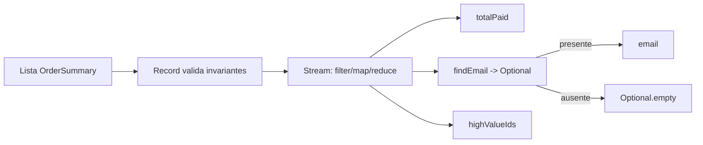

## CAPÍTULO M01-L01: Java 21 para microservicios

### 1. Ubicación
- **Curso:** C2 — Spring Boot Microservicios desde Cero
- **Módulo:** M01 — Fundamentos Java 21 / Spring Boot
- **Lección:** L01 — Java 21 para microservicios
- **Tiempo estimado:** 55 min
- **Versiones:** Java 21, Maven 3.9+, JUnit 5.11

### 2. Prerrequisitos
- Saber programar: variables, condicionales, bucles, funciones, clases.
- JDK 21 instalado y `java -version` funcionando.
- Maven instalado (`mvn -version`).

Comprobación rápida:
```bash
java -version
mvn -version
```

### 3. Objetivo de aprendizaje
Al terminar podrás **usar records, streams y Optional de Java 21** para modelar y procesar datos de dominio en un microservicio, y **verificar con tests JUnit** que la lógica maneja casos válidos, nulos y ausentes.

### 4. Problema real / por qué importa
En microservicios, gran parte del código no es “framework mágico”: es transformar datos de entrada, validar invariantes, calcular totales y responder sin exponer nulos inesperados. Si modelas mal el dominio, Spring Boot solo propaga el problema más rápido.

Java 21 aporta herramientas que reducen boilerplate y hacen explícitas las invariantes: `record` para datos inmutables, streams para transformaciones declarativas, `Optional` para ausencia.

### 5. Analogía y modelo mental
Piensa en un albarán de envío: tiene campos fijos (id, destinatario, total). Un `record` es ese albarán: datos claros, inmutables, con validación al crearse. Un stream es la cinta transportadora donde filtras y sumas paquetes; `Optional` es la casilla “no encontrado” explícita, en vez de devolver una caja vacía sin etiqueta (`null`).

**Dónde se rompe la analogía:** en software, un `Optional` mal usado (`get()` sin comprobar) es tan peligroso como un `null`; y un record no reemplaza toda entidad mutable.

### 6. Diagrama técnico

**Texto alternativo:** Una lista de registros OrderSummary pasa por validación del record, luego streams calculan total, buscan email como Optional y filtran IDs de alto valor.

### 7. Conceptos fundamentales

#### Qué es
- **Record:** clase inmutable de datos con constructor, accesores, `equals`, `hashCode` y `toString` generados.
- **Stream:** pipeline declarativo para transformar colecciones.
- **Optional:** contenedor que expresa “puede no haber valor”.

#### Cómo funciona por dentro
El record genera componentes; su constructor compacto permite validar antes de aceptar el estado. Los streams no modifican la colección original; crean una tubería de operaciones intermedias (lazy) y una terminal (`reduce`, `findFirst`, `toList`).

#### Cuándo usar
- Records para DTOs/value objects inmutables.
- Streams para transformaciones legibles sin mutación accidental.
- Optional como retorno cuando la ausencia es normal.

#### Cuándo NO usar
- No uses record para entidades JPA mutables con identidad y ciclo de vida complejo.
- No uses streams para lógica obscura de 20 operaciones encadenadas; pierde legibilidad.
- No uses `Optional.get()` sin verificar; no uses Optional como campo de entidad o parámetro en todos lados.

### 8. Construcción desde cero

Lab: `docs/cursos/springboot-microservicios-desde-cero/labs/m01-l01-java-21-para-microservicios`

#### Paso 1: Crear proyecto Maven
`pom.xml` define Java 21 y JUnit 5:
```xml
<properties>
  <maven.compiler.release>21</maven.compiler.release>
  <junit.version>5.11.4</junit.version>
</properties>
<dependency>
  <groupId>org.junit.jupiter</groupId>
  <artifactId>junit-jupiter</artifactId>
  <version>${junit.version}</version>
  <scope>test</scope>
</dependency>
```

#### Paso 2: Modelar el dominio con record
`src/main/java/com/academia/java21/OrderSummary.java`:
```java
package com.academia.java21;
import java.math.BigDecimal;
public record OrderSummary(String orderId, String customerEmail, BigDecimal total) {
    public OrderSummary {
        if (orderId == null || orderId.isBlank()) throw new IllegalArgumentException("orderId requerido");
        if (total == null || total.signum() < 0) throw new IllegalArgumentException("total inválido");
    }
}
```
**Por qué:** la validación vive en el borde del objeto. No existe un `OrderSummary` inválido.

#### Paso 3: Procesar con streams y Optional
`src/main/java/com/academia/java21/OrderReportService.java`:
```java
public BigDecimal totalPaid(List<OrderSummary> orders) {
    return orders.stream().map(OrderSummary::total).reduce(BigDecimal.ZERO, BigDecimal::add);
}
public Optional<String> findEmail(List<OrderSummary> orders, String orderId) {
    return orders.stream()
            .filter(o -> o.orderId().equals(orderId))
            .map(OrderSummary::customerEmail)
            .filter(email -> email != null && !email.isBlank())
            .findFirst();
}
public List<String> highValueIds(List<OrderSummary> orders, BigDecimal min) {
    return orders.stream().filter(o -> o.total().compareTo(min) >= 0).map(OrderSummary::orderId).toList();
}
```

#### Paso 4: Verificar comportamiento
`src/test/java/com/academia/java21/OrderReportServiceTest.java` cubre suma, ausencia, filtro y validación:
```java
@Test void findEmailReturnsOptional() {
    assertEquals("ana@demo.test", service.findEmail(orders, "o-1").orElseThrow());
    assertTrue(service.findEmail(orders, "o-2").isEmpty());
    assertTrue(service.findEmail(orders, "missing").isEmpty());
}
@Test void recordValidatesInput() {
    assertThrows(IllegalArgumentException.class, () -> new OrderSummary("", "a@b.test", BigDecimal.ONE));
}
```

#### Paso 5: Ejecutar
```bash
cd docs/cursos/springboot-microservicios-desde-cero/labs/m01-l01-java-21-para-microservicios
./verify.sh
```
Salida real observada:
```text
[INFO] Tests run: 4, Failures: 0, Errors: 0, Skipped: 0
RESULTADO: OK
```

### 9. Código de referencia completo
- `pom.xml`
- `src/main/java/com/academia/java21/OrderSummary.java`
- `src/main/java/com/academia/java21/OrderReportService.java`
- `src/test/java/com/academia/java21/OrderReportServiceTest.java`
- `verify.sh`

### 10. Explicación línea por línea / por bloque

| Código/bloque | Intención | Efecto | Si se omite/cambia |
|---|---|---|---|
| `public record OrderSummary(etc)` | Modelar dato inmutable | Genera constructor/accesores/equals | Más boilerplate y riesgo de mutación |
| Constructor compacto con validación | Invariante en la frontera | Rechaza `orderId` vacío o total negativo | Objetos inválidos circulan por el sistema |
| `reduce(BigDecimal.ZERO, BigDecimal::add)` | Suma segura | Total exacto con `BigDecimal` | Usar `double` introduce errores de precisión |
| `Optional<String> findEmail(etc)` | Ausencia explícita | El llamador debe manejar el caso vacío | `null` causa NPE aguas abajo |
| `filter(email -> email != null && !email.isBlank())` | Normalizar ausencia | Email vacío se trata como ausente | Devuelve string vacío “falso positivo” |
| `toList()` | Lista inmutable de resultado | Resultado claro y seguro | Devolver lista mutable permite efectos colaterales |

### 11. Laboratorio reproducible
```bash
./verify.sh
```
`verify.sh` ejecuta `mvn -q test` y emite `RESULTADO: OK`.

### 12. Verificación automática
- **Valida:** total pagado, búsqueda con Optional, filtro por umbral, validación del record.
- **Pass/fail:** 4 tests JUnit, exit 0.

### 13. Modificación guiada
- **Cambio:** elimina el filtro `!email.isBlank()` en `findEmail`.
- **Hipótesis:** `findEmail(orders,"o-2")` dejará de estar vacío y el test fallará.
- **Comando:** `mvn -q -Dtest=OrderReportServiceTest#findEmailReturnsOptional test`.
- **Resultado esperado:** fallo porque devuelve cadena en blanco. Revierte.

### 14. Error común y diagnóstico
- **Síntoma:** `NullPointerException` al procesar órdenes.
- **Causa:** devolver `null` en vez de `Optional.empty()` o no validar record.
- **Diagnóstico:** seguir el stack trace hasta el mapper/servicio; revisar contrato.
- **Fix:** devolver Optional, validar entrada, agregar test de ausencia.

### 15. Cierre

#### Anti-patrón
Usar `Optional.get()` sin comprobar, o poner Optional por todos lados. Optional es para retornos; valida y modela el dominio con claridad.

#### Pregunta de entrevista
- **Pregunta:** ¿Cuándo usarías un `record` en vez de una clase normal?
- **Respuesta modelo:** Cuando el objeto representa datos inmutables con semántica de valor: DTOs, respuestas, eventos simples. No lo usaría para entidades JPA mutables o cuando necesito herencia/comportamiento complejo.

#### Resumen
- Records hacen explícitas las invariantes del dato.
- Streams expresan transformaciones; Optional expresa ausencia.
- Los tests fijan el comportamiento.

#### Puente
En M01-L02 verás Virtual Threads de Java 21, clave para microservicios con I/O bloqueante.
