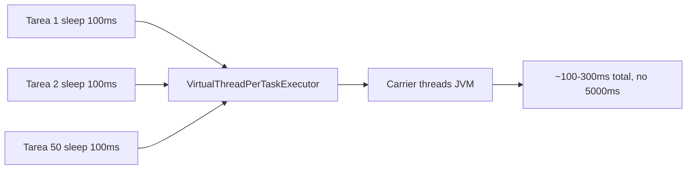

## CAPÍTULO M01-L02: Virtual Threads en Java 21

### 1. Ubicación
- **Curso:** C2 — Spring Boot Microservicios desde Cero
- **Módulo:** M01 — Fundamentos Java 21 / Spring Boot
- **Lección:** L02 — Virtual Threads
- **Tiempo estimado:** 55 min
- **Versiones:** Java 21, Maven 3.9+, JUnit 5.11

### 2. Prerrequisitos
- M01-L01: Java 21, records, tests JUnit.
- Conceptos básicos de concurrencia: thread, bloqueo, pool.
- JDK 21 instalado.

### 3. Objetivo de aprendizaje
Al terminar podrás **ejecutar tareas bloqueantes con virtual threads** usando `Executors.newVirtualThreadPerTaskExecutor()`, y **comprobar** que las tareas se ejecutan concurrentemente con menor tiempo total que la ejecución secuencial.

### 4. Problema real / por qué importa
En microservicios, muchas operaciones son I/O bloqueante: llamadas HTTP, consultas a BD, colas. Con threads de plataforma, cada request bloqueado ocupa un thread caro del SO. Con alta concurrencia, el pool se agota y la latencia se dispara.

Los virtual threads (Project Loom, estables en Java 21) permiten escribir código bloqueante simple mientras la JVM monta/desmonta threads virtuales sobre pocos carrier threads.

### 5. Analogía y modelo mental
Un thread de plataforma es un cajero dedicado: si el cliente tarda rellenando papeles, el cajero espera. Un virtual thread es un cajero que, cuando el cliente espera, atiende a otro y vuelve cuando el primero está listo.

**Dónde se rompe la analogía:** no todos los bloqueos son iguales; `synchronized` con pinning, CPU-bound o código nativo pueden limitar el beneficio. No es magia para todo.

### 6. Diagrama técnico

**Texto alternativo:** 50 tareas bloqueantes se envían a un executor de virtual threads. La JVM las monta sobre carrier threads y el tiempo total es cercano al de una tarea, no la suma secuencial.

### 7. Conceptos fundamentales

#### Qué es
Un **virtual thread** es un thread ligero gestionado por la JVM, no 1:1 con un thread del sistema operativo. Ideal para tareas I/O-bound.

#### Cómo funciona
Cuando un virtual thread se bloquea en operaciones compatibles, la JVM lo desmonta del carrier thread y monta otro. Al completar el I/O, se reprograma. La API es la misma `Thread`/`Runnable`.

#### Cuándo usar
- Muchas tareas concurrentes con I/O bloqueante.
- Código existente bloqueante que quieres escalar sin reescribir a reactive.

#### Cuándo NO usar
- Tareas CPU-bound intensivas: no dan ventaja mágica.
- Secciones largas dentro de `synchronized` que causen pinning (mejorar con `ReentrantLock` cuando aplica).
- No asumas que reemplaza el diseño de backpressure, timeouts o límites de recursos.

### 8. Construcción desde cero

Lab: `docs/cursos/springboot-microservicios-desde-cero/labs/m01-l02-virtual-threads`

#### Paso 1: Simular I/O bloqueante
`src/main/java/com/academia/vt/BlockingGateway.java`:
```java
package com.academia.vt;
public class BlockingGateway {
    public String call(String id) {
        try {
            Thread.sleep(100);
        } catch (InterruptedException e) {
            Thread.currentThread().interrupt();
            throw new RuntimeException(e);
        }
        return "ok-" + id;
    }
}
```
**Por qué:** `Thread.sleep` simula espera bloqueante. En un servicio real sería HTTP/BD.

#### Paso 2: Ejecutar con virtual threads
`src/main/java/com/academia/vt/VirtualThreadExecutor.java`:
```java
try (ExecutorService executor = Executors.newVirtualThreadPerTaskExecutor()) {
    List<Future<String>> futures = new ArrayList<>();
    for (int i = 0; i < tasks; i++) {
        final int id = i;
        futures.add(executor.submit(() -> gateway.call(String.valueOf(id))));
    }
    List<String> out = new ArrayList<>();
    for (Future<String> f : futures) out.add(f.get(1, TimeUnit.SECONDS));
    try (ExecutorService probe = Executors.newVirtualThreadPerTaskExecutor()) {
        virtual = probe.submit(() -> Thread.currentThread().isVirtual()).get();
    }
    return new Result(out, Duration.between(start, Instant.now()), virtual);
}
```

#### Paso 3: Test de concurrencia
`src/test/java/com/academia/vt/VirtualThreadExecutorTest.java`:
```java
@Test void virtualThreadsHandleBlockingTasksConcurrently() throws Exception {
    var result = new VirtualThreadExecutor().run(50);
    assertEquals(50, result.responses().size());
    assertTrue(result.virtual(), "debe ejecutar en virtual threads");
    assertTrue(result.elapsed().toMillis() < 2000, "con VT no debe ser ~5s secuenciales");
}
```

#### Paso 4: Ejecutar
```bash
cd docs/cursos/springboot-microservicios-desde-cero/labs/m01-l02-virtual-threads
./verify.sh
```
Salida real observada:
```text
[INFO] Tests run: 1, Failures: 0, Errors: 0, Skipped: 0
RESULTADO: OK
```

### 9. Código de referencia completo
- `pom.xml`
- `src/main/java/com/academia/vt/BlockingGateway.java`
- `src/main/java/com/academia/vt/VirtualThreadExecutor.java`
- `src/test/java/com/academia/vt/VirtualThreadExecutorTest.java`
- `verify.sh`

### 10. Explicación línea por línea / por bloque

| Bloque | Intención | Efecto | Si se omite/cambia |
|---|---|---|---|
| `Thread.sleep(100)` | Simular bloqueo | Representa I/O esperando | Sin bloqueo no se observa beneficio |
| `Executors.newVirtualThreadPerTaskExecutor()` | Executor Loom | Un virtual thread por tarea | Con pool fijo pequeño sería lento/limitado |
| `try (ExecutorService executor = etc)` | Cerrar executor | Espera tareas y libera recursos | Fuga de threads/recursos |
| `f.get(1, TimeUnit.SECONDS)` | Timeout | Evita test colgado | Sin timeout, fallo cuelga CI |
| `Thread.currentThread().isVirtual()` | Evidencia | Confirma ejecución en VT | Podrías creer que usas VT sin usarlo |
| `elapsed < 2000ms` | Aserción de concurrencia | 50x100ms secuencial = ~5s | Sin esta aserción no pruebas concurrencia |

### 11. Laboratorio reproducible
```bash
./verify.sh
```

### 12. Verificación automática
Valida 50 respuestas, tipo virtual thread y tiempo total menor a 2s. Pass/fail por JUnit.

### 13. Modificación guiada
- **Cambio:** reemplaza `newVirtualThreadPerTaskExecutor()` por `Executors.newFixedThreadPool(1)`.
- **Hipótesis:** el tiempo será cercano a 5000ms y la aserción `< 2000ms` fallará.
- **Comando:** `mvn -q -Dtest=VirtualThreadExecutorTest test`.
- **Resultado esperado:** fallo por tiempo. Revierte.

### 14. Error común y diagnóstico
- **Síntoma:** no mejora el rendimiento con virtual threads.
- **Causa:** tarea CPU-bound, pinning por `synchronized`, o límite externo (BD/pool/conexiones).
- **Diagnóstico:** usar JFR/`-Djdk.tracePinnedThreads=full`, medir tiempos, revisar contención.
- **Fix:** optimizar bloqueo, usar `ReentrantLock`, limitar recursos externos.

### 15. Cierre

#### Anti-patrón
Lanzar millones de virtual threads sin limitar recursos downstream (BD, APIs). Las VTs abaratan threads, no hacen infinita la base de datos.

#### Pregunta de entrevista
- **Pregunta:** ¿Qué problema resuelven los virtual threads y cuándo no ayudan?
- **Respuesta modelo:** Resuelven escalabilidad de I/O bloqueante permitiendo muchas tareas concurrentes con código imperativo simple. No ayudan mucho en CPU-bound, ni eliminan límites de recursos externos, ni corrigen pinning en secciones críticas mal diseñadas.

#### Resumen
- VTs hacen barato el bloqueo.
- Ideal para I/O-bound.
- Mide: usa tests/tiempos, no fe.

#### Puente
M01-L03 entra a Maven/Gradle desde cero: el build tool que empaqueta y verifica estos labs.
