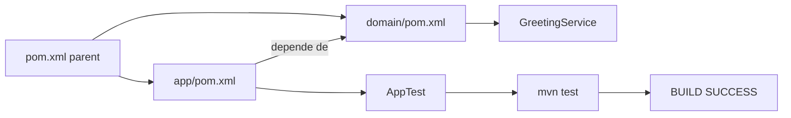

## CAPÍTULO M01-L03: Maven y Gradle desde cero

### 1. Ubicación
- **Curso:** C2 — Spring Boot Microservicios desde Cero
- **Módulo:** M01 — Fundamentos Java 21 / Spring Boot
- **Lección:** L03 — Maven/Gradle desde cero
- **Tiempo estimado:** 60 min
- **Versiones:** Java 21, Maven 3.9+

### 2. Prerrequisitos
- Java 21 y terminal.
- Concepto de dependencia, compilación y tests.
- M01-L01/L02 completados.

### 3. Objetivo de aprendizaje
Al terminar podrás **crear un proyecto Maven multi-módulo desde cero**, declarar dependencias entre módulos y **ejecutar tests** con `mvn -q test`, entendiendo el rol equivalente de Gradle.

### 4. Problema real / por qué importa
Un microservicio no se compila “a mano” en serio. Necesitas build reproducible, dependencias versionadas, estructura estándar, tests y empaquetado. Maven y Gradle resuelven esto. Si no entiendes el build, no puedes diagnosticar fallos de dependencia, ciclos, versiones o empaquetado.

### 5. Analogía y modelo mental
El build tool es la receta y la cocina industrial del proyecto: define ingredientes (dependencias), estaciones (módulos/fases) y control de calidad (tests). El código fuente es la materia prima; sin receta reproducible, cada cocinero produce algo distinto.

**Dónde se rompe la analogía:** en software las dependencias son transitivas y versionadas; un ingrediente puede traer otros ingredientes incompatibles.

### 6. Diagrama técnico

**Texto alternativo:** Un POM padre declara módulos domain y app. App depende de domain. Maven ejecuta tests y produce BUILD SUCCESS.

### 7. Conceptos fundamentales

#### Qué es
- **Maven:** build tool declarativo basado en `pom.xml`, ciclo de vida y repositorios.
- **Gradle:** build tool basado en scripts Groovy/Kotlin, con modelo incremental y flexible.
- **POM:** Project Object Model, descripción del proyecto.

#### Cómo funciona
Maven lee el POM, resuelve dependencias, ejecuta fases (`compile`, `test`, `package`). En multi-módulo, el POM padre agrega módulos y define propiedades comunes.

#### Cuándo usar Maven / Gradle
- Maven: convención, estándar en muchos equipos Java/Spring, declarativo.
- Gradle: builds complejos, performance incremental, DSL flexible.

#### Cuándo NO usar
- No mezcles Maven y Gradle en el mismo módulo sin motivo fuerte.
- No copies dependencias sin entender scope/versionado.
- No ignores el wrapper (`mvnw`/`gradlew`) en equipos.

### 8. Construcción desde cero

Lab: `docs/cursos/springboot-microservicios-desde-cero/labs/m01-l03-maven-gradle-desde-cero`

#### Paso 1: POM padre
```xml
<project>
  <modelVersion>4.0.0</modelVersion>
  <groupId>com.academia</groupId>
  <artifactId>m01-l03-parent</artifactId>
  <version>1.0.0</version>
  <packaging>pom</packaging>
  <modules>
    <module>domain</module>
    <module>app</module>
  </modules>
  <properties>
    <maven.compiler.release>21</maven.compiler.release>
  </properties>
</project>
```

#### Paso 2: Módulo domain
`domain/src/main/java/com/academia/domain/GreetingService.java`:
```java
public class GreetingService {
    public String greet(String name) {
        if (name == null || name.isBlank()) throw new IllegalArgumentException("name requerido");
        return "Hola " + name;
    }
}
```

#### Paso 3: Módulo app depende de domain
`app/src/main/java/com/academia/app/App.java`:
```java
public class App {
    public String run(String name) { return new GreetingService().greet(name); }
    public static void main(String[] args) { System.out.println(new App().run(args.length>0?args[0]:"Mundo")); }
}
```

#### Paso 4: Test de integración entre módulos
`app/src/test/java/com/academia/app/AppTest.java`:
```java
@Test void usesDomain() { assertEquals("Hola Mundo", new App().run("Mundo")); }
```

#### Paso 5: Ejecutar
```bash
cd docs/cursos/springboot-microservicios-desde-cero/labs/m01-l03-maven-gradle-desde-cero
./verify.sh
```
Salida real observada:
```text
[INFO] Tests run: 1, Failures: 0, Errors: 0, Skipped: 0
RESULTADO: OK
```

### 9. Código de referencia completo
- `pom.xml` (parent), `domain/pom.xml`, `app/pom.xml`
- `domain/src/main/java/com/academia/domain/GreetingService.java`
- `app/src/main/java/com/academia/app/App.java`
- tests en ambos módulos
- `verify.sh`

### 10. Explicación línea por bloque

| Bloque | Intención | Efecto | Si se omite/cambia |
|---|---|---|---|
| `<packaging>pom</packaging>` | Parent agregador | No genera jar, coordina módulos | Maven no trata igual el reactor |
| `<modules>` | Declarar submódulos | Build en orden correcto | Módulos no se compilan en reactor |
| `maven.compiler.release=21` | Versión Java | Compilación consistente | Errores por API/target distinto |
| dependencia app→domain | Reutilizar código | App compila usando domain | `cannot find symbol` |
| `mvn -q test` | Verificación | Ejecuta tests en reactor | No hay evidencia de build sano |

### 11. Laboratorio reproducible
```bash
./verify.sh
```

### 12. Verificación automática
Ejecuta tests del reactor Maven. Pass/fail por exit code.

### 13. Modificación guiada
- **Cambio:** elimina el módulo `domain` del POM padre.
- **Hipótesis:** el build fallará porque `app` depende de `domain`.
- **Comando:** `mvn -q test`.
- **Resultado esperado:** fallo de resolución/compilación. Revierte.

### 14. Error común y diagnóstico
- **Síntoma:** `Could not resolve dependencies` o `cannot find symbol`.
- **Causa:** módulo no declarado, versión incoherente, artifactId/groupId mal.
- **Diagnóstico:** `mvn -q -pl app -am test`, revisar POMs.
- **Fix:** corregir coordenadas/módulos/dependencias.

### 15. Cierre

#### Anti-patrón
Copiar POMs sin entender scopes y versiones. Produce “dependency hell”.

#### Pregunta de entrevista
- **Pregunta:** ¿Diferencia práctica entre Maven y Gradle?
- **Respuesta modelo:** Maven es declarativo y basado en convención/ciclo de vida; Gradle es más flexible y suele ser más rápido en builds incrementales. Ambos resuelven dependencias y build; la elección depende del equipo, ecosistema y complejidad.

#### Resumen
- El build tool es infraestructura del proyecto.
- Multi-módulo separa responsabilidades.
- `mvn test` es la evidencia mínima.

#### Puente
M01-L04 crea el primer proyecto Spring Boot Maven desde cero.
