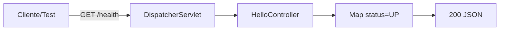

## CAPÍTULO M01-L04: Primer proyecto Maven desde cero con Spring Boot

### 1. Ubicación
- **Curso:** C2 — Spring Boot Microservicios desde Cero
- **Módulo:** M01 — Fundamentos Java 21 / Spring Boot
- **Lección:** L04 — Primer proyecto Maven desde cero
- **Tiempo estimado:** 50 min
- **Versiones:** Java 21, Spring Boot 3.4.x, Maven

### 2. Prerrequisitos
- M01-L03 Maven básico.
- Java 21 instalado.
- Conocer HTTP GET y JSON.

### 3. Objetivo de aprendizaje
Al terminar podrás **crear un proyecto Spring Boot Maven mínimo desde cero**, exponer un endpoint `/health` y **verificarlo con MockMvc**.

### 4. Problema real / por qué importa
Todo microservicio necesita arrancar, exponer endpoints y verificarse automáticamente. Antes de agregar BD, Kafka o Kubernetes, debes dominar el esqueleto mínimo: POM, clase main, controller, test.

### 5. Analogía y modelo mental
Es como montar el tablero eléctrico antes de conectar equipos: primero verificas que hay energía, switch y luz de prueba. `/health` es esa luz: confirma que la app está viva.

**Dónde se rompe la analogía:** un health básico no garantiza que la BD o dependencias externas estén sanas.

### 6. Diagrama técnico

**Texto alternativo:** Una petición GET /health llega al DispatcherServlet, se enruta al HelloController y responde 200 con JSON status UP.

### 7. Conceptos fundamentales

#### Qué es
Spring Boot es un framework de arranque rápido sobre Spring: auto-configuración, servidor embebido, starters y convenciones.

#### Cómo funciona
`@SpringBootApplication` habilita configuración y escaneo. `@RestController` expone endpoints. Spring Boot starter web trae Tomcat embebido y Jackson.

#### Cuándo usar
- APIs REST y microservicios Java.
- Cuando quieres convención y productividad.

#### Cuándo NO usar
- No agregues starters/dependencias “por si acaso”.
- No uses `@SpringBootTest` para todo si un slice test basta.

### 8. Construcción desde cero

Lab: `docs/cursos/springboot-microservicios-desde-cero/labs/m01-l04-primer-proyecto-maven-desde-cero`

#### Paso 1: POM con starter web y test
Usa `spring-boot-starter-parent`, `spring-boot-starter-web`, `spring-boot-starter-test`.

#### Paso 2: Clase principal
`HelloApplication` con `@SpringBootApplication` y `SpringApplication.run(etc)`.

#### Paso 3: Controller
```java
@RestController
public class HelloController {
    @GetMapping("/health")
    public Map<String, String> health() { return Map.of("status", "UP"); }
}
```

#### Paso 4: Test MockMvc
```java
@SpringBootTest @AutoConfigureMockMvc
class HelloControllerTest {
    @Autowired MockMvc mvc;
    @Test void healthReturnsUp() throws Exception {
        mvc.perform(get("/health")).andExpect(status().isOk()).andExpect(jsonPath("$.status").value("UP"));
    }
}
```

#### Paso 5: Ejecutar
```bash
./verify.sh
```
Salida real observada:
```text
RESULTADO: OK
```

### 9. Código de referencia completo
- `pom.xml`
- `src/main/java/com/academia/hello/HelloApplication.java`
- `src/main/java/com/academia/hello/HelloController.java`
- `src/test/java/com/academia/hello/HelloControllerTest.java`
- `verify.sh`

### 10. Explicación línea por bloque

| Bloque | Intención | Efecto | Si se omite/cambia |
|---|---|---|---|
| `spring-boot-starter-web` | Traer MVC + Jackson + Tomcat | Endpoint HTTP posible | No hay stack web |
| `@SpringBootApplication` | Bootstrapping | Escaneo y auto-config | App no arranca como Boot |
| `@GetMapping("/health")` | Ruta GET | Expone health | 404 |
| `Map.of("status","UP")` | JSON simple | Respuesta serializable | Contrato ambiguo |
| `MockMvc` | Test HTTP sin red real | Rápido y determinista | Menos cobertura sin tests |

### 11. Laboratorio reproducible
`./verify.sh` ejecuta tests y emite `RESULTADO: OK`.

### 12. Verificación automática
Valida 200 y JSON `status=UP`.

### 13. Modificación guiada
- **Cambio:** cambia `UP` por `OK`.
- **Hipótesis:** el test fallará por valor JSON.
- **Comando:** `mvn -q test`.
- **Resultado esperado:** fallo en `jsonPath("$.status")`. Revierte.

### 14. Error común y diagnóstico
- **Síntoma:** 404 en `/health`.
- **Causa:** ruta mal escrita, controller fuera de escaneo, app no arrancó.
- **Diagnóstico:** revisar logs, `@RestController`, paquete base.
- **Fix:** corregir mapping/paquete.

### 15. Cierre

#### Anti-patrón
Crear proyecto con dependencias innecesarias desde el día 1. Empieza mínimo y crece por necesidad.

#### Pregunta de entrevista
- **Pregunta:** ¿Qué aporta Spring Boot sobre Spring “a secas”?
- **Respuesta modelo:** Auto-configuración, starters, servidor embebido, métricas/actuator y convenciones que reducen boilerplate y tiempo de arranque del proyecto.

#### Resumen
- Proyecto mínimo: POM + main + controller + test.
- `/health` es el smoke test más simple.
- MockMvc da verificación rápida.

#### Puente
M01-L05 abre la caja negra: IoC, DI y ciclo de vida de beans.
