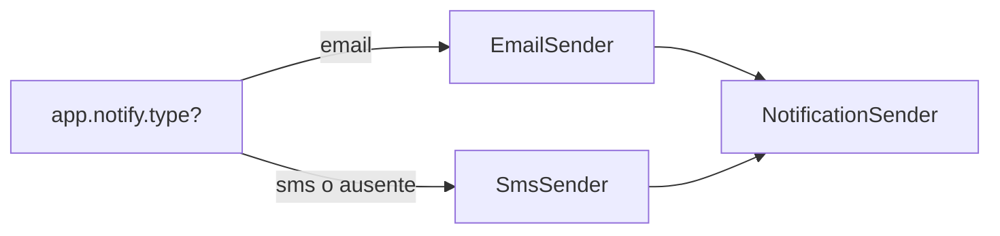

## CAPÍTULO M01-L06: Auto-configuración condicional

### 1. Ubicación
- **Curso:** C2 — Spring Boot Microservicios desde Cero
- **Módulo:** M01 — Fundamentos Java 21 / Spring Boot
- **Lección:** L06 — Auto-config condicional
- **Tiempo estimado:** 55 min
- **Versiones:** Java 21, Spring Boot 3.4.x

### 2. Prerrequisitos
- M01-L05 IoC/DI/beans.
- Properties/YAML básicos.
- JUnit/Spring Boot Test.

### 3. Objetivo de aprendizaje
Al terminar podrás **crear beans condicionales** con `@ConditionalOnProperty` y **verificar** qué implementación se carga según configuración o valor por defecto.

### 4. Problema real / por qué importa
Los microservicios cambian comportamiento por entorno o feature: enviar SMS o email, usar memoria o Redis, habilitar un cliente mock. Si hardcodeas `if` por todos lados, el código se vuelve frágil. La configuración condicional permite seleccionar beans de forma declarativa.

### 5. Analogía y modelo mental
Es un tablero eléctrico con interruptores: el cableado existe, pero el interruptor decide qué circuito se energiza. La property es el interruptor; el bean es el circuito.

**Dónde se rompe la analogía:** en Spring, condiciones pueden depender de clases, beans, entorno, cloud, etc.; no es solo un booleano.

### 6. Diagrama técnico

**Texto alternativo:** La property app.notify.type selecciona EmailSender si vale email, o SmsSender si vale sms o está ausente.

### 7. Conceptos fundamentales

#### Qué es
`@ConditionalOnProperty` registra un bean solo si una propiedad cumple una condición. Spring Boot usa condiciones extensamente en auto-configuración.

#### Cómo funciona
Durante el arranque, Spring evalúa condiciones antes de registrar beans. `matchIfMissing=true` define default cuando falta la property.

#### Cuándo usar
- Selección de implementaciones por config.
- Features toggles simples de infraestructura.
- Auto-config de librerías.

#### Cuándo NO usar
- No uses condiciones para lógica de negocio compleja por request.
- No ocultes comportamiento crítico en muchas condiciones difíciles de rastrear.

### 8. Construcción desde cero

Lab: `docs/cursos/springboot-microservicios-desde-cero/labs/m01-l06-auto-config-condicional`

#### Paso 1: Contrato
```java
public interface NotificationSender { String type(); }
```

#### Paso 2: Implementaciones condicionales
```java
@Component
@ConditionalOnProperty(name = "app.notify.type", havingValue = "email")
public class EmailSender implements NotificationSender { public String type(){ return "email"; } }

@Component
@ConditionalOnProperty(name = "app.notify.type", havingValue = "sms", matchIfMissing = true)
public class SmsSender implements NotificationSender { public String type(){ return "sms"; } }
```

#### Paso 3: Tests con ApplicationContextRunner
```java
@Test void defaultsToSms() {
  runner.run(ctx -> assertThat(ctx.getBean(NotificationSender.class).type()).isEqualTo("sms"));
}
@Test void emailWhenPropertySet() {
  runner.withPropertyValues("app.notify.type=email")
        .run(ctx -> assertThat(ctx.getBean(NotificationSender.class).type()).isEqualTo("email"));
}
```

#### Paso 4: Ejecutar
```bash
./verify.sh
```
Salida real: `RESULTADO: OK`.

### 9. Código de referencia completo
- `NotificationSender.java`, `EmailSender.java`, `SmsSender.java`, `CondApplication.java`
- `ConditionalTest.java`, `verify.sh`

### 10. Explicación línea por bloque

| Bloque | Intención | Efecto | Si se omite/cambia |
|---|---|---|---|
| `@ConditionalOnProperty(etc havingValue="email")` | Activar email | Solo con property email | Bean ausente o conflicto |
| `matchIfMissing=true` en SMS | Default seguro | Funciona sin config | Contexto falla por bean faltante |
| `ApplicationContextRunner` | Probar condiciones | Arranca contextos aislados | Test más lento/frágil con contexto completo |
| `withPropertyValues(etc)` | Simular config | Determinista | Dependes de entorno externo |

### 11. Laboratorio reproducible
`./verify.sh` ejecuta los tests.

### 12. Verificación automática
Valida default SMS y selección email por property.

### 13. Modificación guiada
- **Cambio:** quita `matchIfMissing=true`.
- **Hipótesis:** `defaultsToSms` fallará porque no habrá bean por defecto.
- **Comando:** `mvn -q -Dtest=ConditionalTest#defaultsToSms test`.
- **Resultado esperado:** fallo por bean no encontrado. Revierte.

### 14. Error común y diagnóstico
- **Síntoma:** `NoSuchBeanDefinitionException` o múltiples beans.
- **Causa:** condiciones solapadas, sin default, o property mal nombrada.
- **Diagnóstico:** activar `debug=true`, revisar condition evaluation report.
- **Fix:** ajustar condiciones, defaults y nombres.

### 15. Cierre

#### Anti-patrón
Condicionar todo con properties crípticas. Documenta el contrato de configuración.

#### Pregunta de entrevista
- **Pregunta:** ¿Cómo decide Spring Boot qué auto-configuración activar?
- **Respuesta modelo:** Mediante condiciones (`@ConditionalOnClass`, `@ConditionalOnProperty`, `@ConditionalOnMissingBean`, etc.) evaluadas al arranque; así solo registra beans cuando el entorno y las dependencias lo justifican.

#### Resumen
- Las condiciones hacen el wiring declarativo.
- `matchIfMissing` define defaults.
- Prueba condiciones con `ApplicationContextRunner`.

#### Puente
M01-L07 escala la estructura: multi-module Spring Boot desde cero.
