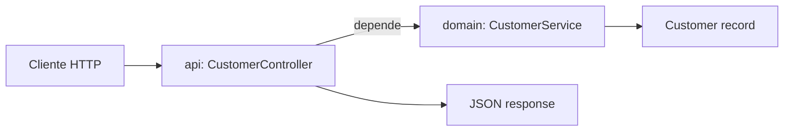

## CAPÍTULO M01-L07: Multi-module Spring Boot desde cero

### 1. Ubicación
- **Curso:** C2 — Spring Boot Microservicios desde Cero
- **Módulo:** M01 — Fundamentos Java 21 / Spring Boot
- **Lección:** L07 — Multi-module Spring Boot desde cero
- **Tiempo estimado:** 60 min
- **Versiones:** Java 21, Spring Boot 3.4.x, Maven

### 2. Prerrequisitos
- M01-L03 Maven multi-módulo, M01-L04/M05 Spring Boot.
- Conocer REST controllers y DI.

### 3. Objetivo de aprendizaje
Al terminar podrás **estructurar un proyecto Spring Boot multi-módulo** (domain + api), inyectar servicios del dominio desde la capa API y **verificar el endpoint con MockMvc**.

### 4. Problema real / por qué importa
Cuando todo vive en un solo paquete, la frontera entre dominio y transporte se difumina. Multi-módulo obliga a declarar dependencias explícitas: la API puede depender de domain, pero domain no debe depender de web. Esto previene acoplamiento accidental y facilita evolución.

### 5. Analogía y modelo mental
Es como separar cocina (dominio) de mostrador (API). El mostrador toma pedidos y entrega platos; no cocina dentro de la caja registradora. La cocina no necesita saber si el pedido llegó por web, app o teléfono.

**Dónde se rompe la analogía:** en software los límites se rompen fácilmente si agregas dependencias equivocadas en el POM.

### 6. Diagrama técnico

**Texto alternativo:** El módulo API depende del módulo domain. El controlador HTTP llama a CustomerService y devuelve el objeto Customer como JSON.

### 7. Conceptos fundamentales

#### Qué es
Un proyecto multi-módulo Maven separa artefactos con POM padre y módulos hijos. En Spring Boot, el módulo API arranca la app; domain contiene lógica reusable.

#### Cómo funciona
El POM padre declara `<modules>`. El POM de `api` declara dependencia a `domain`. Spring escanea y cablea beans si las clases están en el classpath y paquetes visibles.

#### Cuándo usar
- Separar dominio, infraestructura, API, workers.
- Equipos o codebases que crecen.

#### Cuándo NO usar
- Proyectos pequeños donde la complejidad de módulos supera el beneficio.
- No crear módulos por moda; cada módulo debe tener frontera clara.

### 8. Construcción desde cero

Lab: `docs/cursos/springboot-microservicios-desde-cero/labs/m01-l07-multi-module-spring-boot-desde-cero`

#### Paso 1: Dominio
`domain/src/main/java/com/academia/domain/CustomerService.java`:
```java
package com.academia.domain;
public class CustomerService {
    public Customer byId(String id) { return new Customer(id, "Cliente-" + id); }
}
```

#### Paso 2: Controller en API
`api/src/main/java/com/academia/api/CustomerController.java`:
```java
@RestController
@RequestMapping("/customers")
public class CustomerController {
    private final CustomerService service;
    public CustomerController(CustomerService service) { this.service = service; }
    @GetMapping("/{id}") public Customer get(@PathVariable("id") String id) { return service.byId(id); }
}
```

#### Paso 3: Test MockMvc
```java
@Test void returnsDomainObject() throws Exception {
    mvc.perform(get("/customers/7")).andExpect(status().isOk())
       .andExpect(jsonPath("$.id").value("7"))
       .andExpect(jsonPath("$.name").value("Cliente-7"));
}
```

#### Paso 4: Ejecutar
```bash
./verify.sh
```
Salida real: `RESULTADO: OK`.

### 9. Código de referencia completo
- `pom.xml` padre, `domain/pom.xml`, `api/pom.xml`
- `domain/src/main/java/com/academia/domain/Customer.java`, `CustomerService.java`
- `api/src/main/java/com/academia/api/ApiApplication.java`, `CustomerController.java`
- `api/src/test/java/com/academia/api/CustomerControllerTest.java`, `verify.sh`

### 10. Explicación línea por bloque

| Bloque | Intención | Efecto | Si se omite/cambia |
|---|---|---|---|
| dependencia `api -> domain` | Usar dominio desde API | Compila y cablea | `cannot find symbol` |
| `CustomerService` en domain | Lógica reusable | Sin dependencia web | Dominio contaminado si agregas web |
| constructor injection en controller | DI explícita | Testeable | Acoplamiento oculto |
| `@PathVariable("id")` | Leer parámetro URL | `/customers/7` retorna id 7 | 400/404 o binding incorrecto |
| MockMvc JSONPath | Verificar contrato | Asegura forma de respuesta | Regresiones silenciosas |

### 11. Laboratorio reproducible
`./verify.sh` ejecuta reactor Maven.

### 12. Verificación automática
Valida endpoint `/customers/7` retorna JSON con `id` y `name`.

### 13. Modificación guiada
- **Cambio:** cambia `CustomerService.byId` para devolver `Cliente-X`.
- **Hipótesis:** el test fallará en `name`.
- **Comando:** `mvn -q test`.
- **Resultado esperado:** fallo JSONPath. Revierte.

### 14. Error común y diagnóstico
- **Síntoma:** Spring no encuentra `CustomerService`.
- **Causa:** dependencia Maven faltante o paquete fuera de component scan.
- **Diagnóstico:** revisar POM de `api` y paquetes.
- **Fix:** agregar dependencia correcta y/o configuración de scan.

### 15. Cierre

#### Anti-patrón
Módulo “domain” dependiendo de `spring-web`. Rompe la frontera y arrastra infraestructura al núcleo.

#### Pregunta de entrevista
- **Pregunta:** ¿Por qué separar domain y api en módulos?
- **Respuesta modelo:** Para hacer explícitas las dependencias, evitar que la lógica de negocio dependa del transporte HTTP, y facilitar tests/reutilización. La separación reduce acoplamiento accidental.

#### Resumen
- Multi-módulo hace visibles las fronteras.
- API depende de domain, no al revés.
- Tests de contrato protegen la integración.

#### Puente
M01-L08 gestiona configuración por perfiles y externalización.
