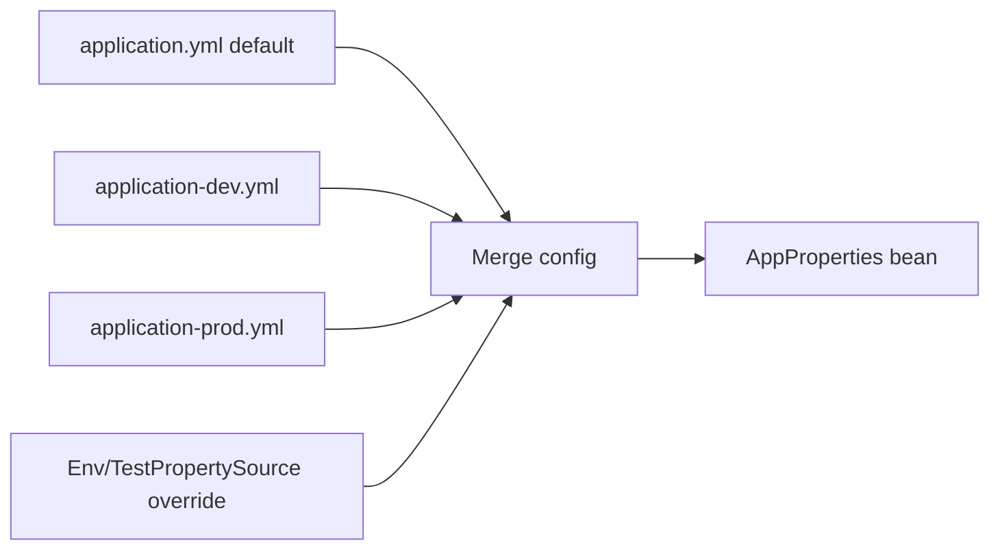

## CAPÍTULO M01-L08: Perfiles y configuración externalizada

### 1. Ubicación
- **Curso:** C2 — Spring Boot Microservicios desde Cero
- **Módulo:** M01 — Fundamentos Java 21 / Spring Boot
- **Lección:** L08 — Perfiles y config externalizada
- **Tiempo estimado:** 55 min
- **Versiones:** Java 21, Spring Boot 3.4.x

### 2. Prerrequisitos
- M01-L04 a M01-L06.
- YAML/properties básicos.
- Entender variables de entorno.

### 3. Objetivo de aprendizaje
Al terminar podrás **configurar propiedades por perfil** (`dev`, `prod`) y **sobrescribir configuración por variables externas**, verificando el comportamiento con tests Spring Boot.

### 4. Problema real / por qué importa
Un microservicio corre en local, CI, staging y producción. Cambian URLs, credenciales, flags y límites. Hardcodear valores o copiar código por entorno causa incidentes. Spring Boot permite externalizar config y activar perfiles.

### 5. Analogía y modelo mental
Es el mismo aparato con distintos modos: “modo casa”, “modo oficina”, “modo viaje”. El hardware es el mismo (código), pero la configuración cambia su comportamiento.

**Dónde se rompe la analogía:** la configuración mala puede romper seguridad o datos; no es solo preferencia.

### 6. Diagrama técnico

**Texto alternativo:** La configuración por defecto se combina con el perfil activo y overrides externos para producir el bean AppProperties final.

### 7. Conceptos fundamentales

#### Qué es
- **Profile:** grupo de configuración/beans activo por entorno.
- **Externalized config:** propiedades fuera del código, cargadas por Spring.

#### Cómo funciona
Spring Boot carga propiedades en orden de precedencia (defaults, archivos por perfil, env vars, args, etc.). `@ConfigurationProperties` enlaza propiedades a un objeto tipado.

#### Cuándo usar
- Diferencias por entorno.
- Feature flags simples de configuración.
- Secretos/URLs inyectadas por entorno.

#### Cuándo NO usar
- No pongas secretos reales en YAML versionado.
- No uses perfiles para bifurcar lógica de negocio compleja en todo el código.

### 8. Construcción desde cero

Lab: `docs/cursos/springboot-microservicios-desde-cero/labs/m01-l08-perfiles-y-config-externalizada`

#### Paso 1: Propiedades tipadas
```java
@ConfigurationProperties(prefix = "app")
public record AppProperties(String message, boolean featureX) {}
```

#### Paso 2: Archivos YAML
`application.yml`:
```yaml
app:
  message: "mensaje-default"
  feature-x: false
```
`application-dev.yml`:
```yaml
app:
  message: "mensaje-dev"
  feature-x: true
```
`application-prod.yml`:
```yaml
app:
  message: "mensaje-prod"
  feature-x: false
```

#### Paso 3: Tests por perfil y override
```java
@Nested @SpringBootTest @ActiveProfiles("dev")
class Dev { @Autowired AppProperties p; @Test void devProfile() { assertThat(p.message()).isEqualTo("mensaje-dev"); assertThat(p.featureX()).isTrue(); } }

@Nested @SpringBootTest @ActiveProfiles("prod") @TestPropertySource(properties = "app.message=override")
class Override { @Autowired AppProperties p; @Test void envOverride() { assertThat(p.message()).isEqualTo("override"); } }
```

#### Paso 4: Ejecutar
```bash
./verify.sh
```
Salida real: `RESULTADO: OK`.

### 9. Código de referencia completo
- `AppProperties.java`, `ProfileApplication.java`
- `application.yml`, `application-dev.yml`, `application-prod.yml`
- `ProfileApplicationTest.java`, `verify.sh`

### 10. Explicación línea por bloque

| Bloque | Intención | Efecto | Si se omite/cambia |
|---|---|---|---|
| `@ConfigurationProperties(prefix="app")` | Binding tipado | Config segura y autocompletable | Propiedades dispersas con `@Value` |
| `@ConfigurationPropertiesScan` | Registrar properties | Bean disponible | Binding no se activa |
| `@ActiveProfiles("dev")` | Activar perfil en test | Carga application-dev | Usa default inesperado |
| `TestPropertySource(properties=etc)` | Simular override externo | Prueba precedencia | No cubres caso real de override |
| YAML por perfil | Separar entornos | Cambios controlados | Hardcode en código |

### 11. Laboratorio reproducible
`./verify.sh`.

### 12. Verificación automática
Valida dev, prod y override externo.

### 13. Modificación guiada
- **Cambio:** borra `app.message` de `application-dev.yml`.
- **Hipótesis:** dev usará `mensaje-default`.
- **Comando:** `mvn -q -Dtest=ProfileApplicationTest$Dev test`.
- **Resultado esperado:** fallo al esperar `mensaje-dev`. Revierte.

### 14. Error común y diagnóstico
- **Síntoma:** perfil activo no toma valores esperados.
- **Causa:** nombre de archivo incorrecto, profile mal activado, precedencia no entendida.
- **Diagnóstico:** `--spring.profiles.active`, logs de environment, actuator env (con cuidado).
- **Fix:** corregir nombre/profile y revisar precedencia.

### 15. Cierre

#### Anti-patrón
Comitear secretos en `application-prod.yml`. Usa secret manager o variables/volúmenes seguros.

#### Pregunta de entrevista
- **Pregunta:** ¿Cómo maneja Spring Boot la configuración por entorno?
- **Respuesta modelo:** Mediante externalized configuration con orden de precedencia y profiles. Permite definir defaults, overrides por perfil y sobrescribir por variables de entorno/args sin recompilar.

#### Resumen
- Mismo código, distinta config.
- Profiles + overrides = flexibilidad.
- Secretos fuera del repo.

#### Puente
M01-L09 compara trade-offs de arranque: JVM, CRaC y GraalVM Native.
