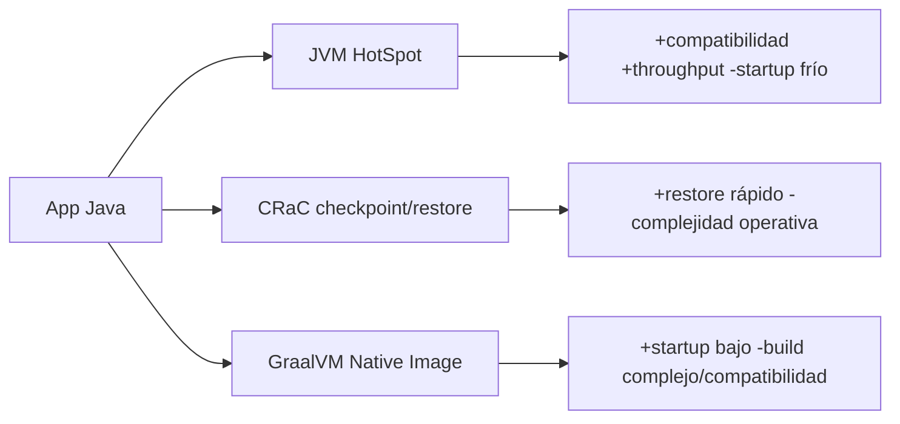

## CAPÍTULO M01-L09: CRaC y GraalVM Native - trade-offs

### 1. Ubicación
- **Curso:** C2 — Spring Boot Microservicios desde Cero
- **Módulo:** M01 — Fundamentos Java 21 / Spring Boot
- **Lección:** L09 — CRaC y GraalVM Native trade-offs
- **Tiempo estimado:** 50 min
- **Versiones:** Java 21 (JVM HotSpot baseline). CRaC/GraalVM evaluados conceptualmente/prácticamente según entorno.

### 2. Prerrequisitos
- M01-L01 a M01-L08.
- Entender startup, memoria, throughput.
- Docker/CI básico (útil, no obligatorio para baseline).

### 3. Objetivo de aprendizaje
Al terminar podrás **medir un startup baseline en JVM** y **comparar trade-offs** entre JVM HotSpot, CRaC y GraalVM Native para decidir con criterio.

### 4. Problema real / por qué importa
En serverless, escalado rápido o CLI, el startup importa. En servicios long-running, importan más throughput, observabilidad y compatibilidad. Elegir GraalVM o CRaC “por moda” puede romper librerías, complicar builds o no mejorar el problema real.

### 5. Analogía y modelo mental
JVM es un auto que tarda en calentar pero rinde bien en viajes largos. Native es un auto ligero que arranca rápido pero puede tener limitaciones con ciertos accesorios. CRaC es “guardar el motor ya caliente” y restaurarlo; rápido, pero requiere condiciones controladas.

**Dónde se rompe la analogía:** el software tiene dependencias, reflection, snapshot de recursos y restricciones operativas reales.

### 6. Diagrama técnico

**Texto alternativo:** La misma aplicación puede ejecutarse en JVM, CRaC o Native, cada una con beneficios y costos distintos.

### 7. Conceptos fundamentales

#### Qué es
- **JVM HotSpot:** ejecución estándar con JIT.
- **CRaC:** Coordinated Restore at Checkpoint; snapshot de proceso para restore rápido.
- **GraalVM Native Image:** compilación AOT a binario nativo.

#### Cómo funciona
JVM interpreta/JIT optimiza. CRaC checkpoint/restore requiere coordinar recursos. Native AOT analiza alcance estático; reflection/dynamic proxies pueden requerir configuración.

#### Cuándo usar
- JVM: default para la mayoría de microservicios long-running.
- CRaC: cuando startup/restore es crítico y el entorno está controlado.
- Native: CLI, funciones, servicios simples con footprint/startup críticos.

#### Cuándo NO usar
- No Native por defecto si tu stack depende de reflection dinámica difícil.
- No CRaC si no puedes controlar sockets, archivos, secrets, estado.
- No optimices startup sin medir.

### 8. Construcción desde cero

Lab: `docs/cursos/springboot-microservicios-desde-cero/labs/m01-l09-crac-y-graalvm-native-trade-offs`

#### Paso 1: App mínima
`out/App.java`:
```java
public class App { public static void main(String[] args){ System.out.println("READY"); } }
```

#### Paso 2: Medir startup baseline JVM
`measure-startup.sh` compila y mide tiempo de ejecución:
```bash
javac -d out out/App.java
START=$(python3 - <<'PY'
import time; print(time.time())
PY
)
java -cp out App >/tmp/m01l09.out
END=$(python3 - <<'PY'
import time; print(time.time())
PY
)
python3 - <<PY
start=float("$START"); end=float("$END")
print(f"startup_ms={(end-start)*1000:.2f}")
PY
```

#### Paso 3: Documentar trade-offs
El `README.md` contiene tabla comparativa y “Cuándo NO usar”.

#### Paso 4: Ejecutar
```bash
./verify.sh
```
Salida real observada:
```text
startup_ms=<número>
RESULTADO: OK
```

### 9. Código de referencia completo
- `out/App.java`
- `measure-startup.sh`
- `README.md`
- `verify.sh`

### 10. Explicación línea por bloque

| Bloque | Intención | Efecto | Si se omite/cambia |
|---|---|---|---|
| `javac/java -cp out App` | Baseline JVM | Mide arranque real simple | Sin baseline no comparas |
| timestamp Python | Medición portable | `startup_ms` observable | Sin medición, opinión |
| tabla trade-offs | Decisión técnica | Hace explícitos costos | Decisión por moda |
| `grep -q "CRaC"` / `GraalVM` | Evidencia documental | Asegura comparación mínima | README vacío pasa inadvertido |

### 11. Laboratorio reproducible
```bash
./verify.sh
```

### 12. Verificación automática
Valida que hay medición `startup_ms=` y que el README cubre CRaC, GraalVM y “Cuándo NO usar”.

### 13. Modificación guiada
- **Cambio:** elimina la sección “Cuándo NO usar” del README.
- **Hipótesis:** `verify.sh` fallará.
- **Comando:** `./verify.sh`.
- **Resultado esperado:** fallo por `grep`. Revierte.

### 14. Error común y diagnóstico
- **Síntoma:** elegir Native y fallar en runtime por reflection.
- **Causa:** configuración AOT incompleta.
- **Diagnóstico:** revisar errores de reflection/resource/proxy, ejecutar tests nativos.
- **Fix:** configurar hints, simplificar, o quedarse en JVM si el costo supera el beneficio.

### 15. Cierre

#### Anti-patrón
Optimizar startup sin medir ni considerar el perfil del servicio. Para un proceso long-running, startup puede ser irrelevante frente a throughput.

#### Pregunta de entrevista
- **Pregunta:** ¿Cuándo elegirías GraalVM Native sobre JVM?
- **Respuesta modelo:** Cuando el startup y footprint son críticos (CLI, serverless, escalado rápido) y el stack es compatible con AOT. Me quedaría en JVM para máxima compatibilidad, throughput maduro y menor complejidad de build cuando el servicio es long-running.

#### Resumen
- JVM: default sólido.
- CRaC: restore rápido con complejidad operativa.
- Native: startup/footprint con costo de build/compatibilidad.

#### Puente
Siguiente módulo: Spring Boot Web/REST, donde estos fundamentos se vuelven API real.
