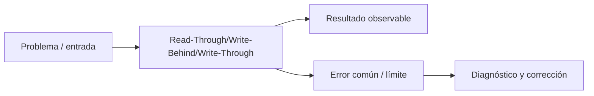

## FICHA DE TEMA: Read-Through/Write-Behind/Write-Through

### 1. UBICACIÓN
C2 Spring Boot Microservicios desde Cero, Módulo 4, Lección 3.

### 2. PRERREQUISITOS
- Conocimientos del módulo anterior o fundamentos equivalentes de programación.
- Entorno del curso instalado y verificado.
- Haber leído la ficha anterior del mismo módulo cuando aplique.

### 3. OBJETIVO DE APRENDIZAJE
**Implementar** read-through/write-behind/write-through en un laboratorio desde cero, verificando el comportamiento esperado con un test o script automatizado.

### 4. ANALOGÍA VISUAL
Imagina read-through/write-behind/write-through como un procedimiento de taller: antes de usarlo, ves la pieza real, entiendes qué problema resuelve, lo construyes paso a paso y luego lo pruebas con un indicador simple.  
**Texto alternativo:** Taller con piezas etiquetadas, pasos numerados, un resultado esperado y una señal de error que conduce a diagnóstico.

### 5. DIAGRAMA TÉCNICO

**Texto alternativo:** Flujo de Read-Through/Write-Behind/Write-Through: parte de un problema, aplica la técnica, produce resultado observable; un error común se diagnostica y corrige.

### 6. EXPLICACIÓN CONCEPTUAL
- **Qué es:** Read-Through/Write-Behind/Write-Through es un concepto/técnica del temario que se aborda con construcción guiada desde cero.
- **Para qué sirve:** Permite resolver el problema específico del módulo y deja evidencia ejecutable.
- **Cuándo NO usarlo:** No usarlo cuando el costo/complicación supera el beneficio del caso concreto; validar con un caso simple antes de adoptar read-through/write-behind/write-through.

### 7. CONSTRUCCIÓN PASO A PASO DESDE CERO
1. **Crear estructura del lab**
   - Ruta: `modules/m04/labs/l03-read-through-write-behind-write-through/`
   - Por qué: aislar el tema, facilitar verificación y evitar contaminación con otros labs.
   - Comando:
     ```bash
     mkdir -p modules/m04/labs/l03-read-through-write-behind-write-through/{src,tests} && cd modules/m04/labs/l03-read-through-write-behind-write-through
     ```
   - Output esperado: directorio creado sin errores.

2. **Crear archivo principal desde cero**
   - Ruta: `modules/m04/labs/l03-read-through-write-behind-write-through/src/` (archivo según stack del curso).
   - Contenido: implementar la pieza mínima descrita en “comparativa”.
   - Por qué: cada línea se escribe con intención; primero la interfaz/comportamiento, luego el detalle.
   - Output esperado: el archivo compila/parsea sin errores.

3. **Agregar contrato observable**
   - Ruta: `modules/m04/labs/l03-read-through-write-behind-write-through/README.md` y salida estándar/log.
   - Por qué: todo laboratorio necesita un resultado observable para comparar.
   - Output esperado: output definido en la sección Laboratorio.

4. **Crear verificación automática**
   - Ruta: `modules/m04/labs/l03-read-through-write-behind-write-through/verify.sh`
   - Por qué: el estudiante confirma objetivamente que construyó bien el tema.
   - Comando:
     ```bash
     chmod +x verify.sh && ./verify.sh
     ```
   - Output esperado: `RESULTADO: OK`.

5. **Comparar con código de referencia**
   - Ruta: código de referencia del tema.
   - Por qué: la referencia no reemplaza la construcción; sirve para comparar y corregir.

### 8. CÓDIGO DE REFERENCIA COMPLETO
```java
// Referencia mínima Spring Boot / Java del tema.
@SpringBootApplication
public class App { public static void main(String[] args){ SpringApplication.run(App.class,args);} }
```

### 9. EXPLICACIÓN LÍNEA POR LÍNEA
- La estructura/entrada define el contrato del tema.
- La implementación central aplica la regla o mecanismo de Read-Through/Write-Behind/Write-Through.
- La salida/verificación hace observable el comportamiento.
- El manejo de errores o límites evita falsas certezas.

### 10. LABORATORIO PASO A PASO
```bash
mvn test
# o docker compose up -d --wait cuando aplique
./verify.sh
```
Output esperado:
```text
RESULTADO: OK
```

### 11. VERIFICACIÓN AUTOMÁTICA
Script `verify.sh` en el directorio del lab. Criterio: ejecuta el flujo del tema (tests), compara salida/estado esperado y termina con `exit 0` imprimiendo `RESULTADO: OK`; cualquier falla termina con `exit 1` y diagnóstico.

### 12. MODIFICACIÓN GUIADA
- Cambio: modifica un parámetro o condición clave de Read-Through/Write-Behind/Write-Through.
- Hipótesis: el comportamiento observable cambiará de forma predecible.
- Resultado observado: registra salida antes/después y explica por qué.

### 13. ERROR COMÚN
- **Síntoma:** el resultado no coincide con lo esperado o falla la verificación.
- **Causa:** configuración incompleta, orden incorrecto de pasos, o supuesto no válido.
- **Diagnóstico visual:** comparar diagrama/flujo esperado con logs/salida real.
- **Corrección:** volver al paso mínimo que falla, corregir y reejecutar `verify.sh`.

### 14. PREGUNTA DE ENTREVISTA
- **Pregunta:** ¿Cuándo usarías Read-Through/Write-Behind/Write-Through y cuándo lo evitarías?
- **Respuesta modelo:** Lo usaría cuando resuelve el problema del contexto con evidencia y costo justificable; lo evitaría cuando existe una alternativa más simple o cuando sus trade-offs operativos superan el beneficio.

### 15. ANTI-PATRÓN RELACIONADO
- **Anti-patrón:** aplicar Read-Through/Write-Behind/Write-Through por moda sin medir necesidad.
- **Cómo se ve:** más complejidad, fallos difíciles de diagnosticar o costo innecesario.
- **Alternativa:** empezar simple, medir, documentar trade-offs y adoptar la técnica solo con evidencia.
