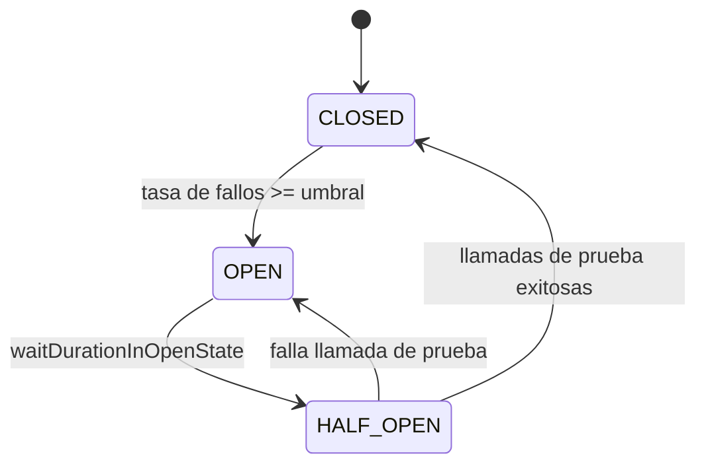

### FICHA DE TEMA: Circuit breaker desde cero (Resilience4j)

#### 1. UBICACIÓN
Curso 2: Spring Boot Microservicios desde Cero, Módulo 8, Lección 2.

#### 2. PRERREQUISITOS
- Haber construido dos microservicios con comunicación REST/Feign (M5-L7, M6-L2).
- Saber ejecutar Docker Compose y leer logs.
- Conocer conceptos básicos de latencia, timeout y fallos remotos.

#### 3. OBJETIVO DE APRENDIZAJE
**Implementar** un Circuit Breaker con Resilience4j en un cliente Spring Boot, **demostrando** la transición cerrado→abierto→semiabierto ante fallos simulados y **verificando** el fallback con un script automatizado.

#### 4. ANALOGÍA VISUAL
**Escena:** Un tablero eléctrico de casa. Cuando un circuito tiene cortocircuito, el breaker “salta” y corta la corriente para evitar daño. Después de un tiempo, se prueba con cuidado (semiabierto). Si el aparato sigue fallando, vuelve a cortar; si funciona, se restablece.  
**Texto alternativo:** Diagrama de breaker eléctrico con tres estados: CERRADO (corriente pasa), ABIERTO (corta tras fallos), SEMIABIERTO (prueba limitada). Flechas indican umbral de fallos, tiempo de espera y llamadas de prueba exitosas.

#### 5. DIAGRAMA TÉCNICO

**Texto alternativo:** Máquina de estados del circuit breaker. Inicia cerrado; pasa a abierto cuando supera umbral de fallos; tras espera pasa a semiabierto; vuelve a cerrado si pruebas pasan o a abierto si fallan.

#### 6. EXPLICACIÓN CONCEPTUAL
- **Qué es:** Patrón que envuelve llamadas remotas y detiene intentos cuando detecta fallos repetidos, devolviendo fallback.
- **Para qué sirve:** Evitar cascadas de fallos, proteger recursos y dar degradación controlada.
- **Cuándo NO usarlo:** No usarlo para ocultar errores de negocio válidos; no usarlo si la operación debe ser estrictamente consistente y no hay fallback aceptable; no sustituye timeouts/corrección de causa raíz.

#### 7. CONSTRUCCIÓN PASO A PASO DESDE CERO

1. **Crear proyecto**
   - Ruta: `modules/m08-resiliencia/labs/l02-circuit-breaker-desde-cero/`
   - Comando:
     ```bash
     mkdir -p cb-lab/{order-service,inventory-service} && cd cb-lab
     ```
   - Por qué: se necesitan dos servicios para observar fallo remoto real.

2. **Servicio inventory (dependencia inestable)**
   - Ruta: `inventory-service/src/main/java/com/academia/inventory/InventoryController.java`
   - Código:
     ```java
     @RestController
     public class InventoryController {
       @GetMapping("/inventory/{sku}")
       public Map<String,Object> ok(@PathVariable String sku) {
         return Map.of("sku", sku, "stock", 10);
       }
       @GetMapping("/inventory/fail/{sku}")
       public ResponseEntity<Void> fail(@PathVariable String sku) {
         return ResponseEntity.status(503).build();
       }
     }
     ```
   - Por qué: endpoint sano y endpoint que falla permiten simular degradación.

3. **Agregar Resilience4j en order-service**
   - Ruta: `order-service/pom.xml`
   - Bloque:
     ```xml
     <dependency>
       <groupId>io.github.resilience4j</groupId>
       <artifactId>resilience4j-spring-boot3</artifactId>
     </dependency>
     <dependency>
       <groupId>org.springframework.boot</groupId>
       <artifactId>spring-boot-starter-aop</artifactId>
     </dependency>
     ```
   - Por qué: Resilience4j usa AOP para decorar llamadas anotadas.

4. **Configurar breaker**
   - Ruta: `order-service/src/main/resources/application.yml`
   ```yaml
   resilience4j.circuitbreaker:
     instances:
       inventory:
         slidingWindowSize: 5
         failureRateThreshold: 50
         waitDurationInOpenState: 5s
         permittedNumberOfCallsInHalfOpenState: 2
   ```
   - Por qué: parámetros pequeños hacen observable el comportamiento en laboratorio.

5. **Cliente con @CircuitBreaker y fallback**
   - Ruta: `order-service/src/main/java/com/academia/orders/InventoryClient.java`
   ```java
   @Service
   public class InventoryClient {
     private final RestClient rest;
     public InventoryClient(RestClient.Builder b) { this.rest = b.baseUrl("http://inventory:8081").build(); }

     @CircuitBreaker(name = "inventory", fallbackMethod = "fallback")
     public Map<String,Object> getStock(String sku) {
       return rest.get().uri("/inventory/fail/{sku}", sku).retrieve().body(Map.class);
     }

     public Map<String,Object> fallback(String sku, Throwable ex) {
       return Map.of("sku", sku, "stock", -1, "fallback", true);
     }
   }
   ```
   - Por qué: el fallback evita error 500 en cadena y devuelve degradación explícita.

6. **Exponer endpoint y ejecutar**
   - Comando: `docker compose up --build -d --wait`
   - Output esperado: ambos servicios healthy.

#### 8. CÓDIGO DE REFERENCIA COMPLETO
`docker-compose.yml`
```yaml
services:
  inventory:
    build: ./inventory-service
    ports: ["8081:8081"]
  order:
    build: ./order-service
    ports: ["8080:8080"]
    depends_on: [inventory]
```
`verify.sh` (resumen ejecutable)
```bash
#!/usr/bin/env bash
set -euo pipefail
cd "$(dirname "$0")"
docker compose up --build -d --wait
for i in {1..6}; do curl -s http://localhost:8080/orders/sku1 >/tmp/cb.json; done
grep -q '"fallback":true' /tmp/cb.json || { echo "FALLA: no hubo fallback"; exit 1; }
STATE=$(curl -s http://localhost:8080/actuator/circuitbreakers | grep -o 'OPEN\|HALF_OPEN\|CLOSED' | head -n1)
[[ "$STATE" == "OPEN" || "$STATE" == "HALF_OPEN" || "$STATE" == "CLOSED" ]] || { echo "FALLA: estado no visible"; exit 1; }
echo "RESULTADO: OK"
```

#### 9. EXPLICACIÓN LÍNEA POR LÍNEA
- `@CircuitBreaker(name="inventory", fallbackMethod="fallback")`: envuelve la llamada; el nombre enlaza con configuración YAML.
- `failureRateThreshold: 50`: con ventana de 5, 3 fallos abren el circuito.
- `waitDurationInOpenState: 5s`: evita martillar el servicio caído.
- `fallback(String sku, Throwable ex)`: misma firma + `Throwable`; retorna respuesta degradada observable.

#### 10. LABORATORIO PASO A PASO
```bash
docker compose up --build -d --wait
for i in {1..6}; do curl -s http://localhost:8080/orders/sku1; echo; done
curl -s http://localhost:8080/actuator/circuitbreakers
```
Output esperado: primeras llamadas fallan/fallback, estado pasa a OPEN; después de 5s puede pasar a HALF_OPEN.

#### 11. VERIFICACIÓN AUTOMÁTICA
`./verify.sh` valida que aparece `"fallback":true` y que el actuator expone estado del breaker. Exit 0 = OK.

#### 12. MODIFICACIÓN GUIADA
- Cambio: `failureRateThreshold` de 50 a 90.
- Hipótesis: el circuito tardará más en abrirse.
- Observación: se necesitan más fallos antes del fallback por apertura; registrar conteo.

#### 13. ERROR COMÚN
- **Síntoma:** nunca entra en OPEN.
- **Causa:** falta `spring-boot-starter-aop` o anotación no interceptada por proxy.
- **Diagnóstico visual:** dashboard actuator sin métricas del breaker; logs sin transición.
- **Corrección:** agregar AOP, llamar método a través de bean Spring, no por `this`.

#### 14. PREGUNTA DE ENTREVISTA
- **Pregunta:** ¿Circuit breaker y retry son lo mismo?
- **Respuesta modelo:** No. Retry reintenta fallos transitorios; circuit breaker deja de intentar cuando el fallo es persistente para proteger el sistema. Se pueden combinar con cuidado: retry corto dentro de presupuesto, breaker afuera.

#### 15. ANTI-PATRÓN RELACIONADO
- **Anti-patrón:** usar fallback que inventa datos críticos (ej. confirmar stock inexistente).
- **Cómo se ve:** el sistema “responde” pero genera inconsistencias de negocio.
- **Alternativa:** fallback degradado explícito, cola diferida, o error controlado con mensaje claro.
