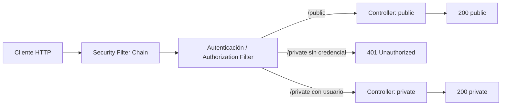

## CAPÍTULO M09-L01: Spring Security Filter Chain

### 1. Ubicación

- **Curso:** C2 — Spring Boot Microservicios desde Cero
- **Módulo:** M09 — Seguridad
- **Lección:** L01 — Spring Security Filter Chain
- **Tiempo estimado:** 45 min
- **Versión de referencia:** Java 21, Spring Boot 3.4.5, Spring Security 6

### 2. Prerrequisitos

Antes de empezar, debes poder:

- Crear un proyecto Spring Boot con Maven y ejecutar `mvn test`.
- Entender qué es un endpoint HTTP, un código 200/401/403 y un header `Authorization`.
- Haber visto el arranque de Spring Boot e IoC básico (M01).

Comprobación rápida:

```bash
java -version
mvn -version
```

Salida real esperada (ejemplo; tu versión puede variar):

```text
openjdk version "27.0.1.0.3" 2026-01-20
Apache Maven 3.9.x
```

### 3. Objetivo de aprendizaje

Al terminar este capítulo podrás **implementar una `SecurityFilterChain` en Spring Boot** que distinga rutas públicas y privadas, y **verificar con MockMvc** que responde 200, 401 o contenido autenticado según el caso.

### 4. Problema real / por qué importa

Todo microservicio expone endpoints. Si no defines reglas, puedes dejar datos privados abiertos o bloquear endpoints que deberían ser públicos. En producción, este error no se ve como “falta una anotación”: se ve como incidente de seguridad, API rota, o ambos.

Spring Security no protege por magia: instala una cadena de filtros delante de tus controladores. Cada request entra por esa cadena antes de tocar tu método `@GetMapping`. El problema real es decidir, de forma explícita y verificable, qué rutas pasan y cuáles no.

Si lo ignoras, terminas con seguridad por defecto no entendida, reglas contradictorias o endpoints sensibles accesibles.

### 5. Analogía y modelo mental

Imagina la entrada de un edificio con control de acceso:

- La **puerta principal** recibe a todas las personas (la request HTTP).
- Antes de llegar a oficinas, pasan por **puestos de control** (filtros): identidad, credencial, permiso.
- Algunas áreas son **públicas** (recepción); otras requieren **credencial** (oficina privada).

**Dónde se rompe la analogía:** en un edificio el guardia puede “interpretar” contexto humano; en Spring Security la decisión la toman reglas configuradas. Si no hay regla clara, no hay criterio humano que salve la request.

### 6. Diagrama técnico



**Texto alternativo:** Una petición HTTP entra a la cadena de filtros de Spring Security. Si la ruta es `/public`, llega al controlador y responde 200. Si es `/private` sin credencial, la cadena responde 401. Si es `/private` con usuario autenticado, llega al controlador y responde 200 con contenido privado.

### 7. Conceptos fundamentales

#### Qué es

Una **Security Filter Chain** es la secuencia de filtros de Servlet/Spring Security que intercepta requests antes del controlador. Cada filtro puede autenticar, autorizar, rechazar o continuar.

En Spring Boot moderno, la configuración se declara como un bean `SecurityFilterChain`:

```java
@Bean
SecurityFilterChain filterChain(HttpSecurity http) throws Exception { /* reglas de autorización */ }
```

#### Cómo funciona por dentro

1. El contenedor Servlet recibe la request.
2. Spring Security registra `FilterChainProxy` como filtro principal.
3. `FilterChainProxy` selecciona la cadena aplicable.
4. Los filtros evalúan la request: CSRF, autenticación, autorización, etc.
5. Si la autorización falla, se devuelve 401/403 antes de llamar al controlador.
6. Si pasa, la request llega al `DispatcherServlet` y a tu `@RestController`.

#### Cuándo usarlo

- Siempre que expongas endpoints HTTP en Spring Boot y necesites control de acceso.
- Para definir reglas explícitas por ruta: públicas, autenticadas, por rol, por scope.

#### Cuándo NO usarlo / trade-offs

- No sirve solo declararlo: una regla mal escrita puede dejar todo abierto o todo cerrado.
- No confundas autenticación (quién eres) con autorización (qué puedes hacer).
- `httpBasic` es útil para aprendizaje/labs; en producción normalmente usarás JWT/OIDC, sesiones controladas u otro mecanismo según el contexto.
- Agregar seguridad tiene costo: más configuración, más pruebas, más casos de error.

### 8. Construcción desde cero

El lab real de este capítulo está en:

```bash
docs/cursos/springboot-microservicios-desde-cero/labs/m09-l01-spring-security-filter-chain
```

#### Paso 1: Crear el proyecto Maven

Archivo: `pom.xml`

```xml
<project xmlns="http://maven.apache.org/POM/4.0.0" xmlns:xsi="http://www.w3.org/2001/XMLSchema-instance" xsi:schemaLocation="http://maven.apache.org/POM/4.0.0 https://maven.apache.org/xsd/maven-4.0.0.xsd">
  <modelVersion>4.0.0</modelVersion>
  <parent><groupId>org.springframework.boot</groupId><artifactId>spring-boot-starter-parent</artifactId><version>3.4.5</version><relativePath/></parent>
  <groupId>com.academia</groupId><artifactId>m09-l01-security-chain</artifactId><version>1.0.0</version>
  <properties><java.version>21</java.version></properties>
  <dependencies>
    <dependency><groupId>org.springframework.boot</groupId><artifactId>spring-boot-starter-web</artifactId></dependency>
    <dependency><groupId>org.springframework.boot</groupId><artifactId>spring-boot-starter-security</artifactId></dependency>
    <dependency><groupId>org.springframework.boot</groupId><artifactId>spring-boot-starter-test</artifactId><scope>test</scope></dependency>
    <dependency><groupId>org.springframework.security</groupId><artifactId>spring-security-test</artifactId><scope>test</scope></dependency>
  </dependencies>
  <build><plugins><plugin><groupId>org.apache.maven.plugins</groupId><artifactId>maven-surefire-plugin</artifactId><configuration><argLine>-Dnet.bytebuddy.experimental=true -XX:+EnableDynamicAgentLoading</argLine></configuration></plugin></plugins></build>
</project>
```

**Por qué este bloque importa:** sin `spring-boot-starter-security` no hay filtro de seguridad; sin `spring-security-test` no puedes simular usuario autenticado de forma limpia en MockMvc.

#### Paso 2: Crear la aplicación y los endpoints

Archivo: `src/main/java/com/academia/sec/SecApp.java`

```java
package com.academia.sec;
import org.springframework.boot.*; import org.springframework.boot.autoconfigure.*; import org.springframework.context.annotation.Bean; import org.springframework.security.config.Customizer; import org.springframework.security.config.annotation.web.builders.HttpSecurity; import org.springframework.security.web.SecurityFilterChain; import org.springframework.web.bind.annotation.*;
@SpringBootApplication @RestController
public class SecApp {
  public static void main(String[] args){ SpringApplication.run(SecApp.class,args); }
  @GetMapping("/public") String pub(){ return "public"; }
  @GetMapping("/private") String priv(){ return "private"; }
  @Bean SecurityFilterChain filterChain(HttpSecurity http) throws Exception {
    http.authorizeHttpRequests(a -> a.requestMatchers("/public").permitAll().anyRequest().authenticated())
        .httpBasic(Customizer.withDefaults());
    return http.build();
  }
}
```

**Qué hicimos:** dos endpoints con distinto nivel de exposición. `/public` debe responder sin credencial; `/private` solo con autenticación.

#### Paso 3: Escribir la verificación antes de confiar

Archivo: `src/test/java/com/academia/sec/SecAppTest.java`

```java
package com.academia.sec;
import org.junit.jupiter.api.Test; import org.springframework.beans.factory.annotation.Autowired; import org.springframework.boot.test.autoconfigure.web.servlet.AutoConfigureMockMvc; import org.springframework.boot.test.context.SpringBootTest; import org.springframework.security.test.context.support.WithMockUser; import org.springframework.test.web.servlet.MockMvc;
import static org.springframework.test.web.servlet.request.MockMvcRequestBuilders.get; import static org.springframework.test.web.servlet.result.MockMvcResultMatchers.*;
@SpringBootTest @AutoConfigureMockMvc
class SecAppTest {
  @Autowired MockMvc mvc;
  @Test void publicIsOpen() throws Exception { mvc.perform(get("/public")).andExpect(status().isOk()); }
  @Test void privateNeedsAuth() throws Exception { mvc.perform(get("/private")).andExpect(status().isUnauthorized()); }
  @Test @WithMockUser void privateWithUser() throws Exception { mvc.perform(get("/private")).andExpect(status().isOk()).andExpect(content().string("private")); }
}
```

**Por qué este test es el corazón del capítulo:** no “cree” que la seguridad funciona; lo prueba. Verifica el caso público, el rechazo anónimo y el acceso autenticado.

#### Paso 4: Ejecutar

Comando:

```bash
cd docs/cursos/springboot-microservicios-desde-cero/labs/m09-l01-spring-security-filter-chain
mvn -q -Dtest=SecAppTest test
```

Salida real observada (resumen):

```text
INFO com.academia.sec.SecAppTest : Started SecAppTest in 0.513 seconds
Tests run: 3, Failures: 0, Errors: 0, Skipped: 0
```

El `verify.sh` del lab ejecuta el test y termina con:

```text
RESULTADO: OK
```

### 9. Código de referencia completo

El código de referencia completo está en el lab:

- `docs/cursos/springboot-microservicios-desde-cero/labs/m09-l01-spring-security-filter-chain/pom.xml`
- `docs/cursos/springboot-microservicios-desde-cero/labs/m09-l01-spring-security-filter-chain/src/main/java/com/academia/sec/SecApp.java`
- `docs/cursos/springboot-microservicios-desde-cero/labs/m09-l01-spring-security-filter-chain/src/test/java/com/academia/sec/SecAppTest.java`
- `docs/cursos/springboot-microservicios-desde-cero/labs/m09-l01-spring-security-filter-chain/verify.sh`

No hay “código oculto”: lo que ves arriba es el comportamiento esencial.

### 10. Explicación línea por línea / por bloque

| Código / bloque | Intención | Efecto | Si lo quitas/cambias |
|---|---|---|---|
| `spring-boot-starter-security` | Activa Spring Security | Se instala la cadena de seguridad | Sin él, no hay 401 automático ni reglas de seguridad |
| `@SpringBootApplication @RestController` | Arranque Boot + controlador | Expone endpoints HTTP | Sin controlador no hay comportamiento observable |
| `@GetMapping("/public")` | Ruta pública | Devuelve `public` | Pierdes el caso permitido |
| `@GetMapping("/private")` | Ruta protegida | Devuelve `private` solo si pasa seguridad | No puedes demostrar autorización |
| `requestMatchers("/public").permitAll()` | Regla explícita pública | `/public` no exige autenticación | Si lo quitas, puede quedar protegido por defecto |
| `anyRequest().authenticated()` | Regla por defecto segura | Todo lo demás exige usuario | Si lo cambias a `permitAll()`, abres endpoints |
| `httpBasic(Customizer.withDefaults())` | Mecanismo de autenticación simple | Permite Basic Auth; útil para lab | Sin mecanismo, el flujo de auth cambia/no queda claro |
| `@WithMockUser` | Simula usuario autenticado | Permite probar `/private` con éxito | Sin él, necesitarías credenciales reales en test |
| `status().isUnauthorized()` | Aserción de rechazo | Confirma 401 anónimo | Sin esta prueba, un endpoint privado abierto pasaría inadvertido |

### 11. Laboratorio reproducible

```bash
cd docs/cursos/springboot-microservicios-desde-cero/labs/m09-l01-spring-security-filter-chain
./verify.sh
```

Salida real observada:

```text
RESULTADO: OK
```

Cleanup: el lab no levanta contenedores; Maven genera `target/` (ignorado por `.gitignore`).

### 12. Verificación automática

`verify.sh` hace:

```bash
#!/usr/bin/env bash
set -euo pipefail
cd "$(dirname "$0")"
mvn -q test
echo "RESULTADO: OK"
```

**Qué valida:** compila, levanta contexto Spring Boot de test, ejecuta MockMvc y confirma las 3 reglas de acceso.  
**Pass/fail:** exit 0 solo si los tests pasan; cualquier fallo rompe el script por `set -e`.

### 13. Modificación guiada

**Cambio:** en `SecApp.java`, cambia temporalmente:

```java
.requestMatchers("/public").permitAll()
```

por:

```java
.requestMatchers("/public").authenticated()
```

**Hipótesis:** `/public` dejará de ser público y el test `publicIsOpen` fallará con 401.

**Ejecuta:**

```bash
mvn -q -Dtest=SecAppTest test
```

**Resultado real observado:**

```text
[ERROR] Failures: 
[ERROR]   SecAppTest.publicIsOpen:7 Status expected:<200> but was:<401>
[ERROR] Tests run: 3, Failures: 1, Errors: 0, Skipped: 0
```

**Aprendizaje:** una regla de seguridad es código ejecutable con consecuencias observables. Por eso se prueba.

Revierte el cambio antes de continuar.

### 14. Error común y diagnóstico

#### Error: endpoint privado devuelve 200 sin autenticación

- **Síntoma:** `privateNeedsAuth` falla o un cliente anónimo accede a `/private`.
- **Mensaje/observación real:** status esperado 401 pero fue 200.
- **Causa:** regla `anyRequest().authenticated()` ausente o sobrescrita por `permitAll()`.
- **Diagnóstico:** revisa `SecurityFilterChain`; ejecuta solo el test fallido; inspecciona reglas por orden.
- **Fix:** deja `anyRequest().authenticated()` y prueba de nuevo.

#### Error: todo devuelve 401, incluso `/public`

- **Síntoma:** `publicIsOpen` falla con 401.
- **Causa:** falta `permitAll()` para `/public` o el matcher está mal escrito.
- **Diagnóstico:** compara ruta real con el patrón usado en `requestMatchers("/public")`.
- **Fix:** corrige matcher y reejecuta `verify.sh`.

### 15. Cierre

#### Anti-patrón

**Seguridad por defecto sin entenderla.** Se ve cuando el equipo “deja lo que venga” o copia una cadena de filtros sin tests. La alternativa es declarar reglas explícitas por ruta y cubrirlas con tests de autorización.

#### Pregunta de entrevista

- **Pregunta:** ¿Qué es la `SecurityFilterChain` y por qué no basta con “poner Spring Security”?
- **Respuesta modelo:** Es la cadena de filtros que intercepta requests antes del controlador. Define dónde se autentica y autoriza. Agregar la dependencia activa mecanismos por defecto, pero sin reglas explícitas y tests no sabes qué endpoints están abiertos, cerrados o mal protegidos.

#### Resumen

- Spring Security decide antes del controlador.
- `SecurityFilterChain` hace explícitas las reglas.
- Los tests de seguridad son evidencia, no opcionales.

#### Puente

En el siguiente capítulo, **M09-L02 Seguridad desde cero**, se parte de esta cadena para entender autenticación/autorización con más detalle y evitar configuraciones “mágicas”.
