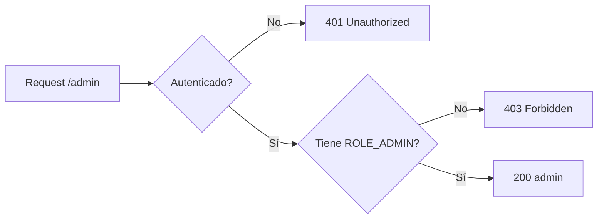

## CAPÍTULO M09-L02: Seguridad desde cero - autenticación vs autorización

### 1. Ubicación
- **Curso:** C2 — Spring Boot Microservicios desde Cero
- **Módulo:** M09 — Seguridad
- **Lección:** L02 — Seguridad desde cero
- **Tiempo estimado:** 50 min
- **Versiones:** Java 21, Spring Boot 3.4.5, Spring Security 6

### 2. Prerrequisitos
- Haber completado M09-L01 (SecurityFilterChain, 200/401).
- Saber qué es un usuario, un rol y un endpoint HTTP.
- Poder ejecutar `mvn test`.

### 3. Objetivo de aprendizaje
Al terminar podrás **distinguir autenticación de autorización** y **configurar reglas por rol** en Spring Security, verificando con tests que un usuario `USER` recibe 403 en `/admin` y un `ADMIN` recibe 200.

### 4. Problema real / por qué importa
M09-L01 respondió “¿quién eres?”. Falta la pregunta igual de importante: “¿qué puedes hacer?”. En un sistema real, un usuario autenticado no debe poder ejecutar acciones administrativas. Si confundes ambos conceptos, terminas dejando operaciones sensibles abiertas a cualquier cuenta válida.

La consecuencia típica es un bug de autorización: el login funciona, los tests “felices” pasan, pero un rol normal accede a un endpoint administrativo. Es un fallo de seguridad lógico, no de sintaxis.

### 5. Analogía y modelo mental
- **Autenticación**: mostrar DNI en recepción. Responde “¿quién eres?”.
- **Autorización**: la tarjeta abre solo ciertas puertas. Responde “¿qué puedes hacer?”.

**Dónde se rompe la analogía:** en software, la autorización debe ser explícita por recurso/acción. Una persona puede tener varias credenciales, roles, scopes o contextos; no basta con “entró al edificio”.

### 6. Diagrama técnico

**Texto alternativo:** La request a `/admin` primero verifica autenticación. Si no hay usuario, responde 401. Si hay usuario pero no tiene rol ADMIN, responde 403. Si tiene rol ADMIN, responde 200.

### 7. Conceptos fundamentales

#### Qué es
- **Autenticación**: verificar identidad (credenciales, token, certificado).
- **Autorización**: verificar permisos sobre un recurso.

#### Cómo funciona por dentro
Spring Security mantiene un `SecurityContext` con el `Authentication`. Después de autenticar, los filtros de autorización evalúan reglas como `hasRole("ADMIN")` contra las autoridades (`GrantedAuthority`) del usuario.

#### Cuándo usar
- Usa roles cuando los permisos son estables y gruesos (ADMIN, USER).
- Usa authorities/scopes cuando necesites granularidad más fina.

#### Cuándo NO usar
- No uses roles hardcodeados para permisos complejos por recurso/dueño; considera ABAC/políticas.
- No asumas que `authenticated()` implica autorizado para todo.
- No deshabilites CSRF en producción sin entender el contexto; aquí se deshabilita para simplificar un lab de endpoints stateless con Basic.

### 8. Construcción desde cero

Lab: `docs/cursos/springboot-microservicios-desde-cero/labs/m09-l02-seguridad-desde-cero`

#### Paso 1: Dependencias
`pom.xml` usa `spring-boot-starter-web`, `spring-boot-starter-security` y `spring-security-test`.

#### Paso 2: Definir endpoints y reglas
Archivo `src/main/java/com/academia/sec2/Sec2App.java`:

```java
package com.academia.sec2;
import org.springframework.boot.*; import org.springframework.boot.autoconfigure.*; import org.springframework.context.annotation.Bean; import org.springframework.security.config.Customizer; import org.springframework.security.config.annotation.web.builders.HttpSecurity; import org.springframework.security.core.userdetails.*; import org.springframework.security.provisioning.InMemoryUserDetailsManager; import org.springframework.security.web.SecurityFilterChain; import org.springframework.web.bind.annotation.*;
@SpringBootApplication @RestController
public class Sec2App {
  public static void main(String[] args){ SpringApplication.run(Sec2App.class,args); }
  @GetMapping("/admin") String admin(){ return "admin"; }
  @GetMapping("/user") String user(){ return "user"; }
  @Bean SecurityFilterChain chain(HttpSecurity http) throws Exception {
    http.csrf(csrf->csrf.disable()).authorizeHttpRequests(a -> a.requestMatchers("/admin").hasRole("ADMIN").requestMatchers("/user").hasAnyRole("USER","ADMIN").anyRequest().authenticated()).httpBasic(Customizer.withDefaults());
    return http.build();
  }
  @Bean UserDetailsService users(){
    return new InMemoryUserDetailsManager(
      User.withUsername("alice").password("{noop}pass").roles("USER").build(),
      User.withUsername("bob").password("{noop}pass").roles("ADMIN").build());
  }
}
```

#### Paso 3: Probar autorización
Archivo `src/test/java/com/academia/sec2/Sec2AppTest.java`:

```java
@Test @WithMockUser(roles="USER") void userCannotAccessAdmin() throws Exception { mvc.perform(get("/admin")).andExpect(status().isForbidden()); }
@Test @WithMockUser(roles="ADMIN") void adminCanAccessAdmin() throws Exception { mvc.perform(get("/admin")).andExpect(status().isOk()); }
@Test @WithMockUser(roles="USER") void userCanAccessUser() throws Exception { mvc.perform(get("/user")).andExpect(status().isOk()); }
```

#### Paso 4: Ejecutar
```bash
cd docs/cursos/springboot-microservicios-desde-cero/labs/m09-l02-seguridad-desde-cero
./verify.sh
```

Salida real observada:
```text
RESULTADO: OK
```

### 9. Código de referencia completo
- `pom.xml`
- `src/main/java/com/academia/sec2/Sec2App.java`
- `src/test/java/com/academia/sec2/Sec2AppTest.java`
- `verify.sh`

Ver lab: `docs/cursos/springboot-microservicios-desde-cero/labs/m09-l02-seguridad-desde-cero/`.

### 10. Explicación línea por línea / por bloque

| Código/bloque | Intención | Efecto | Si se omite/cambia |
|---|---|---|---|
| `requestMatchers("/admin").hasRole("ADMIN")` | Restringir admin | Solo ADMIN obtiene 200 | Sin esto, cualquier autenticado podría entrar |
| `hasAnyRole("USER","ADMIN")` | Permitir ambos roles | USER y ADMIN acceden a `/user` | Podrías excluir ADMIN por error |
| `InMemoryUserDetailsManager` | Usuarios de lab | Identidades predecibles para tests | Necesitarías otra fuente de usuarios |
| `password("{noop}pass")` | Password sin encoder para lab | Simple en demo | **Nunca en producción**; usar BCrypt/Argon2 |
| `@WithMockUser(roles="USER")` | Simula identidad/rol | Prueba autorización sin login real | Sin tests, el 403 puede no cubrirse |
| `status().isForbidden()` | Espera 403 | Diferencia “no autenticado” de “no autorizado” | Usar 401 aquí ocultaría el problema real |

### 11. Laboratorio reproducible
```bash
./verify.sh
```
Ejecuta `mvn -q test` y emite `RESULTADO: OK`.

### 12. Verificación automática
- **Valida:** 403 para USER en `/admin`, 200 para ADMIN en `/admin`, 200 para USER en `/user`.
- **Pass/fail:** `set -euo pipefail`; falla si algún test falla.

### 13. Modificación guiada
- **Cambio:** reemplaza `hasRole("ADMIN")` por `authenticated()` en `/admin`.
- **Hipótesis:** `userCannotAccessAdmin` fallará porque USER recibirá 200.
- **Comando:** `mvn -q -Dtest=Sec2AppTest#userCannotAccessAdmin test`.
- **Resultado esperado:** fallo con status 200 en lugar de 403. Revierte el cambio.

### 14. Error común y diagnóstico
- **Síntoma:** usuario normal entra a `/admin`.
- **Mensaje/observación:** test espera 403, recibe 200.
- **Causa:** regla usa `authenticated()` o `permitAll()`.
- **Diagnóstico:** inspeccionar `SecurityFilterChain` y el orden de `requestMatchers`.
- **Fix:** aplicar `hasRole("ADMIN")` y reejecutar verify.

Otro caso: confundir 401 con 403. 401 = no autenticado; 403 = autenticado sin permiso.

### 15. Cierre

#### Anti-patrón
“Si está logueado, puede todo”. Es cómodo pero peligroso. La autorización debe ser explícita por recurso.

#### Pregunta de entrevista
- **Pregunta:** ¿Diferencia entre 401 y 403?
- **Respuesta modelo:** 401 Unauthorized indica falta de autenticación válida; 403 Forbidden indica que la identidad está autenticada pero no tiene permisos para el recurso.

#### Resumen
- Autenticación = identidad.
- Autorización = permisos.
- Prueba ambos casos con roles reales/simulados.

#### Puente
En M09-L03 verás cómo representar identidad y claims en tokens JWT, simétricos y asimétricos.
