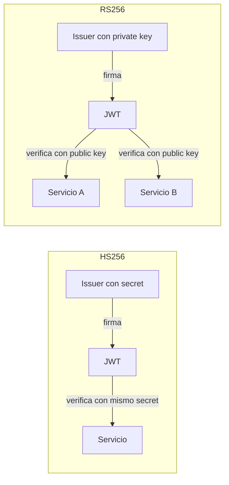

## CAPÍTULO M09-L03: JWT simétrico vs asimétrico

### 1. Ubicación
- **Curso:** C2 — Spring Boot Microservicios desde Cero
- **Módulo:** M09 — Seguridad
- **Lección:** L03 — JWT simétrico vs asimétrico
- **Tiempo estimado:** 55 min
- **Versiones:** Java 21, Nimbus JOSE+JWT 9.47, JUnit 5.11.4

### 2. Prerrequisitos
- M09-L01/M09-L02: autenticación, autorización, HTTP 401/403.
- Criptografía básica: clave secreta, clave pública/privada, firma vs cifrado.
- Maven y JUnit.

### 3. Objetivo de aprendizaje
Al terminar podrás **generar, firmar y verificar JWTs HS256 y RS256** con Nimbus, y **explicar el trade-off** entre firma simétrica y asimétrica en microservicios.

### 4. Problema real / por qué importa
En sistemas distribuidos, los servicios necesitan confiar en una identidad sin llamar a una base de datos central en cada request. Un JWT firmado permite transportar claims (subject, expiración, audiencia) con integridad verificable. El problema es elegir mal el algoritmo: compartir una clave HS256 con muchos servicios aumenta el radio de compromiso; usar RS256 donde no hace falta agrega complejidad operativa.

### 5. Analogía y modelo mental
- **HS256 (simétrico):** un sello de cera con un solo molde secreto. Quien tiene el molde puede sellar y verificar.
- **RS256 (asimétrico):** una firma manuscrita con llave privada; cualquiera con la llave pública puede verificar, pero no puede firmar.

**Dónde se rompe la analogía:** los JWTs también tienen expiración, audience, issuer y rotación de claves; no basta con “la firma se ve bien”.

### 6. Diagrama técnico

**Texto alternativo:** HS256 usa el mismo secreto para firmar y verificar. RS256 firma con clave privada y múltiples servicios verifican con clave pública.

### 7. Conceptos fundamentales

#### Qué es
Un **JWT** (JSON Web Token) tiene header, payload (claims) y signature. La firma garantiza integridad y autenticidad del emisor; **no cifra** el payload por defecto.

#### Cómo funciona
1. El emisor crea claims (`sub`, `exp`, `aud`, etc.).
2. Firma con HS256 (HMAC+secret) o RS256 (RSA+private key).
3. El receptor parsea el token, verifica firma y valida claims (`exp`, `aud`, `iss`).

#### Cuándo usar HS256
- Un solo emisor y un solo verificador, o confianza muy acotada.
- Baja complejidad operativa.

#### Cuándo usar RS256
- Un emisor, muchos verificadores/microservicios.
- Quieres que los verificadores no puedan firmar tokens.

#### Cuándo NO usar
- No metas secretos/PII sensible en claims sin cifrado (JWE) y necesidad real.
- No aceptes tokens sin validar `exp`, `iss`, `aud`.
- No uses `none` ni algoritmos débiles.
- No compartas la private key de RS256.

### 8. Construcción desde cero

Lab: `docs/cursos/springboot-microservicios-desde-cero/labs/m09-l03-jwt-simetrico-vs-asimetrico`

#### Paso 1: Dependencia Nimbus
`pom.xml` incluye `com.nimbusds:nimbus-jose-jwt:9.47` y JUnit 5.

#### Paso 2: Test HS256
```java
@Test void symmetricHs256() throws Exception {
  byte[] secret = new byte[32]; new SecureRandom().nextBytes(secret);
  JWSSigner signer = new MACSigner(secret);
  SignedJWT jwt = new SignedJWT(new JWSHeader(JWSAlgorithm.HS256),
    new JWTClaimsSet.Builder().subject("alice").expirationTime(new Date(System.currentTimeMillis()+60000)).build());
  jwt.sign(signer);
  SignedJWT parsed = SignedJWT.parse(jwt.serialize());
  assertTrue(parsed.verify(new MACVerifier(secret)));
  assertEquals("alice", parsed.getJWTClaimsSet().getSubject());
}
```

#### Paso 3: Test RS256
```java
@Test void asymmetricRs256() throws Exception {
  KeyPairGenerator g = KeyPairGenerator.getInstance("RSA"); g.initialize(2048);
  KeyPair kp = g.generateKeyPair();
  SignedJWT jwt = new SignedJWT(new JWSHeader(JWSAlgorithm.RS256),
    new JWTClaimsSet.Builder().subject("bob").build());
  jwt.sign(new RSASSASigner(kp.getPrivate()));
  SignedJWT parsed = SignedJWT.parse(jwt.serialize());
  assertTrue(parsed.verify(new RSASSAVerifier((java.security.interfaces.RSAPublicKey) kp.getPublic())));
  assertEquals("bob", parsed.getJWTClaimsSet().getSubject());
}
```

#### Paso 4: Ejecutar
```bash
cd docs/cursos/springboot-microservicios-desde-cero/labs/m09-l03-jwt-simetrico-vs-asimetrico
./verify.sh
```
Salida real observada:
```text
RESULTADO: OK
```

### 9. Código de referencia completo
- `pom.xml`
- `src/test/java/com/academia/jwt/JwtTest.java`
- `verify.sh`

### 10. Explicación línea por línea / por bloque

| Código/bloque | Intención | Efecto | Si se omite/cambia |
|---|---|---|---|
| `new byte[32]; new SecureRandom().nextBytes(secret)` | Secreto fuerte 256-bit | HS256 tiene entropía suficiente | Secreto débil = token falsificable |
| `MACSigner(secret)` | Firmador simétrico | Crea firma HMAC-SHA256 | Sin firma, no hay integridad |
| `expirationTime(new Date(System.currentTimeMillis()+60000))` | Limitar validez | Reduce ventana de abuso | Token eterno = riesgo alto |
| `SignedJWT.parse(jwt.serialize())` | Simula recepción por red | Verifica el flujo real string→objeto | Parsear objeto en memoria no prueba serialización |
| `KeyPairGenerator.getInstance("RSA"); g.initialize(2048)` | Par de claves | Private firma, public verifica | Clave pequeña/débil debilita seguridad |
| `RSASSASigner(kp.getPrivate())` | Firma asimétrica | Solo el emisor con private key firma | Si usas public por error, falla |
| `RSASSAVerifier(publicKey)` | Verificación pública | Cualquier servicio puede verificar | Si exiges private key, acoplas verificador al emisor |

### 11. Laboratorio reproducible
```bash
./verify.sh
```
Compila y ejecuta JUnit; termina en `RESULTADO: OK`.

### 12. Verificación automática
- **Valida:** firma/verificación HS256 y RS256, y claims `sub`.
- **Pass/fail:** JUnit + `set -euo pipefail`.

### 13. Modificación guiada
- **Cambio:** en HS256, verifica con un secreto diferente: `new MACVerifier(new byte[32])`.
- **Hipótesis:** `parsed.verify(nuevoVerificador)` devolverá `false` y el test fallará.
- **Comando:** `mvn -q -Dtest=JwtTest#symmetricHs256 test`.
- **Resultado observado esperado:** `AssertionFailedError`/fallo de test. Esto demuestra que la firma protege integridad.
- Revierte el cambio.

### 14. Error común y diagnóstico
- **Síntoma:** token aceptado aunque fue alterado.
- **Causa:** no se llamó `verify()` o se ignoró su resultado.
- **Diagnóstico:** revisar que la verificación sea aserción obligatoria.
- **Fix:** `assertTrue(parsed.verify(verifier))`.

Otro caso: confundir firma con cifrado. Cualquiera puede leer el payload Base64URL de un JWS; no pongas secretos.

### 15. Cierre

#### Anti-patrón
Usar HS256 y repartir el secreto a todos los microservicios “porque es fácil”. Convierte cada verificador en potencial emisor.

#### Pregunta de entrevista
- **Pregunta:** ¿Cuándo eliges RS256 sobre HS256?
- **Respuesta modelo:** Cuando hay un emisor y múltiples verificadores que no deben poder firmar tokens. RS256 permite distribuir la clave pública para verificar y mantener privada la clave de firma.

#### Resumen
- HS256: mismo secreto, simple, radio de confianza acotado.
- RS256: private firma, public verifica, mejor para distribución.
- Siempre verifica firma y claims.

#### Puente
M09-L04 lleva esto a OAuth2/OIDC, donde el JWT aparece como access token validado por un resource server.
